# 强化学习五大基本要素：一个量化交易的入门视角

> 本文基于 B 站视频《[强化学习零基础入门：核心概念与五大基本要素详解](https://www.bilibili.com/video/BV1NAdFB2Enq/)》（UP 主：我是王者quant）整理撰写。视频用"量化交易"作为贯穿始终的实例，把一个抽象的强化学习框架讲得很有画面感；以下内容均来自该视频的讲解与画面，未作超出视频的引申。

## 本讲要解决的核心问题（SCQA）

**背景**：强化学习（Reinforcement Learning，简称 RL）常被介绍为"让智能体在与环境互动中学会最优决策"的方法。道理听起来简单，但一落到具体场景里，很多人就分不清：什么是智能体、什么是环境？状态和动作有什么区别？奖励又该怎么给？

**冲突**：这些要素单看都能懂，可一旦要"设计一个会自己交易的算法"，问题就来了——算法观察什么、能做什么、做好做坏又由谁来打分？边界一旦划错，整个建模就崩了。

**疑问**：强化学习的"五大基本要素"到底是什么，它们又该如何在一个真实场景里各就各位？

**回答（中心思想）**：强化学习可以拆成**五大基本要素——智能体（Agent）、环境（Environment）、状态（State）、动作（Action）、奖励（Reward）**，它们共同构成一个闭环：`Agent ⇌ Environment : {S, A, R}`。本讲用一个**自动交易算法**作例子把这五者讲透：算法就是 agent，市场就是 environment，它会盯着一份**数据快照（state）**，决定**买入/卖出/持仓（action）**，而每笔操作赚了还是亏了，就是环境回给它的**奖励（reward）**。理解了这套骨架，也就理解了强化学习"在动态中持续优化决策"的独特之处。

---

## 一、先看全貌：强化学习到底在解决什么问题

### 1.1 一句话定义：让智能体通过与环境的互动，学会做最优决策

视频给出的核心定义很干净：**强化学习就是让一个智能体（agent）通过与环境的互动，来学习如何做出最优决策。**[【跳转到 00:26】](https://www.bilibili.com/video/BV1NAdFB2Enq/?t=26)

它和"老师手把手教"的方式不同——不给你标准答案，而是靠**不断地试错（trial and error）**，在环境里摸爬滚打，最终找到能获得**最大长期奖励**的那条路径。视频用"教宠物狗握手"打了个直观的比方：你发出指令，它尝试动作，做对了给块饼干当奖励（reward），做错了就没有奖励，反复训练下来，它就学会了在特定指令下做出特定动作。

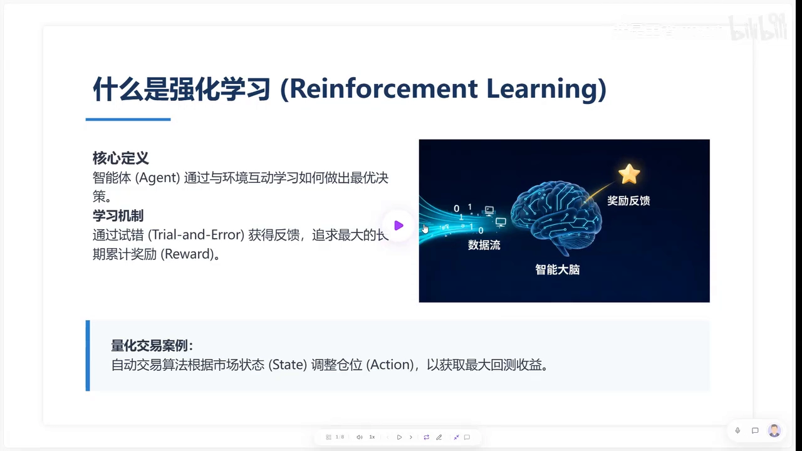

把这只"小狗"换成量化交易里的自动交易算法，就是：算法是 agent，它观察当前市场状态（state，比如 K 线走势或技术指标），然后决定买入、卖出或持仓（action），最终目的就是获取最大的累计收益（reward）。[【跳转到 01:09】](https://www.bilibili.com/video/BV1NAdFB2Enq/?t=69)

### 1.2 和监督学习、无监督学习的分界：不需要标准答案，而且奖励滞后

要把强化学习放回机器学习的大版图，最直观的是和另外两类方法对比：[【跳转到 02:01】](https://www.bilibili.com/video/BV1NAdFB2Enq/?t=121)

- **监督学习**：像"给定历史 K 线去预测明天的涨跌"，它需要明确的**标签**（标准答案）；
- **无监督学习**：像"对海量交易者做画像、聚类"，去发现潜在的市场结构；
- **强化学习**：侧重点在**决策**——通过不断地与环境交互、反馈，学习"什么时候买入或卖出"。

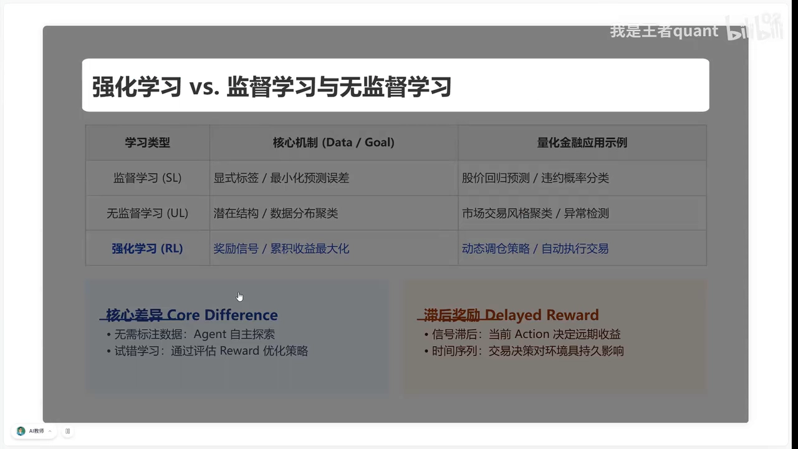

视频点出两个关键差异：

1. **不需要提前准备好的标准答案**。强化学习里没有现成的"对/错"标签，agent 会**自主探索**市场。这种试错的过程，很像一个初出茅庐的交易员，靠一次次止损和盈利来磨练盘感。
2. **滞后奖励（delayed reward）**。在监督学习里，模型预测完立刻就能知道对错；但在 RL 里，你现在的建仓动作可能要等到很久之后平仓时，才能通过利润反馈知道这个决策是否正确。这种**时间序列上的反馈滞后**，是强化学习最具挑战性、也最迷人的地方。[【跳转到 02:46】](https://www.bilibili.com/video/BV1NAdFB2Enq/?t=166)

### 1.3 先看一眼闭环交互长什么样

视频演示了一套闭环交互：策略类型（strategy）决定 agent 如何基于当前 state 做出 action（在量化交易里对应我们的交易逻辑）；风险偏好（risk）又会直接影响奖励函数的计算——调高它，agent 会尝试更高风险的动作以博取潜在高收益。切换到"激进的随机探索模式"后，可以看到当迭代加快时，agent 与环境之间频繁的反馈如何形成"**状态—动作—奖励**"的闭环。[【跳转到 04:20】](https://www.bilibili.com/video/BV1NAdFB2Enq/?t=260)

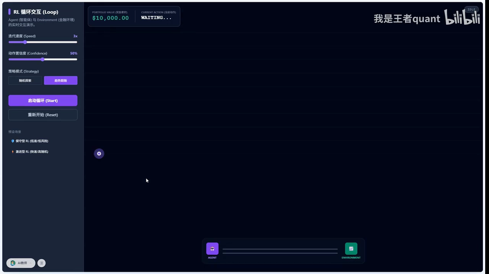

请记住这句话：**强化学习的核心，就是通过这种不断的交互，让 agent 学到"在什么 state 下采取什么 action，能够实现长期累积 reward 的最大化"。**

---

## 二、五大基本要素逐个拆解

下面把 Agent、Environment、State、Action、Reward 五个要素逐个讲清。它们之间的关系可以记成一句话：

```text
Agent  ⇌  Environment :  { S, A, R }
```

### 2.1 要素一：智能体（Agent）与环境（Environment）

在量化场景里，这两个主角的分工非常清楚：[【跳转到 05:22】](https://www.bilibili.com/video/BV1NAdFB2Enq/?t=322)

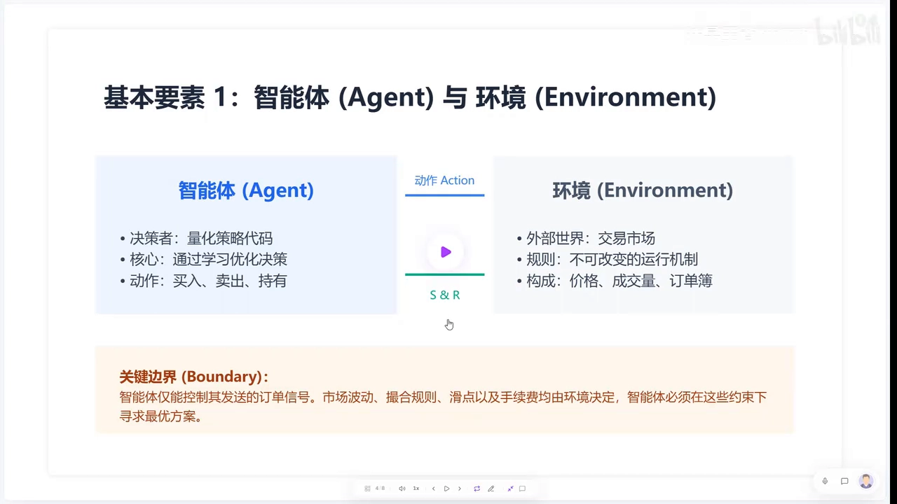

- **智能体（Agent）**：其实就是你写的**策略代码**，或者是那个负责下单的"黑盒模型"。它的任务很明确——观察市场，然后通过学习不断优化自己的决策；它能做的动作也很标准：买入、卖出，或者持仓观望。
- **环境（Environment）**：是智能体生存的土壤。在这个领域里，**交易市场就是环境**——它是一个外部世界，有自己不可撼动的运行规则，比如交易所的撮合机制、价格的波动规律。智能体无法改变这些规则，只能通过观察价格、成交量、订单簿的变化来做出反应。

这里有一个新手经常会搞混的关键点，就是"**边界**"的概念：智能体**唯一能控制的，只有它发送出去的订单信号**；除此之外的一切——市场是否成交、滑点有多少、手续费扣多少——通通属于**环境**的范畴。只有先明确这条边界，才能正确定义强化学习的各个要素。[【跳转到 06:11】](https://www.bilibili.com/video/BV1NAdFB2Enq/?t=371)

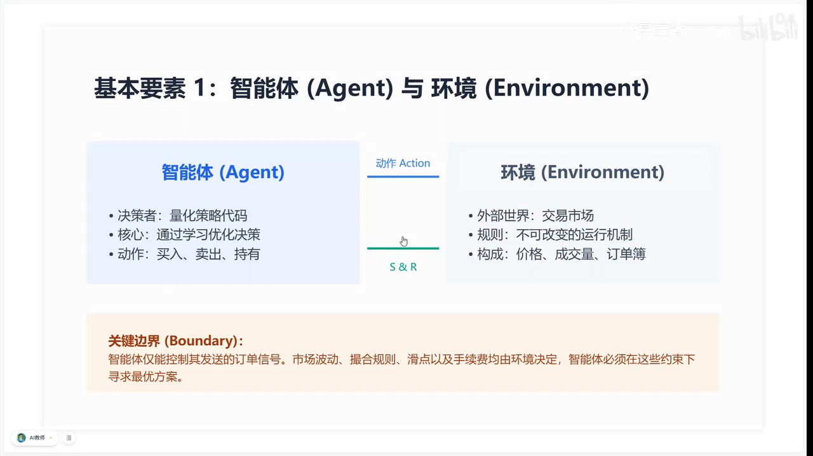

### 2.2 要素二与三：状态（State）与动作（Action）——agent 的"眼睛"和"手"

搞清楚两个主体之后，再看它们之间交换的信息：状态与动作。视频里形容得很形象——**状态就像交易员的"眼睛"，动作就像"手"**。[【跳转到 06:46】](https://www.bilibili.com/video/BV1NAdFB2Enq/?t=406)

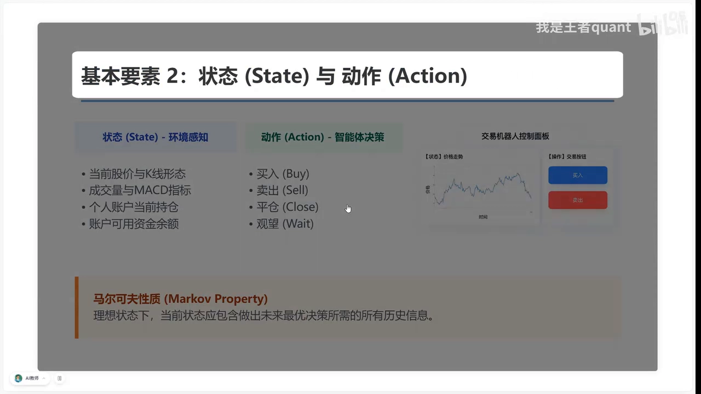

- **状态（State）**：是智能体对环境的**感知**。对于量化机器人来说，它并不是"看到整个世界"，而是看到你喂给它的**数据快照**——包括当前的股价、K 线形态、MACD 等技术指标，甚至智能体自己的"钱包状况"（持仓比例、可用资金）也是状态的一部分。它得知道自己还有多少"子弹"。
- **动作（Action）**：是智能体输出的**指令**。除了常见的买入、卖出、平仓，还要特别注意：**观望或持仓不动也是一种非常关键的动作**——在强化学习里，**不作为也是一种主动的选择**。[【跳转到 07:41】](https://www.bilibili.com/video/BV1NAdFB2Enq/?t=461)

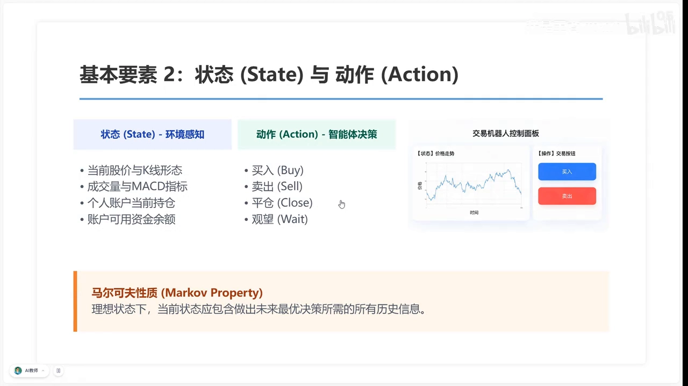

视频还顺带提了一个稍微进阶的概念——**马尔可夫性质（Markov property）**：我们希望"现在的这个状态已经包含了所有对未来决策有用的信息"，你不需要翻看 3 年前的历史，只要看好现在的盘面就能做决定。这是最理想的建模状态。[【跳转到 08:12】](https://www.bilibili.com/video/BV1NAdFB2Enq/?t=492)

### 2.3 要素四与五之外的关键：奖励（Reward）——给 agent 的"指挥棒"

有了"看什么"和"做什么"，还要给智能体一根"指挥棒"，告诉它做得好不好——这就是**奖励机制（Reward）**。[【跳转到 08:30】](https://www.bilibili.com/video/BV1NAdFB2Enq/?t=510)

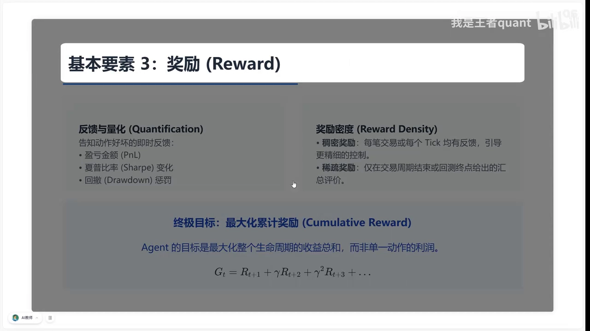

在量化交易场景下，**reward 必须是可量化、可及时反馈的**：

- 最直接的例子是**盈亏金额（PNL）**；
- 为了让策略更稳健，还可以把**夏普比率的变化**或**回撤的大小**作为奖励或惩罚项，告诉 agent 刚才的操作是否符合预期。

视频还强调了一个关键概念——**奖励密度（reward density）**：[【跳转到 09:16】](https://www.bilibili.com/video/BV1NAdFB2Enq/?t=556)

- **稠密奖励**：agent 每一个动作都能得到反馈，比如每个 tick 的价格变动；
- **稀疏奖励**：可能要等整个调仓周期结束才有反馈。

奖励越稠密，agent 学得越快，但也可能变得过于关注局部波动、而忽视大趋势。

最后要明确 **agent 的终极目标不是贪图下一秒的小利，而是最大化累计奖励**：它会为了长远收益，在短期内忍受一定的回撤或成本开支。这个累计奖励可以写成：

```text
G_t = R_{t+1} + γ R_{t+2} + γ² R_{t+3} + …
```

其中 `G_t` 代表从当前时刻开始、所有未来奖励的总和。正是通过这种方式，我们赋予了模型"**远见**"，这就是量化思维中的**全局最优意识**。[【跳转到 09:44】](https://www.bilibili.com/video/BV1NAdFB2Enq/?t=584)

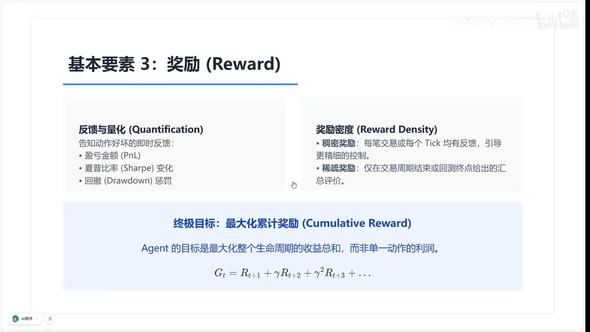

---

## 三、把五个要素连起来：闭环交互与"量化思维"

课程最后做了一次系统总结。再次看向那个核心交互模型——在量化交易中，它不只是一组公式，而是策略运作的**底层架构**：[【跳转到 10:23】](https://www.bilibili.com/video/BV1NAdFB2Enq/?t=623)

```text
Agent  ⇌  Environment :  { S, A, R }
```

- **智能体（Agent）**是我们的交易策略；
- **环境（Environment）**是实时变动的市场；
- 每一次从 **state（状态）**到 **action（动作）**的决策，都在追求长期 **reward（奖励）**的最大化。

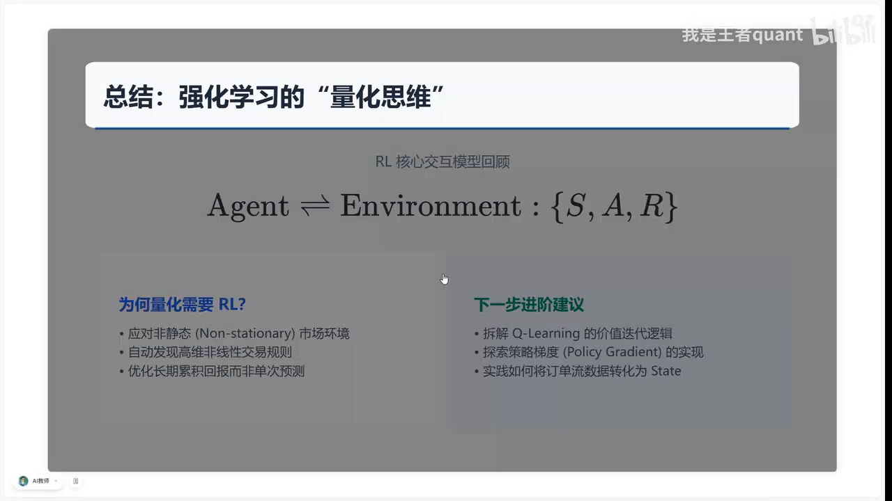

那么**为什么量化需要 RL？** 核心在于应对市场的**非静态特征（non-stationary）**：传统的统计模型往往在市场环境突变时失效，而强化学习具备天生的**适应性**，能自动挖掘高维、非线性的交易规则——这正是人类交易员难以通过肉眼或简单逻辑定义出来的。[【跳转到 11:02】](https://www.bilibili.com/video/BV1NAdFB2Enq/?t=662)

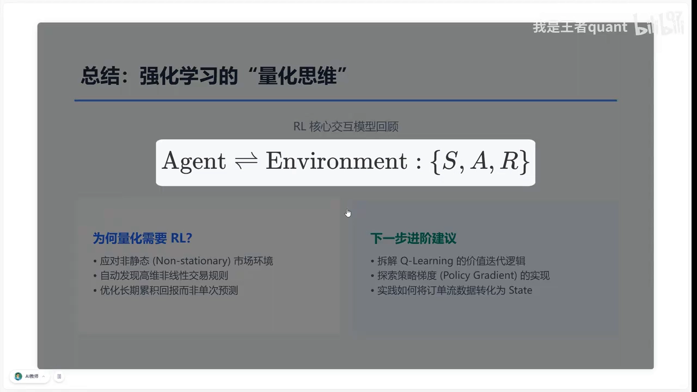

对于想要进阶的同学，视频建议接下来重点去拆解 **Q-Learning 的价值迭代逻辑**，或者探索 **policy gradient（策略梯度）**等算法——掌握这些，就能真正把今天讲到的**五个要素连接成一个可实盘的策略**。

---

## 小结

- 强化学习的核心定义：**让智能体（agent）通过与环境的互动，学习做最优决策**；靠试错（trial and error）而非标准答案。
- 与监督／无监督学习的两大分界：**不需要提前准备的标准答案**、存在**滞后奖励（delayed reward）**。
- **五大基本要素**：
  - **Agent（智能体）**：做出决策的策略代码／模型；
  - **Environment（环境）**：不可控的外部世界（这里就是市场）；
  - **State（状态）**：智能体对环境的感知，一份数据快照；
  - **Action（动作）**：智能体输出的指令，"不作为"也是动作；
  - **Reward（奖励）**：环境给的可量化反馈，决定学习的方向。
- 它们连成一句话：`Agent ⇌ Environment : {S, A, R}`；每一次"状态→动作"的决策都在追求**长期累计奖励**最大化。
- 建模要点：划清**边界**（智能体只能控制订单信号）、理解**马尔可夫性质**（状态要包含足够信息）、平衡**奖励密度**（稠密 vs 稀疏）。
- 量化为何需要 RL：应对市场**非静态特征**，用**适应性**自动挖掘高维非线性的交易规则。

## 关键术语速查

| 术语 | 一句话解释 |
| --- | --- |
| 强化学习（RL） | 让智能体通过与环境互动、试错来学习最优决策 |
| 智能体（Agent） | 做出决策的主体，量化场景里就是策略代码／下单模型 |
| 环境（Environment） | 不受智能体控制的外部世界，这里指交易市场 |
| 状态（State） | 智能体对环境的一次感知（数据快照） |
| 动作（Action） | 智能体输出的指令，买入/卖出/平仓/观望 |
| 奖励（Reward） | 环境给出的可量化反馈，如盈亏 PNL |
| 累计奖励 G_t | 从当前时刻起所有未来奖励的总和，模型追求的目标 |
| 滞后奖励（Delayed Reward） | 当前动作的后果要很久之后才反馈回来 |
| 奖励密度（Reward Density） | 反馈的频繁程度，分稠密奖励与稀疏奖励 |
| 马尔可夫性质（Markov Property） | 当前状态已包含所有对未来决策有用的信息 |
| 边界（Boundary） | 智能体只能控制自己发出的信号，其余归环境 |
