# 强化学习核心要素：智能体、环境与五大基本概念

> 本文基于 B 站视频《[十分钟强化学习系列第一讲：基本概念](https://www.bilibili.com/video/BV1jK4y1w7T8/)》（UP 主：肖老师的退休生活）整理撰写。所有内容均来自该视频的讲解与画面，未作超出视频的引申；文末用作者自己实现的**冰湖（FrozenLake）**代码，把这些概念真正"跑"起来。

## 本讲要解决的核心问题（SCQA）

**背景**：强化学习（Reinforcement Learning，简称 RL）这几年的曝光度很高：它既是 AlphaGo 战胜人类棋手的核心技术，也越来越多地出现在机器人控制、大模型训练里。很多人想入门，却发现教材一上来就是一堆名词——智能体、环境、状态、动作、奖励、折扣、MDP……

**冲突**：这些名词单独看好像都能懂，但放在一起就乱了套。到底谁在"做决策"、谁是"外部世界"？状态和奖励从哪里来、又送到哪里去？只靠背名词，根本串不起一条线。

**疑问**：强化学习这套系统的最小骨架，到底是什么样子的？

**回答（中心思想）**：强化学习的最小骨架，就是"**智能体（agent）与环境（environment）不断交互**"这一个循环——智能体观察环境给出的**状态（state）**，据此选择**动作（action）**，环境随之改变，并回传一个新的状态和一个**奖励（reward）**，如此往复。只要把这条循环和循环里的每个元素讲清楚，后面所有算法就都有了落脚点。本讲先用一张图厘清"人工智能 / 机器学习 / 强化学习"的包含关系，再把智能体与环境、状态与动作、奖励与转换函数逐一拆开，最后用一段自己实现的**冰湖（FrozenLake）**代码让这些概念跑起来。

---

## 一、强化学习处在"人工智能 ⊃ 机器学习 ⊃ 强化学习"的最内层

### 1.1 三个容易混淆的词，其实是一层套一层

初学者最容易把"人工智能、机器学习、强化学习"混着用。作者用一张嵌套图把三者关系理清：[【跳转到 02:52】](https://www.bilibili.com/video/BV1jK4y1w7T8/?t=172)

- **人工智能（Artificial Intelligence）**是最大的范围，指让机器表现出智能的各种方法的总称；
- **机器学习（Machine Learning）**只是人工智能里的一种方法；
- 机器学习内部又分出三个大分支：**有监督学习、无监督学习**和**强化学习**。

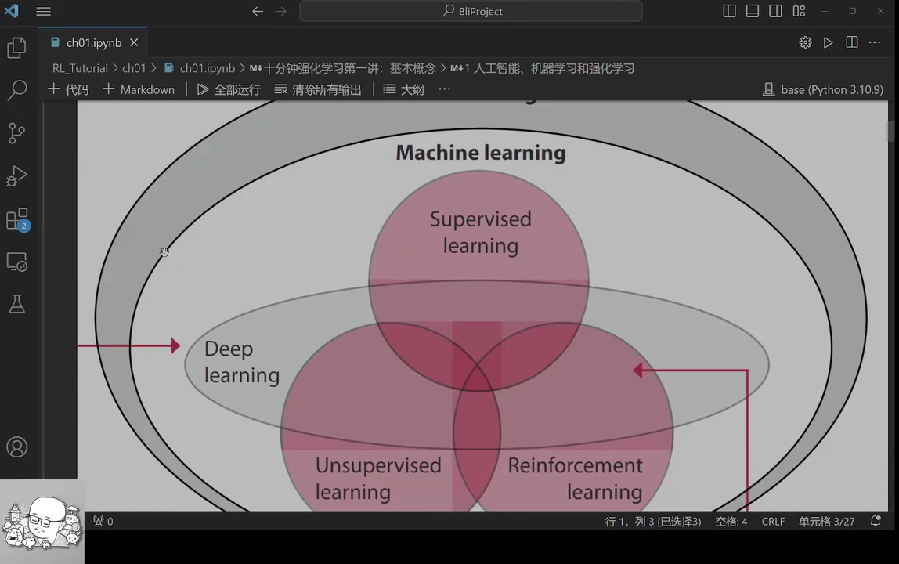

换句话说，强化学习是机器学习里一个很小的分支，它专门回答"**该怎么行动**"这个问题。

### 1.2 深度强化学习 = 深度神经网络（工具）+ 强化学习（思路）

把强化学习和深度神经网络结合起来，就是**深度强化学习（Deep Reinforcement Learning，DRL）**。作者特别强调，不要把二者看成并列关系：神经网络只是一种**工具**，强化学习提供的是**思路**。[【跳转到 03:54】](https://www.bilibili.com/video/BV1jK4y1w7T8/?t=234)

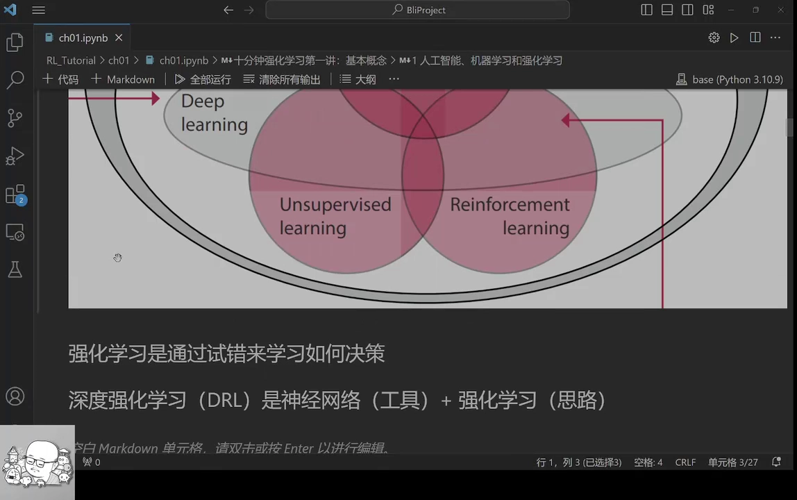

它的核心特点只有一个词：**试错（trial-and-error）**——不是靠人把答案喂给它，而是让它在环境中不断尝试、根据反馈调整，最终学会怎么决策。

---

## 二、强化学习的最小骨架：智能体与环境不断交换信息

### 2.1 两个主角：智能体负责决策，环境是不可控的外部世界

强化学习里有两个最重要的概念：**智能体（agent）**和**环境（environment）**。[【跳转到 04:10】](https://www.bilibili.com/video/BV1jK4y1w7T8/?t=250)

- **智能体**是"负责决策的程序"，它在环境里生存、与环境交互；
- **环境**是"不被程序控制的外部世界"。

两者之间来回交换两样东西：环境向智能体提供**观测（observation）**和**奖励（reward）**，智能体向环境施加**动作（action）**。

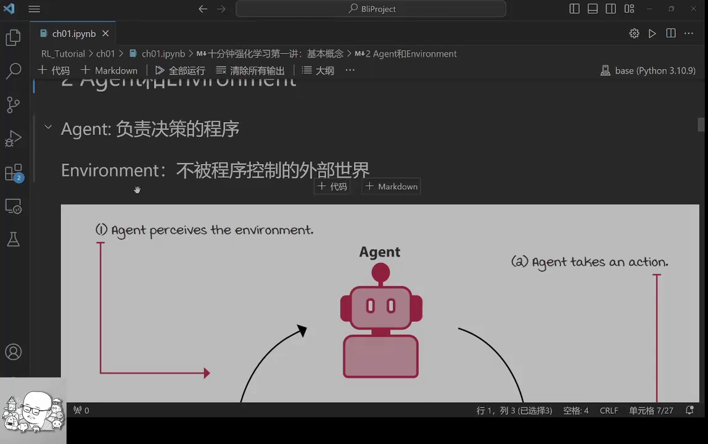

这不难类比到日常生活：每个人都是一个 agent，整个社会就是 environment。我们去学习、上班、社交（动作），得到新的信息和回报，再据此调整下一步行动——强化学习的交互，和人类生活非常相似。[【跳转到 04:45】](https://www.bilibili.com/video/BV1jK4y1w7T8/?t=285)

### 2.2 一次交互的顺序：先观察、再行动，然后拿到新状态和奖励

一次完整的交互有固定的先后顺序：[【跳转到 07:43】](https://www.bilibili.com/video/BV1jK4y1w7T8/?t=463)

1. 智能体先**观察到当前状态（state）**；
2. 根据状态**做出动作（action）**，交给环境；
3. 环境因此发生改变，**返回一个新的观测和一个奖励**。

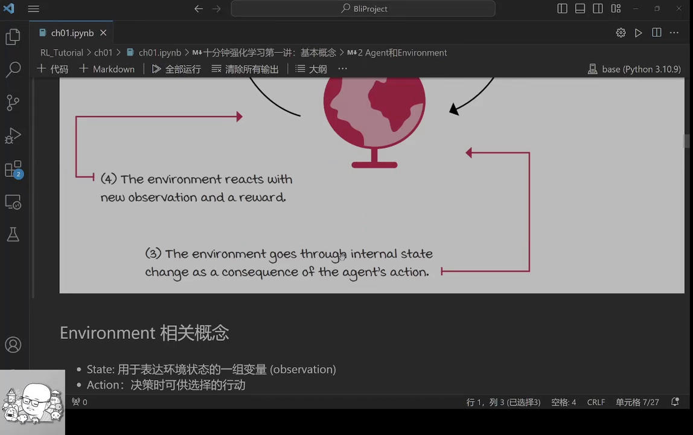

把这一整套交互叫做**一步**，或者叫**一次迭代**。本讲要建立的四个概念模块可以概括为下面这张幻灯片所示的内容：

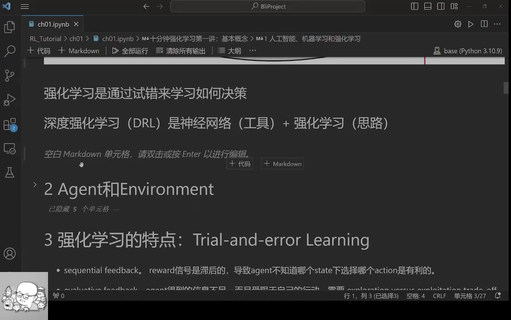

---

## 三、环境一侧的五组核心概念

强化学习里最基础的几个概念都挂在"环境"身上。作者把它们一次性列在一张卡片上：[【跳转到 05:38】](https://www.bilibili.com/video/BV1jK4y1w7T8/?t=338)

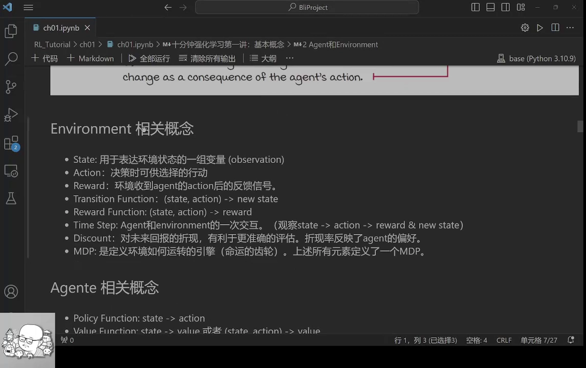

下面逐个拆开。

### 3.1 状态（state）：表示环境状态的一组变量

**状态（state）**就是用**一组变量**来描述环境当前的样子。放到人类社会里，state 可以是我们能观测到的外部世界的一些状态，比如天气、经济状况、社会状况等，都用一组变量来表达。

### 3.2 动作（action）：环境允许智能体选择的行动

**动作（action）**是环境提供给智能体的一些**可供选择的行动**。用人类生活打比方：我可以选择出去上班，也可以选择在家躺平——这些都是可选的 action。

### 3.3 奖励（reward）：环境对动作的反馈信号

**奖励（reward）**是指当环境收到智能体的一个动作之后，给出的**返回信号**（也就是回报）。例如在人类社会里，它可能是你得到的幸福感，或者是你的收入。

### 3.4 转换函数（transition function）：环境如何"变化"到下一个状态

**转换函数（transition function）**描述环境内部状态如何变化：它的输入是**当前状态 + 智能体施加的动作**，输出是**下一个状态**。作者用"人类排放二氧化碳"来类比：人排出更多二氧化碳，环境里的二氧化碳浓度就升高了，于是环境的 state 发生了改变。[【跳转到 06:53】](https://www.bilibili.com/video/BV1jK4y1w7T8/?t=413)

### 3.5 奖励函数（reward function）：环境如何给出奖励

**奖励函数（reward function）**与转换函数并列：它输入的是**当前状态 + 动作**，输出的是一个**奖励**。二者共同构成了环境的输入输出规则。此外还有两个相关概念：

- **一步（one step）**：上节说的"观察状态 → 做出动作 → 返回新状态与奖励"这样一次完整交互；
- **轨迹（trajectory）**：把连续多步串起来，就是一条状态—动作—奖励的序列。

### 3.6 折扣（discount）与 MDP

**折扣（discount）**相当于对未来回报的一种"折现"。为什么需要它？正如老话说的"今天的一块钱不等于明天的一块钱"——因为未来有不确定性，我们希望让**当前**的权重更大一些，这样有利于更准确地评估各个时点上的奖励。[【跳转到 08:08】](https://www.bilibili.com/video/BV1jK4y1w7T8/?t=488)

而当**上面所有这些元素都定义好之后，就定义了一个 MDP（马尔可夫决策过程）**。MDP 定义了整个环境是如何运转的——你可以把环境想象成一台按照 MDP 规则运行的机器。[【跳转到 08:33】](https://www.bilibili.com/video/BV1jK4y1w7T8/?t=513)

---

## 四、智能体一侧的两个函数：策略函数与价值函数

智能体的概念相对简单，它主要包含两个**函数**。[【跳转到 09:08】](https://www.bilibili.com/video/BV1jK4y1w7T8/?t=548)

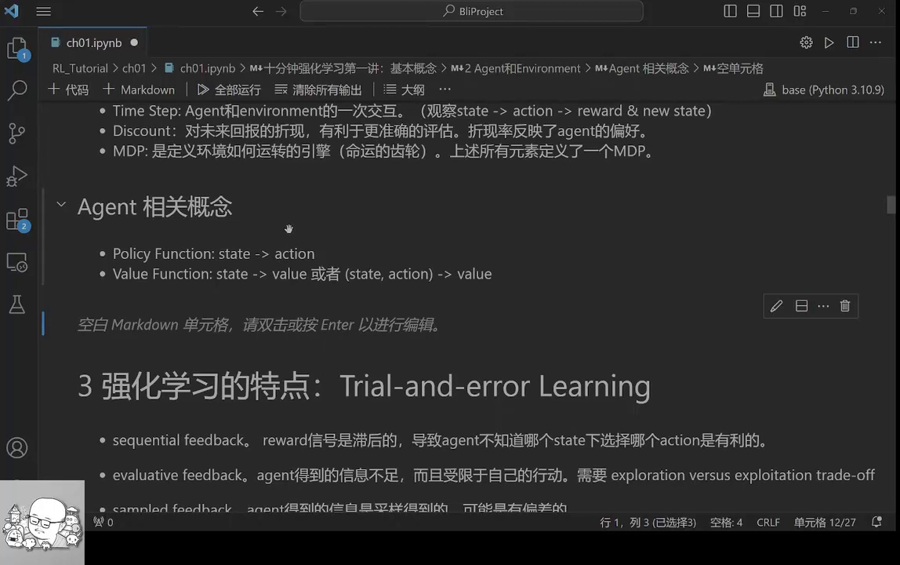

### 4.1 策略函数（policy function）：从状态决定动作

**策略函数（policy function）**的输入是环境的**状态**，输出是**根据状态选择的行动**。一句话：`policy: state → action`。它回答的是"**看到这样的状态，我该做什么**"。

### 4.2 价值函数（value function）：评估状态或状态-动作的好坏

**价值函数（value function）**的输入也是状态，但输出的是一个**价值（value）**，用来评估这个状态的好坏——这叫**状态价值**。它还可以评估"**状态—动作元组（state-action）**"的价值：比如"天晴的时候我去带伞"就是一组 state 和 action 的组合，把它作为输入，价值函数就能判断这组选择值多少分。一句话：`value: state（或 state-action） → value`。

到这里，初学时常见的感觉是"概念好多、好难理解"——没关系，下一节用例子来落地。

---

## 五、强化学习区别于监督学习的三个特点

作者最后提炼出强化学习三点最关键的特征：[【跳转到 10:23】](https://www.bilibili.com/video/BV1jK4y1w7T8/?t=623)

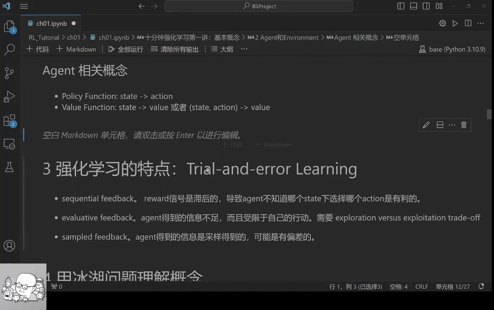

1. **靠试错学习，而且反馈滞后**。智能体通过动作与环境交互，环境再回传新状态或新奖励。但这个"一来一去"的信号是**滞后**的，智能体往往不知道过去哪个动作导致了现在的好或坏奖励——就像你去图书馆看书，并不知道这本书对你明天、下个月甚至明年的影响。[【跳转到 10:48】](https://www.bilibili.com/video/BV1jK4y1w7T8/?t=648)
2. **得到的信息是不足的**。如果智能体始终待在自己的"信息茧房"、舒适空间里，不去尝试没做过的事，就得不到新信息。所以它的信息**受限于自己的行动**，这就需要在**探索（exploration）**和**利用（exploitation）**之间做平衡。
3. **信息是采样得到的、不是无限的**。智能体得到的信息是通过采样获得的，每个人的生活经历都是独特的，本质上也是一种统计抽样。

---

## 六、用一个冰湖问题，把概念真正跑起来

光讲概念还不够，作者认为"**只有当你自己用代码实现了环境和算法，才能真正把它理解透**"。于是他用一个经典的**冰湖（FrozenLake）**问题，从头写了一遍代码。[【跳转到 11:38】](https://www.bilibili.com/video/BV1jK4y1w7T8/?t=698)

### 6.1 冰湖问题：4×4 格子里学"过河"

冰湖问题是一个格子世界：格子是 4×4，一共 16 个。[【跳转到 12:03】](https://www.bilibili.com/video/BV1jK4y1w7T8/?t=723)

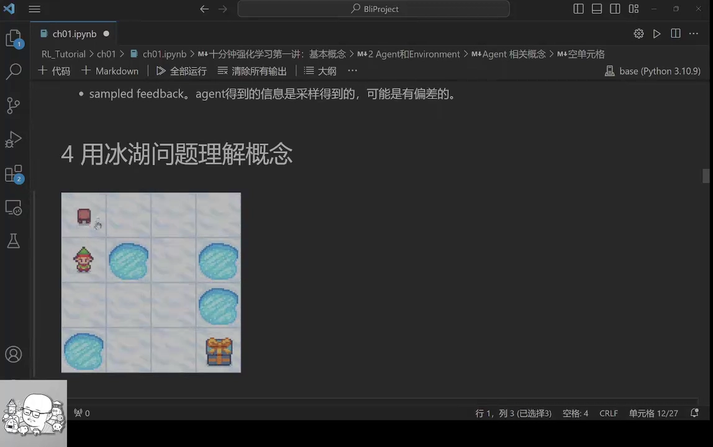

- **智能体**出生在左上角，这个位置叫 **0 号位置**；16 个格子的编号依次是 0~15（第一排 0~3，第二排 4~7，第三排 8~11，第四排 12~15）；
- **目标**：走过这片结冰的湖面，到达编号为 **15** 的位置（拿到宝藏）；
- **动作（action）**：左、右、上、下四个方向；
- **状态（state）**：就是当前位置编号（0~15）；
- **奖励（reward）**：走到 15 号位置得 **+1**，其余情况多为 0；
- 有四个格子是"洞"（冰面上没有冰）：**踩到洞、或者到达终点，游戏就结束**。

对应到前面讲的名词：state 就是位置编号，action 就是四个方向，reward 就是环境给的反馈信号，而"环境如何从一步走到下一步"则由转换函数决定。

### 6.2 用嵌套字典表示"转换函数"

代码里，作者建了一个 `FrozenLake` 类，用 `reset` 设置初始位置、用 `set_transition` 设置**转换函数**。[【跳转到 15:17】](https://www.bilibili.com/video/BV1jK4y1w7T8/?t=917)

这个转换函数本质上是一个**嵌套字典**：外层字典的 **key 是当前状态**，内层字典的 **key 是动作**，内层的 value 则给出这一步可能落到的新状态、对应的概率、奖励以及游戏是否结束。

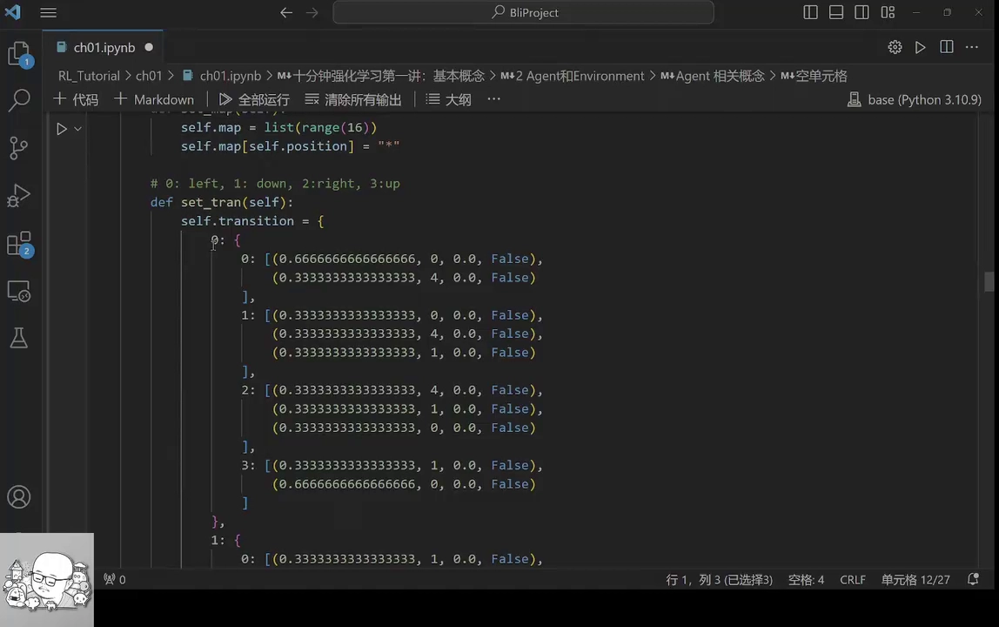

结构大致长这样（下方为便于理解的结构示意，对应视频中屏幕上的嵌套字典）：

```python
# 转换函数（示意）：state → {action: [(概率, 新状态, 奖励, 是否结束), ...]}
transition = {
    0: {                      # 当前状态 = 0 号格（左上角）
        0: [                  # 动作 0 = 往左；左边是墙
            (2/3, 0, 0.0, False),   # 2/3 概率留在原地
            (1/3, 4, 0.0, False),   # 1/3 概率被风/冰滑到 4 号格
        ],
        1: [                  # 动作 1 = 往下
            (1/3, 0, 0.0, False),   # 1/3 留在原地
            (1/3, 4, 0.0, False),   # 1/3 到达 4 号格
            (1/3, 1, 0.0, False),   # 1/3 被吹到 1 号格
        ],
        # …其余动作与状态的规则同理
    },
    # …状态 1~15 各有自己的字典；掉进洞或到达终点后，游戏终止
}
```

**为什么会有多个可能的新状态？** 因为这个冰湖"上面有风、冰很滑"：agent 想往右走，未必真能走到右边——很可能被风一吹、或者冰一滑，划到别的格子上去了。所以这是一个**带随机因素**的环境，每个可能的新状态都对应一个概率（例如上述"留在原地 2/3、滑到 4 号格 1/3"）。[【跳转到 16:07】](https://www.bilibili.com/video/BV1jK4y1w7T8/?t=967)

还有两个细节值得留意：

- **洞是"黑洞"**：一旦掉进去，无论再怎么选动作，它都停在那里不动（状态不变），也不会再获得奖励，只标记"游戏结束"；
- **终点也是终止状态**：到达 15 号后游戏结束；有趣的是，从 14 号出发，即使你选择往下走，也可能被风"刮"到宝箱所在的 15 号，从而拿到 +1 的奖励。

### 6.3 用 `step` 函数完成一次交互

除了展示当前状态的函数，作者还写了最关键的 `step` 函数——它负责把 agent 的动作交给环境。[【跳转到 21:04】](https://www.bilibili.com/video/BV1jK4y1w7T8/?t=1264)

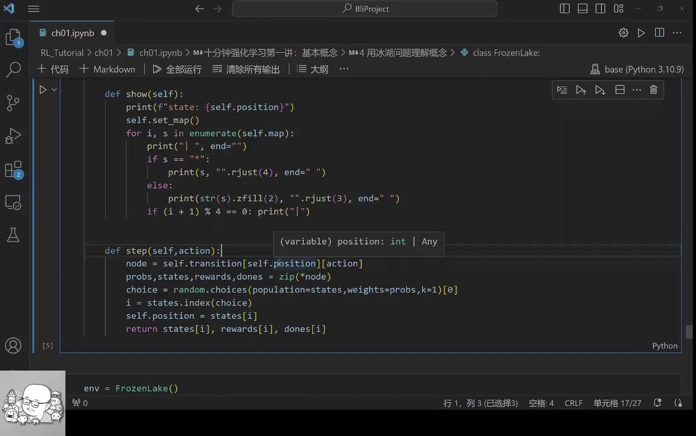

它的做法是：

1. 先看当前 `state` 是什么，用它在转换字典里查出对应的内层结构；
2. 再用这个内层字典按 `action` 查出候选的（概率、新状态、奖励、是否结束）；
3. 用 `random.choice` 按**概率值**抽样，模拟环境的随机因素，得到新状态；
4. 返回新的位置、对应的回报，以及游戏是否结束。

这就是前面"一次交互"在代码里的落地：`state → action → 新 state + reward`。

### 6.4 换一个随机策略，评估它跑得怎么样

为了有东西可跑，作者先写了一个**随机策略**：建一个 `RandomAgent` 类，它的策略函数不管看到什么状态，都从四个动作里随机选一个。[【跳转到 23:59】](https://www.bilibili.com/video/BV1jK4y1w7T8/?t=1439)

然后写一个 `test_game` 函数，让 agent 反复和环境交互：每一轮先重置环境，只要没掉进洞、也没拿到宝藏，就继续玩下去；循环里调用 agent 的策略函数拿到动作，交给环境，环境返回新状态——这正是"agent 与 environment 交互"最典型的两句话。

评估结果很直观：

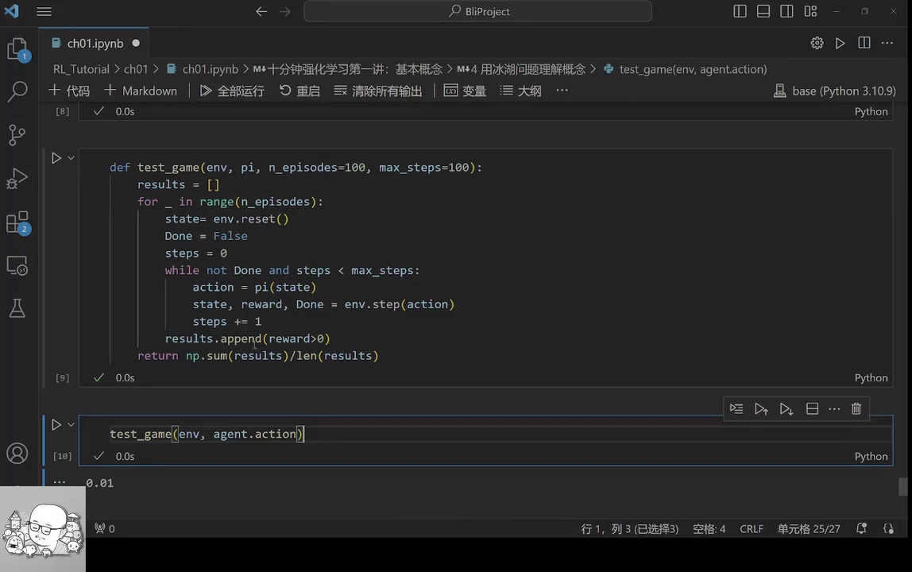

**玩大约 100 盘，只有约 1 盘能拿到宝藏。** 这就是"随机乱走"的效果——它恰恰说明了我们为什么需要"学习"，而不是瞎撞。

### 6.5 回头看：这些概念在冰湖里分别对应什么

跑完例子，再把概念对回代码就一目了然了：[【跳转到 27:19】](https://www.bilibili.com/video/BV1jK4y1w7T8/?t=1639)

- **state**：冰湖里的**坐标（位置编号）**；
- **action**：agent 可以做的四件事（上下左右）；
- **reward**：环境收到 action 后给出的反馈，冰湖里大多是 0，只有到终点才有 +1；
- **转换函数 / 奖励函数**：环境特有的规则，按 agent 的 action 和 state 决定内部状态与奖励的变化，两者都用那个嵌套字典规定好；
- **折扣（discount）**：这个例子比较简单，没有设定它；
- **策略函数**：就是那个"随机给一个动作"的函数；
- **价值函数**：本讲还没涉及，后续会讲。

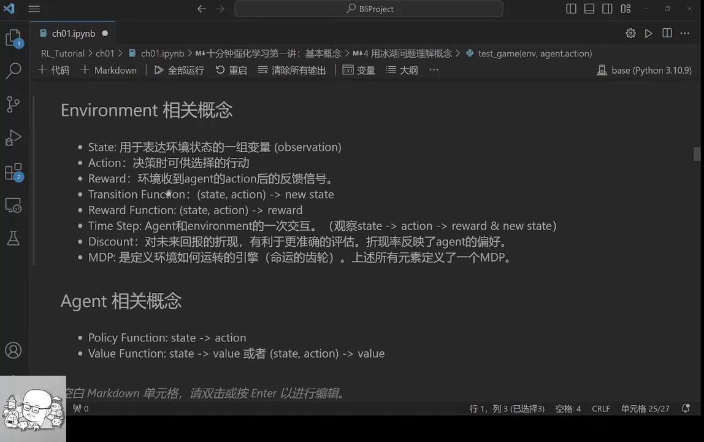

---

## 小结

- 强化学习处在"**人工智能 ⊃ 机器学习 ⊃ 强化学习**"的最内层；它和深度神经网络结合，就是**深度强化学习**（神经网络是工具，强化学习是思路）。
- 最小骨架是"**智能体与环境不断交互**"：智能体观察状态、选择动作，环境返回新状态与奖励，如此往复。
- 环境一侧的核心概念：**状态、动作、奖励、转换函数、奖励函数**，再加上**一步/轨迹、折扣、MDP**。
- 智能体一侧有两个函数：**策略函数**（state → action）与**价值函数**（state / state-action → value）。
- 强化学习区别于监督学习的三个特点：**试错学习且反馈滞后**、**信息不足（需平衡探索与利用）**、**信息靠采样得到**。
- 冰湖（FrozenLake）例子说明：把环境写成**转换字典**、用 `step` 完成一次交互、再用一个**随机策略**跑一跑，就能亲眼看到"乱走"有多差（约 100 盘只赢 1 盘）。

## 关键术语速查

| 术语 | 一句话解释 |
| --- | --- |
| 智能体（agent） | 负责决策的程序，与环境交互 |
| 环境（environment） | 不被程序控制的外部世界 |
| 状态（state） | 用一组变量描述环境当前的样子 |
| 动作（action） | 环境允许智能体选择的行动 |
| 奖励（reward） | 环境对动作给出的反馈信号 |
| 转换函数（transition function） | 由"当前状态 + 动作"得到下一个状态的规则 |
| 奖励函数（reward function） | 由"当前状态 + 动作"得到奖励的规则 |
| 一步 / 轨迹 | 一次完整交互 / 连续多步构成的序列 |
| 折扣（discount） | 对未来回报的折现，让近期权重更大 |
| MDP | 定义好上述全部元素后，就得到马尔可夫决策过程 |
| 策略函数（policy） | 输入状态、输出动作；`state → action` |
| 价值函数（value） | 评估状态或状态-动作的好坏；`state(/state-action) → value` |
| 冰湖问题（FrozenLake） | 4×4 格子中避开洞到达终点的经典入门环境 |

> 视频最后推荐了一本用于自学的书：*Grokking Deep Reinforcement Learning*（对应视频画面中列出的参考阅读）。
