# 探索与利用：从ε-贪婪、乐观初始化到UCB与汤普森采样

> 本文整理自视频《2.探索与利用》（上海交通大学张伟楠老师强化学习课程）[【跳转到 00:06】](https://www.bilibili.com/video/BV1bd4y1i7BK/?t=6)。这是一堂理论密度很高的课：它先给出「探索 vs 利用」的一般定义，再以**多臂老虎机**为最干净的研究环境，把五类探索策略讲透，并用 **Regret（懊悔值）** 这把尺子衡量每一类策略的理论好坏。

## 本讲要解决的核心问题（SCQA）

**背景**：强化学习是一个「序列决策」任务——智能体不断选动作、拿奖励、再调整。它手里永远有一个当前认为最好的动作。

**冲突**：但当前认为的最好动作，是基于有限次尝试得到的、可能有偏差的判断。若一直只用这个判断（利用），收益就再无提升；若一味尝试新动作（探索），又会频繁踩坑、拿不到应得的回报。

**疑问**：到底该怎么在探索与利用之间权衡？有哪些系统性的策略？这些策略的「好坏」又该用什么标准衡量？

**回答（中心思想）**：本讲的答案是——用 **Regret** 来衡量一个探索策略的长期代价。**贪心策略和固定 ε 的 ε-贪婪都只能得到线性增长的 Regret（无法收敛）；而乐观初始化、随迭代衰减的 ε-贪婪、UCB 和汤普森采样，都能把 Regret 压到 O(log T) 这一理论最优的渐进量级。** 其中 UCB 用「均值 + 不确定性」给冷门动作加分，汤普森采样则直接以「成为最优的概率」来抽动作，两者在多臂老虎机实验中都表现优秀。

## 一、探索与利用到底在权衡什么

### 1.1 两个动作：利用已知，还是探索未知

课程一上来就把问题讲清楚。基于当前策略，你面临一个选择：

- 去拿「已知最优收益」的那个行动——这叫做 **利用（exploitation）**：当前我知道哪个策略、哪个动作最好，我就用它；
- 去尝试「一些别的」行动——这叫做 **探索（exploration）**：它不一定是当前最优的，但**有可能**成为最优。

之所以必须探索，是因为**我们当前对每个动作的了解是不准确、有偏差的**。只有通过探索与利用的反复交替，才能不断更新认知，让最终选出的策略尽量接近真正的最优策略。


### 1.2 一个简单形式化：策略池会「长大」

为了把话说清楚，视频给了一个简单形式化。把第 `t` 时刻已有的策略集合记作：

```
Ω_t = { π_t^i },  i = 1, 2, …, n
```

到 `t+1` 时刻，通过**探索**可以再获得若干个新策略，记作 `π_e`（e 即 exploration）：

```
π_e = { π_j },  j = 1, 2, …, m
```

于是我们是在**一个更大的策略池**里找新策略 π，使得它的价值**能够超过「不做探索」时已经找到的最好策略的价值**：

```
V(π) > max_i V(π_t^i)
```

关键点在于：如果**不做探索**，你只能用现有认知去选当前最好的策略，那么你能获得的价值**不会再改变、不会再提升**。所以探索永远是一种「可能发现更好策略」的方式——注意是**可能**，不是必然。

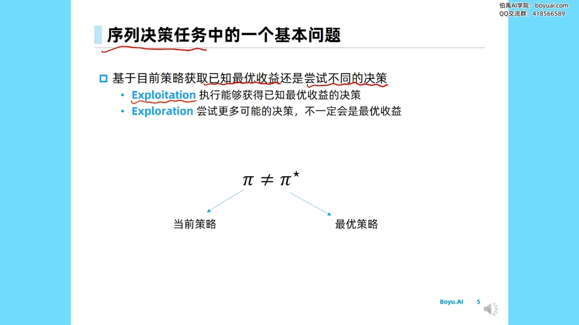

### 1.3 一个例子：今晚去哪家餐厅

课程用「今晚去哪家餐厅」来类比——这是张老师读博时在 UCL 经常被举的例子：

- 常去你最喜欢的那家餐厅：每次吃得都开心，但你**永远发现不了更新、更好的餐厅**（只利用）；
- 经常去试新餐厅：又经常会踩雷，新餐厅不符合口味。

更有意思的是，这个例子在饿了么、美团上随处可见：推荐系统给你推的餐厅里，一部分来自你喜欢的、经常下单的餐厅，另一部分则是**你没吃过的**——后者正是系统刻意安排的「探索」，避免你吃腻。

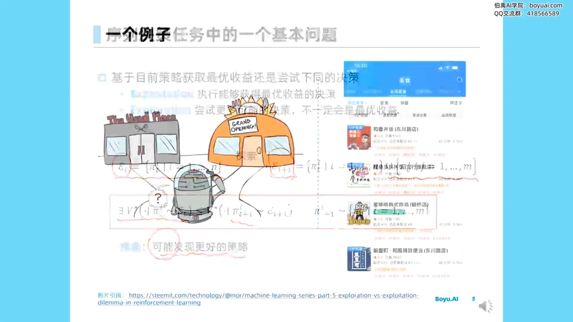

## 二、探索的五类基本原则

视频把「如何探索」归纳成五类方法（本讲重点演示前四类）：

1. **朴素方法**：直接给动作/策略的选择加一个噪声，也就是 ε-贪婪；
2. **乐观初始化（optimistic initialization）**：把每个动作的价值估得很高，随着真实反馈到来，估计值不断下降，于是那些**还没探索过的动作**因为估计值仍然很高而被优先选择；
3. **不确定性度量（uncertainty measurement）**：显式地度量「对某动作回报的不确定性」，不确定性越大，就越应该花更高概率去探索它；
4. **概率匹配（probability matching）**：直接为每个动作按其回报分布采样一个回报值，选采样值最高的动作。某个动作只要**有概率**成为最大值，它就有概率被选中；
5. **状态搜索（state search）**：比如 AlphaGo 里探索没下过的棋盘区域，这要求环境完全透明、可搜索、可枚举。视频说这个会在专门的 AlphaGo 专题里再讲。


## 三、多臂老虎机：最干净的研究环境

### 3.1 问题设定

要研究探索与利用，需要一个「干净」的环境，这就是**多臂老虎机（multi-armed bandit）**。设定如下：

- 赌场里有 `K` 台老虎机（`K` 个 arm），拉一下某台机器，它就以一定概率返回一个 reward；
- 我们暂且认为 reward 在 `[0, 1]` 之间：返回 0 相当于亏，返回 1 相当于赚；
- 我们不断在线地选择、拉动，希望**优化累计时间的收益**：优化「选哪台机器」的策略 π，使得从 `t=1` 一直到 `T` 甚至正无穷，累计收益相对时间 `t` 有较好的增长。

对每台机器的认知会有一个均值估计，并且这个估计**一定带有不确定性**——因为我们只通过有限次观测来估计它。

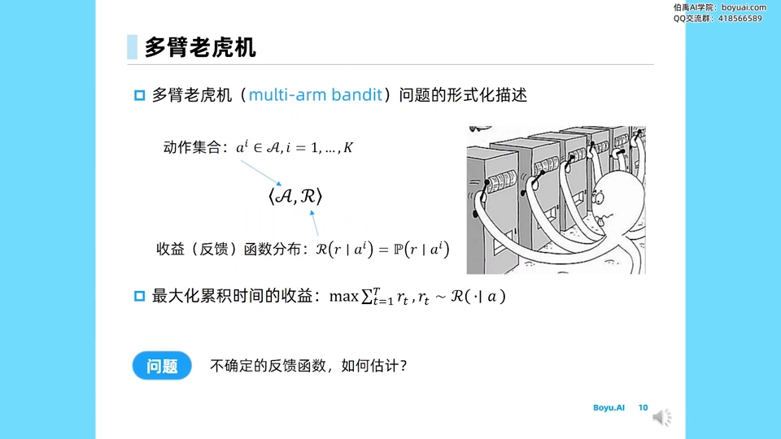

### 3.2 收益估计：从经验均值到增量式更新

最直接的估计就是**经验均值（empirical mean）**。对第 `i` 台机器，如果已经试过它 `n−1` 次，那么在第 `n` 次之前，对其收益的估计就是：

```
Q_n(a_i) = (r_1 + r_2 + … + r_(n-1)) / (n - 1)
```

但每次都要重算 `n−1` 个数的平均，复杂度是 `O(n)`。课程给出一个重要的优化——**增量式更新**，可以把复杂度降到 `O(1)`。推导思路是把第 `n` 次和「前 `n` 次的平均」拆开：

```
Q_(n+1) = Q_n + (1/n) · ( r_n − Q_n )
```

这里 `r_n − Q_n` 就是「本次实际拿到的奖励」减去「本次之前对它的均值估计」，可以理解为一个**误差项** `Δ_(n,i)`。于是我们只需要维护两个量：

- `Q_n`：当前对这台机器的价值估计；
- `n`：这台机器被拉过的次数。

每次拉完，用 `O(1)` 的时间和空间就能更新它。

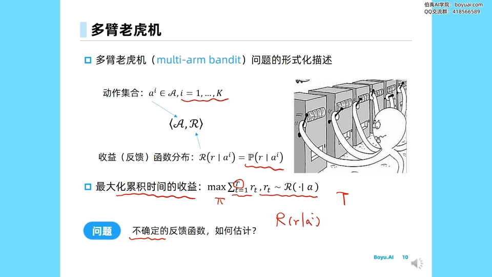

### 3.3 通用算法框架

于是多臂老虎机的算法框架很直接：

1. 对每个 arm 初始化一个 Q 值，且初始被拉次数都为 0；
2. 重复 `T` 次：用策略 π 选一个 arm（动作 `a`）；
3. 通过该 arm 真实（未知）的回报函数采样出收益 `r_t`；
4. 该 arm 的计数 `n` 加一，用上面的增量式公式更新 `Q_a`。

剩下的核心问题就是：**π 到底该怎么设计，才能让长远收益最大？** 为了回答它，需要先有一个衡量标准。

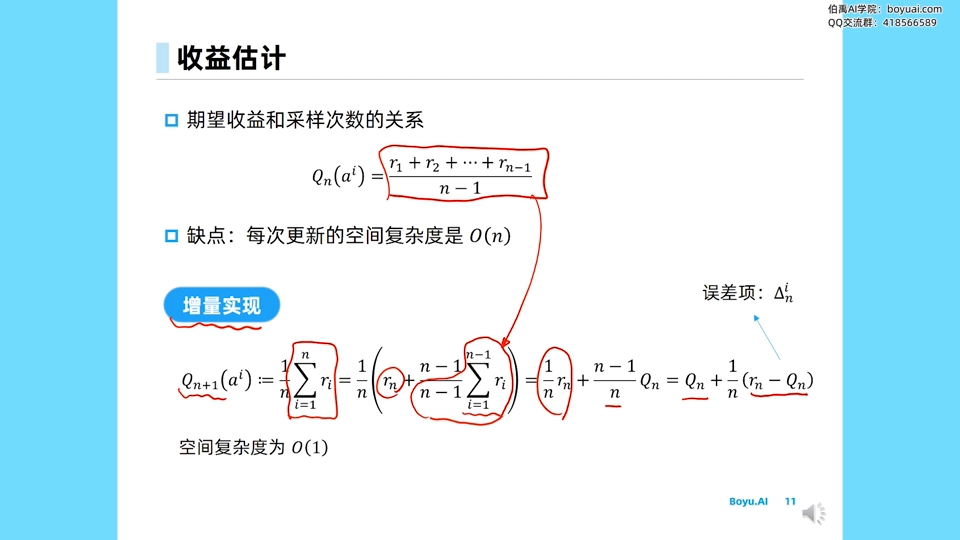

## 四、Regret（懊悔值）：衡量策略好坏的标尺

### 4.1 定义

对每个决策 `a_i`，它的期望收益记作 `Q(a_i)`。最优动作 `a*` 的价值我们记作 `Q(a*)`。那么每选一个别的动作，就和最优之间差了一截：

```
Δ_a = Q(a*) − Q(a) ≥ 0
```

这个差值大于等于 0，就叫做**懊悔值（regret）**。把每个 step 的懊悔值累加、求期望，就得到整个策略的 **Total Regret**：

```
L_T = E[ Σ_(τ=1..T) ( Q(a*) − Q(a_τ) ) ]
```

我们的目标，等价于**最大化累计收益**，也就等价于**最小化这条 Total Regret 曲线**。

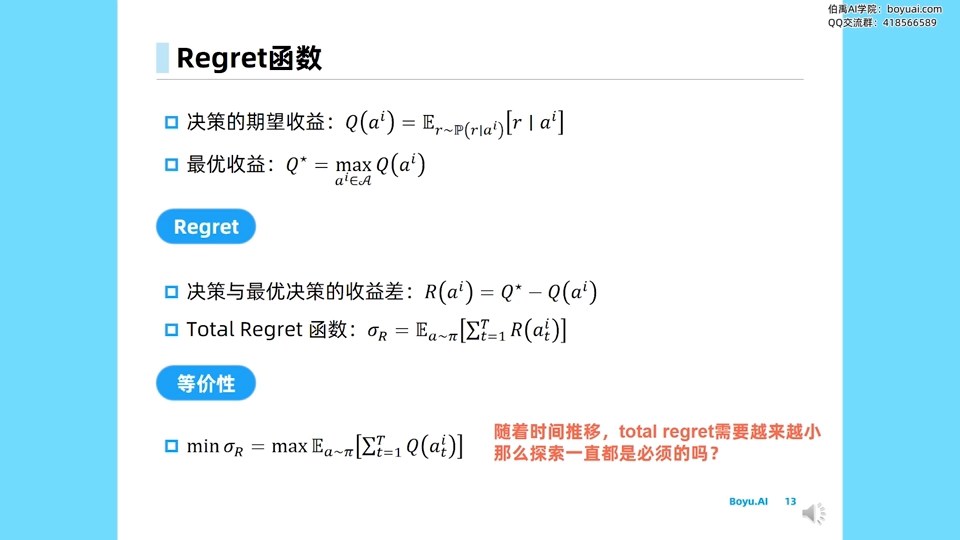

### 4.2 为什么必须「平衡」：两个极端都线性增长

用 Regret 这把尺子，两个极端策略的毛病立刻暴露：

- **一直探索**（比如每次以 0.5 概率随机选）：永远收敛不到最优策略，因为总有一大部分概率去试非最优的动作，Total Regret 随时间**线性增长**、无法收敛；
- **一直不探索（纯贪心）**：当前认知不确保最优。就算每个 arm 都试过 1 万次，仍有极小概率存在偏差；Regret 同样**线性增长**。

所以结论很清楚：**必须平衡探索与利用**，才有可能得到**次线性（sublinear）**的 Regret。

### 4.3 理论下界：Lai–Robbins 定理

Lai 和 Robbins 在 1985 年给出了这一问题的理论分析：在 multi-armed bandit 设定下，**Regret 的下界是 `O(log T)` 量级**，而不是线性的。其中每一项还和每个动作与最优动作的差距 Δ、以及回报分布的差异（可用 KL divergence 度量）有关。因此，能逼近 `O(log T)` 的算法，就算达到了理论上最优的渐进量级。

## 五、策略一：贪心与 ε-贪婪

### 5.1 贪心：线性 Regret

**贪心（greedy）策略**每次只选当前认知下 Q 最大的动作。它的 Total Regret 就是线性增长的。

### 5.2 ε-贪婪：常量 ε 仍是线性，衰减 ε 才能对数收敛

**ε-贪婪**的策略是：

- 以 `1 − ε` 的较大概率**利用**（选当前 Q 最大的动作）；
- 以较小的概率 `ε` 做**均匀随机**的探索。

视频里把这写成：

```
π(a) = 1 − ε              （选 argmax Q 的动作）
π(a) = ε / |A|           （其余动作均匀分配）
```

结论很关键：

- 如果 **ε 是常量**（一直不变），Total Regret 仍然是**线性递增**，只不过斜率比贪心更低；
- 如果把 **ε 以衰减方式逐渐减小**，就能得到理论上**对数收敛**的 Regret（大 O 上达到 log 级别），只是常数项还能继续优化。

一个常见的衰减方案是让 ε 取

```
ε_t = min( 1,  c · |A| / (t · Δ_min²) )
```

其中 `c > 0` 是超参数，`Δ_min` 是「次优动作与最优动作差距最小」的那个 Δ。它相对 `t` 以约 `1/t` 的方式衰减。

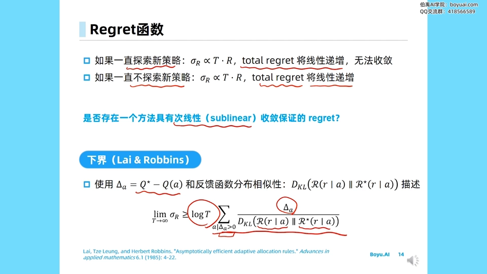

### 5.3 实验结果：三种 ε 的对比

视频画了两张对比图。横坐标是迭代步数 `t`，纵坐标是 Total Regret 或平均收益：

- **Total Regret 图**：贪心和固定 ε 的 ε-贪婪都是**线性上涨**；只有 `1/t` 衰减的 decaying greedy 呈**对数形态**，在 `t` 较大时显著低于前两者；
- **平均收益图**：`ε = 0`（不探索）的曲线早早**停在一个位置**；`ε = 0.1` 与 `ε = 0.01` 则能持续上升。ε 越小，上升越慢但更稳，最终多条曲线会趋近。

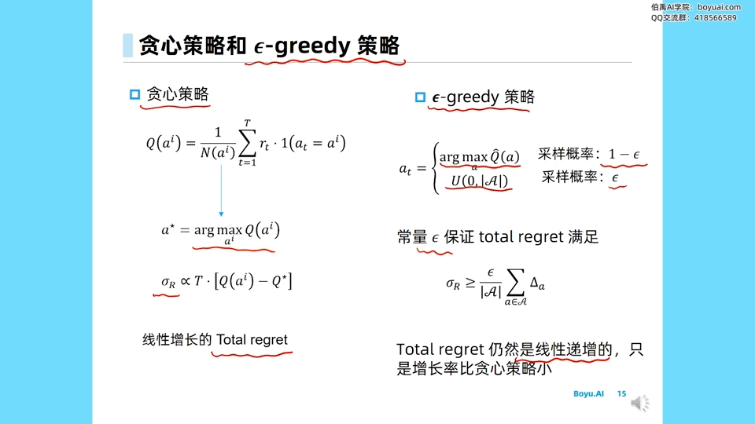

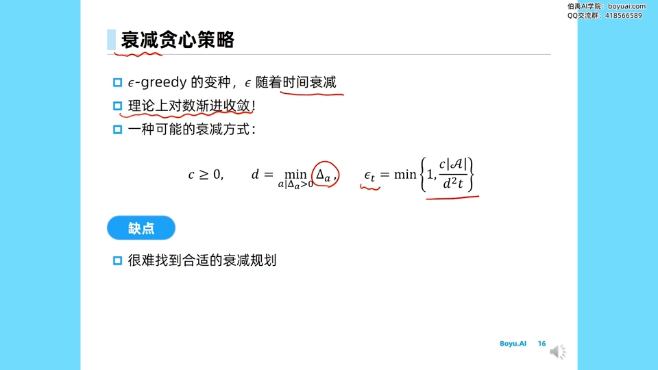

## 六、策略二：乐观初始化

### 6.1 做法与原理

**乐观初始化（optimistic initialization）**把每个动作的初始 Q 值都设得**很高**，相当于先假设「每个选项都可能是最优的」。然后配合前面讲的增量式估计：

```
Q_(n+1) = Q_n + (1/n) · ( r_n − Q_n )
```

因为初始值高，真实反馈（通常没那么高）会让估计**逐渐下降**。于是那些**没被拉过、被拉得少**的动作，Q 值仍然保持很高，在 `argmax Q` 时就会被优先选中——这自然地实现了探索。

这种算法是**有偏的**（初值带来的偏差），但随着采样次数增加，偏差的影响会越来越小。相比 ε-贪婪，它探索到 optimal action 的比例更高，Regret 也更低。

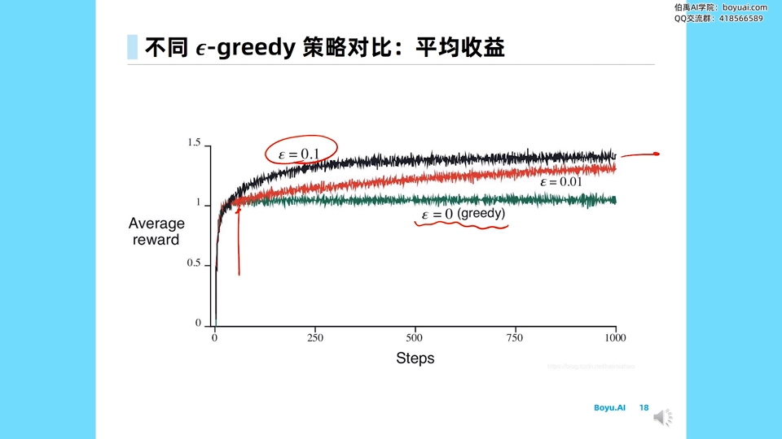

### 6.2 隐患：可能陷入局部最优

乐观初始化有一个隐患：如果每次都用纯贪心，有可能在某次更新中，那个最优动作的 Q 值**恰好被一次不幸运的低回报压得过低**，甚至低于某些次优动作；之后再选 `argmax Q`，就会一直选到第二名的动作，从而**陷入局部最优**。

解决方案很自然：**仍然保留一个较小的 ε 去做探索**，不要在纯贪心（ε = 0）下运行。

## 七、策略三：显式建模价值分布 → UCB

### 7.1 为什么不只看均值

我们还可以**显式地建模每个动作的价值分布** `P(r | a_i)`。看下面这个例子，有三个动作：

- 蓝色动作的分布**很尖（sharp）**，均值约 0.6；
- 另一个动作分布**很平**，均值只有约 0.3，但**方差很大**；
- 第三个动作被拉过很多次，分布也很尖。

虽然平分布的那个动作均值低，但它**一旦采样到右侧，就可能超过蓝色动作**——正是因为它不确定性高，还没有被充分探索。

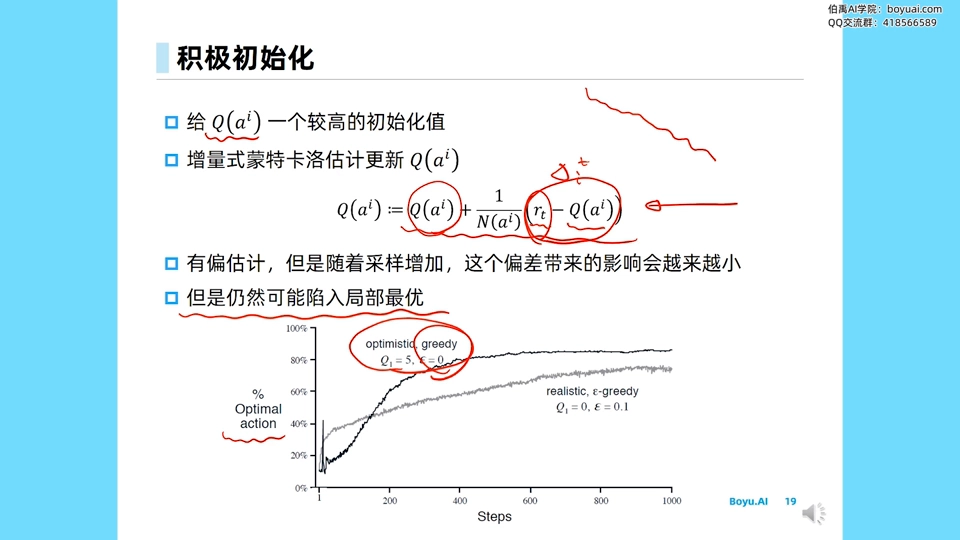

### 7.2 UCB：均值 + 不确定性

顺着这个思路，视频引出 **UCB（upper confidence bound，上置信界）**：给每个动作打一个分

```
score(a) = Q̂(a) + c · u(a)
```

- `Q̂(a)`：当前的经验均值；
- `u(a)`：不确定性度量。经验上，动作被拉得越多（`n_a` 越大），认知越确定，`u_a` 越小；拉得越少，`u_a` 越大。
- `c` 是权重。

这个「上界」的来历，用的是 **Hoeffding 不等式**：对取值范围在 `[0,1]` 的随机变量 X，观测 `t` 次后，真实期望落在经验均值 `X̂` 的 `u` 邻域之外的概率**指数级衰减**：

```
P( |E[X] − X̂| ≥ u ) ≤ 2 · exp( −2 t u² )
```

把它套到动作价值上、对不等式变形（先取 log、再除以 `2n_a`、再开根号），就能得到一个简单结论：不确定性项大致满足

```
u(a) ∝ sqrt( 1 / n_a )
```

也就是随 `n_a` 增大而下降。可以证明，UCB 带来的 Regret 是 `O(log T)` 的——达到理论最优的量级，只是常数项还能进一步优化。

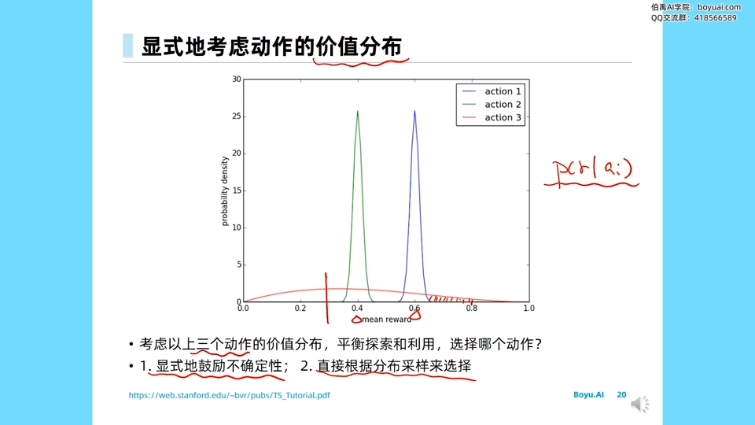

## 八、策略四：汤普森采样

### 8.1 思路：以「成为最优的概率」来抽动作

**汤普森采样（Thompson sampling）**走的是另一条路——干脆不去显式定义不确定性，而是**直接根据每个动作「被选成最优」的概率来选择它**。

形式化地说，对每个动作按「它成为最大 Q 值的概率」来抽：

```
选择 a 的概率 = Pr( Q(a) = max_a' Q(a') )
```

实现上，可以采用「参数化 θ + 后验」的方式：先用当前数据 `d` 估计 θ 的后验分布，从后验中为每个动作采样一个 Q 值，再选采样值最大的动作——这本质上是**蒙特卡罗采样**的思路。

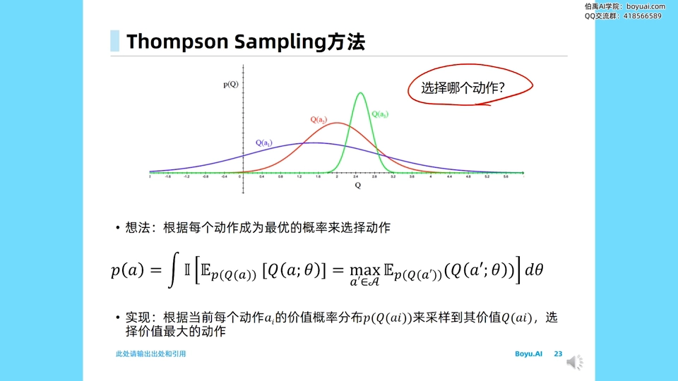

### 8.2 伯努利老虎机：用 Beta 分布建模

如果 reward 在 `[0,1]` 之间（比如每次要么拿到 1、要么拿到 0，即**伯努利 bandit**），那么每个 arm 的成功率天然适合用 **Beta 分布**建模：

- 初始化 `Beta(1, 1)`：第一个 1 表示「拿到 reward 的次数」，第二个 1 表示「没拿到 reward 的次数」；
- 每拿到一次 reward，成功次数 +1；失败，则失败次数 +1；
- `Beta(α, β)` 正比于「以 x 概率取得 α 次成功、以 1−x 概率取得 β−1 次失败」，其中 α、β 相当于额外尝试的成功与失败次数。

从每个 arm 的 Beta 分布里采样出一个 θ_i，选 θ 最大的 arm；跑完更新它的 Beta 分布，如此循环。这样，**不确定性大的 arm 的采样值更容易偶然冲高**，从而被选到，实现了探索。

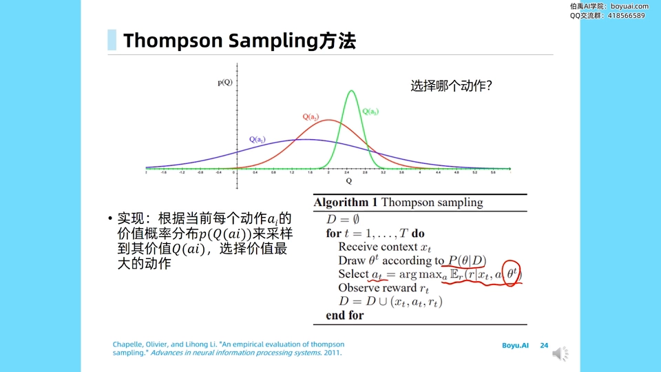

## 九、实验对比与总结

### 9.1 Thompson Sampling vs UCB

视频引用了 Olivier Chapelle 与李立宏老师 2011 年的对比实验：固定 `K` 个 arm，用不同方差 `σₖ²` 和 gap 等条件，比较 Thompson sampling 与 UCB 的 Regret。结论：

- 就最终收敛的 Regret 而言，**Thompson sampling 优于 UCB**；
- 两者大体都以 **sublinear、即 `log T`** 的方式收敛（横坐标取 log 后近似直线）；
- `K` 越大，两者收敛趋势越往后靠；gap 越大，两者收敛幅度的差异越明显。

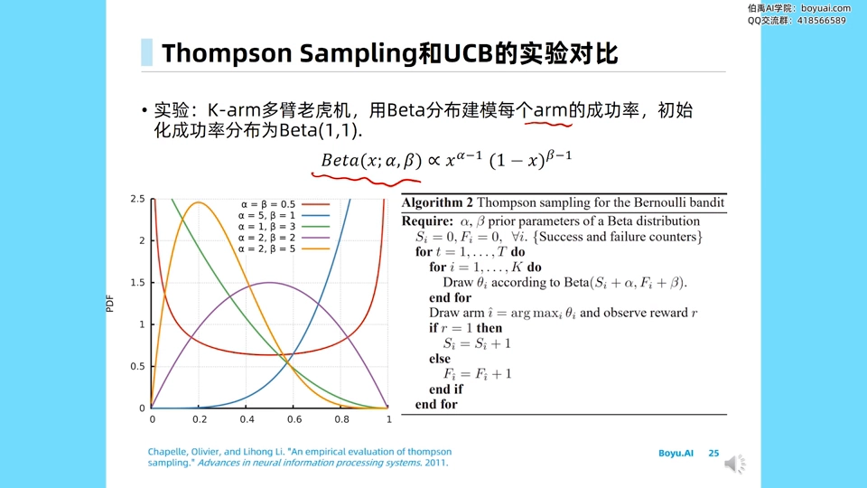

### 9.2 全课总结

视频结尾点题：多臂老虎机可以被看作一种**无状态（stateless）的强化学习**——每次只需要关注对每个 action 的认知，环境始终是同一个状态。它研究的探索与利用是一个**非常干净的环境**。理论上最优的渐进 Regret 是 `log T`，只是常数项会有差别。常用的方法就是：**ε-贪婪、乐观初始化、UCB、汤普森采样**。其中在 control 场景里，ε-贪婪因其简单，是最常用的探索方式。

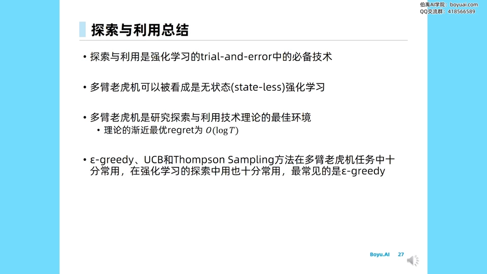

## 小结

1. **两个动作**：利用 = 用已知信息选当前最好的；探索 = 尝试未知，去获取可能更好的选择。
2. **必须权衡**：纯探索和纯贪心都会导致线性增长的 Regret；只有平衡二者才能得到次线性 Regret。
3. **衡量标准**：Regret（懊悔值）越接近 0 越好；理论下界是 `O(log T)`。
4. **ε-贪婪**：`1−ε` 利用、`ε` 探索；常量 ε 线性收敛，**衰减 ε 才能对数收敛**。
5. **乐观初始化**：把初值设高，让未探索动作因「估值仍高」而被选中；注意可能陷入局部最优。
6. **UCB**：用「均值 + 不确定性」打分，不确定性项约正比于 `sqrt(1/n_a)`，Regret 达 `O(log T)`。
7. **汤普森采样**：以「成为最优的概率」抽动作，用 Beta 分布建模伯努利老虎机，实验中常优于 UCB。

## 关键术语速查

| 术语 | 一句话解释 |
| --- | --- |
| 利用 / 探索 | 用已知最优 vs 尝试未知以获取信息 |
| 多臂老虎机 | 多台概率未知的老虎机，在线选拉，目标是最大化累计收益 |
| 增量式更新 | 把平均值的计算改写成 `Q ← Q + (1/n)(r − Q)`，复杂度降到 O(1) |
| Regret（懊悔值） | 相对最优动作的累计损失 `Σ(Q(a*) − Q(a_τ))`，越小越好 |
| 次线性 Regret | 随 T 增长慢于线性的 Regret；理论下界为 `O(log T)` |
| 贪心 / ε-贪婪 | 只选当前最优 / 以 `1−ε` 利用、`ε` 探索 |
| 衰减 ε | 让 ε 随迭代变小，从而使 Regret 对数收敛 |
| 乐观初始化 | 把初值设高，使未充分探索的动作优先被选 |
| UCB（上置信界） | 用「均值 + 不确定性」给冷门动作加分；不确定性约 ∝ `sqrt(1/n_a)` |
| 汤普森采样 | 以「动作成为最优的概率」为权重抽动作，常用 Beta 分布建模 |
| Hoeffding 不等式 | 用于界定期望与经验均值之差的概率，是 UCB 不确定性项的理论来源 |
