# 用代码理解探索与利用：ε-贪婪、衰减、Softmax 与 UCB

> 本文整理自视频《十分钟强化学习系列第三讲：探索和利用》[【跳转到 00:00】](https://www.bilibili.com/video/BV1iH4y1d7uf/?t=0)。视频用一段 Python 代码把「探索还是利用」这个抽象取舍变成了可以跑出来、看得见结果的小实验。

## 本讲要解决的核心问题（SCQA）

**背景**：在强化学习里，智能体要不断做决策。做决策时它手里有两类信息——已经确定的东西（哪个选项目前看起来最好）和还未确定的东西（还没试过的选项可能更好）。

**冲突**：这两者会打架。只顾前者（利用已知），可能一直困在一个普通的选择上；只顾后者（探索未知），又可能把时间浪费在很差的选项上、拿不到应有的回报。更要命的是，现实里我们往往只有有限次尝试的机会。

**疑问**：那么，到底该怎么在「探索未知」和「利用已知」之间取舍？有没有具体、可实现的策略？

**回答（中心思想）**：有，而且都可以用同一个多臂老虎机实验来直观对比。本讲先用代码把老虎机建模出来，再逐一实现四种策略——**纯探索、纯利用、ε-贪婪（含随迭代衰减的版本）、Softmax、UCB**——并在同一张「期望回报」曲线上看出谁强谁弱。结论是：**纯探索和纯利用都不行，真正有效的是「按一定比例、随时间变化地探索」，其中 UCB 用「没试过的动作加分」这一条原则，效果最好。**

## 一、权衡问题：先去哪家餐厅？

### 1.1 一个日常例子

假设你放假出去吃饭，周围有好几家餐厅。有一家你去过很多次，知道它味道不错、价格也不错——那么去这家，就是在**利用（exploit）你已知的信息**。

而旁边还有几家你没去过的餐厅。去没去过的，就是**探索（exploit 的反面，explore）**。探索有两种结果：

- 运气好：发现新餐厅味道更好、价格更低，你得到更大的回报；
- 运气不好：新餐厅又贵又难吃，回报很低。

这就是典型的探索与利用抉择：**利用**是用已知信息去选择那个当下回报最大的动作；**探索**是为了搜集更多信息、去尝试未知的行动。探索的目的是「收集信息」，利用的目的是「用好已有信息」。

### 1.2 为什么必须在两者之间做选择

视频回顾了上一讲的冰壶问题：那时我们**假设已知 MDP、已知转移概率**，于是可以完美规划出一条最优路径——但那是一种「作弊」。现实里，你只能通过与环境交互去了解信息。所以这里天然存在一个权衡：**我到底是去探索、搜集信息，还是去利用已有的信息？**

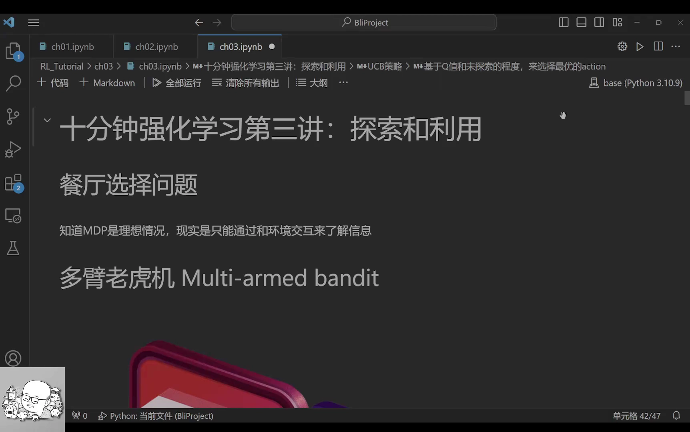

## 二、多臂老虎机：把权衡变成一个可计算的问题

### 2.1 什么多臂老虎机

很多教材都用**多臂老虎机（multi-armed bandit）**来讲这个权衡。它其实就是一排老虎机：每台机器你投一个硬币、拉一下操纵杆，它就以某个概率掉出硬币。但**每台机器掉钱的概率不一样，而你一开始并不知道**。你只能通过不断投钱去尝试，才能大概知道哪台机器出钱概率大。

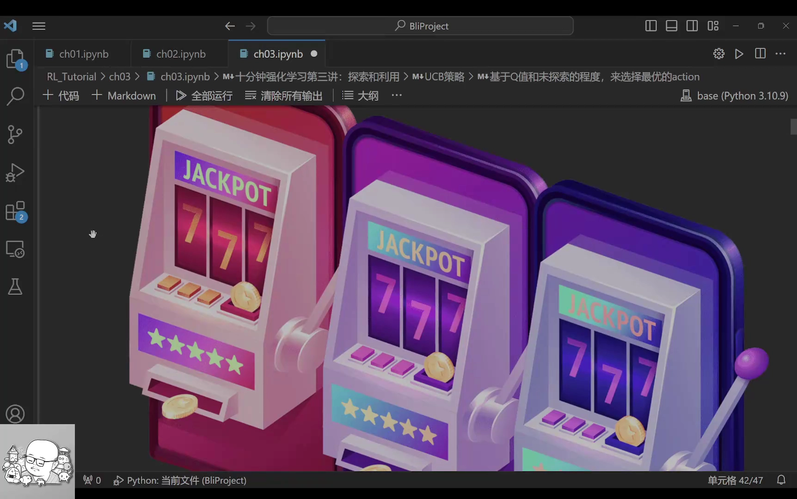

一旦你试出来某台机器概率高，你可能就只盯着它——这就是利用。而老虎机只有「单步决策」（投一次、拉一次就结束，不影响后续），所以它正好剥离了顺序决策的复杂性，让我们只专注一件事：**如何在探索与利用之间平衡**。

### 2.2 用 Python 建模老虎机环境

视频先写了一个环境类。它的初始化主要有两个参数：

- `probs`：每台老虎机掉出硬币的概率；
- `rewards`：掉出硬币时给多少回报。

视频里的具体例子是**四台老虎机**，真实概率分别是 `0.05`、`0.1`、`0.3`、`0.2`，而只要掉出硬币，回报都是 `1`。例如第一台机以 5% 概率给 1，以 95% 概率给 0。

选择某个动作（0、1、2、3 之一）后，环境就把对应老虎机的概率拿出来和随机值比较：随机值小于该概率，就掉钱、给出对应 reward；否则回报为 0。

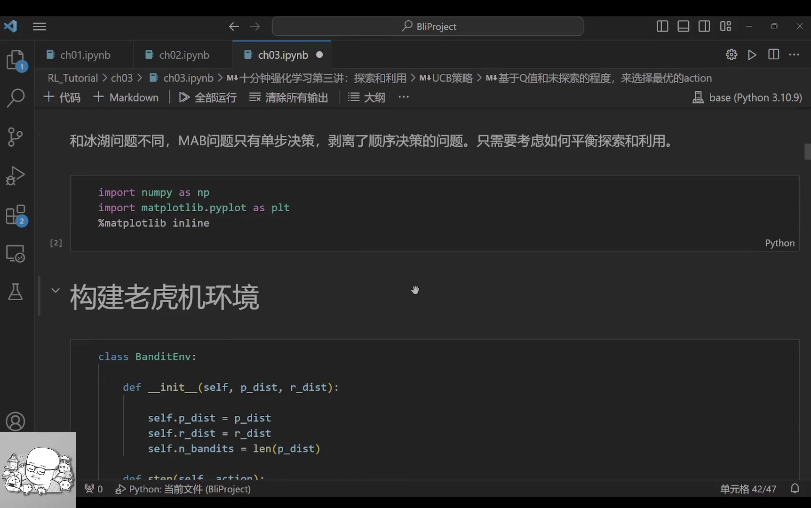

### 2.3 三个要记录的变量：Q、N、期望回报

在跑策略前，视频定义了三个关键的记录量：

- **Q**：对每台老虎机价值的估计。因为前面章节讲过，`Q` 的含义就是某个动作的**期望回报**——四台老虎机就对应四个动作的 `Q` 值，是一个含四个元素的向量。
- **N**：每个动作被选择过的次数。
- **Q1**：一个 `次数 × 4` 的矩阵（比如 1000×4），把每一次实验里算出的 `Q` 都记下来，方便观察它有没有收敛到正确值。
- **return**：每次实验拿到的回报，用于计算「这个策略平均能拿多少」。

`Q` 的更新本质上就是**求平均回报**：一种做法是等所有实验做完，把某台老虎机上拿到的 reward 加起来除以 N；另一种更常用的是**移动平均**，最终结果一样，但能给出中间过程。

## 三、三种「纯策略」的对照实验

视频接下来的做法非常清晰：先各写一个「极端」策略，看它们会怎样翻车。

### 3.1 纯探索：信息收集很好，但收益很差

**纯探索**策略就是完全随机地选动作。跑一千次后，它算出来的 `Q` 约为 `0.047、0.07、0.31、0.19`，和真实值 `0.05、0.1、0.3、0.2` 已经相当接近——**信息收集很不错**。

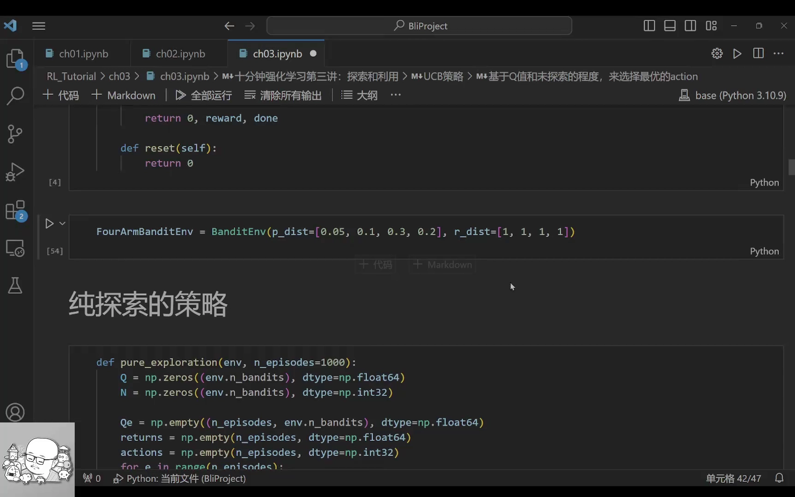

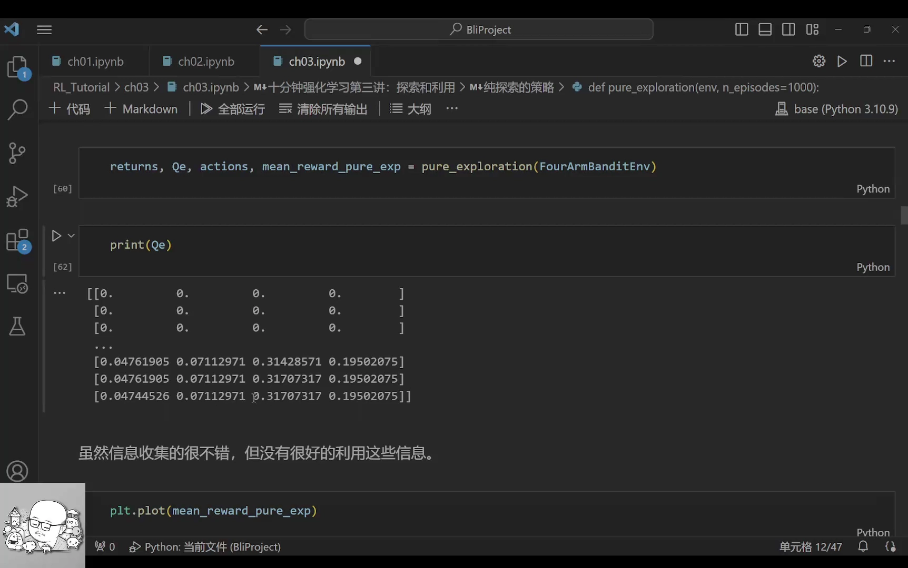

但它的期望回报并不好，大约收敛在 **0.15 左右**。原因很直接：最优动作的真实价值是 0.3，而它因为随机乱选，相当于在四台机器里随机取平均，自然只能拿到接近平均值的收益。这与「最优值 0.3」之间还有很大差距——**它收集了信息，却没有利用信息**。

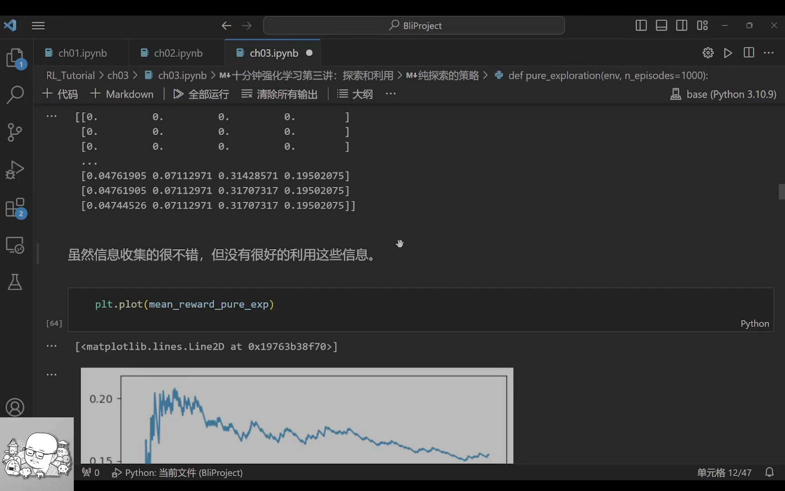

### 3.2 纯利用：一开始就把自己锁死

**纯利用**策略每次只选当前 `Q` 最大的动作。它的结果 Q 值评估**非常不准**。原因是代码层面的一个细节：一开始所有 `Q` 都是 0，在全部为 0 时让 Python 选最大值，它会默认选到第一个（下标 0），也就是第一台老虎机——而这台机器的收益只有 `0.05`。于是它**从第一步起就再也没试过别的机器**，既收集不到好信息，也拿不到好回报。

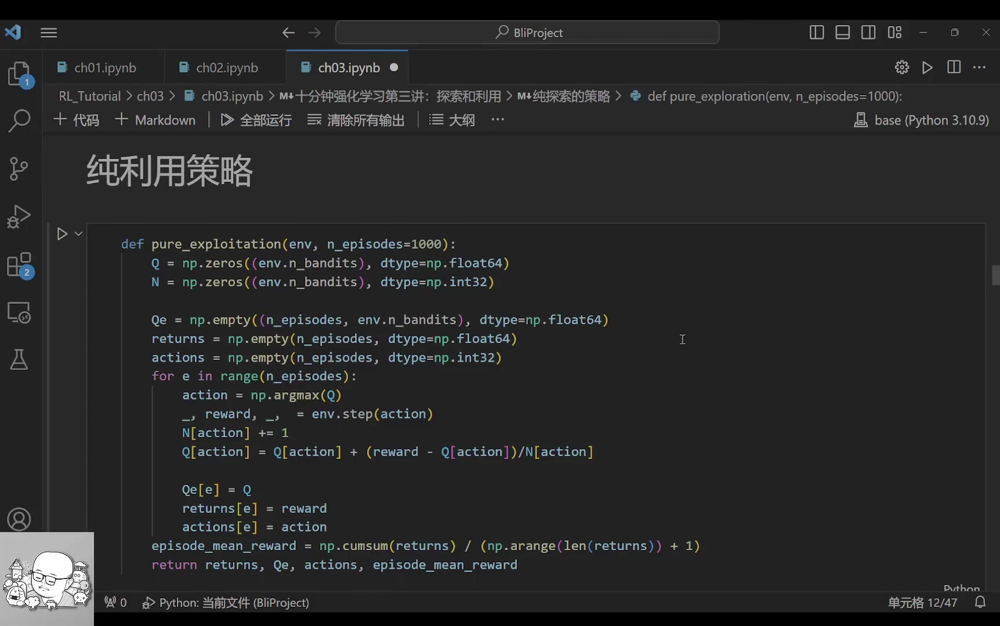

两种极端策略都不行，这正好引出结论：**必须把探索和利用结合起来。**

## 四、ε-贪婪：最简单的平衡

### 4.1 做法

**ε-贪婪（epsilon-greedy）**的思路很直观：一部分时间探索，一部分时间利用。具体用一个小随机数实现：

- 以概率 `1 − ε` 选择当前 `Q` 最大的动作——**利用**；
- 以概率 $\varepsilon$ 随机选一个动作——**探索**。

当 `ε = 0.1` 时，就是 90% 的时间利用、10% 的时间探索。这个比例自己可以调，比如 0.5 或 0.8。

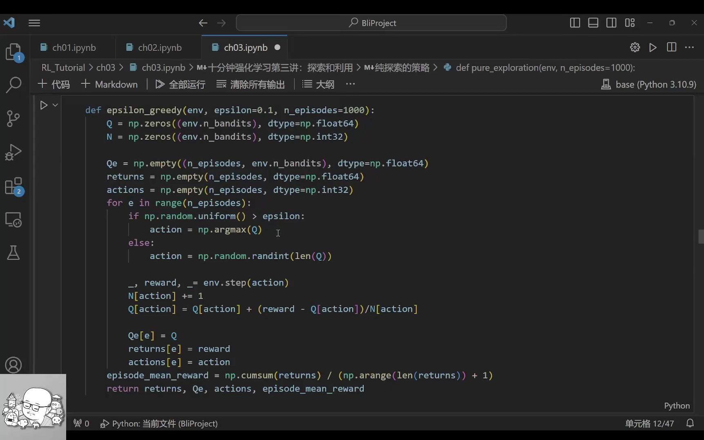

### 4.2 结果：明显变好，但有一个天花板

以 `ε = 0.1` 执行，最后 Q 值判断约为 `0.029、0.03、0.3、0.2`，评估得不错；期望回报曲线**明显好于前两种纯策略**，已经比较接近 0.3 这个上限。

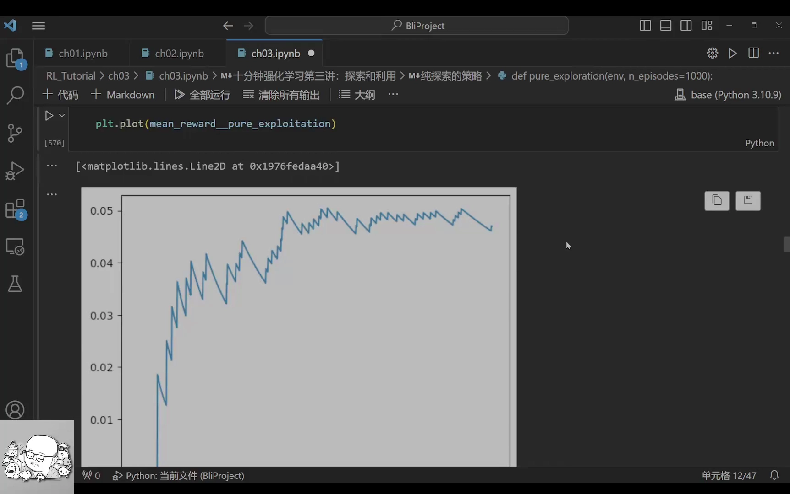

为什么它一开始比较低、后来慢慢上升？因为一开始实验次数少、信息不准，那时「选 Q 最大」并不一定是真正的好动作；到后面信息越来越准，动作选择也越来越好。**但它始终到不了 0.3**——因为后期仍有 10% 的机会在做探索，就像我们明知某家餐厅味道一般，仍有 10% 概率去选那个不是最优的选项。

## 五、进阶 ε-贪婪：让探索率随迭代衰减

### 5.1 思路：早期多探索，晚期多利用

既然 ε-贪婪被固定的 10% 探索拖住了上限，那很自然的想法是：**早期信息少，就让 ε 大一点、多探索；晚期信息多了，就让 ε 小一点、多利用。** 这相当于给 ε 加一个**衰减（decay）**：让 ε 与迭代次数挂钩，随迭代推进逐渐变小。

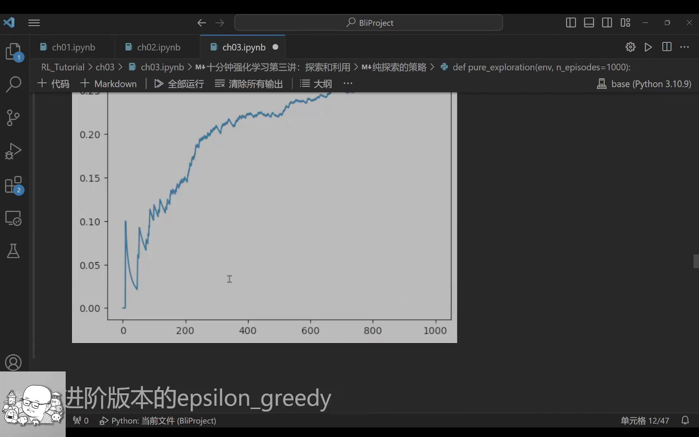

### 5.2 结果：几乎逼近上限

带衰减的 ε-贪婪，Q 值评估比较准确，期望回报也相当不错，**几乎能逼近到 0.3 这个极限**。视频评价它是「一种很好、很优秀的策略」。这也说明一个重要经验：**探索率不该是常量，而应随时间衰减。**

## 六、Softmax：用 Q 值决定各动作的探索比例

### 6.1 思路：好动作有更大概率被选中

前面的随机探索是「平均概率」——每个动作被选中的机会一样大。但不同动作的 Q 值其实不一样，为什么不让**Q 值更高的动作有更高的被选中概率**？

这就是 **Softmax** 的核心思想：把每个 Q 值做指数化，再除以所有指数值之和，得到一组概率分布，然后按这个分布去随机选动作。这样既包含了随机探索，又包含了利用。它同样可以有「早期更平均、晚期更集中」的行为，靠一个**温度参数**来控制。

### 6.2 温度：控制「探索的均匀程度」

Softmax 的实现很简单：$\operatorname{softmax}(Q) = \exp(Q) / \sum(\exp(Q))$，再把它交给随机选择函数。

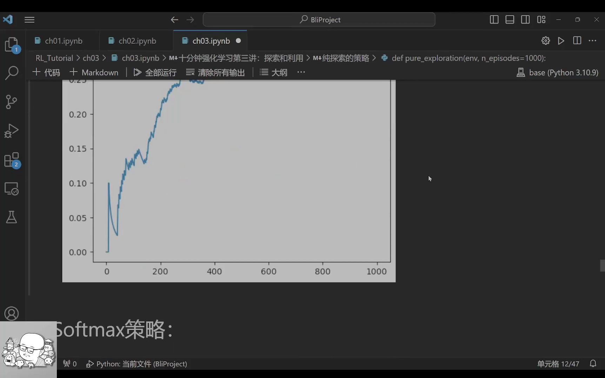

温度参数的作用是：

- **温度大**：分母大，缩放后的 Q 都很小、彼此差不多，于是概率分布接近均匀——**探索性强**，适合早期；
- **温度小**：分母小，Q 值被放大，不同动作之间的差距凸显出来，Q 值越大的动作被选中概率越高——**利用性强**，适合晚期。

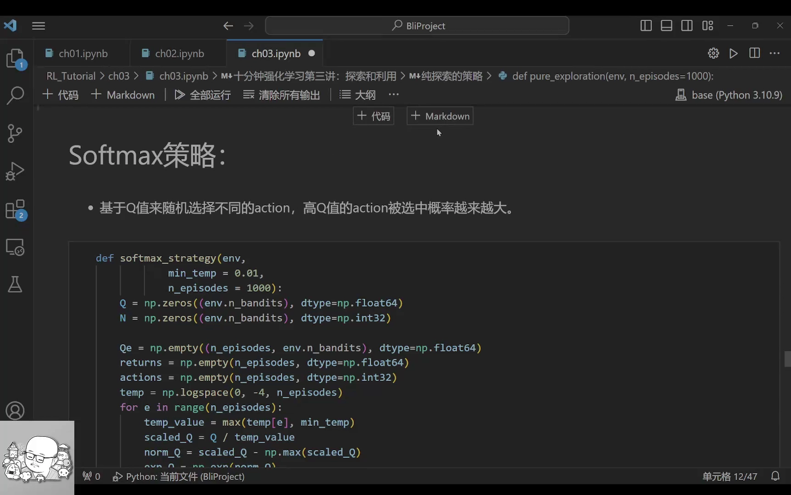

结果是：Softmax 的 Q 值评估与期望回报效果都相当不错，因此被很多算法选用。

## 七、UCB：给「没探索过」的动作加分

### 7.1 思路：好吃 + 没去过

最后一种策略是 **UCB（upper confidence bound，上置信界）**。它的思路也很直白：我们选餐厅，一方面要选好吃、性价比高的，另一方面也要选那些**还没去过**的。把这两件事合起来，就是 Q 值 + 未探索程度。

具体来说，对每个动作给一个分数：

```
score(a) = Q(a) + c · U(a)
```

- `Q(a)` 是当前对该动作价值的估计（好不好吃）；
- `U(a)` 表示「没被探索过的程度」。视频里用的是该动作被选次数的倒数 `1/N`：N 越大（试得越多），U 越小；N 越小（几乎没试过），U 越大；
- `c` 是一个权重系数，用来调节探索项的重要程度。

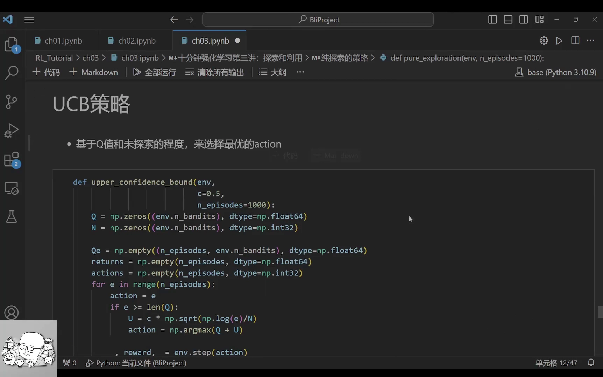

直观地说，一个从没试过的动作（N 很小）会因为 U 很大而被「加分」到值得一试；一个已经试过很多次的动作，U 会很小，只能靠自身 Q 值说话。

### 7.2 结果：也能逼近上限

UCB 的 Q 值评估和期望回报同样能**接近 0.3 这个极限**，是三种策略里表现很好的一种。

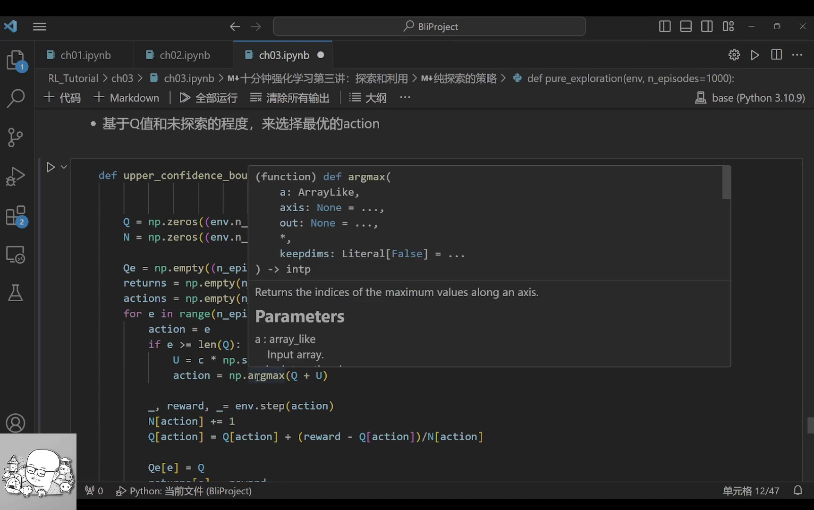

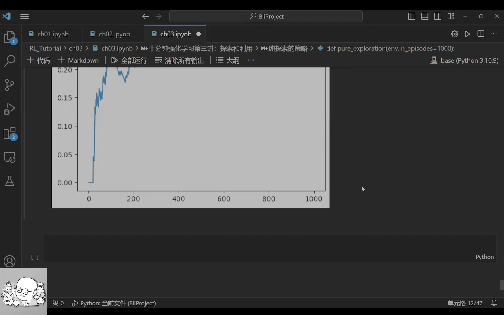

## 小结

本讲用同一套多臂老虎机实验，把「探索与利用」的取舍和四类策略讲清楚了：

1. **纯探索**信息收集得好，但一味随机、期望回报只有约 0.15；
2. **纯利用**被初始值锁死，一步走错就再也不回头，回报极低；
3. **ε-贪婪**用 `1−ε` 利用、$\varepsilon$ 探索，简单有效，但固定的 ε 让它到不了上限；
4. **衰减 ε-贪婪**让探索率随迭代变小，几乎能逼近 0.3 这个极限；
5. **Softmax** 用 Q 值的指数化概率来决定探索比例，温度控制均匀程度；
6. **UCB** 把「Q 值」和「未探索程度」相加，给冷门动作加分，效果同样优秀。

一句话概括本讲的核心：**有效的探索不是「固定比例地随机试」，而是「随时间调整比例，并给试得少的动作额外的机会」。**

## 关键术语速查

| 术语 | 一句话解释 |
| --- | --- |
| 探索（Exploration） | 尝试未知的动作，以收集信息 |
| 利用（Exploitation） | 使用已知信息，选择当前回报最大的动作 |
| 多臂老虎机（Multi-Armed Bandit） | 多台概率未知的老虎机，每次选一台拉一下，研究如何最大化累计收益 |
| 期望回报 | 某个策略在多次实验下的平均回报 |
| Q 值 | 某个动作的期望回报估计 |
| ε-贪婪（ε-Greedy） | 以 `1−ε` 概率利用、以 $\varepsilon$ 概率随机探索的策略 |
| 衰减（Decay） | 让探索率 ε 随迭代次数逐渐变小 |
| Softmax | 把 Q 值转成概率分布，Q 越高被选中概率越大；用温度调节分布均匀程度 |
| UCB（Upper Confidence Bound） | 用 `Q + c·(未探索程度)` 给冷门动作加分，平衡探索与利用 |
| 温度（Temperature） | Softmax 中的超参数，大则分布均匀（多探索）、小则分布集中（多利用） |
