# 多臂老虎机：在没有答案的世界里学会取舍

> 本文基于 B 站视频《[强化学习》第2章 多臂老虎机问题 Multi-Armed Problem](https://www.bilibili.com/video/BV19JsYevEFf/)》（UP 主：LLM张老师）整理撰写。视频逐节走读了 Sutton & Barto《强化学习导论》第 2 章（2.1–2.9）的幻灯片，本文内容均来自该视频的讲解与画面，仅对 AI 字幕的口误与断句做了整理，未作超出视频的引申。

## 本讲要解决的核心问题（SCQA）

**背景**：强化学习要在一个「未知的世界」里，通过不断试错找到能拿到最大奖励的动作。第一章讲的是「表格型方法」——把所有状态、动作的值都记在一张表里，这是强化学习最早的来源。

**冲突**：可是在最简单的情形里就有一个绕不开的矛盾——你面前摆着一排摇杆，每个摇杆的中奖概率都不一样，但你并不知道它们各自是多少。如果每次都只摇自己目前认为最好的那个，就可能被早期的运气锁死；如果一直乱摇，又永远赚不到钱。

**疑问**：面对这种「只有结果、没有答案」的无状态决策问题，到底该怎么选？有没有比「凭感觉」更系统的做法？

**回答（中心思想）**：这就是**多臂老虎机问题（Multi-Armed Bandit）**。它把「探索」和「利用」的取舍抽象成一个可以精确计算的模型：用**动作价值 Q** 估计每个动作的好坏，用 **ε-贪心**在贪心之外留出一条探索的通道，用 **UCB**把「不确定性」也纳入选择依据，用**梯度赌博机**让动作偏好可以被学习。理解了这一章，就理解了强化学习里最底层的那条主线：**在信息不全时，如何权衡眼前的收益与长远的探索。**

---

## 一、先把问题摆清楚：什么是多臂老虎机

### 1.1 它研究的是「未知环境里的试错」

多臂老虎机来自赌场里那台有多个摇杆的老虎机。视频用了一个很直观的设定：想象你面前有 100 台甚至 1000 台老虎机，每台摇杆摇出结果的概率都不同，你要**怎么摇、摇哪一个**，才能让自己赚得最多？这就是一个**基于概率的统计问题**。

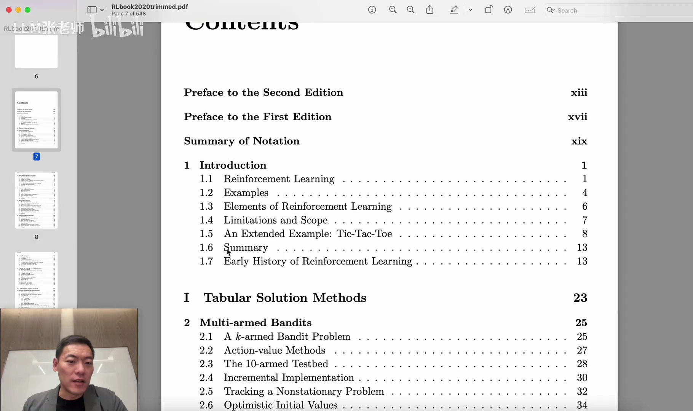

### 1.2 公式里的符号各是什么

视频提醒：这本书里的公式会在整个强化学习中反复出现，所以先把符号的**意义**过一遍：

- `A`：action，也就是**动作**。在老虎机例子里，就是「摇第 2 台还是第 120 台」。
- `T`：time step，第几步。比如 `T = 2` 就是第二步。
- `R`：reward，这一步得到的**奖励**。摇中了一把，奖励可能就是 `+1`。
- `E`：estimate，**估计**的意思，是一个表达符号。

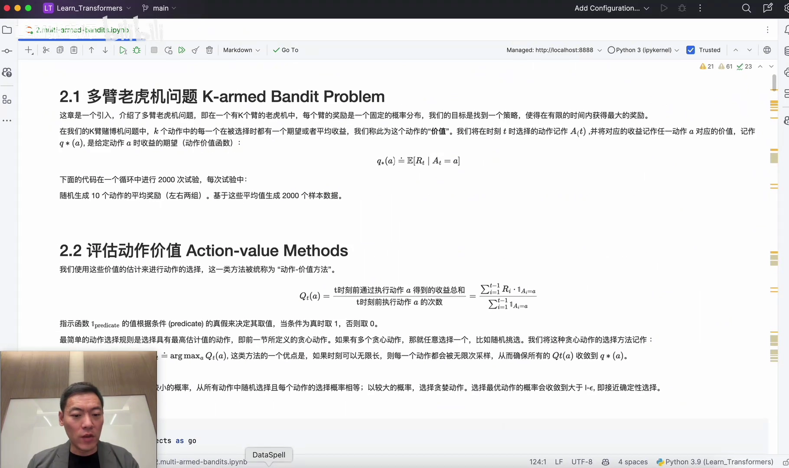

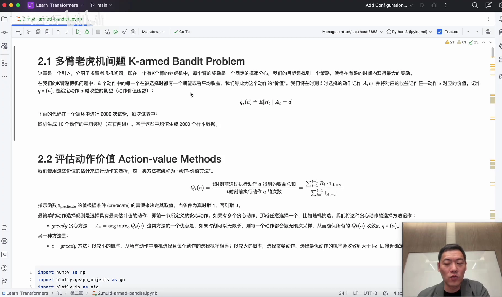

（[跳转到 02:09](https://www.bilibili.com/video/BV19JsYevEFf/?t=129)）

### 1.3 动作价值：用「过去的表现」估计「未来的好坏」

怎么判断一个动作好不好？最朴素的办法是看它**过去拿到过多少奖励**。视频给出的定义是：

> T 时刻之前执行过的动作 `a` 得到的收益总和，除以这个动作被执行的次数。

比如你已经走了 100 步，前 99 步里有时收益是 0、有时是 1，把它们加起来除以 99，就得到你的动作价值。写成公式就是：

```
Q_t(a) = (从 i=1 到 t−1 的 R_i 之和) / (t−1)
```

这个东西叫作**动作价值函数**，英文是 action-value method。它无限逼近于真实的价值 `q*(a)`——也就是那一步你「本该」拿到的最好结果。

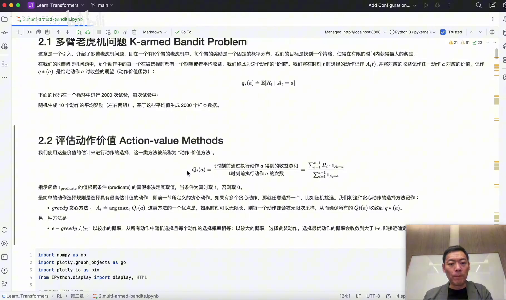

（[跳转到 03:54](https://www.bilibili.com/video/BV19JsYevEFf/?t=234)）

---

## 二、从贪心到 ε-贪心：为什么必须留一条探索的通道

### 2.1 贪心方法：永远选目前最好的那个

最直接的做法是**贪心（greed）**：每次挑动作价值 `Q` 最大的那个动作。

```
A_t = argmax_a  Q_t(a)
```

这里的 `argmax` 我们在大模型里也见过——softmax 之后取最大项，就是选择「值最高」的那个动作。如果你有无穷多的时间，随便怎么摇，最终总能找到那台概率最高的老虎机；但现实里时间有限。

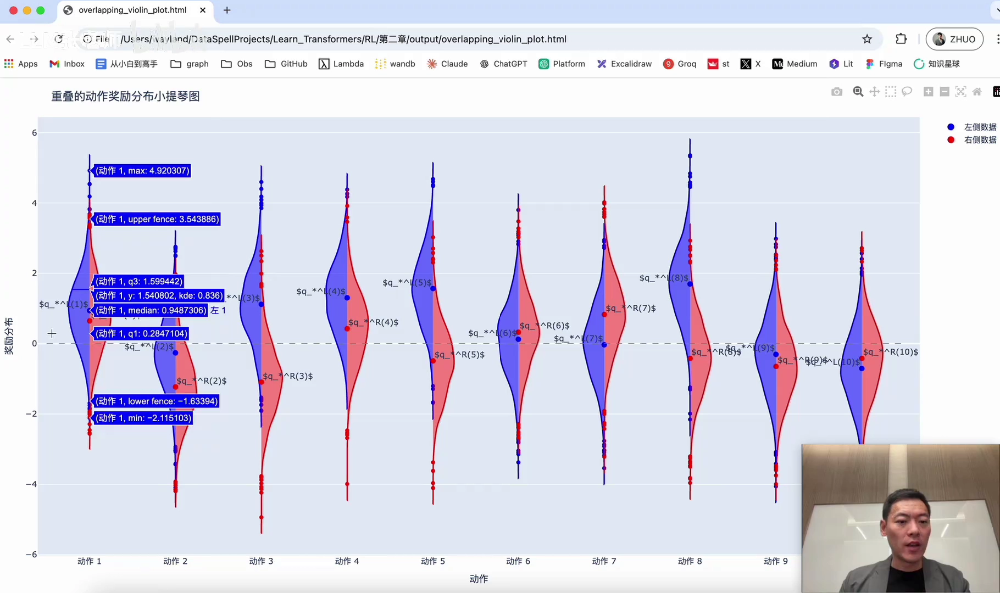

（[跳转到 05:09](https://www.bilibili.com/video/BV19JsYevEFf/?t=309)）

### 2.2 贪心的陷阱：被早期运气锁死

贪心的问题在于「训练周期会被无限拉长」。视频举的例子是：你前几次摇到了概率比较高的一台，就一直摇下去；但很可能只是因为**前 100 步**它概率高，而旁边那台在第 200 步以后概率会更高。这时候你就**永远陷在早期概率高的选择里**，忽略了长期更有价值的动作——坠入了局部最优。

### 2.3 ε-贪心：90% 利用，10% 探索

解决办法是引入一个小参数 `ε`：

- 有 `1 − ε`（比如 90%）的概率，选当前价值最高的那个动作——这是**利用（exploitation）**；
- 有 `ε`（比如 10%）的概率，去选一个随机动作或次优动作——这是**探索（exploration）**。

这 10% 的「随机」就是留给发现潜在更优动作的通道。`ε` 有时设成 0.1，也就是用 0.1 的概率去走别的路。

### 2.4 10 臂测试平台：用数据证明 ε 有用

为了比较这两种方法，视频介绍了 **10-armed testbed（十臂测试平台）**：假设有十个臂，循环 1000 次，比较贪心与 ε-贪心在价值函数上的差距。

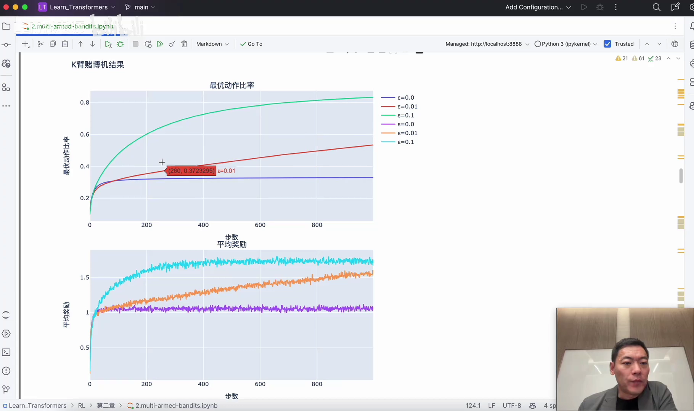

看图（[跳转到 08:15](https://www.bilibili.com/video/BV19JsYevEFf/?t=495)）：

- 横轴是训练步数（1000 步），纵轴是优化比率、也就是平均奖励，越接近 1、数值越高，说明算法表现越好；
- **绿线**是 `ε = 0.1`，早期增长快，后期稳定在 80% 左右选择最优动作；
- **蓝线**是 `ε = 0`，其实就是纯贪心——它长期停留在一个不变的平均奖励里，陷入局部最优；
- **红线**是 `ε = 0.01`，早期因为探索少、奖励偏低，但越往后越接近 `ε = 0.1` 的水平。

结论很清楚：**ε 非常重要，但数值大小可以按任务调**；视频提到行业里初期大多默认取 0.1。

---

## 三、让算法更省内存：增量式实现与「跟踪非平稳」

### 3.1 增量式实现：不必每次重算历史

如果每次都把之前所有奖励累加一遍，计算量会越来越大。**增量式实现（incremental implementation）**把它化简成一次「小步修正」。推导过程是：

```
Q_{n+1} = (1/n) · Σ_{i=1..n} R_i
```

把第 n 项单独拆出来：

```
Q_{n+1} = (1/n) · [ (n−1)·Q_n + R_n ]
```

合并同类项就得到：

```
Q_{n+1} = Q_n + (1/n) · ( R_n − Q_n )
```

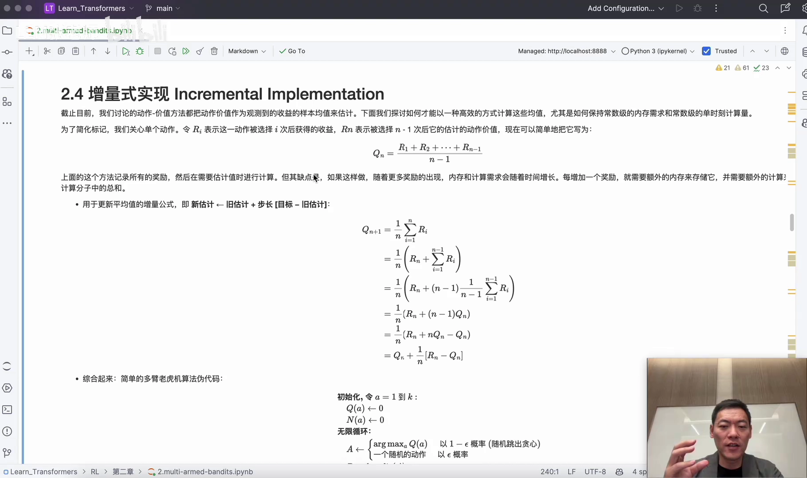

（[跳转到 12:00](https://www.bilibili.com/video/BV19JsYevEFf/?t=720)）

这样一来，每来一个新奖励，只要在旧估计上做一次修正即可，不必把历史累加结果一直存在内存里。

### 3.2 非平稳问题：用固定步长跟住变化

2.5 节讨论的是**非平稳（non-stationary）问题**：摇臂的收益会随时间变化，比如开始是 1，后来变成 1.2、1.3，这时求平均值就不准了。核心思路和上一节很像，只是把步长 `1/n` 换成固定的 `α`：

```
Q_{n+1} = Q_n + α · ( R_n − Q_n )
```

固定步长让估计对「较新」的奖励更敏感，从而能跟上非平稳的变化。

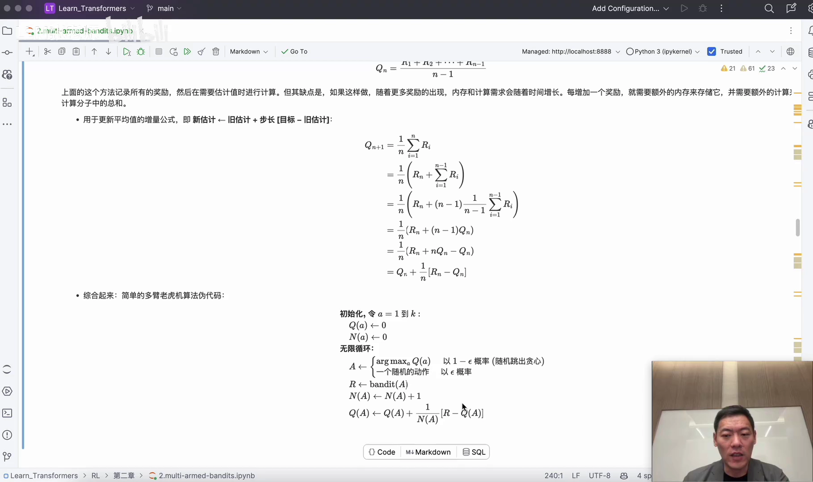

---

## 四、乐观初始值：把「偏差」变成探索的动力

2.6 节的**乐观初始值（optimistic initial values）**讲的是初始值带来的偏差：如果初始动作恰好是早期较好的那台，你可能一直被它锁住，选不到长期价值更高的选项。

办法是**把初始值设得「乐观」一点**。原来 Q 从 0 开始，现在全部设成 `+5`：

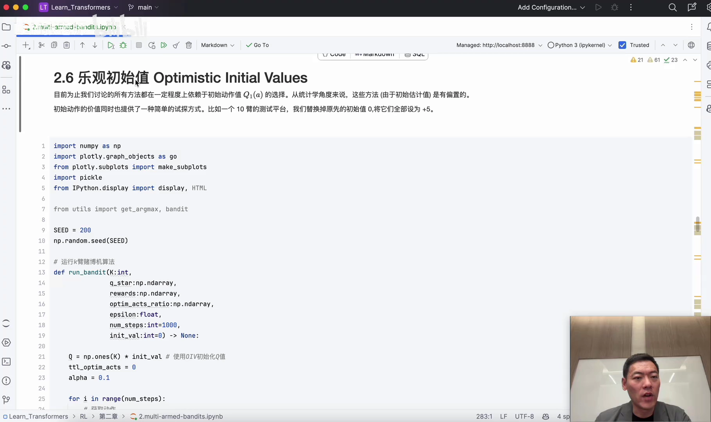

（[跳转到 16:10](https://www.bilibili.com/video/BV19JsYevEFf/?t=970)）

效果是：初始值为 5.0 的**纯贪心**算法，在后期反而比设置了 ε 的贪心算法表现更好——因为「所有动作一开始都很高、实际一拉就失望」这件事本身，就逼着算法去探索，等于用一种巧妙的方式替代了一部分显式的随机探索。

---

## 五、UCB：把「不确定性」也算进去

### 5.1 问题：随机探索也不够聪明

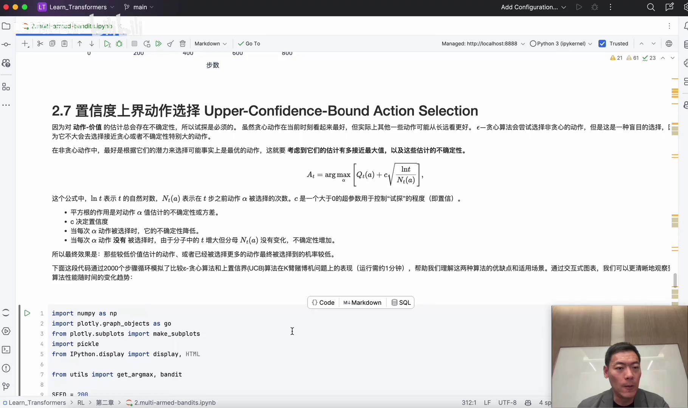

2.7 节的 **UCB（Upper Confidence Bound，置信度上界）**解决的是这样一个问题：ε-贪心的那 10% 是**随机选**的，没有区分「哪个更值得试」。有没有更聪明的探索方式？

### 5.2 做法：给每个动作加一项「不确定性的补偿」

UCB 的想法是：选择动作时，不只看样本均值，还看它「有多不确定」。公式形如：

```
A_t = argmax_a [ Q_t(a) + c · sqrt( ln t / N_t(a) ) ]
```

其中 `N_t(a)` 是动作 `a` 到第 t 步为止被选中的次数，`c` 是一个控制探索程度的小系数。

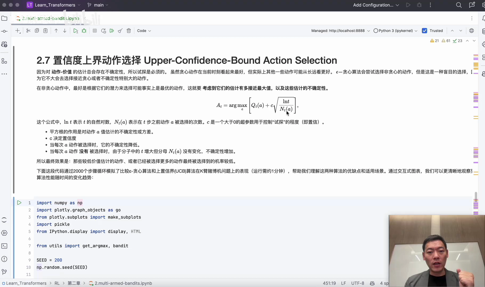

（[跳转到 18:40](https://www.bilibili.com/video/BV19JsYevEFf/?t=1120)）

看这项 `sqrt(ln t / N_t(a))` 的行为（[跳转到 19:55](https://www.bilibili.com/video/BV19JsYevEFf/?t=1195)）：

- 如果某个动作**被选过**，`N_t(a)` 变大、分母变大，这一项就变小，也就是**不确定性下降**；
- 如果某个动作**一直没被选**，时间往前走、`ln t` 变大，而 `N_t(a)` 不变，这一项就变大，**不确定性上升**。

于是「久没被光顾的动作」会被自动重新提起，探索就变得有方向，而不是瞎撞。

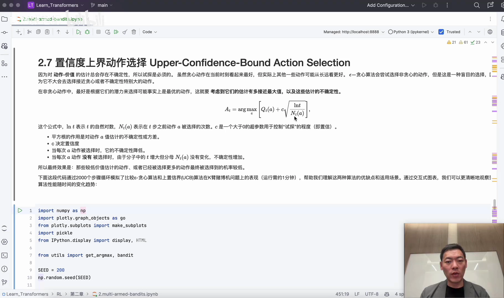

视频给出的对比是：第 100 步时，UCB 有 60% 多的情况下选到最优动作，而 ε-贪心只有 50% 左右；从奖励上看，UCB（紫线）也整体更好。

---

## 六、梯度赌博机：让动作偏好本身可以被学习

### 6.1 换个视角：不记价值，而是记「偏好」

2.8 节的**梯度赌博机（gradient bandit）**引入了一个新概念：**梯度上升**（和大模型里的梯度下降正好相反）。它不再累积奖励、比大小，而是为每个动作学习一个函数——`H_t(a)`，表示对动作 `a` 的**偏好**。

### 6.2 用 softmax 把偏好变成选择概率

动作被选中的概率由 softmax 给出：

```
π_t(a) = exp(H_t(a)) / Σ_b exp(H_t(b))
```

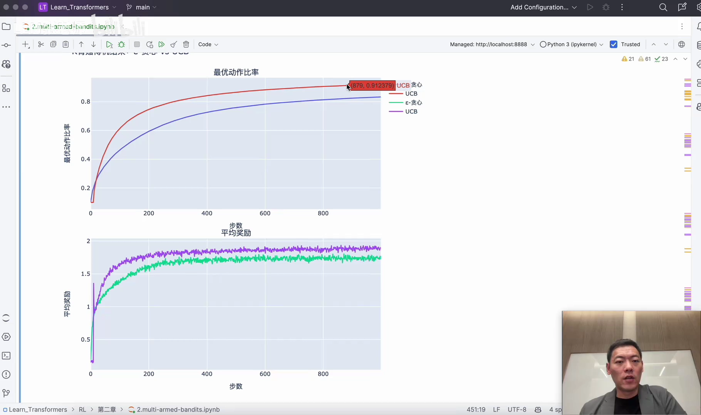

（[跳转到 22:25](https://www.bilibili.com/video/BV19JsYevEFf/?t=1345)）

也就是说，如果一个动作的偏好越来越高，它出现在结果里的百分比就越来越大；我们最终选择百分比最大的那个动作。视频特别指出：这里的偏好**并不基于当前动作的奖励值，而是基于关联性**——每个动作都是一个可学习的函数，所有动作加在一起是一个巨大的复合函数。

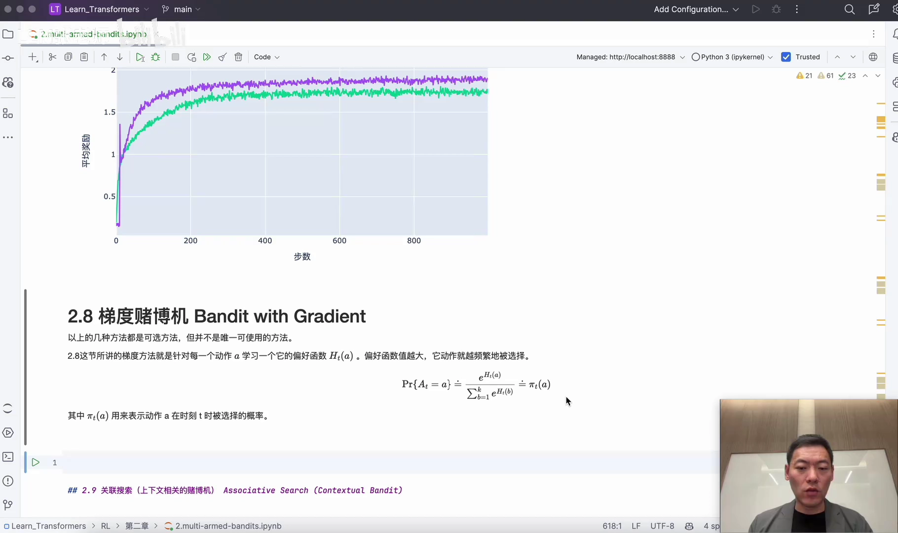

（[跳转到 23:40](https://www.bilibili.com/video/BV19JsYevEFf/?t=1420)）

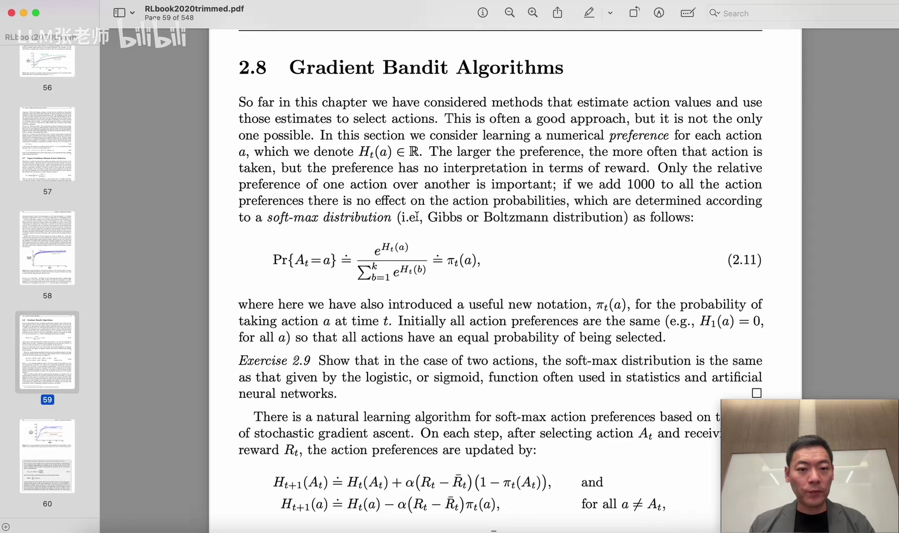

### 6.3 关联搜索：从「无状态」走向「有上下文」

2.9 节引入的是**关联搜索（associative search）**，又叫上下文赌博机。它把多臂老虎机推广一步：动作不只在「当前该摇哪个」上有意义，还会和**上下文/状态**关联起来。这一节在视频里只是一笔带过，但它其实正是通往下一章「马尔可夫决策过程」的桥梁——一旦动作会改变接下来的状态，问题就从「赌博机」升级成了「强化学习」。

---

## 小结

1. **多臂老虎机**研究的是无状态、信息不全时的试错决策：有 K 个臂，每次选一个，目标是最大化累积奖励。
2. **动作价值 `Q_t(a)`** 用历史平均奖励来估计每个动作的好坏；**贪心**每次都选当前最好的。
3. **纯贪心会被早期运气锁死**，于是引入 **ε-贪心**：以 `1−ε` 的概率利用，以 `ε` 的概率探索。
4. **增量式实现**把「求平均」改写成 `Q ← Q + (1/n)(R − Q)`，一步步修正即可；**非平稳问题**用固定步长 `α` 跟踪变化。
5. **乐观初始值**把初始价值设高，让纯贪心在前期也被「失望」逼着探索。
6. **UCB**在样本均值上加一项 `c·sqrt(ln t / N_t(a))`：被选得少、久未光顾的动作不确定性高，会被更优先地尝试。
7. **梯度赌博机**用偏好 `H_t(a)` 与 softmax 直接建模选择概率，并继续为后续 MDP 铺路。
8. 整章的主线只有一条：**在信息不全的世界里，始终权衡眼前的收益（利用）与长远的探索。**

## 关键术语速查

| 术语 | 一句话解释 |
| --- | --- |
| 多臂老虎机（Multi-Armed Bandit） | 有 K 个摇臂、每次选一个、只有选中后才知道结果的试错决策问题 |
| 动作价值 `Q_t(a)` | 动作 a 到第 t 步为止的累积奖励平均值，用来估计动作好坏 |
| 贪心（greedy） | 每次选当前动作价值最高的动作 |
| ε-贪心（ε-greedy） | 以 1−ε 概率利用、以 ε 概率随机探索的策略 |
| 10 臂测试平台 | 用 10 个臂循环 1000 次，比较不同 bandit 算法表现的基准环境 |
| 增量式实现 | 把「重算历史平均」化简为 `Q ← Q + (1/n)(R − Q)` |
| 非平稳（non-stationary） | 摇臂收益随时间变化，用固定步长 α 跟踪 |
| 乐观初始值 | 把初始价值设高，让纯贪心在前期被逼着探索 |
| UCB（置信度上界） | 选「样本均值 + 不确定性补偿」最大的动作，自动权衡探索与利用 |
| 梯度赌博机 | 用偏好 H 和 softmax 建模动作概率，通过梯度上升更新偏好 |
| 关联搜索 | 让动作与上下文/状态关联，是走向 MDP 的过渡 |
