# 多臂赌博机的遗憾界：UCB 是怎么推导出来的

> 本文基于 B 站视频《[在线学习入门 （10.1）多臂赌博机（MAB）](https://www.bilibili.com/video/BV1K12pYeEx4/)》（UP 主：JOJO想）整理撰写。这是「在线学习入门」系列的最后一讲，视频把手写板推导从遗憾的定义一路做到 UCB 算法的伪代码。本文内容均来自该视频的讲解与画面，仅对 AI 字幕的口误与断句做了整理，未作超出视频的引申。

## 本讲要解决的核心问题（SCQA）

**背景**：前面的九讲都在讲**在线学习**，它可以归约成**在线凸优化（OCO）**——每一步先选一个参数 `w_t`，环境返回一个**损失函数** `f_t`，而且这些损失函数是**完全已知**的（full information）。我们讲过 FTL、FTRL，最后用 FTRL + 在线到线性归约得到在线梯度下降，它的遗憾界大约是 `O(√T)`。

**冲突**：可现实里，我们往往**看不到整个损失函数**，只能看到「这次选对了还是选错了」。就像只能摇动老虎机、却不知道其他摇杆会出什么——信息从「全知」退化成「只看得到一点的反馈」。

**疑问**：在这种**只有部分信息**的设定下，遗憾该怎么定义？又该怎么设计算法，让它选得既聪明、遗憾又小？

**回答（中心思想）**：这就是**赌博机在线学习（bandit online learning）**。视频从随机情形出发定义**期望遗憾** `Regret = 各轮最优臂均值之和 − 每轮实际所选臂的均值之和`，把「探索与利用」的矛盾量化成一个要最小化的目标；然后用 **Hoeffding 不等式**构造出**置信上界 UCB**——选择「样本均值 + 不确定性」最大的臂，让算法**自动**在探索与利用之间取得平衡，这正是它比需要手动调参的 ε-贪心和 softmax 更高明的地方。

---

## 一、从「全知」到「只看得到一点」：赌博机问题到底是什么

### 1.1 回顾在线凸优化的交互流程

在线凸优化每一步的流程是（[跳转到 01:15](https://www.bilibili.com/video/BV1K12pYeEx4/?t=75)）：

1. 学习器在动作空间里选一个参数 `w_t`；
2. 把 `w_t` 交给环境；
3. 环境返回一个**凸**损失函数 `f_t`，学习器得到这一步的损失 $f_t(w_t)$。

关键在于：以前的设定里，`f_t` 是**完全已知**的——不管是它的结构、还是它在每一个点的取值，我们都是知道的，这叫 **full information online learning（完全信息在线学习）**。

### 1.2 赌博机：只能看到函数在一个点上的值

这一讲讲的 **bandit online learning** 则不同（[跳转到 03:20](https://www.bilibili.com/video/BV1K12pYeEx4/?t=200)）：

> We can only see some function value, not the function.
> 我们只能看到函数在某一个点处的取值，看不到整个函数。

用一个比喻就很清楚：做多分类问题时，完全信息下我们知道**正确答案是哪一类**；而赌博机设定下，我们只知道**当前的预测是对是错**，并**不知道正确答案是什么**——选错了也不知道该改成什么。

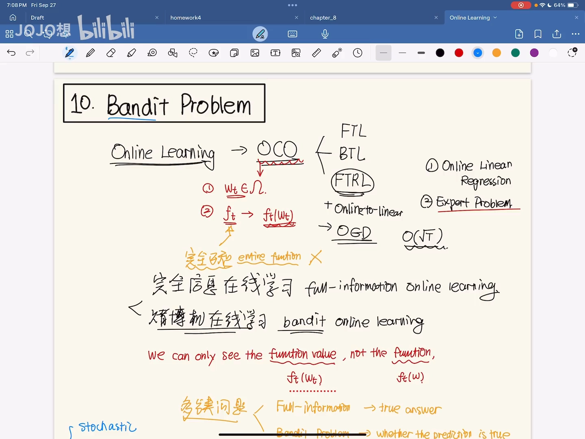

（[跳转到 02:55](https://www.bilibili.com/video/BV1K12pYeEx4/?t=175)）

### 1.3 三种情形里，赌博机属于哪一种

视频回顾了在线凸优化的三个场景：

- **stochastic（随机）**：损失函数从某个分布中独立同分布采样；
- **oblivious（健忘）**：损失函数与学习器的决策无关，在整局游戏开始前就定好了——它可以是对抗的；
- **adaptive（自适应）**：损失函数可以依赖学习器之前的决策。

之前的 FTRL 等算法多建立在 oblivious 设定上。而赌博机问题**信息不全**，所以这一讲从 **stochastic** 这个最简单的角度切入。

---

## 二、多臂赌博机的形式化：设定、目标与遗憾

### 2.1 设定：K 个臂，每轮摇一个

多臂赌博机（MAB）里有 **K 个 arm（摇臂）**，可以理解成 K 个专家、或 K 个假设。每一轮的流程是（[跳转到 10:25](https://www.bilibili.com/video/BV1K12pYeEx4/?t=625)）：

> The learner needs to select one out of K to pull, and then receive the corresponding reward.
> 学习器需要从 K 个臂里选一个来拉，然后收到相应的收益。

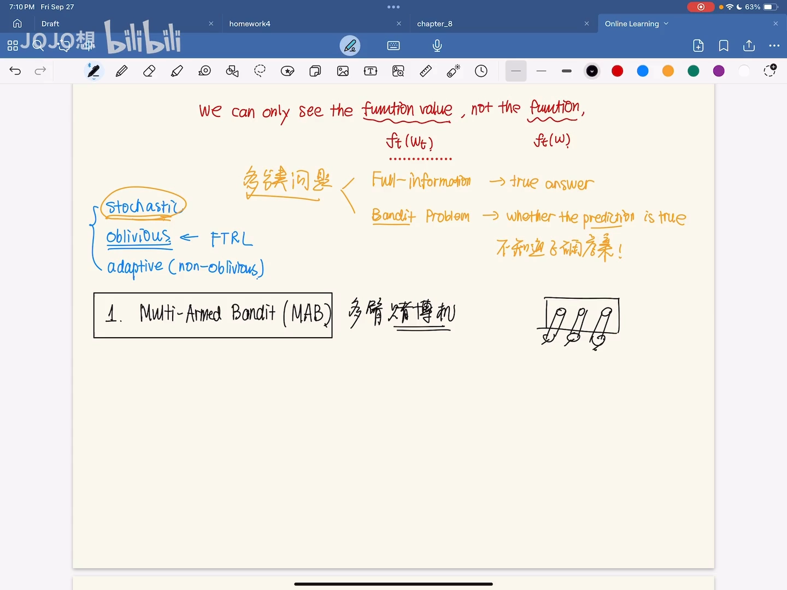

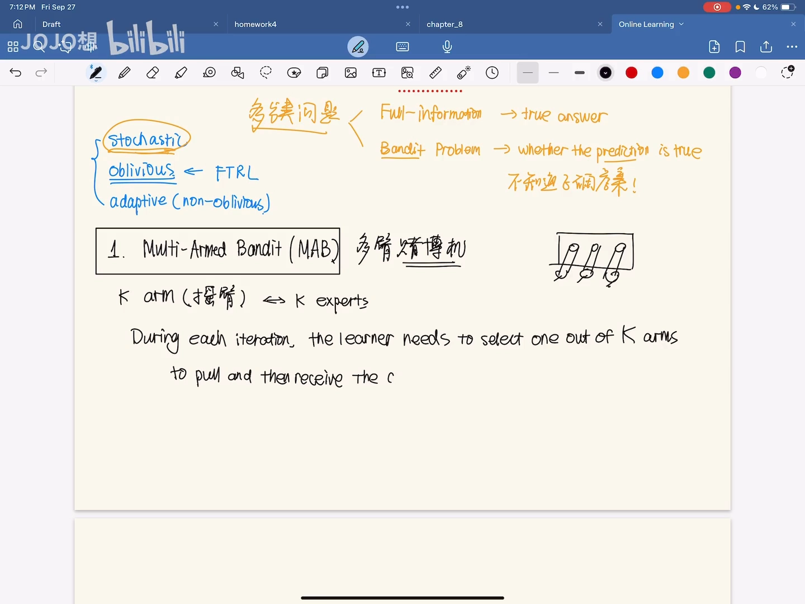

注意这里是 **reward（收益）**，不是 loss——目标也随之从「最小化损失」变成了「**最大化累积收益**」。

### 2.2 记号：μ_i 与 i_t

在随机情形下，**每个臂的收益是独立同分布的（IID）**。记：

- $\mu_i$：第 i 个摇臂收益的**均值**；
- `i_t`：学习器在第 t 轮选择的摇臂。

因为每个臂每轮产生的收益都是一个**分布**、并不确定，所以我们通过求期望，把随机性消掉，只讨论均值。

### 2.3 遗憾：把「选得不够好」变成可以量化的目标

遗憾（regret）在原来的在线凸优化里定义为：

$$
Regret = \sum_{t=1..T} f_t(w_t) - \min_w \sum_{t=1..T} f_t(w)
$$

那里 `f_t` 是损失函数，我们要它小。注意在赌博机里，收益要尽量**大**、遗憾却依旧要尽量**小**——概念并没有反过来。于是遗憾被定义为（[跳转到 14:35](https://www.bilibili.com/video/BV1K12pYeEx4/?t=875)）：

```
Regret = Σ_{t=1..T} max_i μ_i − Σ_{t=1..T} μ(i_t)
       = T·μ* − Σ_{t=1..T} μ(i_t)
```

也就是「一直选最好的那个臂能拿到的期望总收益」减去「我们每轮实际选的臂的期望收益」。因为它只考虑均值，所以也叫 **expected regret（期望遗憾）**。

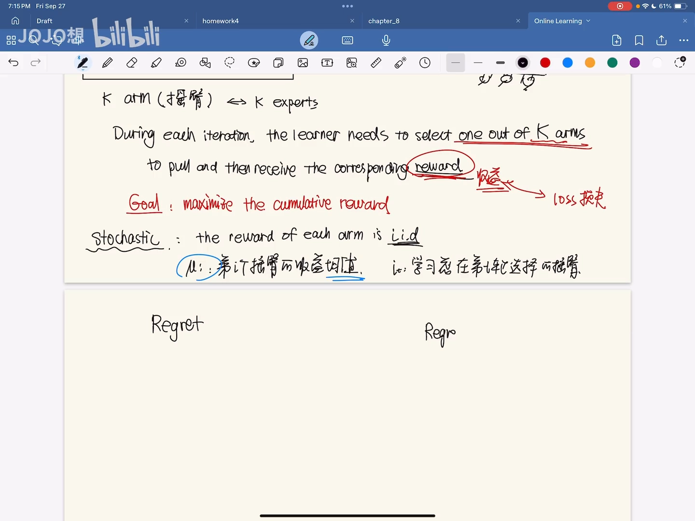

（[跳转到 15:25](https://www.bilibili.com/video/BV1K12pYeEx4/?t=925)）

---

## 三、探索与利用：为什么这个问题本质上是个两难

赌场的最大麻烦在于：我们**只有部分信息（partial information）**——只知道当前轮选到的臂给出的观测 `μ̂`，不知道其他臂的 $\mu$ 是多少。于是学习器面临的就是经典的 **exploration versus exploitation（探索与利用）** 困境（[跳转到 16:40](https://www.bilibili.com/video/BV1K12pYeEx4/?t=1000)）：

- **需要探索**：因为我们不知道每个臂的 $\mu$，为了更准确地估计它们，就得去尝试不同的臂；
- **需要利用**：为了让遗憾最小、收益最大，就希望一直选那个收益最大的臂。

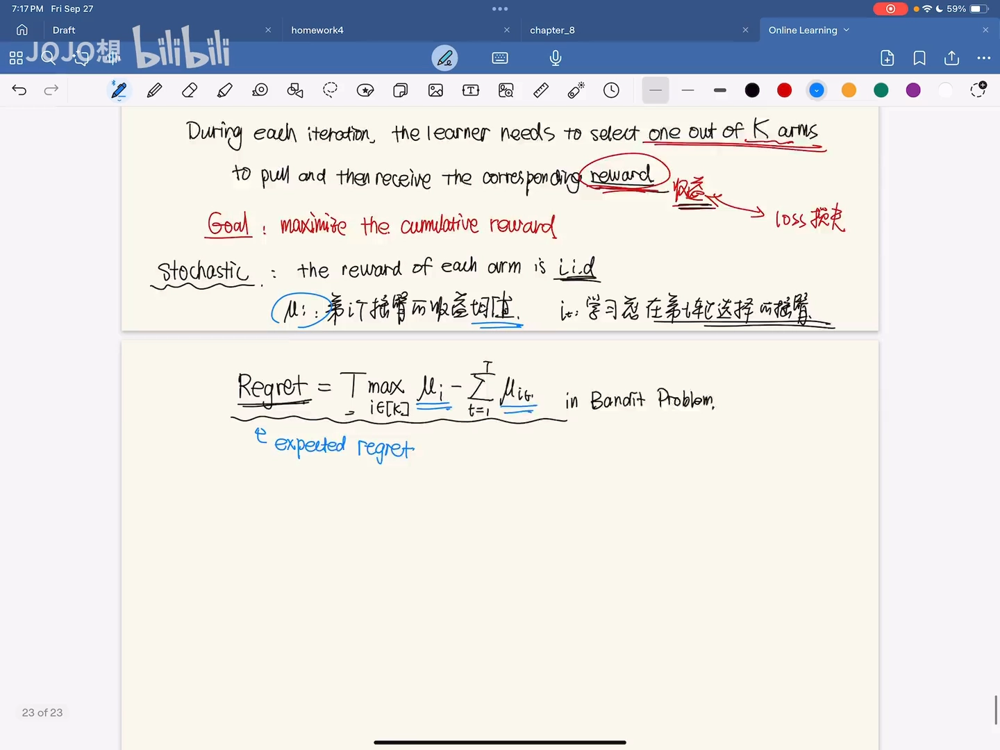

视频用强化学习里的做法打了个比方（[跳转到 19:35](https://www.bilibili.com/video/BV1K12pYeEx4/?t=1175)）：以 Q-learning 为例，常见的是 **ε-greedy**——产生一个 0 到 1 的随机数 `r`，若 `r < ε` 就探索，否则就选当前收益最大的动作；此外也可以用 **softmax**：

$$
\pi(a \mid s) = \exp(Q(s,a) / \tau) / \sum_{a'} \exp(Q(s,a') / \tau)
$$

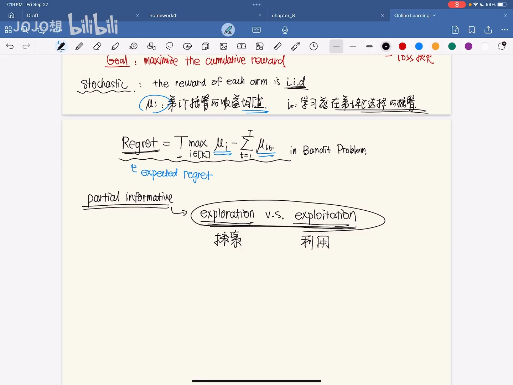

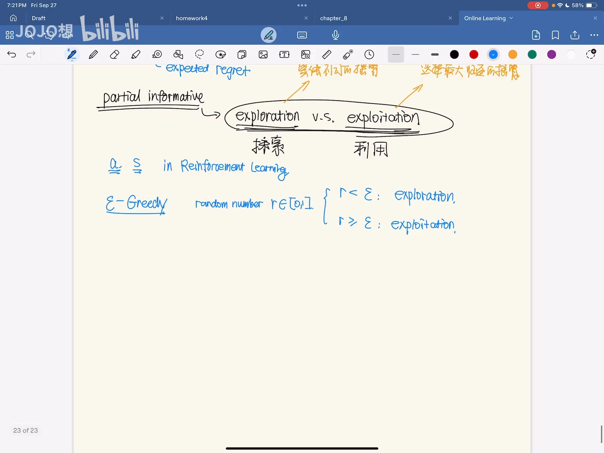

式中的 $\tau$ 是**温度参数（temperature parameter）**：

- $\tau$ 很大 → 各动作的 `Q` 差异被抹平、概率趋于均匀 → 偏向**探索**；
- $\tau$ 很小 → softmax 更倾向于值最大的那一项 → 偏向**利用**。

视频还顺带指出，深度学习里的**知识蒸馏（knowledge distillation）**用的就是同一套思路：先把 $\tau$ 调大（升温）让学生广泛探索老师的知识，再调小让学生专注。

但无论 ε-贪心的 $\varepsilon$、还是 softmax 的 $\tau$，**都需要手动设定**。有没有一种方法能**自动**权衡探索与利用？这就引出了本讲的主角。

---

## 四、UCB：用「置信上界」自动平衡探索与利用

### 4.1 核心想法：不去估计 μ，而去估计它的上界

这一讲给出解决探索-利用困境的典型算法——**UCB（Upper Confidence Bound，置信上界）**（[跳转到 22:55](https://www.bilibili.com/video/BV1K12pYeEx4/?t=1375)）。

它的想法是：为每个臂维护一个**上界** $\hat{\mu}_i$，使得

> 真实的均值 μ_i ≤ 上界 μ̂_i，这件事**以高概率（with high probability）**成立。

然后每一轮**选择上界最高的那个臂**：

> selects the arm with highest UCB.

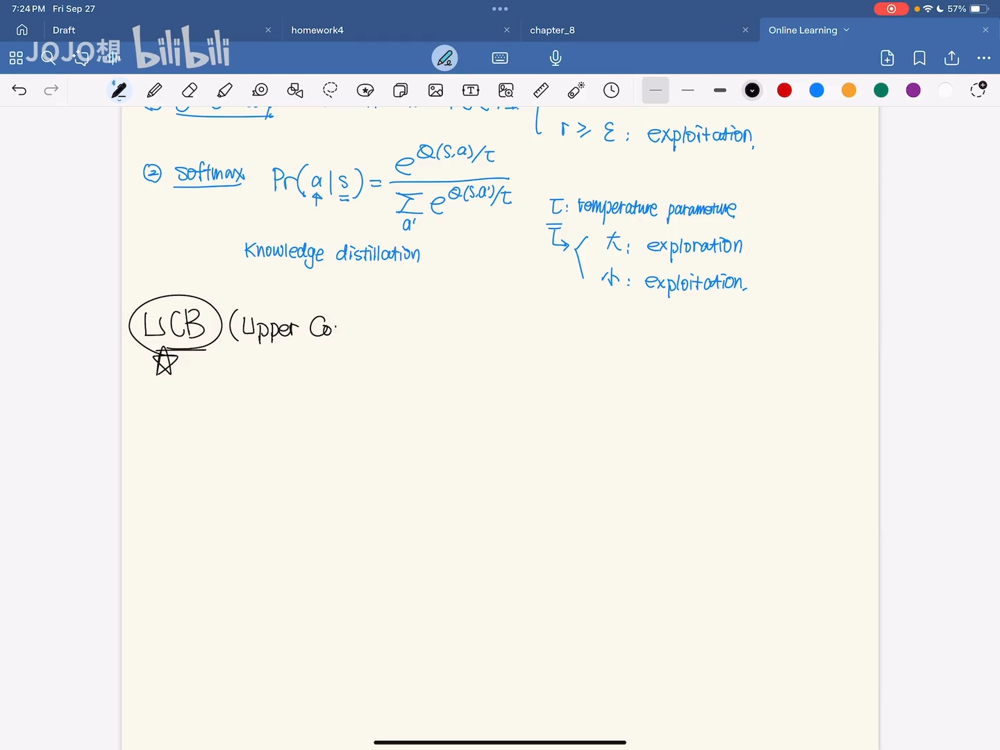

为什么这样能平衡探索与利用？因为我们**不是直接比较样本均值，而是比较「样本均值 + 一点额外的东西」**。这一点额外的东西，正是「不确定性」——后面很快会看到，它天然地偏向被探索得少的臂。

### 4.2 构造 UCB：从 Hoeffding 不等式出发

怎么把 $\hat{\mu}_i$ 构造出来？视频用到了机器学习理论里非常常用的**集中不等式（concentration inequality）**，这里具体用的是 **Hoeffding 不等式**（[跳转到 27:30](https://www.bilibili.com/video/BV1K12pYeEx4/?t=1650)）。

设 `X_1..X_n` 是取值在 `[0,1]` 之间、**独立同分布**、均值为 $\mu$ 的随机变量，则：

```
P( Σ X_i ≥ nμ + t ) ≤ exp( −2t² / n )
P( Σ X_i ≤ nμ − t ) ≤ exp( −2t² / n )
```

它告诉我们：$\sum X_i$ 大概率落在 `nμ ± t` 这个区间里，落到区间外的概率很小。

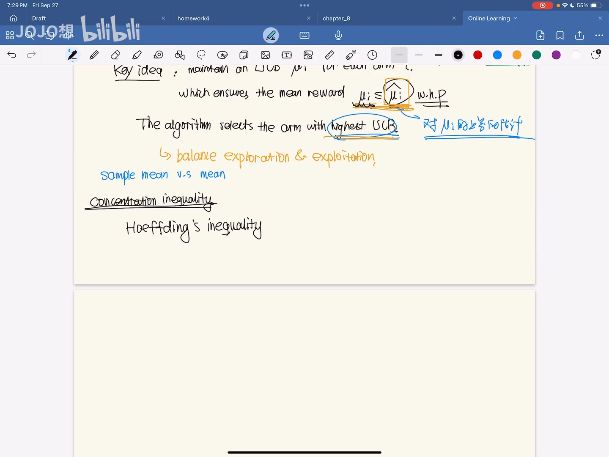

（[跳转到 29:10](https://www.bilibili.com/video/BV1K12pYeEx4/?t=1750)）

### 4.3 推导：μ̄_i + sqrt(2 ln α / N_i)

设第 i 个臂的收益落在 `[0,1]`，它总共被摇了 `N_i` 次，`N_i` 次收益的**样本均值**记为 $\bar{\mu}_i$。把上面的不等式代入、两边同乘 `N_i`，再令区间半宽

$$
t = \sqrt{2 \cdot N_i \cdot \ln \alpha}
$$

就会算出「均值超过上界」这个坏事件发生的概率为：

```
P( μ_i > μ̂_i ) ≤ 1 / α⁴
```

因此以至少 `1 − 1/α⁴` 的概率，有 $\mu_i \le \hat{\mu}_i$。把这个上界取成

$$
\hat{\mu}_i = \bar{\mu}_i + \sqrt{2 \cdot \ln \alpha / N_i}
$$

$\alpha$ 越大，`1 − 1/α⁴` 越接近 1，这个上界就越可靠。

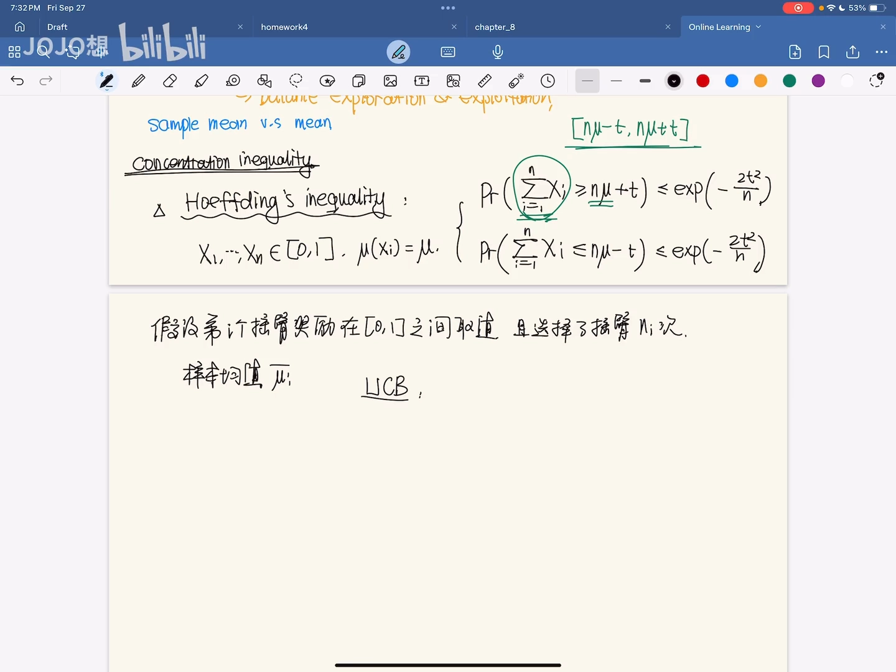

（[跳转到 31:15](https://www.bilibili.com/video/BV1K12pYeEx4/?t=1875)）

### 4.4 为什么它「自动」平衡了探索与利用

把 $\hat{\mu}_i$ 拆开看，它由两部分组成（[跳转到 35:25](https://www.bilibili.com/video/BV1K12pYeEx4/?t=2125)）：

- **样本均值 $\bar{\mu}_i$**：代表**学习器当前学到的东西**（the learner's current knowledge）；
- **区间长度 $\sqrt{2 \ln \alpha / N_i}$**：代表**估计的不确定性**（uncertainty of the estimates）。

于是 UCB 大，要么是因为样本均值大，要么是因为区间长度（不确定性）大：

- 样本均值大 → 应该选它 → 这就是**利用（exploitation）**；
- 区间长度大 → 说明这个臂还没怎么被探索、还「什么都不知道」→ 应该去试它 → 这就是**探索（exploration）**。

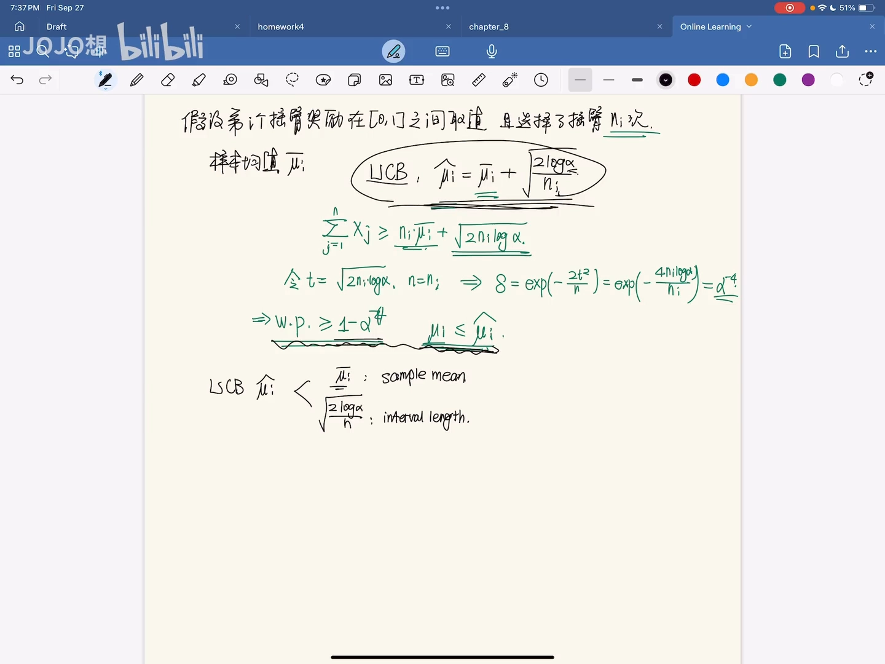

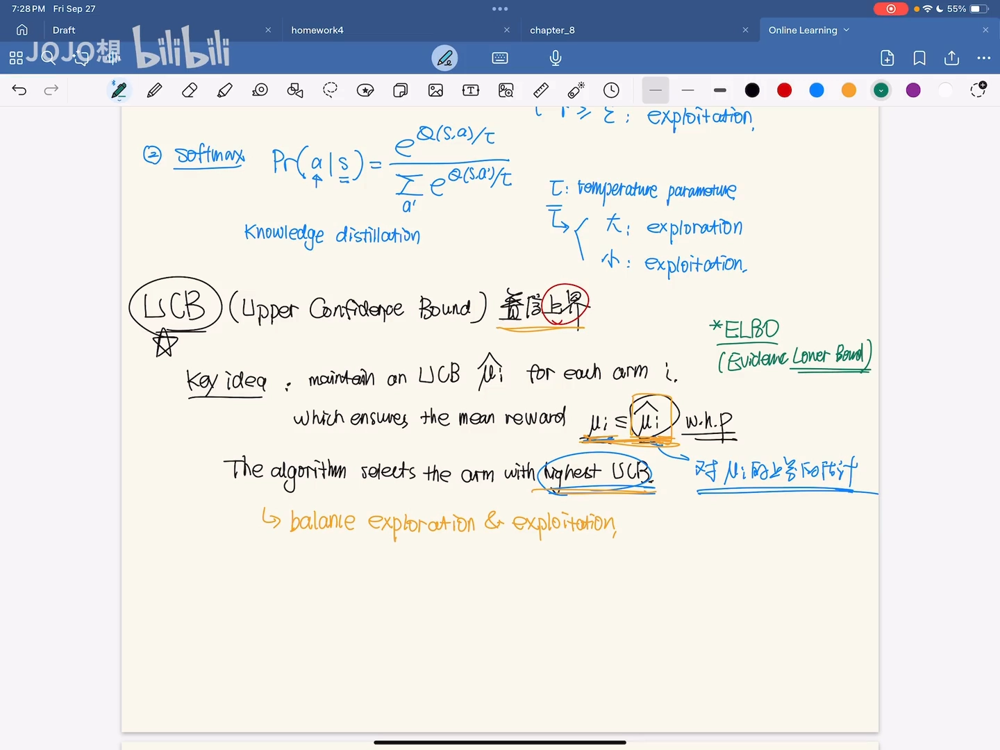

这就形成了一个天然的 trade-off：我们**不需要去判断**什么时候该探索、什么时候该利用，只要始终选 UCB 最大的臂，算法就会 **automatically（自动地）**在两者之间取得平衡——这正是它相对 ε-贪心和 softmax 的优势（后两者的 ε、τ 都要手动设定）。

---

## 五、把 UCB 写成算法

视频最后把 UCB 整理成一个完整的算法（随机情形，[跳转到 38:45](https://www.bilibili.com/video/BV1K12pYeEx4/?t=2325)）：

```
1) 初始化：前 K 轮，每个臂都摇一次（纯探索）
   记录每个臂被选次数 N_i = 1，样本均值 μ̄_i = 摇到的收益 X_i

2) For t = K+1, K+2, ..., T：
   a) 选臂：i_t = argmax_i [ μ̄_i(t−1) + sqrt( 2·ln(t−1) / N_i(t−1) ) ]
   b) 收到收益：观测到 X_{i_t, t}
   c) 更新被选次数：
        N_{i_t}(t) = N_{i_t}(t−1) + 1
        其余 N_j(t) = N_j(t−1)
   d) 更新样本均值（只更新被选到的那个臂）：
        μ̄_{i_t}(t) = [ N_{i_t}(t−1)·μ̄_{i_t}(t−1) + X_{i_t,t} ] / N_{i_t}(t)
```

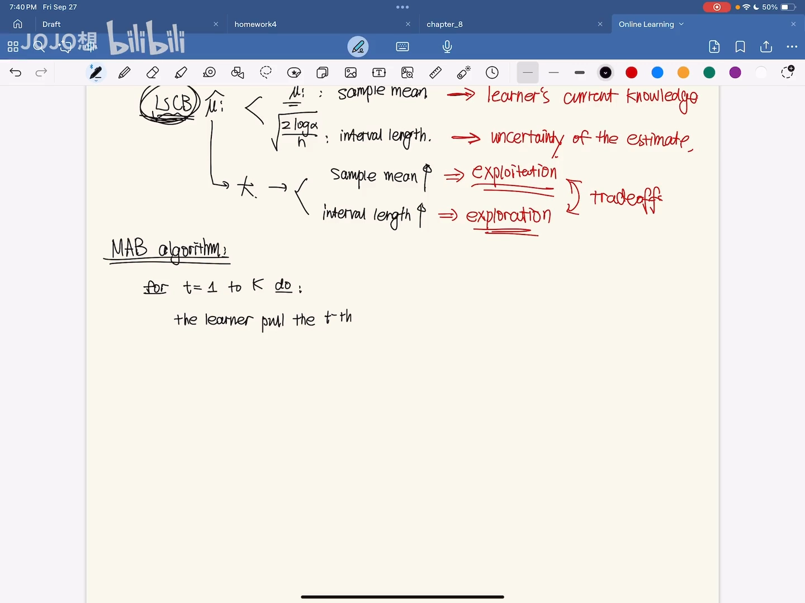

几个细节：

- **开头 K 轮是纯探索**：因为对环境一无所知，必须先给每个臂都摇一次，才能让样本均值有定义；
- **每轮更新的只有两项**：样本均值 `μ̄` 和被选次数 `N`——因为下一轮的 UCB 完全由它们决定；
- 这里的 $\alpha$ 就取成 `t−1`，是随轮数增长的对数项。

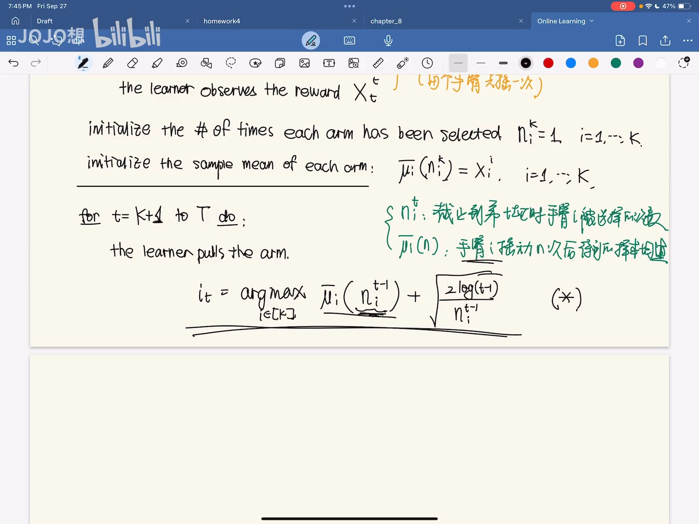

（[跳转到 44:35](https://www.bilibili.com/video/BV1K12pYeEx4/?t=2675)）

---

## 小结

1. **赌博机在线学习**把「完全信息」退化为「只看得到一个点的反馈」：只知道选得对不对，不知道正确答案。
2. **多臂赌博机**有 K 个臂，每轮选一个、得到收益，目标是最大化累积收益。
3. **期望遗憾**定义为「每轮最优臂均值之和 − 每轮实际所选臂均值之和」，它就是我们真正要最小化的目标。
4. 问题本质是**探索与利用**的两难；ε-贪心（手动设 ε）和 softmax（手动设温度 τ）是两种常见折中方式。
5. **UCB** 的思路是估计每个臂均值的**上界** $\hat{\mu}_i$，并选上界最大的臂。
6. 借助 **Hoeffding 不等式**可以推出 $\hat{\mu}_i = \bar{\mu}_i + \sqrt{2 \ln \alpha / N_i}$：前者是当前知识（指向利用），后者是不确定性（指向探索）。
7. 正因如此，UCB 能**自动**平衡探索与利用，无需像 ε-贪心、softmax 那样手动调参。
8. UCB 算法 = **前 K 轮纯探索** + **之后每轮选 UCB 最大者并更新 `N` 与 `μ̄`**。

## 关键术语速查

| 术语 | 一句话解释 |
| --- | --- |
| 在线凸优化（OCO） | 每轮选参数、环境返回凸损失函数的在线学习框架 |
| full information | 损失函数完全已知的在线学习设定 |
| bandit online learning | 只能看到函数在所选点取值的在线学习设定 |
| 多臂赌博机（MAB） | K 个臂、每轮选一个并得到收益的决策问题 |
| 期望遗憾（expected regret） | 最优臂总收益与实际所选臂总收益之差，是要最小化的目标 |
| 探索与利用 | 为估计收益均值需尝试（探索），为最小化遗憾又想选最优（利用） |
| ε-greedy / softmax | 两种手动权衡探索与利用的方式，分别由 ε、τ 控制 |
| Hoeffding 不等式 | 刻画独立同分布随机变量之和集中在均值附近的集中不等式 |
| UCB（置信上界） | 用「样本均值 + 不确定性」构造上界，选上界最大的臂，自动平衡探索与利用 |
