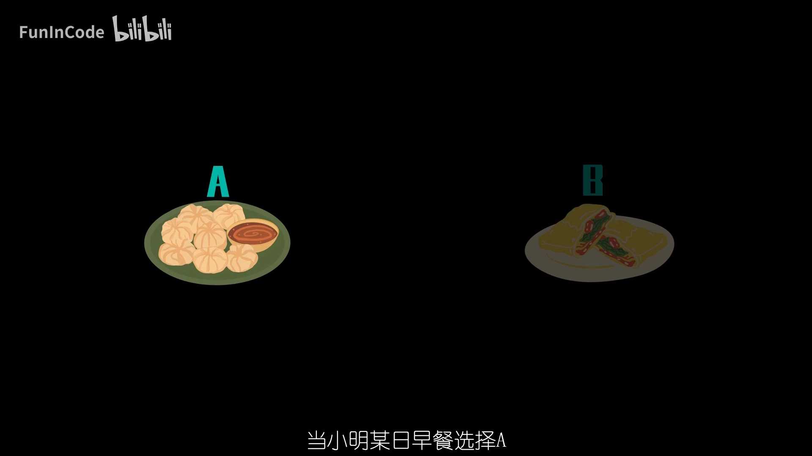
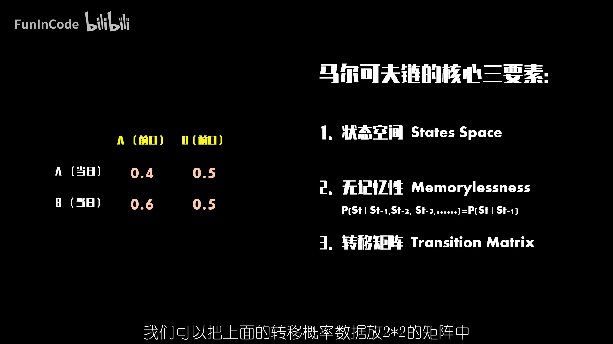
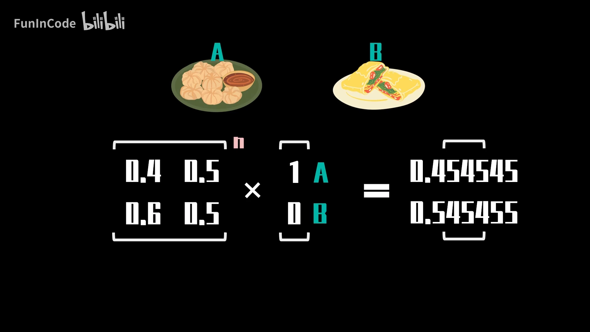
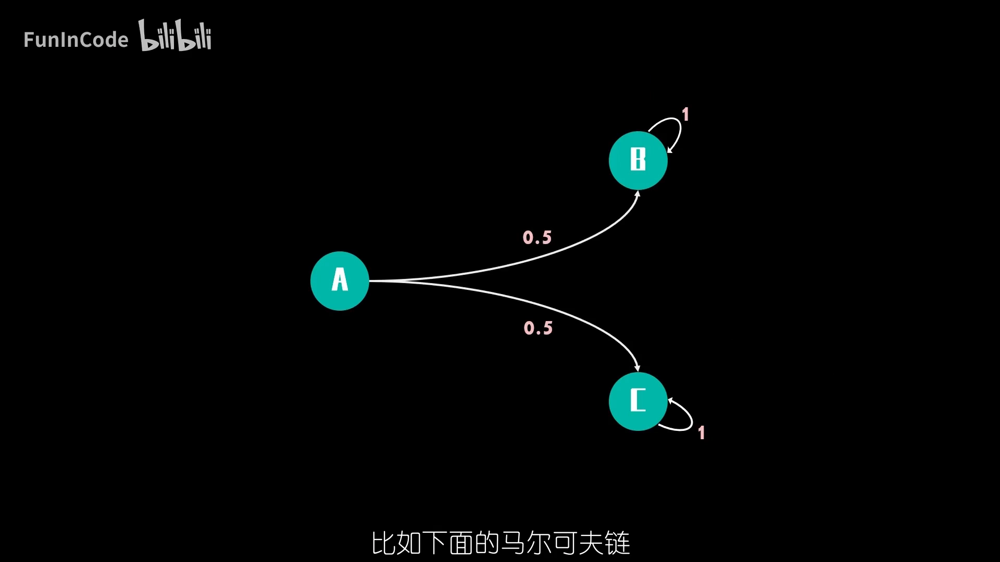
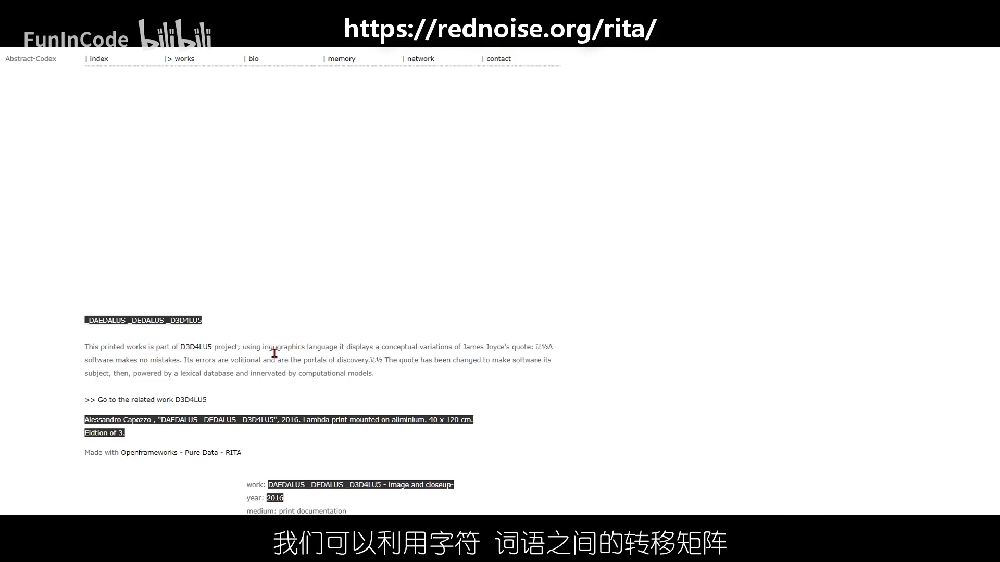

# 5分钟搞懂马尔可夫链：状态空间、无记忆性与转移矩阵

> 视频来源：[【数之道 18】马尔可夫链是什么？了解它只需5分钟！](https://www.bilibili.com/video/BV19b4y127oZ/)（时长约 4.5 分钟）

## 本讲要解决的核心问题（SCQA）

**背景**：很多现实系统是"随时间随机演化"的——明天天气怎么样、下一位顾客买什么、一段文字接下来会出现哪个词，我们只能给出概率，而无法精确预测。

**冲突**：如果要把"未来"算清楚，理论上得把**整部历史**都考虑进去：昨天、前天、上个月发生了什么，似乎都会影响明天。历史的长度没有上限，计算量就无从下手。

**疑问**：有没有一种办法，让我们**只看"现在"**就能推断"接下来"？

**回答（中心思想）**：有。**马尔可夫链（Markov chain）** 的核心假设是——**未来只取决于当前状态，而与如何到达当前状态无关**（这叫"无记忆性"）。一旦接受了这个简化的假设，我们只需要三样东西就能刻画整个随机演化过程：**状态空间**（有哪些可能的状态）、**转移概率**（从一个状态到另一个状态的可能性）、以及把概率打包起来的**转移矩阵**。用这一点"只看当下"的压缩，就能换来计算上的可行。

## 一、从一个"早餐选择"的例子认识马尔可夫链

视频用一个生活化的例子开头：小明家楼下有两家早餐铺，A 主营小笼包和生煎，B 主营煎饼果子。小明每天的选择遵循下面的规律：

- 如果某天选了 **A**，那么第二天有 **40%** 继续选 A、**60%** 改选 B；
- 如果某天选了 **B**，那么第二天有 **50%** 继续选 B、**50%** 改选 A。


关键在于这句话：**当日的选择只受前一日结果、以及对应的转移概率影响，与更早之前的选择无关**。也就是说，不管小明是"一直吃 A 突然改 B"，还是"昨天刚从 B 换来"，只要今天的状态相同，明天的概率分布就完全一样。



[【跳转到 00:14】](https://www.bilibili.com/video/BV19b4y127oZ/?t=14)

## 二、核心三要素：状态空间、无记忆性、转移矩阵

视频把上面这句"简单的话"拆成了马尔可夫链的**三个核心要素**：

1. **状态空间（state space）**——系统所有可能状态的集合。本例中早餐状态只能来自状态空间 ${A, B}$。
2. **无记忆性（memorylessness）**——下一期的概率只受上一期状态影响，与更早的历史无关，可以用条件概率的公式表达。
3. **转移矩阵（transition matrix）**——把所有"从某状态到某状态"的概率整理成矩阵，方便后续分析和计算。


[【跳转到 01:04】](https://www.bilibili.com/video/BV19b4y127oZ/?t=64)

理解这三要素是理解后面一切的前提：**状态空间**决定了"可能处在什么情况"，**转移矩阵**决定了"下一步会怎么变"，**无记忆性**则保证了"这些概率不必随历史变化"，于是同样的矩阵可以反复使用。

## 三、把转移概率写进转移矩阵

把上面的转移概率数据放进一个 **2×2 的矩阵**里：

```
        A      B
A  [  0.4    0.6  ]      ← 从 A 出发：40% 留在 A，60% 去 B
B  [  0.5    0.5  ]      ← 从 B 出发：50% 去 A，50% 留在 B
```

矩阵的**每一行代表起始状态、每一列代表终止状态**，行内元素之和为 1（因为第二天必然落在 A 或 B 之一）。这条矩阵就是这条马尔可夫链的全部"动态"。

## 四、状态概率分布如何随天数演化

有了转移矩阵，就能推演"经过若干天之后，处在各个状态的概率是多少"。

假设小明第一天选 A，那么**当天的状态概率分布**为 `(1, 0)`（100% 在 A）。把它与转移矩阵相乘，得到第二天的分布 `(0.4, 0.6)`；重复同样的操作，得到第三天的分布 `(0.46, 0.54)`：

```
第 1 天    (1,    0     )
第 2 天    (0.4,  0.6   )
第 3 天    (0.46, 0.54  )
  …          …      …
稳态        (0.454545, 0.545455)
```



继续推演下去，分布会迅速稳定到一个固定的值——**稳态分布（steady state distribution）** `(0.454545, 0.545455)`。

[【跳转到 01:47】](https://www.bilibili.com/video/BV19b4y127oZ/?t=107)

## 五、稳态分布与初始状态无关

一个自然的问题是：如果初始分布不同，稳态会不会改变？

视频做了对照实验：假如小明第一天选的是 **B**，用同样的方法计算，很快也会达到**同一个**稳态分布 `(0.454545, 0.545455)`。更进一步，把初始分布设为任何**非负且相加等于 1** 的值，结果都收敛到同一个稳态。



这说明在这条马尔可夫链下，**最终的稳态不受初始状态影响**——这是一个非常有用、也非常反直觉的性质。

[【跳转到 02:12】](https://www.bilibili.com/video/BV19b4y127oZ/?t=132)

## 六、并非所有马尔可夫链都有唯一稳态

上面的"唯一稳态"并不是普遍规律。视频给出一条反例：状态 A 按一定概率**单向连接到 B 和 C**，而一旦进入 B 或 C，就在对应状态下**自循环**、无法再到达其他状态。

```
A ──→ B ──↻
A ──→ C ──↻
```

这样一来，链会"陷进" B 或 C 中的某一个，稳态分布就不止一个：例如 `(0, 1, 0)`（永远停在 B）和 `(0, 0, 1)`（永远停在 C）都可以作为它的稳态。



[【跳转到 03:01】](https://www.bilibili.com/video/BV19b4y127oZ/?t=181)

> 一句话记住：**稳态唯一需要"链能把所有状态都连通起来"这一类条件**；像上面这种"进入后就被困住"的结构，就会产生多个稳态。

## 七、马尔可夫链用在哪里

视频最后介绍了两个典型应用方向：

- **自然语言处理**：利用字符、词语之间的**转移矩阵**，去"联想"用户接下来想说什么、想搜什么，也可以用马尔可夫链随机生成诗词、文章。视频特别推荐信息论之父**克劳德·香农（Claude Shannon）** 1948 年的著作《通信的数学理论》（*A Mathematical Theory of Communication*），其中就有基于转移概率的语言模型思想。
- **金融行业**：分析**牛市／熊市的状态转换**、股票价格预测、信用评级等。




[【跳转到 03:26】](https://www.bilibili.com/video/BV19b4y127oZ/?t=206)

## 小结

- 马尔可夫链的出发点是**一个简化假设**：未来只取决于当前状态，与历史无关（无记忆性）。
- 描述一条马尔可夫链只需要三样东西：**状态空间**、**转移概率**、以及打包它们的**转移矩阵**。
- 状态分布向量**反复乘以转移矩阵**，就能推演出任意天数后的概率分布。
- 在满足连通性等条件时，分布会收敛到一个**与初始状态无关的稳态分布**。
- 稳态**不保证唯一**：如果链中存在"进入后就被困住"的状态，就可能出现多个稳态。
- 典型应用：语言建模／文本生成、金融市场状态分析等。

## 关键术语速查

| 术语 | 一句话解释 |
| --- | --- |
| 马尔可夫链（Markov chain） | 未来只依赖当前状态的随机演化过程 |
| 状态空间（state space） | 系统所有可能状态的集合，如早餐例子中的 ${A, B}$ |
| 无记忆性（memorylessness） | 下一期的概率只由当前状态决定，与更早历史无关 |
| 转移概率（transition probability） | 从一个状态一步转到另一个状态的概率 |
| 转移矩阵（transition matrix） | 把所有转移概率排列成的矩阵，每行之和为 1 |
| 状态概率分布 | 当前系统处在各个状态上的概率（和为 1 的向量） |
| 稳态分布（steady state distribution） | 经过足够多步后趋于不变的状态概率分布 |
