# 马尔可夫链：为什么"未来只取决于现在"

> 视频来源：[马尔可夫链｜强化学习基础](https://www.bilibili.com/video/BV1tgP5z2ELr/?p=2)（时长约 12 分钟）

## 本讲要解决的核心问题（SCQA）

**背景**：当你用手机打字，输入法会在你打完之前就提示下一个词；谷歌要在数以十亿计的网页里判断哪些页面最重要；气象预报员预测明天的天气，通常只从今天的天气出发去推断。这些看似毫不相关的问题，背后共享同一套数学框架——用来推理"随时间随机演化的系统"。

**冲突**：这套框架的核心假设听上去很"大胆"：**未来只取决于当前状态，而与你如何到达当前状态无关**。一个把历史整个忽略掉的模型，怎么可能刻画得了现实世界的复杂？

**疑问**：这种被称为"无记忆性"的假设到底是什么？它凭什么成立？又能带来什么？

**回答（中心思想）**：满足"无记忆性"的随机过程就叫**马尔可夫链（Markov chain）**。它用**状态、转移概率、转移矩阵**三个要素，把"随时间演化的随机系统"压缩成一个可以反复相乘的矩阵；而矩阵的高次幂会自然收敛到一个与初始条件无关的**平稳分布**——这正是谷歌 PageRank 的基础。

## 一、从"无记忆性"说起

马尔可夫（Andrey Markov）在 20 世纪初研究了一个看似简单的问题：**如果已知系统当前的状态，究竟还需要多少历史信息，才能预测接下来会发生什么？**

他给出的结论很惊人：对许多系统而言，**只需要当前时刻的信息就够了**。一旦你知道自己当前所处的状态，过去就变得无关紧要。

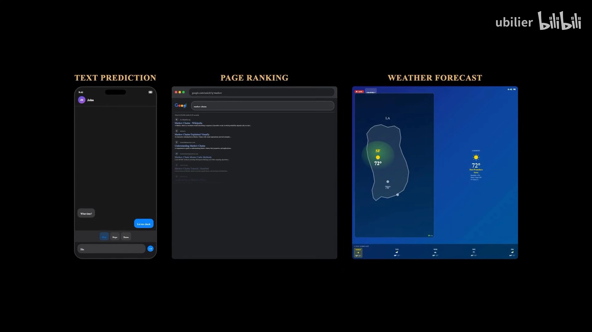

[【跳转到 00:23】](https://www.bilibili.com/video/BV1tgP5z2ELr/?p=2&t=23)

这种特性叫做**无记忆性（memorylessness）**。乍看像是严重的局限——一个忽略历史的模型，怎么可能刻画现实世界的复杂性？然而马尔可夫链最终被证明惊人地强大：从 DNA 序列到股票价格，从排队系统到语言本身，都能用它建模。

关键洞见在于：**这些系统也许拥有丰富的历史，但它们的近期未来主要取决于当前状态**。正是这种简化，让分析变得可行，同时又不牺牲太多准确性。

[【跳转到 01:00】](https://www.bilibili.com/video/BV1tgP5z2ELr/?p=2&t=60)

## 二、三要素：状态、转移、概率

要精确描述一条马尔可夫链，需要三样东西：

- **状态（state）**：系统所有可能的配置情况。比如天气预报里，状态可以是晴天、多云、雨天，每天大气恰好处于其中之一；
- **转移（transition）**：系统如何从一个状态变到另一个状态。从晴天出发，明天可能保持晴朗，也可能转为多云或雨天；
- **概率（probability）**：每个转移都对应一个概率；从任意状态出发，所有转移概率之和必须等于 1（因为明天的天气必定是某种状态）。

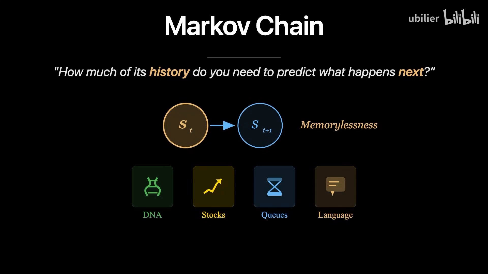

[【跳转到 01:25】](https://www.bilibili.com/video/BV1tgP5z2ELr/?p=2&t=85)

把这些概率整理成一个**转移矩阵（transition matrix）**：每一行代表起始状态，每一列代表终止状态，第 i 行第 j 列的元素表示"一步之内从状态 i 转移到状态 j"的概率。

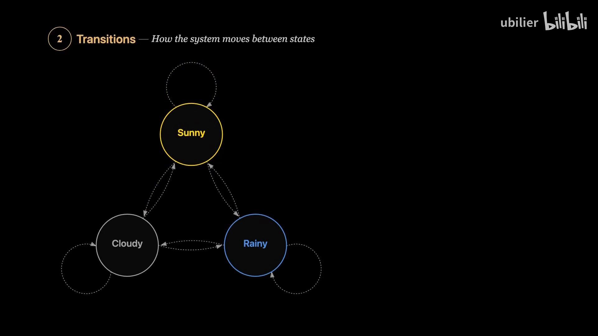

[【跳转到 02:15】](https://www.bilibili.com/video/BV1tgP5z2ELr/?p=2&t=135)

对含三种状态的天气模型，这就是一个 3×3 的矩阵，九个概率完整刻画了天气演变的动态。

而让马尔可夫链区别于"普通链"的，正是**无记忆性**：转移到下一状态的概率仅取决于当前状态，不依赖更早的状态序列。如果今天是晴天，那么"明天下雨"的概率，无论昨天是晴是阴是雨，都保持不变——大气除了当前状况之外没有别的记忆。用条件概率来刻画这一点：

```
P(X_{n+1} = j | X_n = i, X_{n-1}, …, X_0) = P(X_{n+1} = j | X_n = i)
```

换句话说，**完整的历史被压缩成了代表当前状态的一个值**。正是这种压缩，让马尔可夫链在分析上易于处理。

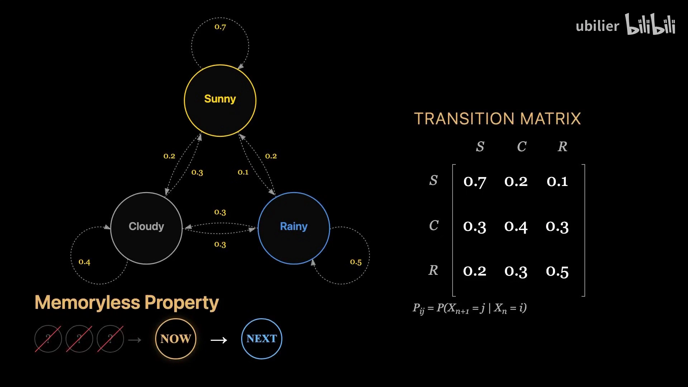

[【跳转到 03:05】](https://www.bilibili.com/video/BV1tgP5z2ELr/?p=2&t=185)

## 三、动手算一次：从一步到多步

为了把上面的话变具体，把天气简化成两种状态：晴、雨。

- 晴天时：明天继续晴的概率 0.8，转雨的概率 0.2；
- 雨天时：明天继续雨的概率 0.6，转晴的概率 0.4。

写成 2×2 的**转移矩阵** `P`（行=当天，列=明天）：

```
        明天晴   明天雨
今天晴 [ 0.8     0.2  ]
今天雨 [ 0.4     0.6  ]
```

每一行之和都等于 1。


[【跳转到 03:55】](https://www.bilibili.com/video/BV1tgP5z2ELr/?p=2&t=235)

**问题**：从晴天开始，两天后的概率分布是多少？可以追踪每一条可能路径：

```
晴→晴→晴 = 0.8×0.8 = 0.64
晴→晴→雨 = 0.8×0.2 = 0.16
晴→雨→晴 = 0.2×0.4 = 0.08
晴→雨→雨 = 0.2×0.6 = 0.12

两天后为晴 = 0.64 + 0.08 = 0.72
两天后为雨 = 0.16 + 0.12 = 0.28
```

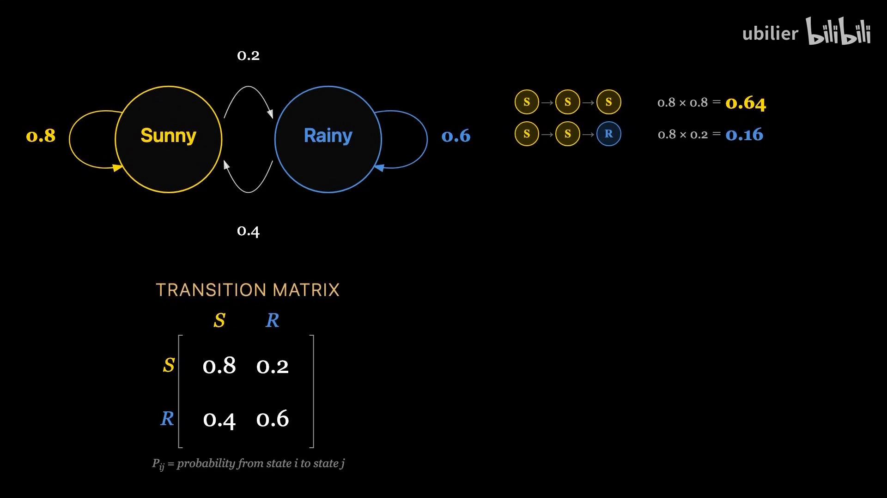

所以从晴天出发，两天后有 72% 的概率是晴天、28% 的概率是雨天。

**精彩之处**：这个"枚举路径再求和"的结果，等价于把转移矩阵**平方** `P²`。矩阵乘法会自动对所有中间路径求和，并按每条路径的概率加权：

```
P² = P × P
```

要得到经过 N 步后的分布，只需把转移矩阵自乘 N 次。

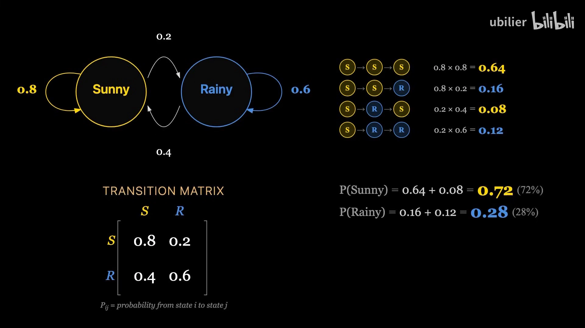

[【跳转到 05:10】](https://www.bilibili.com/video/BV1tgP5z2ELr/?p=2&t=310)

## 四、平稳分布：无论从哪出发，终会殊途同归

继续把矩阵乘下去会怎样？观察 `P` 的第 2、第 5、第 10 次幂：最初两行差别很大（毕竟初始状态是晴还是雨不一样），但随着幂次升高，**各行开始收敛，越来越相似，直至几乎完全相同**。

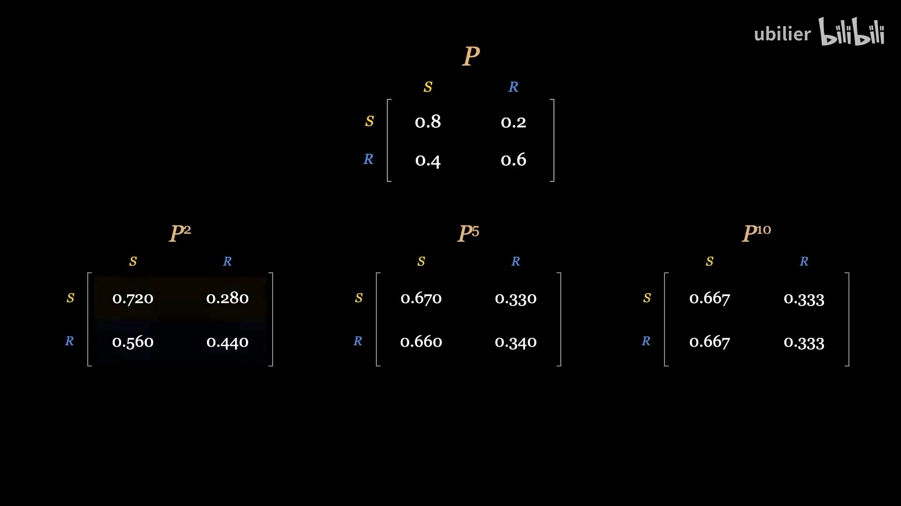

这个极限分布叫做**平稳分布（stationary distribution）**。它的含义很深刻：**无论系统从哪个状态开始，只要等待足够久，处于每个状态的概率都会趋近同一个固定值，而该值只取决于转移概率，与初始条件无关。**

在我们的天气模型里，平稳分布最终是**晴天 2/3、雨天 1/3**——无论从晴天还是雨天开始，经过足够长时间后，停在每个状态的概率都会趋于相同。

[【跳转到 06:25】](https://www.bilibili.com/video/BV1tgP5z2ELr/?p=2&t=385)

平稳分布满足一个漂亮的不动点方程。设 `π` 为平稳概率向量，则：

```
π P = π
```

也就是说，经过一步转移后平稳分布保持不变——它是这个动态过程的**不动点**，也可以看作转移矩阵对应**特征值 1 的左特征向量**。

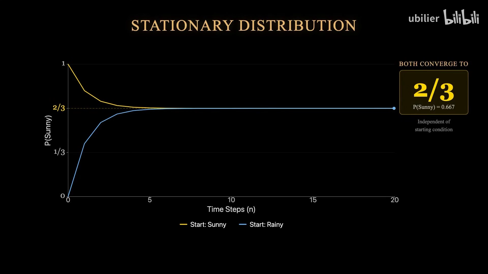

[【跳转到 06:50】](https://www.bilibili.com/video/BV1tgP5z2ELr/?p=2&t=410)

## 五、什么样的链才有唯一的平稳分布？

并非每条马尔可夫链都有唯一的平稳分布，也并非每条链都会收敛到某个分布。一条链可能包含**多个互不连通的部分**，每部分各有其平稳行为；也可能**周期性循环**，永远无法稳定。

但在温和条件下，平稳分布**存在且唯一**：

- **不可约的（irreducible）**——任意两个状态之间可以相互到达；
- **非周期的（aperiodic）**——不会以固定周期循环。

当链同时满足这两点时，无论从哪个起点出发，最终都会收敛到那个唯一的平稳分布。这些条件在大多数实际应用中都能满足。

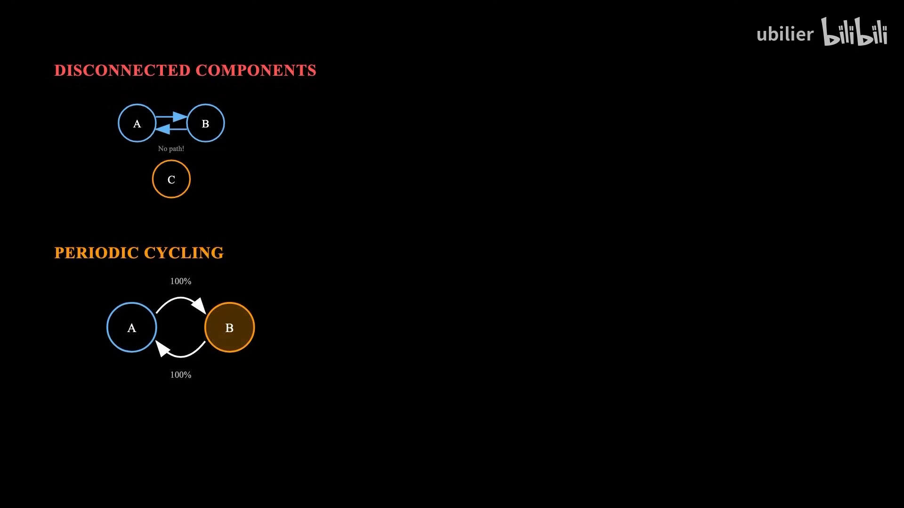

[【跳转到 07:40】](https://www.bilibili.com/video/BV1tgP5z2ELr/?p=2&t=460)

## 六、最著名的应用：PageRank

马尔可夫链最著名的应用，也许是谷歌的 **PageRank**，它在 20 世纪 90 年代末彻底改变了网络搜索。它要解决的题目表述起来很简单——**哪些网页最重要**——但在数十亿网页中却难以回答。

关键洞见在于：**模拟一个随机浏览网页的用户**。把每个网页看作一个状态，页面上的链接定义可能的跳转路径；如果一个页面有 10 个外链，冲浪者点击每个链接的概率就是 1/10。这种随机点击行为，在整个网络图上正好构成一条马尔可夫链。

[【跳转到 08:19】](https://www.bilibili.com/video/BV1tgP5z2ELr/?p=2&t=499)

PageRank 提出的问题很自然：**从长远看，随机冲浪者在每个页面上停留的时间占比是多少？** 这正是这条"网页浏览马尔可夫链"的**平稳分布**。被许多页面链接、或被重要页面链接的页面，会被更频繁地访问——平稳分布刻画了一种沿链接结构传播的"重要性"。

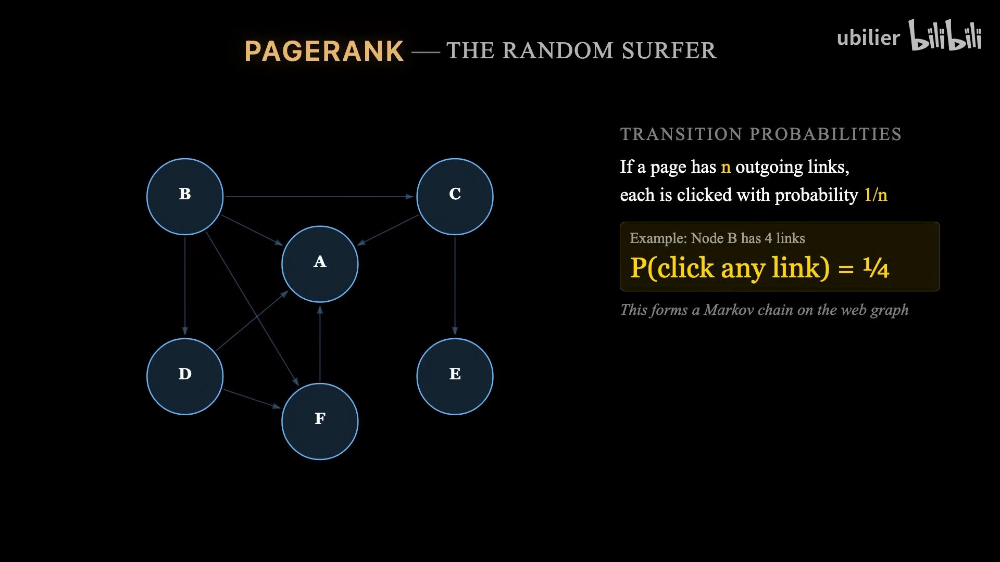

[【跳转到 08:44】](https://www.bilibili.com/video/BV1tgP5z2ELr/?p=2&t=524)

不过网络图有个技术难题：**死胡同页面**（没有外链）会把随机冲浪者困住。为此 PageRank 引入了一个小概率——无论当前在哪，冲浪者都可能瞬间跳到一个随机选择的页面。这种调整称为**阻尼（damping）**，它确保链不可约且非周期，从而保证收敛到唯一的平稳分布。阻尼因子通常取 **0.85**，意味着冲浪者 85% 的时间跟随现有链接、15% 的时间随机跳到任意页面。

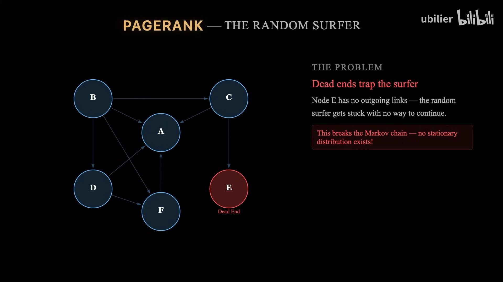

[【跳转到 09:34】](https://www.bilibili.com/video/BV1tgP5z2ELr/?p=2&t=574)

最终的 PageRank 得分，可以通过**反复乘以转移矩阵直到收敛**来计算，这个迭代过程称为**幂法（power iteration）**。对数十亿页面的网络规模而言计算量巨大，但可以并行化——它的结果从根本上改变了我们获取信息的方式。

[【跳转到 09:59】](https://www.bilibili.com/video/BV1tgP5z2ELr/?p=2&t=599)

## 七、什么时候该用马尔可夫链

- **适合**：只要系统的未来主要取决于当前状态，马尔可夫链就会出现，为分析随时间演化的随机过程提供强大框架——天气模式、基因序列、游戏局面、顾客行为、语言结构……当"无记忆"假设合理、且状态空间可控时，它就会派上用场。
- **不适合**：当**长期依赖**占主导、**状态空间爆炸**，或**动态随时间发生根本变化**时，就要避开它。

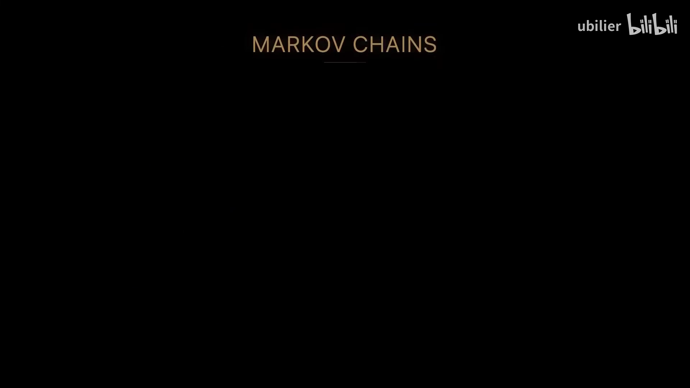

[【跳转到 10:24】](https://www.bilibili.com/video/BV1tgP5z2ELr/?p=2&t=624)

## 八、一页小结

- **无记忆性**：未来只取决于当前状态，完整历史被压缩成一个值；
- **三要素**：状态、转移概率，以及把所有信息编码在一起的**转移矩阵**；
- **矩阵幂**：`P^N` 给出经过 N 步后的分布，自动完成路径枚举与加权求和；
- **平稳分布**：矩阵幂收敛到的、与初始条件无关的长期行为，满足 `πP = π`；
- **存在唯一性**：不可约 + 非周期时，才有唯一的平稳分布，且从任意起点都收敛到它；
- **应用**：PageRank 用幂法求平稳分布，把"重要性"沿链接结构传播。

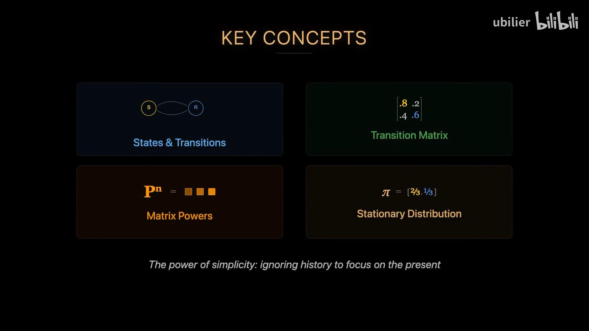
