# 用代码仿真理解马尔可夫奖励过程 MRP

> 视频来源：[理解大模型推理能力从强化学习开始(一)：马尔可夫奖励过程（代码仿真）](https://www.bilibili.com/video/BV1UZ5jzUEvB/)（时长约 61 分钟）

## 本讲要解决的核心问题（SCQA）

**背景**：这是一个从零基础讲到 RLHF（大模型对齐）的系列。上一讲用一个"格子里的小猫找猫粮"的例子，从整体上介绍了强化学习是怎么回事。

**冲突**：但"状态价值""回报"这些词，光看定义仍然很抽象——它们到底是怎么**算**出来的？

**疑问**：能不能只用最基础的 `numpy`，不依赖任何高级框架，**从零把 MRP 仿真一遍**，亲眼看到每个状态的"价值"？

**回答（中心思想）**：可以。视频先补齐 `horizon / episode / return / state value` 四个定义，再把格子世界建模成一个 **MRP（马尔可夫奖励过程 = 马尔可夫过程 + 奖励机制）**，然后用一段**随机游走**的仿真代码，通过"玩很多轮 → 取平均"来估计每个状态的**状态值函数**。最终画出的热力图会显示：**猫粮所在状态价值最高（1.6），并向四周逐渐降低**——这正是智能体"自主探索"学出来的地图。

## 一、先补齐四个基础定义

视频以 Stanford CS234 的讲义为蓝本，先直接给出几个定义。

### 1.1 Horizon（步数 T）与 Episode（一轮游戏）

- **Horizon**：每一轮游戏里走的**步数**，记作 `H`（或 `T`）。它可以是**有限的（finite）**，也可以是**无限的（infinite）**——小猫可能走啊走始终找不到猫粮；如果有限步，则不管走多长总会有个结束。
- **Episode**：可以理解成"**一把游戏**"或"**一个周期**"。比如让猫去找猫粮，它不断试探，找到之后**这一轮游戏就结束了**，这就是一次 episode。

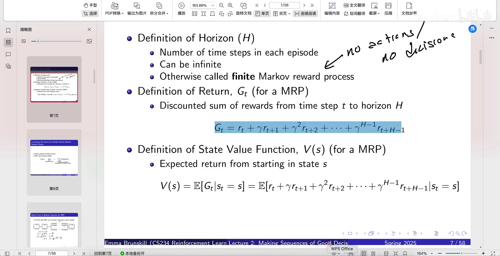

[【跳转到 01:58】](https://www.bilibili.com/video/BV1UZ5jzUEvB/?t=118)

### 1.2 Return（回报 G_t）

**回报**的定义是"**从时间步 t 到 horizon 的、奖励的折扣和**"（discounted sum of rewards），用 `G_t` 表示：

```
G_t = R_t + γ R_{t+1} + γ² R_{t+2} + … + γ^(H−t) R_H
```

其中 `R_t` 是当前状态所获得的奖励，后面这一串是未来可能获得的收益。可以类比**投资理财**：`R_t` 像是你的本金（当前能拿到的），后面那部分像是未来时间里这笔投资可能带来的回报。

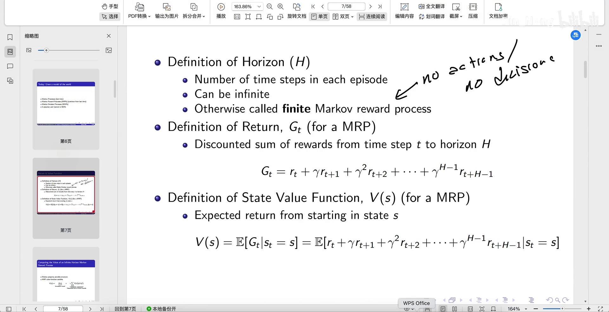

[【跳转到 04:13】](https://www.bilibili.com/video/BV1UZ5jzUEvB/?t=253)

### 1.3 State Value Function（状态价值函数 V）

为什么要定义 `G_t`？就是为了引出**状态价值函数**。它的定义非常直观：

> 当我在某个状态时，**我的价值有多大**——也就是**期望的收益**有多大。

写成公式，就是对回报 `G_t` 求期望：

```
V(s) = E[ G_t | S_t = s ]      ← expected return from starting in state s
```

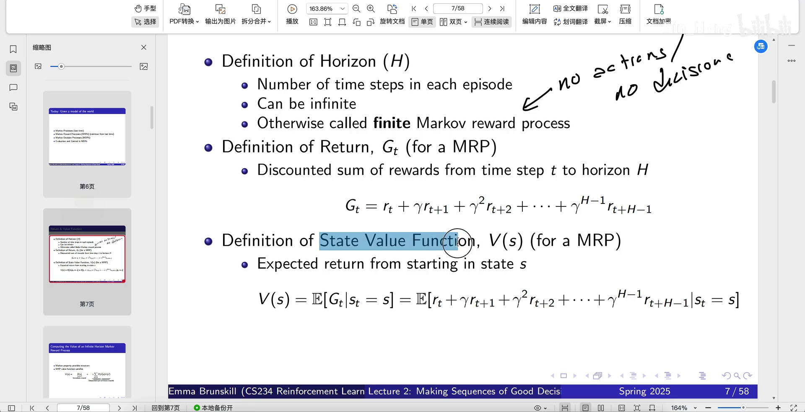

[【跳转到 05:53】](https://www.bilibili.com/video/BV1UZ5jzUEvB/?t=353)

## 二、什么是 MRP：马尔可夫过程 + 奖励

**MRP** 就是 **Markov Reward Process**（马尔可夫奖励过程）：

```
MRP = 马尔可夫过程（Markov process） + 奖励机制（reward）
```

这里要区分两个容易混的概念：

- **reward（奖励）**：是**预先规定好的规则**，是固定的、没有随机性——它是"游戏规则"；
- **return（回报）**：是我们**计算出来**的——它由奖励按折扣累加得到。

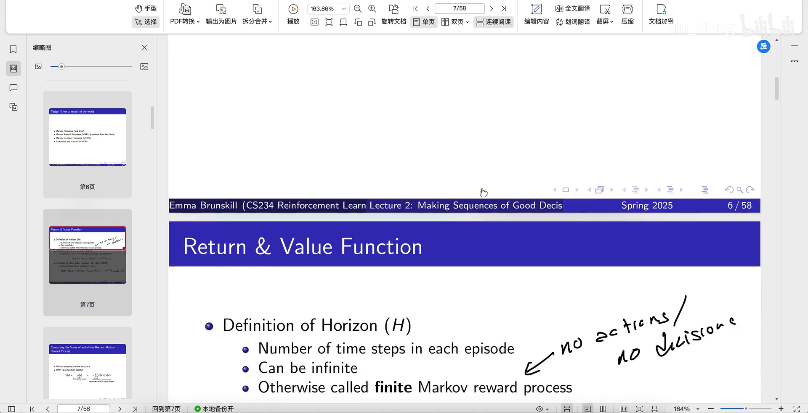

[【跳转到 06:38】](https://www.bilibili.com/video/BV1UZ5jzUEvB/?t=398)

### 2.1 奖励怎么设

在这个例子里：除了猫粮所在的那个状态之外，其它地方的奖励**先定义为零**，只有**到达猫粮位置**才给一个正奖励。奖励也可以变复杂：正的奖励是正向激励，**负的奖励其实是惩罚**（比如在格子中间放一个"扫地机器人"，猫撞上就受惩罚）。

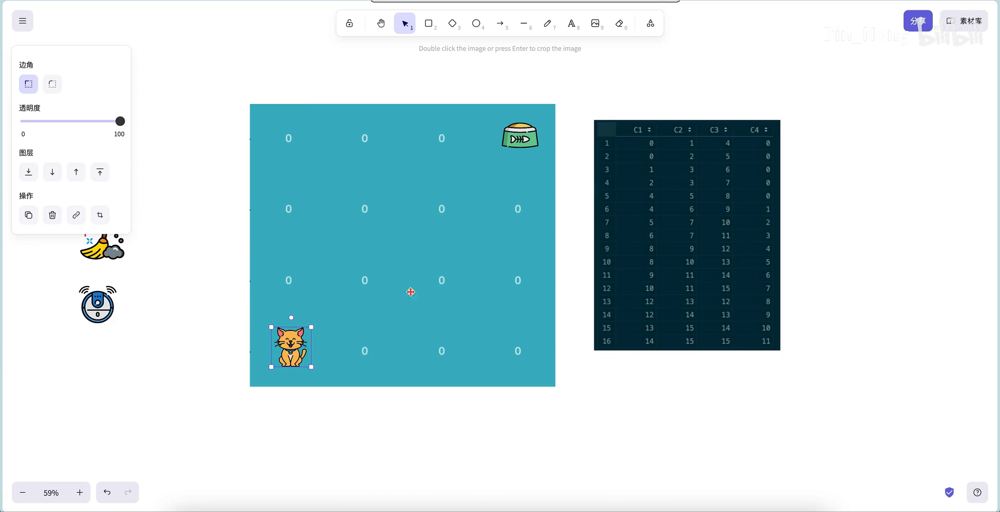

[【跳转到 07:33】](https://www.bilibili.com/video/BV1UZ5jzUEvB/?t=453)

### 2.2 状态转移表

猫每走一步会执行一个动作（上、下、左、右）。**在某个状态下采取某个动作，就会转移到某个状态**——这就是**状态转移表**。它一共 16 行（对应 16 个状态），每行有 4 个可选动作（编号 0、1、2、3）。比如状态 0：

- 往左、往上会**碰壁**，于是**待在原处**（还是 0）；
- 往右会到状态 1；
- 往下会到状态 4。

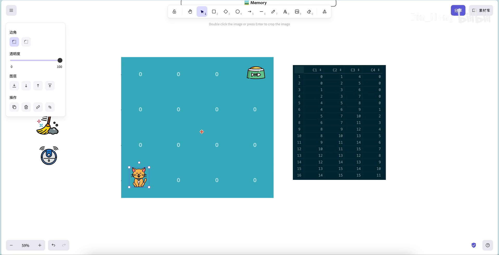

[【跳转到 08:48】](https://www.bilibili.com/video/BV1UZ5jzUEvB/?t=528)

有了状态转移表，小猫就可以**随机地选动作、在里面随机游走**——这正是它不断试探和学习的过程。

## 三、开始写代码：模拟一轮 episode

代码只用最基础的工具：

```python
import numpy as np
import random
import matplotlib.pyplot as plt
import seaborn as sns
```

### 3.1 初始化奖励

这是一个 4×4 的格子，共 16 个状态，每个格子对应一个状态。奖励机制预先规定好：**只有猫粮那个位置（编号 3）有奖励，其余为零**。

```python
rewards = np.zeros(16)   # 16 个状态，先全部设为零
rewards[3] = 3           # 猫粮位置给一个正奖励（也可设成 10、7…）
```

用 seaborn 画成热力图，就能看到"只有一格是亮的"：

```python
sns.heatmap(rewards.reshape(4, 4), annot=True, cmap="YlGnBu")
plt.show()
```

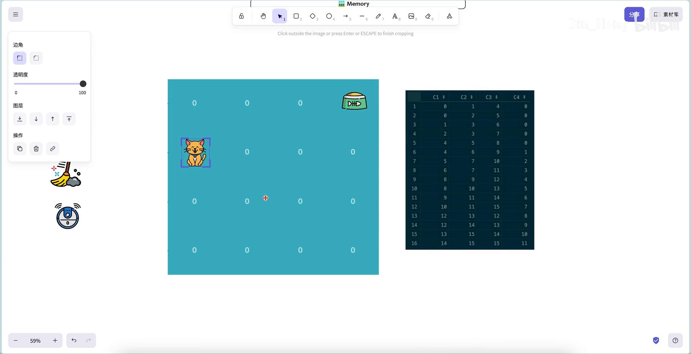

[【跳转到 12:17】](https://www.bilibili.com/video/BV1UZ5jzUEvB/?t=737)

### 3.2 终止条件

一轮游戏什么时候结束？两种情形：**到达猫粮位置（状态 3）**，或者**走的步数超过上限**。后者是为了仿真效率——如果走 1 万步都没找到，实验就太慢了，所以固定一个最大步数（例如 50 步）让它终止，保证这是 finite 的情况。


[【跳转到 15:25】](https://www.bilibili.com/video/BV1UZ5jzUEvB/?t=925)

### 3.3 记录轨迹

每轮游戏从某个初始状态（这里取状态 12）出发。为了保证能算出回报，需要记录两条轨迹：

- **state trajectory**：这只猫走过的**状态**序列；
- **reward trajectory**：每个状态带来的**奖励**序列。

然后放进一个 `while` 循环里：**只要没到终止状态、且步数没超上限，就继续随机走**；每走一步就记录状态与奖励，再用 `random.randint(0, 3)` 随机选一个动作，去状态转移表里**查出下一个状态**，步数加一。

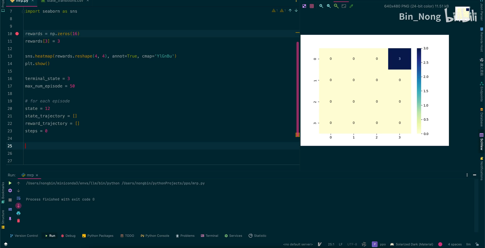

[【跳转到 20:57】](https://www.bilibili.com/video/BV1UZ5jzUEvB/?t=1257)

## 四、计算 G_t：一个关键的递归技巧

一轮结束后，就进入核心：**算回报 `G_t`**。视频把 `G_t` 拆开来看，发现一个非常关键的模式：

```
G9 = R9
G8 = R8 + γ R9
G7 = R7 + γ R8 + γ² R9
```

再往下写会发现：`G7` 里后面那两项，正好就是 `G8`！于是得到**递归关系**：

```
G_t = R_t + γ · G_{t+1}
```

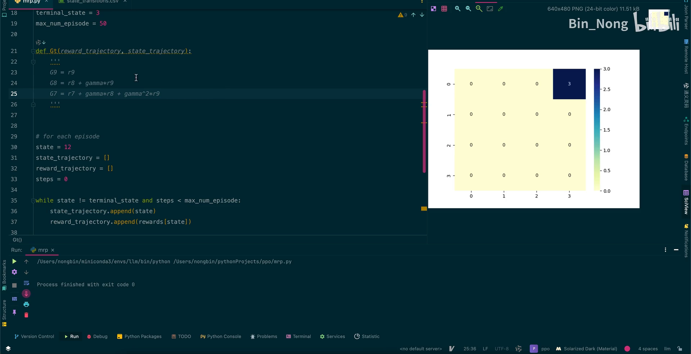

[【跳转到 37:40】](https://www.bilibili.com/video/BV1UZ5jzUEvB/?t=2260)

**好处是**：既然一轮游戏已经走完、数据都在手上，就可以**从最后一步倒着推**：

```python
# 倒序遍历 reward 轨迹，用 G_t = R_t + γ G_{t+1} 递推
# γ 取 0.9
```

这样能充分利用已经算过的 `G9`、`G8`、`G7`，**减少重复计算**——而不是傻乎乎地做累加。

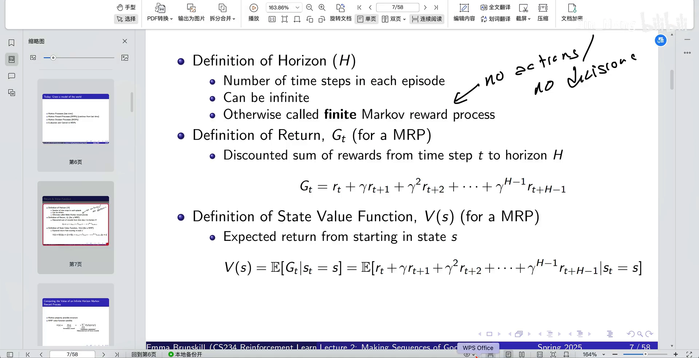

[【跳转到 27:40】](https://www.bilibili.com/video/BV1UZ5jzUEvB/?t=1660)

### 4.1 一个容易被公式忽略的细节：状态被重复访问

这是"真正写代码"时才会遇到的问题：因为动作是随机的，猫**可能在某个小区域里来回打转**，于是一轮轨迹里**同一个状态被访问了多次**。

这会影响求期望：某个状态被走了两次，那两个 `R` 都会累加进去，那**求均值时分母要不要除以次数**？——要考虑。所以需要额外记录：

```python
state_return = np.zeros(16)   # 每个状态的回报累加
state_count  = np.zeros(16)   # 每个状态被访问的次数
```

求平均时用 `state_return / state_count`（为避免 `0 ÷ 0`，给分母加一个极小量 `1e-10`）。**公式看起来很简洁，但真要实现时，这些细节必须自己想到。**

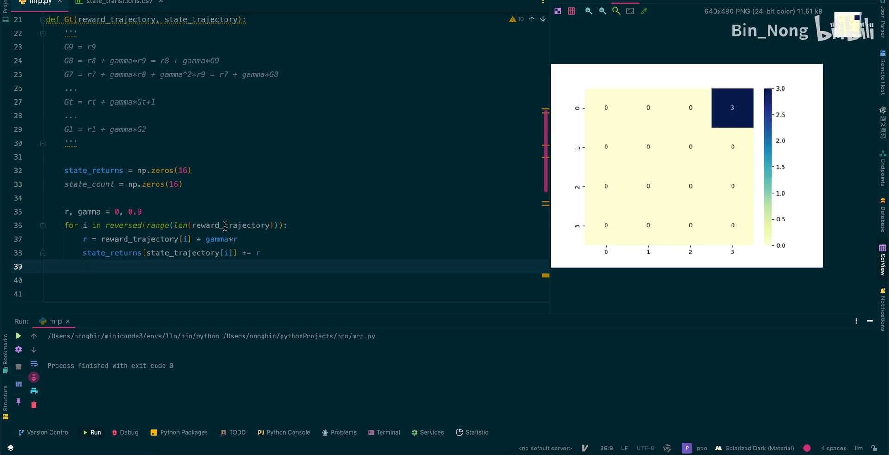

[【跳转到 48:30】](https://www.bilibili.com/video/BV1UZ5jzUEvB/?t=2910)

## 五、多轮游戏：用均值逼近期望

上面只是**一轮**。要估计状态价值 `V(s) = E[G_t | S_t = s]`，就得**玩很多轮**、把每轮的 `G_t` 都存下来，再**取平均**（依据大数定律，用样本均值去逼近期望）：

```python
multiple_returns = []
for episode in range(50):          # 玩 50 轮
    # ……一轮随机游走，算出这一轮的 G_t……
    multiple_returns.append(G_t)

state_values = np.mean(multiple_returns, axis=0)   # 在每个状态的维度上取均值
```

因为每一轮的 `G_t` 是一个 16 维向量，50 轮就有 50 个向量，所以是在**第 0 个维度**（各个状态）上求均值。

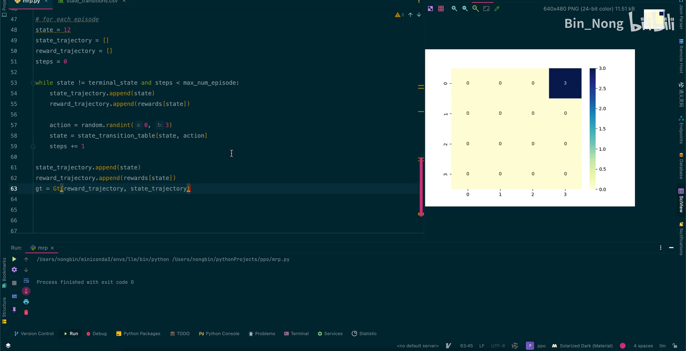

[【跳转到 52:20】](https://www.bilibili.com/video/BV1UZ5jzUEvB/?t=3140)

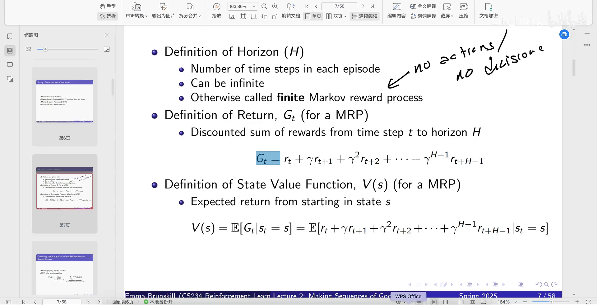

[【跳转到 56:54】](https://www.bilibili.com/video/BV1UZ5jzUEvB/?t=3414)

## 六、结果：一张"价值地图"浮现出来

把 `state_values` 用热力图（同样 reshape 成 4×4）画出来，会看到很有意思的结果：

- **猫粮所在位置的 value 最高，是 `1.6`**；
- 价值从那里**向四周传播**：离猫粮越近的状态，价值越高——因为猫到了那个状态"近在咫尺，只要再走一步就能拿到食物"；
- 于是这只猫相当于**自己学出了一张地图**：此后从任意状态出发，都往 value 更高的地方走，就能找到 `1.6` 那个位置。

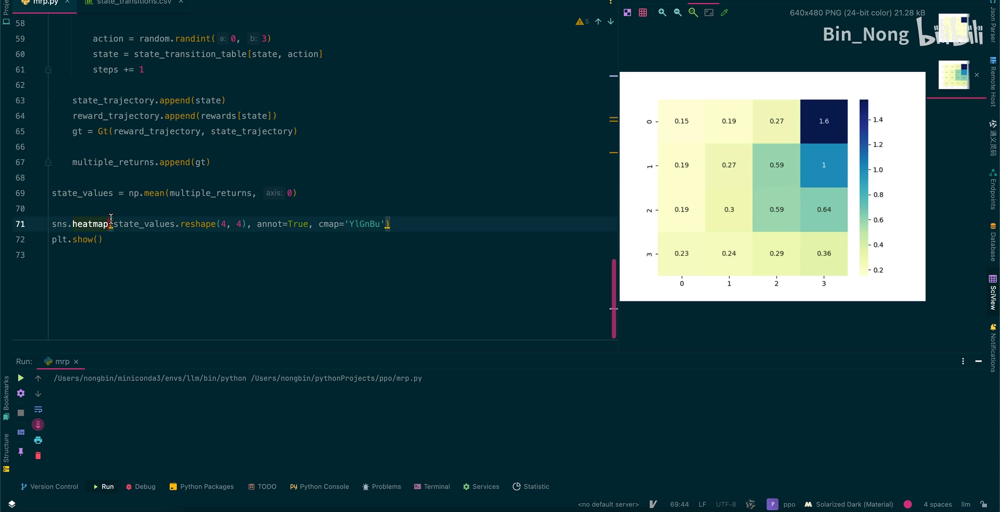

[【跳转到 59:02】](https://www.bilibili.com/video/BV1UZ5jzUEvB/?t=3542)

### 6.1 别忘了它的局限

结果里也有"看起来不太对"的地方：比如有的值 `0.59` 反而比 `0.27` 大，按直觉应该反过来。原因是：

- **实验次数有限**（只玩了 50 轮）；
- 只是**用均值去逼近期望**，如果方差很大，每次实验的结果波动就比较大，无法保证稳定。

这些都是后续会逐步优化的部分——**强化学习的理论就是这样不断递进的**。

## 七、顺带一提：它和监督学习很不一样

跑完整个过程，会发现强化学习和**监督学习（supervised learning）**有个根本区别：

- 监督学习要**预先标注好数据**，再用这些数据去训练模型；
- 而强化学习里，**根本没有标注数据**——数据是这个**智能体（比如小猫）自己与环境的交互**产生的：它在 4×4 的格子世界里上下左右地动，环境给它反馈（奖励），它据此学习。

所以它的训练**没那么容易收敛**，而且数据是**自主探索**出来的、**效率比较低**（小猫甚至还可能找不到猫粮）。这一点，从刚才的仿真过程里就能直接体会到。

## 八、一页小结

- **四个定义**：horizon（步数）、episode（一轮游戏）、return `G_t`（折扣奖励和）、state value `V(s) = E[G_t | S_t = s]`；
- **MRP = 马尔可夫过程 + 奖励机制**，其中 reward 是**规则**、return 是**算出来的**；
- **算 `G_t` 的技巧**：发现 `G_t = R_t + γ G_{t+1}`，于是**从后往前递推**，省去重复计算；
- **实现的坑**：同一状态可能被重复访问，要用 `state_count` 记录次数，再除以它求均值；
- **估计 V**：玩很多轮 episode，把每轮 `G_t` 取平均（大数定律）；
- **结论**：状态价值热力图显示**猫粮处最高（1.6）并向四周传播**，智能体据此"学出一张地图"；而均值近似的精度受实验次数与方差限制。
