# 马尔可夫奖励过程 MRP：回报、折扣因子与状态值函数

> 视频来源：[详解马尔科夫奖励过程MRP](https://www.bilibili.com/video/BV12UKAebEUt/)（赵世钰《强化学习的数学原理》第 2 讲第 3 小节，时长约 11 分钟）

## 本讲要解决的核心问题（SCQA）

**背景**：上一讲我们用一个例子对**马尔可夫决策过程（MDP）**有了整体、形象的了解，但对它的**数学原理**以及各状态之间的关系，还需要进一步理解。

**冲突**：要看清这套数学结构，直接上 MDP 会有点复杂——它既有状态、又有动作、又有奖励。

**疑问**：有没有一个更简单的"原型"，能先把"状态之间如何演化、每个状态到底值多少钱"这件事讲清楚？

**回答（中心思想）**：有，它就是**马尔可夫奖励过程（MRP，Markov Reward Process）**——可以理解为 MDP 的**简化版**。这一讲先给出 MRP 的**四元组定义**，再定义**回报（return）**与**状态值函数（state value function）**，最后用一个"学生上课"的例子亲手算一遍：**折扣因子 γ 取不同值，同一批状态算出来的价值会完全不同**。

## 一、MRP 的四元组定义

马尔可夫奖励过程是 MDP 的一个简化版，便于理解，它用一个**四元组** `(S, P, R, γ)` 来定义：

- **S**：一系列**状态**，是一个有限集；
- **P**：**转移概率矩阵**，和 MDP 里讲的一样，描述状态之间怎么转移；
- **R**：**奖励函数**，定义如下——从当前状态 S 出发所获得奖励的**期望**：

  ```
  R = E[ R_t | S_t = S ]
  ```

- **γ**：**折扣因子（discount factor）**，取值范围在 0 到 1 之间。

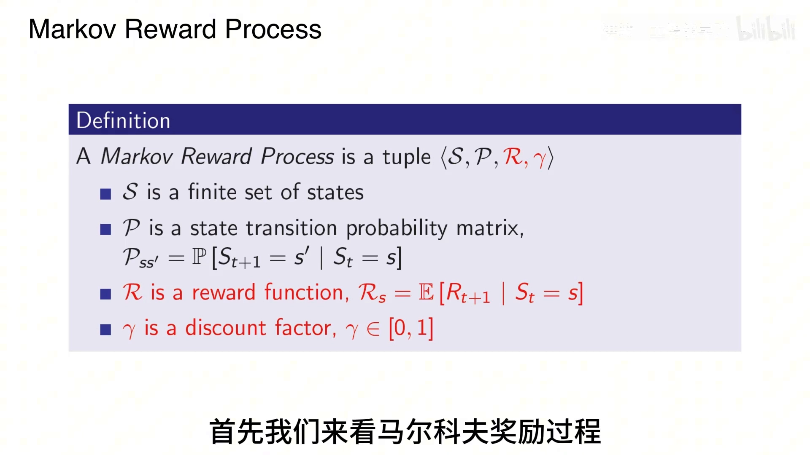

[【跳转到 01:04】](https://www.bilibili.com/video/BV12UKAebEUt/?t=64)

## 二、一个"学生 MRP"的例子

视频用经典的"学生上课"场景来讲解 MRP。这里的**状态**是学生常见的活动：

- **C1 / C2 / C3**：第一节课、第二节课、第三节课；
- **Pass**：考试通过；
- **Sleep**：睡觉；
- **Facebook**：上网浏览 Facebook；
- **图书馆**：去图书馆查资料。

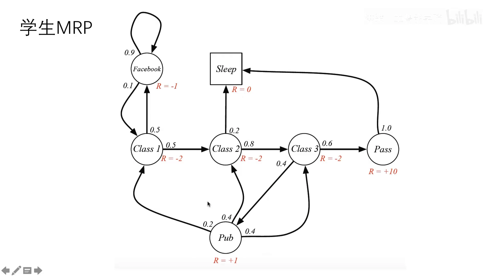

[【跳转到 02:14】](https://www.bilibili.com/video/BV12UKAebEUt/?t=134)

各个状态之间按给定的**转移概率**转移，同时每个状态带有**奖励 R**。把这个例子的**转移矩阵**列出来：

- C1（第一节课）→ C2 的概率是 0.5；
- C2 → C3 是 0.8；
- C3 → 通过（Pass）是 0.6；
- 上完 C1 后去浏览 Facebook 的概率是 0.5；
- 而在浏览 Facebook 的过程中**继续**浏览 Facebook 的概率是 0.9——说明沉迷于上网。

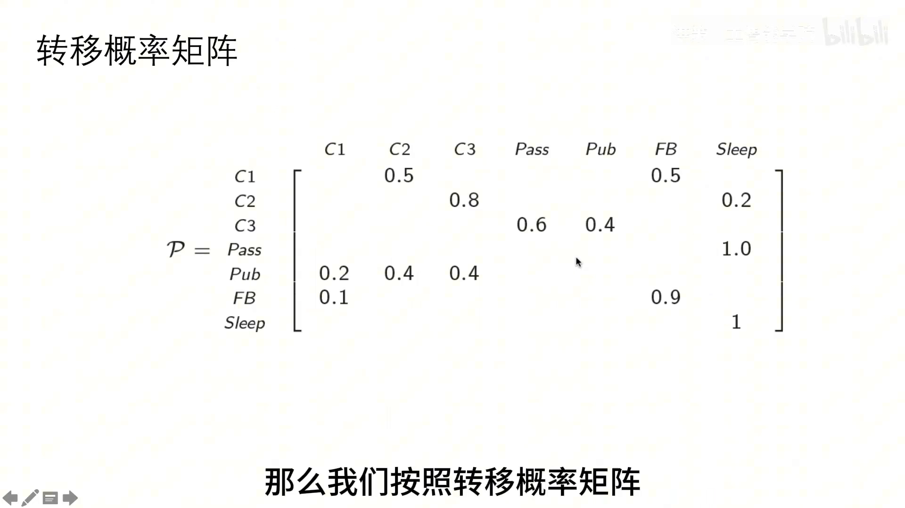

[【跳转到 03:04】](https://www.bilibili.com/video/BV12UKAebEUt/?t=184)

这个转移概率矩阵非常好理解，每个状态的出边概率之和为 1。

## 三、回报 G_t：从当前奖励出发的折扣累加

接着看**总的折扣奖励**怎么算。我们定义**回报（return）** `G_t`：它是**从时间步 t 开始的、总折扣奖励**。

> ⚠️ 视频特别提醒：网上很多技术博客、公众号的强化学习文章在这里**是有错误的**，或者没有详细说明。大部分博客以 David Silver 的讲义为蓝本，而那个公式的写法有问题，**跟他自己后面给出的例子都对不上**。所以本课程统一采用下面这个写法。

正确的写法是：**从当前的直接奖励 `R_t` 出发**，后面接未来的折扣奖励，加总起来就是总折扣奖励：

```
G_t = R_t + γ R_{t+1} + γ² R_{t+2} + γ³ R_{t+3} + …
```

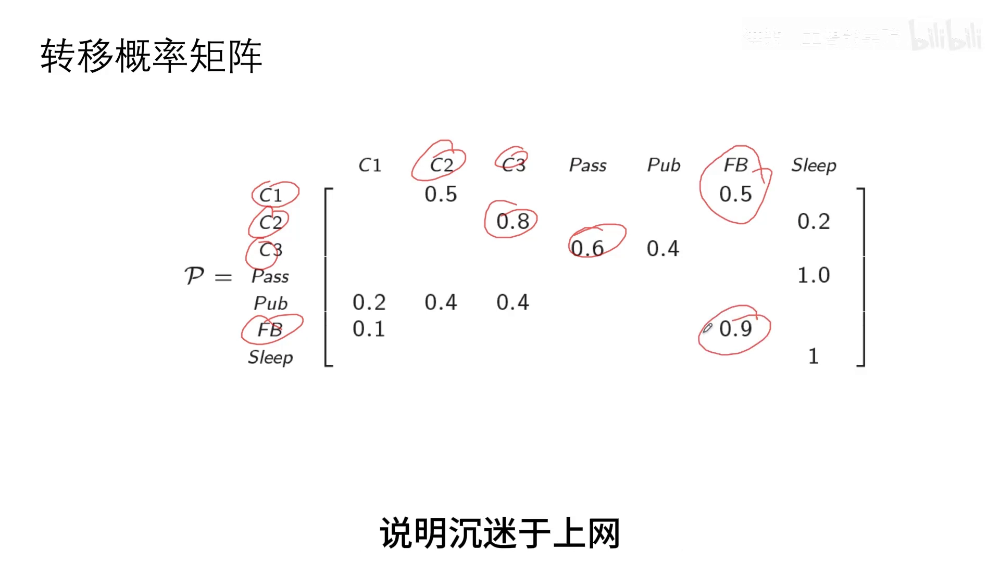

[【跳转到 03:54】](https://www.bilibili.com/video/BV12UKAebEUt/?t=234)

其中 `R_t` 是这一步的直接奖励，`γ` 是折扣因子——**越靠后的奖励被打折得越狠**。

## 四、状态值函数 V(S)：对回报求期望

有了回报，就能引出第三个定义——**状态值函数（state value function）** `V(S)`：

> 它是**从状态 S 开始的未来收益的期望值**。

注意这个定义的三个关键点：**从状态 S 开始**、**未来收益**、**期望值**。用条件期望写出来，就是对回报 `G_t` 求期望：

```
V(S) = E[ G_t | S_t = S ]
```

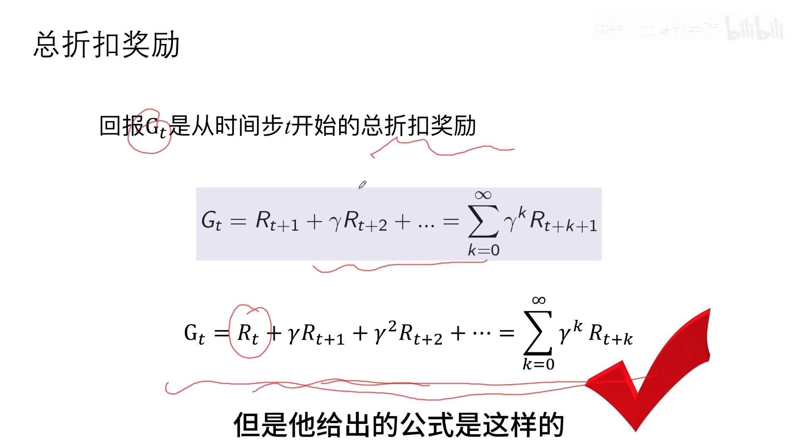

[【跳转到 05:34】](https://www.bilibili.com/video/BV12UKAebEUt/?t=334)

## 五、亲手算一次：γ = 1/2 时的状态值

为了让大家理解，我们来算刚才那个例子：取 `S1 = C1`（从第一节课出发），令 `γ = 1/2`。

照着公式，并对照几种不同的**决策路径**（路径是 C1 → C2 → C3 → Pass → Sleep）。从 `V1` 开始，`R_t` 就是这里的 `R1 = -2`，接着加上 `γ·(-2)`、`γ²·(-2)`……一直乘下去：

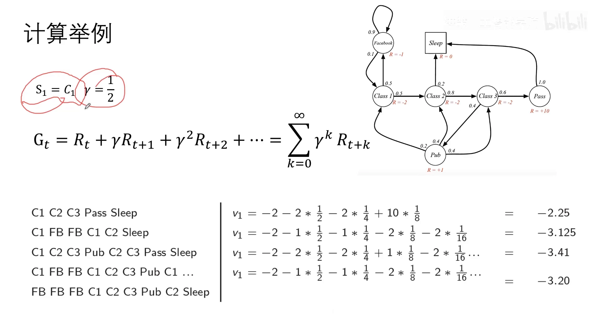

```
V1 = R1 + γ R2 + γ² R3 + …
   = -2 + (1/2)(-2) + (1/2)²(-2) + …
   = -2.25
```

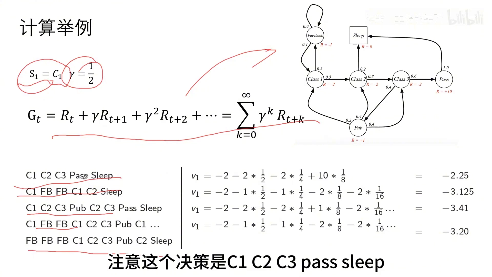

[【跳转到 07:11】](https://www.bilibili.com/video/BV12UKAebEUt/?t=431)

其他状态的算法依此类推。**用这个公式，就对网上常见那个写法做了修正**——那个公式会给理解造成一定困难。

## 六、换个 γ 再看：折扣因子到底在做什么

上面取的是 `γ = 1/2`。现在我们看几个**特殊情况**。

### 6.1 γ = 0：只看眼前

`γ = 0` 意味着**未来完全不起作用**，那就只剩**直接奖励**，按公式算非常简单：

```
γ = 0:  V_t = R_t
```

于是各状态的值就等于它们的即时奖励——第一、二节课是 `-2`、`-2`，"通过"是 `10`，图书馆、睡觉等是 `1`……一目了然。

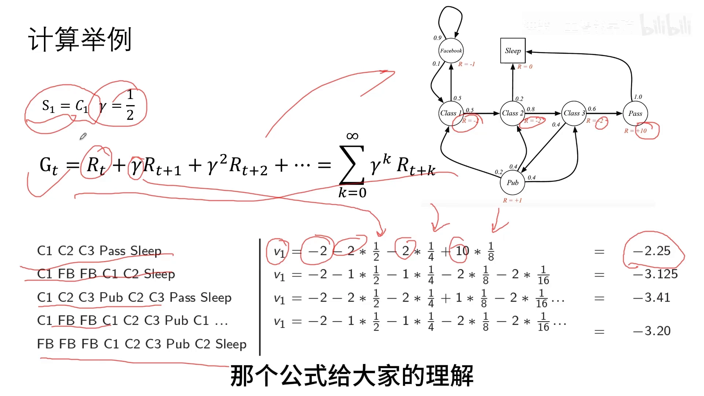

[【跳转到 08:01】](https://www.bilibili.com/video/BV12UKAebEUt/?t=481)

### 6.2 γ = 0.9：未来开始起作用，计算变成递归

`γ = 0.9` 时计算就没那么简单了，这是一个**递归**的过程：先算状态一，再算状态二，依此类推。按这个折扣算，某些状态的值会明显变化，例如出现 `-7.6`、`-5.0` 这样的结果。

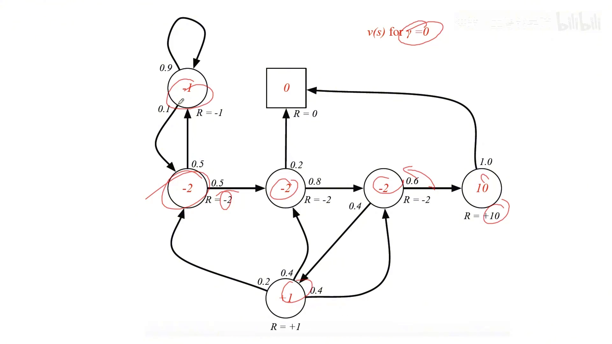

[【跳转到 08:51】](https://www.bilibili.com/video/BV12UKAebEUt/?t=531)

把 `γ = 0.9` 和刚才的 `γ = 0` **对比**一下就能看出门道：

- 取 0.9 时**未来开始起作用**，所以有的值比 `γ = 0` 时**更大**；
- 这说明"**去图书馆查资料**"是一个**未来收益比较大**的状态；
- 不断上课的未来收益也增加，因为你会**越来越接近通过考试**；
- 而"通过之后不上课"的收益就比较差，所以那个 `-7.6` 是较差的情形。

### 6.3 γ = 1：未来不打折，直接累加

最后看 `γ = 1`，也就是**未来收益不打折、直接累加进来**：

```
γ = 1:  V_t = R_t + R_{t+1} + R_{t+2} + …
```

结果中某些状态的值比 `γ = 0.9` 时还要大，另一些保持不变。

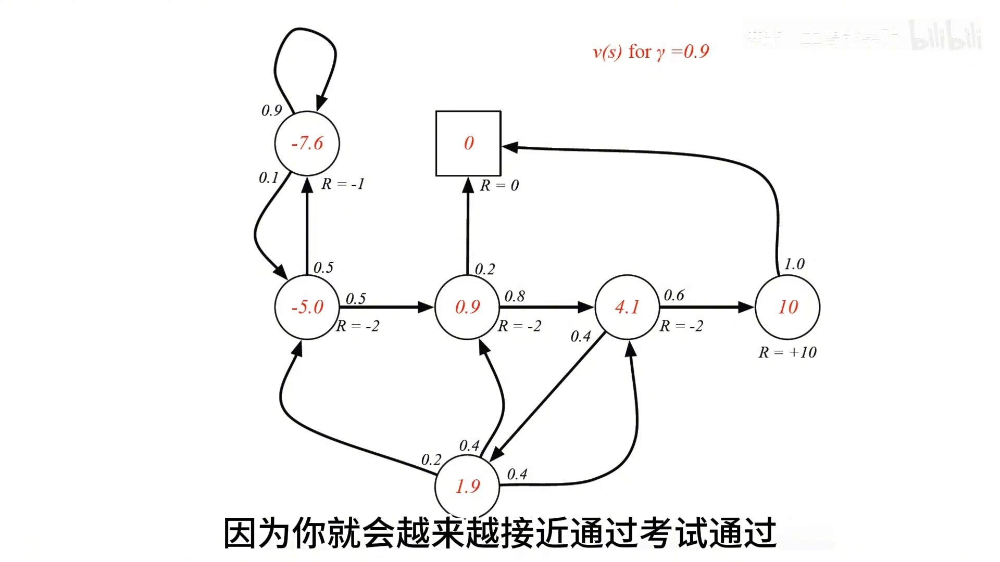

[【跳转到 10:31】](https://www.bilibili.com/video/BV12UKAebEUt/?t=631)

## 七、这些值到底怎么算出来的？

到这里其实留下了一个悬念：`γ = 0.9`、`γ = 1` 那些值并不是靠"枚举路径"硬算的——它们需要**解贝尔曼方程**，而那正是**下一节**要讲的内容。

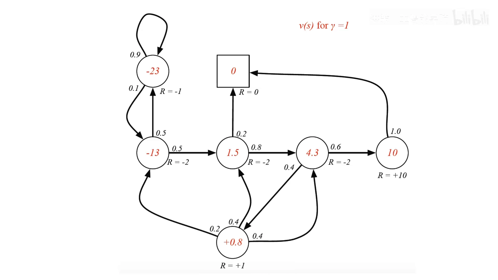

[【跳转到 10:56】](https://www.bilibili.com/video/BV12UKAebEUt/?t=656)

## 八、一页小结

- **MRP** 是 MDP 的简化版，用四元组 `(S, P, R, γ)` 定义；
- **奖励函数 R** 是"从当前状态出发所获奖励的期望"；**折扣因子 γ ∈ [0, 1]**；
- **回报 `G_t`** 是从时间步 t 开始的总折扣奖励，本课程约定**从当前的直接奖励 `R_t` 出发**累加；
- **状态值函数 `V(S) = E[G_t | S_t = S]`**，是从状态 S 开始的未来收益的期望；
- 折扣因子决定"未来有多重要"：`γ = 0` 只看眼前、`γ → 1` 越来越看重长远；一般情形要靠**贝尔曼方程**求解。
