# 有限马尔可夫决策过程：MDP 的数学定义

> 视频来源：[【强化学习 2-1】有限马尔可夫决策过程](https://www.bilibili.com/video/BV1SvXAYcEb7/)（UP 主 PenicillinLP，时长约 14 分钟）

## 本讲要解决的核心问题（SCQA）

**背景**：强化学习研究的是一件事——智能体（agent）在与环境（environment）的反复互动中，为了达成某个目标（goal）而学习。在这个循环里，智能体在某个**状态**下采取一个**行动**，得到一个**奖励**，环境随之进入下一个状态，如此周而复始。

**冲突**：可是这些话都停留在口语层面——"状态""行动""奖励""互动"听着明白，却没法拿来做推导、列方程、谈收敛。要建立理论，就必须先把它们变成精确的数学对象；而且这个对象还得能装下**策略（policy）**与**价值（value）**这两个核心概念。

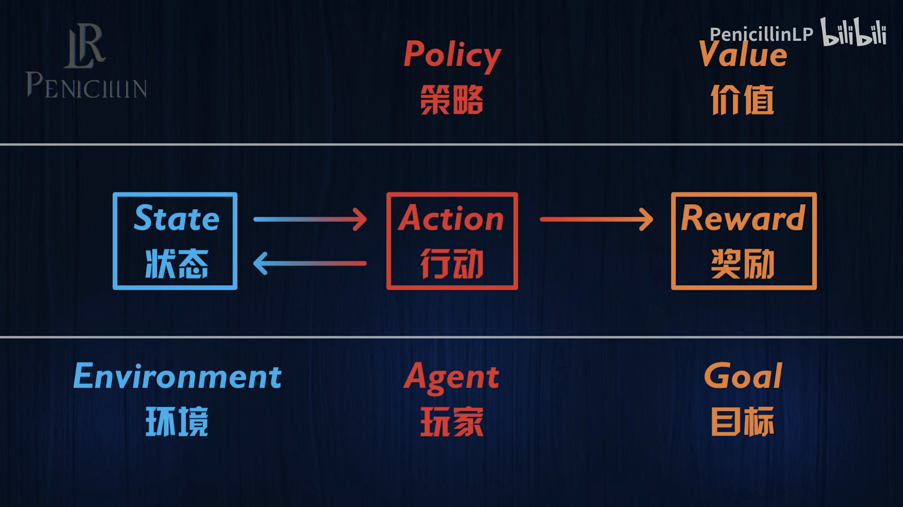

[【跳转到 00:30】](https://www.bilibili.com/video/BV1SvXAYcEb7/?t=30)

**疑问**：那么，怎样才能把"智能体与环境互动"这件事，写成一套可以计算的数学语言？

**回答（中心思想）**：用**马尔可夫决策过程（Markov Decision Process，MDP）**。本讲会一步一步说明：一个**有限** MDP，就是在"状态空间、行动空间、奖励空间"这三个集合之上，再加一个描述动态的概率函数 $p(r, s' \mid s, a)$；再叠加上"马尔可夫性"这条关键假设——**未来只取决于现在**——整套框架就足以承载策略与价值。换句话说，MDP 是强化学习的"坐标系"，后面所有的算法（动态规划、蒙特卡洛、时序差分……）都在这套坐标系里展开。

## 一、三块积木：状态空间、行动空间、奖励空间

要精确描述"智能体与环境互动"，先要把玩家和环境各自的"可选项"写成**集合**。这就是 MDP 的前三块积木。

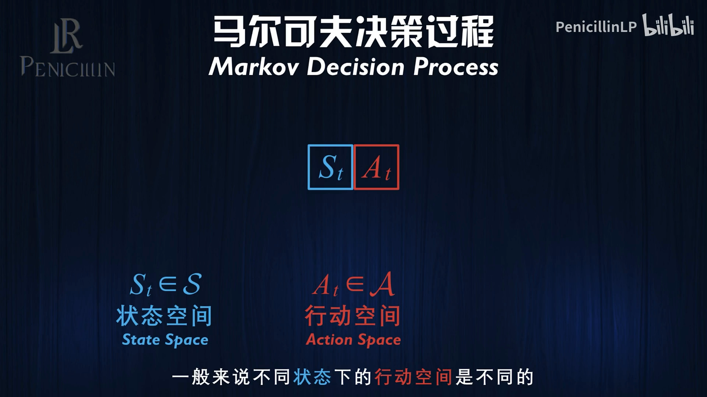

[【跳转到 01:41】](https://www.bilibili.com/video/BV1SvXAYcEb7/?t=101)

- **状态空间（state space）$S$**：所有可能状态的集合。在时刻 $t$，环境处于状态 $S_t$。
- **行动空间（action space）$A$**：所有可能行动的集合。在时刻 $t$，玩家做出行动 $A_t$。

这里有个细节：**不同状态下的行动空间其实可能不一样**（在某些状态下，玩家根本无法采取某些行动）。但为了简单，我们通常假设一个统一的行动空间。

玩家做出行动之后会得到一个奖励 $R_t$。同样地，**奖励空间（reward space）$R$** 就是所有可能奖励的集合——它通常是**实数集的一个子集**。

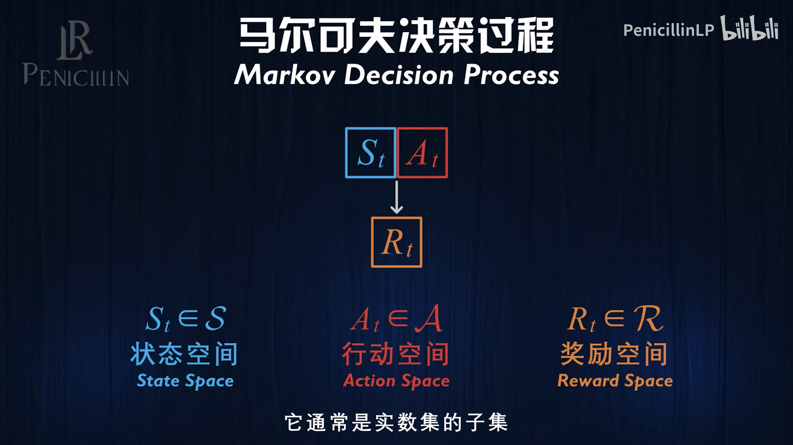

[【跳转到 02:31】](https://www.bilibili.com/video/BV1SvXAYcEb7/?t=151)

有了这三块积木，"互动"就可以被写成一个**序列**：

$$
S_0, A_0, R_0, S_1, A_1, R_1, S_2, A_2, R_2, \ldots
$$

即：环境处于 $S_0$ → 玩家做出 $A_0$ → 得到 $R_0$、环境转入 $S_1$ → …… 这就是"由状态、行动、奖励组成的序列"。

**一个贯穿全讲的例子：迷宫探险。** 环境是一个迷宫，玩家是迷宫里的探险者：

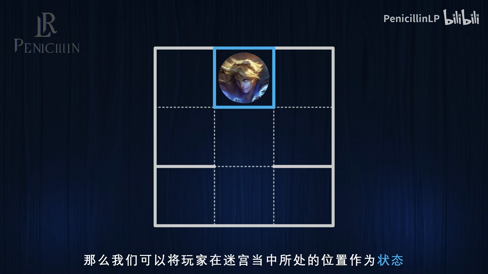

- **状态** = 玩家在迷宫中所处的位置；
- **行动** = 朝上、下、左、右四个方向之一移动；
- **奖励** = 什么都没发生对应 $0$，发现宝箱对应 $+1$，被木乃伊吃掉对应 $-1$。

## 二、马尔可夫性：让"未来只看现在"

上面的序列只有"事"，还缺一条最关键的**假设**，它让整套框架变得可计算：**马尔可夫性（Markov property）**。

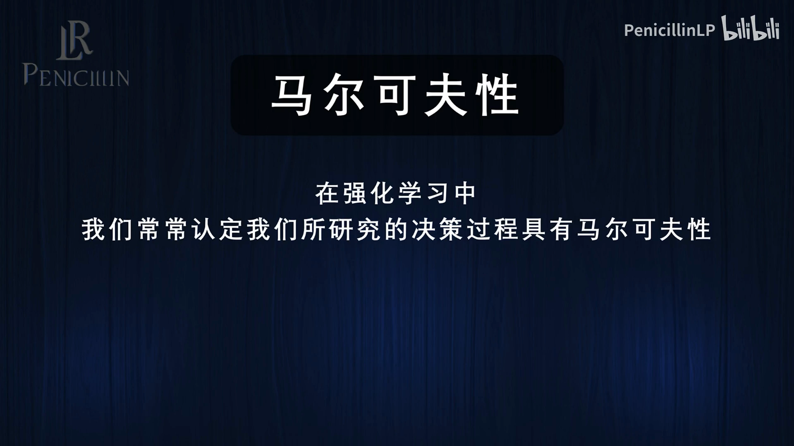

[【跳转到 03:21】](https://www.bilibili.com/video/BV1SvXAYcEb7/?t=201)

它的意思是：玩家获得的奖励 $R_t$ 以及下一时刻的状态 $S_{t+1}$，**完全取决于当前的状态 $S_t$ 和当前的行动 $A_t$**；一旦 $S_t$ 与 $A_t$ 确定，就与更早的历史（过去的状态和行动）**无关**。用条件概率写出来就是：

$$
p(r, s' \mid s, a) = P(R_t = r, S_{t+1} = s' \mid S_t = s, A_t = a)
$$

直观理解：**未来只取决于现在，而与"你是怎么走到现在的"无关**。在迷宫里，"下一步会到哪儿、拿多少奖励"只由"你现在在哪、朝哪个方向走"决定，和你之前怎么绕过来的没关系。

你可能会怀疑：现实里没那么干净吧？比如玩家能不能拿到宝藏，取决于他之前有没有捡到钥匙；会不会被木乃伊吃掉，取决于他之前有没有拿到武器。这看似不满足马尔可夫性，但解决办法很简单——**把"装备情况"也塞进状态的定义里**：

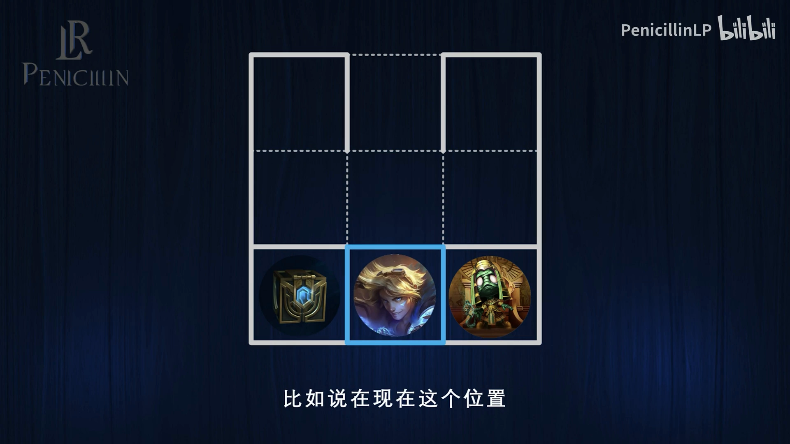

[【跳转到 04:16】](https://www.bilibili.com/video/BV1SvXAYcEb7/?t=256)

也就是说，**状态必须包含"预测未来所需要的一切信息"**。一旦信息缺了，就把它补进状态里；补全之后，马尔可夫性自然成立。这条经验在实战中极其重要：特征工程的一大半，就是在决定"什么该被算进状态"。

## 三、"有限 MDP"：三个集合有限 + 时间离散

有了状态、行动、奖励，再补两个限定词，就得到本讲的主角——**有限马尔可夫决策过程（finite Markov decision process）**。

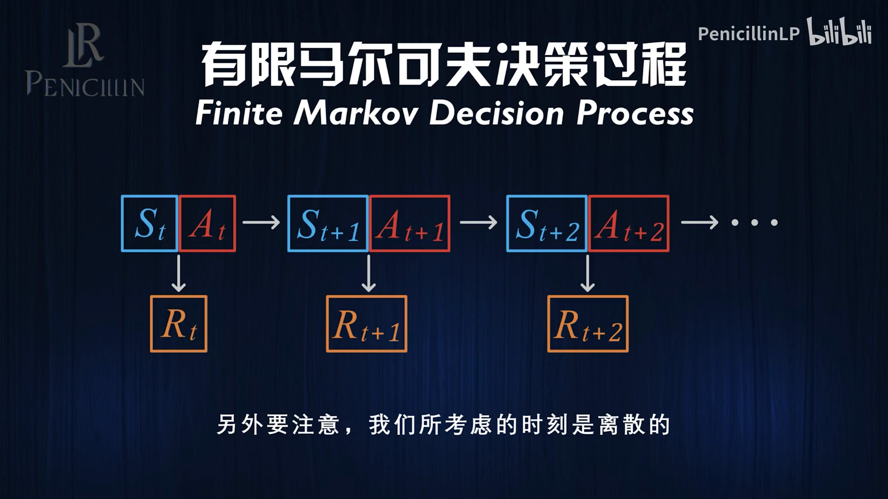

[【跳转到 05:16】](https://www.bilibili.com/video/BV1SvXAYcEb7/?t=316)

- **"有限"** 指状态空间、行动空间、奖励空间都是**有限集合**。比如迷宫例子里：9 个状态、4 个行动、$\{+1, 0, -1\}$ 三个奖励值。
- **"离散"** 指时间被切成一个个时刻，我们用整数 $1, 2, 3, \ldots$ 来标记。棋类、电子游戏、大语言模型等本质上都是离散时间的问题。

现实中的连续问题（比如导弹的飞行轨迹、机器人四肢的平衡）怎么办？一是先**离散化**再处理；二是很多强化学习的原理其实可以直接推广到连续情形，并与机器人学、最优控制紧密相关——不过这是后话。**本系列的主线，始终是离散的有限 MDP。**

## 四、随机性：用一个概率函数刻画动态

最后一个缺口是**随机性**。在迷宫里，"状态 + 行动"唯一地决定了奖励和下一个状态；但在真实场景中，股票会飘，BOSS 的快慢刀说不准，下棋时你也不知道对手怎么落子——**同样的状态和行动，结果并不唯一**。

[【跳转到 06:46】](https://www.bilibili.com/video/BV1SvXAYcEb7/?t=406)

这种随机性用一个概率函数 $p$ 来刻画：给定状态 $s$、行动 $a$，它给出"奖励取 $r$ 且下一状态为 $s'$"的**联合概率**。

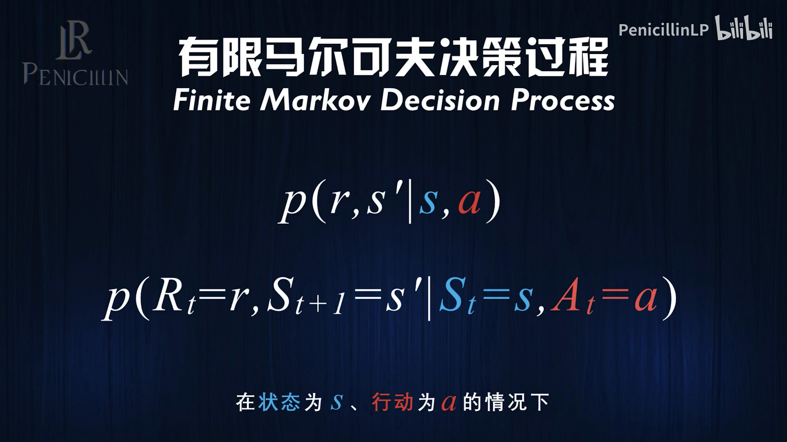

[【跳转到 07:11】](https://www.bilibili.com/video/BV1SvXAYcEb7/?t=431)

$$
p(r, s' \mid s, a) = P(R_t = r, S_{t+1} = s' \mid S_t = s, A_t = a)
$$

只要**给定概率函数 $p$，再加上状态空间与行动空间**，一个离散的有限马尔可夫决策过程就被完全确定了。可以说，$p$ 就是 MDP 的"发动机"——强化学习之所以是强化学习，正是因为多了这层状态转移的随机性（没有它，问题就退化成"单步选择"的多臂赌博机）。

> 大小写的约定（很多教材都遵循）：**大写**（$S_t$、$A_t$、$R_t$）表示随机变量，**小写**（$s$、$a$、$r$）表示这些变量的某个具体取值。

## 五、两类问题：分段（episodic）与持续（continuing）

时间是否"有限"，把 MDP 分成两类。

**第一类：episodic（分段的）。** 存在一个特殊的**终止状态** $S_T$（$T$ 表示 termination）。一旦到达 $S_T$，这一轮决策结束，然后重新开始下一轮。

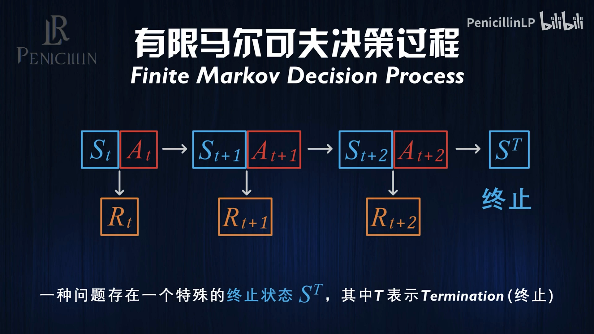

[【跳转到 08:01】](https://www.bilibili.com/video/BV1SvXAYcEb7/?t=481)

`episode` 一词原本指电视剧的"集"，也可以理解为游戏里的"周目"。所以 episodic 问题就是"打完一局、再开一局"。

**第二类：continuing（持续的）。** 不存在终止状态，过程永远持续下去。

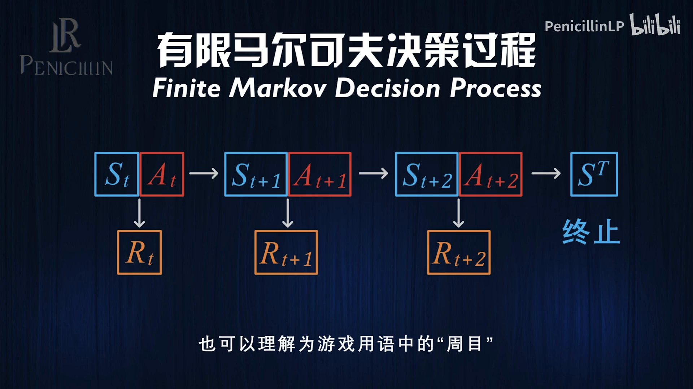

[【跳转到 08:26】](https://www.bilibili.com/video/BV1SvXAYcEb7/?t=506)

到这里，"研究对象"就被精确描述完了。接下来是锦上添花：把强化学习的**目标**、**策略**、**价值**也写成公式。

## 六、把"目标"写成公式：回报与折扣

强化学习的目标是**让将来获得的所有奖励之和最大化**。这个"奖励之和"就是**回报（return）$G_t$**。

对**分段**问题，从时刻 $t$ 一路加到终止时刻 $T$ 即可：

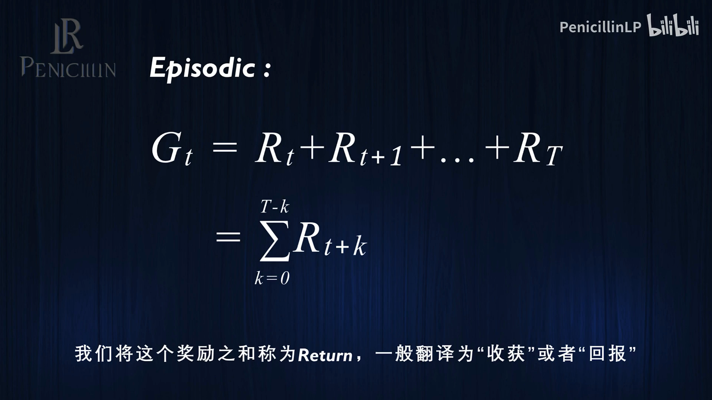

[【跳转到 09:14】](https://www.bilibili.com/video/BV1SvXAYcEb7/?t=579)

$$
G_t = R_t + R_{t+1} + R_{t+2} + \cdots + R_T
$$

但**持续**问题里 $T = \infty$，无穷多个奖励相加很可能发散。于是引入**折扣（discounting）**：越远的奖励，打折越狠。

![continuing 的回报：引入折扣因子 γ，γ∈[0,1]](assets/有限马尔可夫决策过程：MDP的数学定义/00604.webp)

[【跳转到 10:04】](https://www.bilibili.com/video/BV1SvXAYcEb7/?t=604)

$$
G_t = R_t + \gamma R_{t+1} + \gamma^2 R_{t+2} + \cdots
$$

其中 $\gamma$ 是 $0$ 到 $1$ 之间的**折扣因子（discount factor）**。以 $\gamma = 0.8$ 为例：当期的奖励不打折，1 步之后打八折，2 步之后在八折的基础上再打八折（六四折）……以此类推。折扣在数学上保证了回报**有界**，在直觉上也符合常识——比起一年后才捡到一万块，你更希望现在捡到；比起"下次一定"，UP 主更希望大家现在就一键三连。

关键是，这个定义让"当期回报"和"下一期回报"之间有了漂亮的关系：

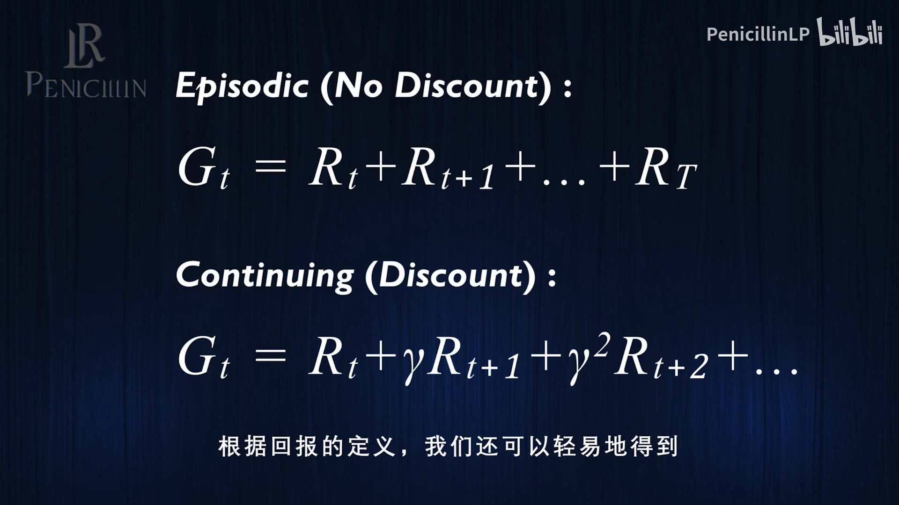

[【跳转到 11:03】](https://www.bilibili.com/video/BV1SvXAYcEb7/?t=663)

$$
G_t = R_t + \gamma G_{t+1}
$$

这条递推式是后面**贝尔曼方程**与所有自举（bootstrapping）方法的种子，务必记住。

## 七、最后两块：策略与价值

**策略（policy）** 回答"在某状态下该做什么"。它不是一成不变的固定动作，而是一个**概率分布** $\pi$：给定状态 $s$，它给出选择行动 $a$ 的概率。

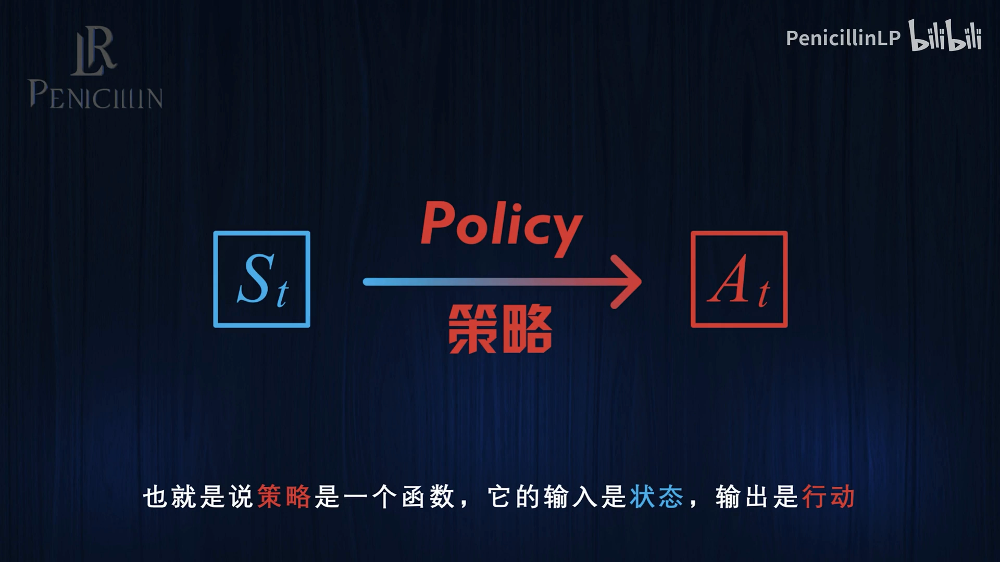

[【跳转到 11:53】](https://www.bilibili.com/video/BV1SvXAYcEb7/?t=713)

$$
\pi(a \mid s) = \text{在状态 } s \text{ 下选择行动 } a \text{ 的概率}
$$

**价值（value）** 回答"在某状态下（或某状态—行动组合下），未来能拿到多少奖励"，也就是**回报的期望值**：

$$
\begin{aligned}
\text{状态价值} \quad & v_\pi(s) = \mathbb{E}_\pi[\, G_t \mid S_t = s \,] \\
\text{状态-行动价值} \quad & q_\pi(s, a) = \mathbb{E}_\pi[\, G_t \mid S_t = s, A_t = a \,]
\end{aligned}
$$

注意下标 $\pi$：**价值是"在某个策略下"的价值**，策略一旦改变，价值往往也随之改变。

## 小结

- **MDP 是强化学习的数学坐标系**：它把"智能体与环境互动"写成精确的数学对象，从而让理论推导成为可能。
- **三块积木**：状态空间 $S$、行动空间 $A$、奖励空间 $R$，互动被写成序列 $S_0, A_0, R_0, S_1, \ldots$。
- **马尔可夫性**是一切的关键假设——**未来只取决于现在**；必要时把"历史信息"补进状态，让假设重新成立。
- **"有限 + 离散"** = 三个集合有限、时间是整数时刻；连续问题可先离散化。
- **动态由概率函数刻画**：$p(r, s' \mid s, a)$ 同时给出奖励与下一状态的联合分布；给定 $p$、$S$、$A$，MDP 就被完全确定。
- **两类问题**：episodic（有终止状态，一轮一轮进行）与 continuing（无限持续）。
- **目标写成回报**：$G_t = R_t + \gamma R_{t+1} + \cdots$，并满足递推 $G_t = R_t + \gamma G_{t+1}$。
- **策略是概率分布 $\pi(a \mid s)$，价值是回报的期望 $v_\pi(s)$、$q_\pi(s,a)$**。

## 关键术语速查

| 术语 | 一句话解释 |
| --- | --- |
| 马尔可夫决策过程（MDP） | 用集合 + 概率函数精确描述"智能体与环境互动"的数学框架 |
| 状态空间 $S$ / 行动空间 $A$ | 所有可能状态 / 行动的集合 |
| 奖励空间 $R$ | 所有可能奖励的集合，通常是实数集的子集 |
| 马尔可夫性 | 下一状态与奖励只依赖当前状态与行动，与更早历史无关 |
| 有限 MDP | 状态、行动、奖励空间都有限，且时间是离散整数时刻 |
| 概率函数 $p(r,s' \mid s,a)$ | 给定 $s, a$ 时"奖励 $r$ 且下一状态 $s'$"的联合概率，即 MDP 的"发动机" |
| episodic / continuing | 有终止状态、一轮一轮进行 / 无终止状态、无限持续 |
| 回报 $G_t$ | 从时刻 $t$ 起的（折扣）奖励之和 |
| 折扣因子 $\gamma$ | $0 \sim 1$ 的参数，越远的奖励打折越狠，保证回报有界 |
| 策略 $\pi(a \mid s)$ | 状态到"行动概率分布"的映射 |
| 状态价值 $v_\pi(s)$ / 状态-行动价值 $q_\pi(s,a)$ | 某策略下回报的期望 |
