# 马尔可夫决策过程：环境的数学刻画与五元组

> 视频来源：[上海交大张伟楠强化学习课程第3讲：马尔可夫决策过程I](https://www.bilibili.com/video/BV1ZaHfekEyL/)（时长约 21 分钟）

## 本讲要解决的核心问题（SCQA）

**背景**：学强化学习，最终是要"学出"一个策略。但策略学得好不好，取决于它所交互的**环境**长什么样。翻强化学习的论文你会发现，作者几乎总是**先把环境" MDP 化"**，做成马尔可夫决策过程，再上算法。

**冲突**：MDP 这个名字听着耳熟，但一个很常见的误解是把它当成"某种强化学习算法"。它其实**根本不是算法**，而是强化学习所交互的"环境"的一个**数学刻画**。要真正理解它，先得回答两个前置问题：环境到底是什么？"决策"两个字又体现在哪里？

**疑问**：MDP 究竟刻画了什么？它的组成部分有哪些？为什么这套刻画能自然地导出"最大化奖励期望"这个学习目标？

**回答（中心思想）**：MDP 用**五元组** $\langle S, A, P, R, \gamma \rangle$ 刻画一个**动态环境**。它的核心是**状态转移概率 $P(s' \mid s, a)$**——正是这一项让问题"动起来"，也让强化学习区别于多臂赌博机、区别于有监督/无监督学习。智能体与环境交互会滚出一条**轨迹（trajectory）/ episode**，并诱导出一个叫**占用度量（occupancy measure）**的数据分布；而强化学习要优化的目标，本质上就是"在这个数据分布上奖励的期望"。

## 一、先厘清一个误解：MDP 不是算法，而是环境的"数学刻画"

MDP **不等于**强化学习算法。它是强化学习交互的**环境**的一个数学刻画。你把环境用 MDP 刻画出来之后，无论它的状态转移（transition）是不是白盒的，都可以对它用强化学习方法去学、学出最优策略。

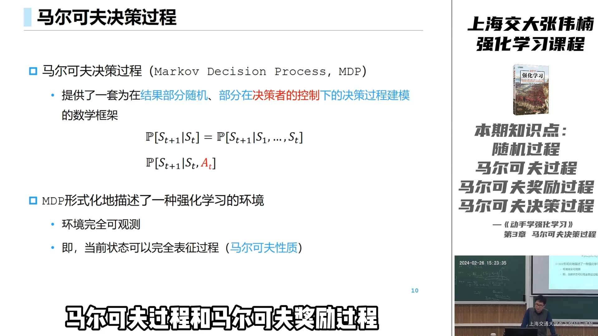

[【跳转到 08:15】](https://www.bilibili.com/video/BV1ZaHfekEyL/?t=495)

"先 MDP 化，再上算法"是强化学习论文的标准套路；反过来说，如果环境本身完全已知、就是一个 MDP，那么在它上面做动态规划（dynamic programming）其实更像一个**规划问题**（类似线性规划、凸优化），有的学者甚至不认为这算"强化学习"。这些我们后面再理。

那么，"环境"到底是什么？答案是一句话：**它是一个随机过程。**

## 二、环境是随机过程；MDP 挑出其中最"好算"的一类

**随机过程**是大学的一门课（保研的话研究生一年级会上），它就是一个或多个事件**以时间为主线**演化的过程。说白了，它就是一个条件概率分布：基于过去已经发生的事件，刻画"下一步"会怎样。

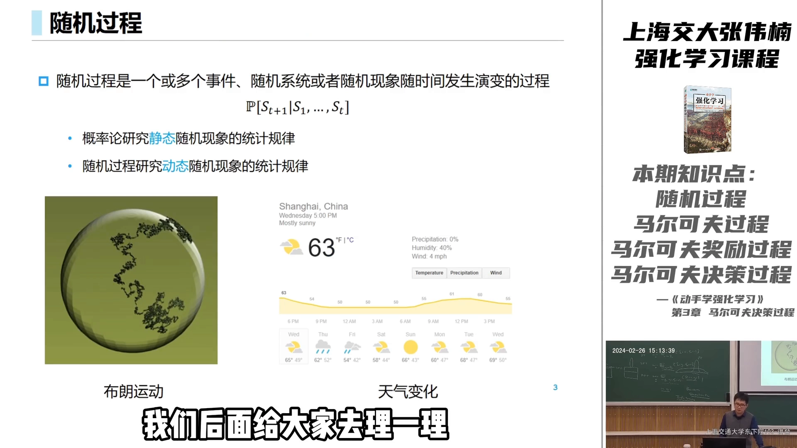

[【跳转到 00:53】](https://www.bilibili.com/video/BV1ZaHfekEyL/?t=53)

$$
S_{t+1} \sim P(\cdot \mid S_0, S_1, \dots, S_t)
$$

不停"累积"下去——$S_{t+1}$ 成为条件、generate 出 $S_{t+2}$，再不断往后推——这就是一个随机过程。布朗运动、天气变化、一场足球比赛、城市交通里各种物质与生物的演化、星系之间的运行轨迹……都是随机过程。

如果能刻画这个演化过程，再带上一个"奖励函数"（告诉智能体什么是好的、什么是坏的），就能定义强化学习的目标了。但"下一步取决于**之前所有**历史"太笼统、不好算。于是我们挑出一类**特殊**的随机过程：**马尔可夫过程**。

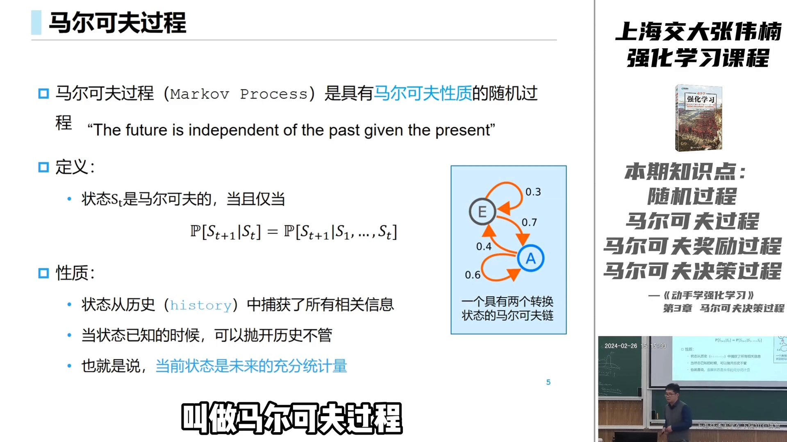

[【跳转到 02:19】](https://www.bilibili.com/video/BV1ZaHfekEyL/?t=139)

严格来说，随机过程"下一步的状态分布"是由之前**所有**已观测到的状态决定的。但如果它**只基于当前这一步的状态**，我们就说这个过程具有**马尔可夫性（Markov property）**：

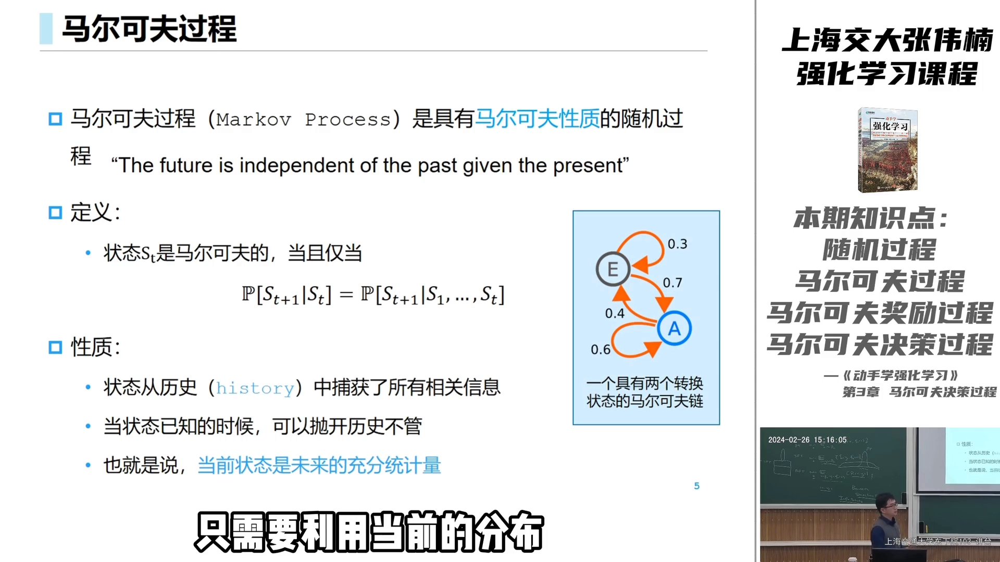

[【跳转到 02:44】](https://www.bilibili.com/video/BV1ZaHfekEyL/?t=164)

一句话：**当前状态是未来的"充分统计量"**，之前的历史完全不用管。举个例子：一个小球抛在空中，只要知道它当前位置、速度、加速度（重力加速度），它的轨迹就完全定了；它是怎么被抛上来的，不用管——这就是一个马尔可夫过程。

> 记号约定：**大写**（$S_t$）是随机变量（stochastic random variable），**小写**（$s$）是它取到的具体值。比如"状态一、状态二"是具体的 $s$，而 $S_t$ 表示 $t$ 时刻状态的那个随机变量。

## 三、从马尔可夫过程 → 马尔可夫奖励过程 → 折扣

有了"过程"，下一步是给它加上"好坏"。

我们可以在每一个状态上放一个奖励值。比如一个只有两个状态的马尔可夫链：在 $E$ 状态以 $0.3$ 留在 $E$、$0.7$ 走到 $A$；在 $A$ 状态以 $0.6$ 停在 $A$、$0.4$ 转到 $E$。若在 $E$ 上给奖励 $1$、在 $A$ 上给奖励 $0.1$，一个**马尔可夫奖励过程（Markov reward process, MRP）**就建构出来了。

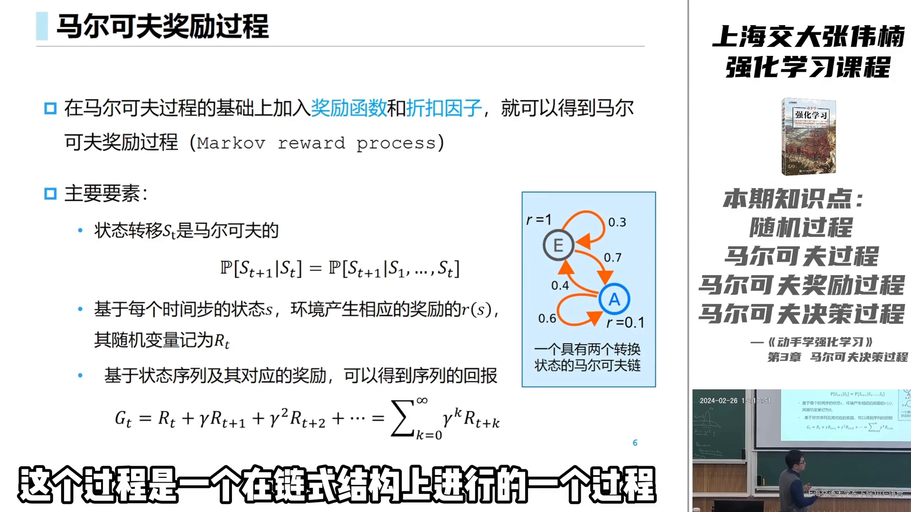

[【跳转到 03:59】](https://www.bilibili.com/video/BV1ZaHfekEyL/?t=239)

在 MRP 里，每个 time step 会经历一个具体的 $S_t$，并得到相应的 reward。把未来的奖励**累积并折扣**起来，就得到"站在当前这一步往后看"的总收获，也就是 **return**：

$$
G_t = R_t + \gamma R_{t+1} + \gamma^2 R_{t+2} + \cdots
$$

**为什么要折扣？** 两个原因：其一，如果不折扣，无限加和往往就是正无穷；打了折扣，它才是一个有限、可比较的值。其二，站在任何一个 time step，很远的未来其实没那么重要，近期的未来更重要。

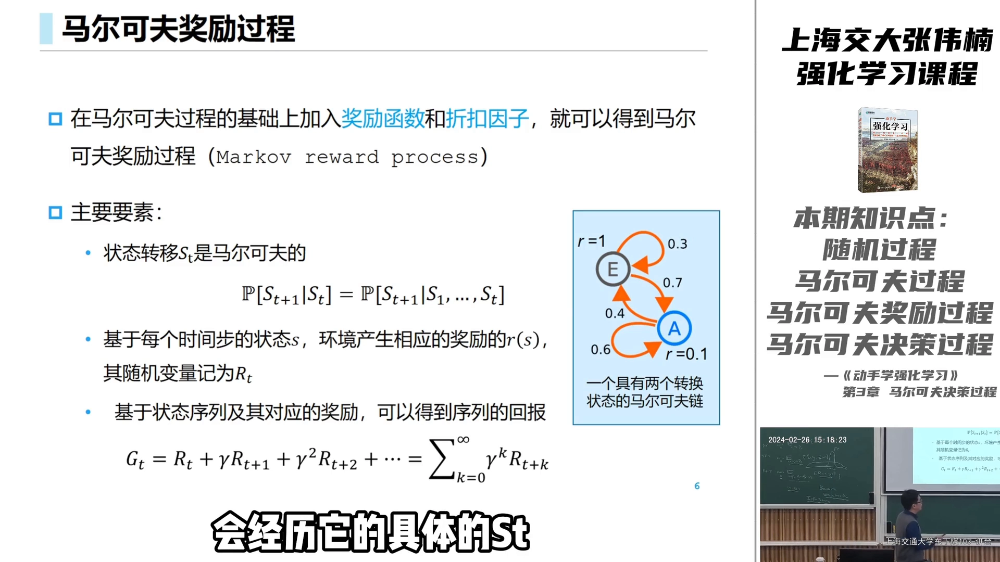

[【跳转到 04:24】](https://www.bilibili.com/video/BV1ZaHfekEyL/?t=264)

这里讲师还做了一个"课外补充"：为什么衰减一定是 $\gamma^t$ 这种形式？（这是一个"唯一性"的直觉推导，不作严格证明。）

直觉是：我们希望在序列之间建立一个**全序**——任意两个序列都能比出孰好孰坏，而且不循环。比如序列 $1, 2, 2$ 与序列 $2, 3, 4$，后者更大、显然更好；同时我们通常假设"近期的 `reward` 比远期的更值钱"。

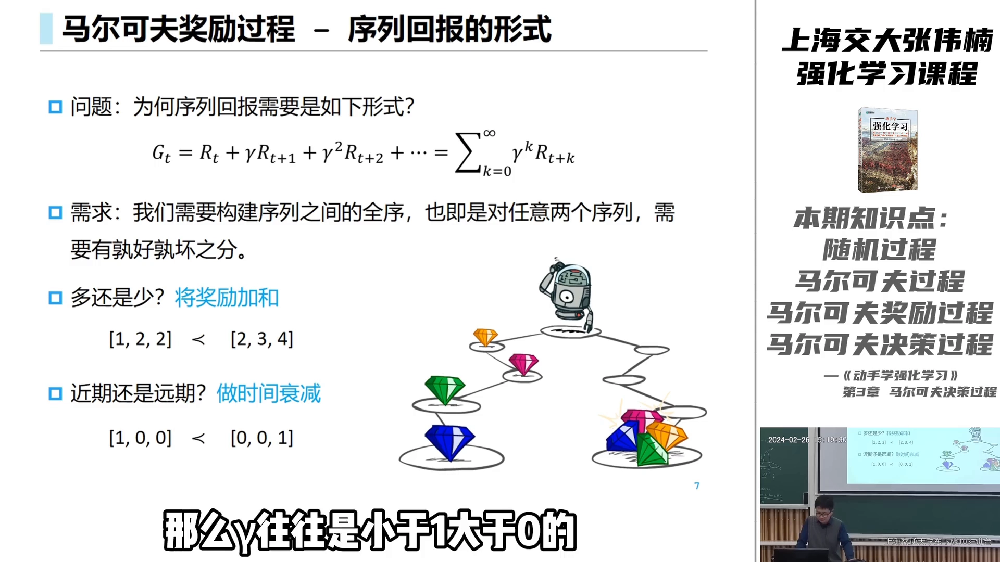

[【跳转到 05:20】](https://www.bilibili.com/video/BV1ZaHfekEyL/?t=320)

若要求"把未来回报乘一个系数、再加当前奖励"这种形式能在所有序列上都自洽，最后只能推出：一步的系数是 $\gamma$、两步是 $\gamma^2$、$k$ 步是 $\gamma^k$——这正是 $\gamma^t$ 的来源。（这个推导有点绕，看视频里黑板上的过程更好懂。）

## 四、"决策"从哪来：从 MRP 到 MDP

到此为止，过程的走向都是 $S$ 自己决定的（MRP 的奖励也只挂在状态上）。那 MDP 里的 **"决策（decision）"** 体现在哪里？

答案是：**引入一个"外界的干扰"——行动 $A_t$**。在 $S_t$ 之后，智能体会采取一个动作 $A_t$，它作用到环境上，改变 $S_{t+1}$ 的分布。

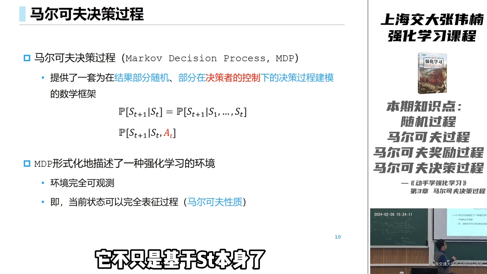

[【跳转到 08:40】](https://www.bilibili.com/video/BV1ZaHfekEyL/?t=520)

$$
S_{t+1} \sim P(\cdot \mid S_t, A_t) \qquad \text{有了 } A_t \text{，环境才"可被决策改变"}
$$

于是可以说：MDP 在**最基本的数学要求**下，就已经能刻画强化学习的环境了——它既能刻画"智能体的行动 $A_t$ 会如何改变环境"，又能在每个 state 上定义"什么是好、什么是坏"。

## 五、MDP 的五元组：S、A、P、R、γ

总结起来，强化学习的这个"环境"，用一个**五元组** $\langle S, A, P, R, \gamma \rangle$ 来刻画：

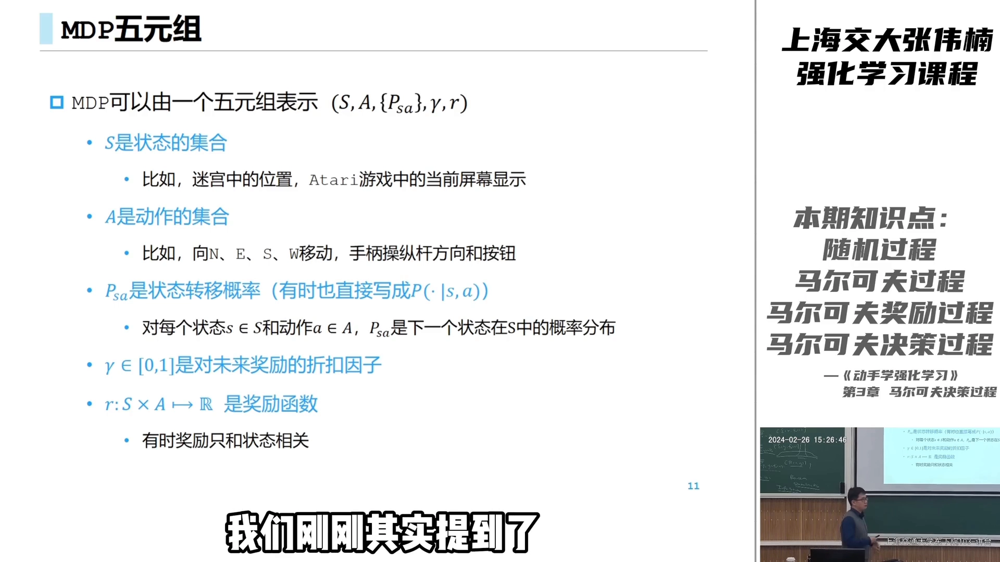

[【跳转到 10:38】](https://www.bilibili.com/video/BV1ZaHfekEyL/?t=638)

- **$S$（状态集合）**：所有状态是多少。迷宫里所有位置是状态；一个 Atari 游戏里，当前屏幕显示的整个画面就是它的状态。
- **$A$（动作集合）**：智能体可做的选择。迷宫里每个方向是一个动作；打游戏时所有手柄操作是动作。
- **$P$（状态转移概率）**：$P(s' \mid s, a)$，在状态 $s$ 采取动作 $a$ 后到达 $s'$ 的概率。**这是整个 MDP 动态性的最核心体现。**
- **$R$（奖励函数）**：告诉智能体"什么好、什么坏"，通常写成 $r(s, a)$ 或 $r(s)$。
- **$\gamma$（折扣因子）**：$0 \sim 1$ 之间，用来折损未来的奖励，让总回报有限而可比较。

关于状态转移概率，讲师特别强调了一句话：**强化学习之所以是强化学习，就是因为有 $P(s' \mid s, a)$ 这玩意。** 如果没有状态转移（没有"下一个状态"），问题最多只是一个多臂赌博机（bandit）——做一个选择、看到后果而已；有了状态转移，才有了"动态性"，才能谈"为未来做规划（planning）"。

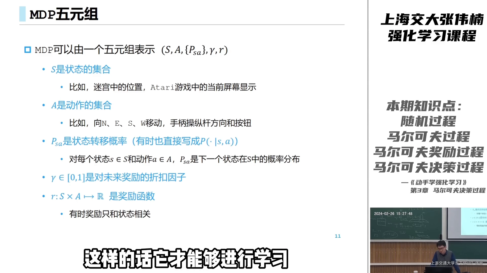

[【跳转到 11:28】](https://www.bilibili.com/video/BV1ZaHfekEyL/?t=688)

关于**奖励函数**：reward 可以简写成基于 state 的 $r(s)$，也可以写成基于 state-action pair 的 $r(s,a)$；更一般地，它是一张从 $S \times A$ 映射到实数轴的函数。为什么奖励一定要是**标量**？因为只有标量才能比较"孰优孰劣"、才能学习——就像机器学习里模型参数可以有几万亿个，但损失函数永远是**一个实数**。真要多目标优化，最后也得想办法把多个目标整合成单个目标。

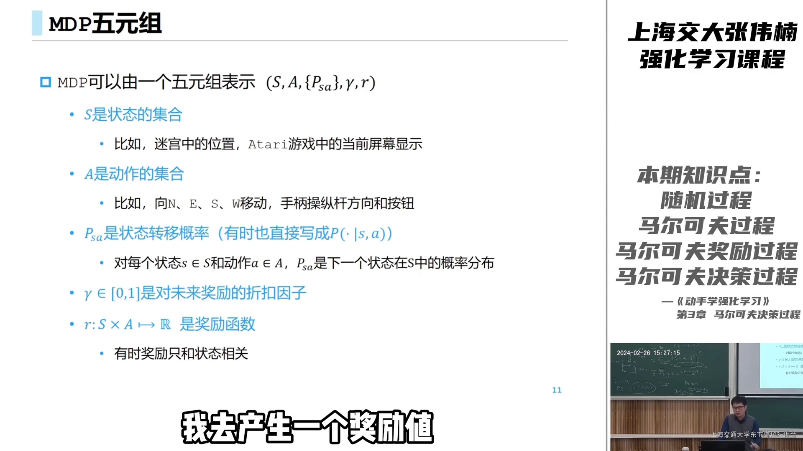

[【跳转到 11:03】](https://www.bilibili.com/video/BV1ZaHfekEyL/?t=663)

## 六、交互如何"滚"出一条轨迹与一个 episode

MDP 是一个**动态环境**：它能从头"动起来"。给定一个初始状态（或初始状态分布），智能体选一个动作、拿到奖励、状态发生转移，再选下一个动作……

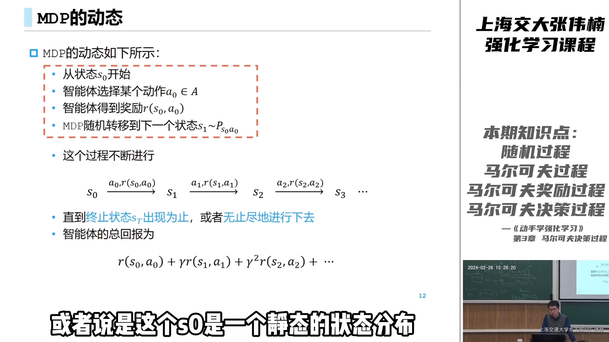

[【跳转到 11:53】](https://www.bilibili.com/video/BV1ZaHfekEyL/?t=713)

```text
S_0 →(A_0)→ R_0 = r(S_0, A_0), S_1 →(A_1)→ R_1, S_2 → …
```

这一路滚下来的记录就是一条**轨迹（trajectory）**。一次"智能体与环境交互的周期"称为一个 **episode**：它以**终止状态（terminal state）**结束，或者以某个固定的 time step（比如交互 100 轮）结束，或者 unlimited 地一直交互下去——这取决于具体任务。

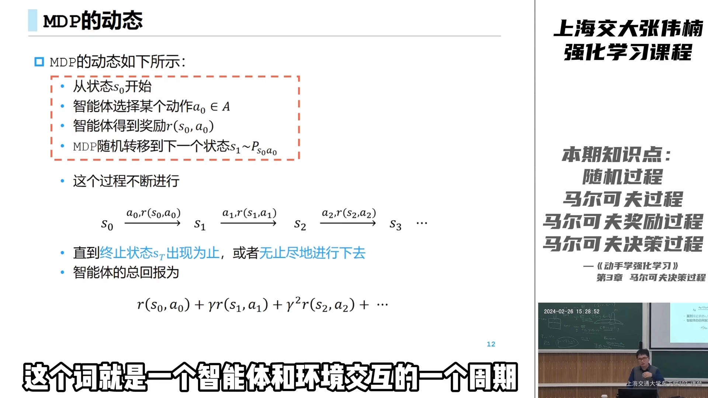

[【跳转到 12:18】](https://www.bilibili.com/video/BV1ZaHfekEyL/?t=738)

智能体在一个 episode 里获得的总回报，就是每个 reward 加在一起、再带上 $\gamma^t$ 的衰减：

$$
\text{Return} = r(S_0, A_0) + \gamma\, r(S_1, A_1) + \gamma^2 r(S_2, A_2) + \cdots
$$

## 七、RL 与监督／无监督学习的根本差别：数据分布会不会变

借 MDP 这套刻画，可以一举说清强化学习与有监督、无监督学习的**核心区别**。

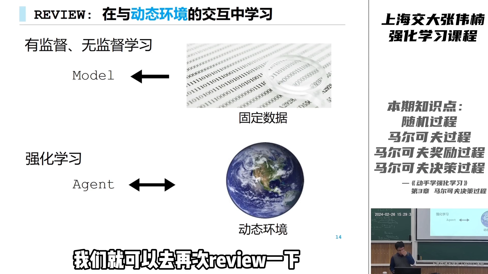

[【跳转到 12:49】](https://www.bilibili.com/video/BV1ZaHfekEyL/?t=769)

有监督／无监督学习（SL / unsupervised learning）无论是最小化损失，还是最大化 log-likelihood，都是在**一个固定的数据分布**上构建目标：

$$
\min_\theta \; \mathbb{E}_{(x, y) \sim D}\big[\, \text{loss}(y, f_\theta(x)) \,\big] \qquad \text{数据分布 } D \text{ 不随模型改变}
$$

这里的数据分布 $D$ 不以模型为转移，我们只是在固定分布上改变"打分函数" $f_\theta$，把期望优化掉。

但强化学习不一样：**它的数据分布本身是随策略改变的**。$s, a$ 是从策略 $\pi_\theta$ 与环境交互诱导出的分布里采样的；当你改变参数 $\theta$、改变策略，数据分布也跟着变，进而这个分布下的奖励期望也变。

这带来一个关键难点：在环境给定、策略 $\pi$ 给定的情况下，这个数据分布**很多时候根本导不出来**，它是 **intractable（不可解）** 的。

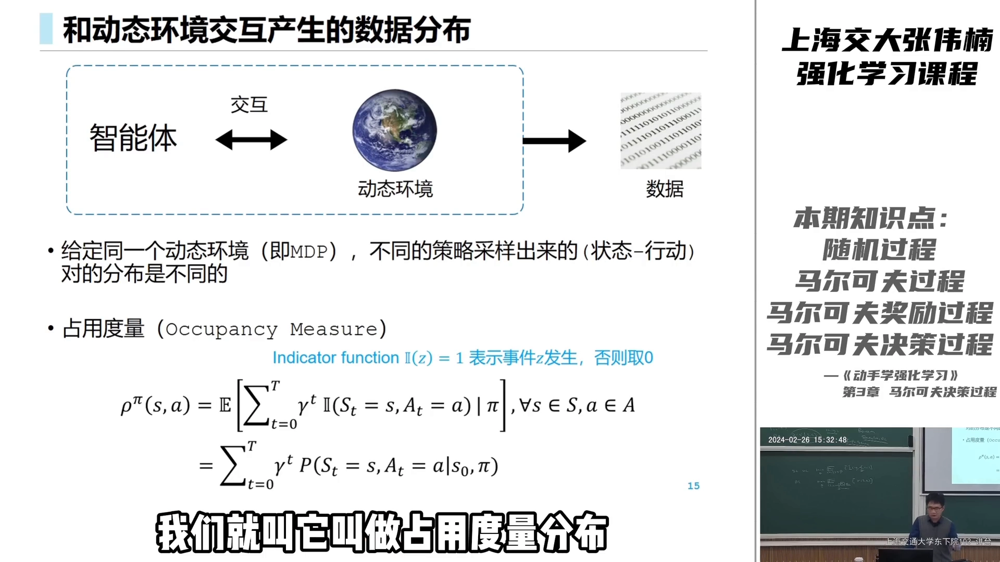

[【跳转到 15:13】](https://www.bilibili.com/video/BV1ZaHfekEyL/?t=913)

也就是说，强化学习比有监督／无监督学习**多黑了一层**：$\pi$ 本身可以是个黑盒（深度强化学习里可能是个五层神经网络），而 $\pi$ 与环境交互出的数据分布又是一层黑盒。这个"策略与环境交互产生的数据分布"，就叫**占用度量（occupancy measure）**，记作 $\rho^\pi$。

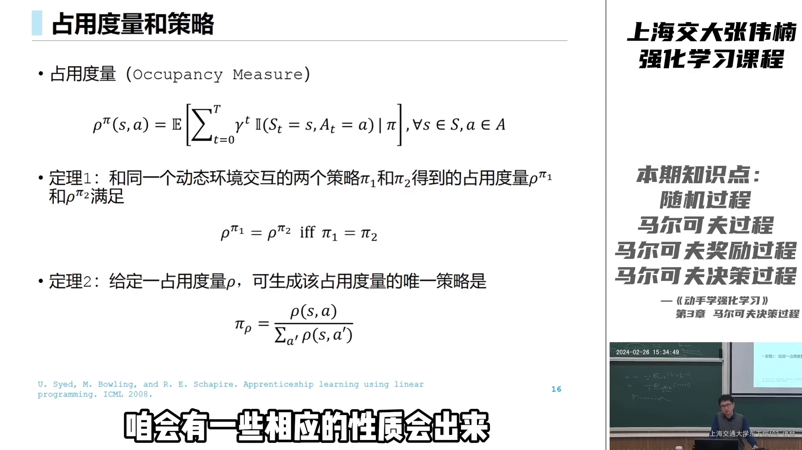

[【跳转到 16:45】](https://www.bilibili.com/video/BV1ZaHfekEyL/?t=1005)

$$
\rho^\pi(s, a) = \sum_t \gamma^t \cdot P(S_t = s, A_t = a \mid \pi)
$$

它衡量的是：跟着策略 $\pi$ 与环境交互时，你"忙于"哪些 $(s, a)$、经常经过哪些状态、常选哪个动作。

占用度量还有两条漂亮的性质：

1. **合法性**：并不是所有分布都能当占用度量——只有对某个策略、在给定环境下真实交互得到的，才叫**合法占用度量**。
2. **可逆性（定理）**：$\rho^{\pi_1} = \rho^{\pi_2}$ **当且仅当** $\pi_1 = \pi_2$。反过来读就是——在给定一个合法占用度量的情况下，能产生它的策略是**唯一**的：把该占用度量在每个 $s$ 上对 $a$ 求和当分母、单个 $(s,a)$ 当分子，就还原出了策略。这也是为什么"数据分布相等"能被当作"策略相等"来用。

## 八、落点：被优化的目标 = 占用度量上的奖励期望

最后，为什么让占用度量**保留 $\gamma^t$ 的未归一化形式**（而不是乘一个 $1 - \gamma$ 把它归一化）？因为**奖励前面本来就有 $\gamma^t$**，两边一配对，价值的加和就可以**从"沿时间求和"改写成"沿 $(s,a)$ 求和"**：

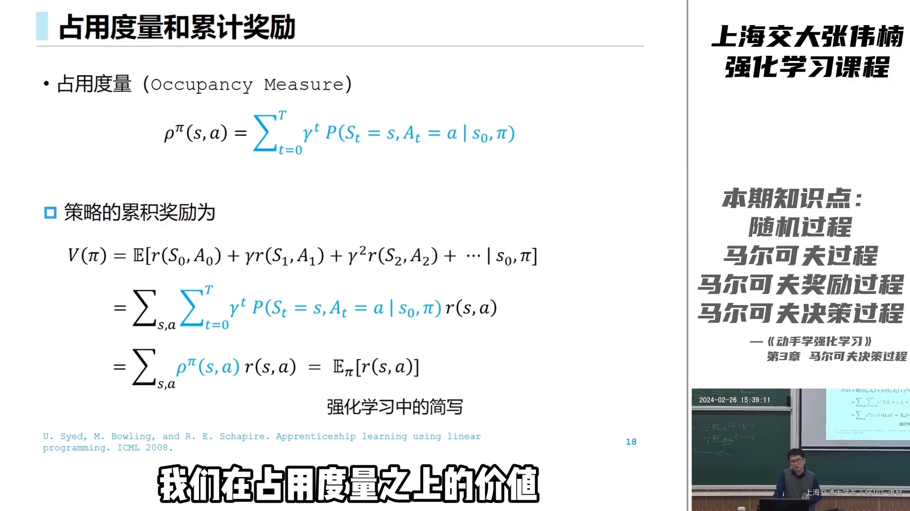

[【跳转到 20:05】](https://www.bilibili.com/video/BV1ZaHfekEyL/?t=1205)

$$
V^\pi(s) = \sum_{s,a} \rho^\pi(s, a) \cdot r(s, a) = \mathbb{E}_{(s,a) \sim \rho^\pi}\big[\, r(s, a) \,\big]
$$

于是强化学习的目标被写成了非常干净的一句话：**智能体的价值，就是在（由策略诱导的）数据分布之下、reward 的期望**。这也解释了为什么强化学习的公式里常把策略 $\pi$ 直接放在期望的角标上——它代表的正是"以 $\pi$ 的占用度量作为数据分布"。

## 小结

- **MDP 不是算法**，而是强化学习所交互**环境**的数学刻画；论文的常规做法是先"把环境 MDP 化"，再上算法。
- **环境是一个随机过程**；MDP 挑出其中满足**马尔可夫性**（未来只看现在、当前状态是未来的充分统计量）的那一类。
- 在马尔可夫过程上给每个状态加奖励，得到 **MRP**；把奖励按 $\gamma^t$ 折扣加和，就得到 **return**——$\gamma^t$ 这种衰减是保证"序列可比、回报有界"的自然选择。
- **"决策" = 引入行动 $A_t$**：下一状态从 $P(\cdot \mid S_t)$ 变为 $P(\cdot \mid S_t, A_t)$，这就是 MDP 中 "decision" 的来源。
- **MDP 五元组 $\langle S, A, P, R, \gamma \rangle$**：状态集合、动作集合、状态转移概率 $P(s' \mid s, a)$、奖励函数（必须是标量）、折扣因子。
- **$P(s' \mid s, a)$ 是灵魂**：没有它，问题就退化为 bandit；有了它，才有了动态性与规划。
- 智能体与环境交互滚出**轨迹 / episode**；总回报是折扣后的奖励之和。
- **RL 与 SL 的根本差别**在于**数据分布会不会变**：RL 的数据分布由策略诱导、且往往 intractable，比 SL 多黑一层。
- 这个诱导分布就是**占用度量 $\rho^\pi$**；被优化的目标可写成 $V^\pi = \mathbb{E}_{(s,a) \sim \rho^\pi}[\, r(s,a) \,]$。

## 关键术语速查

| 术语 | 一句话解释 |
| --- | --- |
| 马尔可夫决策过程（MDP） | 强化学习所交互"环境"的数学刻画，用五元组 $\langle S, A, P, R, \gamma \rangle$ 描述一个动态环境 |
| 随机过程 | 事件以时间为主线演化的过程，本质是一个条件概率分布 |
| 马尔可夫性 | 未来只依赖当前状态；当前状态是未来的"充分统计量" |
| 马尔可夫奖励过程（MRP） | 马尔可夫过程 + 每个状态上的奖励 |
| 折扣因子 $\gamma$ | $0 \sim 1$ 的参数，按 $\gamma^t$ 折损未来奖励，保证回报有限可比较 |
| 状态转移概率 $P(s' \mid s, a)$ | 在 $s$ 采取 $a$ 后到达 $s'$ 的概率；MDP 动态性的核心 |
| 奖励函数 $r$ | 告诉智能体"什么好、什么坏"，映射到实数（标量） |
| 轨迹 / episode | 智能体与环境一次交互产生的记录 / 一个交互周期 |
| 占用度量 $\rho^\pi$ | 策略 $\pi$ 与环境交互诱导出的 $(s,a)$ 数据分布（$\gamma^t$ 未归一化） |
| 合法占用度量 | 能由某个策略在给定环境下真实交互得到的占用度量 |
| 可逆性定理 | $\rho^{\pi_1} = \rho^{\pi_2} \iff \pi_1 = \pi_2$；由占用度量可唯一还原策略 |
