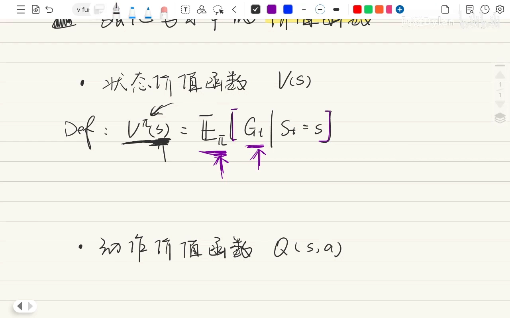
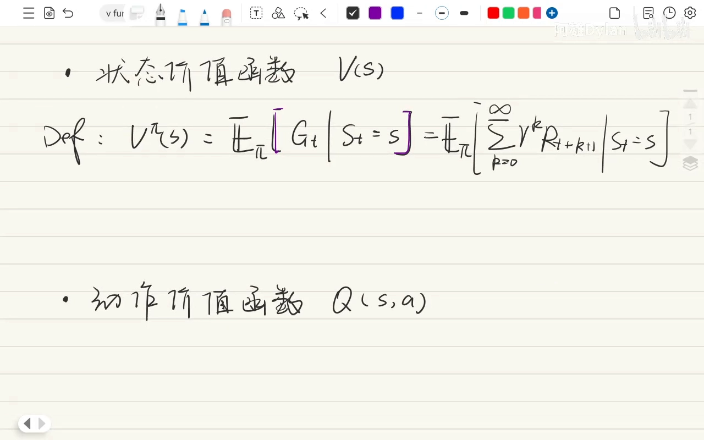
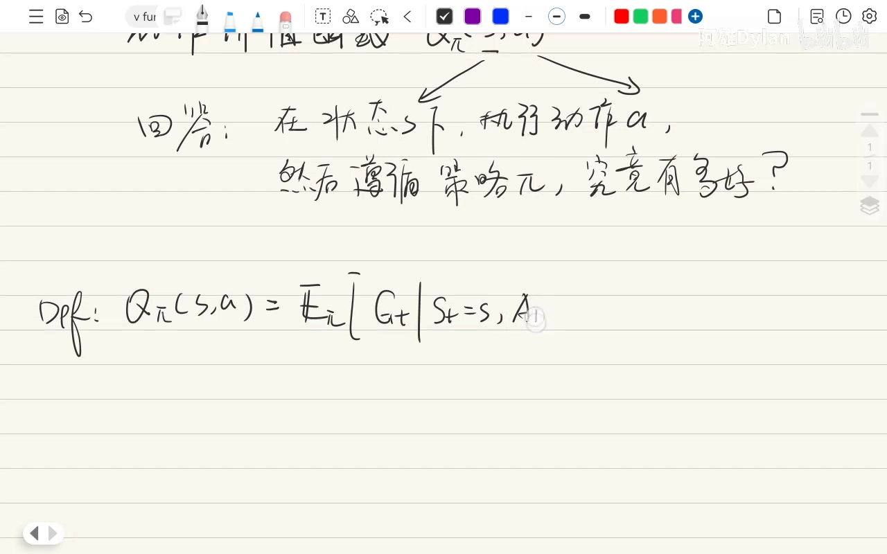
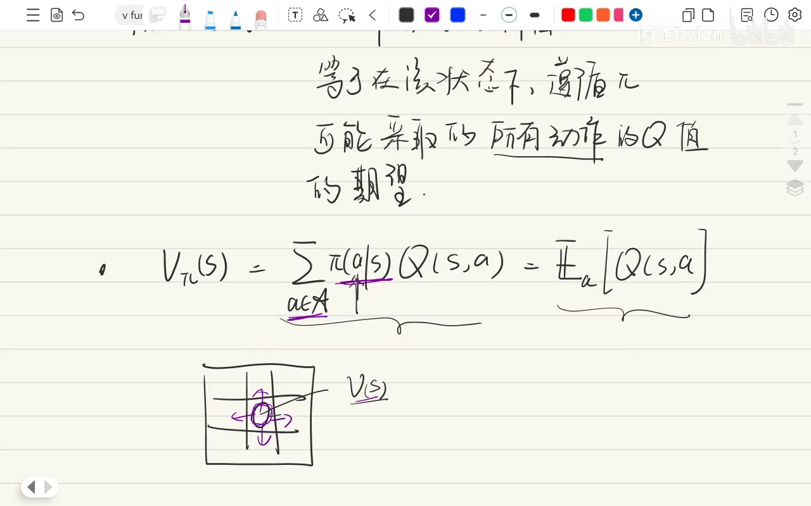
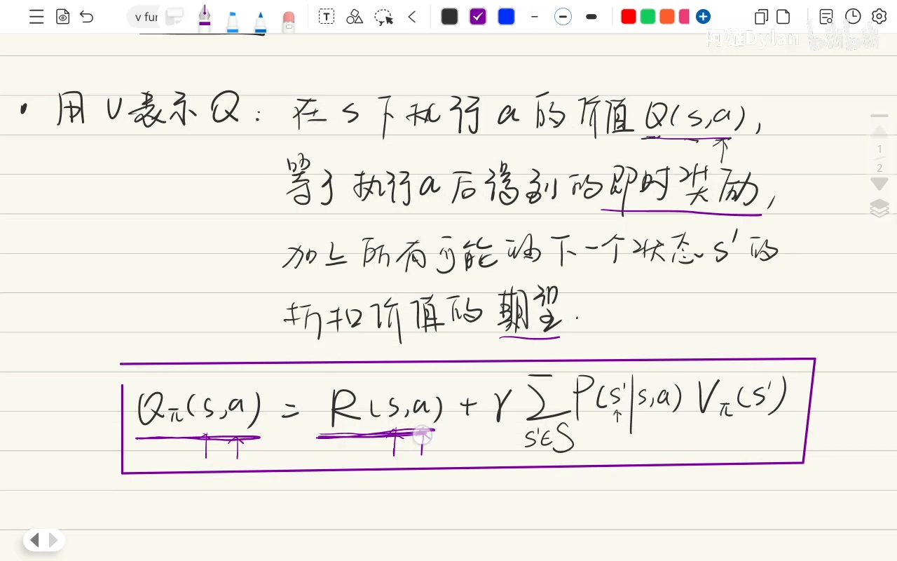
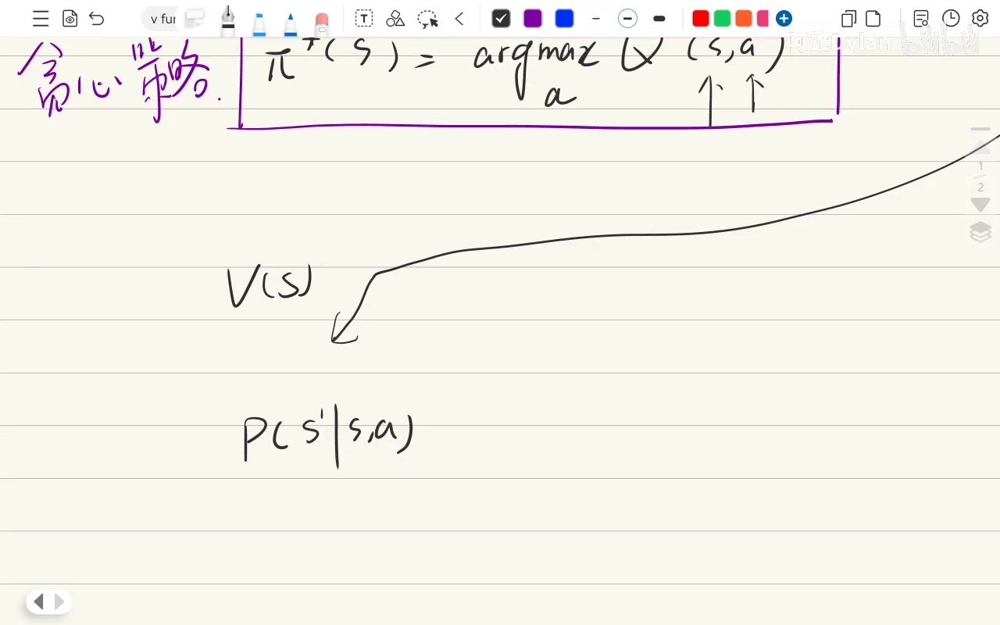
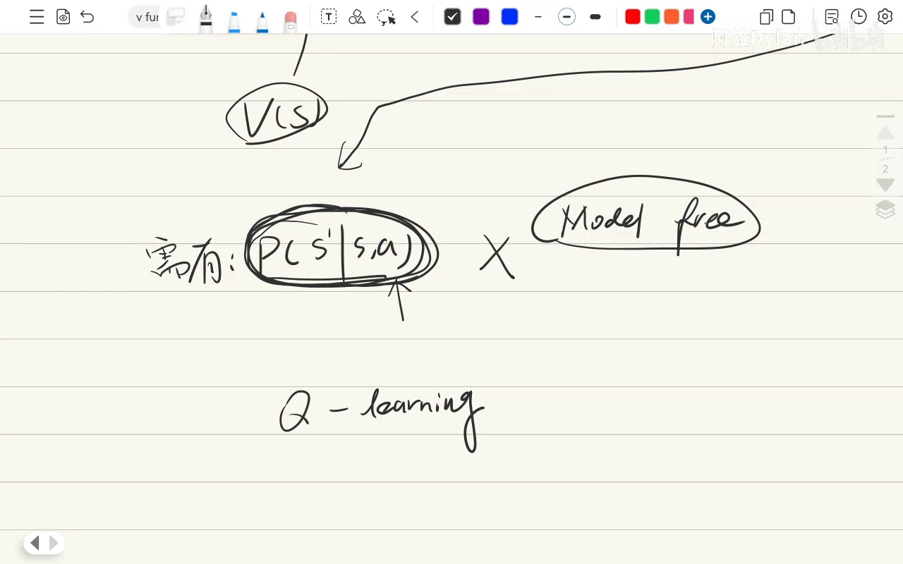
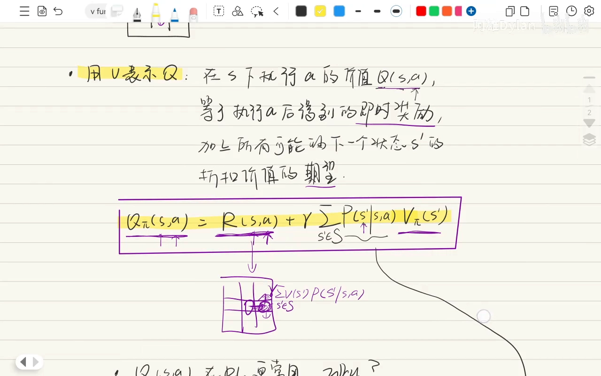

# 价值函数：状态价值 V 与动作价值 Q 及其关系

> 视频来源：[价值函数-强化学习数学基本功](https://www.bilibili.com/video/BV1YN1gBfEgk/)（UP 主：阿雄Dylan，时长约 22 分钟）整理撰写，所有内容均来自该视频的讲解与画面，未作超出视频的引申。

## 本讲要解决的核心问题（SCQA）

**背景**：强化学习里，智能体要判断「当前这个状态好不好」「走这一步好不好」。下棋时我们凭直觉就能给出答案，但算法不能靠直觉。

**冲突**：强化学习用两个函数来回答这两个问题——状态价值函数 `v(s)` 和动作价值函数 `q(s,a)`。它们的定义写出来几乎一模一样，很容易混淆；而实际算法（Q-Learning、DQN 等）里又几乎总是围绕 `q` 展开，让人不明白为什么。

**疑问**：这两个价值函数到底是什么、分别回答什么问题？它们之间是什么关系？为什么 `q` 更常用？

**回答（中心思想）**：价值函数是把「局势好不好」的直觉变成精确数字的打分工具。`v_π(s)` 给**状态**打分——从状态 s 出发、之后一直按策略 π 行动能拿到多少期望回报；`q_π(s,a)` 给**「状态 + 动作」组合**打分——在 s 下先做 a、之后按 π 行动能拿到多少期望回报。两者可以互相转化：`v` 是 `q` 按策略概率的期望，`q` 是即时奖励加上下一状态 `v` 的折扣期望。工程上更常用 `q`，是因为有了最优 `q*` 就能直接读出最优策略（取 argmax 即可），而用 `v` 还需要已知环境的状态转移模型——这在免模型（model-free）场景里拿不到。

## 一、价值函数：把「局势好不好」的直觉变成精确的数字

下象棋时，我们经常思考两个问题 [【跳转到 00:25】](https://www.bilibili.com/video/BV1YN1gBfEgk/?t=25)：

1. 当前的局势如何？
2. 我走这一步棋好不好？

如果能很好地回答这两个问题，就能下好一盘棋。心里可以靠直觉给答案，而**强化学习的一大核心任务，就是通过价值函数把这种模糊的直觉变成精确的数字**——这是得到一个好策略的基础 [【跳转到 00:25】](https://www.bilibili.com/video/BV1YN1gBfEgk/?t=25)。

还有一点很关键：对局势或某一步的判断，**都不是只看眼前这一步**，而是对整盘棋的长远考虑。也就是说，考量的不是即时奖励，而是**累计折扣回报 `G_t`**：把未来所有奖励加起来，并对越远的奖励打的折扣越大 [【跳转到 00:50】](https://www.bilibili.com/video/BV1YN1gBfEgk/?t=50)。

但 `G_t` 是一个**随机变量**：用它来评估策略好坏，不能只看某一条具体轨迹的折扣回报，而要取**在这个策略下的期望**。就像象棋高手也可能输几局，但他获胜的期望高于一般人 [【跳转到 01:15】](https://www.bilibili.com/video/BV1YN1gBfEgk/?t=75)。所以接下来讲的两个价值函数，本质上都是在计算**对回报的期望**。

## 二、状态价值函数 v_π(s)：这个状态有多好

**状态价值函数**（state value function）用大写 `V` 表示，它回答的问题是：在某个特定策略 π 的前提下，处于状态 s **究竟有多好**——从状态 s 开始，如果智能体之后的所有行为都遵循策略 π，它能获得的累计期望奖励是多少 [【跳转到 00:50】](https://www.bilibili.com/video/BV1YN1gBfEgk/?t=50)。



数学定义就是「回报在给定条件下的期望」[【跳转到 02:05】](https://www.bilibili.com/video/BV1YN1gBfEgk/?t=125)：

```
v_π(s) = E_π[ G_t | S_t = s ]
       = E[ Σ_{k=0}^{∞} γ^k R_{t+k+1} | S_t = s ]
```

其中每一项都要解释清楚：

- **为什么用期望**：因为环境的反应（状态转移）以及策略本身都可能带有随机性——如果策略是一个概率分布，动作选择就带随机性，所以我们更关注期望值 [【跳转到 02:05】](https://www.bilibili.com/video/BV1YN1gBfEgk/?t=125)；
- **期望的是什么**：是回报 `G_t`，即从 T 时刻开始所有未来奖励的总和 [【跳转到 02:55】](https://www.bilibili.com/video/BV1YN1gBfEgk/?t=175)；
- **下标 π 的含义**：价值依赖于特定的策略 π，**如果策略改变，同一个状态的价值也会改变** [【跳转到 03:20】](https://www.bilibili.com/video/BV1YN1gBfEgk/?t=200)。



直观理解 [【跳转到 03:45】](https://www.bilibili.com/video/BV1YN1gBfEgk/?t=225)：在迷宫里，如果当前（中间某个）状态 s 的值很高，就说明从这个状态出发，智能体有很大概率进入能获得很多奖励的未来——换句话说，**很可能离终点已经很近了**。

## 三、动作价值函数 q_π(s,a)：做这个动作有多好

**动作价值函数**（action value function，也就是 q function）回答的问题是：在状态 s 下**执行动作 a**、并遵循某个特定策略 π，究竟有多好 [【跳转到 04:35】](https://www.bilibili.com/video/BV1YN1gBfEgk/?t=275)。



数学定义与 `v` 的结构完全一样，只是**多了一个动作条件** [【跳转到 05:50】](https://www.bilibili.com/video/BV1YN1gBfEgk/?t=350)：

```
q_π(s,a) = E_π[ G_t | S_t = s, A_t = a ]
         = E[ Σ_{k=0}^{∞} γ^k R_{t+k+1} | S_t = s, A_t = a ]
```

对比两者：

```
v_π(s)   : 条件只有 S_t = s
q_π(s,a) : 条件多了 A_t = a
```

唯一的区别就是：`q` 是「在指定了一个动作之后」再计算期望回报 [【跳转到 06:45】](https://www.bilibili.com/video/BV1YN1gBfEgk/?t=405)。也就是说，`v` 评价「这个状态好不好」，`q` 评价「在这个状态下做这个动作好不好」。

## 四、两者如何相互转化

既然 `v` 和 `q` 这么像，它们之间有没有关系？有，而且是可以互相表示的转化关系 [【跳转到 07:55】](https://www.bilibili.com/video/BV1YN1gBfEgk/?t=475)。

### 4.1 用 Q 表示 V：v 是 q 按策略概率的期望

含义上可以这样理解：**一个状态的价值 `v_π(s)` 等于在该状态下、遵循策略 π 可能采取的所有动作的 Q 值期望**——因为所有动作都可能被采取 [【跳转到 08:20】](https://www.bilibili.com/video/BV1YN1gBfEgk/?t=500)。


数学上写出来就是 [【跳转到 10:00】](https://www.bilibili.com/video/BV1YN1gBfEgk/?t=600)：

```
v_π(s) = Σ_{a∈A} π(a|s) · q_π(s,a)
       = E_{a~π(·|s)}[ q_π(s,a) ]
```



回到迷宫的例子：某个状态下的 `v` 值，等于「我既可能向右、也可能向左、也可能向上、向下」这些动作价值的期望——把所有可能的动作都算上，就得到该状态下的期望 [【跳转到 10:00】](https://www.bilibili.com/video/BV1YN1gBfEgk/?t=600)。这个关系很重要，要特别注意。

### 4.2 用 V 表示 Q：q 是即时奖励加下一状态 v 的折扣期望

反过来，在状态 s 下执行动作 a 的价值 `q_π(s,a)` 等于：**执行 a 后得到的即时奖励，加上所有可能的下一个状态 s′ 的折扣价值的期望** [【跳转到 11:40】](https://www.bilibili.com/video/BV1YN1gBfEgk/?t=700)。



写成公式 [【跳转到 14:35】](https://www.bilibili.com/video/BV1YN1gBfEgk/?t=875)：

```
q_π(s,a) = R(s,a) + γ · Σ_{s'∈S} P(s'|s,a) · v_π(s')
```

它的读法是：当前状态下执行动作 a 之后拿到即时奖励 `R(s,a)`；接着以概率 `P(s'|s,a)` 转移到下一个状态 s′，把 s′ 的价值折扣后加权求和 [【跳转到 13:15】](https://www.bilibili.com/video/BV1YN1gBfEgk/?t=795)。之所以要「把所有可能的下一个状态都算上」，是因为从当前状态执行比如「向右」这个动作后效果有多好，取决于到了那个地方之后面临的所有可能 [【跳转到 14:35】](https://www.bilibili.com/video/BV1YN1gBfEgk/?t=875)。

## 五、为什么 Q 在强化学习中更常用

这里有一个常被问到的问题：对一个智能体来说，最终目标还是找到**最优策略 π\***，那为什么算法里更常用 `q` 而不是 `v` [【跳转到 16:15】](https://www.bilibili.com/video/BV1YN1gBfEgk/?t=975)？原因是两者的「可操作性」不同。

**从 q* 可以直接读出策略。** 如果已经有了最优的 q function，得到最优策略就很简单：在任何状态 s 下，直接选择能让 `q(s,a)` 最大的那个动作即可 [【跳转到 17:30】](https://www.bilibili.com/video/BV1YN1gBfEgk/?t=1050)：

```
π*(s) = argmax_a q*(s,a)
```



这个思路非常直接，**这种策略就叫贪心策略** [【跳转到 18:00】](https://www.bilibili.com/video/BV1YN1gBfEgk/?t=1080)。

**而用 v 求策略还需要环境模型。** 如果要用 value function，还得知道环境的整个动态模型——也就是状态转移函数 `P(s′|s,a)`，才能通过「向前看一步」的方式判断到底执行哪个动作更好 [【跳转到 18:45】](https://www.bilibili.com/video/BV1YN1gBfEgk/?t=1125)。但在很多现实问题里这并不可行，因为**模型是未知的**：系统动力学（状态转移）我们并不知道。对很多 model-free（不知道模型怎么转移）的问题，用 `v` 来求策略是很难求的 [【跳转到 19:35】](https://www.bilibili.com/video/BV1YN1gBfEgk/?t=1175)。



因此，Q-Learning 这类算法的核心目标，就是**直接学习或逼近最优的 q function**；一旦学到了 `q*`，最优策略也就自然得到了 [【跳转到 20:00】](https://www.bilibili.com/video/BV1YN1gBfEgk/?t=1200)。

## 小结

- **价值函数本质是在算「回报的期望」**：因为环境转移和策略都可能带随机性，所以不能只看单条轨迹的回报 [【跳转到 01:15】](https://www.bilibili.com/video/BV1YN1gBfEgk/?t=75)。
- **状态价值函数 `v_π(s)`**：从状态 s 出发、之后一直按策略 π 行动能获得的期望回报；值高说明未来奖励多（如离迷宫终点近） [【跳转到 03:45】](https://www.bilibili.com/video/BV1YN1gBfEgk/?t=225)。
- **动作价值函数 `q_π(s,a)`**：在状态 s 下先执行动作 a、之后按 π 行动的期望回报，比 `v` 多了一个动作条件 [【跳转到 05:50】](https://www.bilibili.com/video/BV1YN1gBfEgk/?t=350)。
- **两者的关系**：`v_π(s) = Σ_a π(a|s)·q_π(s,a)`（用 Q 表示 V，v 是 q 的期望）；`q_π(s,a) = R(s,a) + γ·Σ_{s′} P(s′|s,a)·v_π(s′)`（用 V 表示 Q） [【跳转到 14:35】](https://www.bilibili.com/video/BV1YN1gBfEgk/?t=875)。
- **价值依赖策略**：策略变了，同一个状态的价值也会变 [【跳转到 03:20】](https://www.bilibili.com/video/BV1YN1gBfEgk/?t=200)。
- **Q 更常用**：有 `q*` 就能直接取 argmax 得到策略；用 `v` 还需要已知状态转移模型，对 model-free 问题不可行 [【跳转到 19:35】](https://www.bilibili.com/video/BV1YN1gBfEgk/?t=1175)。



## 关键术语速查

| 术语 | 一句话解释 |
| --- | --- |
| 回报 `G_t` | 从 t 时刻起的累计折扣奖励总和，是个随机变量 |
| 状态价值函数 `v_π(s)` | 从状态 s 出发、按策略 π 行动的期望回报，评价「状态好不好」 |
| 动作价值函数 `q_π(s,a)`（q function） | 在状态 s 下先做动作 a、之后按 π 行动的期望回报，评价「这个动作好不好」 |
| 用 Q 表示 V | `v_π(s) = Σ_a π(a\|s)·q_π(s,a)`，状态价值是该状态下各动作价值按策略概率的期望 |
| 用 V 表示 Q | `q_π(s,a) = R(s,a) + γ·Σ_{s′} P(s′\|s,a)·v_π(s′)`，动作价值 = 即时奖励 + 下一状态价值的折扣期望 |
| 贪心策略 | 在每个状态取 `argmax_a q*(s,a)`，有了 `q*` 就能直接得到策略 |
| model-free | 不知道环境的状态转移模型 `P(s′\|s,a)`，因此更依赖 `q` 而不是 `v` |
