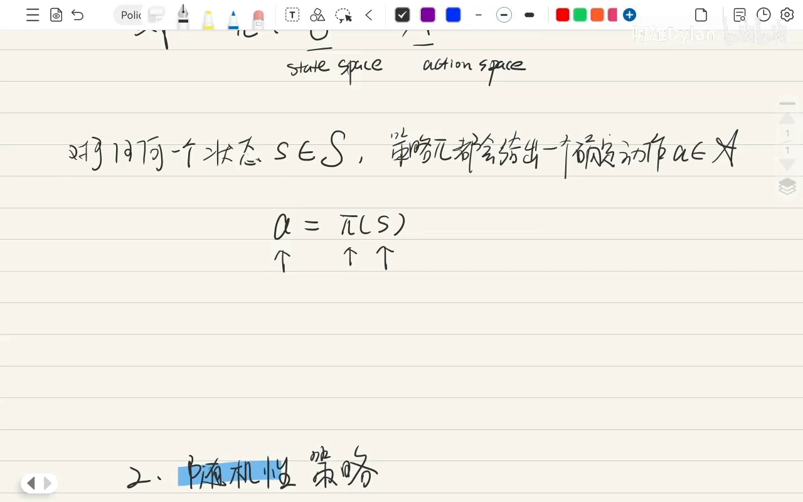
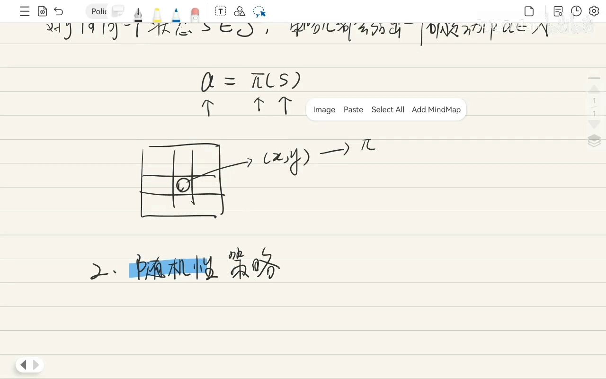
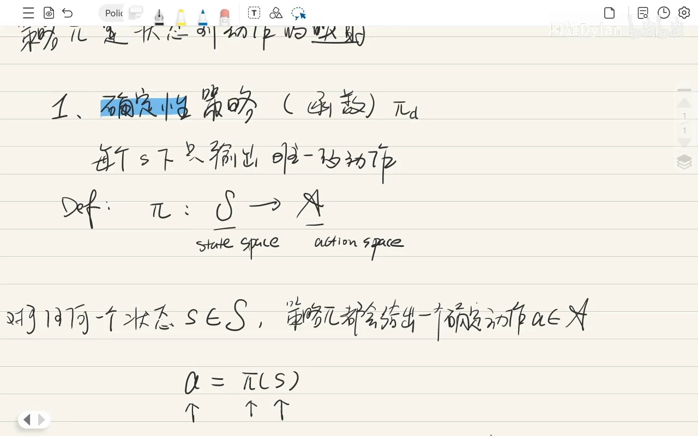
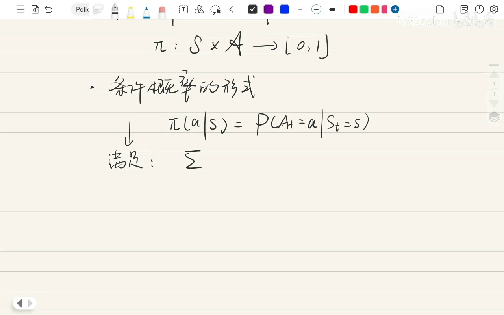
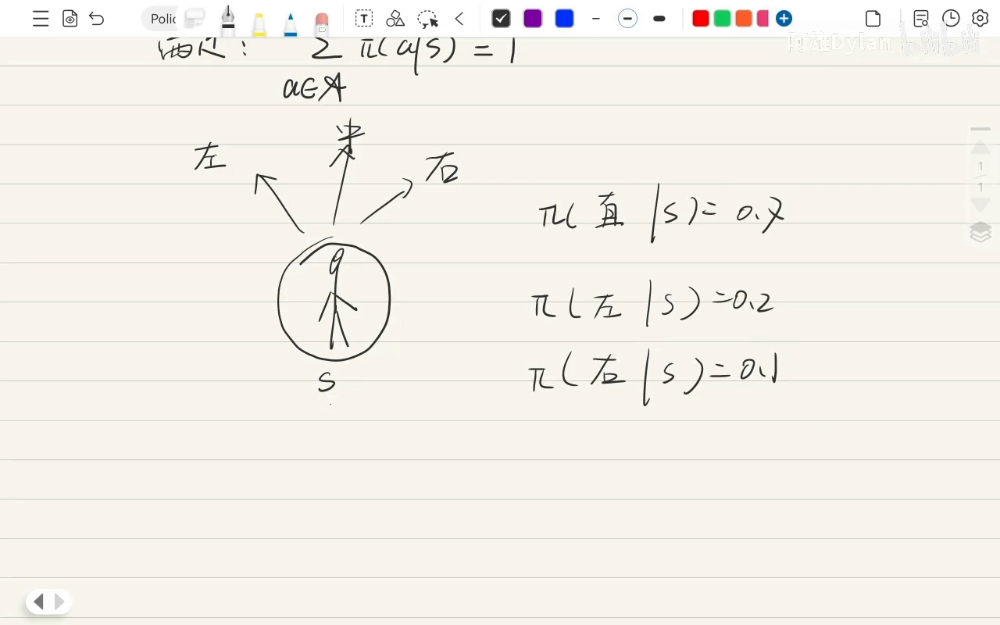
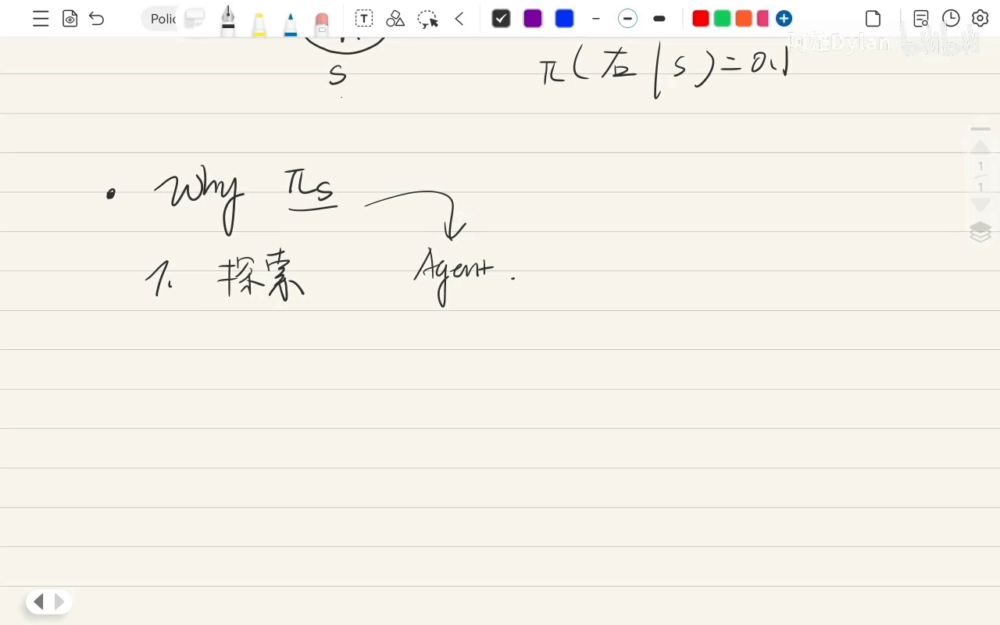
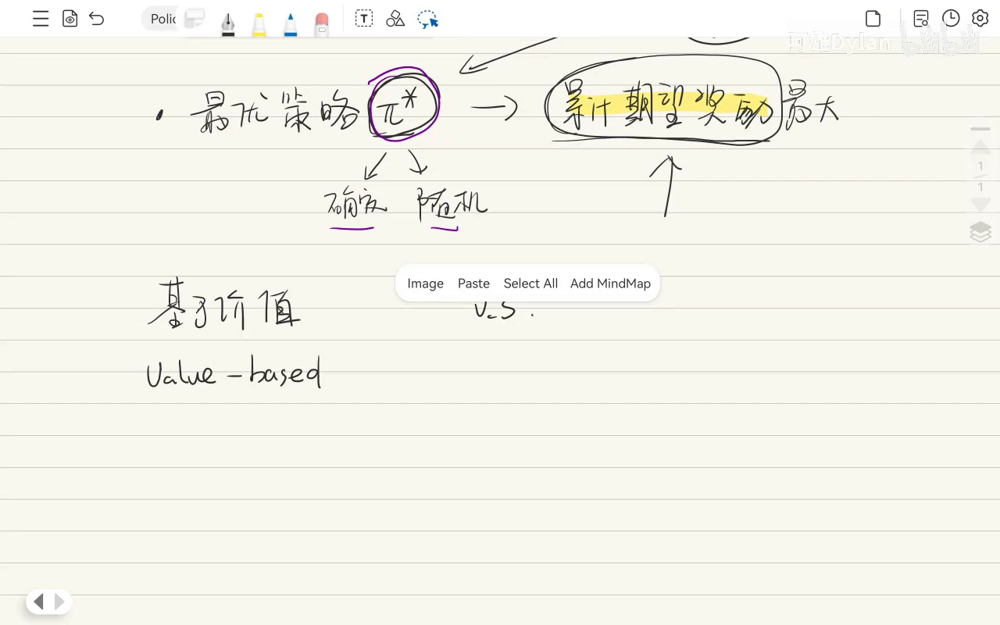
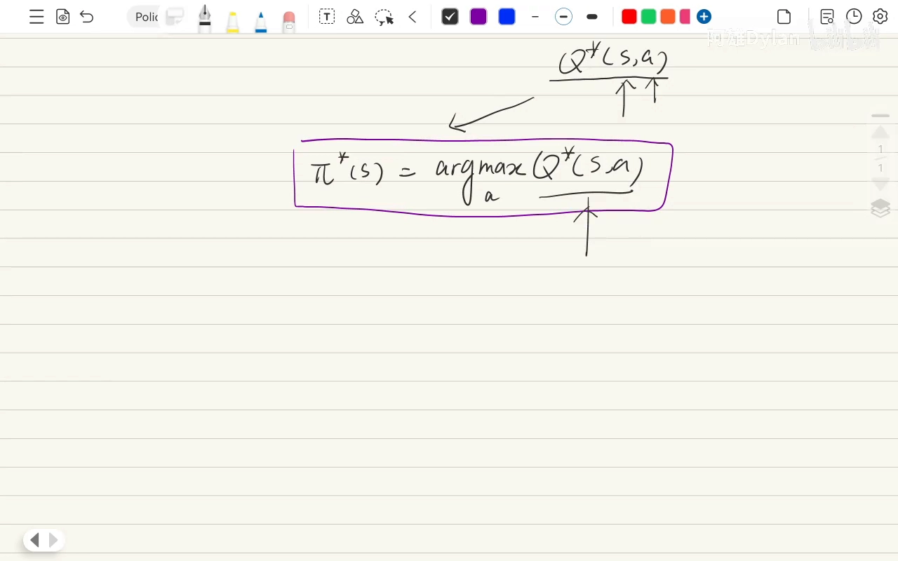
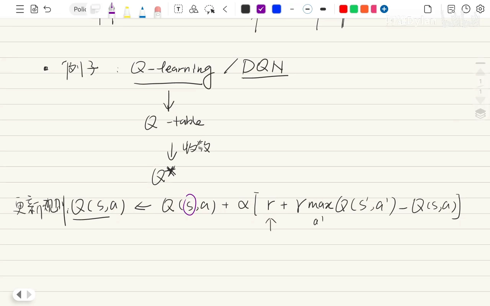

# 策略 π 到底是什么东西：确定性策略、随机策略与最优策略

> 视频来源：[策略π到底是什么东西-强化学习数学基本功](https://www.bilibili.com/video/BV13BWnzHETG/)（UP 主：阿雄Dylan，上下两节约 39 分钟）整理撰写，所有内容均来自该视频的讲解与画面，未作超出视频的引申。

## 本讲要解决的核心问题（SCQA）

**背景**：看强化学习的公式时，状态价值函数 $v_\pi(s)$、动作价值函数 $q_\pi(s,a)$ 的角标里总带着一个 π；有时又会看到 $\pi(a \mid s)$ 这样的写法。

**冲突**：同一个 π，一会儿表示「这个价值函数是按它算出来的」，一会儿又表示「在状态 s 下做动作 a 的概率」；而且 π 写在符号上面还是下面，各家的写法还不统一，看起来非常混乱。

**疑问**：π 到底是什么？它和价值函数是什么关系？我们又怎样才能得到想要的策略？

**回答（中心思想）**：**策略 π 就是「状态到动作的映射」，也就是智能体的行为准则**。它分两类：确定性策略 $a = \pi(s)$（每个状态只输出唯一动作）和随机性策略 $\pi(a \mid s)$（每个状态输出一个动作概率分布）。价值函数只是「在某个策略 π 下打分」的工具，所以 π 会出现在它们的符号里——一旦策略变了，同一个状态的价值也会变。强化学习的终极目标是找到最优策略 $\pi^*$，实现路径有三大流派：基于价值（value-based）、基于策略（policy-based）与 Actor-Critic（演员-评论家）。

## 一、策略 π：智能体的行为方式，本质是状态到动作的映射

### 1.1 π 为什么无处不在

刚开始接触时，π 会出现在各种地方 [【跳转到 00:00】](https://www.bilibili.com/video/BV13BWnzHETG/?p=1&t=0)：

- 状态价值函数 $v_\pi(s)$ 里带一个 π；
- 动作价值函数 $q_\pi(s,a)$ 里也带一个 π（写在上面还是下面没有关系，标在哪里其实都一样）；
- 有时又能看到 $\pi(a \mid s)$，即「在状态 s 下做动作 a 的概率」。

含义其实是一致的：值函数带 π，意思是这个价值是「按照策略 π 来做决策」算出来的；$\pi(a \mid s)$ 则是把策略本身写成一个概率 [【跳转到 00:25】](https://www.bilibili.com/video/BV13BWnzHETG/?p=1&t=25)。



### 1.2 策略的直观理解与数学表述

直观地说，策略 π 指的就是智能体的一种行为方式 [【跳转到 01:40】](https://www.bilibili.com/video/BV13BWnzHETG/?p=1&t=100)：它定义了智能体在特定状态下选择动作的**原则、规则或准则**，像一本行动指南。

用数学语言来说，**策略 π 就是状态到动作的映射** [【跳转到 02:55】](https://www.bilibili.com/video/BV13BWnzHETG/?p=1&t=175)。具体怎么映射，分两种情况：确定性策略与随机性策略。

## 二、确定性策略：一个状态只对应唯一动作

**确定性策略**（deterministic policy）的定义是：在每一个状态下、每个 S 下，只输出**唯一的动作** [【跳转到 03:20】](https://www.bilibili.com/video/BV13BWnzHETG/?p=1&t=200)。

它本身是一个**函数**，把状态空间 S 映射到动作空间 A 上：

```
π : S → A
a = π(s)
```


这意味着：对任何一个属于状态空间 S 的状态 s，策略 π 都会给出一个确定的动作 a，而且这个动作属于动作空间 A [【跳转到 05:25】](https://www.bilibili.com/video/BV13BWnzHETG/?p=1&t=325)。



举个例子 [【跳转到 05:45】](https://www.bilibili.com/video/BV13BWnzHETG/?p=1&t=345)：在迷宫里，当前位置坐标是 (X, Y)。如果是确定性策略，那么只要我在 (X, Y) 这个坐标，输入 X、Y，结果必然是「向北走」，这就是要执行的动作。也就是说，**无论智能体多少次到达 (X, Y)，它都输出「向北走」**——同一个状态，动作永远相同。

## 三、随机性策略：一个状态对应一个概率分布

**随机性策略**（stochastic policy）的定义是：在每个状态下输出一个**关于所有可能动作的概率分布** [【跳转到 07:55】](https://www.bilibili.com/video/BV13BWnzHETG/?p=1&t=475)。它同样是一个函数，只不过取值不是一个动作，而是一个概率分布；智能体就根据这个概率分布随机地选一个动作 [【跳转到 08:20】](https://www.bilibili.com/video/BV13BWnzHETG/?p=1&t=500)。




数学上，π 定义在**状态空间 S 与动作空间 A 的笛卡尔积**上，输出 0~1 之间的一个概率，一般写成条件概率的形式 [【跳转到 09:10】](https://www.bilibili.com/video/BV13BWnzHETG/?p=1&t=550)：

```
π : S × A → [0, 1]
π(a|s) = P(A_t = a | S_t = s)
```

即「在给定状态 s 下、做动作 a 的概率是多少」——在 T 时刻我处于状态 s，那么 A_t = a 的概率是多少 [【跳转到 10:00】](https://www.bilibili.com/video/BV13BWnzHETG/?p=1&t=600)。



既然是概率分布，它就必须满足：**所有可能动作的概率之和等于 1** [【跳转到 10:25】](https://www.bilibili.com/video/BV13BWnzHETG/?p=1&t=625)：

$$
\sum_{a \in A} \pi(a \mid s) = 1
$$



举一个具体例子 [【跳转到 11:25】](https://www.bilibili.com/video/BV13BWnzHETG/?p=1&t=685)：站在十字路口，可以选择直行、左转或右走。假设在当前状态 s 下：

```
π(直行|s) = 0.7
π(左转|s) = 0.2
π(右走|s) = 0.1
```

那么智能体到达状态 s 时，会以 70% 的概率直走、20% 的概率左走、10% 的概率右走 [【跳转到 11:40】](https://www.bilibili.com/video/BV13BWnzHETG/?p=1&t=700)。这是一个概率性的过程，不再像确定性策略那样「到了 (X, Y) 就只向北走」——用随机性策略，向北、向西、向南、向东都有一定概率被选中。

**这两套数学定义（确定性策略的 `a = π(s)` 与随机性策略的 `π(a|s)` 条件概率形式）要记住**；本质上策略就是一个函数、一种映射，区别只在于它是确定性的还是概率分布 [【跳转到 15:50】](https://www.bilibili.com/video/BV13BWnzHETG/?p=1&t=950)。

## 四、为什么还需要随机性策略

既然确定性策略看起来更「干脆」，为什么还要随机性策略？视频给了两个理由 [【跳转到 13:20】](https://www.bilibili.com/video/BV13BWnzHETG/?p=1&t=800)：



**理由一：探索（exploration）的需要。** 学习初期，智能体刚玩游戏时根本不知道什么动作最好。随机性策略允许它做不同的尝试，从而在不同动作下发现能带来更高回报的路径，**避免陷入局部最优**——如果一开始就把策略定死，就只能沿固定方向走，没有任何探索 [【跳转到 13:20】](https://www.bilibili.com/video/BV13BWnzHETG/?p=1&t=800)。

**理由二：部分可观测环境。** 有些环境里，不同的真实状态在智能体看来是同一个状态（视野有限），这种情形下的最优策略本身就可能是随机的 [【跳转到 14:10】](https://www.bilibili.com/video/BV13BWnzHETG/?p=1&t=850)。

最直接的例子是**石头剪刀布**：任何确定性策略都很容易被对手看穿——对方出石头你就出布，你的策略就容易被预测、被击败；而最优策略是以 1/3 的概率随机出石头、剪刀、布 [【跳转到 14:10】](https://www.bilibili.com/video/BV13BWnzHETG/?p=1&t=850)。策略不一定是固定的，随机地出拳反而更好。

## 五、最优策略 π* 与三大求解流派

下半节把视角抬高一层 [【跳转到 00:00】](https://www.bilibili.com/video/BV13BWnzHETG/?p=2&t=0)：谈策略时，我们的最终目标是得到一个**最优策略 π\***。它的好处是：不论策略是确定性的还是随机性的，π* 在让智能体与环境交互时，都能让它获得的**累计期望奖励始终最大** [【跳转到 00:25】](https://www.bilibili.com/video/BV13BWnzHETG/?p=2&t=25)。



怎么让累计期望奖励最大？大体可以分成三个流派 [【跳转到 03:20】](https://www.bilibili.com/video/BV13BWnzHETG/?p=2&t=200)：**基于价值（value-based）、基于策略（policy-based），以及两者的结合 Actor-Critic**。

在讲这三条路之前，先明确一个共同点：不管基于价值还是基于策略，我们都有价值函数——状态价值函数 $v_\pi(s)$ 与动作价值函数 $q_\pi(s,a)$ [【跳转到 03:20】](https://www.bilibili.com/video/BV13BWnzHETG/?p=2&t=200)。它们统称价值函数，都是衡量智能体在当前状态下、或做某个动作的优劣，是一个**打分工具**，帮智能体判断长期来看回报能达到多少 [【跳转到 04:10】](https://www.bilibili.com/video/BV13BWnzHETG/?p=2&t=250)。把策略 π 加到这两个价值函数里，就得到「单用这个策略能得多少分」的打分：

```
v_π(s) = E_π[ G_t | S_t = s ]
q_π(s,a) = E_π[ G_t | S_t = s, A_t = a ]
```

我们的目标就是找到一个最优策略 π*，使 `v(s)` 和 `q(s,a)` 在所有状态下都最大 [【跳转到 07:55】](https://www.bilibili.com/video/BV13BWnzHETG/?p=2&t=475)。

### 5.1 基于价值（value-based）：先学最优 Q，再用贪心策略取动作

这个方法**不直接学习策略，而是学一个最优的价值函数**，例如 q function [【跳转到 09:35】](https://www.bilibili.com/video/BV13BWnzHETG/?p=2&t=575)。一旦学到了 `q*`，最优策略也**随之产生**：在任何状态 s 下，只要选择能让 `q*` 值最大的动作就可以了 [【跳转到 09:35】](https://www.bilibili.com/video/BV13BWnzHETG/?p=2&t=575)：

$$
\pi^*(s) = \arg\max_a q^*(s,a)
$$



这个策略是确定性的。那怎么学 `q*` 呢？用最经典的**贝尔曼方程** [【跳转到 10:45】](https://www.bilibili.com/video/BV13BWnzHETG/?p=2&t=645)：

$$
q^*(s,a) = \mathbb{E}[ R_{t+1} + \gamma \cdot \max_{a'} q^*(S_{t+1}, a') \mid S_t = s, A_t = a ]
$$

意思是：在状态 s 下做动作 a 的最优价值，等于即时奖励 R，加上折扣后「下一状态所有可能动作中能带来最大价值的那个动作」的价值 [【跳转到 11:15】](https://www.bilibili.com/video/BV13BWnzHETG/?p=2&t=675)。



经典实现有两类 [【跳转到 12:05】](https://www.bilibili.com/video/BV13BWnzHETG/?p=2&t=725)：

- **Q-Learning**：用贝尔曼方程不断更新一张 Q 表，直到它收敛到最优的 `q*`，更新规则是 TD 形式：
  ```
  Q(s,a) ← Q(s,a) + α [ r + γ · max_{a'} Q(s',a') − Q(s,a) ]
  ```
- **DQN**：如果状态空间特别大、Q 表已经放不下，就用一个神经网络来近似 Q 函数，把神经网络当作 Q 的拟合器——这就是 DQN 的思想 [【跳转到 14:10】](https://www.bilibili.com/video/BV13BWnzHETG/?p=2&t=850)。

### 5.2 基于策略（policy-based）：直接学策略函数本身

这个方法**不学习价值函数，而是直接学习策略函数本身** [【跳转到 14:35】](https://www.bilibili.com/video/BV13BWnzHETG/?p=2&t=875)。策略函数一般用一组参数 θ 来参数化（也可以是一个神经网络），写成 $\pi_\theta(a \mid s)$ [【跳转到 15:00】](https://www.bilibili.com/video/BV13BWnzHETG/?p=2&t=900)。

- **目标**：找到一组最优参数 `θ*`，让策略的总回报最高 [【跳转到 16:15】](https://www.bilibili.com/video/BV13BWnzHETG/?p=2&t=975)；
- **手段**：定义一个目标函数 `J(θ)`，用它代表策略 π_θ 的好坏程度 [【跳转到 17:05】](https://www.bilibili.com/video/BV13BWnzHETG/?p=2&t=1025)；再用**梯度上升**（或梯度下降）优化 θ，最大化 `J(θ)` [【跳转到 17:55】](https://www.bilibili.com/video/BV13BWnzHETG/?p=2&t=1075)。


更新规则顺带写成：

```
θ ← θ + α · ∇_θ J(θ)
```

典型例子是策略梯度定理与 REINFORCE 算法 [【跳转到 19:10】](https://www.bilibili.com/video/BV13BWnzHETG/?p=2&t=1150)。

### 5.3 Actor-Critic：把「打分」和「选动作」合到一起

第三个方法是 **Actor-Critic（演员-评论家）**，它是上述两种方法的结合：**同时学一个策略网络（actor）和一个价值函数（critic）** [【跳转到 19:35】](https://www.bilibili.com/video/BV13BWnzHETG/?p=2&t=1175)。actor 用 π_θ 来近似策略，critic 则是一个 q function 或 v function [【跳转到 20:00】](https://www.bilibili.com/video/BV13BWnzHETG/?p=2&t=1200)。


经典的 Actor-Critic 方法有 A2C、A3C、PPO、SAC 等 [【跳转到 20:50】](https://www.bilibili.com/video/BV13BWnzHETG/?p=2&t=1250)。

## 小结

- **策略 π 是「状态到动作的映射」**，是智能体的行为准则，本质上是一个函数 [【跳转到 15:50】](https://www.bilibili.com/video/BV13BWnzHETG/?p=1&t=950)。
- **确定性策略**：每个状态只输出唯一动作，`a = π(s)`，同一个状态永远对应同一个动作 [【跳转到 03:20】](https://www.bilibili.com/video/BV13BWnzHETG/?p=1&t=200)。
- **随机性策略**：每个状态输出一个动作概率分布 `π(a|s)`，满足所有动作概率之和为 1；到达同一状态，不同动作都可能被选中 [【跳转到 10:25】](https://www.bilibili.com/video/BV13BWnzHETG/?p=1&t=625)。
- **随机性策略是必要的**：它支撑探索、避免局部最优，在部分可观测环境下也可能是最优的（如石头剪刀布）[【跳转到 14:10】](https://www.bilibili.com/video/BV13BWnzHETG/?p=1&t=850)。
- **价值函数是策略的打分工具**：$v_\pi(s)$、$q_\pi(s,a)$ 都相对某个策略 π 而言，策略变了，价值就变 [【跳转到 04:10】](https://www.bilibili.com/video/BV13BWnzHETG/?p=2&t=250)。
- **终极目标是找到最优策略 π\***，让累计期望奖励最大；三条路径是 **基于价值**（学 `q*` 后 $\pi^*(s) = \arg\max_a q^*(s,a)$）、**基于策略**（直接学 $\pi_\theta$，梯度上升最大化 `J(θ)`）与 **Actor-Critic**（两者结合）[【跳转到 21:40】](https://www.bilibili.com/video/BV13BWnzHETG/?p=2&t=1300)。

## 关键术语速查

| 术语 | 一句话解释 |
| --- | --- |
| 策略 π | 状态到动作的映射，即智能体的行为准则 |
| 确定性策略 | 每个状态只输出唯一动作：`a = π(s)` |
| 随机性策略 | 每个状态输出动作的概率分布：$\pi(a \mid s) = P(A_t=a \mid S_t=s)$ |
| 状态价值函数 $v_\pi(s)$ | 从状态 s 出发、一直按策略 π 行动的期望回报 |
| 动作价值函数 $q_\pi(s,a)$ | 在状态 s 下先做动作 a、之后按策略 π 行动的期望回报 |
| 最优策略 π* | 使累计期望奖励最大的策略，是强化学习的终极目标 |
| 贝尔曼方程（最优） | $q^*(s,a) = \mathbb{E}[R + \gamma \cdot \max_{a'} q^*(s',a')]$，Q-Learning 与 DQN 更新的依据 |
| 基于价值 / 基于策略 / Actor-Critic | 三条求解最优策略的路线：学 `q*` 取 argmax / 直接学 $\pi_\theta$ / 两者结合 |
