# 贝尔曼公式是怎么推导出来的：状态价值的一步展开与策略评估

> 视频来源：[第2课-贝尔曼公式（Part3：公式的详细推导）【强化学习的数学原理】](https://www.bilibili.com/video/BV19N4y1N774/)（西湖大学赵世钰老师课程，时长 15 分钟）

## 本讲要解决的核心问题（SCQA）

**背景**：前面我们已经定义了**状态价值（state value）** $v_\pi(s)$——从状态 s 出发、遵循策略 π 时，未来累积折扣回报的期望；也用例子说明了它非常重要。

**冲突**：既然它这么重要，**到底该怎么把它算出来**？

**疑问**：状态价值是一个"对未来无限多步求期望"的量，我们能不能不枚举整条轨迹，就把它解出来？

**回答（中心思想）**：能。关键在于**贝尔曼公式（Bellman equation）**：它用一句话概括，就是**描述了不同状态的状态价值之间的关系**。把回报拆成"即时奖励 + 未来回报"两部分，再借助**马尔可夫性质**，就能把状态价值写成一个只涉及"一步"的递归关系；对**所有状态**都写这样一个式子并联立，就能把状态价值解出来。

## 一、贝尔曼公式要解决什么问题

### 1.1 状态价值很重要，但计算是难题

我们前面已经定义了 state value，并用例子说明了它非常重要。既然重要，接下来的问题自然是"**它应该怎么计算**"——而计算它的主要工具，就是这个贝尔曼公式。

[【跳转到 00:05】](https://www.bilibili.com/video/BV19N4y1N774/?t=5)

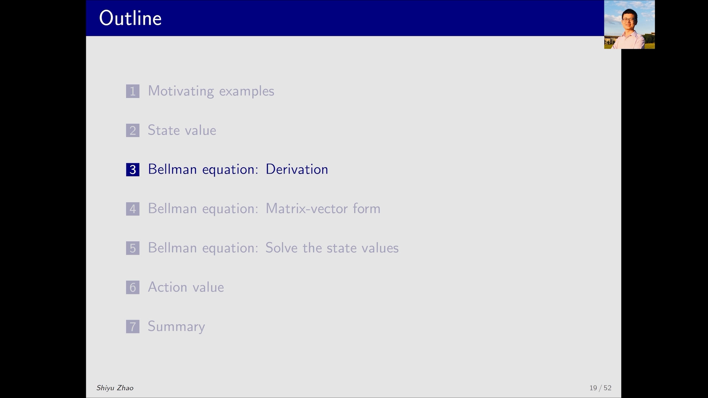

### 1.2 贝尔曼公式的一句话概括

**贝尔曼公式描述的是不同状态的状态价值之间的关系**。

[【跳转到 00:30】](https://www.bilibili.com/video/BV19N4y1N774/?t=30)

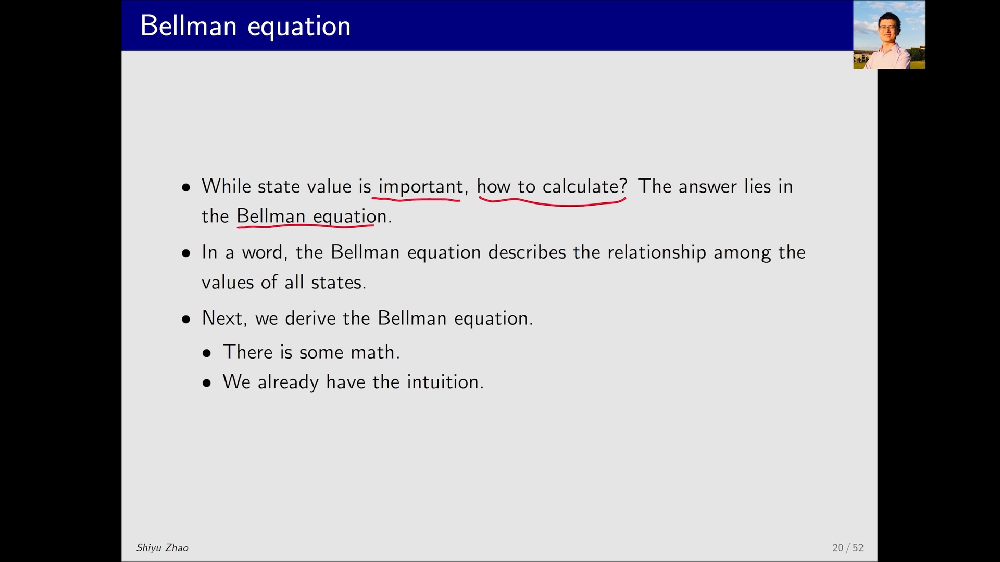

> 老师提醒：推导这一步"看上去有一些数学，但实际上并没有那么难"，配合之前 motivating example 建立起来的直观，就能顺下来。

## 二、推导：把回报拆成"即时奖励 + 未来回报"

### 2.1 从一条轨迹与它的回报出发

考虑一条 trajectory：从 $s_t$ 出发 take action $a_t$，得到一串状态与奖励。这条轨迹可以算出它的**折扣回报（discounted return）** $G_t$。

新的关键操作是：**把 $G_t$ 分成两部分**——提取一个 γ 出来，括号里剩下的部分恰好就是下一时刻的回报 $G_{t+1}$：

$$
\begin{aligned}
G_t &= R_{t+1} + \gamma R_{t+2} + \gamma^2 R_{t+3} + \cdots \\
&= R_{t+1} + \gamma \big( R_{t+2} + \gamma R_{t+3} + \cdots \big) \\
&= R_{t+1} + \gamma G_{t+1}
\end{aligned}
$$

[【跳转到 01:45】](https://www.bilibili.com/video/BV19N4y1N774/?t=105)

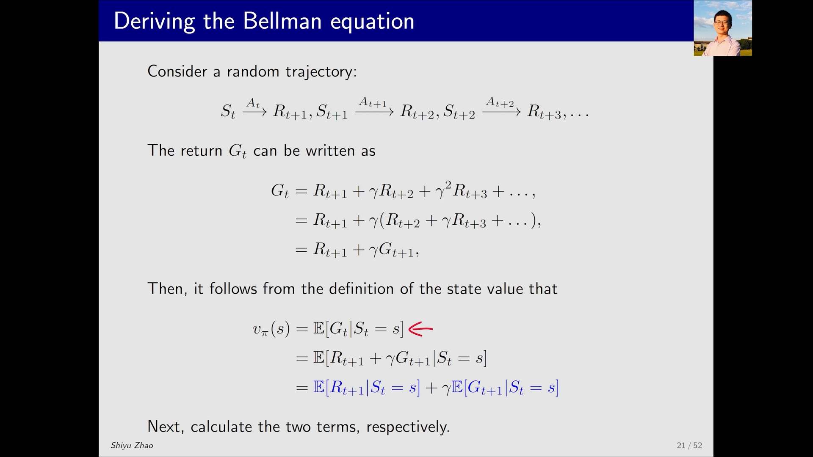

### 2.2 代入状态价值的定义

把上面的递归式代进状态价值的定义 $v_\pi(s) = \mathbb{E}[\, G_t \mid S_t = s \,]$：

$$
\begin{aligned}
v_\pi(s) &= \mathbb{E}[\, G_t \mid S_t = s \,] \\
&= \mathbb{E}[\, R_{t+1} + \gamma G_{t+1} \mid S_t = s \,] \\
&= \mathbb{E}[\, R_{t+1} \mid S_t = s \,] + \gamma \, \mathbb{E}[\, G_{t+1} \mid S_t = s \,]
\end{aligned}
$$

因为**期望对加法可以拆开**，于是我们得到**两个期望**要分别计算：一个是**即时奖励（immediate reward）**，一个是**未来回报（future reward）**。

[【跳转到 02:10】](https://www.bilibili.com/video/BV19N4y1N774/?t=130)

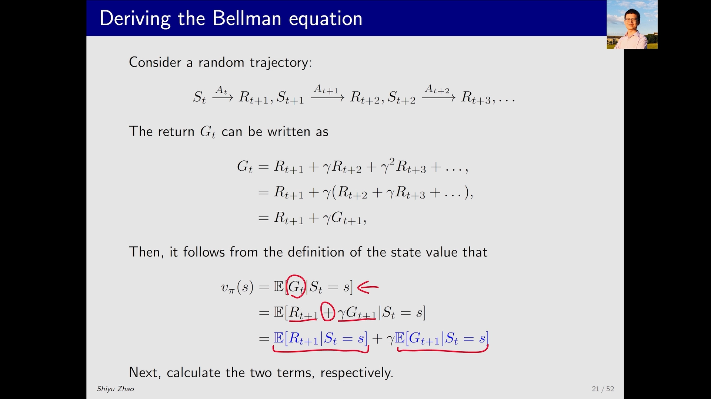

### 2.3 分别计算两个期望

**第一项：即时奖励的期望。** 在状态 s 下可能有多个 action 可选，take action a 的概率是 $\pi(a \mid s)$；做动作 a 后得到奖励 r 的概率是 $p(r \mid s, a)$。按期望的定义写开：

$$
\mathbb{E}[\, R_{t+1} \mid S_t = s \,] = \sum_a \pi(a \mid s) \sum_r p(r \mid s, a) \cdot r
$$

这实际上就是"**即时奖励的均值**"。

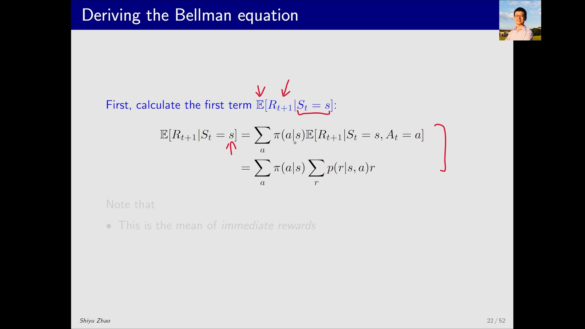

[【跳转到 02:35】](https://www.bilibili.com/video/BV19N4y1N774/?t=155)

**第二项：未来回报的期望。** 这一步是"有点意思"的地方，关键在于**条件期望的一次化简**：

$$
\mathbb{E}[\, G_{t+1} \mid S_t = s \,] = \sum_{s'} \mathbb{E}[\, G_{t+1} \mid S_{t+1} = s' \,] \cdot p(s' \mid s)
$$

其中 $\mathbb{E}[\, G_{t+1} \mid S_{t+1} = s' \,]$ 恰好就是"**从 s′ 出发的未来回报均值**"，也就是针对 s′ 的状态价值 $v_\pi(s')$。为什么可以把条件 $S_t = s$ 去掉？**因为已经知道下一个状态是 s′，之前是什么状态就不再重要了——这正是马尔可夫性质（memoryless，无记忆性）**。

最后，$p(s' \mid s)$（从 s 到 s′ 的概率）由动作概率与转移概率叠加而成：

$$
p(s' \mid s) = \sum_a p(s' \mid s, a) \, \pi(a \mid s)
$$

于是第二项是"**未来回报的均值**"：

$$
\mathbb{E}[\, G_{t+1} \mid S_t = s \,] = \sum_{s'} v_\pi(s') \sum_a p(s' \mid s, a) \, \pi(a \mid s)
$$

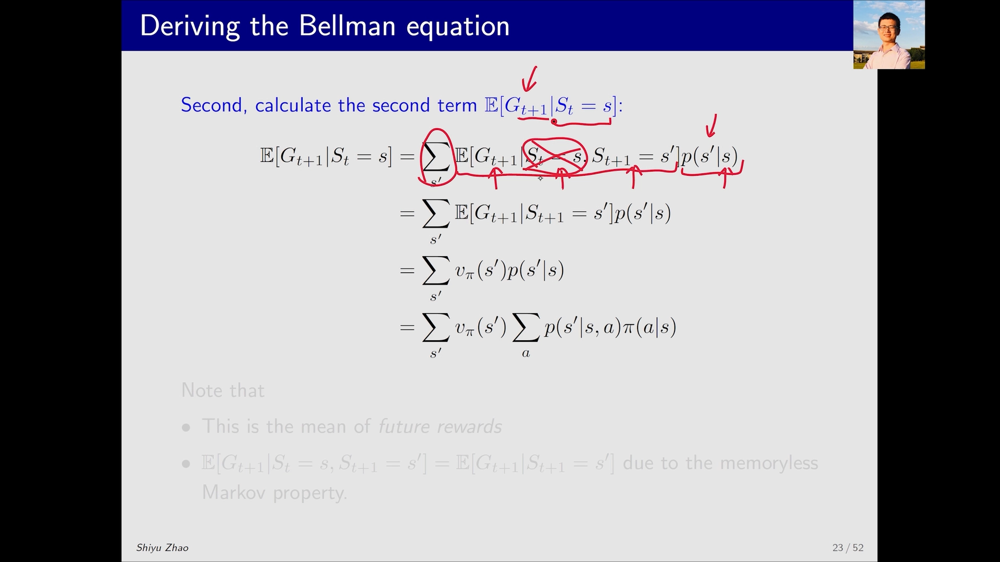

[【跳转到 04:15】](https://www.bilibili.com/video/BV19N4y1N774/?t=255)

### 2.4 合并：得到贝尔曼公式

把两项合起来，就得到**贝尔曼公式**：

$$
\begin{aligned}
v_\pi(s) &= \sum_a \pi(a \mid s) \sum_r p(r \mid s, a) \cdot r \; + \; \gamma \sum_a \pi(a \mid s) \sum_{s'} p(s' \mid s, a) \, v_\pi(s') \\
&= \sum_a \pi(a \mid s) \Big[ \sum_r p(r \mid s, a) \, r \; + \; \gamma \sum_{s'} p(s' \mid s, a) \, v_\pi(s') \Big] \qquad \forall s \in S
\end{aligned}
$$

即：**状态价值 = 即时奖励项的均值 + 未来回报项的均值（打折后）**。

[【跳转到 05:30】](https://www.bilibili.com/video/BV19N4y1N774/?t=330)

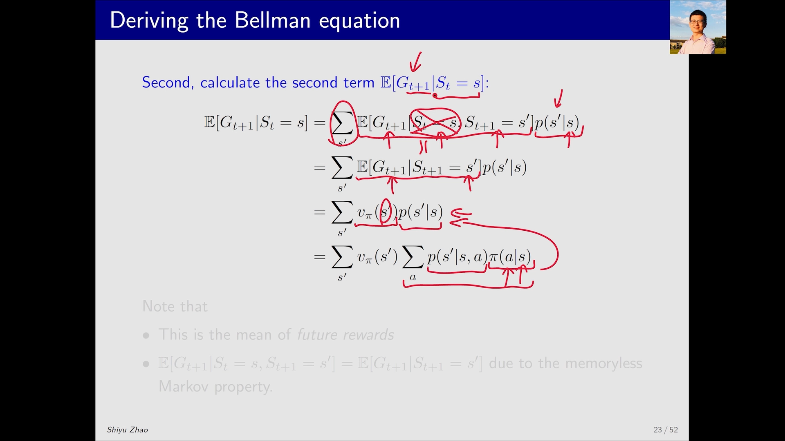

## 三、公式背后必须记住的四个要点

这条公式本身只是一行，但围绕它有四个容易忽略、却非常重要的点：

1. **它描述的是"不同状态价值之间的关系"**：等号左边是 s 的价值，右边是 s′ 的价值——价值之间通过这个式子互相"咬合"。
2. **它由两项构成**：一项是 immediate reward 的均值，一项是 future reward 的均值。
3. **它不是一个式子，而是一组式子**：上文 `∀ s ∈ S` 意味着——**状态空间里有 n 个状态，就有 n 个这样的方程**。对每个状态都写一个，联立起来才能把状态价值求解出来。千万不要以为贝尔曼公式只有一个式子。
4. **求解靠 bootstrapping（自举）**：直观上"某个状态价值依赖别的状态价值，好像没法算"，但我们实际是**有一组方程**，把它们联立即可解出。

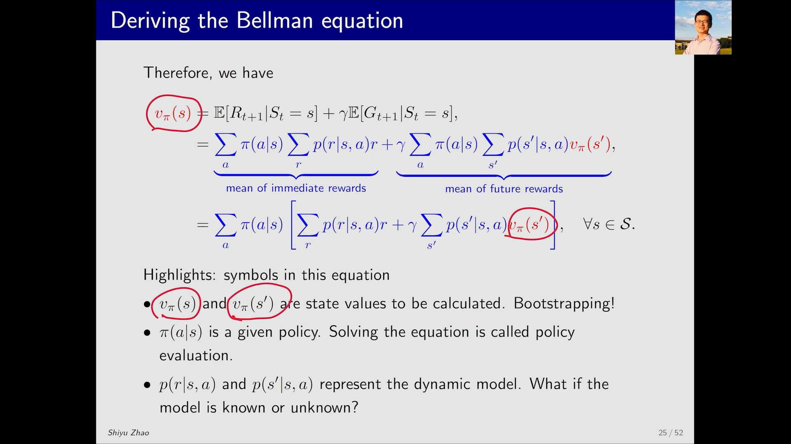

[【跳转到 08:00】](https://www.bilibili.com/video/BV19N4y1N774/?t=480)

还有两个关键依赖：

- **它依赖策略（policy）**：式子里的 `π(a|s)` 就是策略。一旦能把状态价值算出来，我们做的这件事就叫**策略评估（policy evaluation）**——去 evaluate 一个策略究竟好还是坏。
- **它还依赖动态模型（dynamic model / environment model）**：也就是 `p(r|s,a)`、`p(s'|s,a)`。本节与下一节都**假设模型已知**，从而能给出相应算法；如果模型未知，则需要 **model-free 强化学习**的方法，那是后面会重点介绍的内容。

[【跳转到 08:00】](https://www.bilibili.com/video/BV19N4y1N774/?t=480)

## 四、例1：确定性策略下的网格世界

公式看起来唬人，其实非常简单。视频用一个四状态的小例子把它落地。

### 4.1 问题设定

一个网格世界里共有 `s₁ s₂ s₃ s₄` 四个状态，其中有一个是**终点区域（target area）**，还有一个是不建议进入的**禁区（forbidden area）**。给定一个策略 π（图中用绿色箭头标出），我们要做的，就是**把这个问题里所有的贝尔曼公式全部写出来**。

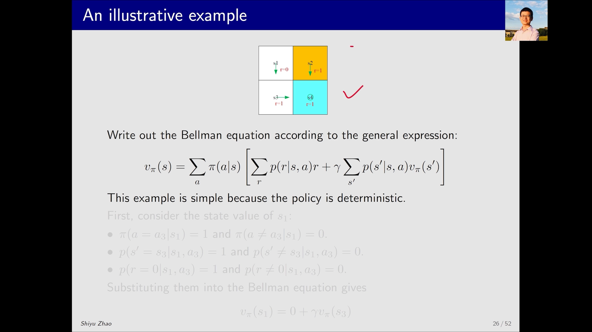

[【跳转到 09:15】](https://www.bilibili.com/video/BV19N4y1N774/?t=555)

### 4.2 对每个状态写出贝尔曼公式

以 `s₁` 为例，要把它对应的贝尔曼公式写出来，就是把公式里每一项都"确定下来"：

- 在 `s₁` take action `a₃` 的概率是 1（不是 `a₃` 的概率是 0），所以**关于动作的求和只剩一项**，求和符号可以去掉；
- 做 `a₃` 得到 `r = 0` 的概率是 1，所以**即时奖励项就是 0**；
- 做 `a₃` 跳到 `s₃` 的概率也是 1，所以**未来回报项只剩 `s₃` 的价值**。

代进去就得到：

$$
v_\pi(s_1) = 0 + \gamma v_\pi(s_3)
$$

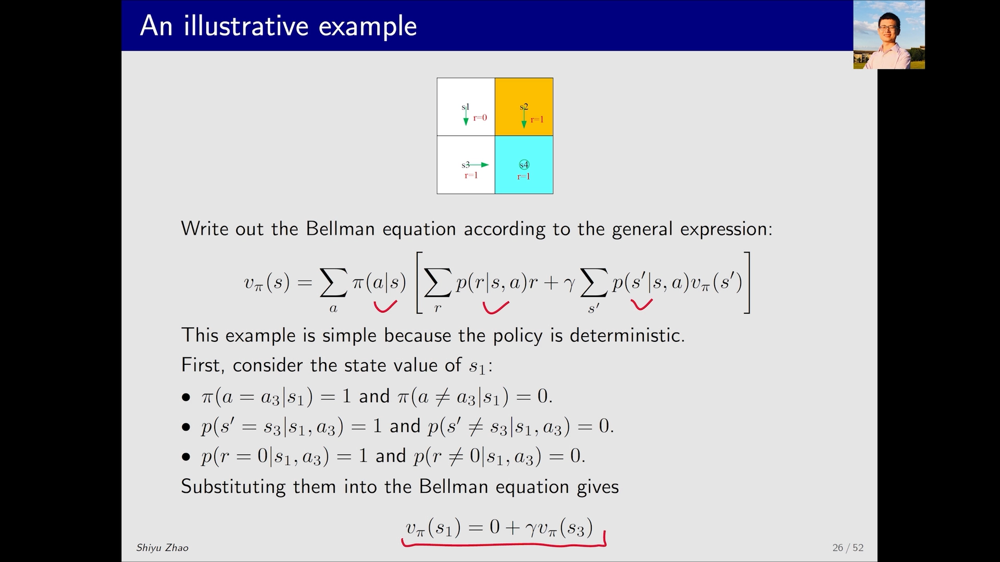

[【跳转到 11:20】](https://www.bilibili.com/video/BV19N4y1N774/?t=680)

这其实就是 motivating example 里我们靠直觉就能写出来的式子——**贝尔曼公式在确定性的简单情形下，直观上非常好理解**。用同样的方法，`s₂ s₃ s₄` 也各能写出一个方程，于是得到**一组方程组**：

```
v_π(s₁) = 0 + γ v_π(s₃)
v_π(s₂) = 1 + γ v_π(s₄)
v_π(s₃) = 1 + γ v_π(s₄)
v_π(s₄) = 1 + γ v_π(s₄)      ← 到达终点后一直停留
```

### 4.3 求解与直觉

有了方程组，求解就很简单了。把 γ 代入一个具体数值（例如 `γ = 0.9`）即可解出：

$$
v_\pi(s_2) = v_\pi(s_3) = v_\pi(s_4) = 10, v_\pi(s_1) = 9
$$

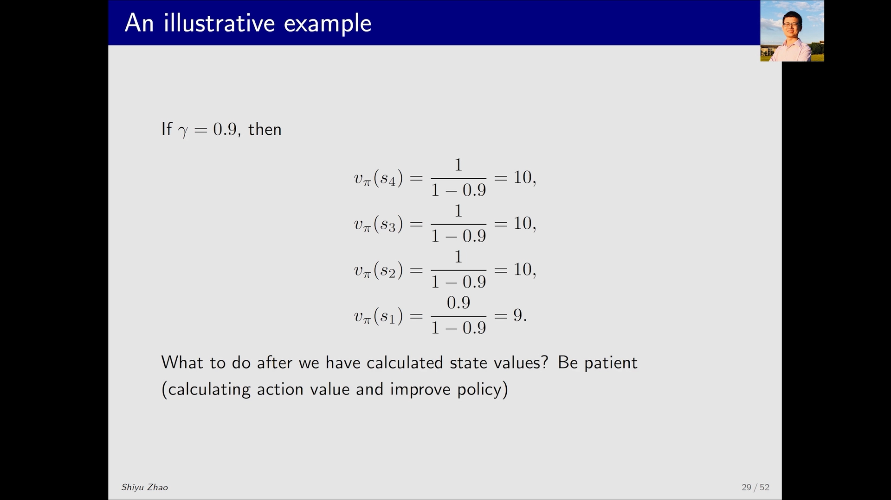

[【跳转到 12:35】](https://www.bilibili.com/video/BV19N4y1N774/?t=755)

结果挺有意思：`s₂ s₃ s₄` 三个状态的价值都是 10，只有 `s₁` 是 9。**状态价值代表"这个状态值不值得去"**——价值高说明值得我们往那个方向走。为什么 `s₂ s₃ s₄` 更高？因为它们**离 target area 更近**，而 `s₁` 离得更远。

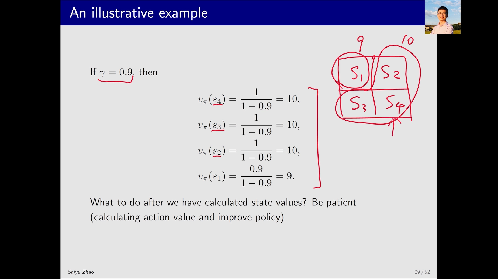

[【跳转到 13:25】](https://www.bilibili.com/video/BV19N4y1N774/?t=805)

> 算完状态价值之后我们要干什么？下一步就可以**改进策略**，慢慢地逼近最优策略——这会在后面展开。

## 五、例2：随机策略与"哪个策略更好"

第二个例子更复杂一些：在 `s₁` 有**两个方向**可以走，是一个随机策略。

### 5.1 写出 `s₁` 的贝尔曼公式

`s₁` 往右走的概率是 0.5，会得到 `-1` 的即时奖励，然后跳到 `s₂`；往下的概率也是 0.5，即时奖励是 0，然后跳到 `s₃`。两项相加：

$$
v_\pi(s_1) = 0.5 \cdot(-1 + \gamma v_\pi(s_2)) + 0.5 \cdot(0 + \gamma v_\pi(s_3))
$$

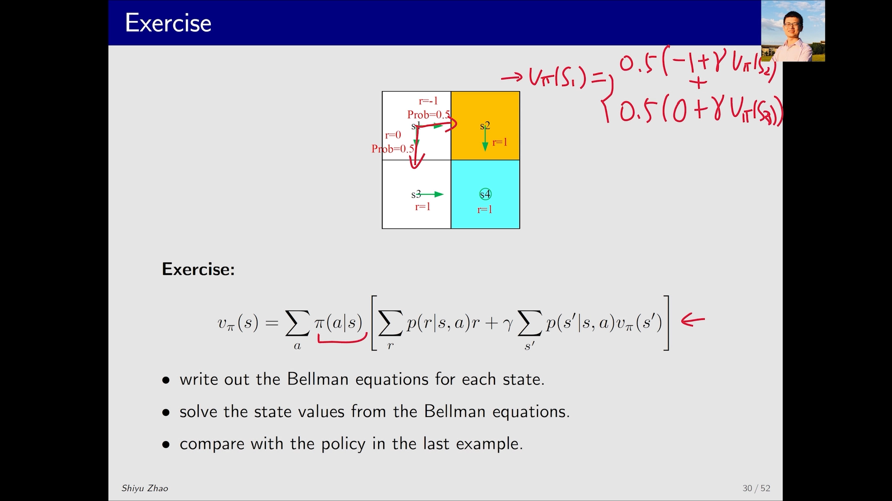

[【跳转到 14:40】](https://www.bilibili.com/video/BV19N4y1N774/?t=880)

`s₂ s₃ s₄` 的方程与例1相同。求解后 `s₂ s₃ s₄` 仍都是 10，而 `s₁` 变成：

```
v_π(s₁) = -0.5 + γ v_π(s₃ 或 s₂ 的均值) = -0.5 + 9 = 8.5   （γ = 0.9）
```

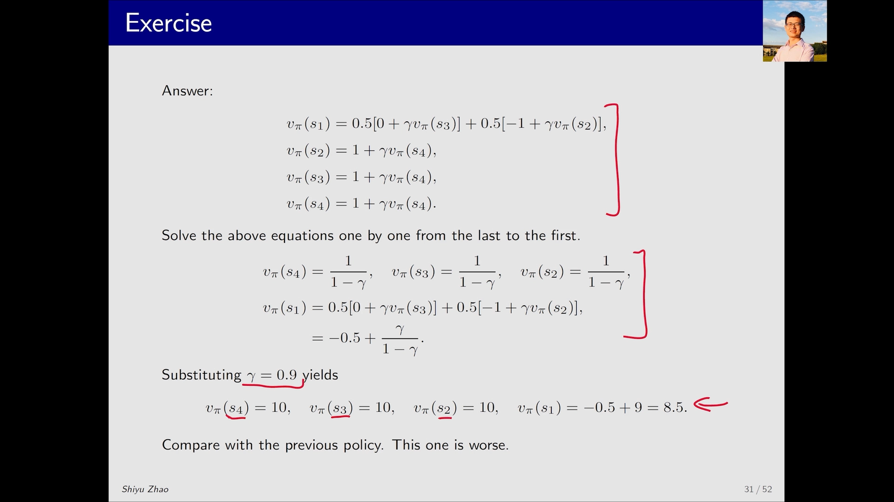

[【跳转到 15:05】](https://www.bilibili.com/video/BV19N4y1N774/?t=905)

### 5.2 用价值比较策略

对比两个策略下 `s₁` 的价值：**9 > 8.5**。这说明第二个策略（会踩到 -1 的那条路）**不如第一个策略好**。这正是"**策略评估**"的用武之地——用状态价值作为标尺，就能判断哪个策略更优。

## 小结

- **贝尔曼公式描述了不同状态价值之间的关系**，是把状态价值从"无限步期望"变成"一步递归"的工具。
- 推导只用了两个关键步骤：把回报拆成 $G_t = R_{t+1} + \gamma G_{t+1}$，再借助**马尔可夫性质**把条件期望化简。
- 公式最终形如 $v_\pi(s) = \sum_a \pi(a \mid s)[ \sum_r p(r \mid s,a) r + \gamma \sum_{s'} p(s' \mid s,a) v_\pi(s') ]$。
- **它不是一个式子，而是一组方程**：每个状态一个，联立求解即得状态价值。
- 它**依赖策略**（所以能用来做**策略评估**）与**动态模型**（模型已知→本节算法；模型未知→model-free 方法）。
- 数值例子里：越靠近终点的状态价值越高（10 与 9），而"会踩到 -1"的策略会把 `s₁` 的价值从 9 拉低到 8.5。

## 关键术语速查

| 术语 | 一句话解释 |
| --- | --- |
| 状态价值 State Value $v_\pi(s)$ | 从状态 s 出发、遵循策略 π 时未来折扣回报的期望 |
| 贝尔曼公式 Bellman Equation | 描述不同状态价值之间递归关系的方程 |
| 即时奖励 Immediate Reward | 走一步立刻拿到的奖励 $R_{t+1}$ |
| 未来回报 Future Reward | 从下一时刻起的折扣回报 $G_{t+1}$ |
| 马尔可夫性质 Markov Property | 已知当前状态后，未来与更早的历史无关（无记忆性） |
| 自举 Bootstrapping | 用其它状态的价值来估计当前状态价值的做法 |
| 策略 Policy `π(a|s)` | 在状态 s 下选择动作 a 的概率 |
| 动态模型 Dynamic Model | 奖励与状态转移的概率 `p(r|s,a)`、`p(s'|s,a)` |
| 策略评估 Policy Evaluation | 用贝尔曼公式求解给定策略的状态价值、据此评判策略好坏 |
| 无模型 Model-Free | 不知道动态模型时，仅靠与环境交互来学习的方法 |
