# 贝尔曼期望方程：用递归把无限步的回报变成一步的关系

> 视频来源：[贝尔曼方程《RethinkFun 强化学习》1.4](https://www.bilibili.com/video/BV1kDwNz6EZd/)（时长 22 分钟）

## 本讲要解决的核心问题（SCQA）

**背景**：在强化学习里，我们用**价值函数**来评价一个状态或一个动作好不好——它衡量的是"从当前状态出发，未来能拿到的累积折扣奖励（也就是**回报** return）的期望"。

**冲突**：这个期望看似简单，真要算却极其困难：未来的轨迹有无数种可能，每多走一步分支就翻倍，很快就会**组合爆炸**，根本算不完。

**疑问**：有没有办法，不去枚举整条未来轨迹，也能求出价值函数？

**回答（中心思想）**：有。**贝尔曼方程（Bellman equation）** 用一个"递归"关系，把"当前状态的价值"重新表达成"这一步拿到的**即时奖励** + 折现后的**下一状态价值**"，从而把无限步的期望问题压缩成只考虑一步的方程。当策略 π 固定时，这一关系的具体形式就叫**贝尔曼期望方程（Bellman expectation equation）**——它是后面所有强化学习算法的地基。

## 一、价值函数为什么难求：从"组合爆炸"到"只考虑一步"

### 1.1 价值函数是对回报的期望

**回报**是一个随机变量：从同一个状态出发，环境随机、策略也随机，走出来的轨迹不同，累积奖励就不同。价值函数通过"求回报的期望"，对一个状态（或一个动作）未来可获得的回报给出一个可量化的评估。

[【跳转到 00:00】](https://www.bilibili.com/video/BV1kDwNz6EZd/?t=0)

### 1.2 直接求期望会组合爆炸

问题是：**求一个回报的期望，需要考虑未来各种可能的情况**。而未来的分支会随步数指数增长，导致"情况过多、计算量爆炸、无法计算"。

[【跳转到 00:07】](https://www.bilibili.com/video/BV1kDwNz6EZd/?t=7)

### 1.3 贝尔曼方程的本质是"递归"

贝尔曼方程就是来简化这个计算的，它的本质可以用两个字概括：**递归**。它把"要算一个很长的未来"变成"只算一步，剩下的交给下一个状态的价值"。

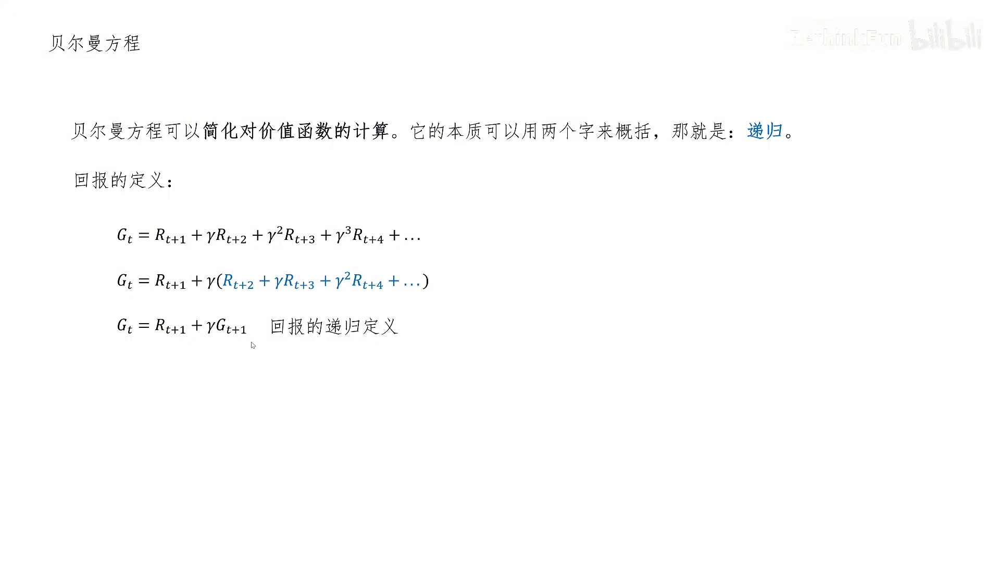

[【跳转到 01:22】](https://www.bilibili.com/video/BV1kDwNz6EZd/?t=82)

贝尔曼方程分成两支：

- **贝尔曼期望方程**：用递归的方式表示**给定策略 π 下**的状态价值函数与动作价值函数；
- **贝尔曼最优方程**：用递归的方式表示**最优**状态价值函数与最优动作价值函数。

## 二、回报的递归结构：贝尔曼方程的起点

要理解贝尔曼方程，先看**回报（return）**本身的递归结构。

回报的原始定义是"t 时刻以后、把每一步的奖励按折扣因子 γ 累加起来的和"：

$$
G_t = R_{t+1} + \gamma R_{t+2} + \gamma^2 R_{t+3} + \gamma^3 R_{t+4} + \dots
$$

对它做一个简单变形：从第二项开始提取一个公因子 γ，会发现括号里剩下的部分恰好就是 **t+1 时刻的回报** $G_{t+1}$：

```
G_t = R_{t+1} + γ ( R_{t+2} + γ R_{t+3} + … )
    = R_{t+1} + γ G_{t+1}          ← 回报的递归定义
```

这一个式子非常符合直觉：**你今天总共能赚多少钱，等于你今天赚的钱，加上你从明天开始以后能赚的钱（未来的收入要打折扣）**。

[【跳转到 00:57】](https://www.bilibili.com/video/BV1kDwNz6EZd/?t=57)

## 三、状态价值函数的贝尔曼期望方程

### 3.1 递归地写出状态价值

**状态价值函数** $V_\pi(s)$ 返回的是"在策略 π 下、对状态 s 未来可获得回报的期望值"。把上面回报的递归式代进去，并注意"t 时刻状态是 s"这个条件，就得到：

```
V_π(s) = E[ G_t | S_t = s ]
       = E[ R_{t+1} + γ V_π(S_{t+1}) | S_t = s ]      ← 贝尔曼期望方程的核心形式
```

也就是说：**当前状态价值 = 即时奖励的期望 + 下一时刻状态价值的期望（打折后）**。


[【跳转到 02:12】](https://www.bilibili.com/video/BV1kDwNz6EZd/?t=132)

### 3.2 两条随机性：为什么会出现期望

这里要注意：动作 `A_t`、即时奖励 $R_{t+1}$、以及下一个状态 $S_{t+1}$ **都是随机的**，所以必须用期望的形式来综合考虑各种情况。而"随机"其实来自两个源头：

1. **策略 π 带来的随机性**——在状态 s 下，下一步做出哪个动作 a 是随机的；
2. **状态转移的随机性**——动作 a 确定后，落到哪个下一个状态 s′ 仍然是随机的。

[【跳转到 04:42】](https://www.bilibili.com/video/BV1kDwNz6EZd/?t=282)

### 3.3 把期望展开成"概率 × 结果"的双重求和

把期望写成"概率 × 结果"再累加，就得到展开形式：

**第一项（即时奖励的期望）**在对动作求和：

$$
\mathbb{E}[ R_{t+1} \mid S_t = s ] = \sum_a \pi(a \mid s) \cdot r(s,a)
$$

其中 `π(a|s)` 是策略在状态 s 下选择动作 a 的概率，`r(s,a)` 是该动作的期望奖励。

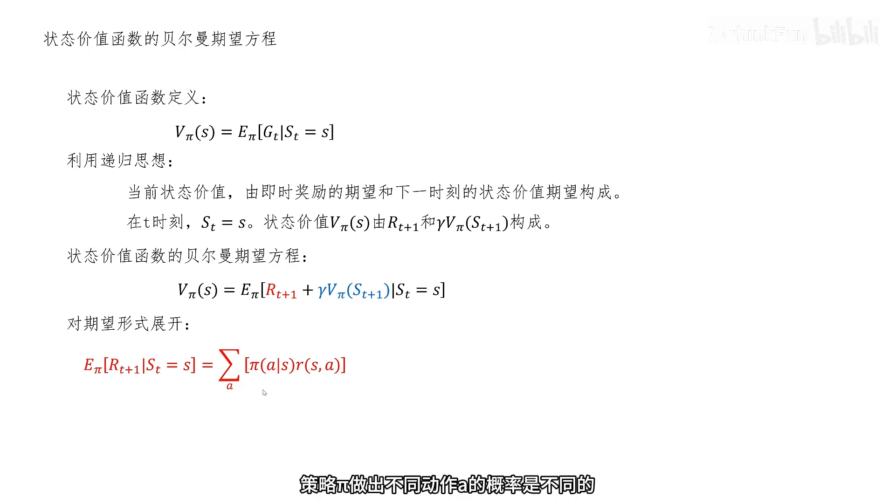

**第二项（下一状态价值的期望）**是两层累加——外层对动作 a 求和（策略随机性），内层对下一状态 s′ 求和（转移随机性）：

$$
\mathbb{E}[ V_\pi(S_{t+1}) \mid S_t = s ] = \sum_a \pi(a \mid s) \sum_{s'} p(s' \mid s,a) \cdot V_\pi(s')
$$

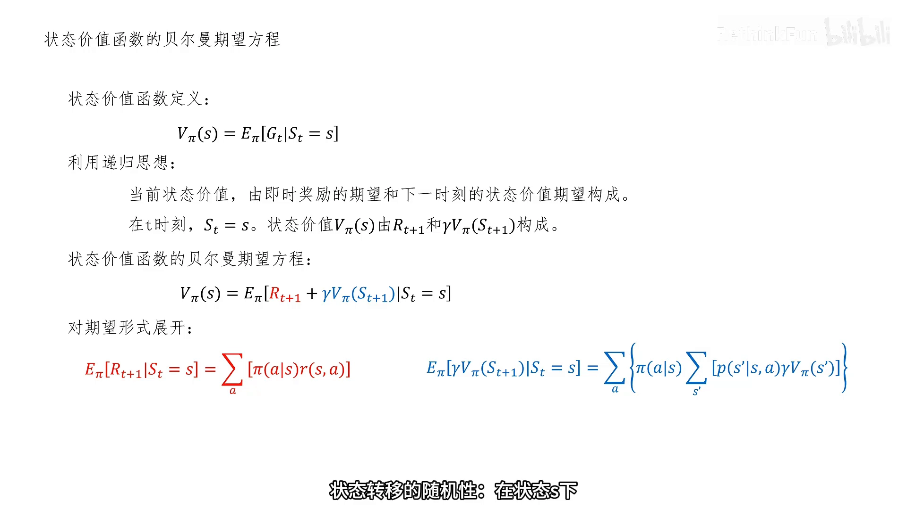

把两项合起来，就是完整的状态价值贝尔曼期望方程：

$$
V_\pi(s) = \sum_a \pi(a \mid s) [ r(s,a) + \gamma \sum_{s'} p(s' \mid s,a) V_\pi(s') ]
$$

[【跳转到 05:57】](https://www.bilibili.com/video/BV1kDwNz6EZd/?t=357)

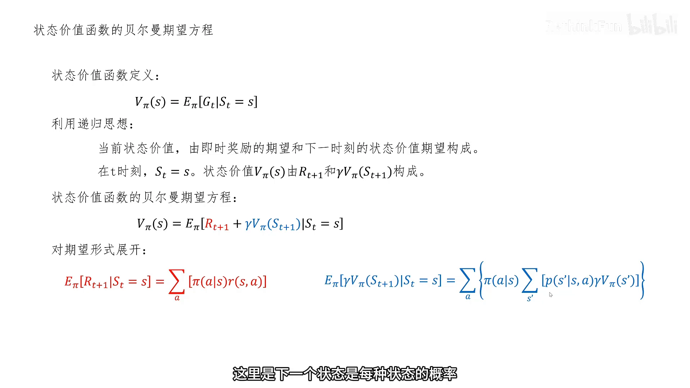

> 直观理解：方块里的 $\sum_a \pi(a \mid s)$ 表示"我可能做各种动作，各按概率加权"；内层 $\sum_{s'} p(s' \mid s,a)$ 表示"做了这个动作后可能落到不同状态，也各按概率加权"。虽然公式看起来唬人，核心思想仍是那句"当前价值 = 即时奖励的期望 + 下一步价值的期望"。

## 四、一个机器人保持平衡的例子：亲手算一次状态价值

光看公式不够，视频用一个"机器人保持平衡"的例子把贝尔曼期望方程走了一遍。

### 4.1 先定义场景的 MDP 五元组

机器人站在一个底面凸起的平板上努力保持平衡，我们要定义它的五元组 `(S, A, p, r, γ)`：

- **状态空间 S**：三种状态 `S左 / S平 / S右`，分别表示机器人左偏、平衡、右偏；
- **动作空间 A**：三种动作 `A左 / A静 / A右`，分别表示重心左移、静止、重心右移；
- **状态转移概率 p**：一张表，某个状态下做某个动作后落到各状态的概率（例如在 `S平` 做 `A静`，也有 0.1 的概率滑向 `S左`、0.1 的概率滑向 `S右`，只有 0.8 的概率保持平衡）；
- **奖励函数 r**：例如 `S左` 下做 `A左` 得奖励 1、`S平` 下做 `A静` 得奖励 2、`S右` 下做 `A左` 得奖励 1，其余动作多为 0；
- **折扣因子 γ = 0.8**。

[【跳转到 09:42】](https://www.bilibili.com/video/BV1kDwNz6EZd/?t=582)

### 4.2 给定一个（非最优的）策略 π

用一个表表示策略：每个单元格是该状态下做该动作的概率。例如第一行（状态 `S左`）做出 `A左 / A静 / A右` 的概率分别是 `0.2 / 0 / 0.8`。

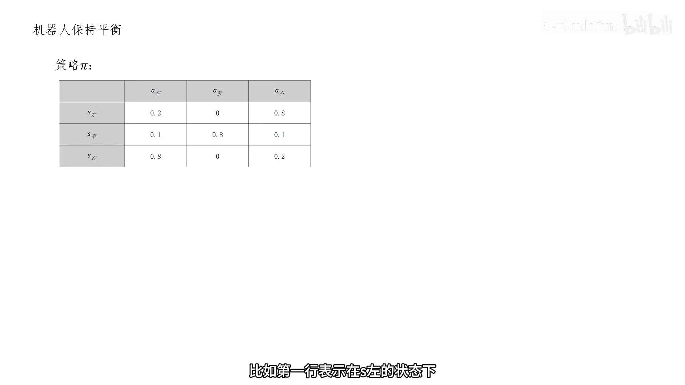

### 4.3 求出"即时奖励的期望"

因为机器人后续状态不断变换、没有终止，直接用定义去算 $V_\pi(S\text{左})$ 很难。这时贝尔曼期望方程派上用场。它把 $V_\pi(S\text{左})$ 拆成两部分，先算**红色部分**——即时奖励的期望：把每种动作的概率乘以该动作的奖励再累加。查表可知 `S左` 下只可能做 `A左` 和 `A右`，于是：

```
E[R_{t+1} | S_t = S左] = 0.2×0 + 0.8×1 = 0.8
```

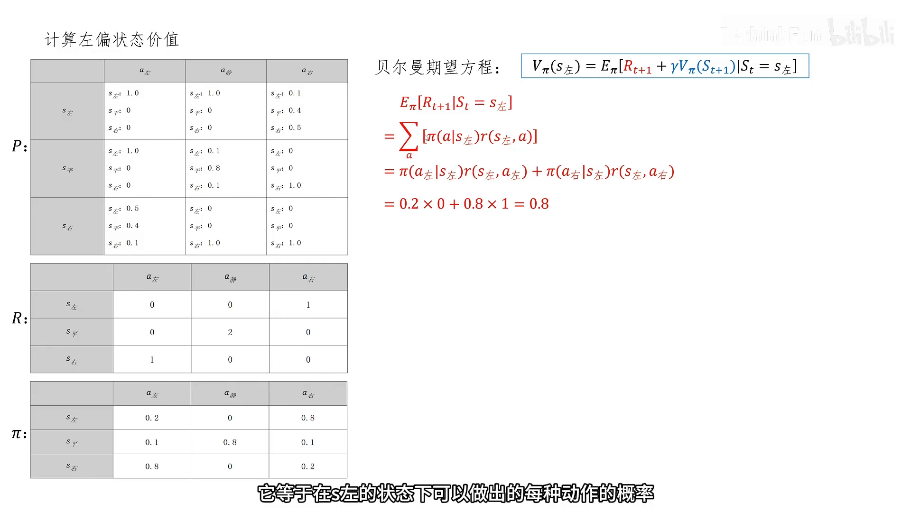

[【跳转到 10:57】](https://www.bilibili.com/video/BV1kDwNz6EZd/?t=657)

### 4.4 求出"下一状态价值的期望"

再算**蓝色部分**：它同样是一个双重求和——外层对动作加权，内层对下一状态加权，最后乘上下一状态的折扣价值：

```
E[ V_π(S_{t+1}) | S_t = S左 ]
  = Σ_a π(a|S左) Σ_{s'} p(s'|S左,a) · γ V_π(s')
  = 0.8×[ 1.0 V_π(S左) + 0.4 V_π(S平) + 0.5 V_π(S右) ]
```

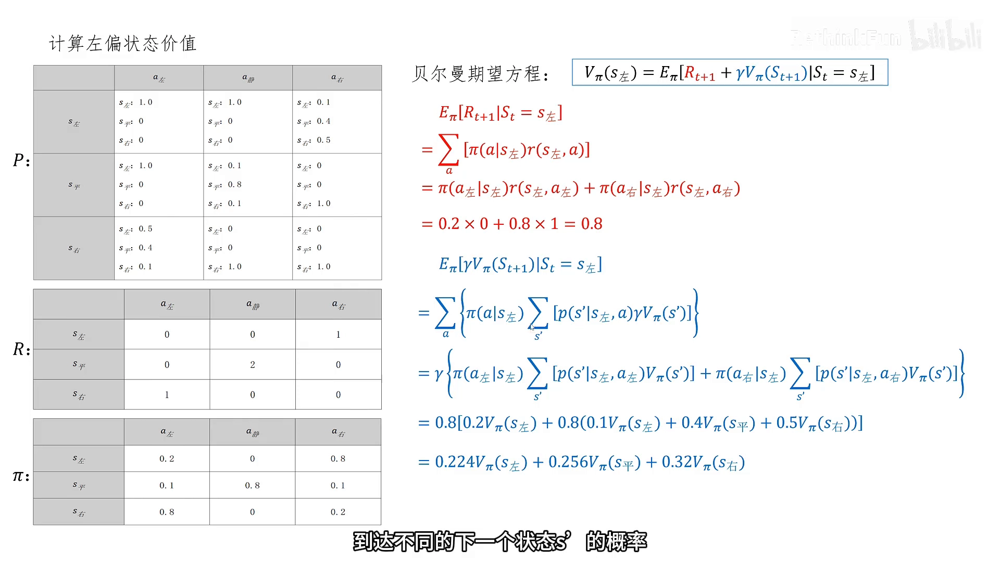

[【跳转到 12:37】](https://www.bilibili.com/video/BV1kDwNz6EZd/?t=757)

### 4.5 联立方程，解出三个状态的价值

把两部分合起来，就得到一个"用其他状态价值来表达 $V_\pi(S\text{左})$"的方程。对三个状态各写一个，就得到一组**线性方程组**，解它即可得到三个状态的状态价值：

```
V_π(S左) = 0.224 V_π(S左) + 0.256 V_π(S平) + 0.32  V_π(S右)
V_π(S平) = 0.32  V_π(S左) + 0.256 V_π(S平) + 0.224 V_π(S右)
V_π(S右) = 1.6  + 0.144 V_π(S左) + 0.512 V_π(S平) + 0.144 V_π(S右)
        ⇒  V_π(S左) ≈ 5.38,  V_π(S平) ≈ 6.45,  V_π(S右) ≈ 5.38
```

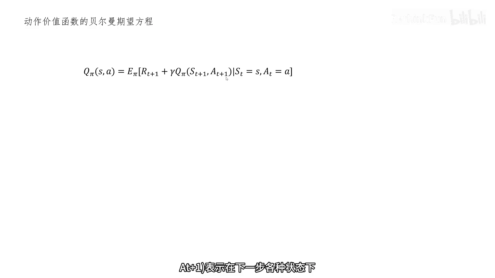

[【跳转到 15:57】](https://www.bilibili.com/video/BV1kDwNz6EZd/?t=957)

可以看到中间状态 `S平` 的价值最高——因为它最容易保持平衡、拿到更多奖励，这与直觉一致。

## 五、动作价值函数的贝尔曼期望方程

**动作价值函数** $Q_\pi(s,a)$ 评价的是"在状态 s 下**已经选定**动作 a、之后再按策略 π 行动"的价值。它的递归关系与状态价值几乎一样，只是把"当前这一步的动作"固定下来：

$$
Q_\pi(s,a) = \mathbb{E}[ R_{t+1} + \gamma Q_\pi(S_{t+1}, A_{t+1}) \mid S_t = s, A_t = a ]
$$

展开成"概率 × 结果"的形式：

$$
Q_\pi(s,a) = r(s,a) + \gamma \sum_{s'} p(s' \mid s,a) \sum_{a'} \pi(a' \mid s') \cdot Q_\pi(s', a')
$$

其中 `p(s'|s,a)` 是"状态 s 下做动作 a 转到 s′"的转移概率，`π(a'|s')` 是"在 s′ 下选动作 a′"的策略概率。

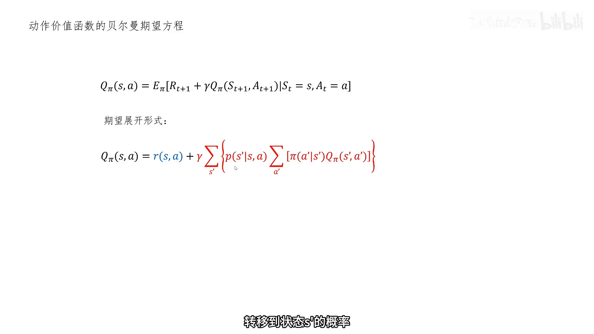

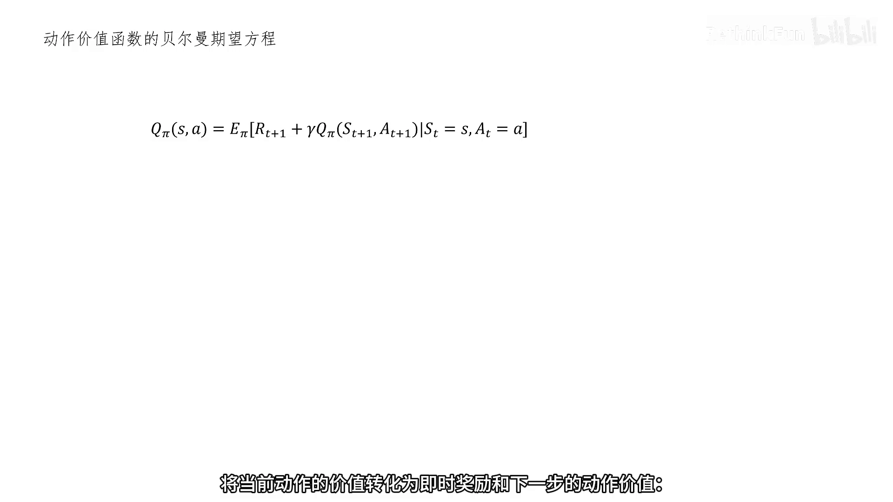

[【跳转到 15:32】](https://www.bilibili.com/video/BV1kDwNz6EZd/?t=932)

**状态价值与动作价值的关系**：状态价值就是"在该状态下、对所有可能动作的动作价值按策略概率加权"的结果——先算清楚每个动作值多少，再按策略一平均，就是状态值多少。

## 六、顺带一提：从期望方程到最优方程

上面的期望方程都**依赖一个给定的策略 π**。如果我们追问"最好的策略到底能有多好"，就要把"按策略加权"换成"直接挑最好的动作"，这就进入了**贝尔曼最优方程**。

### 6.1 全局最优蕴含局部最优

先有一个关键道理：**全局最优策略的任意局部片段，也必然是该局部的最优策略**。比如你找到一条从北京到广州最快的自驾路线，途经西安，那么"西安→广州"这一段也一定是最快的——否则就可以用更快的一段替换掉，与"整体最快"矛盾。


[【跳转到 18:02】](https://www.bilibili.com/video/BV1kDwNz6EZd/?t=1082)

### 6.2 最优状态价值与最优动作价值的方程

把期望方程里的"按策略加权"换成 `max`（只挑最优动作），就得到最优方程：

```
V*(s) = max_a E[ R_{t+1} + γ V*(S_{t+1}) | S_t = s, A_t = a ]
      = max_a [ r(s,a) + γ Σ_{s'} p(s'|s,a) V*(s') ]

Q*(s,a) = r(s,a) + γ Σ_{s'} p(s'|s,a) max_{a'} Q*(s', a')
```

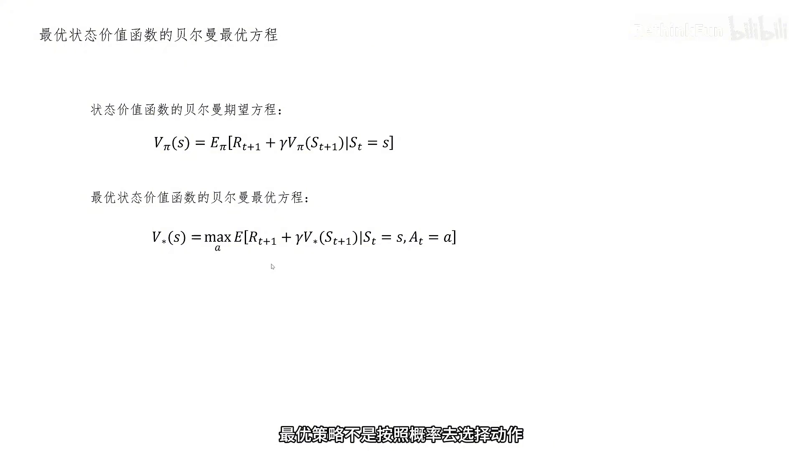

[【跳转到 19:17】](https://www.bilibili.com/video/BV1kDwNz6EZd/?t=1157)

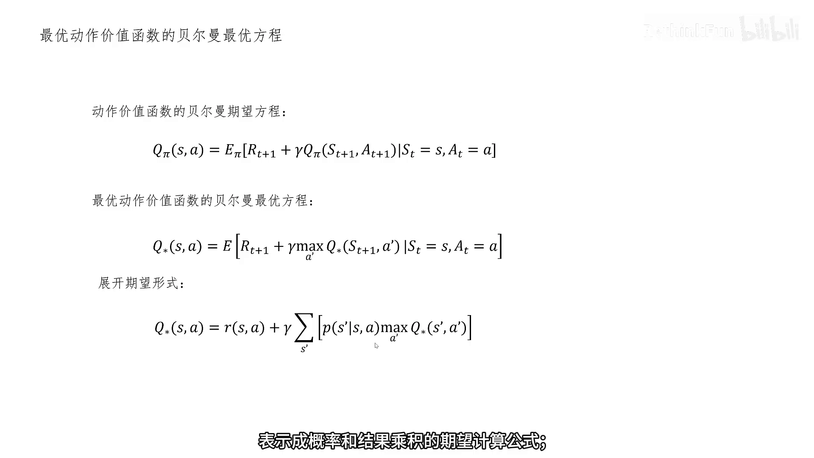

需要注意的是：最优方程里含有 `max` 这个**非线性**操作，因此**无法**像期望方程那样直接列线性方程组求解——这也是后续需要用迭代类算法（如价值迭代、策略迭代）来处理最优方程的原因。

[【跳转到 20:07】](https://www.bilibili.com/video/BV1kDwNz6EZd/?t=1207)

## 小结

- **价值函数**是"回报的期望"，而回报可以递归地写成 $G_t = R_{t+1} + \gamma G_{t+1}$。
- **贝尔曼方程的本质是递归**：把"当前价值"表示成"即时奖励 + 折现后的下一状态价值"。
- **贝尔曼期望方程（给定策略 π）**分状态价值和动作价值两个版本，核心形式是 $V_\pi(s) = \mathbb{E}[R_{t+1} + \gamma V_\pi(S_{t+1}) \mid S_t = s]$。
- 展开成"概率 × 结果"时会出现**双重求和**：外层对动作（策略随机性）、内层对状态（转移随机性）。
- 对**所有状态**都写一个期望方程，就得到一组线性方程组，解出来即完成一次**策略评估（policy evaluation）**。
- **贝尔曼最优方程**把"按策略加权"替换为 `max`，因含非线性操作，不能直接解线性方程组；它触及"最优"层面，将在后续算法中处理。

## 关键术语速查

| 术语 | 一句话解释 |
| --- | --- |
| 回报 Return | 从某一时刻起，把后续奖励按折扣因子累加得到的总和 |
| 折扣因子 γ | 把未来奖励折算到现在的系数（0≤γ<1），越远折得越多 |
| 状态价值 $V_\pi(s)$ | 在策略 π 下，从状态 s 出发未来回报的期望 |
| 动作价值 $Q_\pi(s,a)$ | 在状态 s 先做动作 a、之后再遵循策略 π 时的回报期望 |
| 贝尔曼方程 | 把价值函数写成"即时奖励 + 折现的下一步价值"的递归关系 |
| 贝尔曼期望方程 | 给定策略 π 时的贝尔曼方程，用于策略评估 |
| 贝尔曼最优方程 | 把期望换成 max 后的贝尔曼方程，描述最优价值函数 |
| 双重求和 | 期望展开后外层对动作、内层对状态的累加 |
| 策略评估 Policy Evaluation | 用贝尔曼期望方程求解给定策略的价值函数 |
