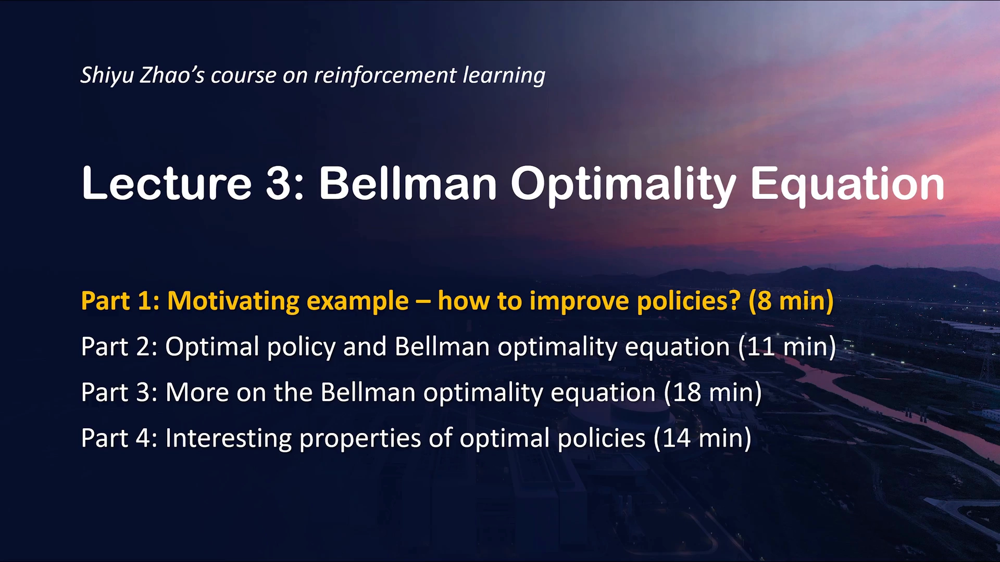
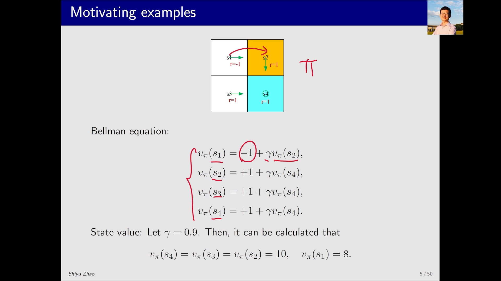
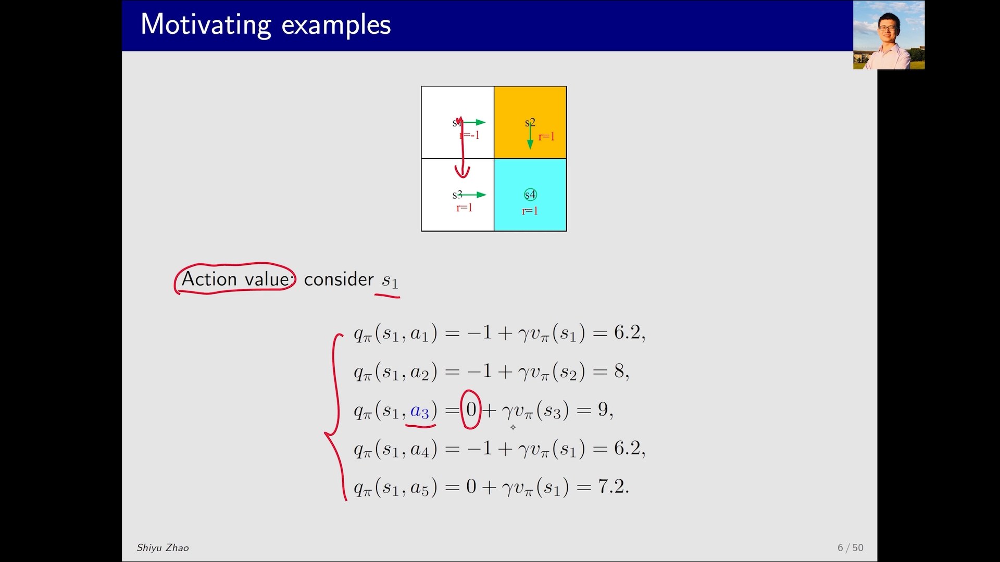
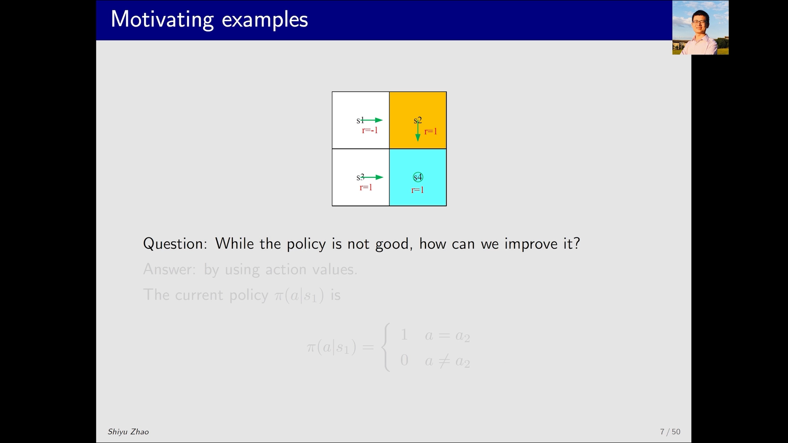
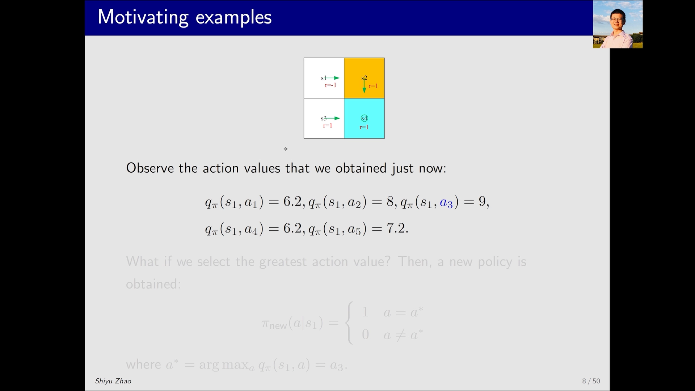
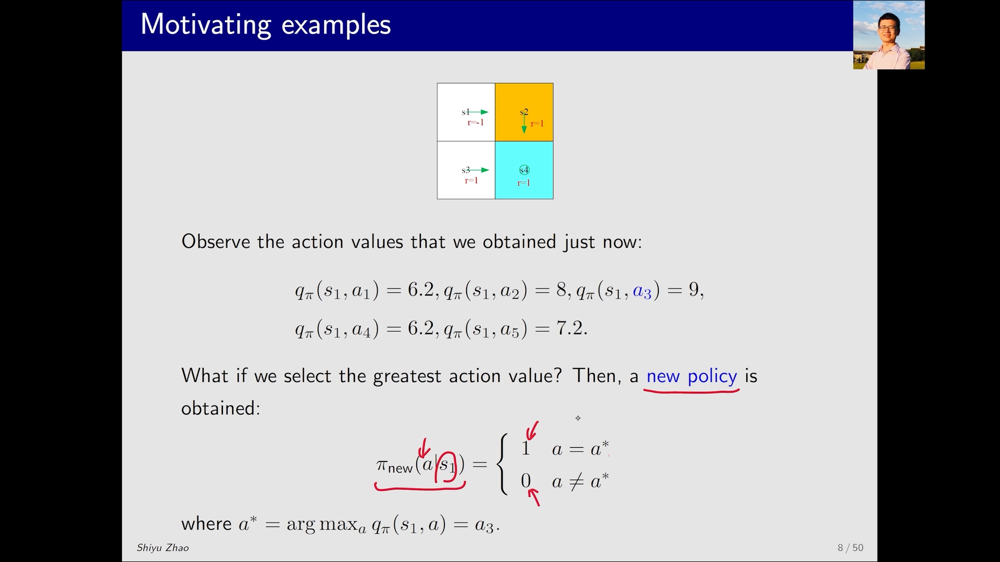
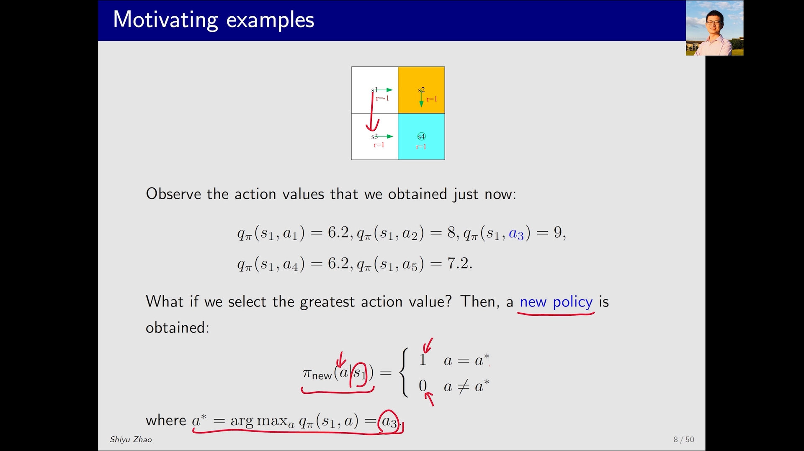
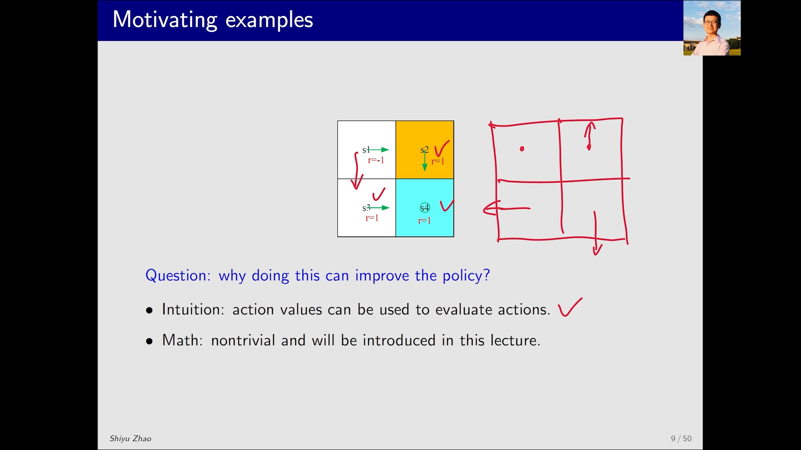

# 第3课·贝尔曼最优公式（一）：为什么"选动作价值最大的动作"就能改进策略

> 本文整理自西湖大学 Shiyu Zhao《强化学习的数学原理》第 3 课 Part 1（Motivating example — how to improve policies）。
> 对应视频：[BV1jB4y1775Y](https://www.bilibili.com/video/BV1jB4y1775Y/)

## 本讲要解决的核心问题（SCQA）

**背景（S）**：上一节课我们学过**贝尔曼公式**——只要策略 `π` 给定，就能为每个状态列出一个价值方程，解线性方程组即可得到状态价值 `v_π(s)`。

**冲突（C）**：可现实中，我们手上拿到的策略往往并不好。比如在一个网格世界里，当前策略一步步把智能体带进"禁区"，越走奖励越差。问题是：该怎样改，才算改得更好？

**疑问（Q）**：有没有一个简单的规则，能稳定地把一个策略"改好"？"在每个状态都选**动作价值最大**的动作"这种直觉，真的成立吗？它在数学上站得住脚吗？

**回答（中心思想）**：成立。策略改进的钥匙是**动作价值** `q_π(s,a)`——在某个状态下选择 `q_π(s,a)` 最大的动作，就能得到一个更好的策略；把这条规则**反复迭代**，策略最终会收敛到最优策略。而要严格说清"为什么一定收敛、一定最优"，就必须引入本课的主角：**贝尔曼最优公式（Bellman Optimality Equation，BOE）**。

> 📌 本讲是整个"贝尔曼最优公式"三讲的第 1 讲，负责给出**动机与直觉**。后续两讲分工是：Part 2 给出公式本身与最优策略的**定义与推导**；Part 3 用**压缩映射定理**证明该公式的解存在、唯一，并说明它就是最优状态价值。



## 一、先把目标钉死：强化学习就是要找"最优策略"

强化学习的目标只有一个：**寻找最优策略（optimal policy）**。为了这个目标，本课要抓住"两个概念 + 一个工具"：

- 两个概念：**最优状态价值**（optimal state value）与**最优策略**（optimal policy）；
- 一个工具：**贝尔曼最优公式**（Bellman Optimality Equation）。

换句话说，这节课真正要回答的是两件事：**最优策略怎么定义**，以及**最优策略怎么找**。抓住这两点，后面的推导就不会迷路。

## 二、复习贝尔曼公式：策略给定，就能算出状态价值

先复现一个反复出现过的简单例子。网格世界里有一个策略 `π`（下图中的绿色箭头），我们要做两件事：

1. 先用**贝尔曼公式**求解状态价值 `v_π(s)`，进而得到**动作价值** `q_π(s,a)`；
2. 在此基础之上，引出一个有意思的现象。

对每个状态都能写出一个贝尔曼方程。以 `s1` 为例（当前策略是"向右走"）：

```text
v_π(s1) = −1 + γ · v_π(s2)      # 向右走：先吃 −1 的即时奖励，再跳进 s2
```

其余状态同理。这一组式子构成一个**线性方程组**，取折扣因子 `γ = 0.9` 求解，可得：

```text
v_π(s4) = v_π(s3) = v_π(s2) = 10
v_π(s1) = 8
```



[【跳转到 02:37】](https://www.bilibili.com/video/BV1jB4y1775Y/?t=157)

> 为什么 `v_π(s1)=8`？把它代回去验证一下：`v_π(s1) = −1 + 0.9 × 10 = 8`，正好吻合。这也说明"状态价值"本质上就是**从该状态出发、按当前策略一直走下去所能拿到的累计折扣回报**。

## 三、算动作价值：一步之内，哪个动作最值得做

有了状态价值，就能算**动作价值** `q_π(s,a)`——它衡量的是"在状态 `s` **先执行动作 `a`**，之后再按策略 `π` 走，能拿到的期望回报"。

以 `s1` 为例，它一共有 5 个可选动作（上、右、下、左、不动），于是对应 5 个动作价值。看其中几个：

```text
q_π(s1, a1) = −1 + γ · v_π(s1) = 6.2      # 向上（撞墙，留在原地）
q_π(s1, a2) = −1 + γ · v_π(s2) = 8        # 向右（当前策略选的）
q_π(s1, a3) =  0 + γ · v_π(s3) = 9        # 向下：无即时奖励，跳进 s3 → 0.9×10 = 9
```



[【跳转到 03:27】](https://www.bilibili.com/video/BV1jB4y1775Y/?t=207)

可以看到，`a3`（向下）的动作价值 **9 最大**，而当前策略所选的 `a2`（向右）只有 8。这个"9 比 8 大"的细节，正是下一步改进策略的依据。（讲义里把 `a3` 标成蓝色，就是为了提示"它对应的动作价值最大"。）

## 四、改进策略：把最大动作价值的动作选出来

现在提出一个有意思的问题：**当前这个策略其实不太好，怎么改？**



[【跳转到 03:52】](https://www.bilibili.com/video/BV1jB4y1775Y/?t=232)

先看当前策略长什么样。当前策略 `π` 在 `s1` 处"铁了心向右走"，可以写成：

```text
π(s1, a) = 1,  若 a = a2（向右）
π(s1, a) = 0,  其它动作
```

而在同样的 `s1` 处，我们已经算出"向下的动作价值最大"。于是构造一个新策略 `π_new`：

```text
a* = argmax_a q_π(s1, a) = a3（向下）
π_new(s1, a) = 1,  若 a = a*
π_new(s1, a) = 0,  其它动作
```

也就是说，**新策略在 `s1` 处一定选择动作价值最大的那个动作**。



[【跳转到 04:42】](https://www.bilibili.com/video/BV1jB4y1775Y/?t=282)

对比一下两个动作的实际效果：**向右**其实不太好（会进入禁区）；**向下**则是真正的好策略，因为它正好绕开了禁区。这就印证了"选最大动作价值"这条规则的有效性。



[【跳转到 05:07】](https://www.bilibili.com/video/BV1jB4y1775Y/?t=307)



[【跳转到 05:32】](https://www.bilibili.com/video/BV1jB4y1775Y/?t=332)

## 五、直觉之外：为什么这一定是对的？

"选动作价值最大的动作"这个直觉很容易理解：动作价值本身就代表了这个动作的价值——**一个动作的动作价值大，就意味着之后能拿到很多奖励，相应的策略自然更好**。

但从**数学**上看，这其实并不那么显然。原因在于这个例子太特殊了：

- 在上面的网格里，`s2、s3、s4` 本身**已经是最优的**（它们的策略无需再改）。所以当我们在 `s1` 处挑动作价值最大的动作时，结果刚好是"向下"。
- 如果换一种情况呢？比如在 `s2` 它此刻向上走、`s4` 向下走、`s3` 向左走——也就是**其他状态的策略都不是最优的**。那么此时在 `s1` 处仍然"挑动作价值最大的动作"，还能得到最优动作吗？

这里面存在不确定性。不过结论是好的：**只要一遍遍地这样做、不断迭代，最后一定会得到一个最优的策略**——对每个状态都选动作价值最大的动作，迭代一次得到一个新策略，再迭代又得到一个新的策略，最终策略会**趋向于最优**。



[【跳转到 06:47】](https://www.bilibili.com/video/BV1jB4y1775Y/?t=407)

于是问题就从"凭直觉"上升为一门需要严格分析的数学问题：这里的"不断迭代最终收敛到最优"到底该如何证明？它所依赖的数学工具，正是下一讲要正式登场的**贝尔曼最优公式**。

## 小结

- 强化学习的**唯一目标**是寻找最优策略；要抓两个概念（最优状态价值、最优策略）和一个工具（贝尔曼最优公式）。
- **状态价值**衡量"一个策略好不好"；**动作价值** `q_π(s,a)` 衡量"在状态 `s` 先做动作 `a` 好不好"。
- 策略改进的实用规则：**在每个状态选择动作价值最大的动作**（`a* = argmax_a q_π(s,a)`）。
- 这条规则在简单例子里效果直观，但要想证明"迭代后必收敛到最优策略"，必须借助**贝尔曼最优公式**做严格分析——这正是后续两讲的内容。

## 关键术语速查

| 术语 | 一句话解释 |
| --- | --- |
| 策略 `π` | 在每个状态上给出"该做什么动作"的规则（可以是随机的） |
| 状态价值 `v_π(s)` | 从状态 `s` 出发、按策略 `π` 一直走下去的累计折扣回报 |
| 动作价值 `q_π(s,a)` | 在状态 `s` **先执行动作 `a`**、之后再按 `π` 走的累计折扣回报 |
| 最优策略 π* | 在所有状态上其状态价值都不低于任何其它策略的策略 |
| 贝尔曼最优公式 (BOE) | 刻画最优状态价值与最优策略的方程，本课的核心工具 |
| 禁区 (forbidden area) | 网格世界中"进入就吃负奖励"的格子 |
