# 第3课·贝尔曼最优公式（三）：用压缩映射定理解它，并证明它确实最优

> 本文整理自西湖大学 Shiyu Zhao《强化学习的数学原理》第 3 课 Part 3（Formula solving and optimality）。
> 对应视频：[BV1KP411n7T5](https://www.bilibili.com/video/BV1KP411n7T5/)

## 本讲要解决的核心问题（SCQA）

**背景（S）**：上一讲给出了贝尔曼最优公式（BOE）`v(s) = max_π Σ_a π(a|s)·q(s,a)`，并拆清了右边的最大化——最优值就是 `max_a q(s,a)`。

**冲突（C）**：但这留下一个"自我指涉"的麻烦：求最优策略要用到 `q`，而 `q` 里又含着还不知道的 `v`。于是必须回答：这样的方程**有解吗**？解**唯一吗**？如果解不唯一，"最优状态价值"就无从谈起。

**疑问（Q）**：有没有一套通用的数学工具，能一次性给出**存在性、唯一性、以及求解算法**？

**回答（中心思想）**：有，它就是**压缩映射定理（contraction mapping theorem）**。把 BOE 改写成 `v = f(v)`，只要证明其中的 `f` 是一个压缩映射，就能立刻推出：解存在且唯一，并可用**迭代** `v_{k+1} = f(v_k)` 求出，且指数收敛。更进一步，可以证明这个解 `v*` 正是**最大的状态价值**，而对应的 `π*` 是一个**确定性的贪婪策略**——上一讲的四个问题至此全部回答。

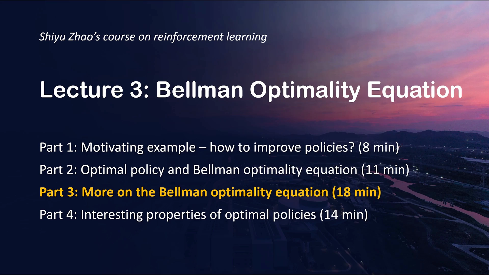

## 一、把贝尔曼最优公式写成 `v = f(v)`

上一讲我们处理右边那个 `max_π` 时，其实可以把它**整体看作一个函数**，记作 `f(v)`。为什么能这样？因为求 `max_π` 的做法是：**先固定 `v`，就能求出一个 `π`**；至于这个 `π` 具体长什么样、最优值是多少，我们暂且不必关心——反正它一定是 `v` 的函数。

于是 BOE 就改写成：

```text
v = f(v)
其中  f(v) 的第 s 个元素 = max_π Σ_a π(a|s) · Σ_{s',r} p(s',r|s,a) · [ r + γ v(s') ]
```

**式子一下子变得极其简洁：`v = f(v)`。** 接下来要求解的就是它。而在求解之前，先要请出压缩映射定理。

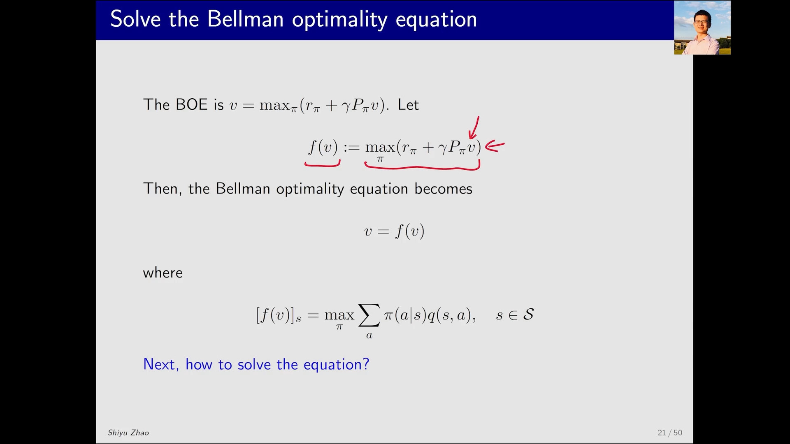

[【跳转到 00:30】](https://www.bilibili.com/video/BV1KP411n7T5/?t=30)

## 二、预备知识：不动点与压缩映射

压缩映射定理建立在两个概念之上。

### 2.1 不动点（fixed point）

在集合 `X` 上有一个点 `x`，以及一个映射（也叫函数）`f`。如果

```text
f(x) = x
```

就把 `x` 称为 `f` 的一个**不动点（fixed point）**。

直观解释很清晰：这里有一个点 `x`，用函数 `f` 映射之后**又映射回它自己**，于是这个点"不再动了"，因此叫不动点。

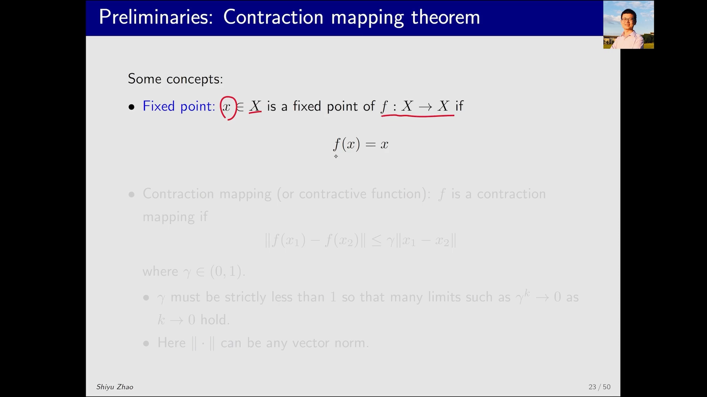

[【跳转到 01:20】](https://www.bilibili.com/video/BV1KP411n7T5/?t=80)

### 2.2 压缩映射（contraction mapping）

如果函数 `f` 满足下面这个不等式，就称它是**压缩映射**（contraction mapping，也叫 contractive function）：

```text
‖ f(x1) − f(x2) ‖ ≤ γ · ‖ x1 − x2 ‖，   其中 γ ∈ (0, 1)
```

它说的是：**任意取两个点，它们函数值之间的距离，比这两个点原本的距离还要小**（再乘上一个小于 1 的因子 `γ`）。注意两点：

- `γ` 必须**严格小于 1**，这样才能保证迭代时距离不断缩小（从而极限为 0）；
- 这里 `‖·‖` 可以是**任意一种向量范数**。

直观上（用一维情况说明）：`x1` 被映射到这一边、`x2` 被映射到那一边，映射后两点的距离比映射前更近——这就是"**收缩（contractive）**"一词的来历。

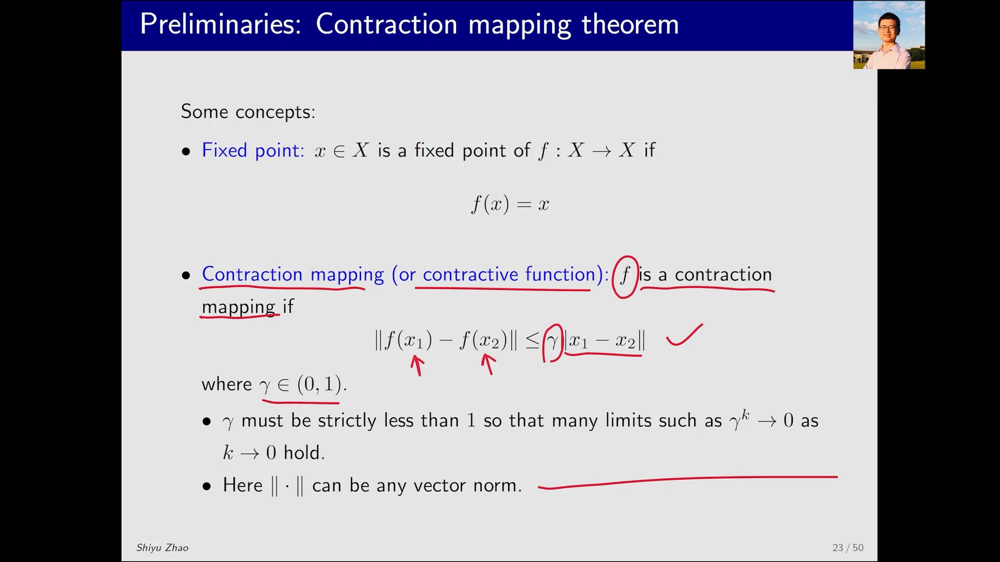

[【跳转到 02:10】](https://www.bilibili.com/video/BV1KP411n7T5/?t=130)

### 2.3 两个小例子

**例一（标量）**：`f(x) = 0.5x`。

- 因为 `0 = 0.5 × 0`，所以 `x = 0` 是一个不动点；
- 又因为 `‖0.5x1 − 0.5x2‖ = 0.5‖x1 − x2‖`，把 `0.5` 提出来后系数小于 1（比如取 γ = 0.6、0.7），所以它是压缩映射。

**例二（向量/矩阵）**：`f(x) = A x`，`A ∈ R^{n×n}`。当矩阵范数 `‖A‖ < 1` 时，同样有：`0` 是不动点，且 `Ax` 是压缩映射。

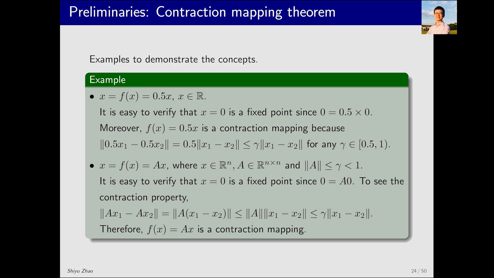

[【跳转到 03:30】](https://www.bilibili.com/video/BV1KP411n7T5/?t=210)

## 三、压缩映射定理：存在、唯一、可迭代

有了上面两个概念，就可以引出**压缩映射定理（contraction mapping theorem）**——它非常强大，不只这门课，在任何需要求解 `x = f(x)` 这类方程的地方都用得上。

**定理**：对于形如 `x = f(x)` 的方程，若 `f` 是压缩映射，则：

```text
1) 存在性：存在不动点 x*，使 f(x*) = x*；
2) 唯一性：该不动点 x* 是唯一的；
3) 算法：考虑序列 x_{k+1} = f(x_k)，则 x_k → x*（k → ∞）；
   且收敛速度是指数级的（指数收敛）。
```

第一条威力在于：**我们根本不用知道 `f` 具体长什么样，只要它是压缩映射，就一定存在不动点**。第三条则给了一个现成的求解办法：从任意初值 `x0` 出发，反复代入 `f`，序列就会收敛到 `x*`（实际中根本不需要 `k` 到无穷大，跑几步就能得到满意结果）。

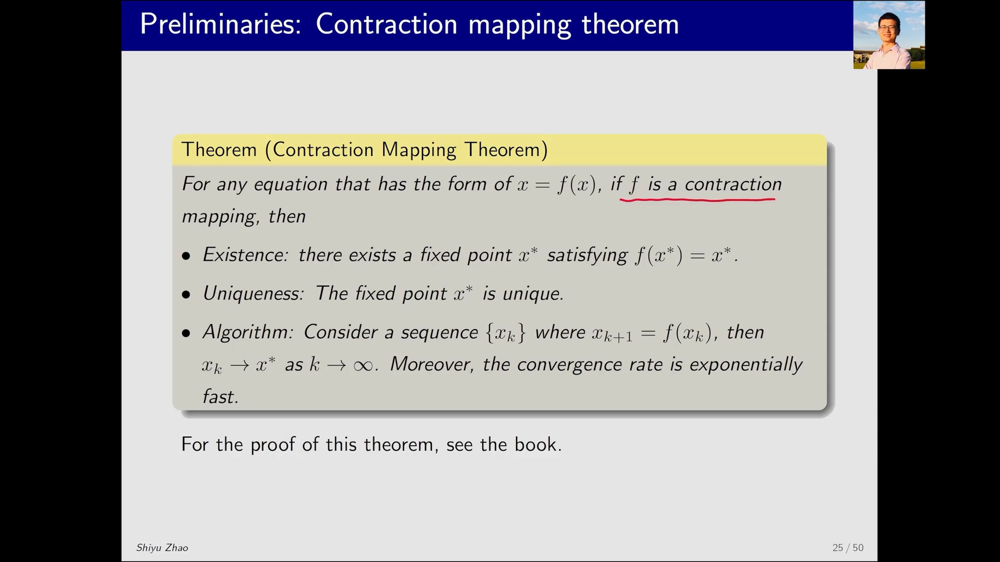

[【跳转到 04:13】](https://www.bilibili.com/video/BV1KP411n7T5/?t=253)

用它来看 `x = 0.5x`：不动点 `x* = 0`，且唯一；从 `x0 = 10` 出发迭代，得到 `5、2.5、1.25、…`，明显趋向于 `0`。向量/矩阵的情形同理。

## 四、把它用到贝尔曼最优公式上

现在正式把压缩映射定理用在 BOE 上。我们要解的 `v = f(v)`，**正好就是压缩映射定理要处理的那一类问题**。于是只需要做一件事：**证明 BOE 中的 `f(v)` 是一个压缩映射**。

可以证明：

```text
‖ f(v1) − f(v2) ‖ ≤ γ · ‖ v1 − v2 ‖
```

其中 `γ` 是折扣率（discount rate），它**小于 1**。因此 `f(v)` 是压缩映射。

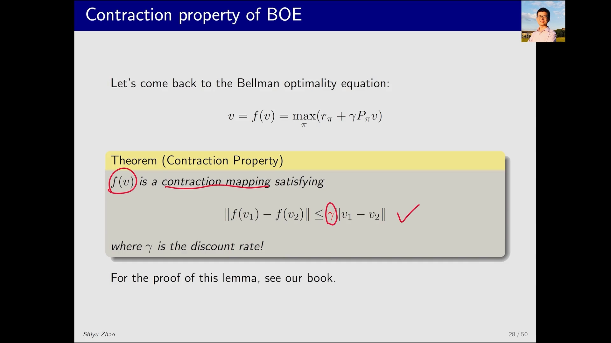

[【跳转到 07:08】](https://www.bilibili.com/video/BV1KP411n7T5/?t=428)

既然 `f` 是压缩映射，贝尔曼最优公式立刻可以用压缩映射定理求解，得到三条结论：

```text
1) 贝尔曼最优公式一定存在一个解，记为 v*；
2) 该解 v* 是唯一的；
3) 该解可由迭代算法求解：v_{k+1} = f(v_k)，且 v_k → v*。
```

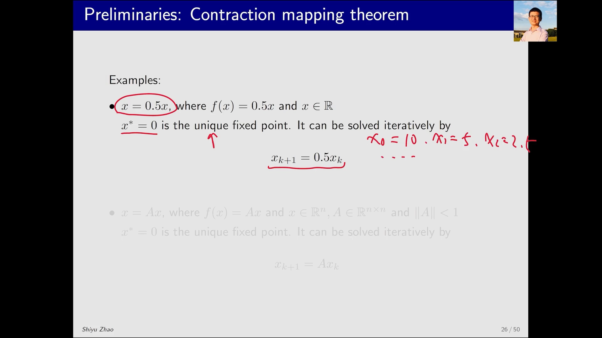

[【跳转到 06:18】](https://www.bilibili.com/video/BV1KP411n7T5/?t=378)

## 五、解的最优性：`v*` 就是最大的状态价值

接下来分析这个解的最优性。设 `v*` 是 BOE 的解（由上面的迭代算法求出），并令 `π*` 为对应 `v*` 的最优策略——也就是**把 `v*` 固定住后求出的那个 `π`**。

把这个 `π*` 代回，等式右边那个 `max_π` 就可以去掉、换成 `π*`：

```text
v* = r_{π*} + γ · P_{π*} · v*
```

这正是一个**对应策略 `π*` 的贝尔曼公式**（贝尔曼公式一定对应某个策略）。因此 `v* = v_{π*}`，即 `v*` 就是 `π*` 所对应的状态价值。换句话说：

> **贝尔曼最优公式是一个特殊的贝尔曼公式**——只不过它对应的策略比较特殊，是一个**最优策略**。

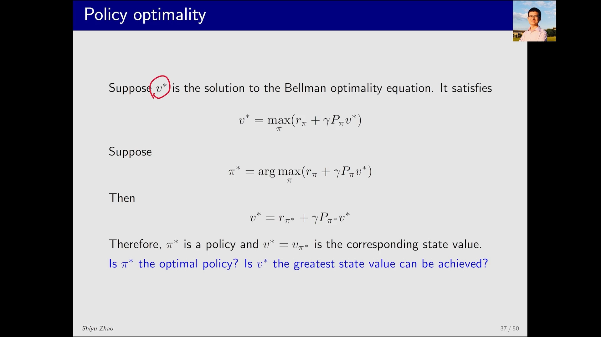

[【跳转到 07:58】](https://www.bilibili.com/video/BV1KP411n7T5/?t=478)

那么 `π*` 究竟是不是最优？它对应的 `v*` 是不是最大的？有一个结论可以回答：

**最优性定理**：设 `v*` 是 BOE 的解，则 `v*` 是**最优状态价值函数**，即对任意策略 `π` 都有

```text
v*(s) ≥ v_π(s),   对任意 s
```

既然 `π*` 对应的状态价值 `v_{π*} = v*` 达到了最大，那么 `π*` 自然就是一个**最优策略**。

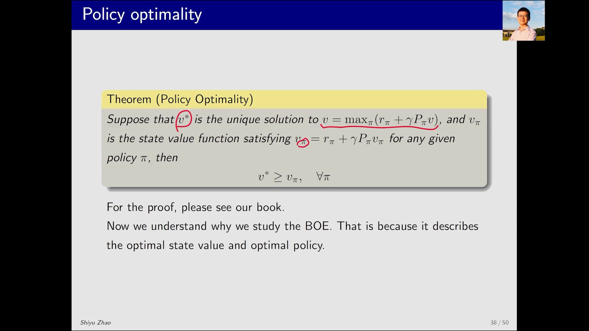

[【跳转到 09:13】](https://www.bilibili.com/video/BV1KP411n7T5/?t=553)

## 六、最优策略长什么样：确定性的贪婪策略

那么最优策略 `π*` 具体是什么形式？答案并不陌生——在状态 `s` 时，`π*` 选择动作价值最大的那个动作 `a*`：

```text
π*(s, a) = 1,  若 a = a* = argmax_a q(s,a)
π*(s, a) = 0,  其它动作
```

也就是说，对状态 `s` 下动作价值最大的动作，选择概率为 1；对其余动作，概率为 0。于是这个策略：

- **是确定性的（deterministic）**——在每个状态明确选择一个动作，没有随机性；
- **是贪婪的（greedy）**——所谓贪婪，就是"不管别的，只选最大的那一个"。

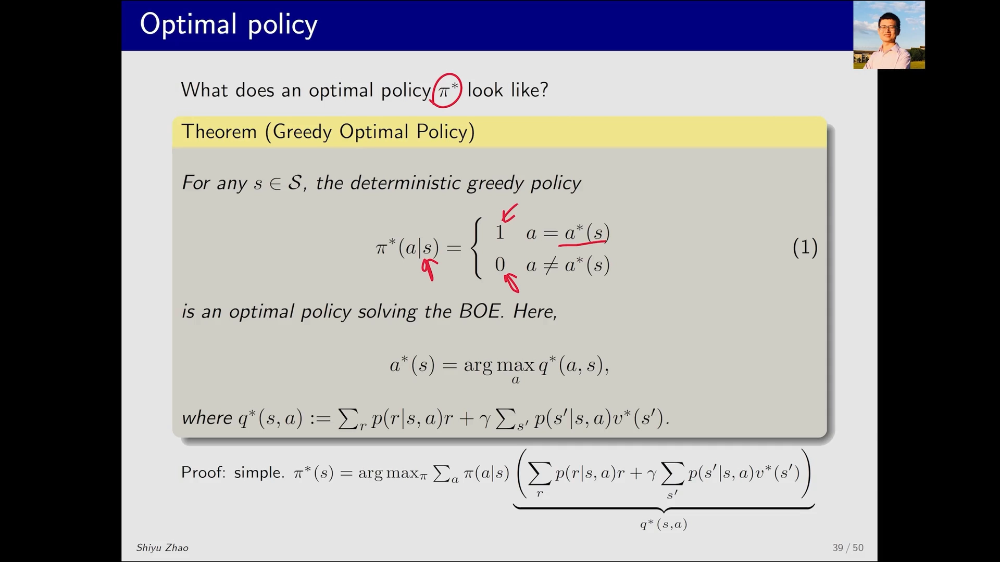

[【跳转到 10:03】](https://www.bilibili.com/video/BV1KP411n7T5/?t=603)

回到上一讲开头那四个疑问，现在都有了答案：**最优策略存在**（由压缩映射定理的存在性保证）、**唯一性方面最优状态价值唯一**、它是**确定性的贪婪策略**、并且可以**通过迭代算法求出**。

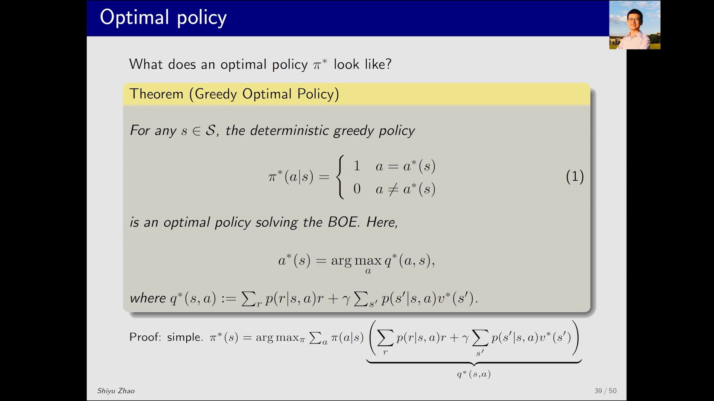

[【跳转到 09:38】](https://www.bilibili.com/video/BV1KP411n7T5/?t=578)

## 小结

- BOE 可改写成简洁形式 **`v = f(v)`**，其中 `f(v)` 是把右边 `max_π` 整体看作的函数。
- **不动点**：满足 `f(x) = x` 的点；**压缩映射**：满足 `‖f(x1) − f(x2)‖ ≤ γ‖x1 − x2‖`（`γ ∈ (0,1)`）的函数。
- **压缩映射定理**给出三件事：不动点**存在**、**唯一**、并可用迭代 `x_{k+1} = f(x_k)` 求出且**指数收敛**。
- BOE 中的 `f(v)` 满足压缩性（`γ` 为折扣率，小于 1），因此 BOE 的**解 `v*` 存在、唯一、可迭代求解**。
- **最优性**：`v*` 是最大的状态价值（对任意 `π` 有 `v*(s) ≥ v_π(s)`），故 `π*` 是最优策略；`π*` 是**确定性的贪婪策略**，`π*(s,a*) = 1`（`a* = argmax_a q(s,a)`）。

## 关键术语速查

| 术语 | 一句话解释 |
| --- | --- |
| 不动点 (fixed point) | 满足 `f(x) = x` 的点，映射后回到自身 |
| 压缩映射 (contraction mapping) | 满足 `‖f(x1) − f(x2)‖ ≤ γ‖x1 − x2‖`（`0<γ<1`）的函数 |
| 压缩映射定理 | 若 `f` 是压缩映射，则 `x = f(x)` 的解存在、唯一，且 `x_{k+1}=f(x_k)` 指数收敛到它 |
| 折扣率 (discount rate) γ | 决定压缩性的常数，`0 < γ < 1` |
| 最优性定理 | BOE 的解 `v*` 是最大的状态价值函数 |
| 贪婪策略 (greedy policy) | 在每个状态只选动作价值最大的动作 |
| 确定性与随机策略 | 确定策略每个状态选一个动作；随机策略按概率分布选动作 |
