# 第3课·贝尔曼最优公式（二）：最优策略的定义，与那个"嵌套了优化"的方程

> 本文整理自西湖大学 Shiyu Zhao《强化学习的数学原理》第 3 课 Part 2（Optimal policy and Bellman optimality equation）。
> 对应视频：[BV1Ue4y1n7uX](https://www.bilibili.com/video/BV1Ue4y1n7uX/)

## 本讲要解决的核心问题（SCQA）

**背景（S）**：上一讲我们知道，动作价值 $q_\pi(s,a)$ 可以用来改进策略；状态价值 $v_\pi(s)$ 则用来衡量"一个策略好不好"。

**冲突（C）**：但"最优策略"到底该如何**严格定义**？定义出来之后，一堆尖锐的问题随之而来：这样的策略**存在**吗？**唯一**吗？它是**随机**的还是**确定**的？又该怎么**求**出来？

**疑问（Q）**：有没有一个方程，能把"最优策略"和"最优状态价值"同时刻画出来，让上面这些问题一次性得到回答？

**回答（中心思想）**：有，它就是**贝尔曼最优公式（BOE）**——形式上几乎就是贝尔曼公式，只是在策略前面多了一个 $\max_\pi$。这个改动把"给定策略求价值"变成了"**连策略一起求**"，因此右边嵌套了一个优化问题。本讲先给出最优策略的定义，再给出 BOE 的两种形式，并把右边那个"最大化"拆开讲清楚。

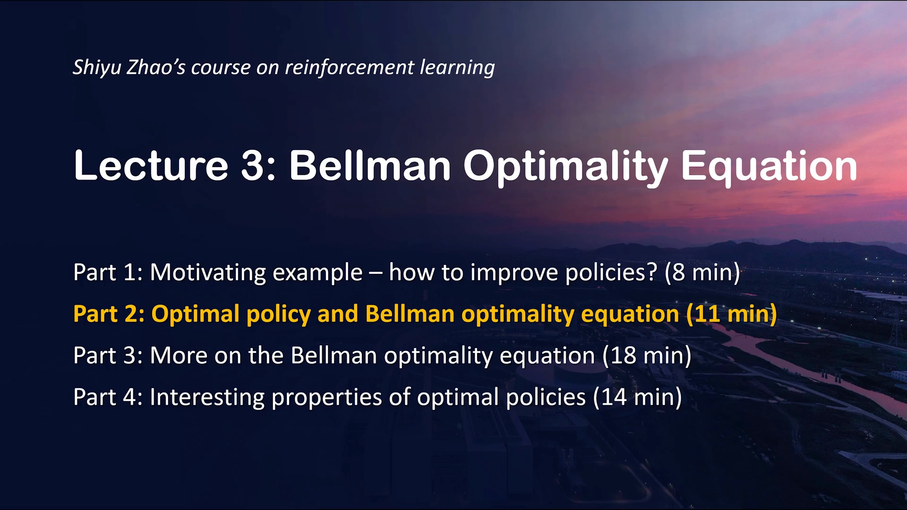

## 一、最优策略怎么定义：先用状态价值比高低

上一讲反复强调过：**状态价值之所以重要，是因为它能衡量一个策略究竟好还是不好**。现在把这个说法正式写下来。

**策略优劣的定义**：如果两个策略 $\pi_1$ 和 $\pi_2$，对**所有**状态 $s$ 都有 $v_{\pi_1}(s) \ge v_{\pi_2}(s)$，就说 **$\pi_1$ 比 $\pi_2$ 好**（$\pi_1$ is "better" than $\pi_2$）。

**最优策略的定义**：如果一个策略 $\pi^*$，对**任意**状态 $s$、相比**任意**其它策略 $\pi$，都有 $v_{\pi^*}(s) \ge v_\pi(s)$，就说 **$\pi^*$ 是最优的**。

```text
若 ∀s，v_π1(s) ≥ v_π2(s)   →  π1 比 π2 好
若 ∀s, ∀π，v_π*(s) ≥ v_π(s) →  π* 是最优策略
```

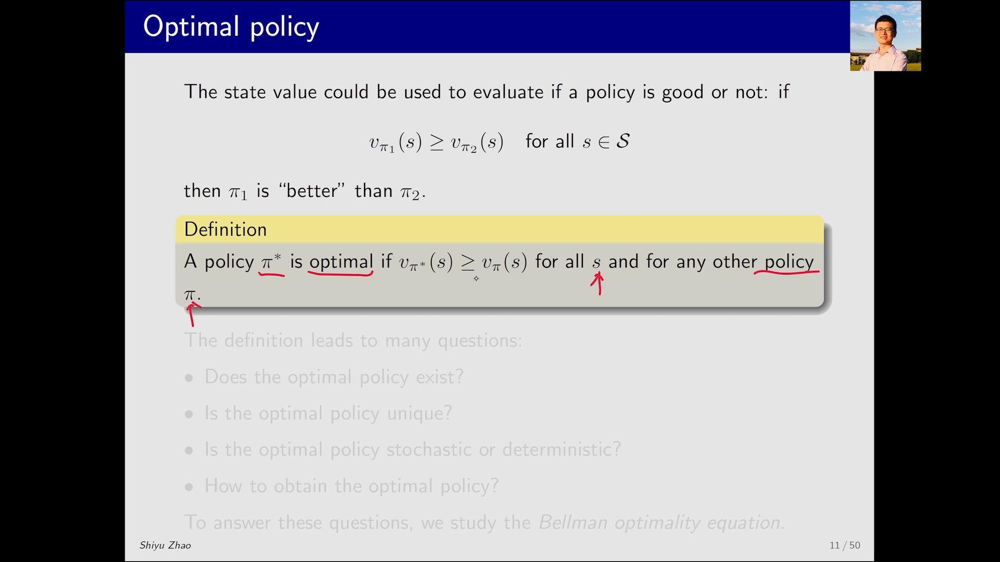

[【跳转到 00:55】](https://www.bilibili.com/video/BV1Ue4y1n7uX/?t=55)

## 二、定义刚写完，问题就来了：四个待答的疑问

定义本身并不麻烦，麻烦的是定义之后要回答的一系列问题：

1. **存在性**：最优策略是否存在？它看起来非常理想——比其他所有策略都好、并且在**所有**状态上都能打败其他策略。会不会存在"只能在某些状态赢、在另一些状态赢不了"的策略呢？
2. **唯一性**：它是唯一的吗？会不会有很多策略同时都是最优的？
3. **随机还是确定**：最优策略是随机的（stochastic）还是确定的（deterministic）？我们有时会偏好确定性策略——在某个状态明确地告诉我该做什么动作。
4. **可求解性**：最后，这个策略到底怎样才能得到？

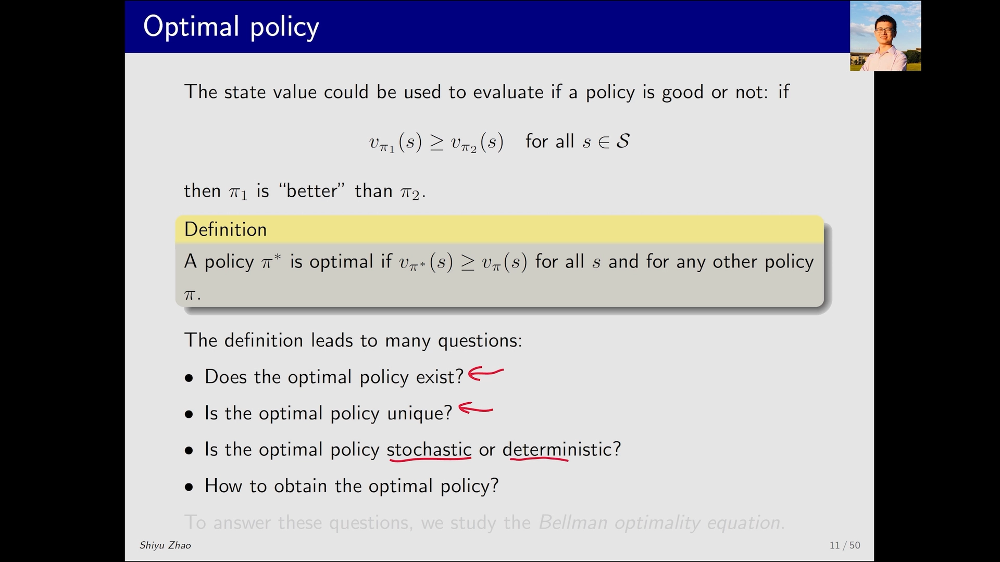

[【跳转到 01:45】](https://www.bilibili.com/video/BV1Ue4y1n7uX/?t=105)

**这四问，全靠研究贝尔曼最优公式来回答。** 讲法上我们采用"先给式子、再分析性质"的顺序。

## 三、贝尔曼最优公式：在贝尔曼公式前面加一个 max

先看 BOE 的**逐元素形式（element-wise form）**：

$$
v(s) = \max_\pi \sum_a \pi(a \mid s) \left( \sum_{s',r} p(s',r \mid s,a)\,\big[\, r + \gamma v(s') \,\big] \right), \quad \text{对任意 } s \in S
$$

对照上节课的贝尔曼公式，会发现它**非常眼熟**——唯一的改动是：在 $\pi$ 前面加了 $\max_\pi$。

这正是关键所在：**对（普通）贝尔曼公式，策略 $\pi$ 是给定的；而贝尔曼最优公式里 $\pi$ 是未知的**，因为等式右边嵌套了一个优化问题。求解顺序是"先解出这个 $\pi$，再把它带回式子里"。右边那一大坨可以简写成动作价值 $q(s,a)$：

$$
v(s) = \max_\pi \sum_a \pi(a \mid s)\, q(s,a)
$$

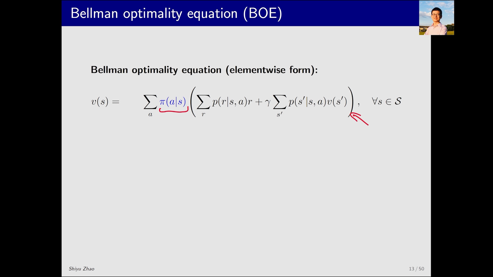

[【跳转到 02:35】](https://www.bilibili.com/video/BV1Ue4y1n7uX/?t=155)

它的**矩阵-向量形式（matrix-vector form）**则是：

$$
v = \max_\pi \left( r_\pi + \gamma P_\pi v \right)
$$

其中 $\max_\pi$ 是对向量逐元素取最大（element-wise），可以拿到括号里面去。这个式子中，概率（即系统模型 $p(s',r \mid s,a)$）、奖励 $r$、折扣因子 $\gamma$ **都是已知的**；要求解的是状态价值 $v$ **以及**每个状态上的最优策略 $\pi$。

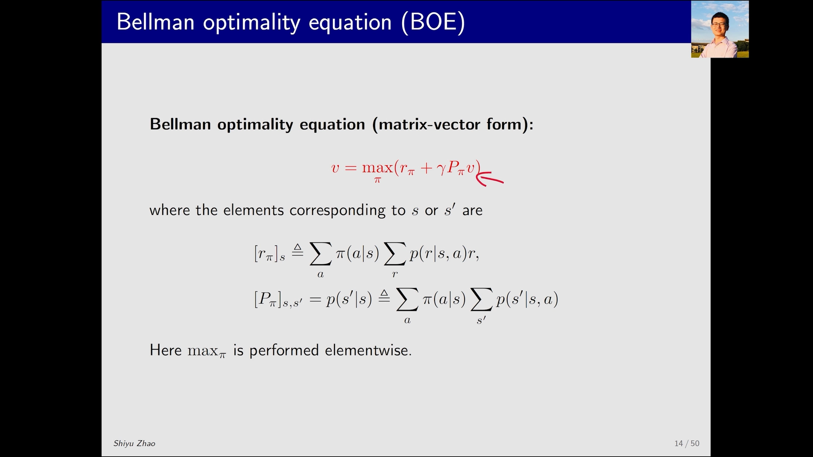

[【跳转到 03:50】](https://www.bilibili.com/video/BV1Ue4y1n7uX/?t=230)

## 四、这个公式"优雅"在哪，"棘手"又在哪？

BOE 既 tricky（棘手）又 elegant（优雅）：

- **优雅**：形式非常简洁，却**同时刻画了最优策略与最优状态价值**。
- **棘手**：一方面，右边其实**镶嵌了一个最优化问题**；另一方面，去求解、去理解式子里的一些问题也不那么直观。

脑子里冒出一堆疑问很正常：怎么求解？这个方程**是否存在解**？**解是否唯一**？为什么要研究它？它和最优策略、最优状态价值又是什么关系？——这些问题会在后续逐条解答。

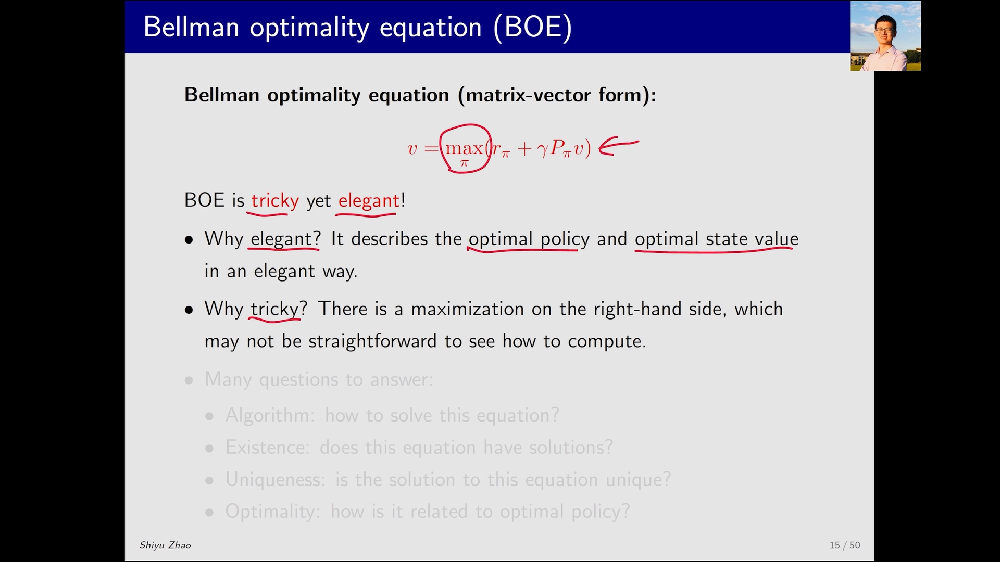

[【跳转到 04:40】](https://www.bilibili.com/video/BV1Ue4y1n7uX/?t=280)

## 五、拆解右边那个"最大化"：先看一个玩具例子

BOE 最让人迷惑的，是右边那个"求最大"。它既出现在逐元素形式里，也出现在矩阵-向量形式里。

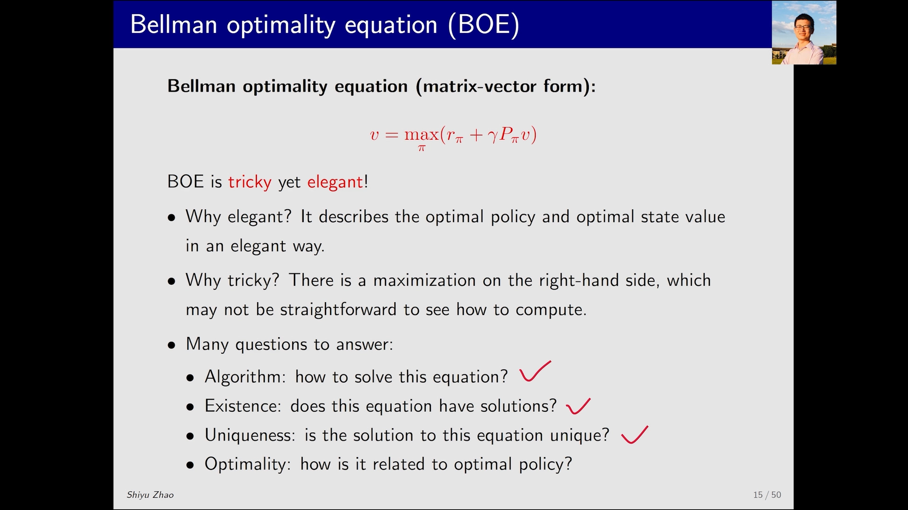

[【跳转到 05:05】](https://www.bilibili.com/video/BV1Ue4y1n7uX/?t=305)

它为什么不好懂？因为一个式子里有**两个未知量**：状态价值 $v$（虽是向量，但当成一个未知量），以及**每个状态上都要解出的 π**。一个式子、两个未知量，怎么解？

看一个模拟它的玩具例子。设两个变量 $x$ 和 $a$ 满足：

$$
x = \max_a \left( 2x - 1 - a^2 \right)
$$

求解分两步：

**第一步**：先**固定 $x$**，看右边对 $a$ 求最大。因为里面是 $-a^2$，所以当 $a = 0$ 时取到最大值，此时右边等于 $2x - 1$。

```text
max_a ( 2x − 1 − a² )  →  当 a = 0 时最大 = 2x − 1
```

**第二步**：把最优值 $a = 0$ 代回，式子变成 $x = 2x - 1$，解出 $x = 1$。于是 $x = 1$、$a = 0$ 就是这个方程的解。

```text
a = 0 代入 →  x = 2x − 1  →  x = 1
解为：x = 1，a = 0
```

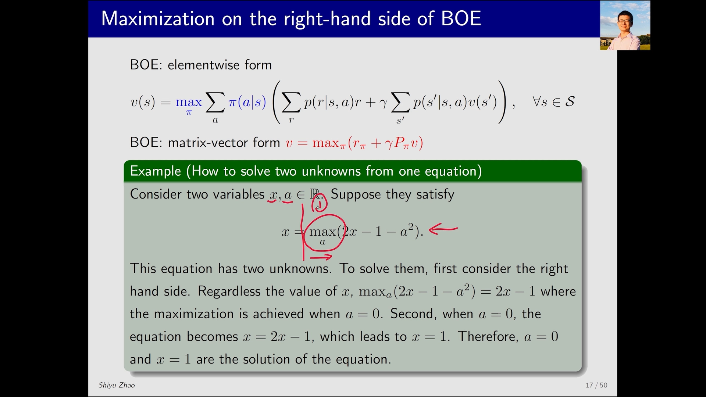

[【跳转到 06:33】](https://www.bilibili.com/video/BV1Ue4y1n7uX/?t=393)

> **核心思路：把"一个式子、两个未知量"拆成两步——先固定一个、对另一个求最优，再把最优值代回。** 这正是求解贝尔曼最优公式的思路。

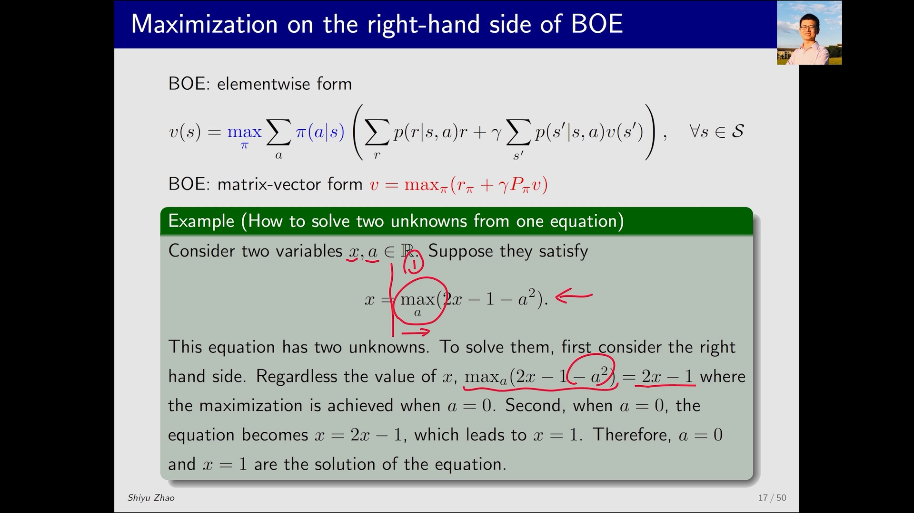

[【跳转到 06:58】](https://www.bilibili.com/video/BV1Ue4y1n7uX/?t=418)

## 六、把同样的思路用到贝尔曼最优公式上

回到 BOE。等式右边那些项都是已知的；只有含 $v$ 的那一项是未知的——但之后会看到，我们会**先给 $v$ 一个初始值**，一旦初始值给定，这一项也就是已知的，我们把它简写成 $q(s,a)$。

于是问题变成：**在 $q(s,a)$ 已知的前提下，怎样确定 $\pi(s,a)$？**

在我们的网格世界里一共有 5 个动作，也就是有 $q(s,a_1)$ 到 $q(s,a_5)$ 这 5 个值。要解的就是：对每个状态，怎样分配"选各动作的概率"，使右边最大。

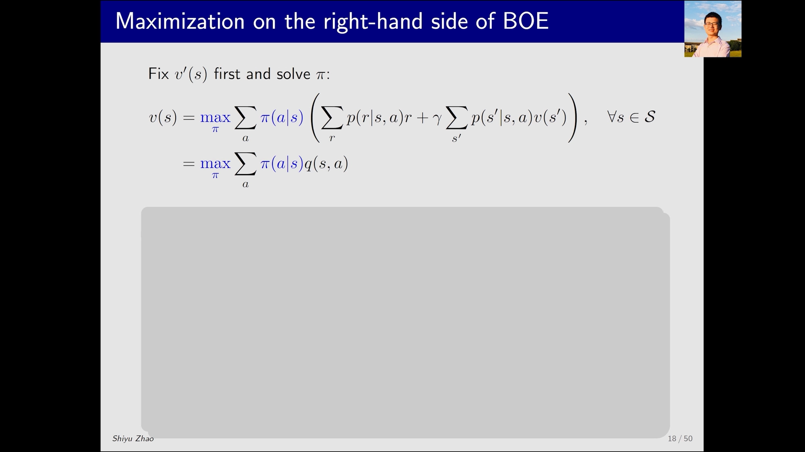

[【跳转到 07:29】](https://www.bilibili.com/video/BV1Ue4y1n7uX/?t=449)

### 6.1 三个 q 值的例子

先把问题缩到最小：假设有 3 个 $q$ 值，要求 3 个系数（权重）$c_1$、$c_2$、$c_3$，使下面这个目标函数最大：

```text
maximize   c1·q1 + c2·q2 + c3·q3
subject to c1 + c2 + c3 = 1，  且  c1, c2, c3 ≥ 0
```

约束从哪来？因为这组系数对应的正是概率 $\pi$，而概率必须非负、且求和为 1。

**结论（最优解）**：把**所有权重都放到最大的那个 $q$ 上**。不妨假设 $q_3$ 最大，那么最优解就是：

$$
c_3 = 1, \quad c_1 = c_2 = 0
$$

**直观解释**：$c_3$ 是 $q_3$ 的权重，$q_3$ 最大，自然希望把权重全给它，这样总和最大。

**数学解释**：因为 $c_1 + c_2 + c_3 = 1$，可以把 $q_3$ 写成

$$
q_3 = (c_1 + c_2 + c_3)\, q_3 = c_1 q_3 + c_2 q_3 + c_3 q_3
$$

又因为 $q_3$ 最大，所以 $c_1 q_3 + c_2 q_3 + c_3 q_3 \ge c_1 q_1 + c_2 q_2 + c_3 q_3$。也就是说，**不管系数怎么取，加权和都不会超过 $q_3$**，而取到 $q_3$ 的唯一方式就是 $c_3 = 1$。

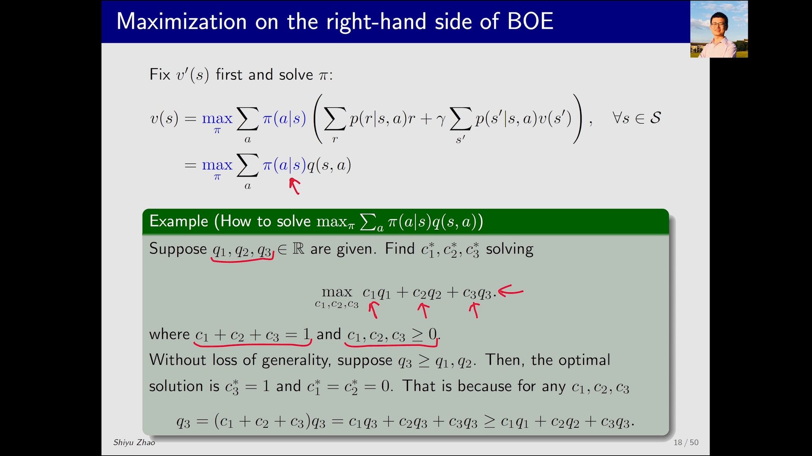

[【跳转到 08:51】](https://www.bilibili.com/video/BV1Ue4y1n7uX/?t=531)

## 七、结论：右边的最优值，就等于最大的 q

把上面的思路搬回 BOE：**右边这一项的最优值，就等于最大的那个 $q(s,a)$**。取得最大值的策略是：

```text
π(s, a*) = 1      # a* = argmax_a q(s,a)
π(s, a)  = 0      # 其它动作
```

即：**对动作价值最大的那个动作，选择概率为 1；对其余动作，概率为 0。** 至此，我们就把嵌套在贝尔曼最优公式里、那个"可能让人迷惑"的右边最优项，彻底讲清楚了。

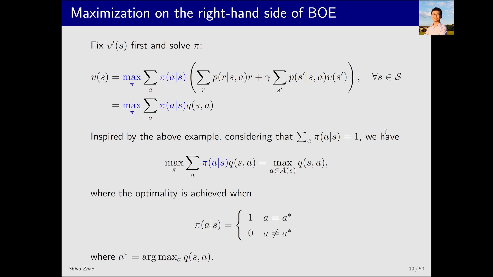

[【跳转到 10:30】](https://www.bilibili.com/video/BV1Ue4y1n7uX/?t=630)

不过此时还有一个悬而未决的问题：**我们用了 $q(s,a)$，可 $q$ 本身又依赖 $v$；而 $v$ 到底是多少，我们其实还没求出来。** 这个"自我指涉"的方程究竟有没有解、解是否唯一、又该如何迭代求解？——这正是下一讲（Part 3）用**压缩映射定理**要解决的事。

## 小结

- **策略优劣**：对所有状态 $v_{\pi_1}(s) \ge v_{\pi_2}(s)$，则 $\pi_1$ 比 $\pi_2$ 好；对任意状态和任意策略都满足 $v_{\pi^*}(s) \ge v_\pi(s)$，则 $\pi^*$ 最优。
- 最优策略引出四个问题：**存在性、唯一性、随机/确定、如何求解**——都靠贝尔曼最优公式回答。
- **贝尔曼最优公式（BOE）** = 贝尔曼公式 + 策略前的 $\max_\pi$。逐元素形式为 $v(s) = \max_\pi \sum_a \pi(a \mid s)\, q(s,a)$，矩阵-向量形式为 $v = \max_\pi (r_\pi + \gamma P_\pi v)$。
- 它优雅（简洁且刻画最优）又棘手（右边嵌套优化；$\pi$ 未知）。
- 求解要点：**先固定一个未知量、对另一个求最优，再代回**。由此可得右边最优值 = $\max_a q(s,a)$，最优策略把概率全给 $\arg\max_a q(s,a)$ 的动作。

## 关键术语速查

| 术语 | 一句话解释 |
| --- | --- |
| 最优策略 π* | 对任意状态、任意策略 $\pi$ 都有 $v_{\pi^*}(s) \ge v_\pi(s)$ 的策略 |
| 逐元素形式 (element-wise form) | 每个状态 $s$ 单独列一个方程的写法 |
| 矩阵-向量形式 (matrix-vector form) | 把所有状态合成一个向量方程 $v = \max_\pi (r_\pi + \gamma P_\pi v)$ 的写法 |
| 嵌套优化 | BOE 右边包含一个对 $\pi$ 求最大的子问题 |
| $q(s,a)$ | 动作价值；在求 $\pi$ 时先当作已知量 |
| $\arg\max_a q(s,a)$ | 使动作价值取到最大的那个动作 $a^*$ |
