# 第4课（下）：策略迭代算法——四个关键问题、逐元素实现与两个网格实验

> 本篇整理自视频《第4课 值迭代与策略迭代 Part2：策略迭代算法》。视频地址：[BV1at4y1P7P4](https://www.bilibili.com/video/BV1at4y1P7P4/)。

## 本讲要解决的核心问题（SCQA）

**背景**：我们已经知道，给定一个策略 `π`，只要解它的贝尔曼公式，就能得到这个策略的**状态价值（state value）** `V_π(s)`——它衡量"按这套策略一直走下去，平均能拿多少折扣回报"。

**冲突**：但状态价值只是**评估**，它不会自己变好。随便猜一个策略 `π₀`，解出来的 `V_π₀` 大概率离最优值 `V*` 差得很远。**评估不能改进策略**——这是上一节留下的缺口。

**疑问**：能不能利用"评估出来的价值"反过来去**改策略**，并且保证每改一次都真的更好、最终一定收敛到最优策略？

**回答（中心思想）**：能，这就是**策略迭代（policy iteration）**。它把一次迭代拆成两步——**策略评估（policy evaluation）** 解出 `V_{π_k}`，**策略改进（policy improvement）** 用它贪心地换出更好的 `π_{k+1}`——然后循环。可以证明 `V_{π_{k+1}} ≥ V_{π_k}`，且 `k → ∞` 时收敛到最优状态价值和最优策略。它和价值迭代其实是**同一个更一般算法的两个极端**。

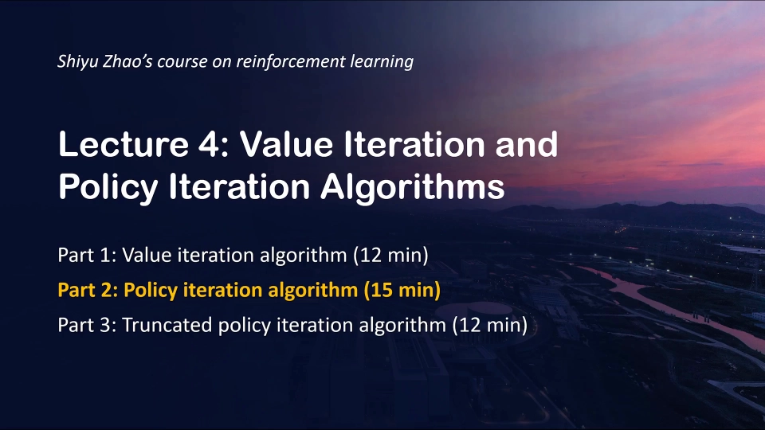

---

## 一、算法本身：评估一步、改进一步，循环下去

### 1.1 从一个"随便猜的"初始策略出发

一开始我有一个**初始策略（initial policy）**，用 `π₀` 表示，它可以是**任意给定**的一个策略。也许它并不好，但没关系——我们会不断迭代，最终找到一个好的策略。

### 1.2 每一次迭代的两步

每一次迭代实际上分为两步：

**第一步：策略评估（policy evaluation）。** 给定一个策略，求解它对应的**贝尔曼公式**，从而得到该策略的状态价值 `V_π(s)`。已知第 `k` 步的策略 `π_k`（最开始是 `π₀`），我求解出 `V_{π_k}`，这就是对该策略做评估。

**第二步：策略改进（policy improvement）。** 刚才不是求出了 `V_{π_k}` 吗？我求解这样一个优化问题，得到一个**更优的新策略** `π_{k+1}`。

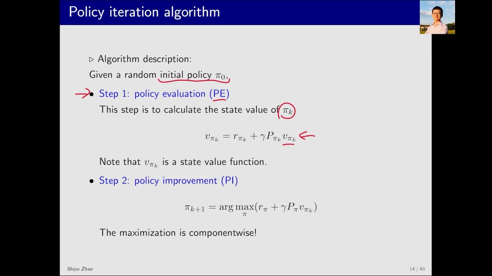

[【跳转到 00:55】](https://www.bilibili.com/video/BV1at4y1P7P4/?t=55)

写成公式，策略改进就是：

```
π_{k+1}(s) = argmax_a  Σ_{s'} p(s' | s, a) · [ r(s, a) + γ · V_{π_k}(s') ]
```

括号里那一坨其实就是**动作价值（action value）** `q_{π_k}(s, a)`——"在状态 `s` 先做动作 `a`、之后老老实实按 `π_k` 走"的价值。所以策略改进做的事非常朴素：**在每个状态下，挑动作价值最大的那个动作。**

[【跳转到 01:20】](https://www.bilibili.com/video/BV1at4y1P7P4/?t=80)

### 1.3 整个过程的形状

这样一个过程可以这样表示：最开始我有一个猜的策略 `π₀`，它肯定不好；然后依次有 `π₁`、`V_{π₁}`，`π₂`、`V_{π₂}`，等等——这就是一个迭代的过程：

```
π₀ → V_{π₀} → π₁ → V_{π₁} → π₂ → V_{π₂} → ... → π* , V*
     评估      改进    评估      改进
```

而"改进"这一步之所以叫 improvement，是因为新策略真的不比旧的差——这正是下面第二个问题要回答的。

---

## 二、四个关键问题：算法为什么站得住

在讲具体实现之前，先回答四个关键问题：

1. 怎样求解状态价值？
2. 在策略改进这一步，为什么新策略 `π_{k+1}` 会比 `π_k` 要好，为什么叫 improvement？
3. 这个迭代算法为什么能找到最优策略？
4. 它和我们讲过的价值迭代有什么关系？

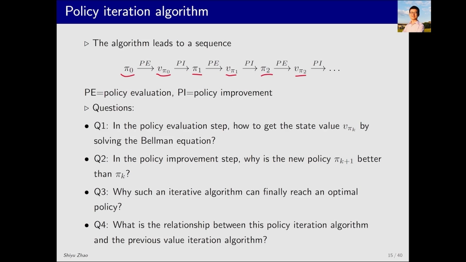

[【跳转到 01:45】](https://www.bilibili.com/video/BV1at4y1P7P4/?t=105)

### 2.1 问题一：怎样求解状态价值

要做策略评估，其实在讲贝尔曼公式的时候已经非常详细地介绍过了。假设 `π_k` 给定，我们可以写出它的贝尔曼公式，然后求解它的状态价值。有两种方法：

- **闭式解（closed form solution）**：把贝尔曼公式写成矩阵形式 `V = r + γPV`，直接求逆得到 `V = (I − γP)^{-1} r`。数学上很漂亮，但涉及矩阵求逆，状态一多就算不动。
- **迭代解（iterative solution）**：先对 `V_{π_k}` 给一个猜测，然后不断迭代，就能慢慢得到 `V_{π_k}`。

因为我们不太会用闭式解（它涉及矩阵求解），所以**经常用的是迭代解**。

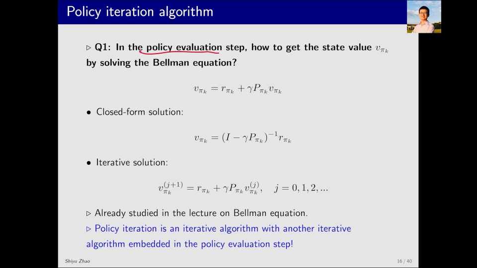

[【跳转到 02:35】](https://www.bilibili.com/video/BV1at4y1P7P4/?t=155)

这里有一个值得指出的结构特点：**策略评估是策略迭代这个算法中的一步，而这一步又依赖一个迭代算法**——相当于一个**大的迭代算法**，它里面的每一步又涉及一个**小的迭代算法**。

```
外层大迭代（策略迭代）：  π₀ → π₁ → π₂ → ...
                            ↑ 每一步内部要跑
内层小迭代（策略评估）：  V⁰ → V¹ → V² → ... → V_{π_k}
```

这个"迭代套迭代"的结构，后面会引出"内层要不要跑到底"的重要讨论。

### 2.2 问题二：为什么 `π_{k+1}` 一定比 `π_k` 好

`π_{k+1}` 是在 `V_{π_k}` 给定的情况下求解前面那个 `argmax` 式子得到的。结论是：

```
V_{π_{k+1}}(s) ≥ V_{π_k}(s)   对所有状态 s 成立
```

既然新策略在每个状态上的价值都不低于旧策略，那么 `π_{k+1}` 当然也比 `π_k` 要好——这就是它叫 improvement 的原因。这里只把结论作为结果放出来，详细证明可以在教材里找到。

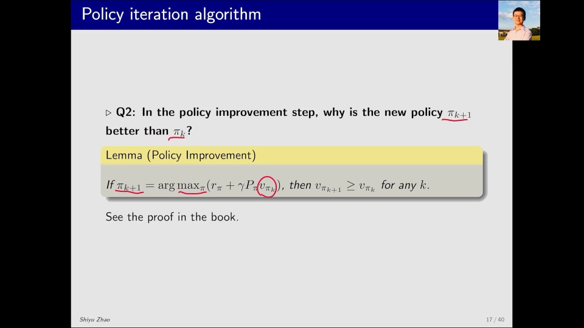

[【跳转到 03:50】](https://www.bilibili.com/video/BV1at4y1P7P4/?t=230)

直观理解一下为什么成立：`V_{π_k}` 告诉你"从每个状态出发、按旧策略走"值多少。现在你在某个状态上改用一个**只看一步就贪心**的动作，等于是在"当前状态 + 之后仍然按旧策略走"的所有选项里挑了最好的一个。所以至少不会比原来差；如果恰好所有状态都挑不出更好的，说明旧策略已经是贪心的了，此时 `π_{k+1} = π_k`，迭代自然停止。

### 2.3 问题三：为什么一定能找到最优策略

首先我们知道，算法里有一个策略改进，所以每次都在不断改进：最开始 `V_{π₀}` 可能不好，不断改进后 `V_{π₁}` 会好一点，慢慢地 `V_{π_k}` 肯定比之前的更好。

那么最好的肯定是 `V*`。`V*` 是什么？它是**贝尔曼最优公式**的解，也就是最优的状态价值。

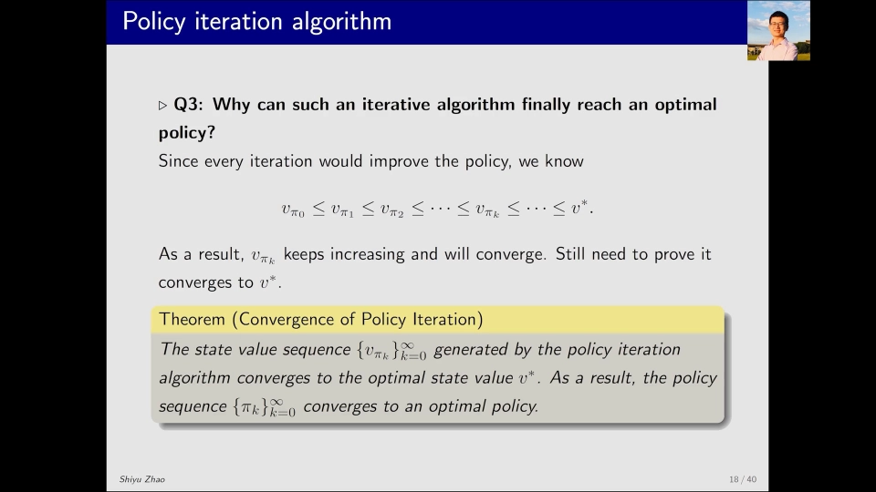

[【跳转到 04:15】](https://www.bilibili.com/video/BV1at4y1P7P4/?t=255)

所以直观上好像这样确实越来越好，也就能找到最优策略。但数学上会稍微复杂一点：虽然知道 `V_{π_k}` 越来越好，但它**究竟能不能好到最优的那个值**，还需要证明——一个单调递增的序列完全可能收敛到某个小于 `V*` 的上界。

这个证明同样作为结果给出：**`V_{π_k}` 最后一定会收敛——当 `k` 趋于无穷时，它收敛到最优状态价值（optimal state value），并且策略也会收敛到一个最优策略。**

### 2.4 问题四：策略迭代和价值迭代是什么关系

有两层关系：

**第一，策略迭代的收敛性证明用到了价值迭代的收敛性结果。** 在回答第三个问题时，我们证明策略迭代收敛，实际上用到了"价值迭代收敛"这个已有结果，所以它是**基于**价值迭代的。

**第二，策略迭代和价值迭代实际上是两个极端。** 它们是一个**更一般算法**的两个极端，这个更一般的算法就是策略迭代的一般化——也就是通常所说的**广义策略迭代（Generalized Policy Iteration, GPI）**，本系列后面会专门讲到。

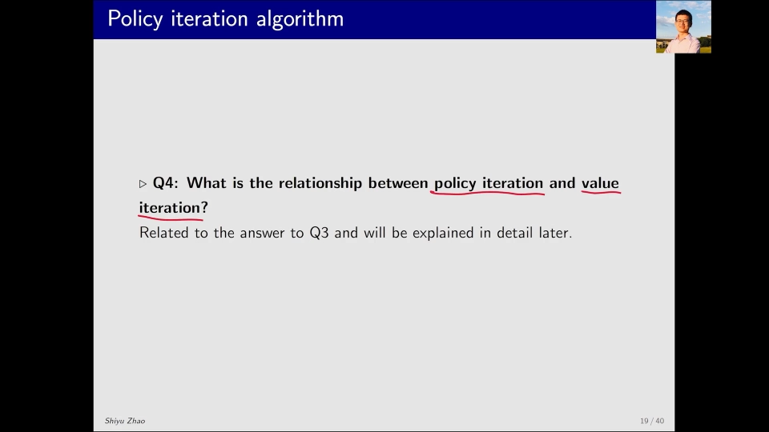

[【跳转到 05:30】](https://www.bilibili.com/video/BV1at4y1P7P4/?t=330)

具体怎么"极端"法？关键就在内层那个小迭代：

- 内层迭代**一直跑到完全收敛** → 就是**策略迭代**（每步都精确评估）；
- 内层迭代**只跑一步** → 就退化成**价值迭代**（每步只做一次"取最大 + 更新值"）。

---

## 三、怎么编程实现：逐元素形式

要实现策略迭代，就要研究它的**逐元素形式（element-wise form）**——也就是把矩阵-向量写法拆成"对每个状态 `s` 分别怎么算"。

### 3.1 第一步：策略评估的逐元素形式

策略评估本质上就是"用迭代方式求解贝尔曼公式"的算法。它的逐元素形式是：

```
V_{π_k}^{j+1}(s) = Σ_a π_k(a | s) · Σ_{s'} p(s' | s, a) · [ r(s, a) + γ · V_{π_k}^{j}(s') ]
```

记号说明：

- 上标 `j` 表示"第 `j` 次迭代估计出来的 `V_{π_k}` 值"；
- 下标 `k` 表示"第 `k` 个外层策略"；
- `π_k(a|s)` 是策略在状态 `s` 选动作 `a` 的概率（确定性策略时只有一个动作概率为 1）。

因为 `π_k` 是给定的、`V_{π_k}^{j}` 是上一轮已知的，所以通过这个式子可以求出左边的 `V_{π_k}^{j+1}`；再把左边带回右边，这样就可以循环，**直到收敛**，就认为找到了 `V_{π_k}`，这一步就完成了。

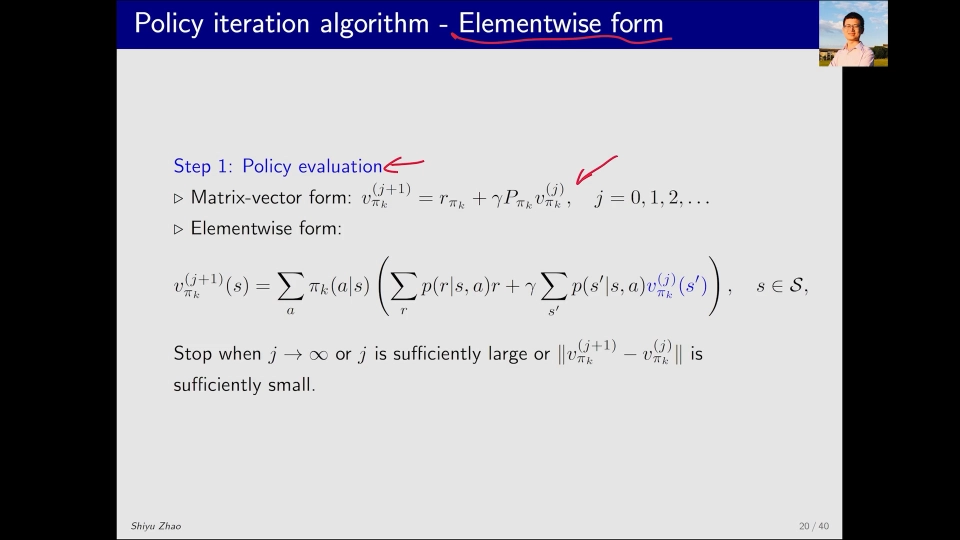

[【跳转到 06:20】](https://www.bilibili.com/video/BV1at4y1P7P4/?t=380)

### 3.2 第二步：策略改进的逐元素形式

上一步不是找到了 `V_{π_k}` 吗？下一步要更新得到 `π_{k+1}`，方法是求解这个 `max`，它的逐元素形式是：

```
π_{k+1}(s) = argmax_a  Σ_{s'} p(s' | s, a) · [ r(s, a) + γ · V_{π_k}(s') ]
```

`V_{π_k}` 在这里都是已知的，然后要求解这个 `π`。怎么求解呢？括号里实际上就是 `q_{π_k}(s, a)`，可以求出来。我有好几个 `q_{π_k}`，应该选择哪个动作作为新策略呢？这在价值迭代当中我们已经知道了——**新的最优策略就是选择对应最大那个 `q_{π_k}` 的动作 `a*`。**

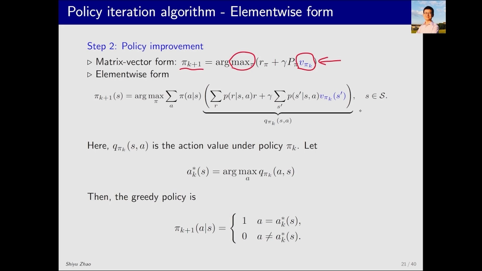

[【跳转到 07:10】](https://www.bilibili.com/video/BV1at4y1P7P4/?t=430)

### 3.3 伪代码

整个这个过程可以用伪代码比较好地展示出来。在每一次迭代（假设是第 `k` 次）里有两步——策略评估和策略改进。

```
for k = 0, 1, 2, ...:
    # ---------- 第一步：策略评估 ----------
    V⁰ ← 任意初始猜测                      # 可以是任意值
    repeat:
        for each state s:
            V^{j+1}(s) ← Σ_a π_k(a|s) Σ_{s'} p(s'|s,a) [ r(s,a) + γ V^{j}(s') ]
        j ← j + 1
    until V^{j} 收敛
    V_{π_k} ← V^{j}

    # ---------- 第二步：策略改进 ----------
    for each state s:
        for each action a:
            q_{π_k}(s,a) ← Σ_{s'} p(s'|s,a) [ r(s,a) + γ V_{π_k}(s') ]
        π_{k+1}(s) ← argmax_a q_{π_k}(s,a)     # 取最大的那个
```

我们的目标是求解 `V_{π_k}`：先给它一个初始猜测（可以是任意值），把这个猜测代入这样一套迭代算法，直到 `V_{π_k}^j` 收敛，就得到了 `V_{π_k}`。

下一步策略改进：先遍历所有状态，对每一个状态再遍历它的每一个动作，用刚求出的 `V_{π_k}` 算出 `q_{π_k}`；接下来很简单，新的策略就是选择 `q_{π_k}` 里最大的那个。计算出 `π_{k+1}` 之后再回到第一步，去计算 `V_{π_{k+1}}`，这样不断迭代循环下去。

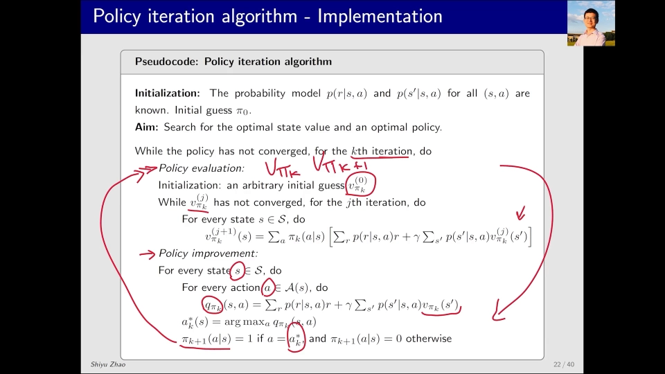

[【跳转到 08:50】](https://www.bilibili.com/video/BV1at4y1P7P4/?t=530)

注意伪代码里的**双层循环**：外层 `for k` 是策略迭代的轮次，内层 `repeat ... until` 是策略评估的迭代。这正是 2.1 节说的"大迭代套小迭代"。

---

## 四、例一：两个格子的最小例子，一次迭代就到最优

### 4.1 问题设定

这里是一个非常简单的问题：有两个网格，右边是一个**目标区域（target area）**。最优策略显然是这样——在左边格子里时我要**往右走**，在右边格子里时我就**静止不动**。

我们要用策略迭代算法来得到这样一个最优策略。初始策略不合适：**全都是往左走**。看看它怎么收敛到最优策略（optimal policy）。

每个格子有三个动作：`a_l` 往左、`a_0` 保持不动、`a_r` 往右。

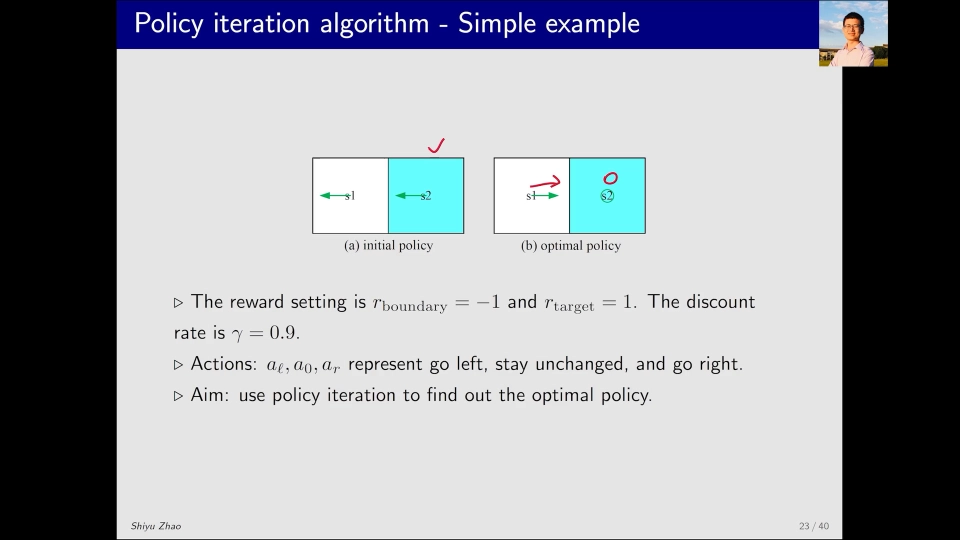

[【跳转到 09:15】](https://www.bilibili.com/video/BV1at4y1P7P4/?t=555)

### 4.2 第零次迭代：求 `V_{π₀}`

来看第零次迭代，也就是 `k = 0` 的时候。我要做的就是求解 `V_{π₀}`——怎么求解呢？就是求解贝尔曼公式。

因为这个例子非常简单，可以直接求解出来；问题比较复杂时，就用前面那个迭代算法来求解。这里比较简单，就直接跳过了。

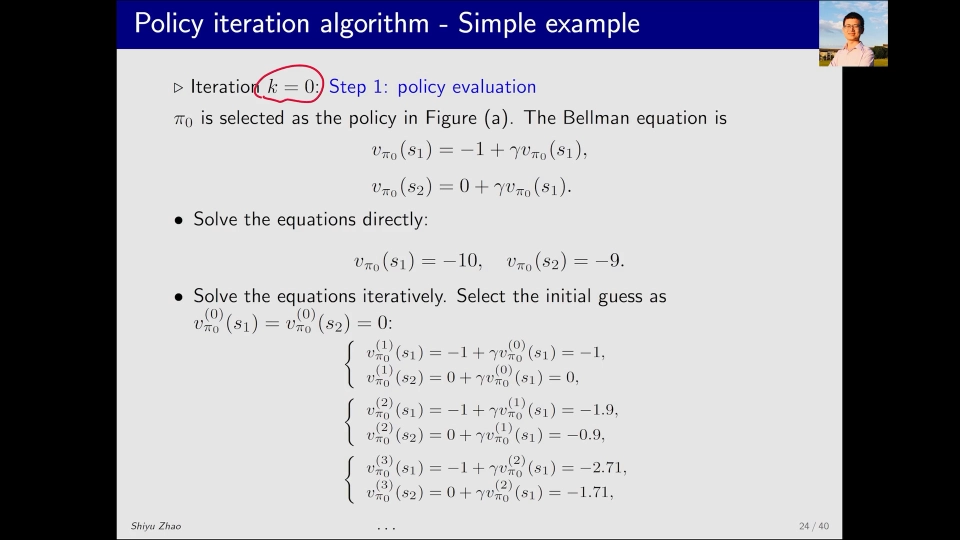

[【跳转到 09:40】](https://www.bilibili.com/video/BV1at4y1P7P4/?t=580)

### 4.3 用 `V_{π₀}` 算 `q_{π₀}`，再取最大得到 `π₁`

下面要计算的实际上就是 `q_{π₀}`。`q_{π_k}` 和 `V_{π_k}` 有这样的关系，也就是我给出 `V_{π_k}` 就一定能求出 `q_{π_k}`。刚才 `V_{π₀}` 不是已经求出来了吗？把它具体的值代入这个式子，也就是代入这个表格里，就可以得到具体的 `q_{π₀}` 是多少。

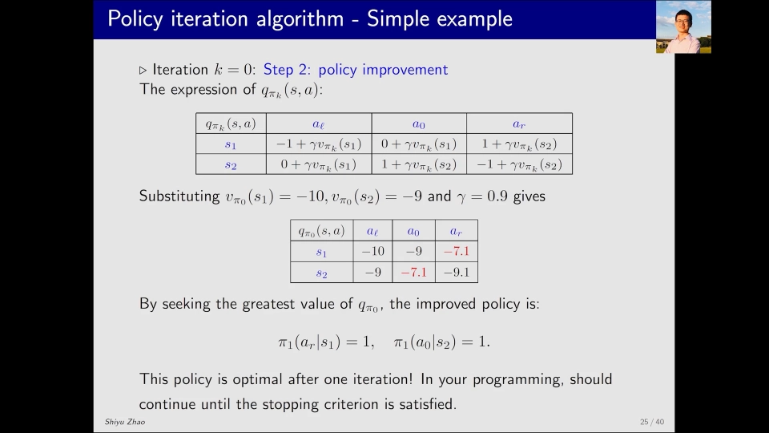

[【跳转到 10:05】](https://www.bilibili.com/video/BV1at4y1P7P4/?t=605)

那下一个策略 `π₁` 是什么呢？很简单，看表格里哪个 `q_{π₀}` 最大——左边格子这一行里 `a_r` 那个最大，所以在 `s₁` 时我选 `a_r`；右边格子这一行里 `a_0` 那个最大，所以在 `s₂` 时选 `a_0`。于是就得到了这样一个新策略。

[【跳转到 10:30】](https://www.bilibili.com/video/BV1at4y1P7P4/?t=630)

如果把这个策略画出来，会发现这个新策略**已经是最优了**：在 `s₁` 时它往右走，在 `s₂` 时它保持不动。不过这个问题非常简单，**一个 iteration 就能得到最优策略**；问题比较复杂时就需要多个 iteration。

---

## 五、例二：5×5 网格，观察策略是怎么"从近到远"变好的

### 5.1 设定与整体过程

下面再看一个更复杂的例子，通过这个例子看看能有什么有意思的发现：对一个 **5×5 的网格**求最优策略。

这些图绘制的是：从最开始随便给的策略 `π₀` 开始，计算出来 `V_{π₀}`，再做策略改进得到 `π₁`，这样一直下去，直到最后的 `π₁₀` 和 `V_{π₁₀}`。

可以看到中间过程里这些策略都是不好的，有的状态的策略乱七八糟；到最后 `π₁₀` 的时候已经得到了最终的策略——**从任何一点出发都能够到达目标区域**。

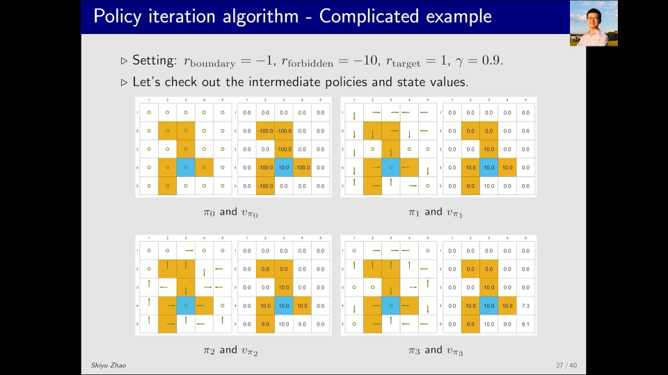

[【跳转到 11:45】](https://www.bilibili.com/video/BV1at4y1P7P4/?t=705)

为什么从某些点出发**不会穿过禁区（forbidden area）**到达目标区域呢？回到这个例子的设定：禁区是 `-10`，也就是进入禁区会有比较大的惩罚，所以策略会主动避开它。

### 5.2 有意思的现象：靠近目标的状态先变好

在这个过程中有一个非常有意思的现象：

- `π₀` 实际上是不好的策略，因为**每一个状态它都会保持原地不动**；
- `π₁` 呢，其实很多状态的策略也都是不好的，但注意看这几个状态的策略：从 `π₁` 到 `π₂`，有一个状态的策略变好了——它原本是向右（离目标更远），现在变成向左，能够到达目标区域；
- 从 `π₂` 到 `π₃`，又一个状态的策略变好了——它原本是向上，现在变成向左，能够到达目标区域；
- 再往下就会发现，慢慢地这些都变好了，到了 `π₅` 时这些也变好了；
- 直到 `π₉` 时，基本上比较近的这些状态的策略都已经变好了，**只有比较远的这些状态还没变好**。

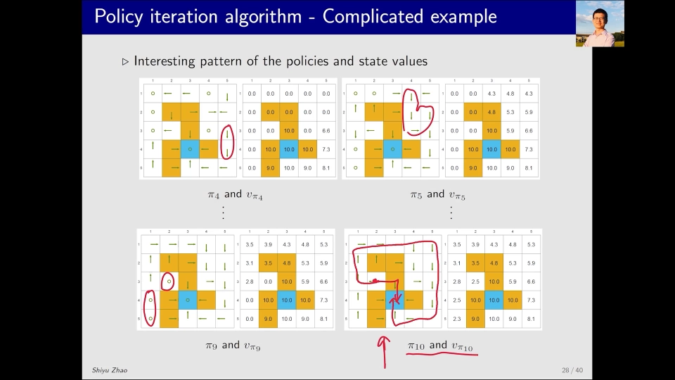

[【跳转到 13:25】](https://www.bilibili.com/video/BV1at4y1P7P4/?t=805)

**规律就是：接近目标的状态，它的策略会先变好；远离目标的状态，它的策略会后变好。** 策略的"正确性"像波纹一样，一圈一圈从目标向外扩散。

### 5.3 为什么会这样：贪心动作依赖别人的策略

数据上我们已经清楚了，因为数学公式都非常清晰。直观上来说，原因在于：

我在某一个状态选择它的**贪心动作（greedy action）**——也就是对应最大**动作价值（action value）**的那个动作时，**严重依赖于其他状态的值/策略**。

- 如果其他状态的策略不好、乱七八糟，那我这时候虽然选一个最大的动作价值，那个动作**也可能没有意义**——因为走一步之后就掉进一个烂策略里了；
- 但如果其他状态有能够到达目标区域的策略，那么很显然，我选择到那个状态，我也能达到目标、能够得到正的奖励（reward），所以我这时候的贪心动作就是最优的。

总而言之：**当这个状态周围没有能到达目标区域的状态时，它也不会到达目标区域；当周围有能到达目标区域的状态时，它新的策略也能到达目标区域。**

[【跳转到 13:50】](https://www.bilibili.com/video/BV1at4y1P7P4/?t=830)

这就是为什么"好消息"必须从目标一格一格往外传——每一轮迭代，正确的策略只能向外推进一格。这也从侧面说明了：状态数量越多、离目标越远，需要的外层迭代次数就越多。

---

## 小结

- **策略迭代 = 策略评估 + 策略改进，循环执行**。评估是"给定 `π_k` 解贝尔曼公式得到 `V_{π_k}`"，改进是"在 `V_{π_k}` 上对每个状态取 `argmax_a q_{π_k}(s,a)` 得到 `π_{k+1}`"。
- **初始策略可以任意**，哪怕很差也没关系，迭代会把它改好。
- **改进是有保证的**：`V_{π_{k+1}} ≥ V_{π_k}`，所以叫 improvement；且 `k → ∞` 时 `V_{π_k}` 收敛到最优状态价值 `V*`，策略收敛到最优策略 `π*`。
- **评估本身是个迭代算法**，于是策略迭代是"大迭代套小迭代"；内层跑到完全收敛 = 策略迭代，内层只跑一步 = 价值迭代，二者是一个更一般算法（GPI）的两个极端。
- **逐元素实现**很直接：评估用 `Σ_a π(a|s) Σ_{s'} p(s'|s,a)[r + γV(s')]` 反复更新；改进用同一个括号（即 `q_{π_k}`）取最大。
- **两个实验**：两格例子一次迭代就到最优；5×5 例子显示"靠近目标的状态先变好、远离目标的后变好"，因为贪心动作的价值依赖其他状态是否已经能到达目标。

## 关键术语速查

| 术语 | 一句话解释 |
| --- | --- |
| 策略评估（policy evaluation） | 给定策略 `π_k`，解贝尔曼公式得到状态价值 `V_{π_k}` |
| 策略改进（policy improvement） | 用 `V_{π_k}` 算出 `q_{π_k}(s,a)`，每个状态取最大者作为新策略 `π_{k+1}` |
| 状态价值（state value）`V_π(s)` | 从状态 `s` 出发、按策略 `π` 走能拿到的折扣回报期望 |
| 动作价值（action value）`q_π(s,a)` | 在状态 `s` 先做动作 `a`、之后按 `π` 走的折扣回报期望 |
| 贪心动作（greedy action） | 当前状态下动作价值最大的那个动作 |
| 闭式解（closed form solution） | 直接矩阵求逆 `V = (I − γP)^{-1} r` 解贝尔曼公式，状态多时不可行 |
| 迭代解（iterative solution） | 给初值反复套贝尔曼公式直到收敛，实际常用 |
| 最优状态价值 `V*` | 贝尔曼最优公式的解，是所有策略中能达到的最大状态价值 |
| 广义策略迭代（GPI） | 把"评估"和"改进"以任意粒度交替的一般框架，策略迭代与价值迭代是它的两个极端 |