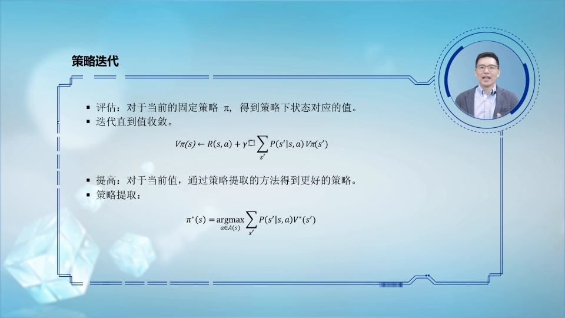
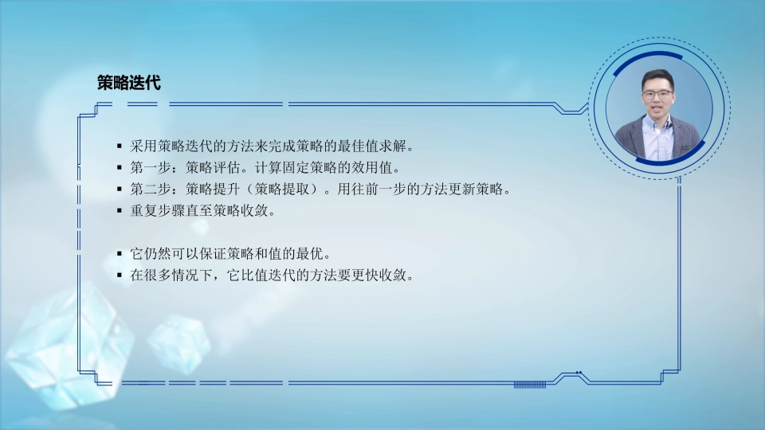
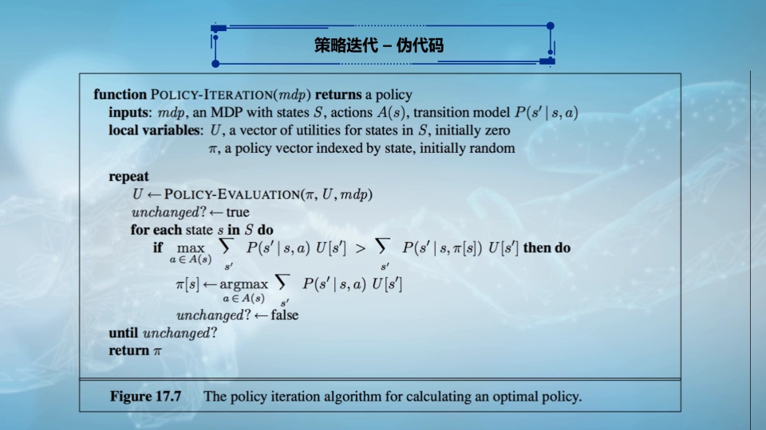
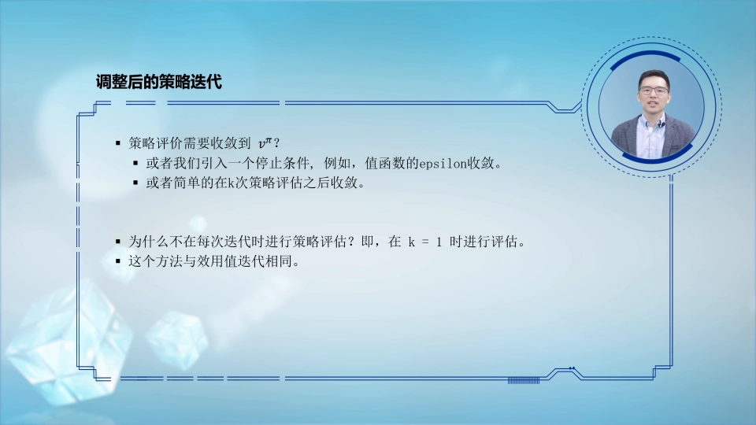
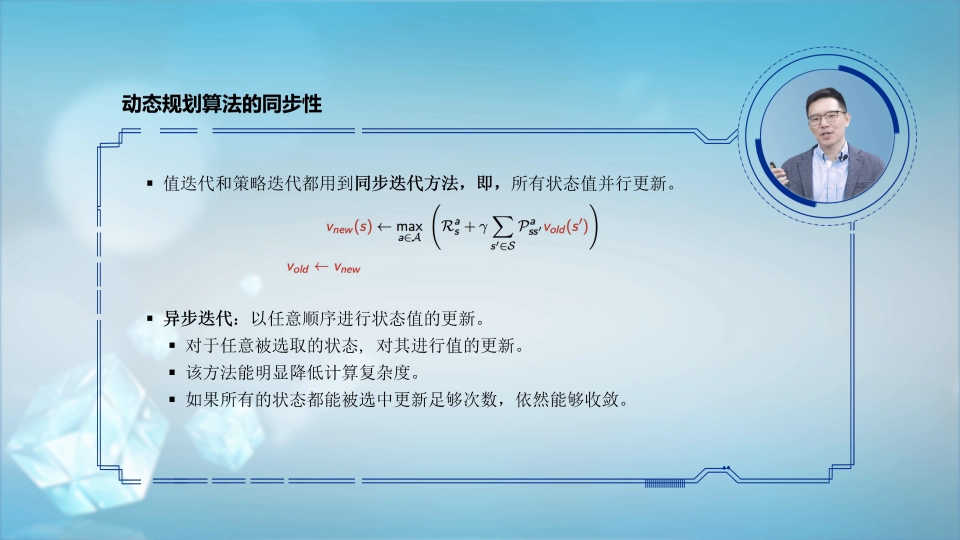

# 第7讲：马尔可夫模型的策略迭代——评估与提升交替，直到策略不再改变

> 本篇整理自视频《强化学习-第七讲-马尔可夫模型的策略迭代》。视频地址：[BV1DN4y137zg](https://www.bilibili.com/video/BV1DN4y137zg/)。

## 本讲要解决的核心问题（SCQA）

**背景**：在马尔可夫决策过程（Markov Decision Process, MDP）里，只要**固定一套策略**——也就是在每个状态下预先规定好要采取哪个动作——我们就能用贝尔曼迭代公式，为每个状态算出一个收敛的**期望累计回报**（也叫效用值、状态值）。这一步叫**策略评估（policy evaluation）**。

**冲突**：可是这套策略是我们随手预设的，它算出来的效用值显然**不是最优的效用值**，这套动作也**不是最优策略**。评估只告诉我们"当前这套策略有多好"，并不能告诉我们"怎么才能更好"。

**疑问**：既然"固定策略"的思路能算出一个收敛的值，能不能在这套值的基础上，把策略一步步改到最优？

**回答（中心思想）**：能，这就是**策略迭代（policy iteration）**。它把"固定策略求值"和"按值改策略"拆成两步——**策略评估**与**策略提升（policy improvement）**——然后让这两步**交替循环**：评估到收敛 → 按当前值贪心地换一套更好的动作 → 再评估新策略 → 再提升……**直到策略不再被替换为止**，此时策略收敛，就是最优策略。实际应用中它比价值迭代收敛得更快。


---

## 一、策略评估：先给"够不够好"一个可计算的答案

### 1.1 什么是"固定一套策略"

一套策略，就是在**每个状态下要采取什么动作**，我们先预设好。比如一个机器人在走廊里，我们可以规定"在位置 1 就往右走、在位置 2 就往左走"，这就是一套完整的策略。

固定策略之后，环境就退化成一个"没有选择余地"的马尔可夫链：每个状态只有一个确定的下一步。这时就能算：**从某个状态出发，一直按这套策略走下去，能拿到多少期望累计回报**。

### 1.2 策略评估在算什么

**策略评估**就是：给定一套策略，看它够不够好；够不够好，取决于它能为状态带来的期望累计回报是高还是低。

计算方法就是反复套用贝尔曼迭代公式，直到数值收敛：

```
V_π(s) ← R(s, π(s)) + γ · Σ_{s'} P(s' | s, π(s)) · V_π(s')
```

读法：状态 `s` 的价值 = 当前按策略选定的那个动作带来的即时回报 `R`，加上"由状态转移到达的下一个状态 `s'` 返回来的期望累计回报"的加权平均，最后用折扣因子 `γ` 对整个未来部分做衰减。

经过这一轮贝尔曼迭代，我们可以为每个状态找到一个**收敛的效用值**。



[【跳转到 04:05】](https://www.bilibili.com/video/BV1DN4y137zg/?t=245)

### 1.3 评估的局限：它只回答"多好"，不回答"怎么更好"

但显然这个效用值**不是最佳的效用值**，我们一开始找的这套动作或策略也**不是最佳策略**。

打个比方：策略评估像给一个学生的现有学习方法打分——它能告诉你"用这套方法大概能考 70 分"，但不会告诉你"该改哪一步才能考 90 分"。要拿到 90 分，必须**改方法**，而不是反复给同一套方法打分。

于是问题变成：怎样基于"固定策略"的思想，为每个状态找到**最佳动作**以及**最佳效用值**？

---

## 二、策略迭代：评估与提升两步交替，直到策略不再改变

### 2.1 基本思想：先预设一套策略，然后分两步走

策略迭代的基本思想是：首先为每个状态先找到一个固定的动作，也就是为这个 MDP 问题**先预设一个策略**。在这个基础上，分两步走：

1. **第一步：策略评估。** 在给定某个策略之后，计算这个策略能为每一个状态带来的最好的期望累计回报是多少，等到每个状态对应的期望累计回报**收敛**。
2. **第二步：策略提升。** 在当前这套期望累计回报值的设定下，看每个状态对应的**最佳动作**是什么，把原本的策略替换成当前状态下最好的那套策略。


[【跳转到 01:35】](https://www.bilibili.com/video/BV1DN4y137zg/?t=95)

### 2.2 策略提升：其实就是"策略提取"

策略提升的意思是：在当前期望累计回报值的设定下，每个状态对应的最佳动作是什么。

它的整个计算方法和前面讲过的**策略提取（policy extraction）**是一样的：**看每个状态对应的所有动作返回来的期望累计回报分别是多少，挑最大的那个值所对应的动作**，把原本的策略替换成当前状态下最好的那套策略。

用公式写出来，就是先算"在状态 `s` 做动作 `a`、之后按旧策略走"的动作价值，再对所有动作取最大值：

```
Q(s, a) = R(s, a) + γ · Σ_{s'} P(s' | s, a) · V_π(s')

π_new(s) = argmax_a  Q(s, a)
```

注意这里的关键差别：策略评估是**按 π 求期望**（老老实实跟随当前策略），策略提升是**对动作取 max**（在所有动作里挑最好的）。一个"跟随"，一个"贪心"，这是后面所有动态规划方法的共同骨架。

[【跳转到 02:00】](https://www.bilibili.com/video/BV1DN4y137zg/?t=120)

### 2.3 交替进行：一个自我改进的循环

第一步策略评估、第二步策略提升，二者可以**交替进行**：

- 换了一个策略之后，**回到第一步**，在当前新策略下继续计算这套策略能为不同状态带来多好的期望累计回报；
- 等它收敛了，**再回到第二步**，在目前这套状态效用值上计算每个状态对应的最佳动作，完成又一次策略提升；
- 如此往复。

直到这两步走到某个位置，**我们的策略不再被替换了**，那就说明策略收敛了、已经找到最佳策略，整个过程就可以停止。



[【跳转到 03:40】](https://www.bilibili.com/video/BV1DN4y137zg/?t=220)

用一句话概括这个循环：

```
π₀ --评估--> V_π₀ --提升--> π₁ --评估--> V_π₁ --提升--> π₂ --> ... --> π*
                                                                  (策略不再改变时停下)
```

使用策略迭代，我们可以为 MDP 问题找到每个状态对应的**最佳期望累计回报值**，同时也能找到每个状态对应的**最佳动作**；而且在实际应用中，它比价值迭代收敛得更快。

### 2.4 策略提升的公式形式

把两步写成公式，就更清楚了。

**第一步，策略评估**：固定某套策略 `π`，在这套策略下为每个状态找到它的期望回报——当前状态采取这个固定动作的即时回报 `R(s,a)`，加上由状态转移到达的下一个状态返回来的期望累计回报的加权平均，再用 `γ` 对整个值做衰减：

```
V_π(s) = R(s, π(s)) + γ · Σ_{s'} P(s' | s, π(s)) · V_π(s')
```

**第二步，策略提升**：在给定 `V_π(s)` 的情况下，看目前的效用值能算出的每个状态对应的最佳动作是什么——新策略就是在所有动作里选那个能返回最佳期望累计回报的，也就是对动作 `a` 取 `argmax`：

```
π_new(s) = argmax_a [ R(s, a) + γ · Σ_{s'} P(s' | s, a) · V_π(s') ]
```

找到这个 `π_new` 之后，我们又回到"通过迭代方法计算当前策略能给状态带来多大的期望累计回报"这一步。

[【跳转到 04:30】](https://www.bilibili.com/video/BV1DN4y137zg/?t=270)

---

## 三、伪代码：策略迭代在程序里长什么样

### 3.1 函数签名与局部变量

策略迭代函数以**马尔可夫决策过程**为参数。MDP 里有五元组——状态空间、动作空间、状态转移模型、奖励模型，还有一个预先设定的 `γ` 作为超参数。

局部变量有两个：

- 一个 `u` 向量，它表示每个状态对应的 `V` 值是多少，**初始化为零**；
- 一个 `π`，它指当前要评估的策略是什么，**最开始是随机初始化的**。



[【跳转到 05:13】](https://www.bilibili.com/video/BV1DN4y137zg/?t=313)

### 3.2 大循环里的两件事

接下来是一个大的循环。循环一开始，执行**策略评估**——看当前这个策略能为不同状态带来多少期望累计回报，用策略评估的贝尔曼迭代公式完成整个计算。

评估完成后做**策略提升**。这里用一个局部布尔变量 `unchanged` 来监控当前策略是否收敛，最开始把它初始化成"策略没有发生变化"。

[【跳转到 05:38】](https://www.bilibili.com/video/BV1DN4y137zg/?t=338)

然后对每个状态，看当前状态所选择的最佳动作与我们目前设定的动作是否一样：

- 如果目前设定的动作对应出来的期望累计回报值**小于**当前状态下能取到的最大期望累计回报值，就说明这个策略要被替换——用策略提升（策略提取）的公式替换策略，同时把 `unchanged` 设成 `false`，表示已经发生了变化；
- 如果所有状态都没有发生替换，`unchanged` 保持 `true`。

所有状态遍历完之后，再看目前的策略有没有发生变化：**如果发生了变化，就继续执行策略评估和策略提升这样的轮回；如果策略不再变化，就说明策略收敛了，可以把当前策略返回。**

整理成伪代码：

```
function POLICY_ITERATION(mdp, γ):
    u ← 全零向量            # 每个状态的 V 值
    π ← 随机策略            # 当前要评估的策略

    loop:
        u ← POLICY_EVALUATION(π, u, γ)      # 第一步：评估到收敛
        unchanged ← true                     # 先假定策略不变
        for each state s:
            best_action ← argmax_a [ R(s,a) + γ Σ_{s'} P(s'|s,a) u(s') ]
            if best_action ≠ π(s):
                π(s) ← best_action           # 第二步：策略提升
                unchanged ← false            # 记录"发生了变化"
        if unchanged:
            return π                         # 策略不再变化 → 收敛
```

[【跳转到 06:28】](https://www.bilibili.com/video/BV1DN4y137zg/?t=388)

---

## 四、两个细节：评估要不要做到完全收敛

在刚才那段伪代码里，实际上有几个细节问题需要考量。核心问题是：**策略评估那一步，有没有必要让每一次评估都做到完全收敛？**

答案是没有必要。因为整体还有一个策略提升的部分，而我们最后要找的是一个**最佳的策略**；某一个策略的评估是否到完全收敛的位置，对整体是没有影响的——评估做得糙一点，提升后的策略可能只是"少改对几个状态"，下一轮还会继续改。

于是就有了两个极端：

### 4.1 极端一：评估做到完全收敛（标准策略迭代）

这是最"老实"的做法，也是伪代码里写的做法：每次评估都迭代到 `V` 值不再变化。

[【跳转到 07:40】](https://www.bilibili.com/video/BV1DN4y137zg/?t=460)

但在实际操作里，我们往往会把收敛条件设置得**比价值迭代更宽松**一点，比如：

- 限定一个迭代次数，可能是五次或十次；
- 同时，能容忍的两次迭代之间 `V` 值的差值也可以设得更大一点。

### 4.2 极端二：每评估一次就提升一次（退化成价值迭代）

第二个极端是：如果我们的策略评估每进行一次就进行策略替换，这样的思路是不是更好呢？

想一想会带来什么结果：经过策略替换得到当前状态下能找到的最佳动作，然后基于这个最佳动作来进行策略评估；接着再去找经过策略评估、对策略对应的值进行提升之后的最佳策略，再基于这个最佳策略进行一次策略评估……

**它的整个过程实际上和价值迭代是一样的。** 因为价值迭代做的就是我每一次都去找每个状态对应的最佳动作，把它返回来的值更新成我们的位置，接着在下一轮又去找在更新后的位置下最佳的动作是什么，再用这个最佳动作对应的值来更新。

所以结论是：**如果策略评估只进行一步，那么策略迭代和价值迭代就变成两个等价的方法。**



[【跳转到 08:30】](https://www.bilibili.com/video/BV1DN4y137zg/?t=510)

这个观察很有价值：它说明**策略迭代和价值迭代不是两种互不相干的方法，而是同一个谱系的两端**——评估做得越彻底，越像策略迭代；评估做得越敷衍，越像价值迭代。中间那些"评估做三五次就提升"的折中做法，就是本系列后面要讲的**广义策略迭代（Generalized Policy Iteration, GPI）**的基本思路。

---

## 五、再看基础属性：同步更新与异步更新

最后再看一下策略迭代和价值迭代这两种方法的一些基础属性。

### 5.1 它们都是动态规划方法，都维护"两个时间片"

如之前所说，策略迭代也好、价值迭代也好，**都是动态规划方法的一种**。

在价值迭代的伪代码里我们知道，局部参数中有两个向量：一个表示更新之前每个状态对应的值，另一个表示迭代之后每个状态对应的值。在迭代过程中，**迭代之后的向量里每个状态的 `V` 值，它的计算来源都是从迭代之前那个向量里状态的 `V` 值来计算的**。

比如要计算 `s₃` 在迭代之后的值并对它更新，而 `s₃` 与 `s₁`、`s₂`、`s₃` 相关，那么这时候 `s₁` 和 `s₂` 的值会从**迭代之前**的向量里取，而不是用刚刚更新过的 `s₃`。

[【跳转到 10:24】](https://www.bilibili.com/video/BV1DN4y137zg/?t=624)

这相当于我们同时维护了两个时间片的两套价值表。这样的方法我们称之为**同步更新（synchronous update）**：在 `t+1` 时刻所有状态的值更新次数都是一样的，在 `t` 时刻所有状态的值更新次数也是一样的。

### 5.2 同步更新的效率问题

同步更新在实际使用中并没有达到最佳的计算效率。因为可以想见，**有些状态的值更新频率会更快**，或者说某些状态的值在某些时间片会比其它时间片更新得更快。

但同步更新的方法没法把这种"更新快慢"考虑进来——因为在某个时间片下所有状态的更新次数都是一样的，`s₁` 即使早就收敛了，也还得跟着一起重算。

[【跳转到 11:14】](https://www.bilibili.com/video/BV1DN4y137zg/?t=674)

### 5.3 异步更新：只存一份，各状态更新次数可以不同

于是就有了与同步更新相对应的另一种方法——**异步更新（asynchronous update）**。

异步更新允许在某个时间片下（或者说此时就没有时间片的概念了）**只保存一个向量**，在这个向量里，各状态 `V` 值的更新次数可以互不相同：有的更新次数更多，有的更少。

换句话说，异步更新是**就地更新（in-place）**：算完 `s₃` 的新值直接写回去，接下来算 `s₄` 时就能用上刚刚更新过的 `s₃`。信息传播得更快，收敛也就更快。

所以在很多实际操作中我们会采用异步更新，因为它会让整体迭代收敛的速度更快一点。当然它也带来了一些问题，比如会对**全局收敛性**产生一些影响。同步更新和异步更新的对比是一个扩展课题，有兴趣可以课外补充资料。



[【跳转到 12:04】](https://www.bilibili.com/video/BV1DN4y137zg/?t=724)

---

## 小结

- **策略评估**只回答"这套固定策略有多好"：固定 `π`，用贝尔曼迭代求出每个状态收敛的期望累计回报 `V_π(s)`；但它给出的既不是最优值，也不是最优策略。
- **策略迭代**把"求值"和"改策略"拆成两步并交替执行：**策略评估**（按 `π` 求期望）→ **策略提升**（对动作取 `argmax`，等价于策略提取）→ 再评估 → 再提升。
- **停止条件**是策略不再被替换：所有状态下 `argmax` 选出的动作都与当前策略一致，说明策略收敛，返回当前策略即最优策略。实际应用中策略迭代比价值迭代收敛更快。
- **评估不必做到完全收敛**：收敛条件可以比价值迭代更宽松（限定 5~10 次迭代、容忍更大的 `V` 差值），因为最终目标是最优策略，个别策略评估得糙一点不影响大局。
- **两个极端**：评估做到完全收敛 = 标准策略迭代；每评估一步就提升一次 = 价值迭代。两者是同一个谱系的两端。
- **同步更新 vs 异步更新**：同步更新维护更新前/更新后两套价值，所有状态更新次数一致；异步更新只存一份、就地更新，各状态更新次数可不同，收敛更快但会影响全局收敛性。

## 关键术语速查

| 术语 | 一句话解释 |
| --- | --- |
| 策略（policy）`π` | 在每个状态下规定要采取哪个动作的规则 |
| 策略评估（policy evaluation） | 给定策略 `π`，迭代求解贝尔曼公式得到 `V_π(s)` |
| 期望累计回报 / 效用值 | 从某状态出发按策略走下去能拿到的折扣累积奖励的期望 |
| 策略提升（policy improvement） | 在 `V_π` 上对每个状态的所有动作取 `argmax`，得到一套更好的策略 |
| 策略提取（policy extraction） | 从价值函数反推出贪心策略的操作，策略提升用的就是它 |
| 策略迭代（policy iteration） | 策略评估与策略提升交替执行，直到策略不再变化的算法 |
| 价值迭代（value iteration） | 每轮只做一步"取最大 + 更新值"，等价于评估只做一步的策略迭代 |
| 同步更新（synchronous update） | 用更新前的整份价值表计算更新后的整份价值表，所有状态更新次数一致 |
| 异步更新（asynchronous update） | 只存一份价值表、就地更新，各状态更新次数可以不同，通常收敛更快 |