# 价值迭代求解 MDP：从贝尔曼最优方程到「营救公主」与「出租车路网」两个算例

> 本篇整理自 B 站 UP 主的强化学习系列视频「价值迭代算法求解马尔可夫决策过程（MDP）」。视频地址：[BV18A411P7Lj](https://www.bilibili.com/video/BV18A411P7Lj/)。

## 本讲要解决的核心问题（SCQA）

**背景**：马尔可夫决策过程（MDP）的五要素已经定义清楚了——状态 $s$、动作 $a$、奖励 $r$、转移概率、折扣因子 $\gamma$。策略 $\pi(a \mid s)$ 是"在某个状态下选择各个动作的概率分布"，状态价值 $V(s)$ 是"从 $s$ 出发往后所有奖励的折扣和"。强化学习的目标，就是找到**最优策略**。

**冲突**：目标好说，但**怎么算**？贝尔曼最优方程把 $V(s)$ 和下一状态的 $V(s')$ 绑在一起，是一个"自己依赖自己"的方程；状态一多，靠手算或解方程都不现实。

**疑问**：给定一个具体的 MDP，有没有一套**能一步步执行**的流程，把最优状态价值和最优策略真的算出来？

**回答（中心思想）**：有，就是**价值迭代（Value Iteration）**。它只有三步：**① 把每个状态的价值初始化为 0；② 反复用 $V(s) \leftarrow \max_a [\, r + \gamma \cdot V(s') \,]$ 更新，每次都取"即时奖励 + 下一状态价值"的最大值；③ 直到价值不再变化（收敛），输出最优状态价值与最优策略。** 本讲用两个算例把它走了一遍：3×3 的「营救公主」和 6 结点的「出租车路网」。

---

## 一、先分清三件事：策略、最优策略、最优状态价值

价值迭代的连贯性很强，先把三个容易混淆的概念摆清楚。

### 1.1 策略 $\pi$ 是"动作上的一个概率分布"

策略的符号是 $\pi$，数学上写作 $\pi(a \mid s)$——**在当前状态 $s$ 下选择动作 $a$ 的可能性**。

用一个棋盘来直观理解：当前所处状态是黄色落子，黑色子是障碍。站在这个格子上，智能体（agent）可以往前走、往上走、往下走、往左走、往右走。但**往哪个方向走的可能性并不相同**——比如四种走法的概率分别是 20%、20%、40%、20%。这组百分比，就构成了当前状态对应的策略。

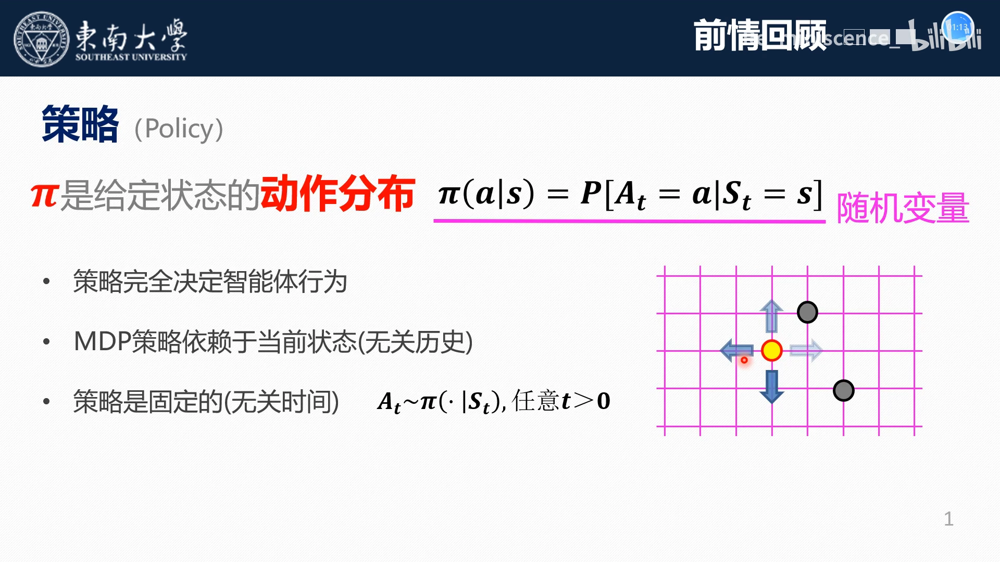

关键点：**策略与智能体当前所处的状态绑定**。棋子移动到另一个位置，策略也就随之改变。策略完全决定了智能体的行为方式。

### 1.2 最优策略是"一条完整的动作链"

策略和最优策略不是一回事：

- **策略**是一个动作分布，体现的是**无限的可能**——同一状态下有无穷多种概率分配方式；
- **最优策略**是在策略的基础上**坍缩成一条完整的动作链**，这条动作链能实现我们所期望的**状态值函数最大**、收益最大。

为什么说最优策略"一定是有限个"？以「营救公主」为例：王子可以反复横跳、可以绕圈跑，一直消耗体力却不去找公主——这些都是合法的策略，数量无限；但**以最小体力损耗找到公主**的那种走法，一定只有有限几种。

[【跳转到 04:32】](https://www.bilibili.com/video/BV18A411P7Lj/?t=272)

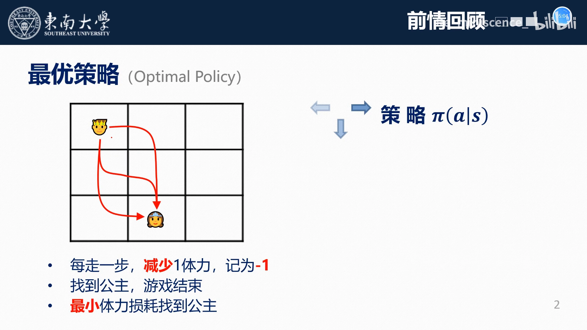

### 1.3 最优状态价值 $V(s)$ 衡量"站在这里有多好"

在最优策略下，每个状态会对应一个**最优状态价值**——它一定是最大的，因为对应的策略是最好的。

$V(s)$ 的定义是：**从状态 $s$ 起，往后所有状态（$s'$、$s''$……）的奖励的折扣和**，用来衡量状态 $s$ 的综合价值。每个位置都有一个 $V(s)$，数值各不相同，于是可以用 $V(s)$ 来衡量每个状态的综合好坏。

注意用词：不带"最优"二字的 $V(s)$，是**某个给定策略下**的状态价值（综合衡量）；带"最优"二字的，才是最优状态价值。

---

## 二、价值迭代要用的方程：贝尔曼最优方程

价值迭代主要就是围绕**状态价值函数的贝尔曼最优方程**展开的。它体现的是 $V(s)$ 和 $V(s')$ 之间的关系：

$$
V(s) = \max_a [\, r + \gamma \cdot V(s') \,]
$$

逐项看：

- $r$：由状态 $s$ 转到状态 $s'$ 所产生的一个**即时收益**（这个动作带来的即时奖励）；
- $V(s')$：**下一状态**的状态价值；
- $\gamma$：折扣因子，控制未来收益的权重；
- $\max_a$：在所有可选动作里**取最大**。

所以这句话可以读成：**一个状态的价值，等于"走一步的即时收益 + 折扣后的下一状态价值"在所有动作中的最大值**。价值迭代的全部工作，就是**不断地取这个 max**。

[【跳转到 07:50】](https://www.bilibili.com/video/BV18A411P7Lj/?t=470)

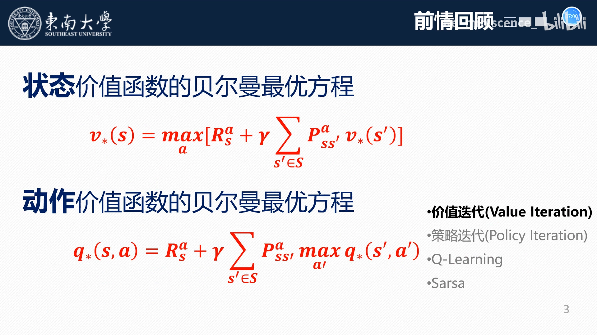

---

## 三、算法的三步：初始化 → 循环取 max → 收敛输出

价值迭代的流程可以概括成三句话。

### 3.1 第一步：初始化

对**每一个状态** $s$，把它的价值函数初始化为 0——即 $V(s_1) = V(s_2) = V(s_3) = \dots = 0$。终端（terminal）状态也保持 0。

### 3.2 第二步：重复循环，取 max

对每个 $V(s)$ 做一次赋值：

$$
V(s) \leftarrow \max_a [\, r + \gamma \cdot V(s') \,]
$$

括号里是"下一状态的状态值 + 这个动作带来的奖励"，对所有动作取最大，把最大的那个赋给 $V(s)$。

### 3.3 第三步：判断收敛，输出

什么时候停？当 $V(s)$ 与**更新之前**的那个 $V(s)$ 差别不大——**小于一个给定的正实数**时，就认为迭代完成了，输出最优解（最优状态价值与最优策略）。

[【跳转到 08:15】](https://www.bilibili.com/video/BV18A411P7Lj/?t=495)

写成伪代码：

```
输入：MDP 的转移关系与奖励 r、折扣因子 γ、收敛阈值 ε
# 第一步：初始化
for 每个状态 s:
    V(s) ← 0

# 第二步与第三步：循环 + 收敛判断
repeat
    for 每个状态 s:
        V_old(s) ← V(s)
        V(s) ← max_a [ r(s,a) + γ · V(s′) ]
until  max_s | V(s) − V_old(s) | < ε

输出：V(s)（最优状态价值），以及每个状态下取到 max 的那个动作（最优策略）
```

[【跳转到 09:18】](https://www.bilibili.com/video/BV18A411P7Lj/?t=558)

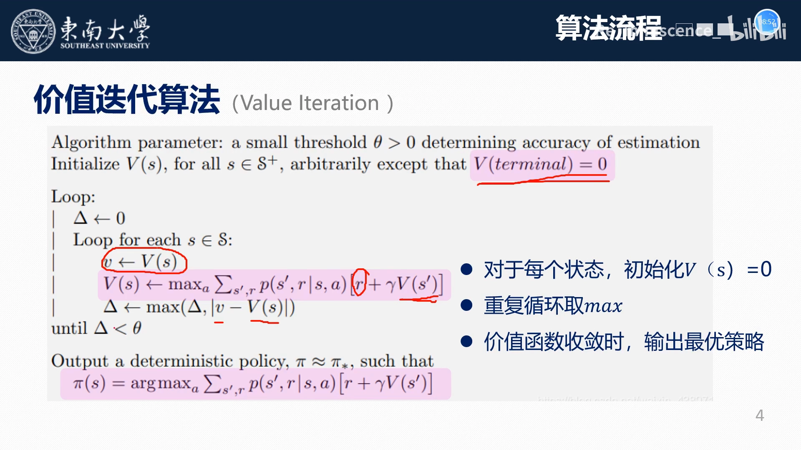

---

## 四、算例一：营救公主（$\gamma = 1$）

### 4.1 情景

给一个 3×3 的格子，公主在一个位置，王子在另一个位置。

- 王子**每走一步就减少一点体力**，记为 −1——这个 −1 就是**收益（reward）**；
- **找到公主，游戏结束**。公主是最后一个状态，它之后没有下一状态：只能有状态指向公主，不能由公主指出来；
- 目标：**以最小的体力损耗找到公主**。

把它抽象成 MDP：

| MDP 要素 | 在本例中对应什么 |
| --- | --- |
| 状态 $s$ | 王子所在的格子位置 |
| 动作 $a$ | 向上、向下、向左、向右走一格（不能斜着走） |
| 奖励 $r$ | 每走一步体力损耗 1，记为 $r = -1$ |
| 折扣因子 $\gamma$ | 取 1，即未来的收益与当前的收益等权重，不随时间衰减 |
| 终止状态 | 公主所在格子，$V = 0$，没有动作指出 |

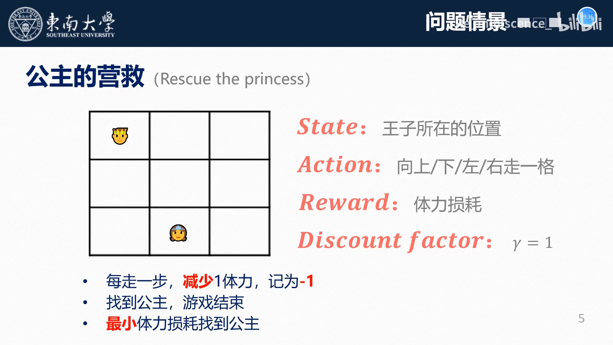

### 4.2 第一次迭代：全零起步

第一步，把所有状态的 $V(s)$ 初始化为 0。

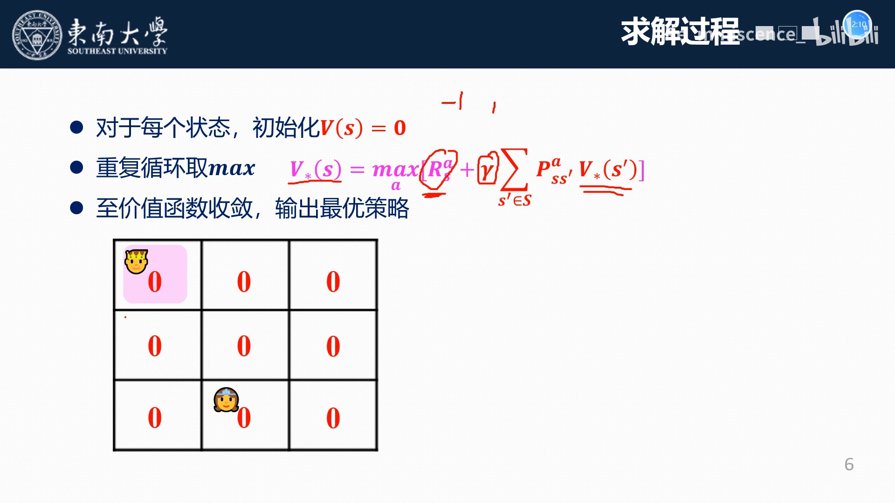

第二步开始取 max。以王子当前所在位置为例：它的**下一状态**是周围几个浅蓝色的格子，可以通过"向右走一格"或"向下走一格"到达。

- 向右走：$-1 + V(s') = -1 + 0 = -1$
- 向下走：$-1 + V(s') = -1 + 0 = -1$

两个候选都是 −1，取最大还是 −1，于是把 −1 赋给这个位置。

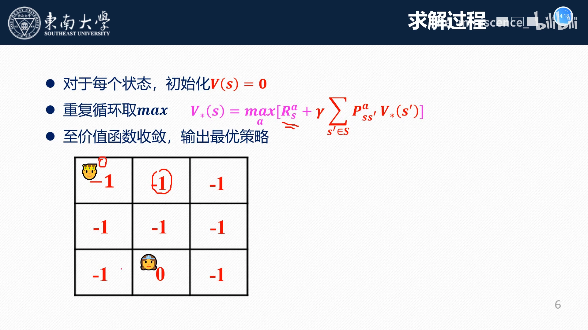

中间位置同理：它可往下、往右、往左走，每走一次 `reward` 都是 −1，加上下一状态的价值 0，候选都是 −1，取最大仍是 −1。

**公主所在格子特殊**：走到公主就结束了，公主没有下一状态、没有动作指出，所以它**保留初始值 0**。

其余八个状态都用相同方式逐个算一遍，就得到第一次迭代的完整结果。

### 4.3 第二次、第三次迭代：数值开始分层

基于第一次的结果再做一次迭代，数值就不再全是 −1 了——离公主近的格子数值更好（−1），离得远的更差（−2）。

文稿在这里用一组具体候选值说明了"取最大"的作用：某个位置可以往上、往右、往左、往下走，其中绕远的方向算出来是 $-2$，而朝目标方向的那一步是 $-1$；在 $-1$、$-2$、$-2$、$-2$ 里取最大，取到 $-1$，于是把它赋给这个位置。

[【跳转到 14:23】](https://www.bilibili.com/video/BV18A411P7Lj/?t=863)

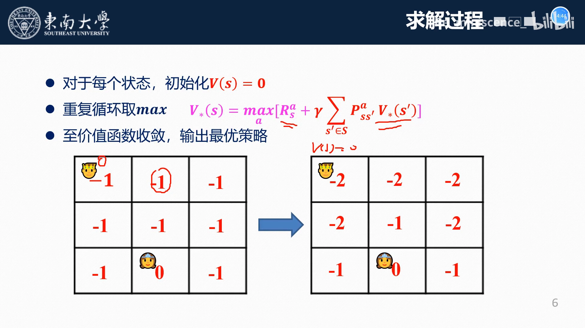

### 4.4 收敛：再迭代就不变了

继续迭代，当**两次迭代的结果完全一样、不再变化**时，就说明达到了收敛状态，可以输出最优策略了。

收敛后每个格子的数值，就是"从这个位置出发走到公主的**最小体力损耗**"，也就是**最优状态价值**。因为每步记 −1，所以数值是负的，绝对值就等于最少步数：相邻格 −1、两格 −2、三格 −3，公主所在位置一步都不用走（值为 0）。

这也解释了为什么"最优"是有限个：王子可以走上 1 万步、1000 步，但**最优的一定是有限的那几种**走法。从每个格子出发、按最优动作一步步走向公主的那条路径，就是最优策略。

[【跳转到 15:38】](https://www.bilibili.com/video/BV18A411P7Lj/?t=938)

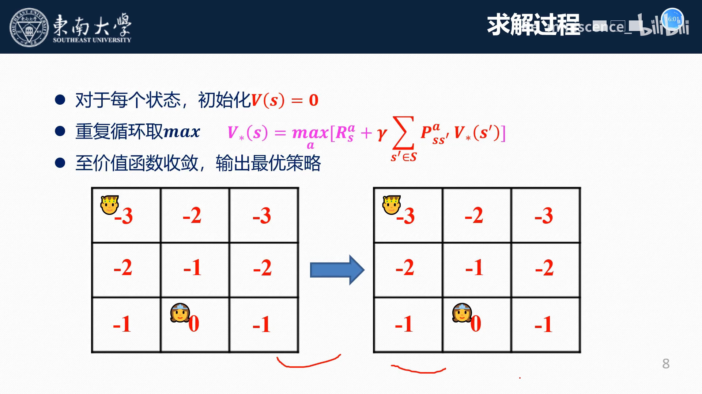

---

## 五、算例二：出租车路网（$\gamma = 0.5$）

### 5.1 情景与设置

第二个算例是一个**道路网络**：6 个结点，可以理解为 6 个交叉口，编号 $s_1$～$s_6$；结点之间是**有向路段（link）**。

- $s_1$ 可以流向 $s_2$ 和 $s_4$；
- $s_2$ 可以流向 $s_3$ 和 $s_5$；
- $s_3$ 流向 $s_6$，$s_6$ 又指向 $s_5$；
- $s_5$ 流向 $s_4$；
- $s_4$ **只有流入、没有流出**，所以到达 $s_4$ 行驶就结束了（相当于公主那样的终止状态）。

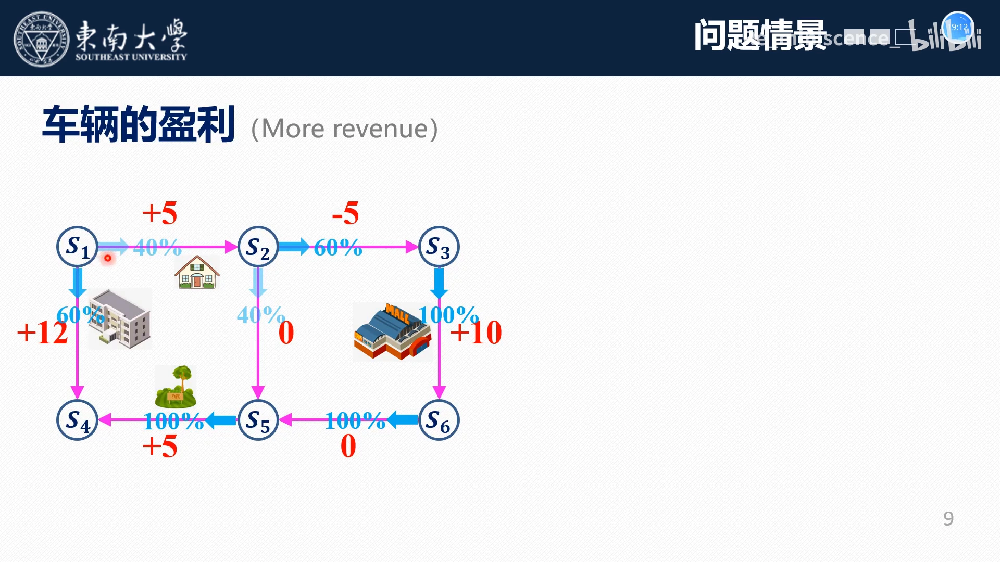

**收益怎么定**？把车辆想成出租车：在不同道路上行驶，**接到乘客的可能性不同**。商场附近、人多的建筑附近能接到更多乘客，收益高；荒郊野外接到的乘客少，收益也少。所以每条路段根据其所在用地的性质，给定一个收益——这本质上就是**状态转换所带来的奖励**。

同时还给定了一个策略 $\pi$（画面中用蓝色标注）：

- $s_1$：向东行驶 40%，向南行驶 60%；
- $s_3$：只能向南，概率 100%；
- $s_6$：只能向西，概率 100%；
- $s_5$：只能向西，概率 100%。

MDP 要素对应关系：

| MDP 要素 | 在本例中对应什么 |
| --- | --- |
| 状态 $s$ | 车辆所在的结点（交叉口） |
| 动作 $a$ | 所选择的道路（有向路段） |
| 奖励 $r$ | 每经过一段道路的收益（图中红色数字） |
| 策略 $\pi$ | 每个结点选择各条道路的概率（图中蓝色标注） |
| 折扣因子 $\gamma$ | 取 0.5 |

$\gamma = 0.5$ 的含义是：**每一次状态转换，收益就变得更不值钱**——可以理解为收益的贬值速度。

要回答三个问题：

1. 每个结点的**状态价值**是多少（给定策略下）？
2. 每个结点的**最优状态价值**是多少？
3. 从哪里出发、怎么走，能让收益最大？

### 5.2 先算"给定策略下"的状态价值（策略评估）

这一步要用到状态价值和动作价值的关系：

$$
\begin{aligned}
V(s) &= \sum_a \pi(a \mid s) \cdot Q(s,a) \\
Q(s,a) &= r + \gamma \cdot \sum_{s'} p(s' \mid s, a) \cdot V(s')
\end{aligned}
$$

把 $Q(s,a)$ 代进上面那个式子，就能用**下一状态**的状态价值来求**上一状态**的状态价值。以 $s_1$ 为例：

```
V(s1) = 0.4 × [ 5  + 0.5 · V(s2) ]      # 向东走，路段收益 5
      + 0.6 × [ 12 + 0.5 · V(s4) ]      # 向南走，路段收益 12
```

$V(s_2)$ 同理：

```
V(s2) = 0.6 × [ −5 + 0.5 · V(s3) ]      # 向东走，路段收益 −5
      + 0.4 × [ 0  + 0.5 · V(s5) ]      # 向南走，路段收益 0
```

$s_3$ 只有一条出路：

```
V(s3) = 1.0 × [ 10 + 0.5 · V(s6) ]      # 向南走，路段收益 10
```

而 $V(s_4) = 0$（终止状态）。于是可以**回代**：先把 $V(s_4)$ 代入 $V(s_5)$ 的式子得到 $V(s_5)$，再把 $V(s_5)$ 代进 $V(s_6)$ 的式子，依次往回算，最后得到每个结点的状态价值。

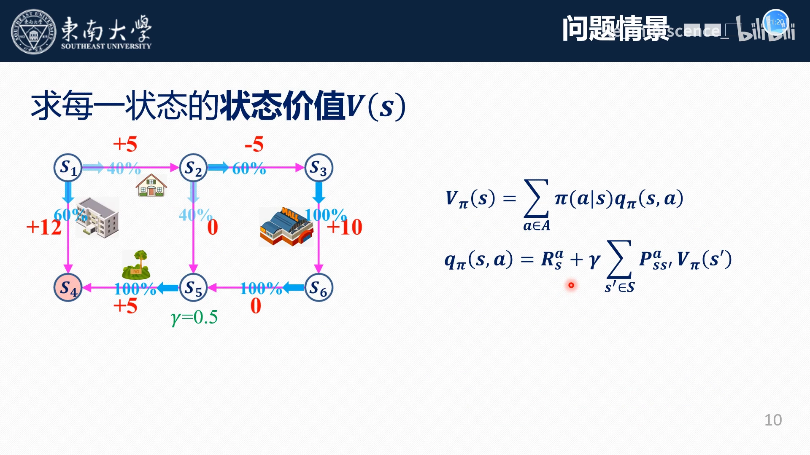

结果：在**这个给定策略**下，$s_3$ 的状态价值最高。

这里有个容易想不通的地方：从 $s_3$ 走下来是 10，再往下是 0，再往后还要乘两次 0.5 的折扣，看起来应该比 $s_1$ 那条 12 的路径更少，为什么 $s_3$ 反而更高？

原因在于 **$s_1$ 只有 40% 的可能走那条 12 的路**，另有 60% 的可能流向 $s_2$（收益更低）。**加权之后**，$s_1$ 的综合价值就下来了。这正是"状态价值"这个词里的**加权思想**：它衡量的是**期望**，不是最好情况。

### 5.3 再用价值迭代求最优状态价值

上面得到的是"给定策略下"的价值。要求**最优**状态价值，还是回到价值迭代的三句话。

**第一次迭代**：所有 $V = 0$ 起步。以 $s_1$ 为例：

```
向右走： 5  + 0.5 × V(s2) = 5  + 0 = 5
向下走： 12 + 0.5 × V(s4) = 12 + 0 = 12
取最大： V(s1) = max(5, 12) = 12
```

其余结点用同样的方式取最大，就得到第一次迭代的结果。

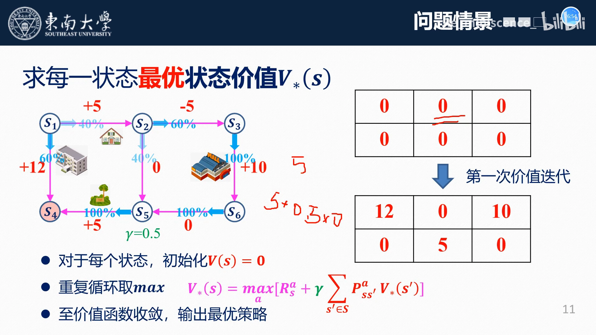

**第二次迭代**：用第一次的结果再算一遍。以 $s_2$ 为例，它有两种流出：

```
向右（收益 −5）： −5 + 0.5 × V(s3) = −5 + 5 = 0
向下（收益 0）：   0 + 0.5 × V(s5) = 0 + 2.5 = 2.5
```

两者取最大，得到 $2.5$。其余结点同理。

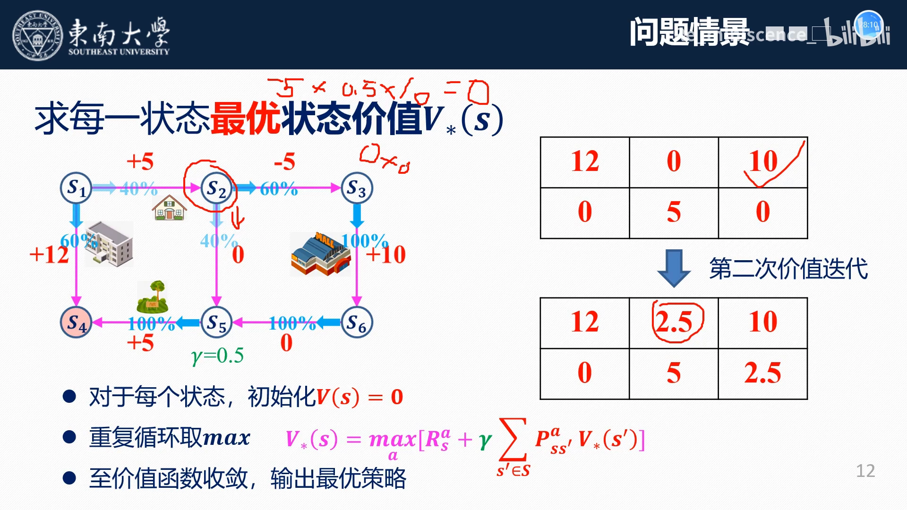

**第三、第四次迭代**：矩阵的变化越来越小，到第四次迭代时**基本不再变化**，说明已经达到最优，此时的价值就是**最优状态价值**。

结果很有意思：**最优状态价值在 $s_1$ 处取得（12），而不是在 $s_3$ 处**。也就是说，如果按最优方式走，从 $s_1$ 出发能拿到最好的结果——这正是价值迭代"取 max"带来的变化：它不再被 40%/60% 的概率拖累，而是**直接选最好的那条路**。

[【跳转到 27:30】](https://www.bilibili.com/video/BV18A411P7Lj/?t=1650)

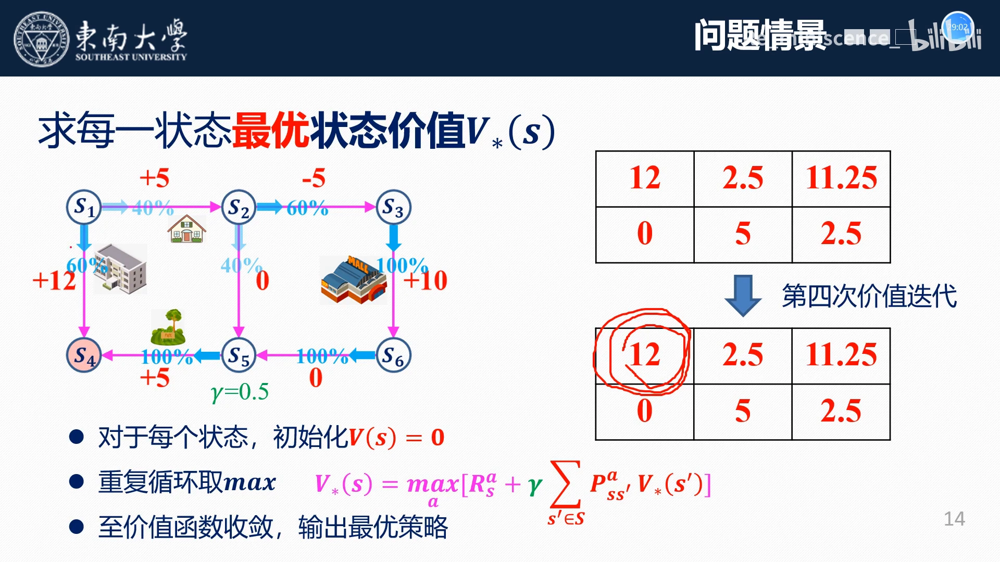

---

## 小结

- **价值迭代是"给定 MDP，怎么算最优"的一套可执行流程**，只有三步：初始化 $V(s)=0$ → 循环取 $\max$ → 收敛输出。
- **核心公式是贝尔曼最优方程** $V(s) = \max_a [\, r + \gamma \cdot V(s') \,]$：每次更新都在"即时奖励 + 折扣后的下一状态价值"里**取最大**。
- **策略与最优策略不同**：策略是状态上的**动作概率分布**（无限可能），最优策略是**一条完整动作链**（有限个），对应最大的状态价值。
- **$V(s)$ 衡量的是期望**：给定策略下要把各动作按概率**加权**（营救公主里 $\gamma=1$，出租车路网里 $\gamma=0.5$），所以"看起来最好的路"未必综合价值最高。
- **收敛判据**：$V(s)$ 与更新前的差别小于给定阈值，或两次迭代结果完全一样。
- **算例一（营救公主）** 说明 $\gamma=1$、每步 $r=-1$ 时，最优状态价值的绝对值就是"到终点的最少步数"；**算例二（出租车路网）** 说明取 $\max$ 之后最优状态价值会从 $s_3$ 转移到 $s_1$——**最优 ≠ 给定策略下的最好**。

## 关键术语速查

| 术语 | 一句话解释 |
| --- | --- |
| 马尔可夫决策过程（MDP） | 用状态、动作、奖励、转移概率、折扣因子描述序贯决策问题的数学框架 |
| 策略 $\pi(a \mid s)$ | 在状态 $s$ 下选择各动作的概率分布，决定了智能体的行为方式 |
| 最优策略 | 在策略基础上坍缩成的一条完整动作链，能获得最大的状态价值 |
| 状态价值 $V(s)$ | 从状态 $s$ 起往后所有奖励的折扣和，衡量该状态的综合好坏 |
| 最优状态价值 | 在最优策略下取得的状态价值，一定是所有策略中最大的 |
| 动作价值 $Q(s,a)$ | 在状态 $s$ 先执行动作 $a$ 后能拿到的折扣累积奖励 |
| 贝尔曼最优方程 | $V(s) = \max_a [\, r + \gamma \cdot V(s') \,]$，用取最大把相邻状态的价值联系起来 |
| 折扣因子 $\gamma$ | 未来收益的衰减/贬值速度，$\gamma=1$ 表示未来与当前等权 |
| 价值迭代（Value Iteration） | 反复用贝尔曼最优方程更新 $V(s)$ 直到收敛的求解算法 |
| 终止状态（terminal state） | 没有后继状态的状态（如公主、$s_4$），其价值固定为 0 |
| 收敛 | 相邻两次迭代的价值差别小于给定阈值，此时输出最优解 |