# 值迭代（Value Iteration）：把贝尔曼最优方程拆成一段能写进代码的循环

> 本篇整理自 B 站强化学习系列课程第四课「值迭代与策略迭代」中关于 Value Iteration（值迭代）的部分。视频地址：[BV1bd4y1z7nT](https://www.bilibili.com/video/BV1bd4y1z7nT/)。

## 本讲要解决的核心问题（SCQA）

**背景**：我们面对的是一个**模型已知**的 MDP——转移概率 `p(s′|s,a)` 和奖励 `r` 都是已知的。上一节课已经写出了**贝尔曼最优方程**，并给出了它的矩阵-向量形式。

**冲突**：这个方程左右两边都含有 `v`，是一个"自己等于自己"的不动点方程，没有可以直接套用的闭式解。光把方程写出来，并不等于知道怎么把它算出来。

**疑问**：给定模型，到底怎么一步一步把最优状态价值和最优策略算出来？

**回答（中心思想）**：上一节课的**压缩映射定理（Contraction Mapping Theorem）**其实已经把算法给出来了——用一个**迭代**算法反复把 `v` 代进方程右边。这个算法就叫**值迭代（Value Iteration）**。它的每一步只做两件事：先用当前的 `V_k` 求出一个贪婪策略（**Policy Update**），再把这个策略代回去算出 `V_{k+1}`（**Value Update**）；两步合起来，效果就是 `V_{k+1}(s) = max_a Q_k(s,a)`——**每个状态的新价值，等于它所有动作里最大的那个动作价值**。

本讲属于"三次课连成一条线"的中间一环：上一课是贝尔曼最优方程（理论），这一课是值迭代与策略迭代（第一个 **model-based** 的算法），下一课是第一个 **model-free** 的算法。三者的关系非常密切。

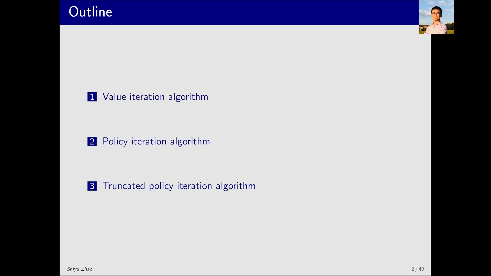

---

## 一、值迭代的来源：贝尔曼最优方程 + 压缩映射定理

### 1.1 需要求解的那个方程

贝尔曼最优方程的矩阵-向量形式是：

```
v = max_π ( r_π + γ P_π v )
```

其中 `v` 是所有状态的价值拼成的向量，`r_π` 是策略 π 下的奖励向量，`P_π` 是策略 π 下的状态转移矩阵，`γ` 是折扣因子。`max_π` 的意思是：右边的策略 π 也要选，要选让括号里最大的那个 π。

这个式子不好直接解，因为 `v` 同时出现在等号两边，而且外面还套了一个 `max`。

### 1.2 定理给出的就是一个迭代算法

压缩映射定理告诉我们：只要用下面这个迭代式反复算，就能求出最优策略和最优状态价值：

```
v_{k+1} = f(v_k) = max_π ( r_π + γ P_π v_k )
```

为什么这个式子能算？因为右边出现的所有量都已知了——`r_π`、`P_π` 由模型给出，`v_k` 是上一次迭代得到的猜测值。所以每迭代一次，就是把已知的数代进去、做一次"取最大"的运算。

[【跳转到 01:27】](https://www.bilibili.com/video/BV1bd4y1z7nT/?t=87)

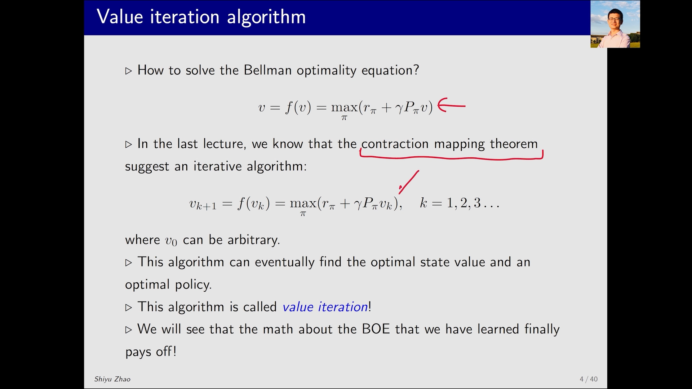

这个迭代算法有一个正式的名字：**Value Iteration（值迭代）**。

至于"这个算法为什么设计成这个样子""为什么它能找到最优策略"，上一节课讲压缩映射定理时已经回答过了，本讲不再重复，重点转向**怎么拆开它、怎么编程实现它**。

### 1.3 一个容易被忽略的问题：`V_k` 到底是不是状态价值？

答案：**不是。**

猛一看 `V_k` 出现在价值方程的位置上，很像一个状态价值。但仔细看下标：右边是 `V_k`，左边是 `V_{k+1}`。

- 如果左边也是 `V_k`，那这就是一个**贝尔曼公式**，`V_k` 就是某个策略下的**状态价值**（那对应的是"策略评估"）；
- 但现在左边是 `V_{k+1}`，左右不同，所以它**不是**贝尔曼公式，`V_k` 也就**不是**状态价值。

那 `V_k` 是什么？它只是**一个向量、一组值**，可以是任意的初值（比如全零）。这也正是这个算法叫"**值**迭代"的原因：它迭代的对象是"值"本身，而不是在评估某个固定策略。

[【跳转到 03:07】](https://www.bilibili.com/video/BV1bd4y1z7nT/?t=187)

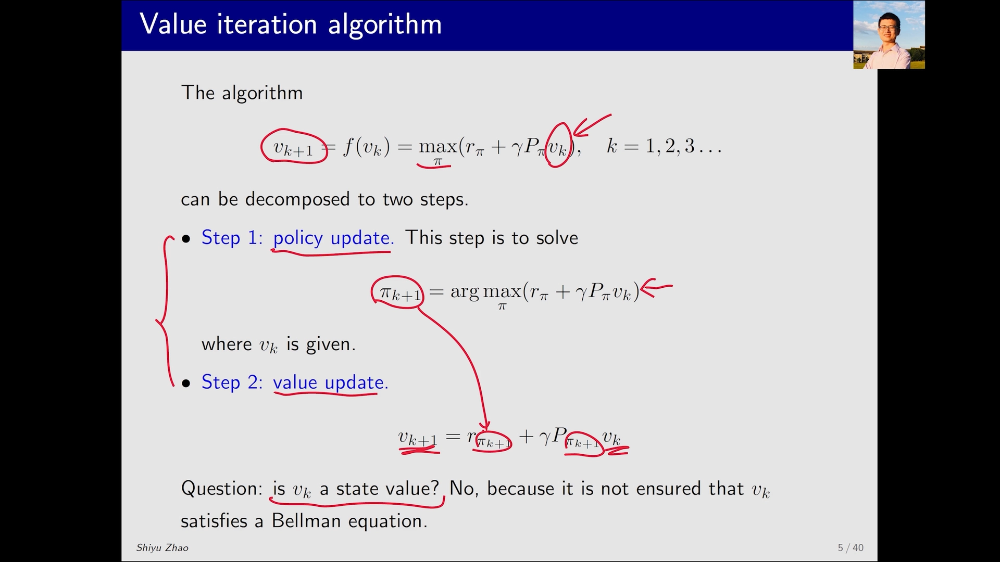

---

## 二、把一步迭代拆成两步：Policy Update 与 Value Update

矩阵-向量形式适合做**理论分析**；要看**怎么实现**，就要看它的**逐元素形式（element-wise form）**——也就是对每一个状态 `s` 单独写出一个式子。

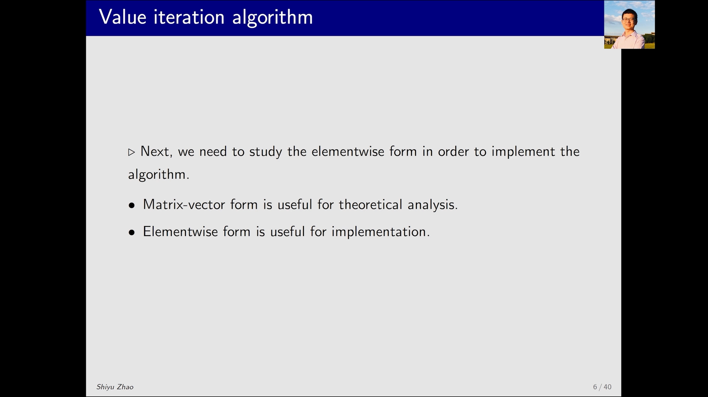

拆开来看，一次迭代包含两个步骤：**Policy Update**（先处理式子里的那个优化问题，得到 `π_{k+1}`）和 **Value Update**（把 `π_{k+1}` 代回去，由 `V_k` 求出 `V_{k+1}`）。

[【跳转到 02:42】](https://www.bilibili.com/video/BV1bd4y1z7nT/?t=162)

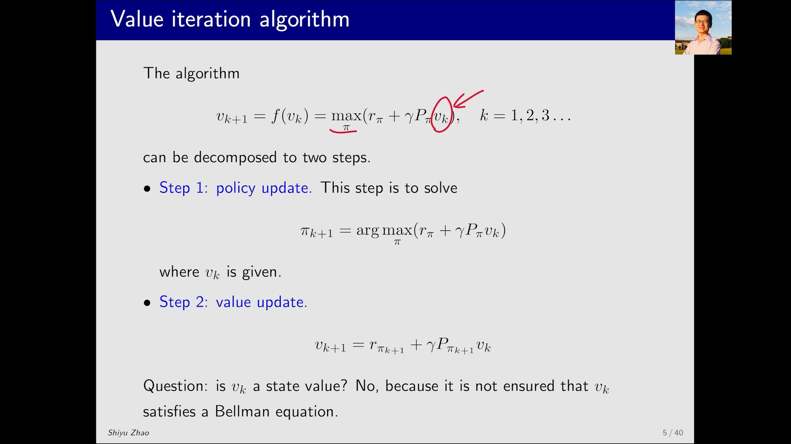

### 2.1 第一步：Policy Update（策略更新）

固定当前的 `V_k`，对每个状态 `s`、每个动作 `a` 算出动作价值 `Q_k(s,a)`，然后取最大的那个动作：

```
Q_k(s,a) = Σ_{s′} p(s′|s,a) · [ r(s,a,s′) + γ · V_k(s′) ]

π_{k+1}(s) = argmax_a Q_k(s,a)
```

注意这里 `Q_k` 的算法：**对下一状态 `s′` 求加权和**，权重是转移概率 `p(s′|s,a)`；每一项是"这一步的即时奖励 `r` + 折扣后的下一状态价值 `γ·V_k(s′)`"。

因为 `V_k` 是已知的，所以 `Q_k` 可以一次算出来。

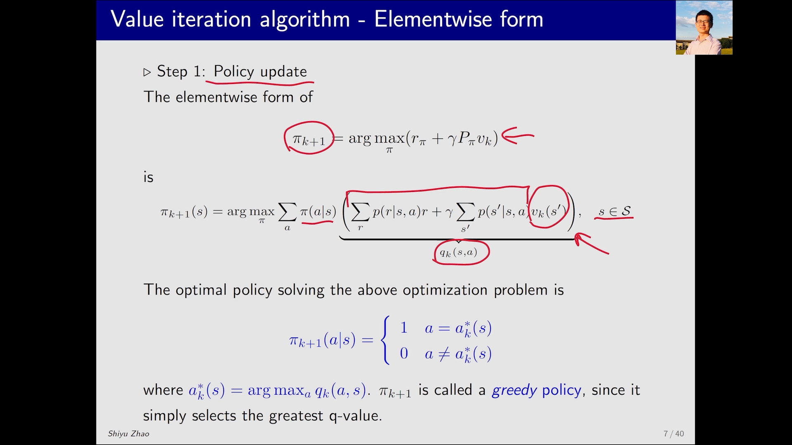

求出来的 `π_{k+1}` 是什么样子？它把**概率 1** 给 `Q_k` 最大的那个动作，其余动作概率全是 0。所以它是一个**确定性策略**，而且是一个**贪婪策略（greedy policy）**——只认最大的 Q 值。

[【跳转到 04:47】](https://www.bilibili.com/video/BV1bd4y1z7nT/?t=287)

### 2.2 第二步：Value Update（价值更新）

把刚求出的 `π_{k+1}` 代回价值公式：

```
V_{k+1}(s) = Σ_a π_{k+1}(a|s) · Q_k(s,a)
```

因为 `π_{k+1}` 在最优动作上取 1、其余取 0，这个加权求和立刻退化成一句话：

```
V_{k+1}(s) = max_a Q_k(s,a)
```

也就是说，**新的状态价值就是那个最大的 Q 值**。

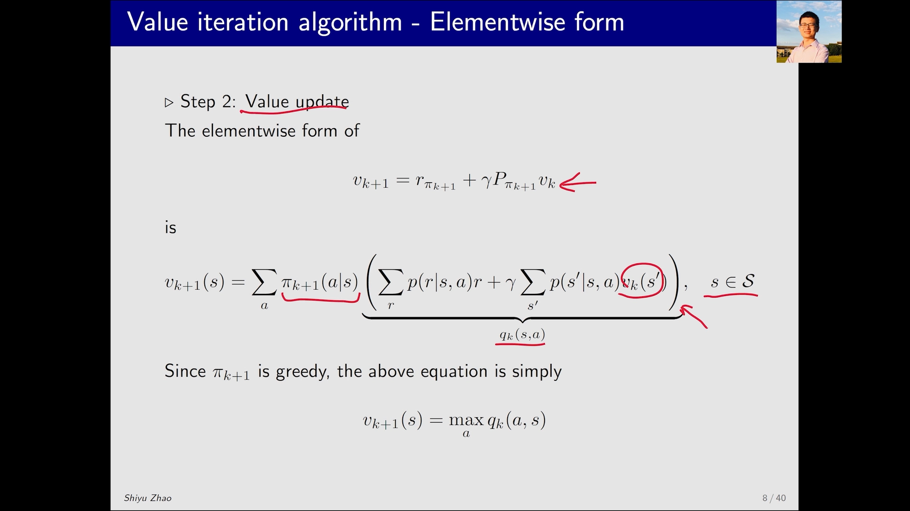

### 2.3 两步合起来的流程

把上面两步串起来，一次迭代就是四步：

1. 手上有一个 `V_k`（第一次可以是 `V_0`，比如全零）；
2. 对每个状态 `s`，用 `V_k` 算出所有动作的 `Q_k(s,a)`；
3. 看哪个动作的 `Q_k` 最大，把它作为 `π_{k+1}(s)`（Policy Update）；
4. 把这个最大的 `Q_k` 作为 `V_{k+1}(s)`（Value Update），交给下一轮。

[【跳转到 05:37】](https://www.bilibili.com/video/BV1bd4y1z7nT/?t=337)

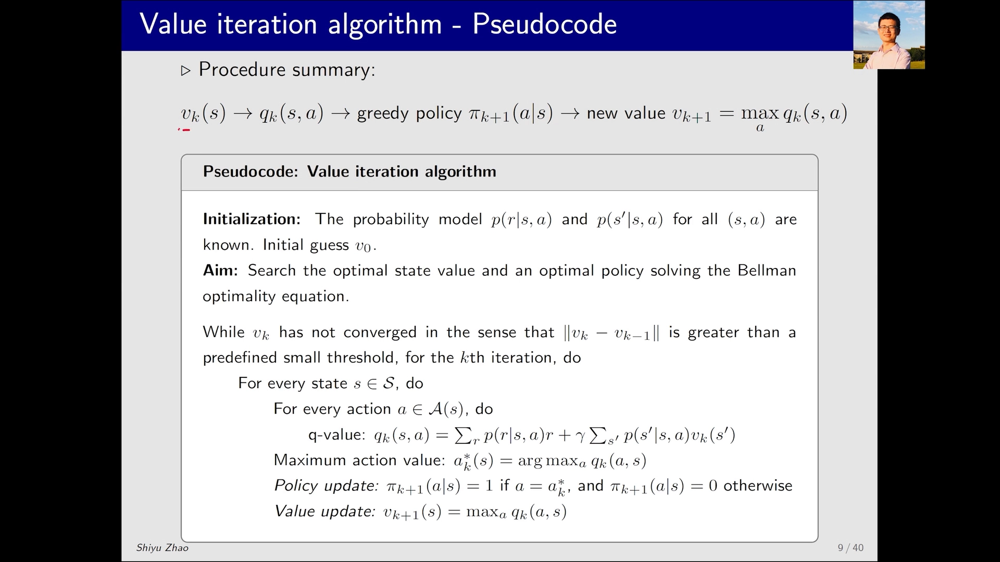

---

## 三、伪代码：把流程写成循环

把上面的流程写成伪代码，就是下面这样。它同时维护两张表：`Q` 表和 `V` 表。

```
输入：模型 p(s′|s,a)、r(s,a,s′)，折扣因子 γ，初值 V_0，容差 ε
k ← 0
repeat
    for 每个状态 s:
        for 每个动作 a:
            Q_k(s,a) ← Σ_{s′} p(s′|s,a) · [ r(s,a,s′) + γ · V_k(s′) ]
        π_{k+1}(s) ← argmax_a Q_k(s,a)      # Policy Update
        V_{k+1}(s) ← max_a Q_k(s,a)         # Value Update
    k ← k + 1
until max_s | V_k(s) − V_{k−1}(s) | < ε
输出：π_k（近似最优策略）、V_k（近似最优状态价值）
```

两个细节值得注意：

- **收敛判据**：所谓"`V_k` 收敛了"，指的是 `V_k` 和 `V_{k−1}` 的差别已经小到一个很小的数（比如 `0.001`）以下。此时再怎么迭代也变不动了，就可以停。
- **实现方式**：编程时不一定要真的把 `Q` 表存下来，但必须**具备从 `V` 算出 `Q` 的能力**——这是整个算法的核心操作。

[【跳转到 06:27】](https://www.bilibili.com/video/BV1bd4y1z7nT/?t=387)

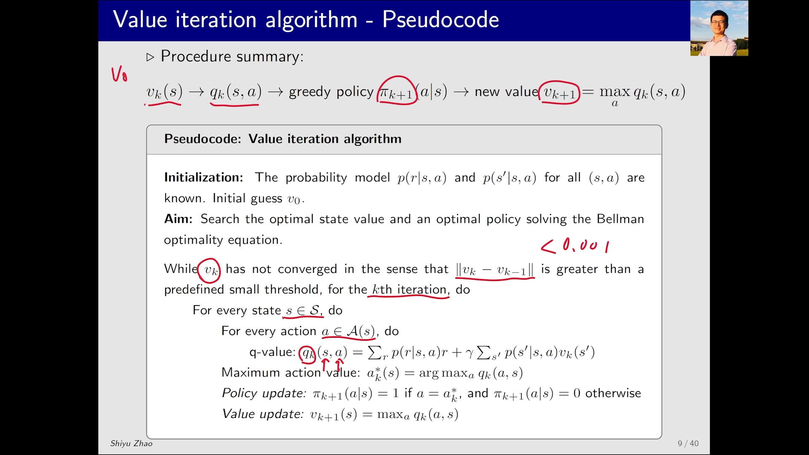

---

## 四、算例：带禁止区域的网格世界

### 4.1 问题设置

用一个网格世界来演示。图的上方给出了这个问题的基本设置，其中有一块 **forbidden area（禁止区域）**——走进去要付出代价。我们的目标是用值迭代求出最优策略。

图右侧会随着迭代不断更新，画的就是每一步得到的 `π_{k+1}`。

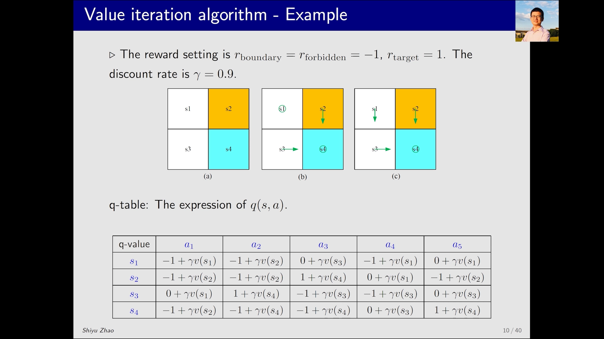

### 4.2 k = 0：从全零出发

`V_0` 可以任意选取，为简单起见取**全部为零**。把 `V_0` 代进 `Q` 表，就得到每个状态、每个动作对应的 `Q_0`。

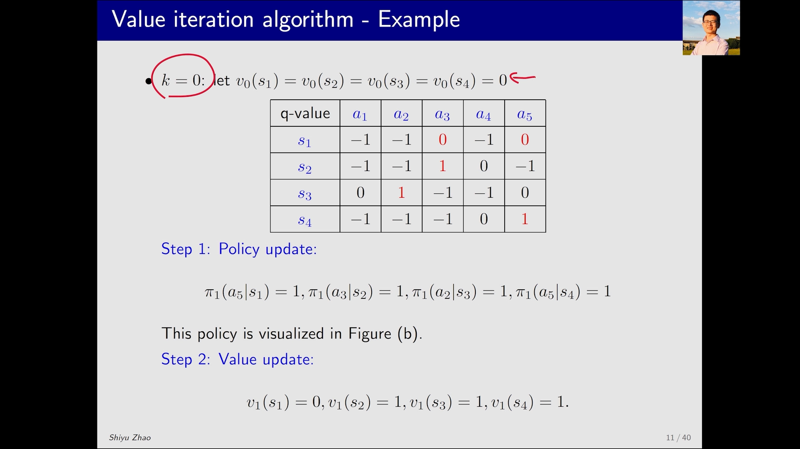

有了这张表，两步就都能做了：

- **Policy Update**：对每个状态看哪一列的 `Q` 最大。例如 `S1` 有两个动作的 `Q` 并列最大（`a3` 与 `a5`），任选一个即可，本例选了 `a5`；其他状态同理，分别选了 `a3`、`a2`、`a5`。
- **Value Update**：`V_1` 就等于这些最大的 `Q` 值。

把得到的策略画到图上（图 b），会发现 `S2`、`S3`、`S4` 已经是最优的了，只有 `S1` 还不对——它选择了原地不动，而最优做法应该是往下走（图 c）。

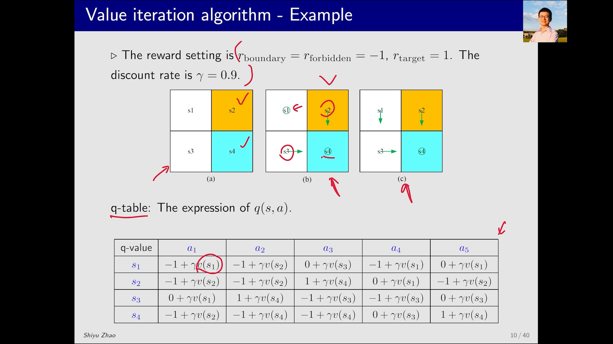

### 4.3 k = 1：再来一轮就收敛到最优策略

把上一轮得到的 `V_1` 重新代回 `Q` 表，得到一张新的 `Q` 表，再对每个状态取最大，就得到新的策略和新的 `V_2`。

[【跳转到 10:12】](https://www.bilibili.com/video/BV1bd4y1z7nT/?t=612)

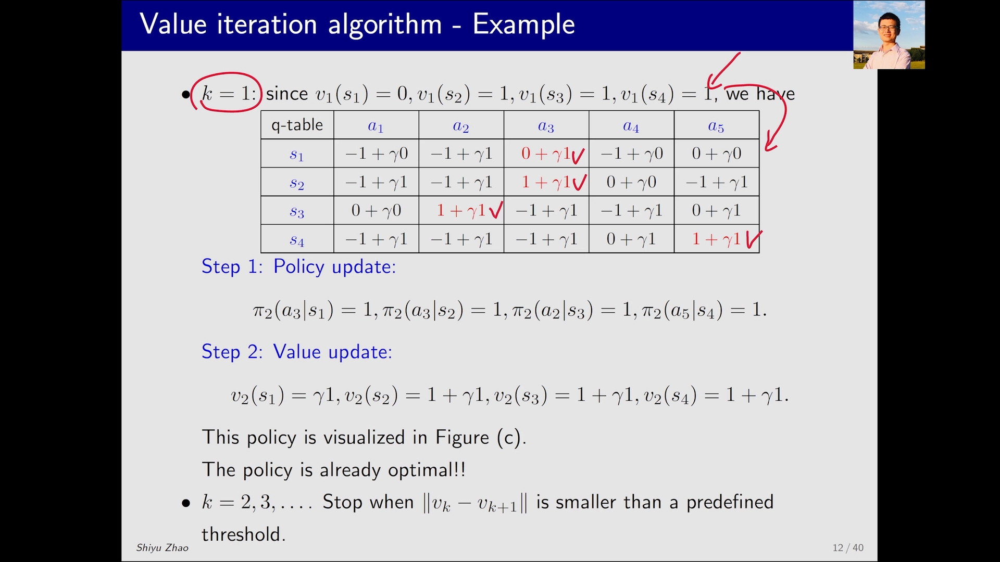

再看画出来的策略，一眼就能看出它已经是最优策略了——**这个例子只用了两步迭代就找到了最优策略**。

之所以这么快，是因为例子非常简单，而且初值恰好离答案不远。如果问题复杂得多，就需要更多迭代步数。

### 4.4 什么时候停

可以继续往下迭代，停止条件是 `V_k − V_{k−1}` 小于一个很小的数——意思是**再怎么努力也改变不了了**，这时就可以停止。

[【跳转到 11:27】](https://www.bilibili.com/video/BV1bd4y1z7nT/?t=687)

---

## 小结

- **值迭代就是贝尔曼最优方程的一个迭代解法**：`v_{k+1} = max_π (r_π + γ P_π v_k)`，由压缩映射定理保证收敛到最优解。
- **`V_k` 不是状态价值**，只是一组可以任意初始化的"值"；左边是 `V_{k+1}` 而不是 `V_k`，所以它不是贝尔曼公式。这也是"**值**迭代"这个名字的由来。
- **一步迭代 = 两步操作**：Policy Update（固定 `V_k`，取 `argmax` 得到贪婪策略）+ Value Update（把策略代回，得到 `V_{k+1}`）。
- **两步合起来等价于一句话**：`V_{k+1}(s) = max_a Q_k(s,a)`——新价值就是最大的动作价值。
- **矩阵形式用于理论分析，逐元素形式用于编程实现**；实现的关键能力是"从 `V` 算出 `Q`"。
- **收敛判据**是 `|V_k − V_{k−1}| < ε`；收敛后输出 `V_k` 与 `π_k`。
- **算例说明收敛可以很快**：网格世界里从全零出发只迭代两步就得到了最优策略。

## 关键术语速查

| 术语 | 一句话解释 |
| --- | --- |
| 贝尔曼最优方程（Bellman Optimality Equation） | 用"取最大"代替"按策略求期望"的贝尔曼方程，其解就是最优状态价值 |
| 压缩映射定理（Contraction Mapping Theorem） | 证明 `v = f(v)` 存在唯一解、并给出迭代解法 `v_{k+1} = f(v_k)` 的数学工具 |
| 值迭代（Value Iteration） | 把贝尔曼最优方程当作迭代式，反复更新"值"直到收敛的 model-based 算法 |
| Policy Update（策略更新） | 固定当前价值，对每个状态取 `argmax_a Q_k(s,a)`，得到贪婪策略 |
| Value Update（价值更新） | 把新策略代回价值公式，结果就是 `max_a Q_k(s,a)` |
| 贪婪策略（Greedy Policy） | 只把概率 1 给当前最优动作、其余动作概率为 0 的确定性策略 |
| 逐元素形式（Element-wise Form） | 对每个状态单独写出的公式，与矩阵-向量形式等价，更贴近代码实现 |
| 收敛判据（Convergence Criterion） | 相邻两次迭代的价值差小于阈值 `ε` 时停止迭代 |
| 状态价值 `V(s)` | 从状态 `s` 出发、按某策略走下去能拿到的累积奖励期望 |
| 动作价值 `Q(s,a)` | 在状态 `s` 先执行动作 `a`、之后按某策略走下去能拿到的累积奖励期望 |