# 第4讲：已知环境模型下的规划——动态规划求解 MDP

> 本篇整理自上海交通大学张伟楠老师《强化学习》课程第 4 讲「动态规划」。视频地址：[BV1S2HfewEQa](https://www.bilibili.com/video/BV1S2HfewEQa/)。

## 本讲要解决的核心问题（SCQA）

**背景**：强化学习的目标是找到一个策略 π，让智能体在与环境交互的过程中获得最大的累积奖励期望。通常我们面对的是**黑盒环境**——只能与环境交互、拿到数据，并不知道转移概率的数学形式。

**冲突**：但如果换一种情形——环境的**转移概率**和**奖励函数**完全已知（白盒 MDP），我们还需要像黑盒那样靠反复采样去"学"吗？

**疑问**：当一个 MDP 已经**完整给出**时，智能体应该怎样**直接算出**最优策略？

**回答（中心思想）**：这种"模型已知"的求解过程叫**规划（Planning）**，用**动态规划（Dynamic Programming, DP）**来做。核心只有两招——**策略迭代**和**价值迭代**：前者每一步都精确评估、再改进，理论漂亮；后者把"精确评估"换成"一步贪心"，牺牲一点精度换来速度，实际更常用。


---

## 一、规划问题：环境模型已知时，为什么可以直接"算"出最优策略

### 1.1 白盒 MDP 与黑盒 MDP

一个 MDP 由五元组构成，其中最关键的、决定"能不能直接算"的两项是：

- **转移概率** $P(s' \mid s, a)$：在状态 $s$ 采取动作 $a$ 后，转移到新状态 $s'$ 的概率；
- **奖励函数** $R(s, a)$：在状态 $s$ 采取动作 $a$ 能拿到的（期望）奖励。

如果这两项都已知，就是**白盒环境**；如果只知道能和它交互、拿到一条条数据，但不知道这两个函数的具体形式，就是**黑盒环境**。

- 黑盒：只能靠采样数据去估计，属于后面的**无模型（model-free）**强化学习；
- 白盒：不需要采样，直接根据已知的分布去算期望、做优化即可——这正是**规划**。

在监督学习里也有类似的"规划"：如果直接给出了 $P(x, y)$ 这个数据分布，我们就完全知道数据长什么样，可以直接求最优函数（比如线性规划）。强化学习里也是同理。

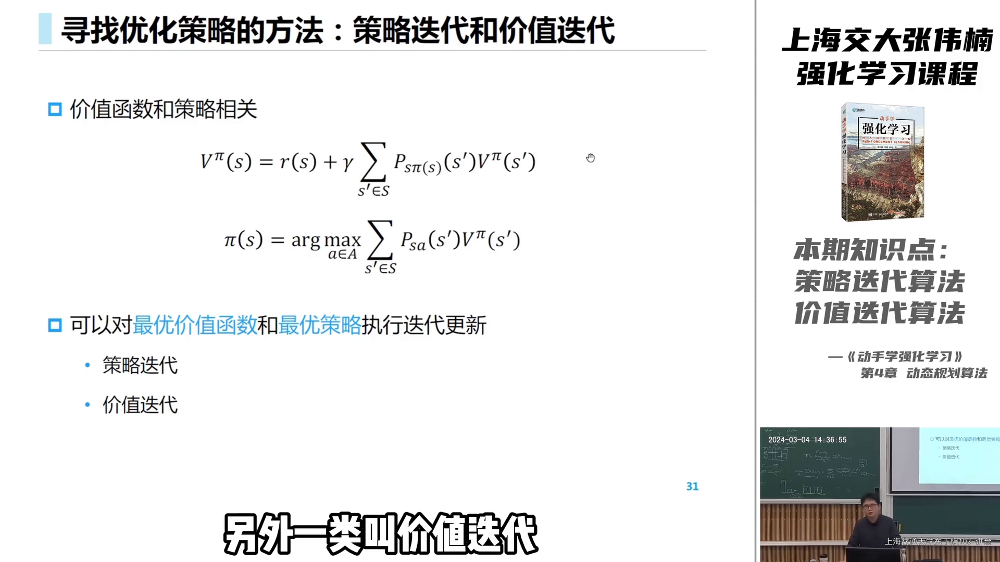

### 1.2 回顾：状态价值与动作价值

**状态价值 $V(s)$**：从状态 $s$ 出发，按照当前策略 π 一直走下去，能拿到的累积奖励期望。用贝尔曼方程把它写开，就是"当前奖励 + γ × 下一状态的价值的期望"：

$$
V(s) = \mathbb{E}\big[\, r + \gamma \cdot P(s' \mid s, a) \cdot V(s') \,\big]
$$

**动作价值 $Q(s, a)$**：注意，动作价值从来不是只定义在单个动作上，而是定义在**「状态-动作」对**上——提到动作价值，必然是在**某个状态下**选择了某个动作的价值。它和状态价值可以相互定义：

$$
\begin{aligned}
V(s) &= \sum_a \pi(a \mid s) \cdot Q(s, a) \\
Q(s, a) &= r + \gamma \cdot \sum_{s'} P(s' \mid s, a) \cdot V(s')
\end{aligned}
$$

### 1.3 两种贝尔曼方程：期望 vs 最优

强化学习里有两种方程，区别只在于"要不要对动作做选择"：

- **贝尔曼期望方程（Bellman Expectation Equation）**：**不**对动作做选择，而是"跟随（follow）"当前策略 π，对所有动作按策略概率求期望，评估的是**当前策略**的价值；
- **贝尔曼最优方程（Bellman Optimality Equation）**：直接在所有动作里**贪心**地选让价值最大的那个，其他动作概率都为 0，求的是**最优**价值。

这个区别贯穿全讲：**策略迭代**基于期望方程，**价值迭代**基于最优方程。

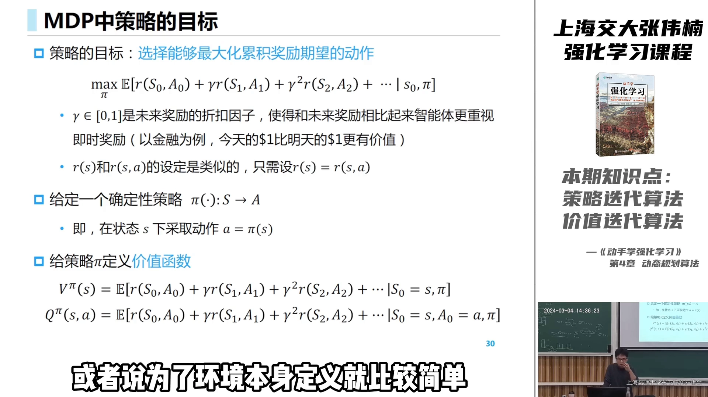

---

## 二、策略迭代：先评估、再改进，反复迭代

求解策略的方法分为两类：**策略迭代**和**价值迭代**。它们都建立在同一个框架——**广义策略迭代（GPI, Generalized Policy Iteration）**之上：

> 先评估每个状态上"哪些动作能带来更大价值"，再基于更高价值的位置去**提升策略**，如此反复。

### 2.1 策略评估（Policy Evaluation）

策略评估回答：**给定**一个策略 π，每个状态的价值 $V^\pi(s)$ 是多少？

公式很短——$V = V^\pi$——但实质是要算出整张价值表。做法是**贝尔曼迭代**：反复用贝尔曼方程更新，直到收敛。

### 2.2 策略提升（Policy Improvement）

评估清楚 $V^\pi$ 之后，在每个状态下选择让价值最大的动作，替换原策略。背后的理论是**策略提升定理**：

```
只要存在 Q(s,a) > V(s)，就把策略移到动作 a 上，价值就不会变差。
```

这种基于价值函数、直接取最大动作的更新，叫**基于 V 的贪心（greedy of V）**。

### 2.3 策略迭代算法

对有限状态-动作空间的 MDP，策略迭代就是：

1. 初始化一个策略 π；
2. **策略评估**：计算 $V = V^\pi$（这一步公式最短，却最耗时）；
3. **策略提升**：在每个状态选使价值最大的动作，更新 π；
4. 重复 2、3 直到策略不再变化。

有一个关键前提：因为现在是 MDP、整个环境已知，**不存在采样数据不足的问题**，所以可以放心地直接贪心求解。等以后讲无模型方法时，没有转移概率、要收集数据，就必须**兼顾探索与利用**了。

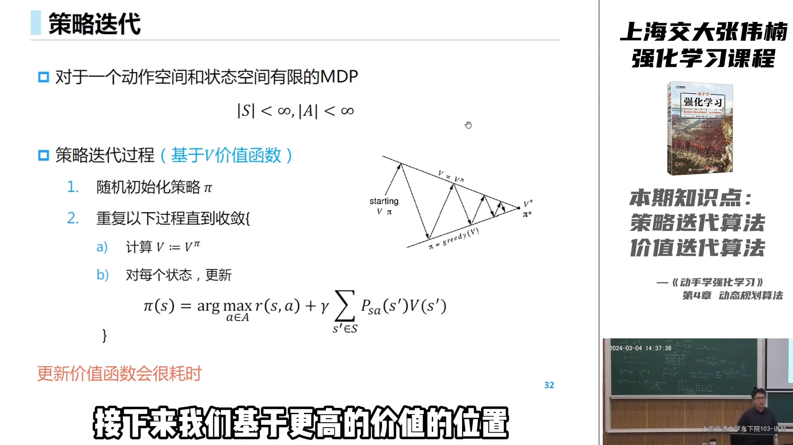

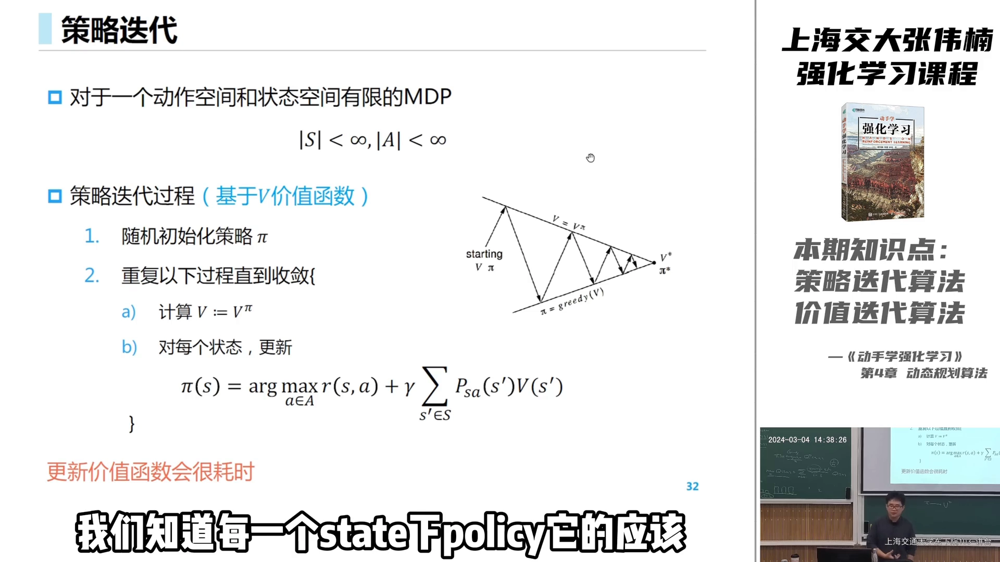

### 2.4 一个 16 格网格世界的例子

用一个 16 格的网格世界做**策略评估**：状态 0~15，其中 **1~14 是非终止状态，0 和 15 是终止状态**。

规则：每走一步是**确定性转移**——撞墙就停在原地，不撞墙就走到相邻格子；走到 0 或 15 时 episode 结束。**未终止的每一步获得 −1 的奖励**（因为想尽快走出去，越早到达终止状态越好）。

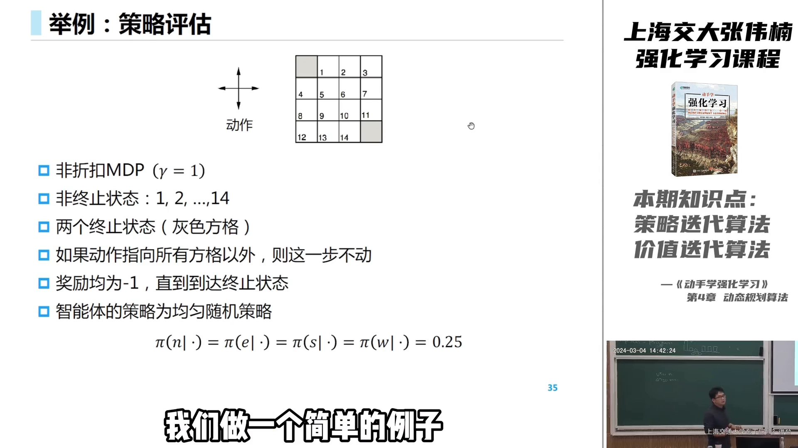

现在评估一个**上下左右各 1/4 概率的均匀随机策略**。做法：

- 初始化每个格子的价值为 0；
- 用贝尔曼迭代一步：在每个格子上，取"朝四个方向走的价值"的平均，再加上当前这一步的奖励 −1。

例如中间某个格子，朝上下左右走的价值分别是 −1、0、−1、−1，四者相加除以 4 得 −0.75，再加这一步的奖励 −1，就是 **−1.75**（保留两位小数记为 −1.7）：

$$
((-1) + 0 + (-1) + (-1)) / 4 + (-1) = -1.75
$$

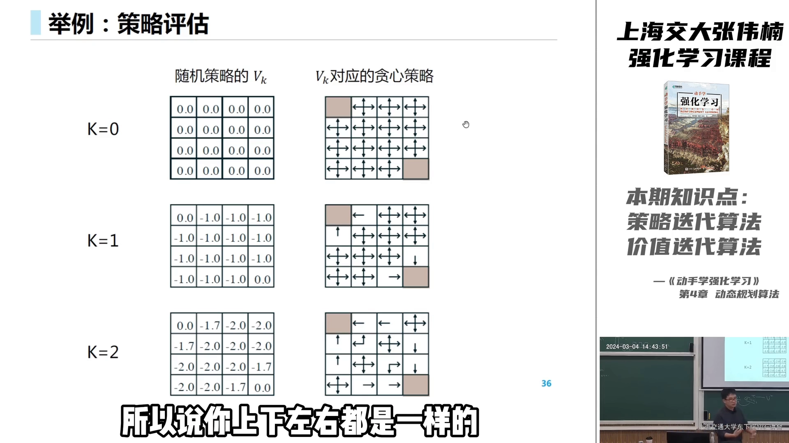

迭代到最后（K 趋于无穷）会收敛。注意一个有意思的现象：**当 K=3 时价值表还没收敛，但它对应的策略提升得到的新策略，其实已经收敛到最优策略了**。这提示我们：也许不必把价值算到精确，就能拿到好策略。

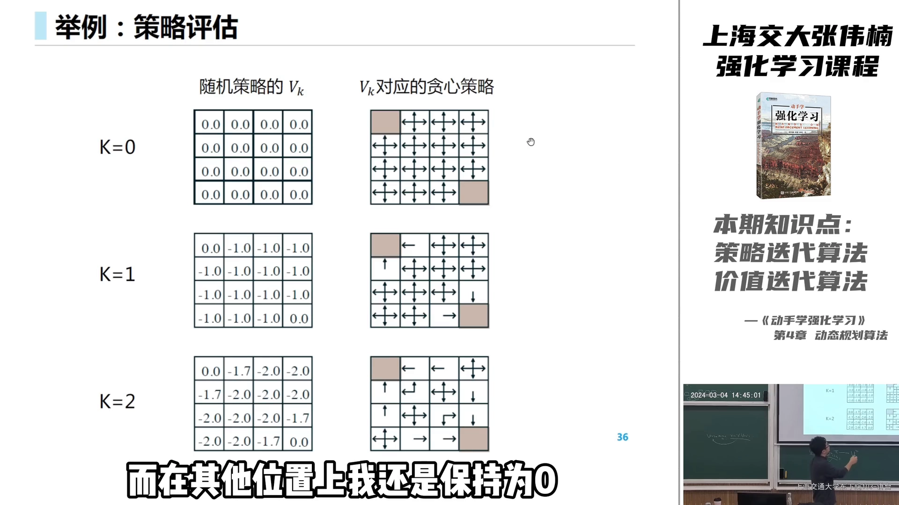

---

## 三、价值迭代：把"精确评估"换成"一步贪心"

### 3.1 动机：像 mini-batch 梯度下降一样提速

精确计算 $V^\pi$ 很耗时。而上面那个现象说明：**在价值还没收敛的中间就去做策略提升，往往也能很快到达最优策略**。

这就像机器学习里的**批量梯度下降**：把整个训练集的梯度都算完再更新一次，代价太高；改用 **mini-batch 甚至随机梯度下降**，用一个样本就更新，速度更快、结果也不错。

于是得到**价值迭代**：牺牲每次评估价值的**精度**，换来非常快的**更新速度**。用它自己的话说——价值迭代是策略迭代的一种"贪心加速版"：如果策略迭代中不再精确计算 $V = V^\pi$，就退化成价值迭代。

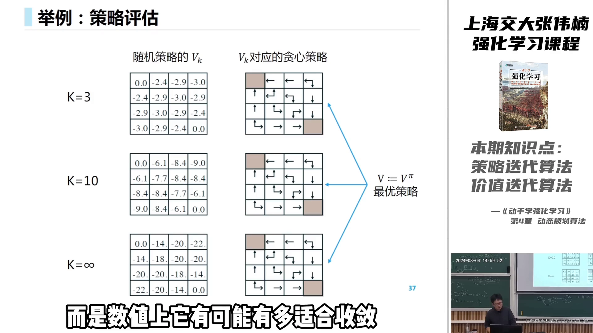

### 3.2 贝尔曼最优迭代式

价值迭代**不再维护一个显式的策略 π**：

- 策略迭代的出发点是初始化一个随机策略 π；价值迭代则对**每个状态**初始化价值为 0；
- 每一步不再按策略分布求期望，而是直接在当前状态下**贪心地选**让价值最大的动作：$\max_a$。

$$
V(s) \leftarrow \max_a \big[\, r + \gamma \cdot \sum_{s'} P(s' \mid s, a) \cdot V(s') \,\big]
$$

这就是**贝尔曼最优迭代式**——注意它用的是 $\max$（最优方程），而不是期望方程。这里 $V$ 甚至**不带 π 角标**：因为它只是一个中间计算变量，并不对应某个具体的策略；只有收敛之后，它才对应上最优策略。

另一种写法（用 $V(s) = \max_a Q(s,a)$ 把状态价值与动作价值耦合起来）：

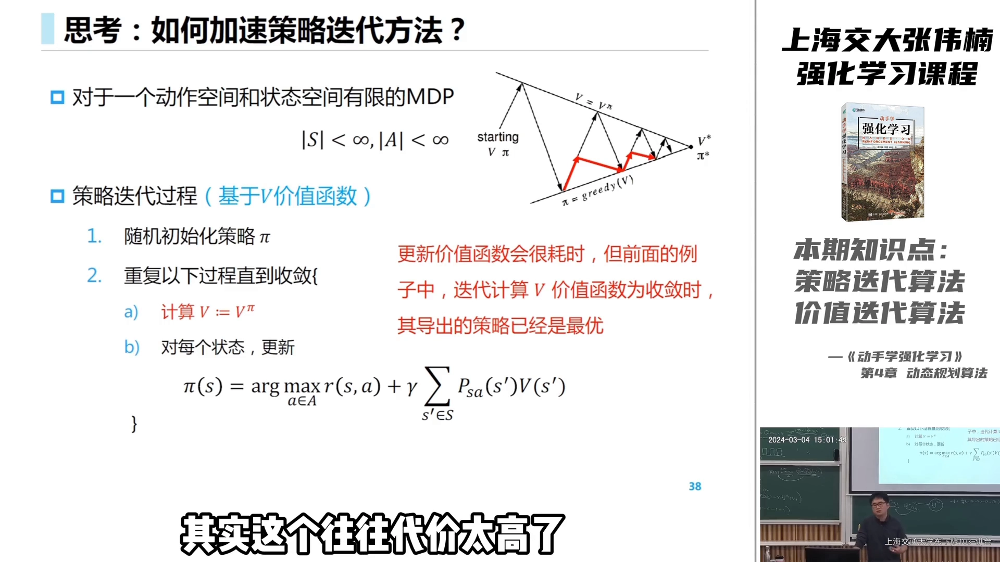

### 3.3 值迭代会收敛吗？

会。**贝尔曼最优迭代式有不动点（收敛性）定理保证**：它一定收敛，而且每次都是贝尔曼最优的更新方式，最终收敛到**最优价值函数 $V^*$**。

最优价值函数 $V^*$ 最简单的定义：把所有策略枚举一遍，取每个状态上能取得的最大价值：

$$
V^*(s) = \max_\pi V^\pi(s)
$$

一个直观结论：所有 $V^\pi(s)$ 都 ≤ $V^*(s)$；只要还有提升空间，就能用贝尔曼最优迭代式继续更新。

⚠️ 一个容易困惑的点：价值迭代**中间过程**的 $V$ 表可能**不合法**——找不到一个恰好对应它的策略；但可以保证：**收敛之后，一定会有一个最优策略正好符合这张表**。

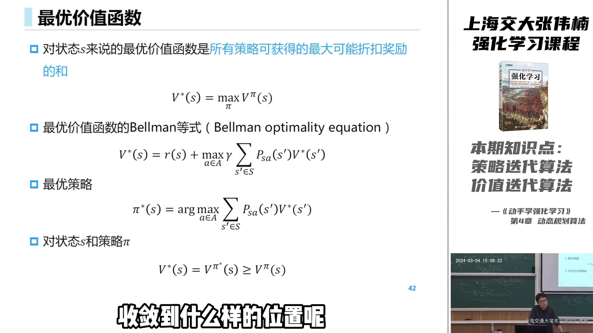

### 3.4 最短路径例子

更简单的一个例子：格子中**左上角是唯一出口**，每走一步奖励为 1（走到的格子越少越好）。

- 一开始所有格子价值为 0；
- 用贝尔曼最优迭代式更新：每个格子只选让价值最大的方向；
- 几轮之后，每个格子都会收敛到**以最快速度走到左上角所需的最少步数**——这就是我们熟悉的**动态规划求最短路径**。

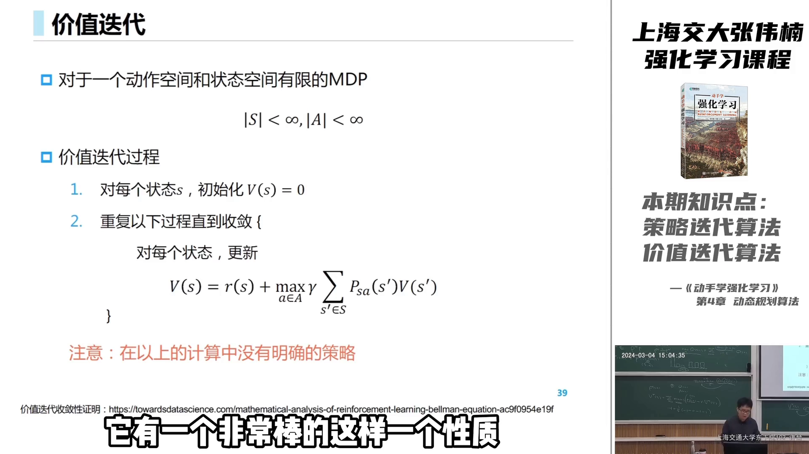

---

## 四、策略迭代 vs 价值迭代：怎么选

两者名字不同、机制也不同，对比一下：

| 维度 | 策略迭代 | 价值迭代 |
| :--- | :--- | :--- |
| 中间变量 | 一个**显式策略** π + 其价值表 | 只有价值表 $V$，无显式策略 |
| 中间合法性 | 每一步都是**合法策略**，随时导出都对应当前策略 | 中间 $V$ 表**无合法意义**，只有收敛后才有意义 |
| 每次更新 | 完整评估 $V = V^\pi$，**很耗时** | 一步贝尔曼最优更新，**快** |
| 理论基础 | 更直接、更漂亮 | 一种贪心的加速近似 |
| 适用场景 | 空间**小**的 MDP，想算得更精确 | 空间**大**的 MDP，追求效率 |

一句话概括：

- **环境简单** → 可以用策略迭代，收敛稳、性质好；
- **环境复杂**（状态、动作都很多）→ 几乎只会选价值迭代，效率更高。

另外，**若没有循环的状态转移，价值迭代会非常快；若有循环转移，策略迭代更稳健**（因为它严格按当前策略分布算价值，不会出现奇怪的循环计算）。

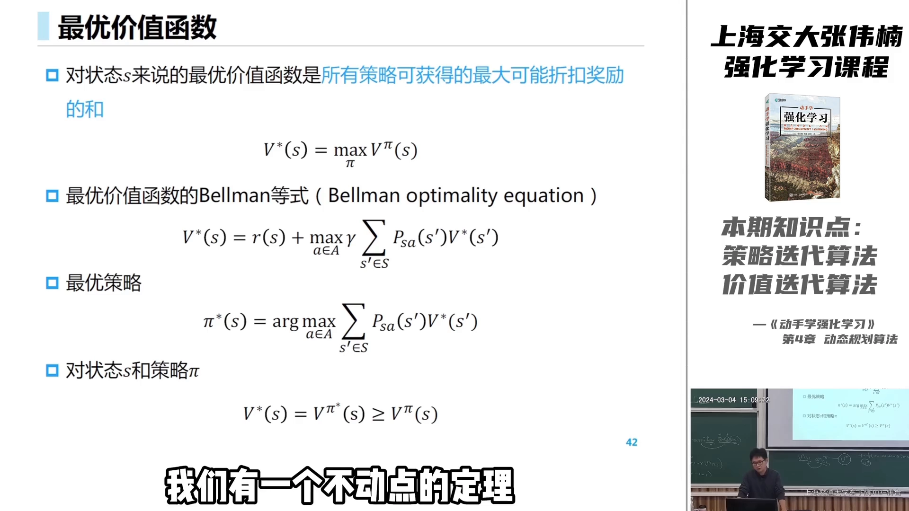

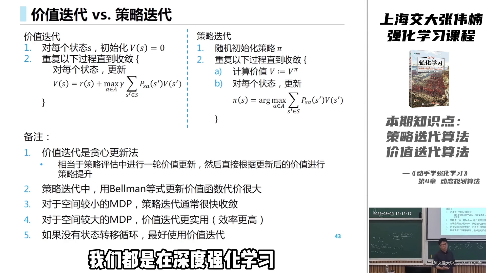

这些方法都是**表格型强化学习（tabular RL）**的基础，后续很多深度强化学习 / 近似强化学习方法都会直接沿用它们的思想。

---

## 五、从规划到学习：为什么还需要无模型方法

最后是一个延伸讨论：**如果环境不是给定的白盒 MDP，怎么办？**

一个"很直接、很暴力"的思路是——**先从数据里学一个 MDP 模型，再在模型上做动态规划**（策略迭代或价值迭代）：

1. 随机初始化策略，与环境交互，收集一条条轨迹数据（**episodes**：从 $s_0$ 出发，take action、拿 reward，直到终止状态或终止时间步）；
2. 用**数数法**估计模型：$P(s' \mid s, a)$ 的分母是"看到 (s,a) 对的次数"，分子是"其后看到 s′ 的次数"，相除即得概率；奖励函数则取在 $s$ 上看到的平均 reward；
3. 在补完整的 MDP 上做价值迭代 / 策略迭代，得到新策略；
4. 用新策略再与环境交互，产生新数据、重建模型，如此反复。

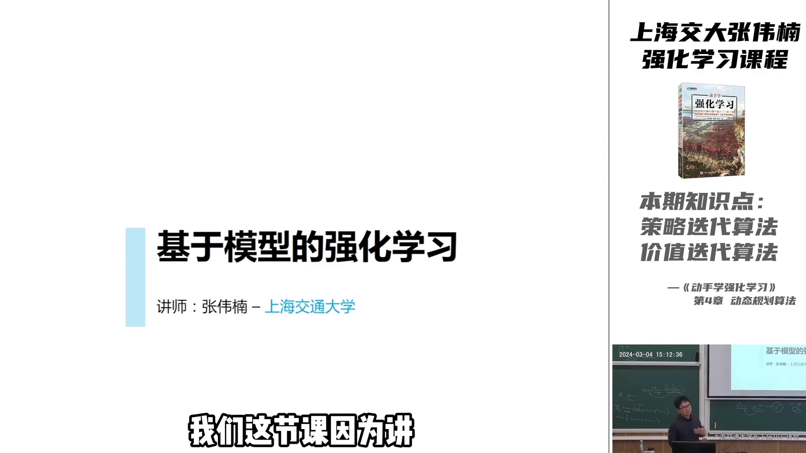

但这条路有**明显隐患**：由于中间用的是贝尔曼**最优**迭代式、有 $\max$ 操作，**环境建模哪怕和真实环境差一点点，一旦某个 $\max$ 选错，错误就会沿着状态向前传播**，越算越错，最终策略严重偏离最优。所以"先建模型再规划"看似正确，实践中往往效果不好。

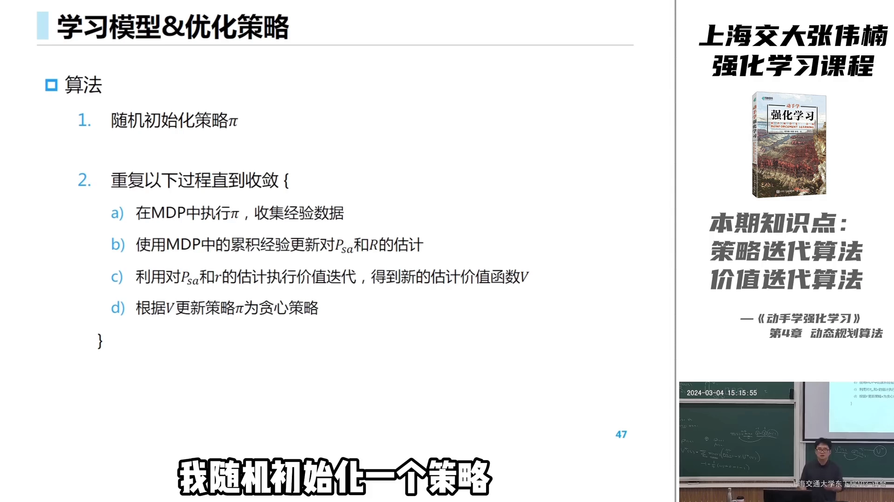

因此，我们需要**不使用 MDP 中动态规划方法、直接学习最优策略与价值函数**的一类方法——它们统称**无模型强化学习（model-free RL）**，也是后续章节的主题。

---

## 小结

- **规划（Planning）**：当 MDP 的转移与奖励都已知（白盒）时，不需要采样，直接"算"出最优策略——这就是动态规划。
- **两种贝尔曼方程**：期望方程"跟随策略求期望"，最优方程"对动作贪心取 max"。
- **策略迭代**：策略评估（算 $V^\pi$）+ 策略提升（贪心改进），每一步都是合法策略，理论漂亮但每次评估很耗时。
- **价值迭代**：把"精确评估"换成"一步贝尔曼最优更新"，牺牲精度换速度，中间价值表可能不合法，收敛后对应最优策略。
- **选择**：环境简单用策略迭代，环境复杂用价值迭代；有循环转移时策略迭代更稳。
- **从规划到学习**：先建模再规划会因 $\max$ 的误差传播而失效，因此需要无模型强化学习直接学策略与价值。

## 关键术语速查

| 术语 | 一句话解释 |
| :--- | :--- |
| 规划（Planning） | 环境模型已知时，直接根据分布求最优策略，而非从数据中学习 |
| 动态规划（DP） | 用贝尔曼方程迭代求解 MDP 的方法总称 |
| 策略评估 | 给定策略 π，算出它的状态价值 $V^\pi$ |
| 策略提升 | 基于价值函数，在每个状态选价值最大的动作来改进策略 |
| 策略迭代 | 策略评估与策略提升交替进行，直到策略收敛 |
| 价值迭代 | 只维护价值表、每步用贝尔曼最优迭代式贪心更新，是策略迭代的加速版 |
| 贝尔曼期望方程 | 对动作按策略分布求期望，评估当前策略的价值 |
| 贝尔曼最优方程 | 对动作取 max，求最优价值函数 $V^*$ |
| 广义策略迭代（GPI） | "评估—改进"反复迭代的通用框架 |
| 无模型强化学习 | 不知道转移与奖励时，直接从数据学习策略与价值 |
