# 广义策略迭代（GPI）：评估与改进的相互驱动

> 本篇整理自 Mutual Information 的「贝尔曼方程、动态规划、广义策略迭代｜强化学习 Part 2」。视频地址：[BV1Vz9UBbEtC](https://www.bilibili.com/video/BV1Vz9UBbEtC/)。

## 本讲要解决的核心问题（SCQA）

**背景**：当环境的转移概率和奖励完全已知（白盒 MDP）时，我们可以用动态规划（Dynamic Programming, DP）直接算出最优策略。前面我们已经拆出了两个看起来很朴素的动作：**策略评估**（算出当前策略有多好）和**策略改进**（把当前策略改得更好一点）。

**冲突**：这两个动作单独看都不难，甚至有点无聊——一个是反复代入贝尔曼方程，一个是"每步挑价值最大的动作"。但它们看起来还互相矛盾：评估要求"忠实反映当前策略"，改进却要求"改变当前策略"。既然如此，凭什么把它们拼起来就能保证得到最优策略？它们之间到底是什么关系？

**疑问**：有没有一个统一的框架，能把"评估"和"改进"的关系说清楚，并且解释为什么几乎所有强化学习算法都长这个样子？

**回答（中心思想）**：这个框架就是**广义策略迭代（Generalized Policy Iteration, GPI）**——把策略评估与策略改进看成两股**相互竞争又相互协同**的驱动力，让它们交替进行；**只要两个过程各尽其职、哪怕每次都只部分完成，算法在极限下依然收敛到最优策略与最优价值函数**。策略迭代是"评估到底再改进"的特例，价值迭代是"评估只走一步就改进"的特例，二者都是 GPI 的实例。而 GPI 的代价也很明确：它要求**完全已知的环境模型**，且**状态空间不能太大**——这正是动态规划的维度灾难。

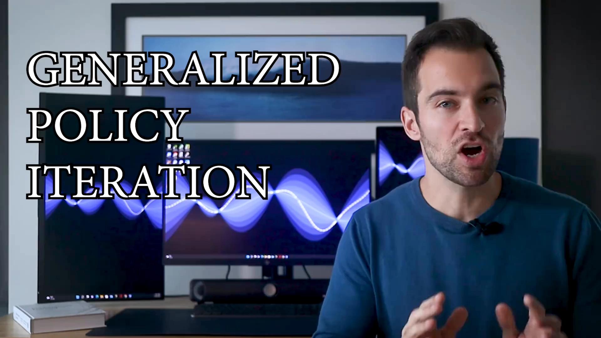

---

## 一、贝尔曼方程把"找最优策略"变成"解方程组"

GPI 的两股力量都建立在贝尔曼方程上，所以先把地基铺好。

### 1.1 两个连接关系：V 与 Q 互相定义

对任何策略 π、任何状态、任何动作，都有下面两条关系（`π(a|s)` 表示在状态 `s` 下选择动作 `a` 的概率）：

```
(1) V(s) = Σ_a π(a|s) · Q(s, a)                      ← 状态价值 = 动作价值的策略加权平均
(2) Q(s, a) = Σ_{s′,r} p(s′,r|s,a) · [ r + γ · V(s′) ]  ← 动作价值 = 下一阶段奖励与折现价值的期望
```

第一条说的是：状态的价值，就是在该状态下按策略抽动作、各个动作价值按概率加权平均。第二条说的是：动作的价值，是把"这一步拿到的奖励 + 折现后的下一状态价值"按环境动态的分布求期望。

注意这两条**还不是**贝尔曼方程，但可以用它们搭出贝尔曼方程。视频里用一个网格来整理：**行是状态价值 V、列是动作价值 Q，每个单元格对应一个方程**；方程左边由行标签决定，右边由列标签决定。

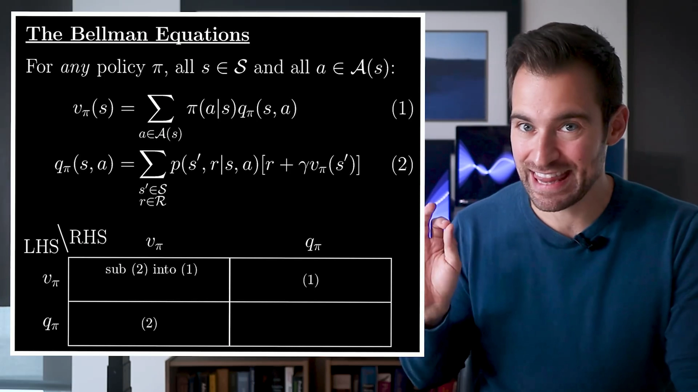

- 把 (2) 代入 (1)：得到**状态价值**的贝尔曼方程——任意状态价值可以用"一步之外"的状态价值表示；
- 把 (1) 代入 (2)：得到**动作价值**的贝尔曼方程——任意动作价值可以用"一步之外"的动作价值表示。

[【跳转到 09:48】](https://www.bilibili.com/video/BV1Vz9UBbEtC/?t=588)

这一步的意义在于：**每个未知的价值都有一个对应的贝尔曼方程**，所以"求价值函数"就等价于"解一个方程组"。有 100 个状态，就有 100 个方程。

### 1.2 一个 5 状态的小例子：贝尔曼方程在做什么

假设有 5 个状态，把注意力放在中间的状态 `S0`。从 `S0` 可以向左或向右：

- 向右时，环境按一个分布给出"奖励—下一状态"的组合，例如有 9% 的概率落到 `S2` 且奖励为 0；向左同理；
- `S0` 的策略是：40% 概率向左、60% 概率向右；折扣因子 `γ = 0.95`。

问题是：**如果我还告诉你各个下一状态的价值，你能算出 `S0` 的价值吗？** 这正是贝尔曼方程在做的事。推导分三步：

```
第 1 步（按动作分解，用全概率定律）：
  V(S0) = 0.4 · E[G_t | S0, 左] + 0.6 · E[G_t | S0, 右]
        = 0.4 · Q(S0, 左) + 0.6 · Q(S0, 右)

第 2 步（用回报的递归关系 G_t = R_{t+1} + γ·G_{t+1}）：
  E[G_t | S0, 右] = E[ R_{t+1} + γ·G_{t+1} | S0, 右 ]

第 3 步（把 G_{t+1} 换成"下一状态的价值 V(S_{t+1})"）：
  二者并不相等，但在期望意义下相等——这一步替换是合法的
```

第三步是整个推导里最巧妙的地方：`G_{t+1}` 是随机变量，`V(S_{t+1})` 是它的条件期望；把随机变量换成它的期望会改变取值，**但外面还套着一层期望**，所以最终结果不变。替换之后剩下的就只是"按概率加权平均"了——而权重（各个"奖励—下一状态"的概率）恰好就是环境动态给出的分布，全部已知，于是所有数值都能算出来。

[【跳转到 03:31】](https://www.bilibili.com/video/BV1Vz9UBbEtC/?t=211) · [【跳转到 05:44】](https://www.bilibili.com/video/BV1Vz9UBbEtC/?t=344)

### 1.3 从"跟随策略"到"选择动作"：贝尔曼最优方程

上面的方程对**任何策略**都成立，它描述的是"跟随 π"时的连接关系。要谈最优策略，只改一个地方：**状态价值不再对动作做加权平均，而是取最大的动作价值**。

还是那 5 个状态。假设告诉你：从 `S0` 向左并此后一直遵循最优策略，平均回报是 `19.1`；向右是 `21.3`。你显然应该向右——否则就是主动放弃预期回报。所以 `S0` 的最优价值必须是 `21.3`，即

```
V*(s) = max_a Q*(s, a)
```

这就是**贝尔曼最优性的基本条件**：智能体必须始终选择动作价值最高的那个动作，否则就不是最优行为。如果多个动作并列最高，说明存在多个最优策略（视频里点到为止，细节可查原书）。

[【跳转到 07:19】](https://www.bilibili.com/video/BV1Vz9UBbEtC/?t=439) · [【跳转到 08:20】](https://www.bilibili.com/video/BV1Vz9UBbEtC/?t=500)

---

## 二、策略评估：把贝尔曼方程变成"反复赋值"

有了贝尔曼方程，第一个子程序就水到渠成了。

**策略评估（Policy Evaluation）** 的定义是：给定一个固定策略 π，计算它在**所有状态**（或所有状态-动作对）上的价值函数。求解方法有好几种，这里用的是最简单的**迭代解法**：不直接解方程组，而是"反复代入、逐步逼近"。

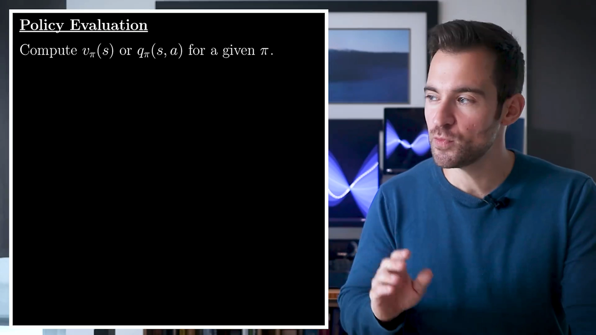

[【跳转到 11:34】](https://www.bilibili.com/video/BV1Vz9UBbEtC/?t=694)

### 2.1 用 Sutton & Barto 的 4×4 网格世界做例子

设定如下（书中的 Example 4.1）：

- **16 个状态**，其中 2 个是终止状态（左上角和右下角）；
- 智能体可以向上、下、左、右移动，**确定性**地转移到相邻格子；如果会走出网格，就原地不动；
- 每移动一步奖励 **-1**，**没有折扣**（`γ = 1`）；
- 目标：尽快到达终止状态。

要回答的问题是：**给定一个"四个动作等概率随机选"的简单策略，它的价值函数是什么？**

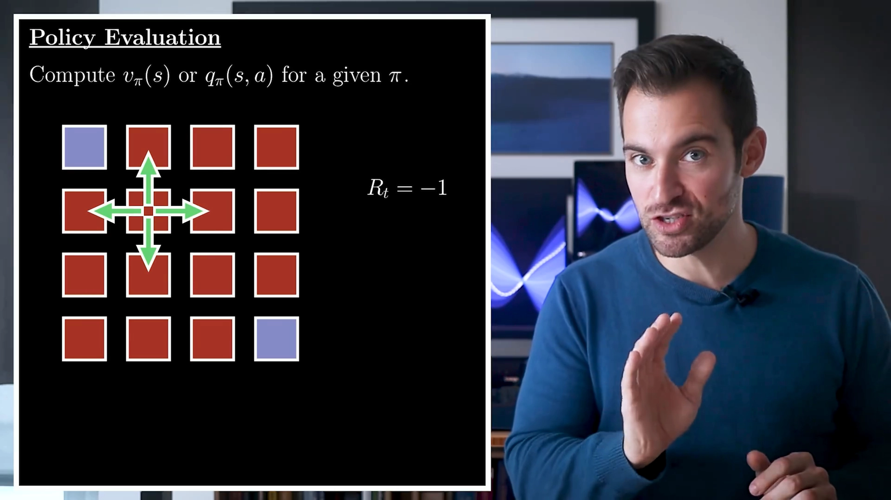

[【跳转到 11:54】](https://www.bilibili.com/video/BV1Vz9UBbEtC/?t=714)

### 2.2 算法：随机初始化，然后不断"按贝尔曼方程重新赋值"

```
1. 随机初始化所有状态的价值 V(s)（终止状态必须固定为 0，这一点永远成立）
2. 重复：
     对每个状态 s：
         V(s) ← Σ_a π(a|s) · Σ_{s′,r} p(s′,r|s,a) · [ r + γ · V(s′) ]   ← 按贝尔曼方程重新赋值
     这一次"把所有状态都重算一遍"叫一次遍历（sweep）
   直到所有价值的变化都不超过一个小量
3. 输出 V ≈ V^π
```

用大写 `V(s)` 表示这个"随机估计"，是因为它一开始只是逼近真实值的估计量。初始值显然不满足贝尔曼方程，所以还不是解；而最简单的修正办法就是**直接按贝尔曼方程重新赋值**——让每个状态的价值由它邻居的（当前估计的）价值决定。

[【跳转到 12:57】](https://www.bilibili.com/video/BV1Vz9UBbEtC/?t=777)

![按贝尔曼方程重新赋值：V(s) ← Σ_a π(a|s) Σ p(s′,r|s,a)[r + γV(s′)]，格子里是收敛后的价值](assets/广义策略迭代GPI与动态规划的维度灾难/00817.webp)

直觉是：**每一次赋值都会把 MDP 的一部分信息注入进来**，价值估计因此逐步改善；重复足够多次，就有理论保证收敛到正确答案。这就是策略评估的全部内容——**把贝尔曼方程翻译成赋值语句，然后反复执行**。

如果改用动作价值，过程几乎一模一样：把状态换成状态-动作对，把贝尔曼方程换成动作价值版本即可。

[【跳转到 13:27】](https://www.bilibili.com/video/BV1Vz9UBbEtC/?t=807)

---

## 三、策略改进：用"贪心"把价值函数翻译成更好的策略

第二个子程序回答的问题是：**给定某个策略 π 的价值函数，怎么确定一个更好的策略？**

### 3.1 灵感来自最优策略的行为

为简化起见，先设策略是**确定性**的（每个状态只选一个动作）。回顾最优策略的行为：**每个状态下所选择的动作，必须实现最大的动作价值**。这就给了灵感——那就照做：

```
π′(s) = argmax_a Q^π(s, a) = argmax_a Σ_{s′,r} p(s′,r|s,a) · [ r + γ · V^π(s′) ]
```

也就是说，在**原来策略的价值函数**上，每个状态都改选动作价值最大的那个动作。这样得到的新策略，叫做相对于价值函数 `V^π` 的**贪心策略（greedy policy）**——它和贪心算法一样，靠"每一步局部取最优"逐步逼近全局最优。

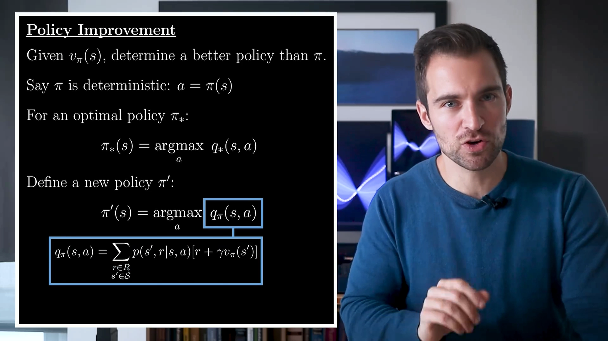

[【跳转到 13:37】](https://www.bilibili.com/video/BV1Vz9UBbEtC/?t=817) · [【跳转到 14:16】](https://www.bilibili.com/video/BV1Vz9UBbEtC/?t=856)

### 3.2 策略改进定理：这样做一定不会变差

这个操作不是瞎猜，它有**策略改进定理（Policy Improvement Theorem）** 兜底：新得到的贪心策略**至少和原策略一样好**（价值函数在每个状态上都不低于原策略）。所以这一步"总是有帮助"，不会把已经不错的东西改坏。

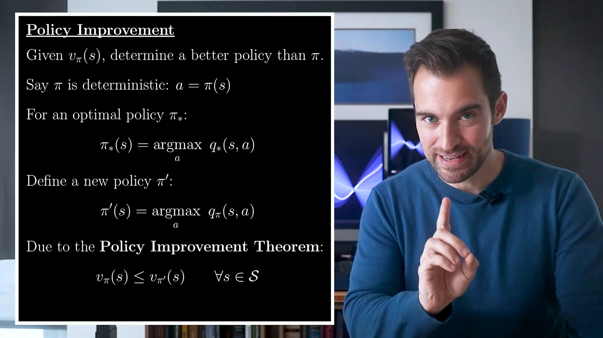

回到网格世界的例子：前面算出的价值函数对应的是"四个动作等概率"的随机策略。对它做一次策略改进——每个状态只选动作价值最高的方向——得到的策略**一眼就能看出是最优策略**（朝终止状态走）。

[【跳转到 14:39】](https://www.bilibili.com/video/BV1Vz9UBbEtC/?t=879) · [【跳转到 15:07】](https://www.bilibili.com/video/BV1Vz9UBbEtC/?t=907)

不过要强调：**一般来说，需要多次策略改进迭代才能到达最优策略**。网格世界一次就到位，属于运气好（问题简单）。

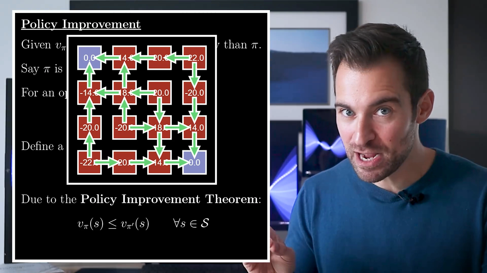

### 3.3 什么时候该停？——一个漂亮的判据

一个自然的疑问：**如果策略已经是相对于它自己价值函数的贪心策略，那不就再也改不动了吗？** 确实改不动了。但有趣的是，这个"改不动"恰恰是好消息：

> 如果价值函数满足"评估该策略"的条件（即 `V` 是该策略的贝尔曼期望方程的解），**并且**该策略相对于这个价值函数是贪心的（`π(s) = argmax_a Q(s,a)`），那么它就必然满足贝尔曼**最优**方程——也就是说，**此时已经处于最优策略**。

于是"改进不动了"不再是"卡住了"，而是"到达终点了"。这个判据意味着：**这种交替调整只有在无法继续优化时才会停止**，停下来的时候一定是全局最优。

[【跳转到 15:37】](https://www.bilibili.com/video/BV1Vz9UBbEtC/?t=937)

---

## 四、策略迭代：评估到底，再改进，直到不动

把两个子程序串起来，就得到最直接的算法——**策略迭代（Policy Iteration）**，它是 GPI 的一个特例：

```
π0  ← 任意初始化的策略
重复：
    V(π_k) ← 策略评估：反复遍历状态，直到价值不再变化（把 π_k 评估"到底"）
    π_{k+1} ← 策略改进：对 V(π_k) 取贪心
直到策略与价值函数都不再变化
输出：π* ≈ π_k，V* ≈ V(π_k)
```

注意这个循环里有个关键细节：**改进之后，原来的价值函数就不适用了**（它是为旧策略算的），所以必须重新评估，拿到新策略的价值函数，再对它做改进。如此往复。

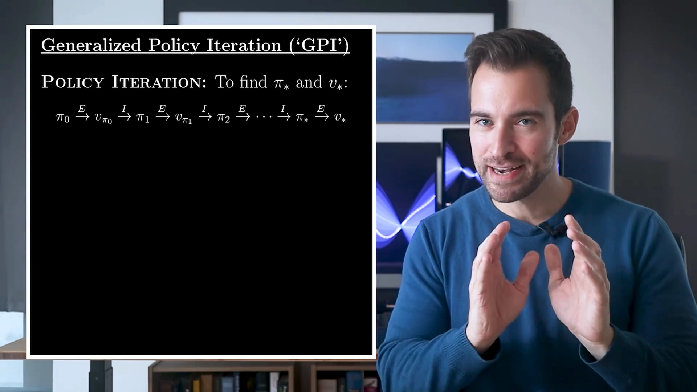

[【跳转到 15:57】](https://www.bilibili.com/video/BV1Vz9UBbEtC/?t=957) · [【跳转到 16:13】](https://www.bilibili.com/video/BV1Vz9UBbEtC/?t=973)

视频里对这一步的评价是："很少遇到如此简单却如此有用的东西，它能实现如此重要的功能。"——**评估**保证价值函数忠实反映当前策略，**改进**保证策略单调变好，两者配合，最终必然停在最优处。

---

## 五、GPI：把"评估—改进"抽象成两股相互驱动的力量

策略迭代只是一个**具体算法**。真正重要的是它背后的**通用理念**——Sutton & Barto 的定义（视频直接朗读原文）是：

> **GPI 指的是"策略评估与策略改进过程相互作用的通用理念，独立于具体细节以及两个过程的其他细节"。**

换句话说：GPI 不关心你用哪种方法做评估、也不关心你改进到什么程度，它只关心**"评估"和"改进"这两个角色在互相推动**。几乎所有强化学习方法都可以归入 GPI——这就是它作为"整体框架"的宏大之处。

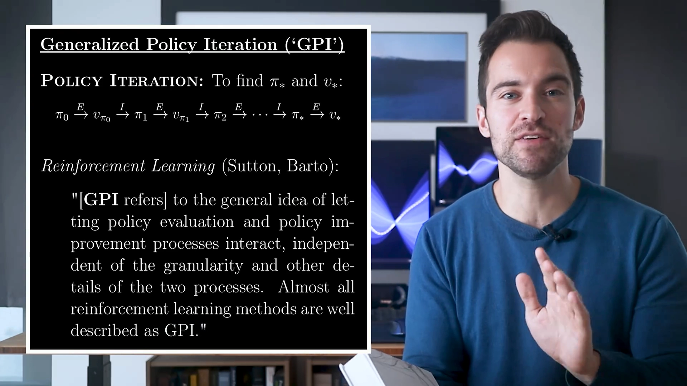

[【跳转到 16:54】](https://www.bilibili.com/video/BV1Vz9UBbEtC/?t=1014) · [【跳转到 17:03】](https://www.bilibili.com/video/BV1Vz9UBbEtC/?t=1023)

### 5.1 两股力量：既竞争又协同

GPI 之所以能工作，是因为两个过程的目标**方向相反**：

- **评估**想让价值函数**与当前策略一致**——它"配合"策略，把策略的真实表现算准；
- **改进**想让策略**与当前价值函数不一致**——它"对抗"价值函数，凡是价值函数指出的更优动作，就要改过去。

一旦两者完全一致（策略对它自己的价值函数贪心），系统就到达了不动点，而这个不动点就是最优解。所以它们**相互竞争**（都想改变对方）又**相互协同**（合起来把解推向最优）。视频开头的说法是：这些操作"作为相互竞争又相互协同的驱动力量，共同产生优质策略"。

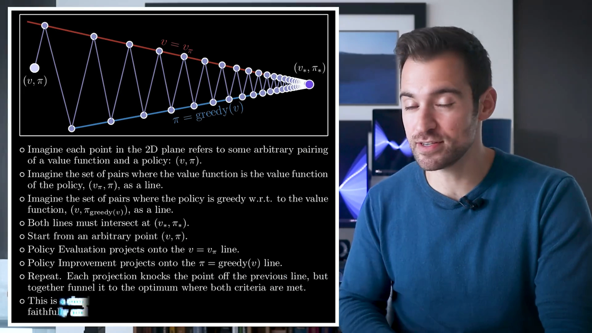

[【跳转到 00:45】](https://www.bilibili.com/video/BV1Vz9UBbEtC/?t=45) · [【跳转到 18:07】](https://www.bilibili.com/video/BV1Vz9UBbEtC/?t=1087)

### 5.2 价值迭代：把"评估到底"砍成"只走一步"

GPI 的威力体现在它的**可变形性**上。策略迭代里的评估要"反复遍历状态直到价值不再变化"，这很贵。那能不能改一下：

> **只做一次遍历（甚至只走一步）就立刻切换到策略改进，还能收敛到最优解吗？**

**能。** 这就是**价值迭代（Value Iteration）**——GPI 框架下的另一种算法：

```
V ← 任意初始化
重复：
    V(s) ← max_a Σ_{s′,r} p(s′,r|s,a) · [ r + γ · V(s′) ]    ← 只做一次"评估"，且用 max 而非加权平均
直到 V 不再变化
```

价值迭代可以看成"**评估只做一步的策略迭代**"：既然评估不必做完，那就干脆把它压到最省。而这正是 GPI 的普遍结论：

> **只要每个过程各尽其职、哪怕只部分完成，算法仍然会在极限下得到最优策略。**

[【跳转到 17:23】](https://www.bilibili.com/video/BV1Vz9UBbEtC/?t=1043) · [【跳转到 17:36】](https://www.bilibili.com/video/BV1Vz9UBbEtC/?t=1056) · [【跳转到 17:49】](https://www.bilibili.com/video/BV1Vz9UBbEtC/?t=1069)

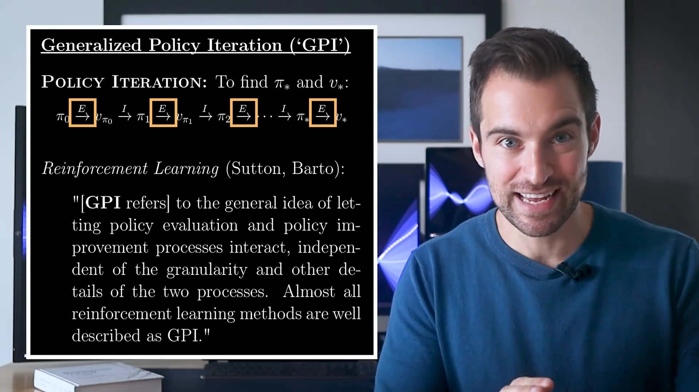

---

## 六、价值迭代实战：赌徒问题

理论讲完，看一个"最优策略反直觉"的例子——Sutton & Barto 书中的**赌徒问题（Gambler's Problem）**。

### 6.1 问题设定

- **状态**：赌徒的资金，是 1 到 99 之间的整数；
- **终止状态**：资金达到 **100 美元**（赢）或 **0 美元**（输）；
- **动作**：押注一枚硬币，正面朝上的概率是 **40%**。他可以押注不超过当前金额的整数金额，也可以押"距离 100 美元的差额"；
- **转移**：正面朝上则赢得所押金额，否则损失该金额；
- **奖励**：不使用折扣，除"转移到 100 美元状态"时获得奖励 1 之外，所有奖励都是 0（可用指示函数表达）。

```
状态 s ∈ {1, 2, …, 99}，终止：s = 0（输）、s = 100（赢）
动作 a ∈ {1, 2, …, min(s, 100 − s)}
转移：s → s + a  以 0.4 的概率（正面）
      s → s − a  以 0.6 的概率（反面）
奖励：r = 1 当且仅当 s + a = 100，其余为 0；γ = 1
```

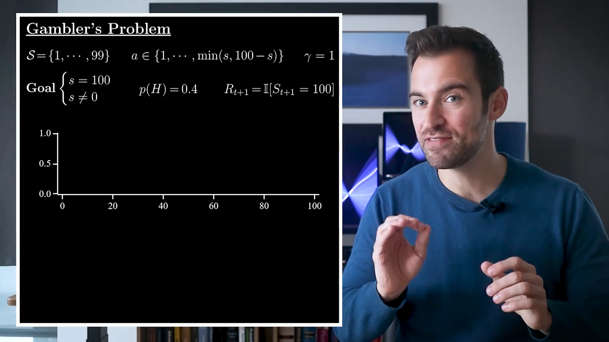

[【跳转到 18:12】](https://www.bilibili.com/video/BV1Vz9UBbEtC/?t=1092) · [【跳转到 18:17】](https://www.bilibili.com/video/BV1Vz9UBbEtC/?t=1097)

### 6.2 怎么可视化

视频用两张图来观察迭代过程：

1. **价值函数图**：横轴是状态（资金），纵轴是该状态的价值（赢的概率）；
2. **押注方案图**：纵轴是每个状态下的最佳押注额。这个问题的最优策略是**确定性**的；由于最高动作价值经常出现大量并列，用"**总是选最小押注**"来打破平局。

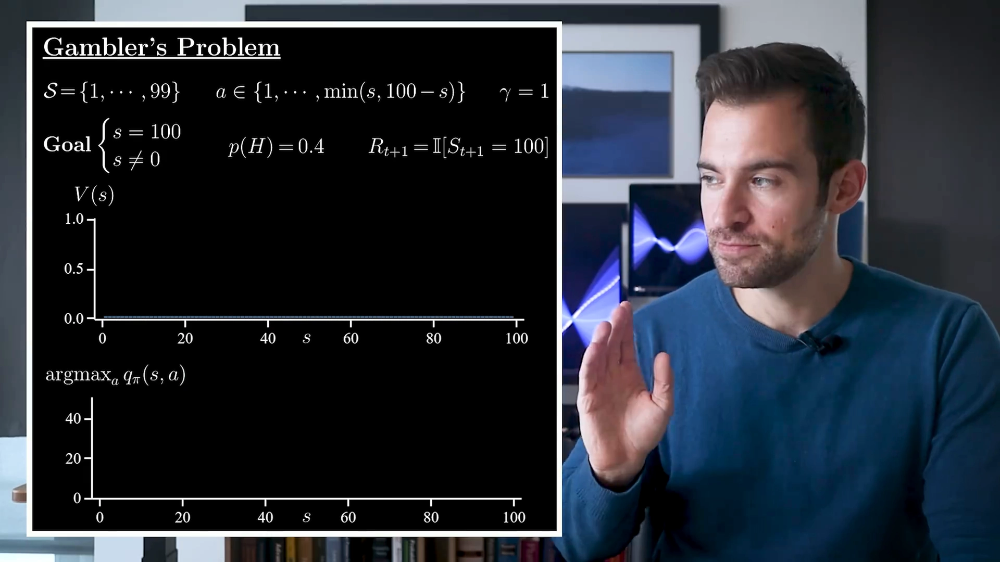

[【跳转到 18:42】](https://www.bilibili.com/video/BV1Vz9UBbEtC/?t=1122) · [【跳转到 19:07】](https://www.bilibili.com/video/BV1Vz9UBbEtC/?t=1147)

### 6.3 迭代过程：一次遍历 + 一次贪心，反复交替

- 把价值函数**初始化为全 0**（这不是必须的，但作为起点是有效的）；
- 做第一次策略改进，得到一批押注方案——文稿中的描述是：资金超过 50 时，就把"凑够 100 所需的差额"全押上；
- 接着问：这个策略在每个状态的价值是多少？如果走**策略迭代**，就要反复遍历状态直到价值函数不再变化；但走**价值迭代**不需要——**只做一次遍历，随后立刻让策略相对于新的价值函数贪心**；
- 这个过程反复交替进行，直到不再变化，就得到最优策略。

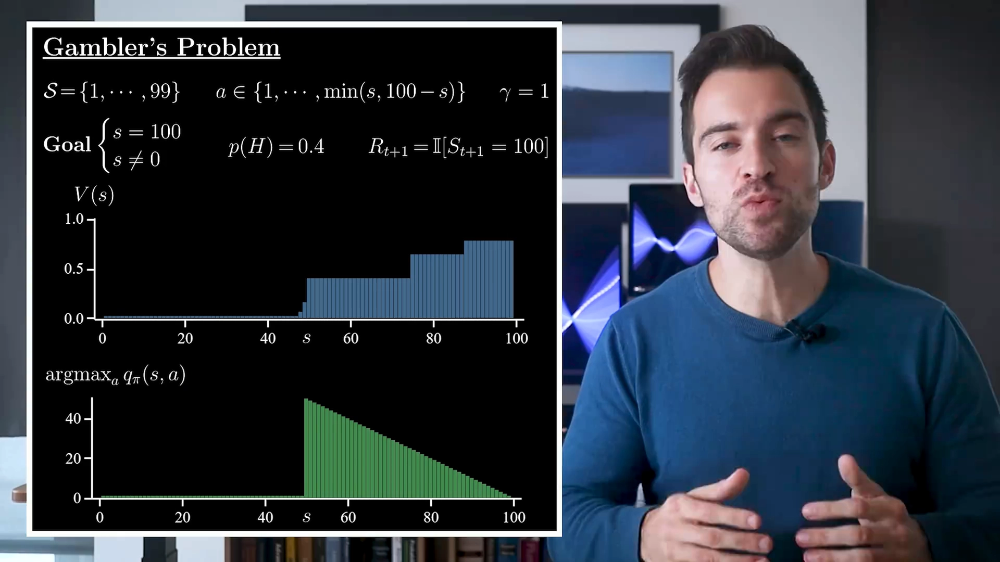

[【跳转到 19:32】](https://www.bilibili.com/video/BV1Vz9UBbEtC/?t=1172) · [【跳转到 19:55】](https://www.bilibili.com/video/BV1Vz9UBbEtC/?t=1195)

### 6.4 结果：一个"有趣且非同寻常"的最优策略

收敛后的最优策略**看起来很有趣、也很不寻常**——它不是"资金越多押得越多"这种直觉方案，而是在不同资金区间上表现出完全不同的押注行为。

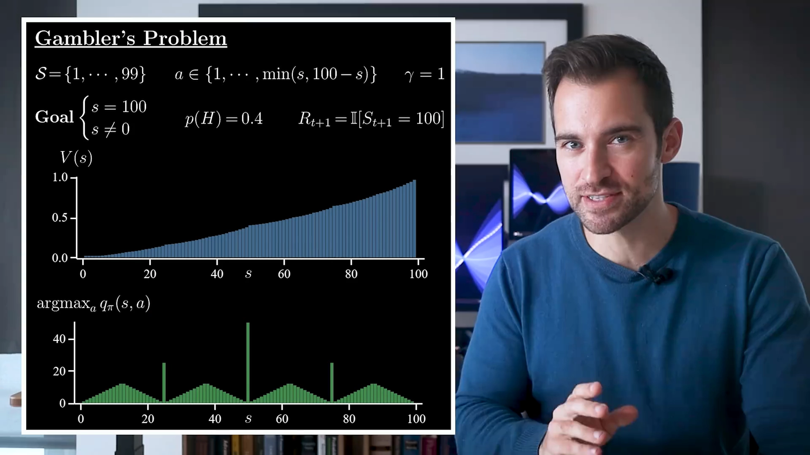

[【跳转到 20:25】](https://www.bilibili.com/video/BV1Vz9UBbEtC/?t=1225)

这个例子的价值在于：**对这个问题做巧妙的数学分析，当然也能发现这个策略；但动态规划让我们不必如此**——用简单通用的算法，就能拿到问题所需的最优策略。这就是 GPI 系列方法的实用力量。

---

## 七、GPI 的边界：模型假设与维度灾难

**GPI 很强，但它的力量到此为止。** 上面所有推导都建立在两个"舒适假设"上，缺一不可。

### 7.1 假设一：必须完全知道环境模型

动态规划的所有赋值式里都出现了 `p(s′,r|s,a)`——环境动态的概率分布。也就是说，DP 要求**能精确访问环境模型**。这在现实世界里是不现实的假设：真实问题里我们通常只有一个黑盒，只能交互、拿数据，拿不到转移概率的解析形式。

### 7.2 假设二：状态空间必须有限、且不能太大 —— 维度灾难

第二个限制更致命：**DP 的每次遍历都要访问每一个状态，每个状态都要枚举它的所有动作和所有后继状态**。于是计算量与内存开销都随**状态数量**增长。而状态数量在真实问题里往往是这样爆炸的：

```
状态 = 若干状态变量的组合
若每个变量有 k 种取值、共 d 个变量，则状态数 ≈ k^d   ← 随维数 d 指数增长
```

这就是**维度灾难（Curse of Dimensionality）**：状态数随状态变量维数**指数增长**，而 DP 必须把每个状态都算一遍，于是"状态空间不能太大"这条限制很快就被现实撞破。棋盘类问题（4×4 网格、资金 1~99）状态数很小，所以 DP 又快又准；一旦换成图像输入、机器人连续控制这类问题，状态数就是天文数字，DP 直接不可行。

[【跳转到 20:35】](https://www.bilibili.com/video/BV1Vz9UBbEtC/?t=1235) · [【跳转到 20:40】](https://www.bilibili.com/video/BV1Vz9UBbEtC/?t=1240) · [【跳转到 20:45】](https://www.bilibili.com/video/BV1Vz9UBbEtC/?t=1245)

### 7.3 但它是整个强化学习的地基

尽管有这些限制，这套理论仍然是强化学习的**基础**：GPI 这个"评估—改进"的骨架，在后面所有无模型方法里都会以新的形式反复出现——只是把"用模型算期望"换成"用样本估期望"。对于现实问题，我们要做的是**主动拆掉这些舒适假设**，并证明仍然能取得良好进展。这正是下一讲**蒙特卡洛方法**要做的事。

[【跳转到 20:51】](https://www.bilibili.com/video/BV1Vz9UBbEtC/?t=1251)

---

## 小结

- **贝尔曼方程是地基**：`V(s) = Σ_a π(a|s)·Q(s,a)` 与 `Q(s,a) = Σ_{s′,r} p(s′,r|s,a)[r + γV(s′)]` 互相代入，就得到状态价值/动作价值的贝尔曼方程；把加权平均换成 `max` 就得到贝尔曼最优方程。每个未知价值配一个方程，求价值 = 解方程组。
- **策略评估 = 把贝尔曼方程翻译成赋值语句**：随机初始化（终止状态固定为 0），反复遍历所有状态重新赋值，直到价值变化足够小；每次赋值都注入一部分 MDP 信息，因此必然逐步收敛。
- **策略改进 = 对当前价值函数取贪心**：`π′(s) = argmax_a Q^π(s,a)`；策略改进定理保证新策略至少和旧策略一样好。
- **"改不动了"就是最优**：若 `V` 是某策略的贝尔曼期望方程解，且该策略对 `V` 贪心，则它满足贝尔曼最优方程，必为最优策略。
- **策略迭代 = 评估到底 + 改进一次，循环到不动**；**价值迭代 = 评估只走一步 + 改进一次，循环到不动**。二者都是 GPI 的特例。
- **GPI 是统一框架**：评估想让价值函数与策略一致，改进想让策略与价值函数不一致；两股力量相互竞争又协同，只要各尽其职、哪怕只部分完成，极限下仍收敛到最优。
- **GPI 的代价**：必须完全已知环境模型，且状态空间不能太大；状态数随维数指数增长（维度灾难），这是 DP 无法绕开的边界，也是后续无模型方法的出发点。

## 关键术语速查

| 术语 | 一句话解释 |
| --- | --- |
| 贝尔曼方程（Bellman Equation） | 把"某状态的价值"与"一步之后各状态的价值"联系起来的方程，是 DP 与 RL 的共同地基 |
| 贝尔曼最优方程（Bellman Optimality Equation） | 把贝尔曼方程里的"策略加权平均"换成"取最大"，描述最优价值函数 |
| 策略评估（Policy Evaluation） | 给定固定策略 π，算出它在所有状态上的价值函数 `V^π` |
| 策略改进（Policy Improvement） | 对现有价值函数取贪心，得到不差于原策略的新策略 |
| 策略改进定理（Policy Improvement Theorem） | 贪心得到的新策略在每个状态上的价值都不低于原策略 |
| 策略迭代（Policy Iteration） | 评估到收敛 + 改进一次，反复循环，直到策略与价值都不再变化 |
| 价值迭代（Value Iteration） | 评估只做一次遍历（且用 max）就立刻改进，反复循环 |
| 广义策略迭代（GPI） | "评估与改进相互作用"的通用理念，独立于两个过程的具体实现细节 |
| 遍历（Sweep） | 把所有状态各重新赋值一次 |
| 维度灾难（Curse of Dimensionality） | 状态数随状态变量维数指数增长，使"遍历所有状态"的计算方式不可行 |
