# 第3.2讲：策略评估——用迭代把"当前策略有多好"算出来

> 本篇整理自强化学习系列课程中「策略评估：迭代求解价值函数」一讲。视频地址：[BV1waz9YFEc2](https://www.bilibili.com/video/BV1waz9YFEc2/)。

## 本讲要解决的核心问题（SCQA）

**背景**：上一讲把强化学习问题做了完整的数学建模——用马尔可夫决策过程（MDP）描述"状态、动作、转移、奖赏、折扣"这五件事，并把"求最优策略"写成了贝尔曼方程。既然方程已经列出来了，剩下的似乎只是解方程。

**冲突**：可是**解方程组这条路会走不通**。贝尔曼方程是"每个状态一个方程、所有状态互相耦合"的联立方程组：状态空间或状态-动作空间一大，方程组的规模就爆炸，甚至根本解不出来。

**疑问**：不直接解方程组，还能怎么求出价值函数？

**回答（中心思想）**：把**方程**改写成**迭代式**——不去"一次解出所有未知数"，而是从一个随便的初值出发，反复用同一套更新规则把估计值往前推，推到不再变化（收敛）为止。这套"反复迭代逼近真值"的做法就是**动态规划（Dynamic Programming, DP）**。本讲聚焦它在策略迭代中的第一步——**策略评估（Policy Evaluation）**：给定一个策略 π，把它的状态值函数 $V_\pi(s)$ 算出来。关键有三点：

1. 评估的对象**永远是当前这个策略 π**，评估的就是"还没改进的 π 有多好"；
2. 评估本身是**一个小迭代**（记作 t），它嵌在策略迭代的**大迭代**（记作 k）里面；
3. 迭代要能停下来，靠的是**阈值判据**（两轮价值之差的最大值小于 ε），而不是拍脑袋定次数。

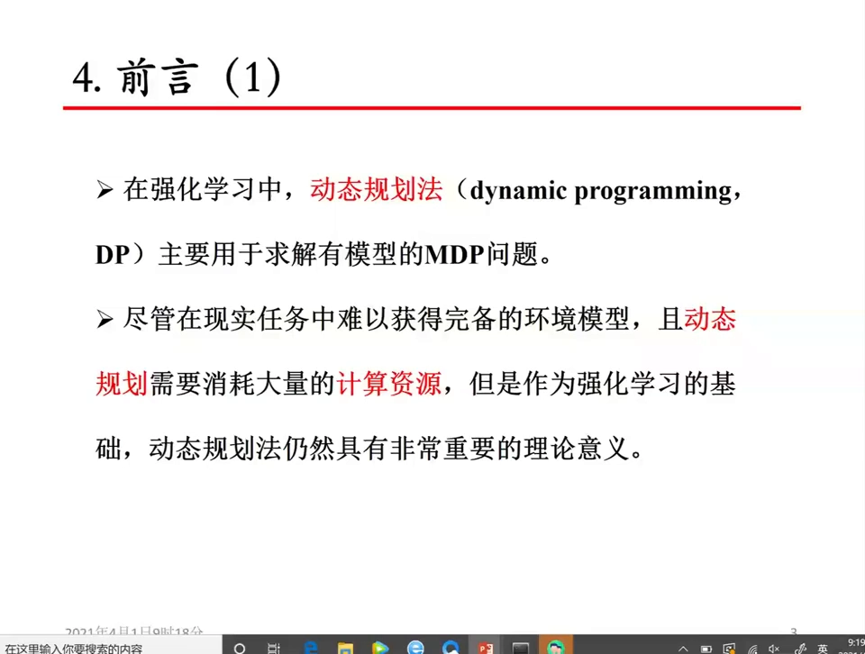

---

## 一、动态规划法的前提与代价：它要求"有模型"

### 1.1 前提：转移概率和奖赏函数都得知道

动态规划法主要用于求解**有模型的 MDP**。所谓"有模型"，指的是**迁移动态已知**——也就是已知

- **转移概率**：在当前状态 $s$ 采取动作 $a$ 之后，到达下一个状态 $s'$ 的概率；
- **奖赏函数**：到达 $s'$ 的同时能拿到的立即奖赏。

两者合起来写成 $P(s', r \mid s, a)$：在状态 $s$ 采取动作 $a$，转移到 $s'$ 并且拿到奖赏 $r$ 的概率。这个量就是本讲所有公式里那个"动态"（dynamics）。

[【跳转到 01:00】](https://www.bilibili.com/video/BV1waz9YFEc2/?t=60)

### 1.2 代价：现实里这个概率很难拿到

麻烦在于，现实任务中这样的概率**很难得到**。比如要让扫地机器人知道"当前采取某个动作后转移到下一个状态"的分布，就必须做大量实验、经过大量统计，才能得到一个比较接近真实值的概率。所以动态规划法"需要模型、而模型又很难获得"，在现实应用中有不少局限性。

[【跳转到 01:25】](https://www.bilibili.com/video/BV1waz9YFEc2/?t=85)

### 1.3 那为什么还要学它：它是后面所有方法的理论底座

原因有两个：

1. **它是后续方法的理论基准**。蒙特卡洛法（MC）和时序差分法（TD），本质上都是对动态规划法的一种**近似**——把"用模型算期望"换成"用采样估期望"。学会了 DP，后面才看得懂 MC 和 TD 在近似什么。
2. **模型已知时，它不需要真实实验**。只要模型给定，就不必到真实环境里跑，纯靠**计算**就能把最优价值和最优策略求出来。所以这一章会有很多计算，都是"纸上算出来"的。

[【跳转到 02:15】](https://www.bilibili.com/video/BV1waz9YFEc2/?t=135)

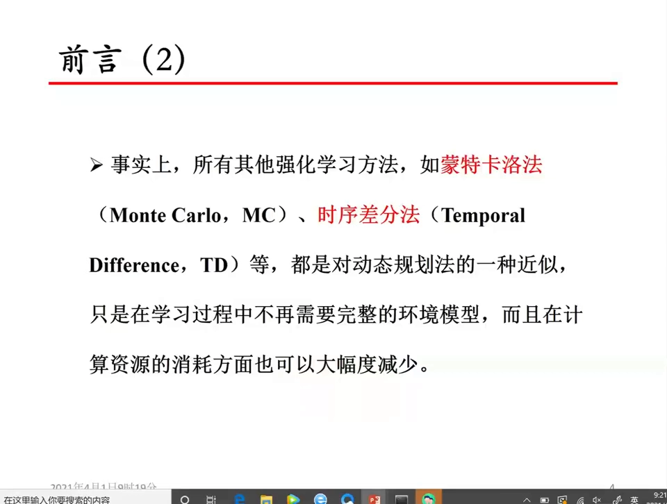

### 1.4 定位：它是"基于值函数"的方法，而且分两条路

动态规划法主要利用**价值函数**来评价策略，所以它属于**基于值函数的方法**（与之并列的另一大类是基于策略梯度的方法）。又因为它基于模型、需要知道动态 $P(s', r \mid s, a)$，所以它分成两种：

- **有模型的策略迭代**（policy iteration）；
- **有模型的值迭代**（value iteration）。

本讲只讲策略迭代的第一步：策略评估。

[【跳转到 03:30】](https://www.bilibili.com/video/BV1waz9YFEc2/?t=210)

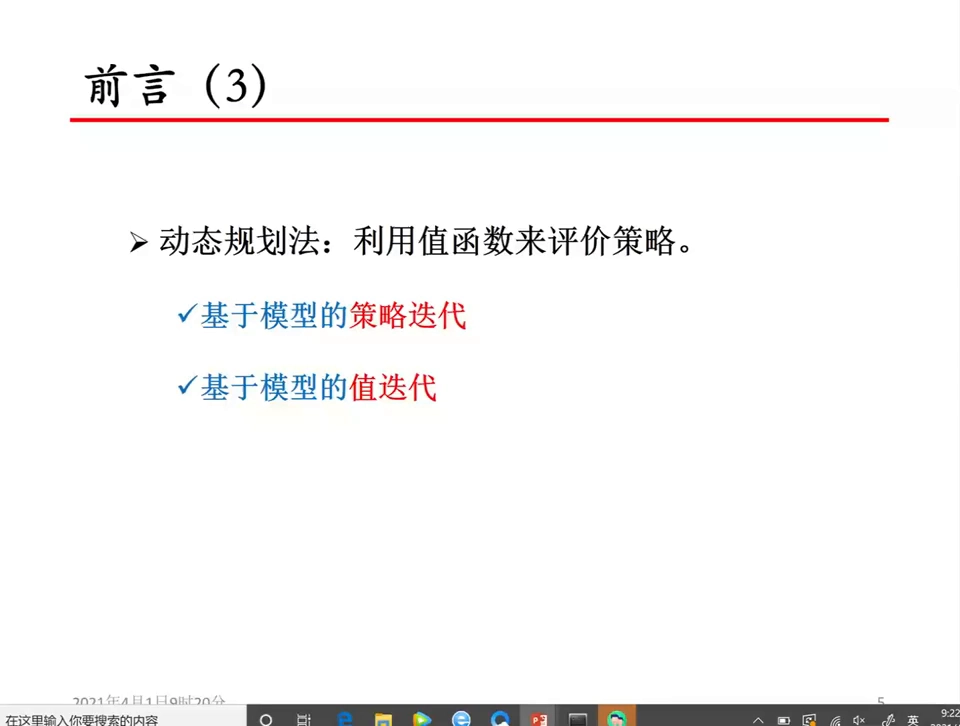

---

## 二、策略评估在策略迭代中的位置：它是"评估—改进"循环的第一环

### 2.1 策略迭代 = 策略评估 + 策略改进

**策略迭代**的思路是：先构建当前策略的值函数（既可以是状态值函数 $V$，也可以是动作值函数 $Q$）来**评价**当前策略，再利用这些值函数给出**改进后**的新策略。它包含两个步骤：

- **第一步：策略评估**——对当前策略评估它的价值；
- **第二步：策略改进**——拿到每个状态（或状态-动作对）的价值之后，据此改进策略。

然后就这样"评估—改进—再评估—再改进"循环往复。

[【跳转到 04:24】](https://www.bilibili.com/video/BV1waz9YFEc2/?t=264)

### 2.2 什么是策略评估：给定 π，求出它名下所有状态的价值

每一次策略评估都是一个**迭代过程**：对**给定的策略 π**，评估在该策略下**所有状态**（或所有状态-动作对）的值函数——$V_\pi$ 或 $Q_\pi$。

注意这两个记号右下角都带一个 π：这说明评估是在**当前策略下**进行的，而且**必须**在当前策略下进行。评估到什么时候结束？要等到这一轮评估**收敛**——迭代出来的 V 值或 Q 值不再变化，才认为本次评估结束。评估结束就进入下一步。

[【跳转到 05:14】](https://www.bilibili.com/video/BV1waz9YFEc2/?t=314)

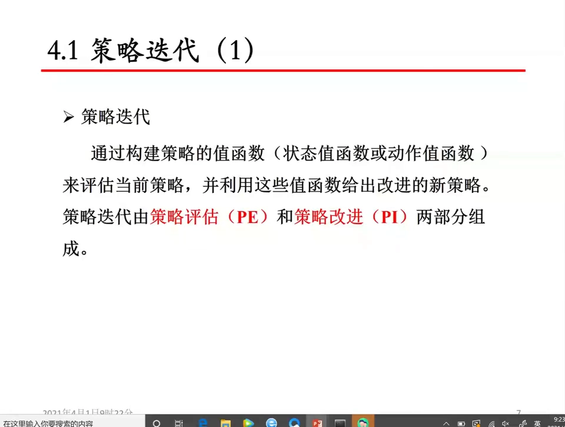

### 2.3 评估的产物长什么样：V_π 与 Q_π

评估的产物是一张"价值表"：

- **状态值函数 $V_\pi(s)$**：在策略 π 下，从状态 $s$ 出发一直走下去能拿到的累积奖赏期望；
- **动作值函数 $Q_\pi(s, a)$**：在策略 π 下，从状态 $s$ 出发、**先执行动作 $a$**，之后一直按 π 走能拿到的累积奖赏期望。

两者描述的是同一件事的两个粒度：$V$ 是"站在状态上看"，$Q$ 是"站在状态-动作对上看"。

[【跳转到 05:39】](https://www.bilibili.com/video/BV1waz9YFEc2/?t=339)

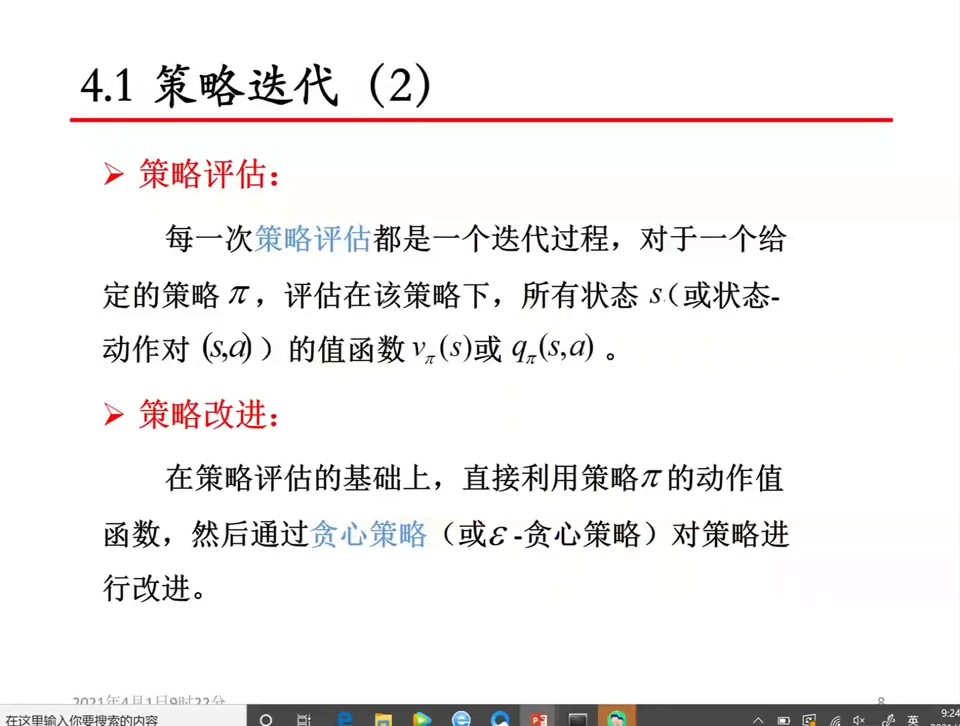

### 2.4 评估之后怎么改进：贪心与 ε-贪心

评估完成、$V_\pi$ 或 $Q_\pi$ 都已收敛，第二步就利用**动作值函数**做贪心改进：在每个状态下，选动作价值最大的那个动作。

如果手上只有状态值函数怎么办？那就**先补算动作值**：把每个状态-动作对的 $Q$ 算出来，再按 $Q$ 的大小决策——某个状态下有三个动作，就选值最大的那个。

具体有两种改进规则：

- **贪心（greedy）策略**：直接选价值最大的动作，其余动作概率为 0；
- **ε-贪心（ε-greedy）策略**：以 ε 的概率（比如 0.1）在所有动作上**均匀随机**地选，以 1−ε 的概率（比如 0.9）选价值最大的动作。多出来的这点随机性是为了保留探索。

于是当前策略就从 π 变成了 π′，而 π′ 正是"对 π 评估之后的值函数做贪心（或 ε-贪心）"得到的改进策略。

[【跳转到 06:29】](https://www.bilibili.com/video/BV1waz9YFEc2/?t=389)

### 2.5 一条链式关系：V_π → Q_π → 策略改进

把上面两步串起来，就得到一条层层递进的关系：

```
V_π  ──（补算/取 max）──▶  Q_π  ──（贪心 / ε-贪心）──▶  改进后的策略 π′
```

先在 π 下算出 $V_\pi$ 或 $Q_\pi$，在此基础上产生 π′；再在 π′ 的基础上评估，得到 π″……以此类推。

[【跳转到 08:09】](https://www.bilibili.com/video/BV1waz9YFEc2/?t=489)

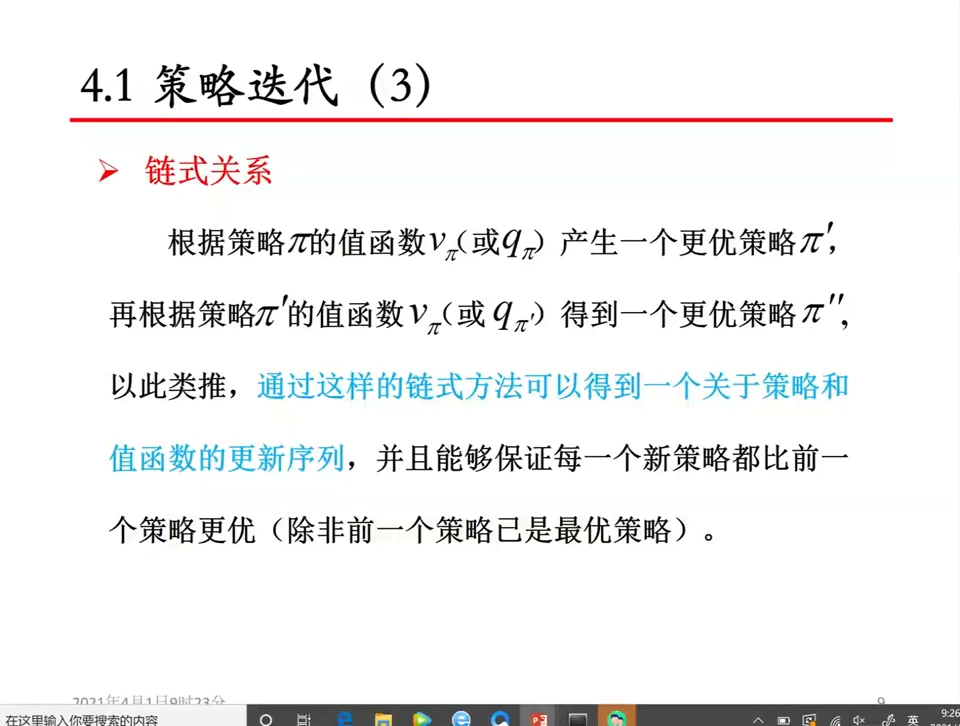

### 2.6 什么时候停：策略不再变化就停

整个循环的终止条件是"每个新策略都比前一个更优"，落到可操作的判据上就是：**改进后的策略与前一个策略没有变化**（或变化非常小）时，迭代结束。

这里要特别分清**两个嵌套的迭代**：

- **内层：评估迭代**——对当前这个策略 π 做迭代，直到价值收敛；
- **外层：策略迭代**——评估完就改进、改进完再回去评估，如此反复。

用记号区分：外层策略迭代的次序记作 `k`，内层评估迭代的次序记作 `t`。**小迭代 t 收敛之后，才做一次改进，然后进入下一个 k。**

[【跳转到 09:24】](https://www.bilibili.com/video/BV1waz9YFEc2/?t=564)

### 2.7 一个容易踩的坑：π 收敛了，V 不一定也"收敛"

完整的链条是：从 π₀ 出发做策略评估（PE）得到 $V_{\pi_0}$ 或 $Q_{\pi_0}$，再做策略改进（PI）得到更优的 π₁，然后评估、改进，一轮一轮，最后得到 π\* 和 V\*。

但要注意：**π 值不再变化时，V 值不一定不再变化**。因为我们的主要目的是求策略 π，π 已经稳定，策略迭代其实就可以停止了；V 只要满足"变化小于一定阈值"或者"迭代到给定次数"就够用，不必追到完全不变。

[【跳转到 10:39】](https://www.bilibili.com/video/BV1waz9YFEc2/?t=639)

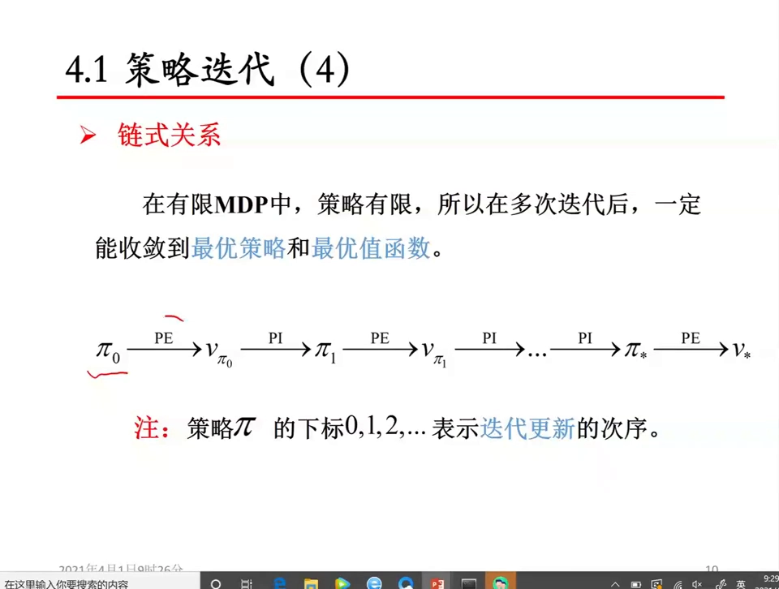

---

## 三、基于状态值函数的策略评估：把贝尔曼方程改写成迭代式

### 3.1 两种评估入口，本讲只走 V 这一条

策略评估可以基于**状态值函数**做，也可以基于**动作值函数**做，两种都能完成评估。本讲详细讲的是**基于状态值函数**的那一种：计算并评估 $V_\pi$。

[【跳转到 12:19】](https://www.bilibili.com/video/BV1waz9YFEc2/?t=739)

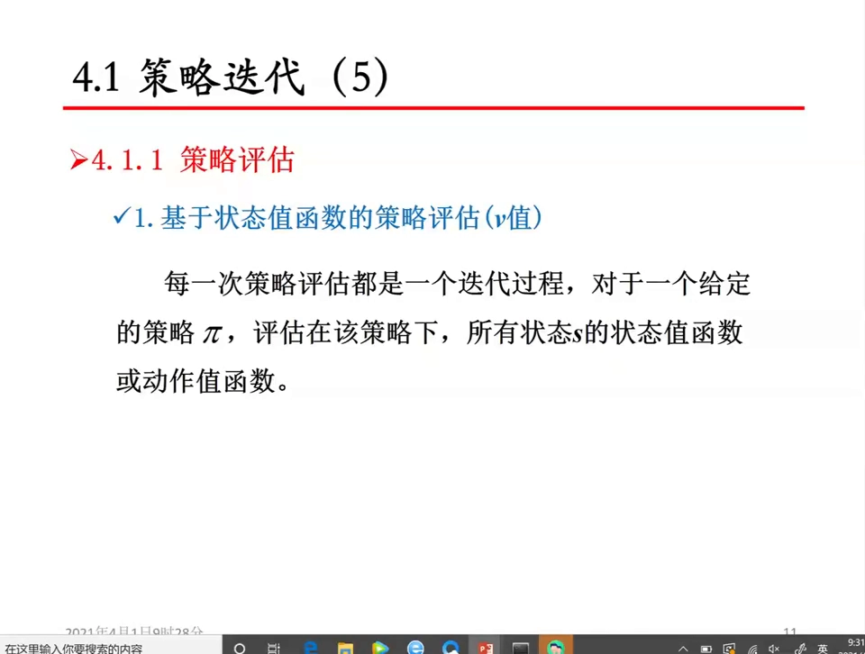

### 3.2 核心手法：方程 → 迭代式

评估状态值函数用的其实就是贝尔曼方程。但贝尔曼方程是一个**方程**——把所有状态写在一起，就是一个含很多未知数、彼此耦合的方程组；状态空间一大就很难求解。

所以要把它**转换成一个迭代式**：写出"后一轮的 V 值"与"前一轮的 V 值"之间的关系式，然后反复套用。

[【跳转到 12:44】](https://www.bilibili.com/video/BV1waz9YFEc2/?t=764)

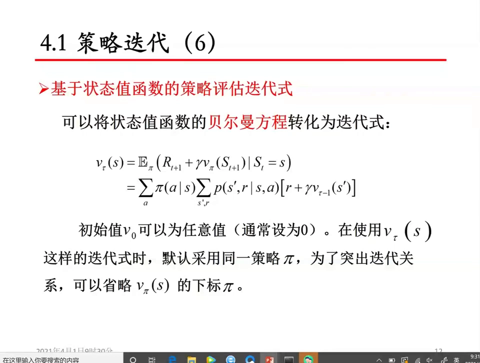

### 3.3 迭代式的四个组成部分

迭代式的骨架是"两层求和 + 一个括号"：

$$
V_t(s) = \sum_a \pi(a \mid s) \cdot \sum_{s', r} P(s', r \mid s, a) \cdot \big[\, r + \gamma \cdot V_{t-1}(s') \,\big]
$$

逐项读：

- $\sum_a \pi(a \mid s)$：**在当前状态 s 下采取各个动作的概率**，由策略 π 给定。第一层求和是在"动作"上求期望。
- $\sum_{s', r} P(s', r \mid s, a)$：**动态**——在当前状态 s 采取动作 a 后，到达 s′ 并拿到奖赏 r 的概率。第二层求和是在"环境的随机性"上求期望。
- $r$：这一步拿到的立即奖赏。
- $\gamma$：**折扣因子**，0 到 1 之间的小数，决定"未来的奖赏打几折"。
- $V_{t-1}(s')$：**上一轮**迭代算出来的、下一状态的价值。

举个具体例子：上一讲那个随机环境里出现过的 0.8 / 0.15 / 0.05，就是这里的动态——0.8 的概率向前走、0.15 原地不动、0.05 向相反方向走。而前面那一项是"当前状态下采取各动作的概率"（比如等概率），因为求的是**期望值**，所以这些情况都必须考虑进去。

[【跳转到 13:59】](https://www.bilibili.com/video/BV1waz9YFEc2/?t=839)

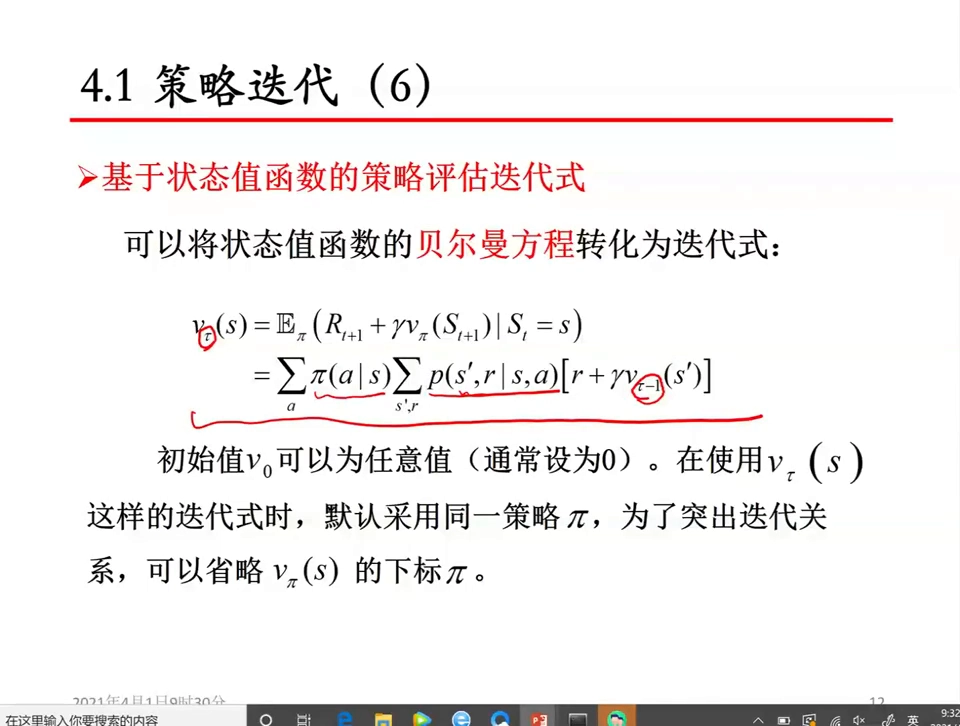

### 3.4 为什么叫"期望更新法"

上面这个更新同时用到了**两个概率**——策略给出的动作概率、模型给出的转移概率——也就是在**当前策略下**对这个量求**期望**（通常用花体的 E 表示）。因为要把所有分布、所有单步转移的情况都考虑进来，所以这种更新方式被称为**期望更新法（expected update）**。后面讲 MC 和 TD 时，"采样更新"正是相对它而言的。

[【跳转到 18:59】](https://www.bilibili.com/video/BV1waz9YFEc2/?t=1139)

### 3.5 两轮混用：把 V_{t−1} 直接换成 V

严格按 $V_t(s)$ / $V_{t-1}(s')$ 写，是"这一轮只读上一轮"的写法。实际用的时候往往**不**这么做，而是把两轮的值写在一起、用同一个符号 $V$，边算边覆盖：

$$
V(s) \leftarrow \sum_a \pi(a \mid s) \cdot \sum_{s', r} P(s', r \mid s, a) \cdot \big[\, r + \gamma \cdot V(s') \,\big]
$$

这样两轮的值混在一起用，**收敛速度会更快一些**。这就是后面要讲的"异步计算方式"。

初始值一般设为零（设成任意值也行）；但如果设得非常大，可能会影响收敛性，所以习惯上设 0。另外，迭代式里那个 π 常常被省略不写，但你必须清楚：**你评估的是当前策略的价值**——评估的都是"还没有改进的当前策略"，改进完之后还要再评估。

[【跳转到 15:14】](https://www.bilibili.com/video/BV1waz9YFEc2/?t=914)

### 3.6 停止条件：迭代次数，还是阈值？

有两种提前结束迭代的方法：

1. **直接设置迭代次数**：达到这个次数就认为收敛了，迭代停止。
2. **设定一个较小的阈值 ε**，用**无穷范数**判断：

$$
\Delta = \max_s \big|\, V_t(s) - V_{t-1}(s) \,\big| < \varepsilon \qquad \text{即} \qquad \| V_t - V_{t-1} \|_\infty < \varepsilon
$$

这里的"无穷范数"（$\|\cdot\|_\infty$）读法很直白：把所有状态上"两轮 V 值之差的绝对值"都列出来，取其中**最大的那个**；只要最大的那个小于 ε，就说明整张表都已经稳定了。（范数家族里还有 1-范数、2-范数，无穷范数取的是分量的最大绝对值。）

一般推荐用**阈值方式**，因为它更保险：只设迭代次数可能出现"次数到了但还没收敛"的情况，评估效果就不好。

[【跳转到 16:54】](https://www.bilibili.com/video/BV1waz9YFEc2/?t=1014)

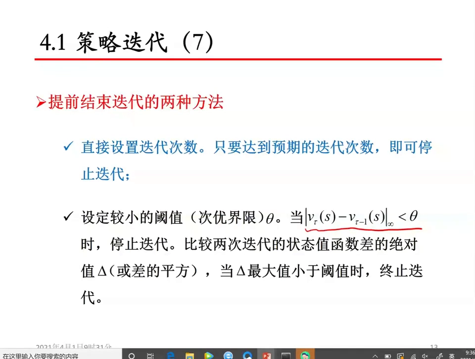

---

## 四、算法伪代码：基于状态值函数的策略评估

### 4.1 为什么一定要写成伪代码

研究生阶段会涉及很多伪代码——无论发表文章还是写大论文，都要用伪代码形式表现算法。所以这一节把策略评估完整地写成标准格式：**输入 → 初始化 → 循环体 → 输出**。

[【跳转到 19:49】](https://www.bilibili.com/video/BV1waz9YFEc2/?t=1189)

### 4.2 输入：策略、模型、折扣因子

注意算法名字里的限定词——一定是"**基于状态值函数**"的策略评估，它评估的是当前策略。

```
算法：基于状态值函数的策略评估
输入：
  π            —— 待评估的策略（每个状态下采取各动作的概率）
  P(s′, r|s, a) —— 动态（模型）：当前状态 s 采取动作 a，转到 s′ 并得到 r 的概率
  R            —— 奖赏函数
  γ            —— 折扣因子，0 < γ < 1
```

关于策略的形态：策略可以是**确定的**，也可以是**随机的**。这里统一按随机策略处理，因为**确定策略只是随机策略的一个特例**——某个动作概率为 1、其余为 0，就是确定策略；概率是"零点几、零点几"分散开的，就是随机策略。

[【跳转到 20:14】](https://www.bilibili.com/video/BV1waz9YFEc2/?t=1214)

### 4.3 初始化与主循环

```
初始化：
  对所有状态 s：V(s) ← 0
  阈值 ε ← 0.01          （设 0.001 也可以，迭代次数更多但结果更精确）

循环：t = 1, 2, 3, …
  Δ ← 0
  对每一个状态 s：
      v ← V(s)
      V(s) ← Σ_a π(a|s) · Σ_{s′, r} P(s′, r|s, a) · [ r + γ · V(s′) ]
      Δ ← max(Δ, |v − V(s)|)
  若 Δ < ε ：停止本轮评估

输出：V ≈ V_π
```

阈值取 0.01 还是 0.001 是个精度与算力的取舍：0.001 更精确，但迭代次数可能更多。

[【跳转到 21:29】](https://www.bilibili.com/video/BV1waz9YFEc2/?t=1289)

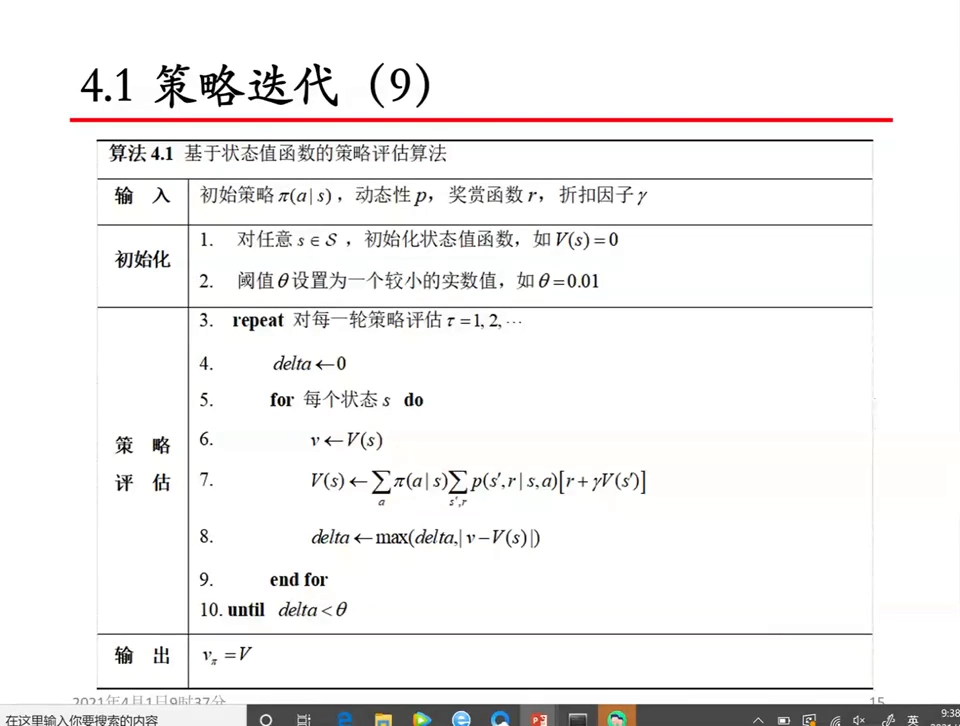

### 4.4 循环体里到底在算什么

对每一个状态，算的就是前面那个由贝尔曼方程转化来的迭代式：**当前状态下采取动作的概率 × 当前状态下采取动作后到达下一状态的概率 ×（立即奖赏 + γ × 下一状态的价值）**，再对动作和下一状态求和。

公式里所有的 $V$ 都写成同一个符号、不标轮次，意思是**原地更新**——算完就直接覆盖存回去。

[【跳转到 22:19】](https://www.bilibili.com/video/BV1waz9YFEc2/?t=1339)

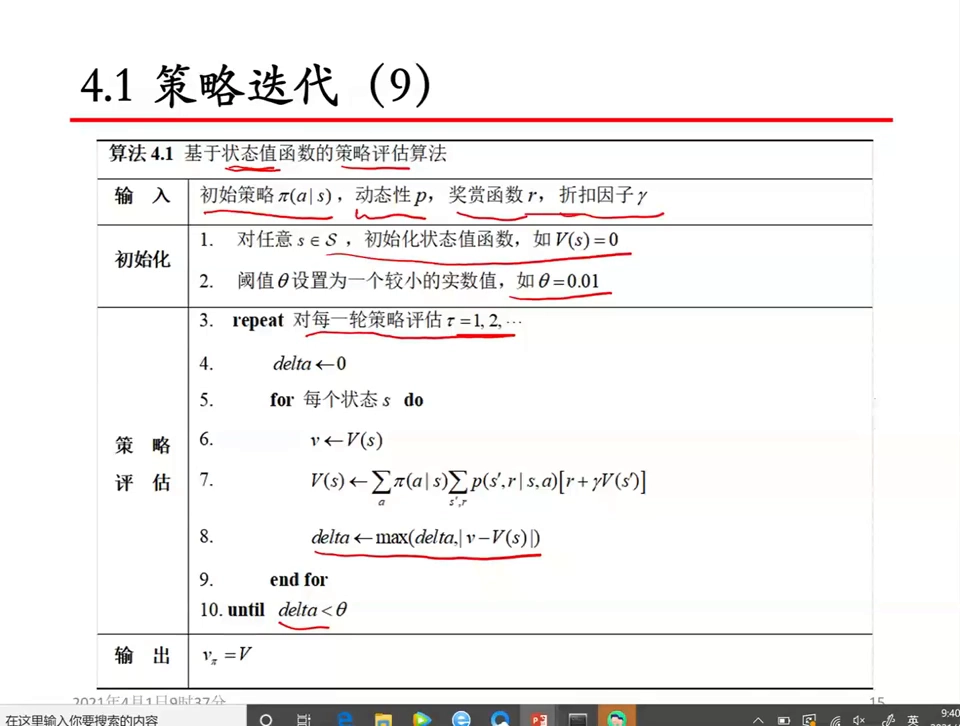

### 4.5 大 V 是估计值，小 V_π 才是真值

算法中间过程用的都是大 $V$——大 $V$ 是一个**估计值**。它什么时候才有资格被当作当前策略下的真正状态值？**只有在评估收敛之后**，才可以把大 $V$ 作为 $V_\pi$ 的值。

为什么说小 $V_\pi$ 是"真实值"？因为动态规划法假定**模型是正确的**——模型没问题，用它算出来的 $V_\pi$ 就是该状态下、该策略下的真实价值。所以整个过程可以概括为：

```
大 V（迭代中的估计值）  ──收敛──▶  小 V_π（当前策略下的真实价值）
```

[【跳转到 23:09】](https://www.bilibili.com/video/BV1waz9YFEc2/?t=1389)

---

## 五、异步更新 vs 同步更新：同一套公式，两种算账顺序

### 5.1 异步计算：一套数组，边算边用新值

上面这个算法用的是**异步计算方式**：第 t 轮和第 t−1 轮用的是**同一组 V**（只存一套 V 数组）。每次要用 V 值时，用的都是数组里**当前最新的值**，不管它是哪一轮算出来的。

于是评估的中间结果就与"状态被评估的先后次序"密切相关。举个例子：现在评估第 5 个状态，会用到第 4 个状态和第 6 个状态的值——

- 如果第 4 个状态**已经**评估过，用的是它的**新值**；
- 如果第 4 个状态**还没**评估，用的是它的**旧值**。

次序是先 4 后 5，4 的新值就被用上；次序是先 5 后 4，5 用的就是 4 的旧值。两轮的值就这样混到了一起——这正是"异步"这个名字的由来。

[【跳转到 24:24】](https://www.bilibili.com/video/BV1waz9YFEc2/?t=1464)

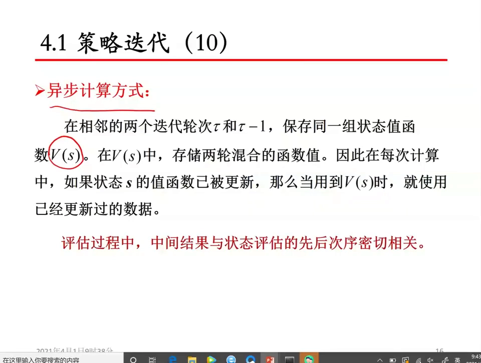

### 5.2 同步计算：本轮只读上一轮

另一种是**同步计算方式**：计算本轮的 V 值时，**完全**使用上一轮的 V 值。这样中间结果只与上一轮有关，与评估的先后次序**无关**——这一轮虽然已经产生了新值，但我不用它，仍然读旧的那一份。

[【跳转到 26:29】](https://www.bilibili.com/video/BV1waz9YFEc2/?t=1589)

### 5.3 两者怎么选：结果一样，速度不同

- **收敛结果相同**：两种方式最终收敛到的价值是同一套；
- **收敛速度不同**：通常**异步计算方式更快**——因为它一算出新值就立刻用上，信息传播得更早。这也解释了前面"两轮混用、用同一个 V"为什么收敛更快。

[【跳转到 26:59】](https://www.bilibili.com/video/BV1waz9YFEc2/?t=1619)

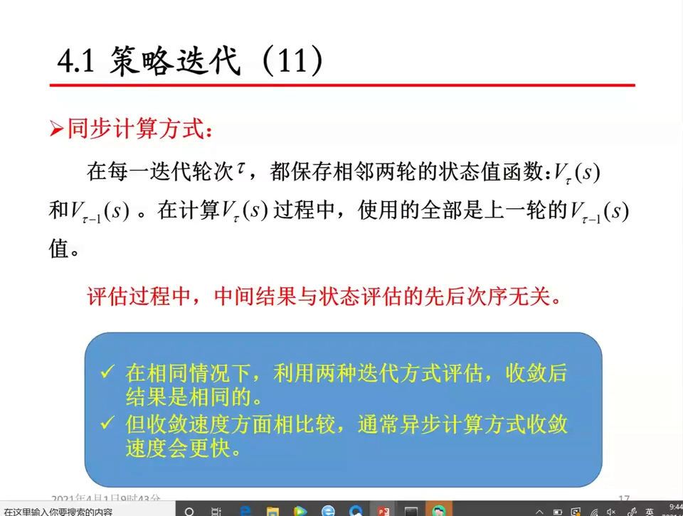

---

## 六、一个算法同时覆盖确定性 MDP 与随机 MDP

这个策略评估算法把**确定性 MDP** 和**随机性 MDP** 都统一进来了，统一的位置就在 $P$ 上：

- **确定性情形**：当前状态下采取某个动作后，到达的下一状态是唯一确定的（概率为 1，其余为 0）；
- **随机性情形**：当前状态 s 采取动作 a 后，到达哪个 s′ 是随机的，概率分散在多个 s′ 上。

两种情况在同一个算法里同时被表达出来。所以在策略迭代里，用这个算法既能解确定 MDP，也能解随机 MDP，**只是状态转移不同，算法本身不需要改**。这也再次说明：**确定 MDP 是随机 MDP 的一个特例**。

有些书里把"确定 MDP 的策略评估"和"随机 MDP 的策略评估"分成两种来解，这里把它们统一成了一个。

[【跳转到 27:22】](https://www.bilibili.com/video/BV1waz9YFEc2/?t=1642)

---

## 小结

- **动态规划法要求有模型**：必须已知转移概率与奖赏函数 $P(s', r \mid s, a)$。现实中这个概率要靠大量实验统计才能得到，所以 DP 有局限；但它是 MC、TD 等方法的理论基准——后两者都是对 DP 的近似。
- **策略评估是策略迭代的第一步**：给定策略 π，迭代求出它名下所有状态的 $V_\pi$（或所有状态-动作对的 $Q_\pi$），**评估对象永远是当前策略**。
- **评估之后是策略改进**：用 $Q_\pi$ 做贪心或 ε-贪心得到 π′，形成 $V_\pi \to Q_\pi \to \text{策略改进}$ 的链式关系；只有 V 时先补算 Q。
- **两个嵌套迭代**：内层评估迭代 `t`（价值收敛即停），外层策略迭代 `k`（策略不再变化即停）。π 稳定后即可停止，V 只需满足阈值或次数要求。
- **核心手法是"方程改迭代式"**：把贝尔曼方程组改写成 $V_t(s)$ 与 $V_{t-1}(s')$ 之间的递推，反复套用逼近真值。
- **停止判据用无穷范数**：$\max_s |V_t(s) - V_{t-1}(s)| < \varepsilon$，比"固定迭代次数"更保险。
- **异步 vs 同步**：异步只存一套 V、边算边用新值，结果与评估次序有关但收敛更快；同步本轮只读上一轮，与次序无关。两者收敛结果相同。
- **确定性 MDP 是随机 MDP 的特例**：差别只体现在 $P$ 的概率分布上，算法本身不用改。

## 关键术语速查

| 术语 | 一句话解释 |
| --- | --- |
| 动态规划（DP） | 模型已知时，用迭代计算而非解方程组来求价值函数与最优策略的方法 |
| 有模型 MDP | 已知转移概率与奖赏函数 $P(s', r \mid s, a)$ 的 MDP |
| 转移概率 / 动态 | 在状态 s 采取动作 a 后，到达 s′ 并获得奖赏 r 的概率 |
| 策略 π | 在每个状态下选择各动作的概率分布；某个动作概率为 1 时是确定性策略 |
| 状态值函数 $V_\pi(s)$ | 在策略 π 下从状态 s 出发的累积奖赏期望 |
| 动作值函数 $Q_\pi(s, a)$ | 在策略 π 下从状态 s 先执行动作 a、之后按 π 走的累积奖赏期望 |
| 策略评估（PE） | 给定策略 π，迭代求出 $V_\pi$ 或 $Q_\pi$ 的过程 |
| 策略改进（PI） | 用评估得到的价值做贪心/ε-贪心，生成更优策略 |
| 贪心 / ε-贪心 | 前者总选价值最大的动作；后者以 ε 概率均匀随机探索、以 1−ε 概率贪心 |
| 折扣因子 γ | 0~1 之间的小数，决定未来奖赏的折算比例 |
| 期望更新法 | 对策略分布与转移分布同时求期望的更新方式（DP 的特征） |
| 无穷范数 $\|\cdot\|_\infty$ | 取所有分量绝对值中的最大值；此处用于判断整张价值表是否已收敛 |
| 异步计算 | 只存一套 V，边算边覆盖，用到的最新值可能与本轮/上轮混杂 |
| 同步计算 | 本轮更新只读上一轮的 V，结果与状态评估次序无关 |
