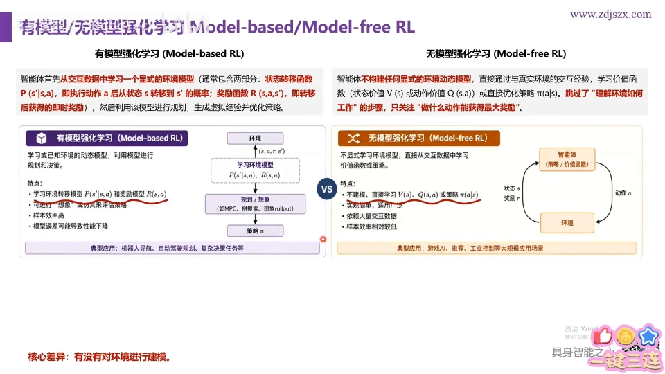
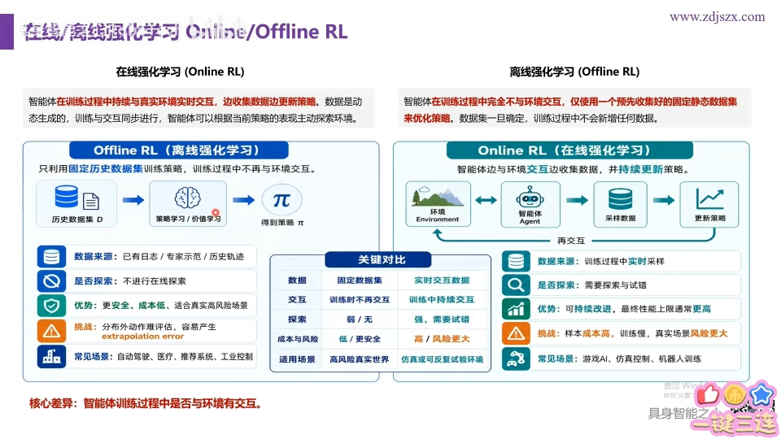
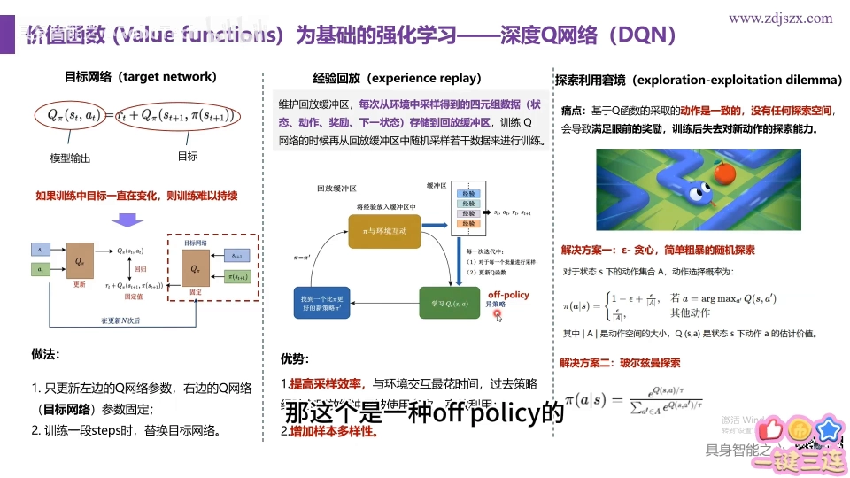
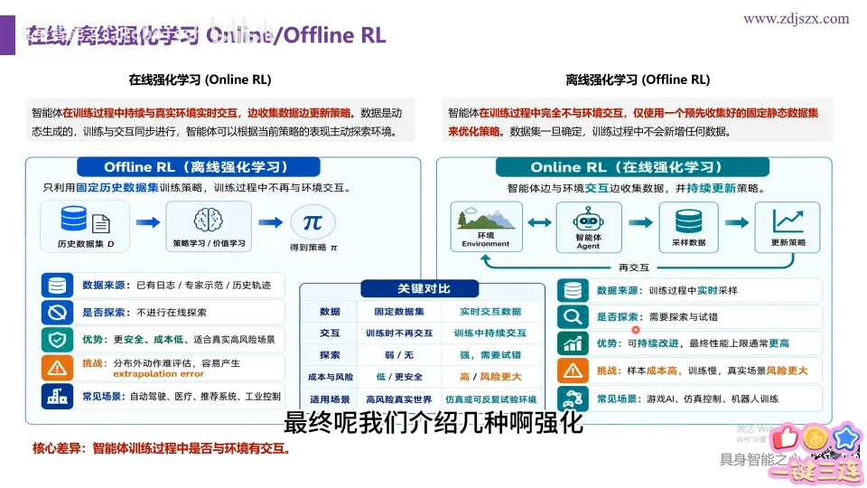
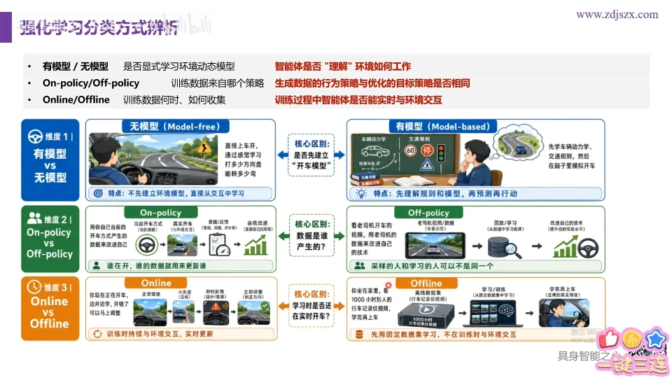
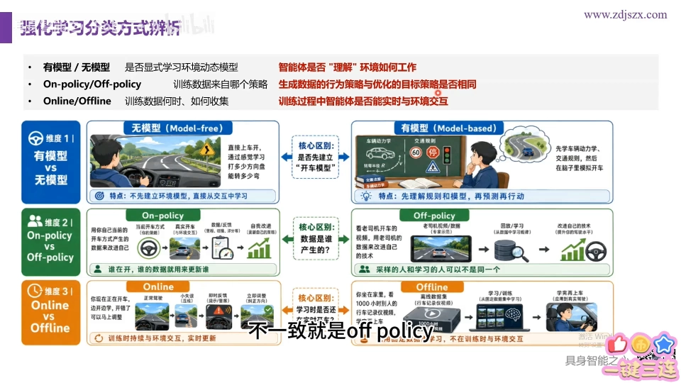

# 强化学习算法分类：有模型/无模型、同策略/异策略与在线/离线

> 本篇整理自 Bilibili 视频《强化学习六个概念怎么分？6分钟理清在线/离线、On/Off-policy 与有/无模型》。视频地址：[BV1fox767E2S](https://www.bilibili.com/video/BV1fox767E2S/)。它是上一篇《无模型学习》的配套短片，专门把几组容易混淆的分类讲清楚。

## 本讲要解决的核心问题（SCQA）

**背景**：学强化学习时会撞见一堆成对出现的名词——有模型/无模型、同策略/异策略、在线/离线。它们都由英文简写出现（model-based / model-free、on-policy / off-policy、online / offline），很容易记混。

**冲突**：这些词都带"model""policy"字眼，但说的其实是**完全不同的三件事**；不看判别标准，很容易张冠李戴。

**疑问**：每一对概念的判别标准到底是什么？又该怎样一眼分清？

**回答（中心思想）**：三组分类，各有一条**单一的判别标准**——

- **有模型 / 无模型**：是否知道（要建模）环境的**转移概率与奖励**；
- **同策略 / 异策略**：产生数据的**行为策略**与评估改进的**目标策略**是否同一个；
- **在线 / 离线**：训练过程中**是否与真实环境交互**。

---

## 一、有模型 vs 无模型：是否要"建模"环境

**模型（Model）**在这里有确切含义：它指环境中那个**转移概率矩阵**（以及奖励函数）。于是判别标准只有一句话——**你知不知道这个转移概率矩阵**：

- **知道 → 有模型（model-based）强化学习**；
- **不知道 → 无模型（model-free）强化学习**。

两者的学习流程也不一样：

- **有模型**：先花力气去**学习转移概率矩阵和奖励函数**，把模型建好；有了模型，环境和智能体"怎么交互"就清楚了，再据此去求 `Q` 函数、求策略 π。
- **无模型**：干脆**不学模型**——转移概率和奖励爱是什么样就什么样，我直接到环境里探索、反复试错，**只学价值函数、Q 函数和策略**，最终让奖励最大就算学会。

打个比方：有模型像是先把"游戏规则说明书"读明白再上手；无模型则是说明书直接丢掉，全靠一次次实操去摸规律。

---

## 二、同策略 vs 异策略：行为策略和目标策略是不是同一个

在训练过程中，我们通常要用一个 **policy** 去获取数据。判别标准是：**"产生数据的行为策略"和"被训练/优化的目标策略"是不是同一个 policy**。

- **同一个 → 同策略（on-policy）**；
- **不是同一个 → 异策略（off-policy）**。

两个典型例子：

- **REINFORCE**：这是基于蒙特卡洛的算法，它**训练所用的策略**和**采数据所用的策略**是同一个——所以是同策略算法。
- **DQN（深度 Q 网络）**：它用到**经验回放**和**目标网络**。与环境交互、产生数据的那个策略，和在训练中不断更新的那个（走在后面的）策略**不是同一个**——因此 DQN 是**异策略**算法。

一句话记住判别标准：**看训练中"行为策略"与"目标策略"是否一致**。

---

## 三、在线 vs 离线：训练时要不要和环境"打交道"

第三组判别标准落在**交互**上：训练过程中，智能体**是否与真实环境交互**。

- **一边训练、一边与真实环境交互 → 在线（online）强化学习**；
- **不与真实环境交互，只用一批早已交互过的静态数据集来优化策略 → 离线（offline）强化学习**。

它们各有取舍。与环境交互本身是**非常耗时**的过程，所以：

- **离线**学习不与环境交互，**训练效率更高**；
- **在线**学习要与环境交互，训练效率可能低一些，但**交互带来的效果更好**。

一句话记住判别标准：**看训练时有没有"环境交互"**。

---

## 四、一张表辨析，并用"开车"场景验证

把三组的判别标准并排放在一起：

| 分类 | 判别标准 | 一方 | 另一方 |
| --- | --- | --- | --- |
| 有模型 / 无模型 | 是否理解并建模工作环境（转移概率矩阵 + 奖励） | 知道 = 有模型 | 不知道 = 无模型 |
| 同策略 / 异策略 | 生成数据的行为策略与优化的目标策略是否一致 | 一致 = 同策略 | 不一致 = 异策略 |
| 在线 / 离线 | 训练过程中智能体是否与环境交互 | 有交互 = 在线 | 无交互 = 离线 |

讲者还借"**开车**"场景把六个概念串起来做了区分——核心还是反复回到上面那三条判别标准：**要不要建环境模型、行为策略与目标策略是否相同、训练时要不要和环境交互**。

---

## 小结

- **有模型 / 无模型**：看**是否知道并建模**环境的转移概率矩阵与奖励。有模型先学模型再求策略；无模型不学模型、直接试错学价值与策略。
- **同策略 / 异策略**：看**行为策略与目标策略是否同一个**。REINFORCE 是同策略；DQN（含经验回放、目标网络）是异策略。
- **在线 / 离线**：看**训练时是否与真实环境交互**。离线不交互、训练效率高；在线要交互、交互效果更好。
- 三组分类回答的是三个不同问题，**判别标准各不相同**，不能混为一谈。

## 关键术语速查

| 术语 | 一句话解释 |
| --- | --- |
| 模型（Model） | 环境的转移概率矩阵与奖励函数。 |
| 有模型 / 无模型 | 是否知道（并去学习）环境模型；不知道就是无模型。 |
| 行为策略 / 目标策略 | 产生数据的策略 / 被训练与优化的策略。 |
| 同策略 / 异策略 | 行为策略与目标策略是否同一个；不同就是异策略。 |
| 在线 / 离线 | 训练过程中是否与真实环境交互；不交互就是离线。 |
| 经验回放 | 把交互数据存起来重复利用的机制，常见于 DQN。 |
