# 4.1 无模型学习：不知道环境时，如何从经验中估计价值

> 本篇整理自 Bilibili 视频《强化学习 2 无模型学习》（UP 主：teacher_tu）。视频地址：[BV1ZM41127hS](https://www.bilibili.com/video/BV1ZM41127hS/)。文末附一支"六分钟辨析六种概念"的配套短片。

## 本讲要解决的核心问题（SCQA）

**背景**：前两章我们已经知道，一个马尔可夫决策过程（MDP）由**转移概率** $P(s' \mid s, a)$ 与**奖励函数** $R(s, a)$ 刻画；当这两项都已知（白盒环境）时，用策略迭代或价值迭代就能直接"算"出最优策略。

**冲突**：但在绝大多数真实任务里，环境是**黑盒**——转移概率和奖励函数我们都不知道。而动态规划里最关键的那一步"策略评估"，偏偏要用到环境的动态特性；没有模型，这个式子就算不出来。

**疑问**：环境模型不知道，是不是就没办法评估策略、更没办法改进策略了？智能体到底应该靠什么才能学到最优策略？

**回答（中心思想）**：靠**经验**。让智能体与环境反复交互、产生数据，再用这些数据去估计价值——这套"不需要环境模型、只用采样数据学习"的做法，就叫**无模型（model-free）学习**。它有两根技术支柱：**蒙特卡洛**（用样本均值去近似期望）和**时序差分**（用自举，边交互边更新）；而在与环境交互时，还必须用**软性策略（ε-贪婪）**来平衡"探索"与"利用"。

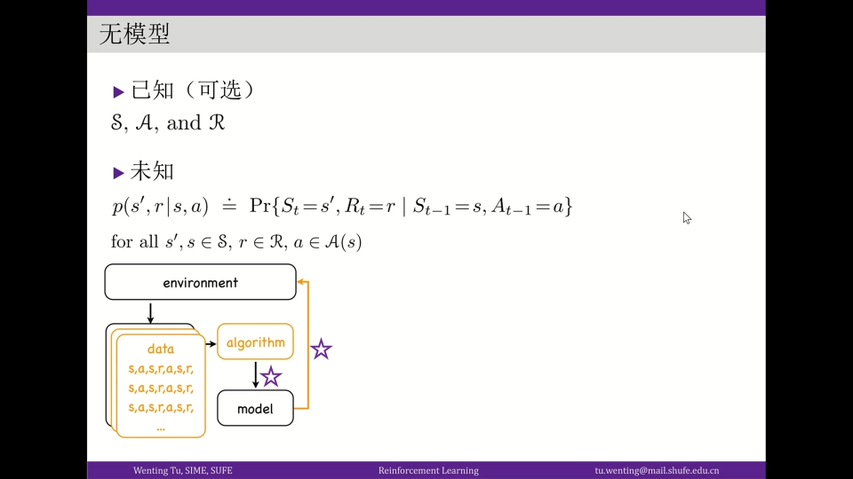

---

## 一、为什么"没有环境模型"是个大问题

### 1.1 策略评估这一步，离不开环境动态特性

回顾有模型强化学习：策略 π 是这样一步步改进出来的——从 π₀ 改进到 π₁、π₂，一直到收敛到最优策略 π*。从 π₀ 到 π₁ 的这一步，牵扯两件事：

1. **策略评估**：先用 π₀ 求出它的状态价值 $v_{\pi_0}$；
2. 求贪婪策略：再根据价值，用贪心算法挑出改进后的 π₁（价值迭代则把这步换成"一步贪心"）。

问题就出在第 1 步。策略评估用到的贝尔曼方程

$$
V(s) = \sum_a \pi(a \mid s) \sum_{s',r} P(s' \mid s, a)\,\big[\, r + \gamma\, V(s') \,\big]
$$

需要**遍历所有后继状态及其转移概率**才能展开。一旦环境的动态特性 $P(s' \mid s, a)$ 不知道，这个式子就写不出来——策略评估做不了，整套策略迭代也就卡住了。

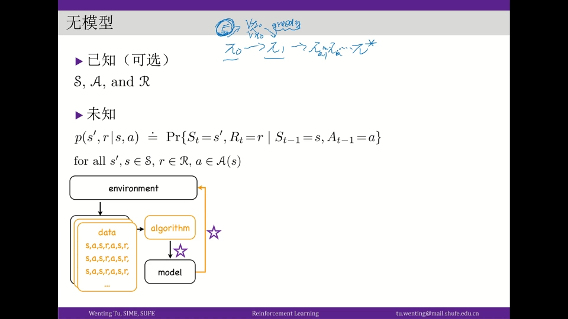

### 1.2 类比监督学习：真值未知，就用样本去估计

其实"真值不知道"这件事，在监督学习里早就遇到过。监督学习要估计的是数据分布 $p(x, y)$，它对应"自然界（环境）的真值（ground truth）"；真值不知道怎么办？——**用一系列序列样本去估计**。

强化学习里是同一套思路：模型不知道，那我们同样可以用数据去估计它。具体做法是让**智能体与环境交互**，产生一系列以序列形式表达的样本，这些样本里就带着关于环境动态特性的线索；算法再用这些数据把模型（或价值）估计出来。

于是无模型强化学习就形成了这样一个闭环：

- **用数据估计价值 → 用价值改进策略**：算法如何从数据中学出更优秀的策略；
- **用策略产生数据 → 再用数据改进策略**：优秀的策略又要如何与环境交互，产生更多数据，让估计更准、策略更好。

这里有一个和监督学习**本质不同**的地方：数据不是现成给你的，而是**必须由智能体采取某种策略与环境交互才产生**。也正因为如此，"用什么样的策略去和交互"本身就成了一个要设计的环节。

### 1.3 两个关键点与两个技术支柱

把上面的话浓缩一下，无模型学习绕不开两个关键点：

1. **算法如何通过数据得到更优策略** —— 对应技术：**蒙特卡洛**（基于样本去近似期望）；
2. **智能体如何与环境交互** —— 对应技术：**软性策略**（ε-贪婪），用来处理"探索-利用两难"。

接下来的全篇，就是沿着"一个多臂赌博机的例子"把这两条线讲清楚。

---

## 二、用多臂赌博机把"无模型"跑一遍

### 2.1 一个五个摇臂的黑盒

**多臂赌博机（Multi-armed Bandit）**是无模型学习最小的实验台。它的设定是：面前有一台赌博机，有五个摇臂；你投入一个硬币，就可以选一个摇臂摇一下，每个摇臂会以**某个未知概率**吐出硬币（比如十块）。

它的"动态特性"因此非常精简：**每个动作（摇臂）背后，对应一个关于回报 $r$ 的概率分布**。又因为每次摇完这一局就结束，它是**单步问题**，不存在状态之间的转移。

- 如果**知道**每个摇臂出币金额的期望，那聪明的策略很简单：**每次摇期望最大的那个摇臂**（平局时任选其一）——这正是有模型学习里的**贪婪策略**；
- 如果**不知道**（也就是无模型的情形），就获得不了这些结论，只能另想办法。

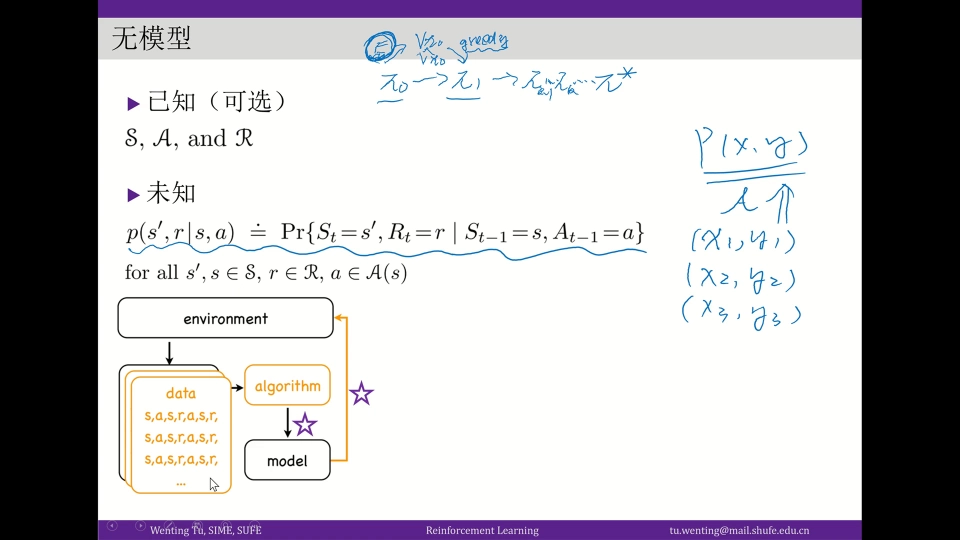

### 2.2 探索-利用两难：三种智能体的对照

面对只有固定成本（比如 100 个一元硬币）的赌博机，不同"头脑"的智能体会采取不同策略：

| 智能体 | 策略 | 结果 |
| --- | --- | --- |
| 无脑型 | 每次都随机选一个摇臂 | 纯靠运气，成本花光为止 |
| 精明型 | 把 100 分成两份：前 50 随机试每个摇臂、**估计出各自期望**，后 50 猛摇估计最好的那个 | 用数据估计了模型，再贪婪利用 |
| 小气型 | 每个摇臂只试**一次**，看谁出了硬币就后面 95 次全押它 | 样本太少，容易误判 |

小气型的问题在于样本太少、不确定性太大：也许真正期望最大的摇臂第一次恰好没出币，被错过了；而期望很小的摇臂恰好第一次出了币，后面却被死磕。这背后正是**探索-利用两难（exploration-exploitation tradeoff）**：

- **探索**太多 → 一直在试，拿不到高收益；
- **利用**太多 → 可能一直守着一个次优选择，错过更高回报的机会。

这里有一个关键观察：**如果你知道环境的动态特性（各摇臂的期望），就根本不会有两难**——你会有一个确定性的最优策略，在每个状态下都采取期望最高的动作。正因为"不知道"，才必须面对它。而无模型学习里惯用的解法，就是用**软性策略**：以一定概率随机选（探索），以其余概率贪心选（利用），这正是后面反复出现的 **ε-贪婪（ε-greedy）**。

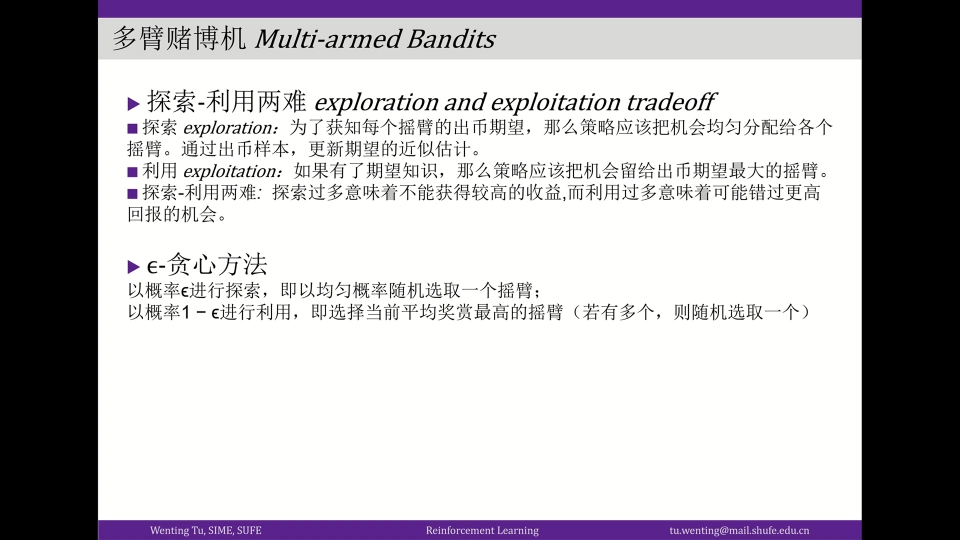

---

## 三、蒙特卡洛：用样本均值去估计期望

### 3.1 从"求平均"到"增量式更新"

"精明型"智能体做的事，本质就是**蒙特卡洛**。以摇臂一为例：在 50 次里摇了它 10 次，把每次拿到的金额 $r_i$ 加起来、再除以次数，就得到它回报期望的估计：

$$
q_n = \frac{1}{n} \sum_{i=1}^{n} r_i \quad \text{用样本均值估计期望}
$$

这其实就是把每次回报 $r_i$ 看作对随机变量的一次**采样**，再用这些采样的平均值去近似它的期望。

但这个"先求和再平均"的写法有个缺点：每次更新都要重新累加所有历史样本。于是可以把它改写成**增量式（递归）**：

$$
q_{n+1} = q_n + \frac{1}{n}\left( r_n - q_n \right)
$$

这样一来，算下一步只需要用到"当前最新的估计 q"和"最新获得的回报 r"，**存储量和计算量都大幅下降**。这行递归式还能这样解读：

$$
\begin{aligned}
q_{n+1} &= q_n + \Delta q \\
\Delta q &= \frac{1}{n}\left( r_n - q_n \right) \quad \text{= 步长} \times \text{误差}
\end{aligned}
$$

其中 $r_n - q_n$ 就是"这次实测值"与"当前估计"之间的差距，是一个 **error（误差）**；前面的 $1/n$ 则是**步长（学习率）**。更新规则于是有了统一的形象：**新估计 = 旧估计 + 步长 × 误差**。

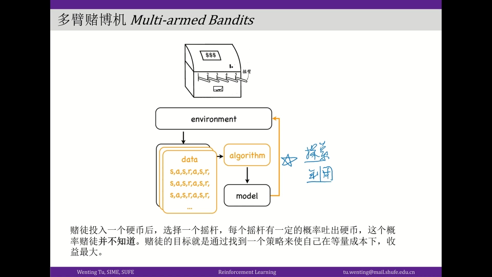

### 3.2 固定步长：为"非平稳环境"留后手

步长取 $1/n$，相当于对历史上所有样本赋予**相同权重**。但如果把步长换成一个**固定值 α**，情况就变了：越新的样本权重越大（$r_n$ 的权重从 $1/n$ 变成恒定的 α，相对变大）。

什么时候我们更看重新样本？——当环境**非平稳**（动态特性随时间慢慢改变）时。这时越靠近现在的样本越能反映当前环境，所以**固定步长更适合非平稳环境**。这份"对新鲜数据更敏感"的偏好，在后面讲时序差分时还会一再出现。

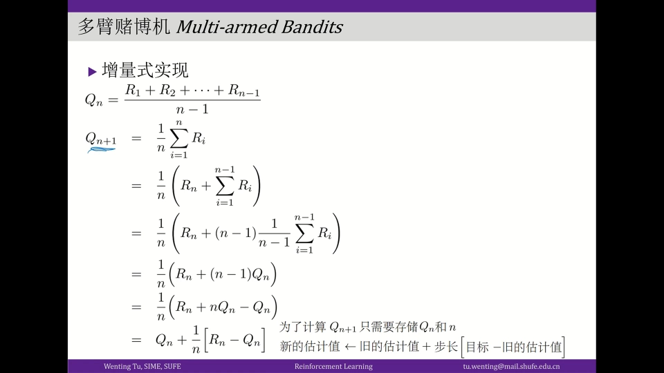

### 3.3 把两个技术点合起来：一个多臂赌博机算法

把"ε-贪婪交互"与"蒙特卡洛更新"缝在一起，就得到一个完整的多臂赌博机算法：

```
对每个动作 a：q(a) ← 0，n(a) ← 0            # 初始化估计与计数
循环：
    以 ε 的概率随机选一个动作；否则选 q(a) 最大的动作    # ε-贪婪选择
    执行动作 a，获得回报 r                              # 与环境交互
    n(a) ← n(a) + 1
    q(a) ← q(a) + (1 / n(a)) · ( r − q(a) )            # 蒙特卡洛更新
```

- 用 ε-贪婪选动作，对应"智能体如何与环境交互"这个关键点；
- 用 $q \leftarrow q + (1/n)(r - q)$ 更新，对应"如何用数据学出更优策略"这个关键点。

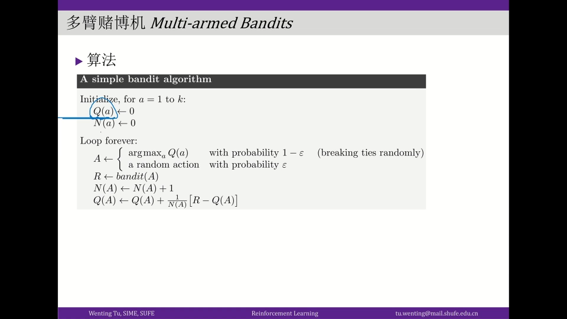

---

## 四、从单步到序列：蒙特卡洛预测与控制

### 4.1 更一般的任务：数据是"一条轨迹"

多臂赌博机只是单步问题。真实任务里，一次交互得到的是**一条序列**：

$$
s_0, a_0, r_1, s_1, a_1, r_2, s_2, \dots, r_T
$$

前面说过，无模型场景下 $v_\pi$ 没法用贝尔曼方程直接算。现在的思路是：**用这条序列去估计它**。回忆"状态价值"的物理含义——环境处在 $s$ 时往后能拿到的累计收益——那么把某个状态之后的所有回报累加起来，就可以作为对这个状态价值的一次**采样估计**。

### 4.2 首次访问（First-Visit）与每次访问（Every-Visit）

麻烦在于：**同一条序列里，同一个状态 $s$ 可能出现多次**。比如 $s$ 在第 1 个时间点和第 5 个时间点都出现了，那它后面各自累加的回报都能当作 $v(s)$ 的样本。到底怎么取？

- **首次访问（First-Visit）**：只信赖**第一次**遇到 $s$ 时拿到的回报采样；
- **每次访问（Every-Visit）**：每一次遇到 $s$ 都算一个样本。

两种方式都可用。

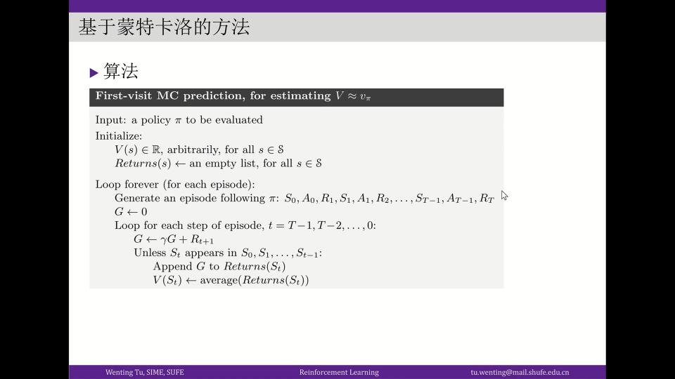

### 4.3 蒙特卡洛预测算法

以首次访问为例，蒙特卡洛预测的伪代码是：

```
输入：待评估的策略 π
初始化 V(s) 为任意值
循环（每一回合）：
    按 π 生成一条完整序列 s₀, a₀, r₁, …, r_T
    G ← 0
    从 t = T−1 倒着到 0：
        G ← γ·G + r_{t+1}                    # 逆序累加回报
        若 s_t 在这一回合中首次出现：
            把 G 追加到 Returns(s_t)
            V(s_t) ← avg( Returns(s_t) )      # 用样本均值估计
```

- 指针从后往前遍历，一路累加回报 $G$，再把它当成对应状态价值的一个样本；
- 最后取平均（相当于步长 $1/n$）。若环境非平稳，也可把平均换成固定步长的增量更新。

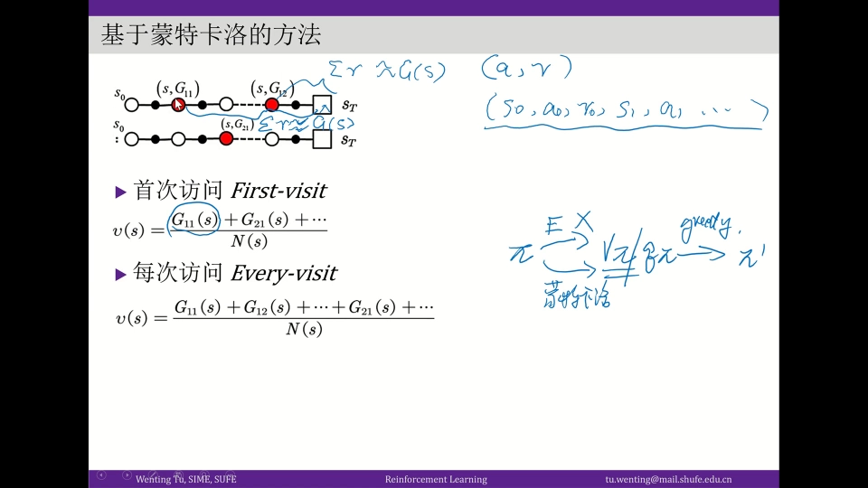

### 4.4 蒙特卡洛控制：评估用 MC，改进仍用贪婪

至此，"策略评估"这一步就从"依赖环境动态特性"换成了"用 MC 从样本估计"。解决了评估，策略改进照旧：

> 用 MC 求出 $q_\pi$（或 $v_\pi$）→ 用贪婪策略得到更优的 π′ → 再交互产生更多数据……

但别忘了探索-利用两难：如果策略纯贪婪，样本会局限在很小的局部里，估不准。所以要把策略设成 **ε-贪婪（ε-soft）**：**以 ε 的概率探索、以 1−ε 的概率利用**。注意实际选到最优动作 $a^*$ 的概率是 $1 - \varepsilon + \varepsilon/|A|$（因为 $a^*$ 也落在随机探索的动作集合里）。

把"首次访问 MC + ε-贪婪"合起来，就得到如下的控制算法：

```
初始化 π 为 ε-贪婪，q(s,a) 为任意值
循环（每一回合）：
    用 π 与环境交互，生成一条完整序列
    G ← 0
    从 t = T−1 倒着到 0：
        G ← γ·G + r_{t+1}
        若 (s_t, a_t) 首次出现：把 G 追加到 Returns(s_t, a_t)
        q(s_t, a_t) ← avg( Returns(s_t, a_t) )
    用更新后的 q 求贪婪策略，再与 ε 结合，更新 π     # 策略改进 + 探索
```

这种"**产生样本的行为策略**"与"**被评估、被改进的目标策略**"是同一个策略的版本，叫 **同策略（on-policy, 图中标记 Q≈q）**；与之相对的还有异策略，留到第六节。

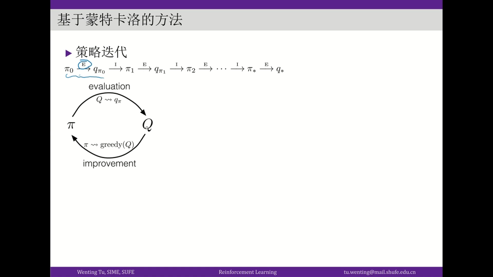

---

## 五、时序差分：不必等一整回合，边走边更新

### 5.1 蒙特卡洛的短板

蒙特卡洛有一个硬伤：**对价值的一次更新，要等到一整回合跑完**，再从后往前遍历。这会带来两个麻烦：

- 任务步骤很长时，一开始策略还很武断，整回合下来会吃很多 loss；
- 任务**没有终止**（无限步）时，压根等不到"回合结束"，MC 就没法用。

### 5.2 用"下一步的估计"代替"完整回报"

时序差分（Temporal-Difference, TD）的破题点很巧妙。在时刻 $t$，我们本应用完整的 $G_t$（从 $r_1$ 一直累加到 $r_T$）去更新 $v(s_0)$；但后面的回报还没产生，算不出精确的 $G_t$。

TD 说：那我不要等。**只拿已经到手的 $r_{t+1}$，再加上"对下一个状态价值的当前估计"** $\gamma \cdot v(s_{t+1})$，把它当作 $G_t$ 的近似：

$$
\begin{aligned}
G_t &\approx r_{t+1} + \gamma\, v(s_{t+1}) \\
V(s_t) &\leftarrow V(s_t) + \alpha\, \big[\, r_{t+1} + \gamma\, v(s_{t+1}) - V(s_t) \,\big]
\end{aligned}
$$

这样，**每走一步就能更新一次**：拿到 $r_1$ 就更新 $v(s_0)$，拿到 $r_2$ 就更新 $v(s_1)$……不必再等整回合。

关键在于：等式右边**用到了自己当前的估计** $v(s_{t+1})$ 来更新 $v$，这叫**自举（bootstrapping）**。所以 TD 可以看作**蒙特卡洛（采样）与动态规划（自举）的结合**——它既有采样的味道，又像 DP 那样"用估计更新估计"。

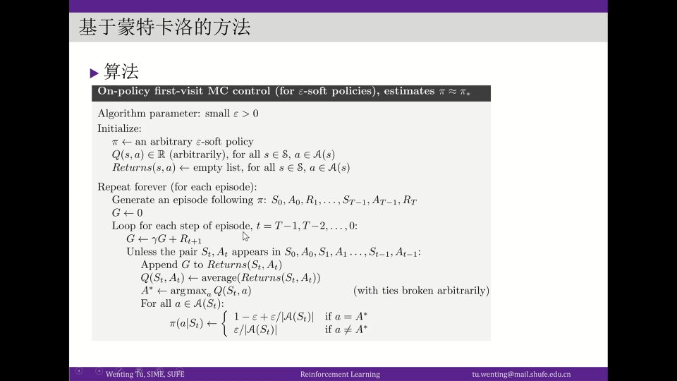

### 5.3 n 步时序差分

TD 未必要"走一步就自举"。也可以**向前多看几步再自举**：拿到 $r_1, r_2, \dots, r_n$ 这几步的真实回报后，再接上 $v(s_{t+n})$ 作为尾项估计。这就是 **n 步时序差分（n-step TD）**。

- $n = 1$：就是最普通的 TD(0)；
- $n$ 越大：越接近蒙特卡洛（用更多真实回报、更少自举）。

它的统一形式是：**前 n 步用序列里真实的 reward，尾项用当前价值函数的估计**。

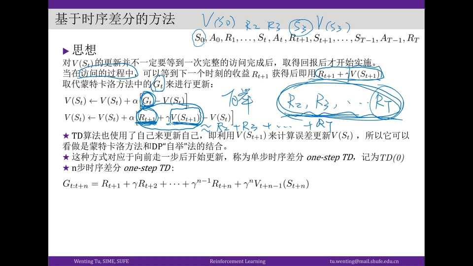

---

## 六、同策略与异策略：行为策略与目标策略能不能不同

### 6.1 一个矛盾：采样要探索，改进要纯贪心

回看上一节的算法：产生样本的**行为策略**（记作 $b$）和被评估、被改进的**目标策略**（记作 $\pi$）是**同一个** ε-贪婪策略——这就是**同策略（on-policy）**。

但这里藏着一个矛盾：

- 用 ε-贪婪去采样是必要的，因为要保持**探索、让样本多样化**；
- 然而"好的修改基础"应该是那个**纯贪婪策略**，而不是掺了随机探索的软性策略。

于是我们希望：**用软性策略 $b$ 去采数据，但评估和改进的对象是纯贪婪策略 $\pi$**（这两者自然不同，$b \ne \pi$）——这就成了**异策略（off-policy）**。

新的问题随之而来：$b$ 产生的样本，对应的分布是 $v_b$；而我们要估计的是 $v_\pi$。两个策略对应的分布不一样，**不能拿一个分布的样本直接估另一个分布的价值**。

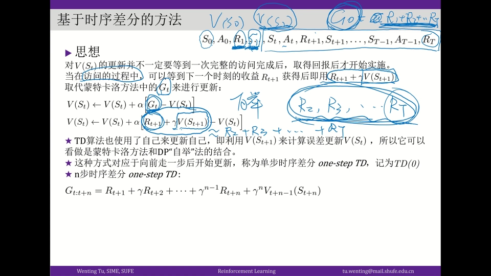

### 6.2 跨分布估计：重要性采样

解决办法是统计里现成的工具——**重要性采样（Importance Sampling）**：当我们只有一个采样分布（$b$）的样本，却要估计另一个目标分布（$\pi$）的量时，可以给每个样本乘上一个**权重比（重要性采样比）**：

$$
\rho = \frac{\pi(a \mid s)}{b(a \mid s)}
$$

用这个比值去"纠正"样本的分布偏差，就能用 $b$ 的样本来估计 $\pi$ 的价值。有了它，就能实现"**采样用 ε-贪婪软性策略、评估与改进用纯贪婪策略**"。这一条对应到前面第六章标题里的"异策略"，是后面 Q-Learning 等离轨算法的理论前提。

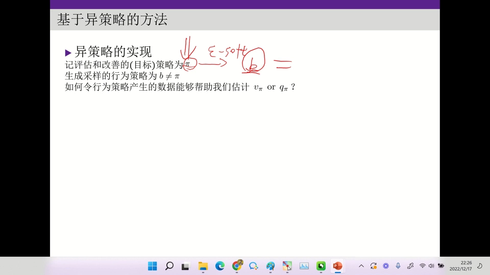

---

## 七、再往前一步：状态太多时，用函数逼近

### 7.1 表格法的天花板

前面一直默认把价值函数想象成一张**表格**：一行一个状态 $s$，对应一格价值。这在状态有限且不多时没问题；但只要**状态空间无限、或非常大**，表格法就会失效——你根本没法遍历所有状态；用蒙特卡洛采样也很难覆盖全。

### 7.2 用"特征向量 + 线性函数"表示价值

替代方案是**函数逼近（function approximation）**：不再一状态一格，而是把状态价值写成一个**参数化的函数**。最简单的选择是**线性函数**：

$$
v(s) \approx x(s)^\top \cdot w = \sum_j x_j(s) \cdot w_j
$$

其中 $x(s)$ 是状态 $s$ 的**特征向量**（把这个状态"刻画"成一组数），$w$ 是待学习的参数。让这个线性函数的输出尽量接近真实的状态价值，就是目标。

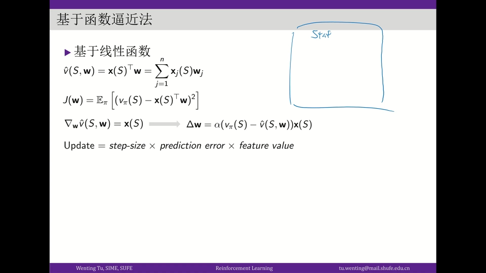

### 7.3 把 G 当标签，用随机梯度下降求 w

这其实很像**回归/监督学习**：$x(s)$ 是输入，真实的 $v(s)$ 是标签（label）。区别是——**标签并没有现成的 ground truth**。那怎么办？拿前面已经会的东西去"造"标签：**用蒙特卡洛或时序差分算出的 $G_t$ 充当标签**。

于是更新就像随机梯度下降（SGD）一样直白：

```
初始化 w
循环（每一回合）：
    用策略 π 与环境交互，产生一条序列
    对序列中每个 s_t：
        用蒙特卡洛或时序差分得到 G_t                    # 造标签
        w ← w + α · ( G_t − v_w(s_t) ) · x(s_t)        # 随机梯度下降
直到收敛
用收敛后的 v_w 求贪婪策略，作为对 π 的改进
```

注意梯度的形状：**更新量 = 步长 × 预测误差 × 特征值**。"预测误差" $G_t - v_w(s_t)$ 越小，说明函数逼近得越准。当状态空间巨大时，这套函数逼近往往比表格法友好得多，也是实际强化学习应用里更常用的做法。

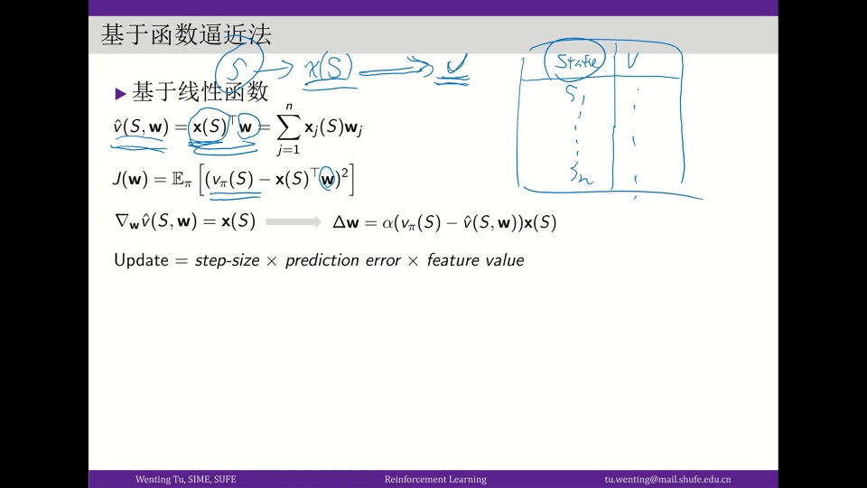

---

## 小结

- **无模型学习的出发点**：真实任务里环境动态特性未知，策略评估那一步（贝尔曼方程）算不出来，只能改用**与经验交互产生的数据**来估计价值。
- **两个关键点**：① 算法如何用数据得到更优策略（→ 蒙特卡洛）；② 智能体如何与环境交互（→ 软性策略/ε-贪婪）。数据不是现成的，必须由智能体采取某种策略交互产生——这是与监督学习的本质差异。
- **探索-利用两难**：探索多则收益低，利用多则可能错过；如果知道环境动态特性就不存在两难，正因为不知道才必须权衡。解法是 **ε-贪婪**。
- **蒙特卡洛**：用样本均值估计期望，可改写成增量式 $q \leftarrow q + (1/n)(r - q)$；步长取固定值 α 时越新的样本权重越大，更适合**非平稳环境**。
- **首次访问 vs 每次访问**：同一状态在一条序列里多次出现时，只取第一次的回报 / 每次都取，二者都可。
- **时序差分（TD）**：用 $r_{t+1} + \gamma v(s_{t+1})$ 近似完整回报 $G_t$，从而**边走边更新**；它把"采样"和"自举"结合起来，是 MC 与 DP 的合体。向前多看 n 步再自举，就是 **n 步 TD**。
- **同策略 vs 异策略**：行为策略与目标策略是否相同。希望"采样用软性策略、评估改进用纯贪婪策略"时，就需要用**重要性采样**跨分布估计。
- **函数逼近**：状态空间无限/巨大时，用 $v(s) \approx x(s)^\top w$ 之类的参数化函数代替表格，用 MC/TD 造出 $G_t$ 当标签，做随机梯度下降。

## 关键术语速查

| 术语 | 一句话解释 |
| --- | --- |
| 模型（Model） | 指环境的转移概率 $P(s' \mid s, a)$ 与奖励函数 $R$；知道它就有模型，不知道就是无模型。 |
| 有模型 / 无模型 | 是否需要（能）知道环境的动态特性；无模型只能靠与环境交互采到的数据学习。 |
| 蒙特卡洛（Monte Carlo） | 用大量样本的平均值来近似期望的一类方法。 |
| 增量式更新 | 把"求和再平均"改写成 $q \leftarrow q + (1/n)(r - q)$，只需保存最新估计与最新回报。 |
| 步长 / 学习率 α | 更新量前面的系数；取固定值 α 时越新的样本权重越大，更适合非平稳环境。 |
| 首次访问 / 每次访问 | 同一状态在一回合中多次出现时，只取首次回报 / 每次都取。 |
| ε-贪婪（ε-greedy） | 以 ε 的概率随机探索、以 1−ε 的概率贪心利用的软性策略。 |
| 探索-利用两难 | 探索能带来信息，利用能带来收益，二者此消彼长。 |
| 时序差分（TD） | 用 $r_{t+1} + \gamma v(s_{t+1})$ 近似 $G_t$，边走边更新、不必等整回合结束。 |
| 自举（Bootstrapping） | 用当前的估计值去更新估计值（TD 用 $v(s_{t+1})$ 更新 $v(s_t)$）。 |
| n 步时序差分 | 前 n 步用真实回报、尾项用当前价值估计的 TD 变体。 |
| 同策略 / 异策略 | 行为策略与目标策略是否同一个；不同就是异策略。 |
| 重要性采样 | 用权重比 $\pi(a \mid s)/b(a \mid s)$ 把 $b$ 的样本"校正"到 $\pi$，实现跨分布估计。 |
| 函数逼近 | 用参数化函数（如 $x(s)^\top w$）代替表格来表示价值函数，适用于巨大/连续状态空间。 |
