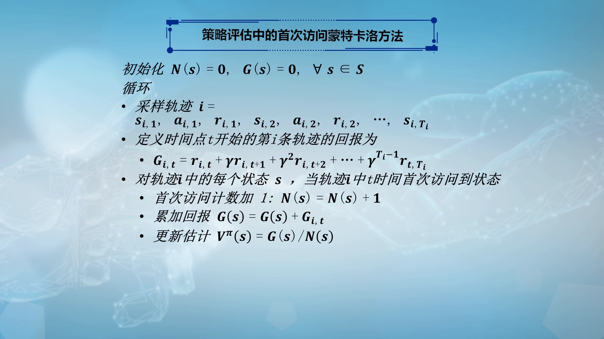
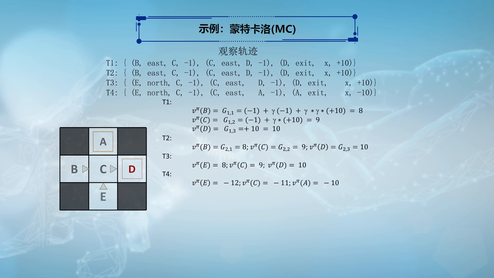
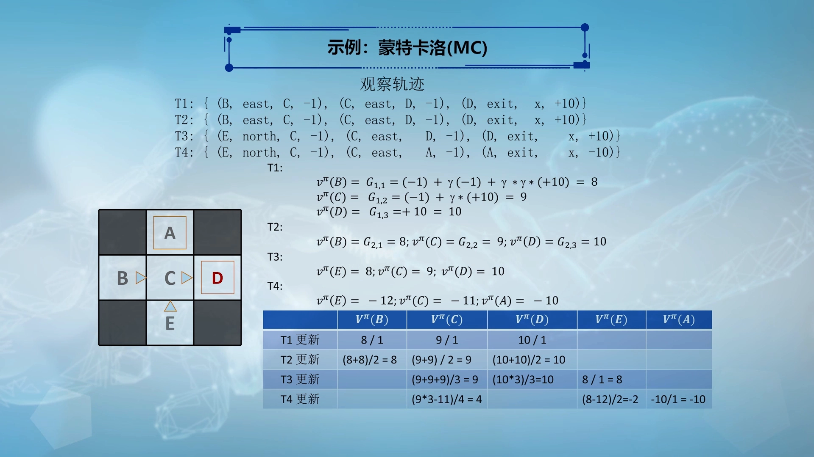
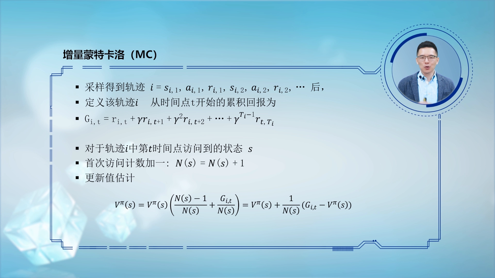
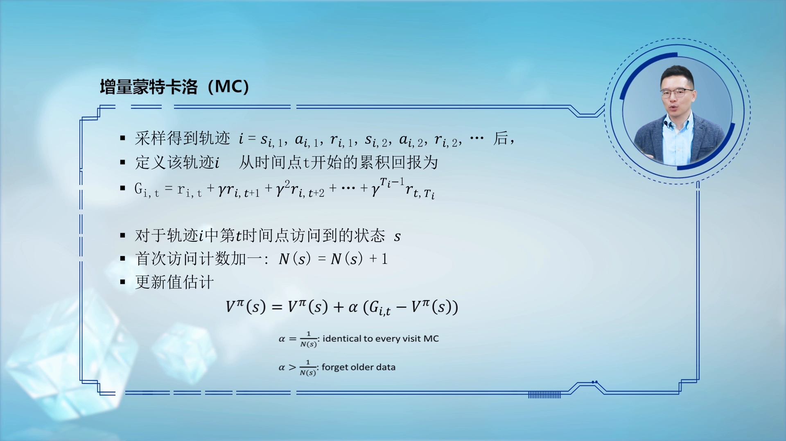

# 蒙特卡洛预测：首次访问与每次访问

> 本篇整理自复旦大学魏忠钰老师《强化学习》课程第十讲「模型无关的策略评估——蒙特卡洛算法」。视频地址：[BV1xY4y1n7Lz](https://www.bilibili.com/video/BV1xY4y1n7Lz/)。

## 本讲要解决的核心问题（SCQA）

**背景**：策略评估要做的事，是给定一个策略 π，评估每个状态的**效用值（价值）** $V^\pi(s)$——从状态 s 出发、一直按 π 走下去，能拿到的**累计回报的期望**。

**冲突**：上一小节用的是「基于模型」的方法（动态规划）：前提是环境的转移概率和奖励函数**已知**，才能解析地把期望算出来。可现实里，环境模型往往不知道，或者复杂到写不出来。

**疑问**：在不知道环境模型（也就是「模型无关」）的情况下，怎么评估一个策略的价值？

**回答（中心思想）**：用**蒙特卡洛（Monte Carlo, MC）**方法——不看模型，而是**让智能体反复与环境交互、采样出一条条完整轨迹**，再用这些轨迹里实际拿到的**累计回报的平均值**去逼近期望。按每个状态「用**第一次访问**的回报、还是**每一次访问**的回报」来累加，就得到**首次访问（first-visit）MC** 与**每次访问（every-visit）MC** 两种算法。


---

## 一、蒙特卡洛策略评估：用「样本平均」代替「解析期望」

### 1.1 问题的输入：一条由交互产生的轨迹

用 MC 做模型无关的策略评估，输入是一个**序列**——它由智能体与环境交互产生，序列中包含很多形如 `(s, a, r, s′)` 的四元组。假设一条轨迹总共有 T 个时间片，写出来就是：

```
s_1, a_1, r_1, s_2, a_2, r_2, …, s_T
```

### 1.2 要估计的量：累计回报的期望

给定策略下，对某个状态做评估，实际上就是求它所能获得的**累计回报的期望**：

$$
V^\pi(s) = \mathbb{E}[ G_t \mid s_t = s ]
$$

这里的累计回报 `G_t`，就是把从 t 时刻起的即时奖励和后续奖励按折扣因子 γ 逐项累加起来。

### 1.3 核心思想：期望算不出来，就采样求平均

期望为什么算不出来？因为它需要对所有可能轨迹按概率加权求和，而概率（环境模型）恰恰是未知的。既然算不出来，就换一个朴素的办法——**采样求平均**：

- 每条轨迹里都能找到该状态出现的那个时间片，把它之后的累计回报取出来，作为该状态的**一个样本**；
- 如果能收集到 N 个这样的样本，直接对它们求平均，就得到了 $V^\pi(s)$ 的估计。

这就是最直接、最朴素的**蒙特卡洛估计方法**（MC 也叫「直接评估」）。


---

## 二、首次访问蒙特卡洛算法：逐行读伪代码

### 2.1 两组计数器

伪代码里维护两组参数，都定义在整个状态空间 S 上：

- `N(s)`：状态 s 被访问的**次数**；
- `G(s)`：状态 s 迄今收到的**累计回报总和**。

初始化时，所有状态的 `N(s)` 和 `G(s)` 都置为 0。

### 2.2 采样一条轨迹，并计算每个时刻的累计回报

循环体一开始，先**采样一条轨迹**。假设这是第 i 次循环，得到第 i 条轨迹：

$$
i = s_{i,1}, a_{i,1}, r_{i,1}, s_{i,2}, a_{i,2}, r_{i,2}, \dots , s_{i,T_i}
$$

其中 `T_i` 是第 i 条轨迹的时间片总数。利用累计回报的定义，可以为轨迹里每个时刻 t 算出回报 $G_{i,t}$：

$$
G_{i,t} = r_{i,t} + \gamma \cdot r_{i,t+1} + \gamma^2 \cdot r_{i,t+2} + \dots + \gamma^{T_i-1} \cdot r_{i,T_i}
$$

直观地说：越靠前的奖励贡献越大（不折扣），越靠后的奖励被 γ 乘得越狠。

### 2.3 抵达每个状态时更新

对轨迹上出现过的每一个状态 s，**当它在轨迹中第一次被访问时**：

```
N(s) ← N(s) + 1
G(s) ← G(s) + G_{i,t}
V^π(s) = G(s) / N(s)
```

也就是：访问计数加一、把这次拿到的回报累加进去、再用「总和 ÷ 次数」更新估值。



### 2.4 首次访问 vs 每次访问：只看第一次，还是每次都看？

同一个状态在一条轨迹里可能被**多次访问**，用哪些回报去更新，就分出两种变体：

- **首次访问 MC（first-visit MC）**：只用状态**第一次**被访问时的那个回报。**一条轨迹对一个状态最多贡献 1 个样本**。
- **每次访问 MC（every-visit MC）**：轨迹里该状态**每一次**被访问的回报都用上，**一条轨迹可以贡献多个样本**。

本讲主讲首次访问 MC（它更简单，也更便于精确的理论分析）。

---

## 三、实例：五状态走格子，手算一遍

### 3.1 环境与预先给定的策略

这是一个五状态的走格子问题：状态 A、B、C、D、E，其中 **B 和 E 是起点**、**A 和 D 是终点**、C 是中间态。因为是策略评估，每个状态的动作已经**预先给定**（相当于给定了一个策略）：

- B、C：向东走；E：向北走；A、D：直接结束。
- 折扣因子 `γ = 1`（让计算尽量简单）。


### 3.2 四条轨迹与各自的样本回报

智能体与环境交互，得到四条轨迹（每条都是一串「状态, 动作, 奖励」）：

```
T1: (B, east, −1), (C, east, −1), (D, exit, +10)
T2: (B, east, −1), (C, east, −1), (D, exit, +10)
T3: (E, north, −1), (C, east, −1), (D, exit, +10)
T4: (E, north, −1), (C, east, −1), (A, exit, −10)
```

以 T1 为例，逐个时刻算累计回报（γ = 1）：

```
G_{1,1}(B) = (−1) + γ(−1) + γ²(+10) = 8
G_{1,2}(C) = (−1) + γ(+10) = 9
G_{1,3}(D) = +10 = 10
```

即 T1 为 B 贡献样本 8、为 C 贡献样本 9、为 D 贡献样本 10。



### 3.3 逐条轨迹更新，得到估值

每来一条轨迹，就把该轨迹贡献的样本累加进去，再除以累计次数：

| 更新后 | V^π(B) | V^π(C) | V^π(D) | V^π(E) | V^π(A) |
| :-- | :-- | :-- | :-- | :-- | :-- |
| T1 更新 | 8/1 | 9/1 | 10/1 | | |
| T2 更新 | (8+8)/2 = 8 | (9+9)/2 = 9 | (10+10)/2 = 10 | | |
| T3 更新 | | (9+9+9)/3 = 9 | (10×3)/3 = 10 | 8/1 = 8 | |
| T4 更新 | | (9×3−11)/4 = 4 | | (8−12)/2 = −2 | −10/1 = −10 |

几个值得注意的点：

- **T3** 里 E 第一次出现，样本回报 $G_{3,1}(E) = (-1) + \gamma(-1) + \gamma^2(+10) = 8$（和 T1 里 B 的算法一样）；
- **T4** 里 E 的样本回报是 $G_{4,1}(E) = (-1) + \gamma(-1) + \gamma^2(-10) = -12$，所以 E 的估值从 8 更新为 `(8−12)/2 = −2`；
- **C** 在 T4 收到的样本是 `−1 + γ(−10) = −11`，于是 `(9×3 − 11)/4 = 4`。

可以看到：随着轨迹越采越多，每个状态的估值就是「已收集样本的算术平均」。



---

## 四、从「求平均」到「增量更新」：滑动平均

### 4.1 把求和改写成迭代式

前面是「先攒样本、最后求平均」。其实不必攒着，可以把更新改写成**增量（迭代）**形式：

```
V^π(s) ← V^π(s) + (1/N(s)) · (G_{i,t} − V^π(s))
```

它的含义很清晰：$G_{i,t} - V^\pi(s)$ 是「这次的新样本」与「旧估计」之间的**差值（误差）**，再按 `1/N(s)` 的比例补上去。样本越多，每次调整的幅度越小。



### 4.2 步长 α 的含义

把 `1/N(s)` 记成步长 $\alpha$，就得到更一般的形式：

```
V^π(s) ← V^π(s) + α · (G_{i,t} − V^π(s))
```

- 当 `α = 1/N(s)` 时，它等价于对样本取**算术平均**，也就是前面首次访问 MC 的更新方式；此时 α 随访问次数增加而**不断减小**；
- 当 $\alpha$ 取固定值、或大于 `1/N(s)` 时，表示**新样本的权重更大**、旧数据被逐渐「遗忘」。

后一种做法在实际中很常见：数据会随时间不断变化，我们希望新数据发挥更大作用，所以常让 `α > 1/N(s)`。



### 4.3 两个常见的追问

- **一条轨迹会更新一个状态几次？** 首次访问 MC 最多 **1 次**；每次访问 MC 可以**多次**。
- **能截断轨迹、只用前一半来做 MC 吗？** 不行。MC 必须对轨迹里每个时刻算**累计回报**，而累计回报只有在状态到达**终结**之后才能确定；轨迹没结束，回报就算不出来，MC 也就不适用。


---

## 小结

- **策略评估的两种路子**：基于模型（动态规划，需要已知转移概率与奖励）；模型无关（蒙特卡洛，只需要能采样轨迹）。
- **MC 的核心**：用**样本累计回报的平均**去逼近价值函数的期望，即 $V^\pi(s) = G(s) / N(s)$。
- **两种变体**：首次访问 MC（每回合每状态最多一个样本）与每次访问 MC（每回合可多个样本）。本讲以首次访问为主。
- **累计回报**：$G_t = r_t + \gamma \cdot r_{t+1} + \gamma^2 \cdot r_{t+2} + \dots$，越早的奖励权重越大。
- **实例结论**：五状态走格子中，估值就是对所收集样本的算术平均；例如 $V^\pi(B)$ 在 T1、T2 之后保持为 8。
- **增量更新**：`V ← V + α(G − V)`；`α = 1/N` 等价于算术平均，`α > 1/N` 时更看重新样本。
- **MC 的适用前提**：轨迹必须能走到终结，否则无法计算累计回报。

## 关键术语速查

| 术语 | 一句话解释 |
| :-- | :-- |
| 策略评估（Policy Evaluation） | 给定策略 π，估计每个状态的（状态）价值 V^π(s)。 |
| 模型无关（Model-Free） | 不假设知道环境的转移概率与奖励函数，只通过交互采样学习。 |
| 蒙特卡洛（Monte Carlo, MC） | 用大量完整轨迹的累计回报取平均，来估计期望的方法。 |
| 轨迹 / 回合（Trajectory / Episode） | 智能体从起点到终点的一次完整交互序列。 |
| 累计回报（Return） `G_t` | 从时刻 t 起，各步奖励按 γ 折扣后的加权和。 |
| 首次访问 MC（First-Visit） | 只用状态在一条轨迹中首次出现时的回报来更新。 |
| 每次访问 MC（Every-Visit） | 用状态在一条轨迹中每一次出现时的回报来更新。 |
| 增量更新 / 滑动平均 | 用 `V ← V + α(G − V)` 逐步更新估值，α 为步长。 |
| 步长 α（Learning Rate） | 控制新样本对估值影响大小的系数；α = 1/N 时等于算术平均。 |
