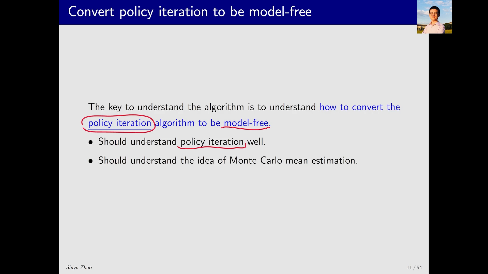
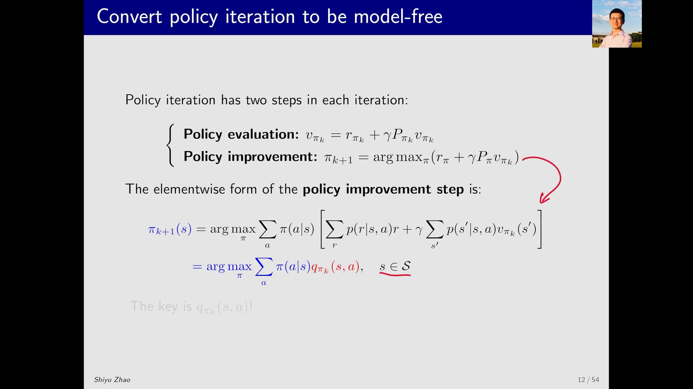
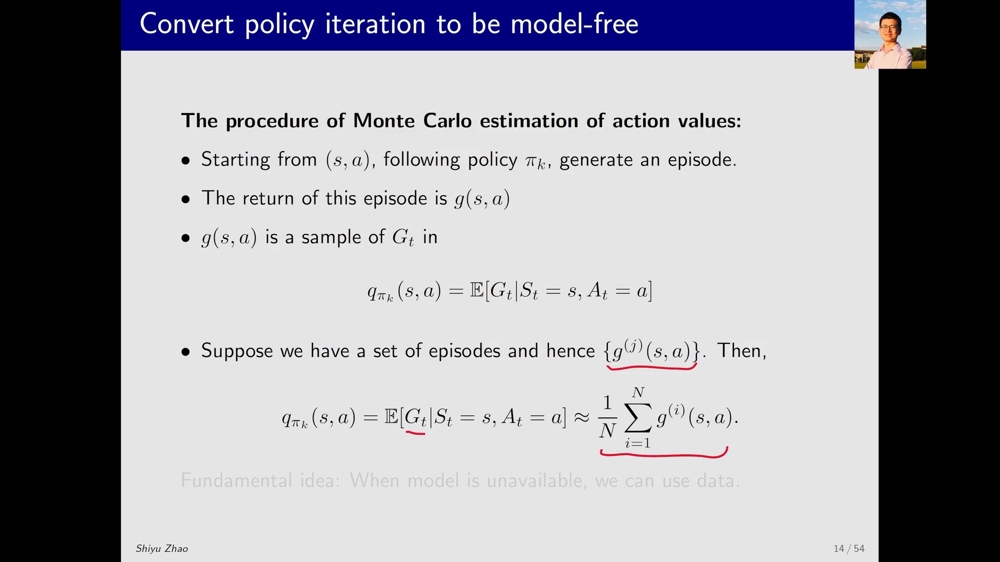
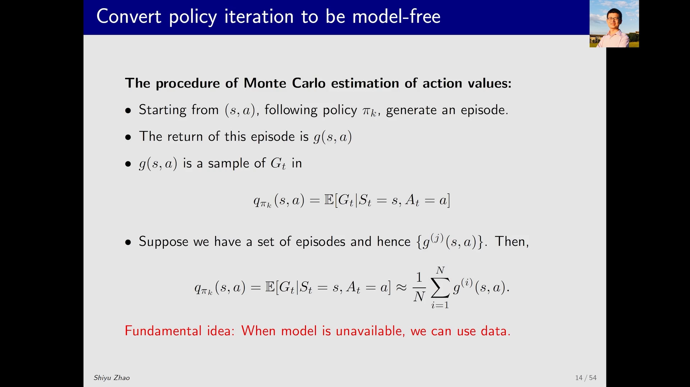
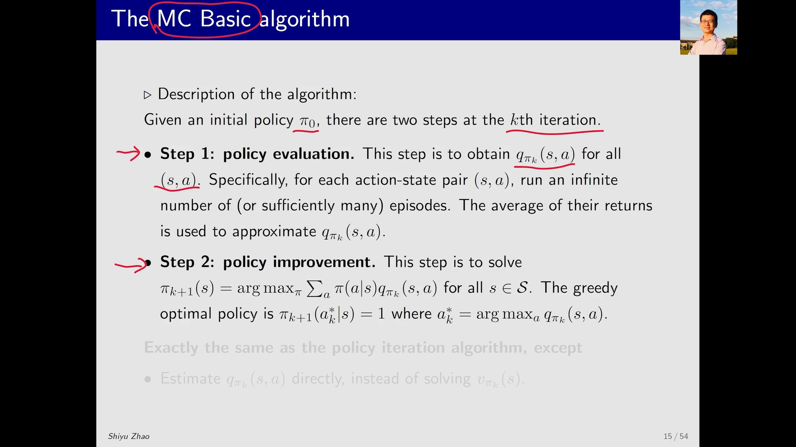
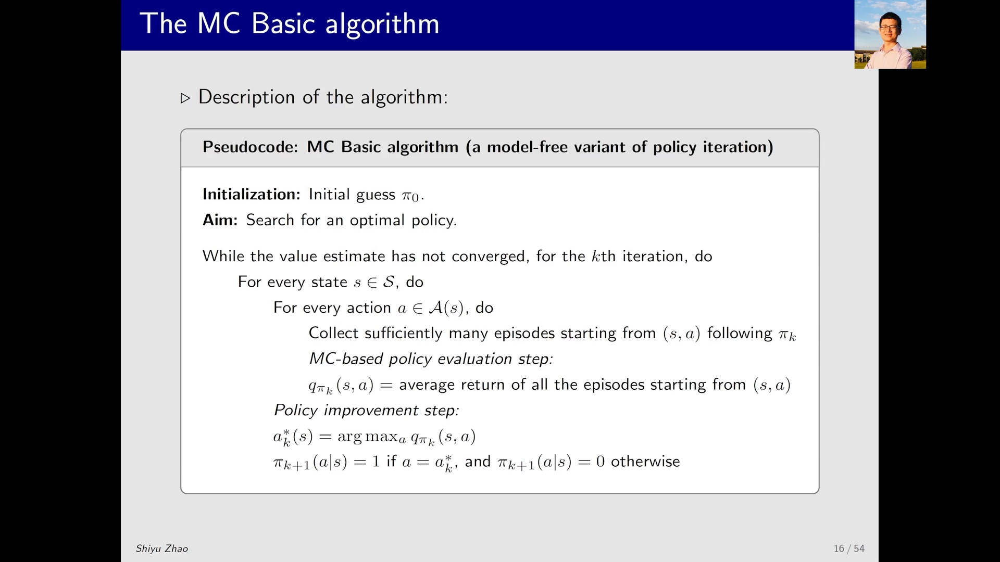
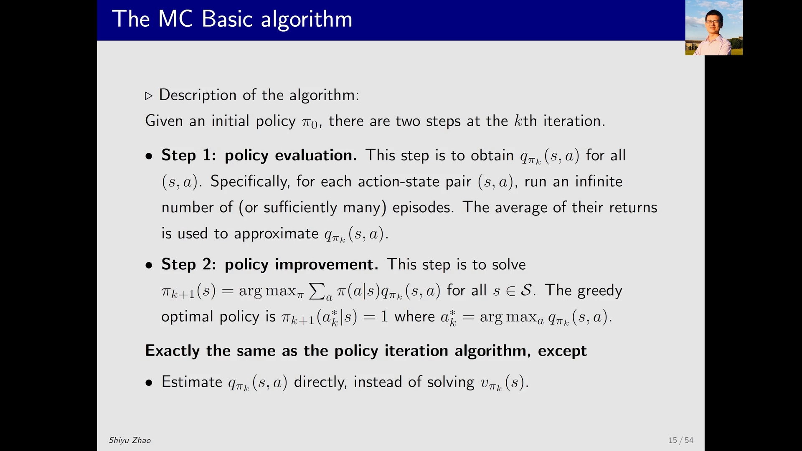
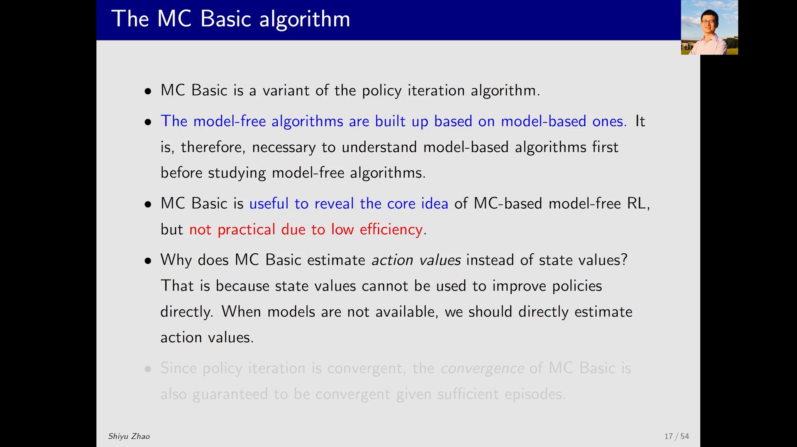
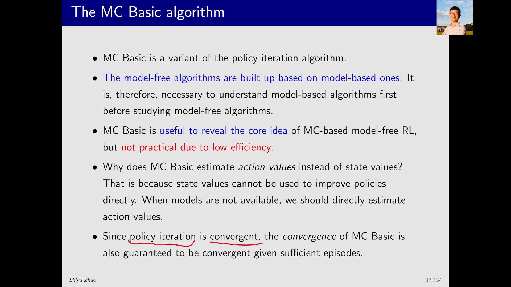

# MC Basic：把策略迭代改造成无模型算法

> 本篇整理自《强化学习的数学原理》第 5 课「蒙特卡洛方法」第 2 部分「MC Basic 算法介绍」。视频地址：[BV1dG411E7Xj](https://www.bilibili.com/video/BV1dG411E7Xj/)。

## 本讲要解决的核心问题（SCQA）

**背景**：前面已经学过**策略迭代（policy iteration）**——它每一轮做两件事：先**策略评估**（求出当前策略 π_k 的状态价值 $V^{\pi_k}(s)$，也就是解贝尔曼公式），再**策略改进**（在每个状态上选动作价值最大的那个动作，得到新策略 π_k+1）。这套流程能保证收敛到最优策略。

**冲突**：但策略迭代是**基于模型（model-based）**的：策略评估要解贝尔曼公式，得知道转移概率；策略改进要把状态价值转成动作价值，也得知道转移概率和奖励函数。而在真实问题里，环境模型往往拿不到。

**疑问**：能不能把策略迭代里**依赖模型的那一块**换掉，换成不需要模型的模块，从而得到一个**无模型（model-free）**的强化学习算法？

**回答（中心思想）**：能。策略改进那一步不用动，唯一要换的是策略评估——**不再先算状态价值再转成动作价值，而是直接用数据去估计动作价值 $Q^\pi(s,a)$**。动作价值最原始的定义就是「从 (s,a) 出发能拿到的回报的期望」，这是一个**均值估计（mean estimation）**问题，用**蒙特卡洛方法**采样求平均就能解。这样得到的算法就叫 **MC Basic**：它是策略迭代的一个变形，把基于模型的模块整体替换成蒙特卡洛估计。



---

## 一、改造的靶点：策略迭代里哪一步依赖模型

### 1.1 策略迭代的两步

策略迭代在每一轮迭代里做两件事：

1. **策略评估**：给定策略 π_k，求它的状态价值 $V^{\pi_k}$——本质是解贝尔曼公式；
2. **策略改进**：知道 $V^{\pi_k}$ 之后，求解一个最优化问题，得到新策略 π_k+1。

改进那一步按状态逐个展开，长这样：

$$
\pi_{k+1}(s) = \arg\max_a Q^{\pi_k}(s, a)
$$

其中后边这一长串 $Q^{\pi_k}(s,a)$ 就是**动作价值**。所以整个策略迭代里**最核心的量就是 $Q^{\pi_k}(s,a)$**：只要拿到它，改进就是「选最大的那个」。

[【跳转到 01:20】](https://www.bilibili.com/video/BV1dG411E7Xj/?t=80)



### 1.2 算动作价值的两条路

要得到 $Q^{\pi_k}(s,a)$，有两种方法：

- **依赖模型**：先算出 $V^{\pi_k}$，再用模型（转移概率、奖励）把它转成 $Q^{\pi_k}$。价值迭代走的就是这条路——第一步求 $V^{\pi_k}$，第二步因为模型全都知道，$Q^{\pi_k}$ 自然算得出来。
- **不依赖模型**：直接按动作价值的**最原始定义**去估计它。

[【跳转到 02:10】](https://www.bilibili.com/video/BV1dG411E7Xj/?t=130)

![动作价值的两种表达式：第一个需要模型（打叉），第二个只需数据（E[G_t]），这就是做无模型 RL 的切入点](assets/MC Basic：把策略迭代改造成无模型算法/00205.webp)

### 1.3 动作价值的最原始定义，正好是一个「求平均」

动作价值最初的定义是：**从状态 s 出发、执行动作 a，之后得到的回报（return）的期望**。

$$
Q^\pi(s, a) = \mathbb{E}\big[\, G_t \mid s_t = s,\ a_t = a \,\big]
$$

这里的回报 $G_t$ 是一个**随机变量**（因为环境有随机性、策略也可能随机）。求它的期望，就是一个**均值估计**问题。

于是「把策略迭代变成无模型」这件事，就归结成一句话：**用不依赖模型的式子替代依赖模型的式子**。而替代品就是——采样若干条轨迹，把实际拿到的回报求平均。

[【跳转到 02:35】](https://www.bilibili.com/video/BV1dG411E7Xj/?t=155)

---

## 二、具体怎么做：采样、求平均、再贪心

### 2.1 从一个 (s, a) 出发，收集回报样本

具体操作分三步：

1. 从任意一个 **(s, a) 组合**出发；
2. 按**当前策略**与环境交互，跑完一整条轨迹，得到一个 **episode**；
3. 计算这条轨迹对应的**折扣回报（discounted return）**，记作 $g(s,a)$。

$g(s,a)$ 就是随机变量 $G_t$ 的**一个采样**。如果有很多这样的采样，构成一个集合，就可以用这些 $g$ 的**平均值**来估计 $G_t$ 的期望——也就是 $Q^\pi(s,a)$。

[【跳转到 03:25】](https://www.bilibili.com/video/BV1dG411E7Xj/?t=205)



### 2.2 一句话记住这个思路：没模型就得有数据

整个无模型强化学习的核心思想可以压缩成一句大白话：

> **没有模型的时候，你得有数据；没有数据的时候，你得有模型。反正总得有一个。**

没有模型时，我们就**依赖数据**。这里的「数据」在统计/概率里叫**样本（sample）**，在强化学习里有个专门的名字叫**经验（experience）**。

[【跳转到 04:15】](https://www.bilibili.com/video/BV1dG411E7Xj/?t=255)



### 2.3 MC Basic 的算法流程

到这里算法已经清晰了，它的名字叫 **MC Basic**（MC 是 Monte Carlo 的首字母缩写）。

算法从一个**初始策略**出发（这个策略可能很不好，后面会逐步改进）。在第 k 轮迭代里，包含两步：

**第一步：策略评估**——对**所有** (s, a) 估计 $Q^{\pi_k}(s,a)$。方法是：从每个 (s, a) 出发，各跑很多条 episode，把它们的回报求平均。

**第二步：策略改进**——用上一步得到的 $Q^{\pi_k}$ 求解最优化问题，得到新策略：

$$
\pi_{k+1}(s) = \arg\max_a Q^{\pi_k}(s, a)
$$

[【跳转到 05:05】](https://www.bilibili.com/video/BV1dG411E7Xj/?t=305)



### 2.4 伪代码逐行读

伪代码和前面讲过的策略评估非常像：

```
for k = 0, 1, 2, ... :                      # 每一轮迭代
    for each s in S:                        # 遍历每个状态
        for each a in A(s):                 # 遍历该状态下每个动作
            # 策略评估：从 (s,a) 出发采样多条 episode
            收集 n 条从 (s,a) 出发、按 π_k 生成的 episode
            对每条 episode 计算折扣回报 g
            Q(s,a) ← (g_1 + g_2 + ... + g_n) / n
        # 策略改进：贪心
        π_k+1(s) ← argmax_a Q(s,a)
```

要点只有两个：**遍历所有 (s,a) 收集回报求平均**，然后**选动作价值最大的动作**。

[【跳转到 06:20】](https://www.bilibili.com/video/BV1dG411E7Xj/?t=380)



### 2.5 与策略迭代的唯一区别

把两者并排看，结论非常干净：

| | 策略迭代（model-based） | MC Basic（model-free） |
| :-- | :-- | :-- |
| 策略评估 | 解贝尔曼公式得 $V^{\pi_k}$，再用模型转成 $Q^{\pi_k}$ | 直接从数据（episode 的平均回报）得到 $Q^{\pi_k}$ |
| 策略改进 | $\arg\max_a Q^{\pi_k}(s,a)$ | 完全相同 |
| 是否要模型 | 要 | 不要 |

**第二步一模一样，唯一的区别在第一步**：策略迭代是先求状态价值再转动作价值，MC Basic 是直接用数据得到动作价值。

[【跳转到 05:55】](https://www.bilibili.com/video/BV1dG411E7Xj/?t=355)



---

## 三、五条必须记住的说明

### 3.1 先懂策略迭代，才可能懂 MC Basic

MC Basic 就是策略迭代的一个**变形**：把基于模型的模块拿掉，换成一个不需要模型的模块。所以学它的正确顺序是——**先搞懂基于模型的策略迭代**，否则上来就学 MC Basic 会有一堆疑问，比如「凭什么把策略改成选动作价值最大的那个？」

### 3.2 教学价值极高，但效率很低

MC Basic 非常有用，因为它**极其清晰地揭示了「怎么把 model-based 变成 model-free」这个过程**。但它**并不实用**：效率比较低（每个 (s,a) 都要跑很多条 episode）。

后面会介绍两个算法逐步提高效率。顺带一提，**MC Basic 这个名字是讲课老师特意起的**，在别的地方看不到——因为真实教材里通常直接讲更实用的版本。

[【跳转到 08:00】](https://www.bilibili.com/video/BV1dG411E7Xj/?t=480)


### 3.3 为什么要直接估计动作价值，而不是先估状态价值

这是初学者最容易卡住的一点。在策略迭代里是先估 $V^\pi$ 再转成 $Q^\pi$；MC Basic 却**直接估 $Q^\pi$**。

原因很直接：**如果先估状态价值，之后还要再转一遍，而「从 V 转到 Q」这一步又依赖模型**——那就等于没摆脱模型。所以必须跳过 $V$，直接把 $Q$ 估出来。

[【跳转到 09:15】](https://www.bilibili.com/video/BV1dG411E7Xj/?t=555)



### 3.4 收敛性仍然成立

策略迭代是收敛的；MC Basic 和策略迭代在结构上完全一样，**只是估计动作价值的方法不同**，所以它的**收敛性仍然能得到保证**。

[【跳转到 09:40】](https://www.bilibili.com/video/BV1dG411E7Xj/?t=580)



不过要注意：随着后续算法变得越来越复杂（为了效率做各种近似），这种收敛性会逐渐消失，或者说收敛性的分析会越来越复杂。

### 3.5 学习方法的启示：先把核心想法剥离出来

老师在这里给了一个学习方法上的建议，值得单独记一笔：

> 学习时应该把**最核心的想法**和**让它看起来复杂的那些东西**剥离开来。

在这个例子里：
- **最核心的想法** = 把策略迭代里基于模型的部分替换掉；
- **让它变复杂的东西** = 怎么更高效地利用数据、怎么更高效地更新、怎么去掉实际中难以实现的假设……

后者会让算法更实用，但也会让算法看起来很复杂。**先抓住核心 idea，再去看工程细节**，才不会在细节里迷路。

[【跳转到 08:25】](https://www.bilibili.com/video/BV1dG411E7Xj/?t=505)

---

## 小结

- **MC Basic 的定位**：策略迭代的无模型变形，把「基于模型的策略评估」换成「基于数据的动作价值估计」。
- **改造的靶点**：策略迭代里唯一依赖模型的是策略评估（要先求 $V^\pi$ 再转 $Q^\pi$）；策略改进 $\arg\max_a Q^\pi(s,a)$ 完全不用动。
- **替代方案**：动作价值的最原始定义就是「回报的期望」，是一个均值估计问题，用蒙特卡洛采样求平均即可。
- **算法两步**：对每个 (s,a) 采样多条 episode、对回报求平均得到 $Q^{\pi_k}$；再贪心地取 $\arg\max$ 得到新策略。
- **核心口号**：没有模型就得有数据（经验 / experience），没有数据就得有模型。
- **为什么直接估 Q**：从 $V$ 转 $Q$ 又要用到模型，所以必须跳过 $V$。
- **价值与代价**：教学上极其清晰，实践上效率太低；收敛性因与策略迭代同构而仍然成立。
- **学习方法**：先剥离出核心想法，再叠加让它变复杂的工程细节。

## 关键术语速查

| 术语 | 一句话解释 |
| :-- | :-- |
| 策略迭代（Policy Iteration） | 反复做「策略评估 → 策略改进」，直到策略不再变化。 |
| 策略评估（Policy Evaluation） | 给定策略 π_k，求出它的状态价值 $V^{\pi_k}$（或动作价值）。 |
| 策略改进（Policy Improvement） | 在每个状态上选动作价值最大的动作，得到新策略。 |
| 状态价值 $V(s)$ | 从状态 s 出发、按策略走下去的累积回报期望。 |
| 动作价值 $Q(s,a)$ | 从状态 s 出发、先执行动作 a 再按策略走下去的累积回报期望。 |
| 基于模型（Model-Based） | 需要知道转移概率与奖励函数才能计算的方法。 |
| 无模型（Model-Free） | 不需要环境模型，只靠采样数据估计的方法。 |
| 均值估计（Mean Estimation） | 用样本平均值去逼近随机变量期望的统计方法。 |
| 回合 / 轨迹（Episode） | 从起点到终结的一次完整交互序列。 |
| 折扣回报（Discounted Return） $G_t$ | 从时刻 t 起各步奖励按折扣因子 γ 加权求和的结果。 |
| 经验（Experience） | 强化学习里对「采样得到的数据」的称呼，即样本。 |
| MC Basic | 用蒙特卡洛估计动作价值、其余照搬策略迭代的教学型算法。 |