# MC Exploring Starts：让蒙特卡洛控制更高效

> 本篇整理自《强化学习的数学原理》第 5 课「蒙特卡洛方法」第 4 部分「MC Exploring Starts 算法」。视频地址：[BV1Ke4y1S7BT](https://www.bilibili.com/video/BV1Ke4y1S7BT/)。

## 本讲要解决的核心问题（SCQA）

**背景**：上一节介绍的 **MC Basic** 用蒙特卡洛估计动作价值、其余照搬策略迭代，第一次完整展示了「怎么用蒙特卡洛实现无模型的强化学习」。

**冲突**：MC Basic 的坏处是**考虑得太少、效率太低**：它从每个 (s,a) 出发跑一堆 episode，却**只用轨迹起点那一个 (s,a) 的回报**，剩下的数据全浪费了；而且它要**等所有 episode 都收集完**才做一次策略改进，等待本身就是浪费。

**疑问**：能不能在**不改变核心思想**的前提下，把 MC Basic 推广成更实用的算法？

**回答（中心思想）**：能，推广的方向有两个——**更充分地利用数据**（一条 episode 里每个 (s,a) 都能拿来估计，分 first-visit 与 every-visit 两种做法）和**更及时地更新策略**（得到一个 episode 就立刻改进，不必等齐）。这两点合起来就是 **MC Exploring Starts** 算法。它额外要求一个条件：**每个 (s,a) 都要能作为起点被访问到**（exploring starts），否则有些动作永远估不到、可能漏掉最优动作。这个条件理论上必要，但实际中难以实现，于是引出下一节的 **MC ε-Greedy**。

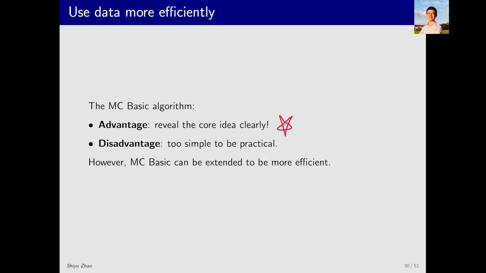

---

## 一、MC Basic 浪费在哪：数据与更新

### 1.1 先引入一个概念：visit（访问）

在一个网格世界里，遵循策略 π 得到一条 episode。这条 episode 里**每出现一次某个 (state, action) 对，就称为对该 (s,a) 有了一次 visit（访问）**。

假设这条 episode 是：

```
(s1, a2) → (s2, a4) → (s1, a2) → (s2, a3) → (s5, a1)
```

那么 (s1,a2) 被访问了 **2 次**，(s2,a4)、(s2,a3)、(s5,a1) 各被访问 **1 次**。

[【跳转到 00:55】](https://www.bilibili.com/video/BV1Ke4y1S7BT/?t=55)

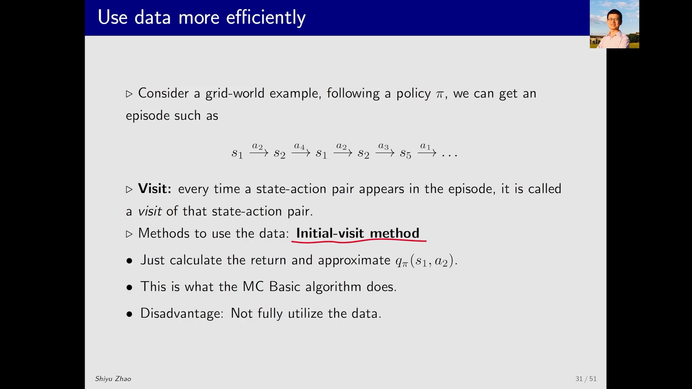

### 1.2 MC Basic 用的是 initial-visit：只认起点

MC Basic 里用的策略叫 **initial-visit**：**对一条 episode，只考虑它的起点 (s1, a2)**，用起点之后的回报来估计 $Q^\pi(s_1,a_2)$。

问题很明显：**这条 episode 里还有很多数据被浪费了**。既然我们已经跑出了 `(s2,a4) → (s1,a2) → (s2,a3) → (s5,a1)` 这一段，那它本身就可以看作一条**新的 episode**（从 (s2,a4) 出发），完全可以用来估计 $Q^\pi(s_2,a_4)$。

[【跳转到 01:20】](https://www.bilibili.com/video/BV1Ke4y1S7BT/?t=80)

### 1.3 数据复用：把一条 episode 拆成多条子 episode

顺着这个想法，一条 episode 可以拆出很多条**子 episode**：

```
原 episode:  (s1,a2) → (s2,a4) → (s1,a2) → (s2,a3) → (s5,a1)

子 episode 1（从第 2 个 (s,a) 起）: (s2,a4) → (s1,a2) → (s2,a3) → (s5,a1)
子 episode 2（从第 3 个 (s,a) 起）: (s1,a2) → (s2,a3) → (s5,a1)
子 episode 3（从第 4 个 (s,a) 起）: (s2,a3) → (s5,a1)
子 episode 4（从第 5 个 (s,a) 起）: (s5,a1)
```

于是同一条数据可以同时用来估计 (s1,a2)、(s2,a4)、(s2,a3)、(s5,a1) 四个动作价值——**数据被利用得非常充分**。

[【跳转到 01:45】](https://www.bilibili.com/video/BV1Ke4y1S7BT/?t=105)

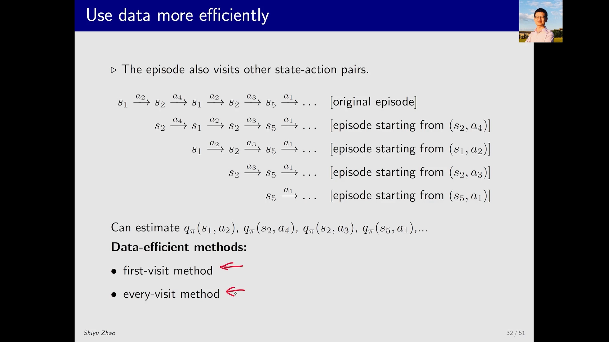

### 1.4 两种复用方式：first-visit 与 every-visit

具体到「同一个 (s,a) 在一条 episode 里出现多次怎么办」，有两种做法：

- **every-visit（每次访问）**：不管出现几次，**每一次出现**之后的回报都拿来估计该 (s,a) 的动作价值。上面例子里 (s1,a2) 出现了 2 次，两次的后缀都用上。
- **first-visit（首次访问）**：**只用第一次出现**的后缀；第二次出现时，它后面的数据就不再用它来估计了。

两者的差别就体现在重复访问的 (s,a) 上：every-visit 用得多、样本更多；first-visit 用得少、但样本之间更接近独立。

[【跳转到 02:35】](https://www.bilibili.com/video/BV1Ke4y1S7BT/?t=155)

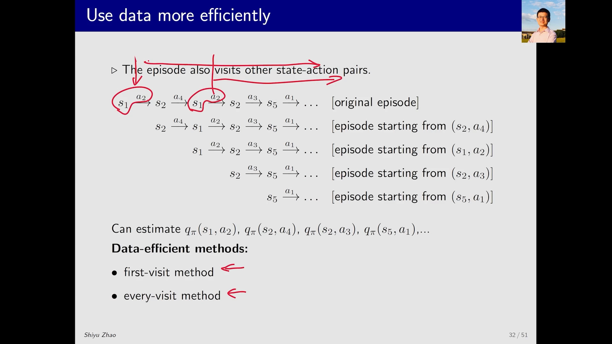

### 1.5 更新的效率：批量等齐 vs 得到一个就改

除了数据利用，还有**策略更新的效率**问题。这里同样有两种方法：

- **批量式（MC Basic 采用）**：把一个 (s,a) 出发的**所有 episode 全部收集完**，再对回报求平均来估计动作价值。问题是**必须等所有 episode 都到手**，等待过程浪费时间。
- **逐个式**：**得到一个 episode，就立刻用它估计动作价值、立刻改进策略**，不停不等，下一个 episode 再来再改。

[【跳转到 03:25】](https://www.bilibili.com/video/BV1Ke4y1S7BT/?t=205)

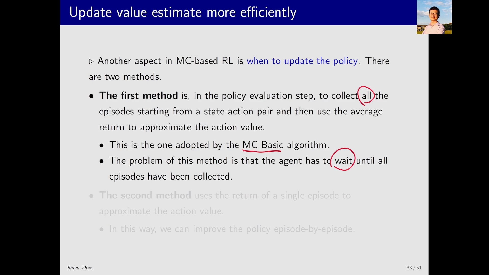

### 1.6 「只用一个 episode 估得准吗？」——截断策略迭代的先例

初学者会问：本来要用很多个 episode 才估得准，现在**只用一个 episode** 就更新，估计显然不准，这到底行不行？

答案是**行**，而且这个思想上一节课已经出现过——**截断的策略迭代（truncated policy iteration）**。它的策略评估本应求解贝尔曼公式、需要无穷多步迭代才能得到精确的状态价值；当时我们**只做有限步迭代**就停了。有限步当然得不到精确的价值，但**算法仍然行之有效**。

同样的道理用在这里：用一个 episode 估出的动作价值不精确，**但没关系**。

[【跳转到 04:15】](https://www.bilibili.com/video/BV1Ke4y1S7BT/?t=255)

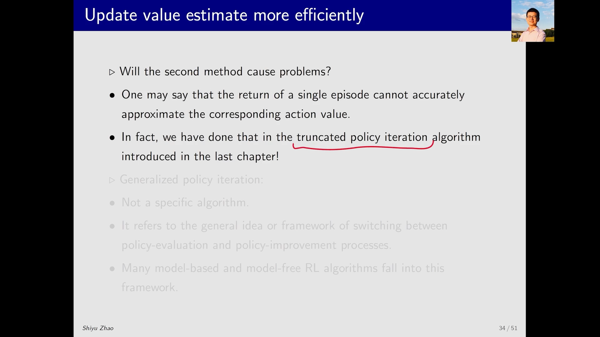

### 1.7 这一类方法有个共同名字：GPI

这种「评估不必求精确、评估与改进不断交替」的做法，有一个统一的名字——**广义策略迭代（Generalized Policy Iteration，简称 GPI）**。

要点是：

- **GPI 不是一个具体的算法**，而是一大类算法、一种思想、一种架构；
- 它的特征是：在**策略评估**与**策略改进**之间**不断切换**，且策略评估**不需要**把动作价值或状态价值估得非常精确；
- 上一节课的算法、这一节课的算法，**都能归到 GPI 框架里**。

[【跳转到 05:05】](https://www.bilibili.com/video/BV1Ke4y1S7BT/?t=305)

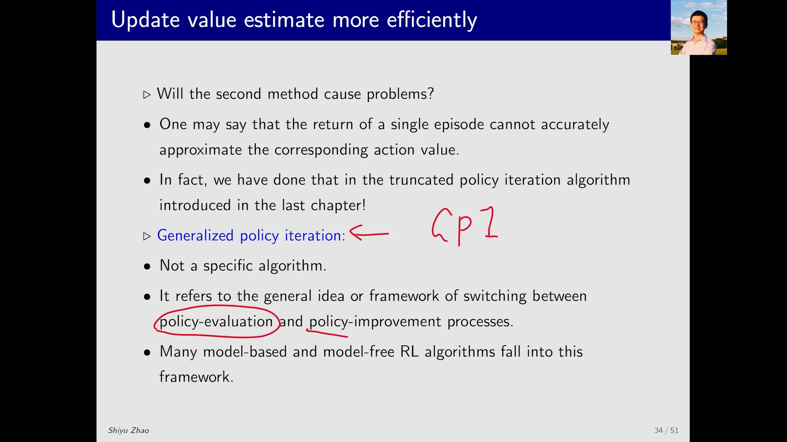

---

## 二、MC Exploring Starts 算法：把两点改进合起来

有了上面的思考，就得到新算法 **MC Exploring Starts**。它是 MC Basic 的**推广**，推广的方式就是**让计算效率更高**。

### 2.1 算法骨架

```
循环（每轮）:
    1. 生成一条 episode（从某个 (s, a) 出发，按当前策略 π 走完）
    2. 策略评估：对这条 episode 里出现的每个 (s, a)，
       用它的后缀回报（return）更新 Q(s, a)
       —— 可选 first-visit 或 every-visit
    3. 策略改进：对更新过的状态，立刻做贪心
       π(s) ← argmax_a Q(s, a)
```

和 MC Basic 相比，两处关键差别就是前面说的：**一条 episode 里的每个 (s,a) 都要用上**，以及**每得到一个 episode 就立刻改进策略**（GPI 式的交替）。

[【跳转到 05:51】](https://www.bilibili.com/video/BV1Ke4y1S7BT/?t=351)

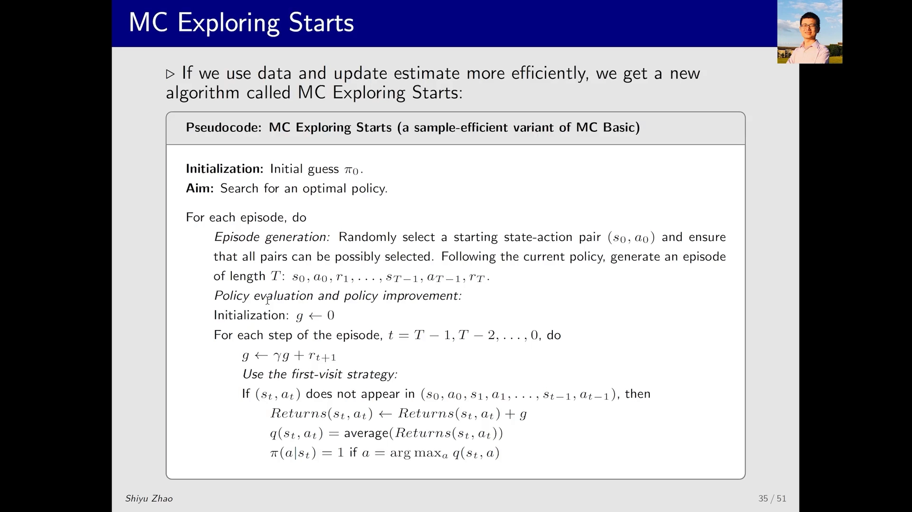

### 2.2 一个容易看懵的细节：为什么伪代码要「倒着算」

假设得到的 episode 是：

```
(s1,a1) → (s2,a2) → (s3,a3) → (s4,a4) → ...
```

**直觉做法**是正着遍历：先处理 (s1,a1)，把它后面所有奖励加起来得到回报，作为 `Q(s1,a1)` 的估计；再往下碰到 (s2,a2)，把它后面所有奖励加起来……依此类推。

但伪代码是**从后往前**算的。为什么？**纯粹是为了提高计算效率。**

[【跳转到 06:41】](https://www.bilibili.com/video/BV1Ke4y1S7BT/?t=401)

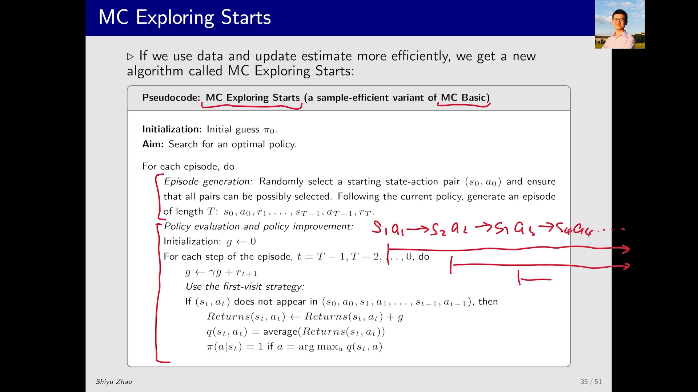

### 2.3 倒推技巧：`g ← r + γ · g`

假设从后面某一步开始，我们已经算出了后缀回报 `g`（即后面所有奖励的折扣和）。现在要算前一个 (s,a) 的回报，**不必把后面所有奖励重新加一遍**，只需：

```
新 g = r + γ · g
```

其中 `r` 是从当前 (s,a) 出发拿到的**即时奖励（immediate reward）**，`g` 是刚才那一段已经算好的回报。算出的新 `g` 又可以继续往前递给更早的 (s,a)。

[【跳转到 07:31】](https://www.bilibili.com/video/BV1Ke4y1S7BT/?t=451)

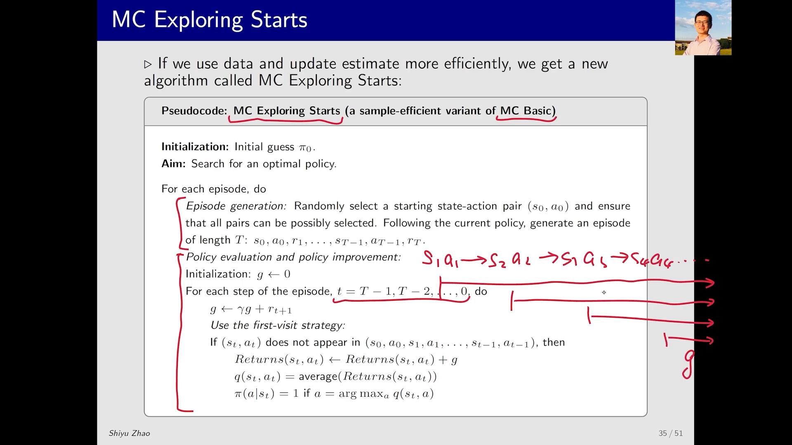

所以，**看算法时发现「怎么和刚才讲的核心思想不一样、怎么这么绕」，多半不是思想变了，而是这类小技巧在提升计算效率**。核心思想仍然只有一个：用回报的平均来估计动作价值。

---

## 三、exploring starts：为什么这个条件必不可少

### 3.1 拆成两个词看：exploring 与 starts

理解这个条件，抓住两个单词就够：

**exploring（探索）**：从**每一个 (s,a)** 出发，都要有 episode。只有这样，才能用后面生成的奖励来估计回报，进而估计动作价值。

为什么必须？因为**如果某个 (s,a) 从来没被访问到，它对应的动作就可能被漏掉**——而那个动作恰恰可能是最优的。为了得到最优策略，必须确保每个 (s,a) 都能被访问到。

[【跳转到 08:21】](https://www.bilibili.com/video/BV1Ke4y1S7BT/?t=501)

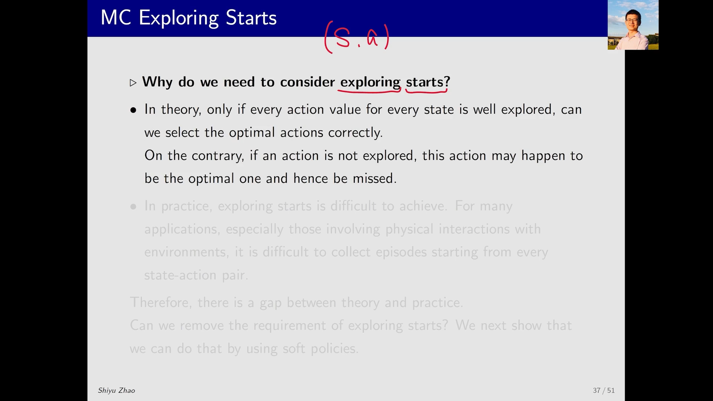

**starts（起点）**：要拿到某个 (s,a) 之后的数据，理论上其实有**两条路**：

1. **从 (s,a) 开始**一条 episode —— 这就是 **start**；
2. 从**其它** (s,a) 开始，但过程中**恰好经过**当前的 (s,a) —— 这就是 **visit**。

两种情况都能拿到该 (s,a) 之后的数据，**理论上都可以**。

[【跳转到 09:11】](https://www.bilibili.com/video/BV1Ke4y1S7BT/?t=551)

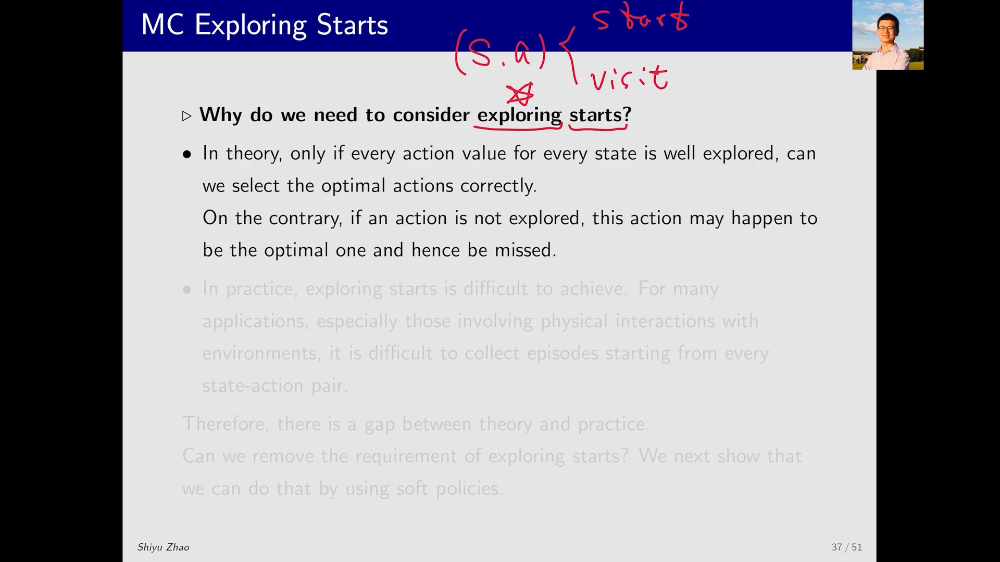
### 3.2 为什么只能用 starts，不能指望 visit

问题在于：**visit 这条路目前没法保证**。因为轨迹怎么走**依赖于策略、依赖于环境**——我怎么能确保「从其它 (s,a) 出发，就一定经过剩下的所有 (s,a)」？没办法确保。

所以只能采取比较**笨但可靠**的办法：**确保从每一个 (s,a) 出发都有一条 episode**。这就是 exploring **starts** 这个名字的由来。

[【跳转到 09:36】](https://www.bilibili.com/video/BV1Ke4y1S7BT/?t=576)


### 3.3 实际中难以实现：理论与现实的 gap

exploring starts 非常重要、也非常必要，但**实际当中难以实现**。

举个具体例子：一个网格世界里有一个**真实的机器人**。要让它从不同的 (s,a) 出发，就得**把机器人搬过去、设置好程序**，非常麻烦。这就是**理论与实际之间的 gap**。

[【跳转到 10:01】](https://www.bilibili.com/video/BV1Ke4y1S7BT/?t=601)

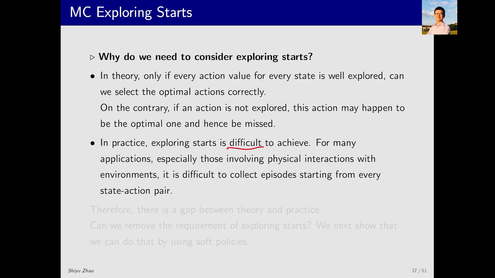

### 3.4 出路：用 soft policy 把条件「转化」掉

那么能不能把 exploring starts 这个条件**去掉**，或者**转化成别的形式**来实现？**答案是可以的**——需要用到 **soft policy（软策略）**。

这引出了第四部分的主题 **MC without exploring starts**，其中会介绍一个算法：**MC ε-Greedy**。它的思路是让策略本身带一点随机性（以 ε 的概率随机选动作），从而**不需要刻意从每个 (s,a) 出发，也能保证 visit 覆盖到所有 (s,a)**。

[【跳转到 10:51】](https://www.bilibili.com/video/BV1Ke4y1S7BT/?t=651)

---

## 小结

- **MC Exploring Starts 的定位**：MC Basic 的推广，核心思想不变，只做效率优化。
- **改进一：数据复用**。MC Basic 用 initial-visit（只认起点），浪费了 episode 的其余部分；把后缀看作子 episode，就能让每个 (s,a) 都用上数据。细分有 **first-visit** 与 **every-visit** 两种。
- **改进二：更新更及时**。从「等所有 episode 收齐再求平均」改成「得到一个 episode 就立刻改进策略」。
- **为什么可以只用一个 episode**：截断策略迭代已经开过先例——评估不必精确；这类「评估与改进不断交替、评估不求精确」的方法统称 **GPI（广义策略迭代）**，是一大类算法的架构而非具体算法。
- **倒推技巧**：伪代码从后往前算回报，用 `g ← r + γ·g` 递推，避免重复累加，纯为效率。
- **exploring starts 的含义**：**exploring** = 每个 (s,a) 都要被访问到（否则可能漏掉最优动作）；**starts** = 让每个 (s,a) 都作为 episode 起点（因为 visit 这条路依赖策略与环境，无法保证）。
- **理论与现实的 gap**：真实机器人没法随意搬到任意起点，所以这个条件实际难实现；出路是用 **soft policy**，即下一节的 **MC ε-Greedy**。

## 关键术语速查

| 术语 | 一句话解释 |
| :-- | :-- |
| 访问（visit） | episode 中每出现一次某个 (s,a)，就记对该 (s,a) 的一次访问。 |
| initial-visit | 只用 episode 起点那个 (s,a) 的后缀回报来估计，MC Basic 采用。 |
| first-visit | 同一个 (s,a) 在一条 episode 里重复出现时，只用第一次出现的后缀。 |
| every-visit | 同一个 (s,a) 每出现一次，就用该次的后缀回报估计一次。 |
| 子 episode | 把一条 episode 从中间某个 (s,a) 起的后缀，看作一条新的 episode。 |
| 折扣回报（Return） `G` | 从某时刻起各步奖励按折扣因子 γ 加权求和的结果。 |
| 即时奖励 `r` | 在当前 (s,a) 这一步立刻拿到的奖励。 |
| 广义策略迭代（GPI） | 评估与改进不断交替、评估不必求精确的一大类算法架构。 |
| 截断策略迭代 | 策略评估只做有限步迭代就停止的策略迭代变体。 |
| exploring starts | 要求每个 (s,a) 都能作为 episode 起点的条件。 |
| soft policy（软策略） | 每个动作都有正概率被选到的策略，用随机性保证探索。 |
| MC ε-Greedy | 以 ε 概率随机选动作的蒙特卡洛控制算法，可去掉 exploring starts 假设。 |