# 4.4 MC ε-贪婪策略实战：一个算例走通同轨控制

> 本篇整理自 Bilibili 视频《MC ε-贪婪策略实战：一个例子走通同轨控制》。视频地址：[BV1vW4y1H7oj](https://www.bilibili.com/video/BV1vW4y1H7oj/)。ε-贪婪策略的定义与 MC ε-贪婪算法的推导见同目录另一篇《MC 的 ε-贪婪策略：从探索性起点到同轨控制》。

## 本讲要解决的核心问题（SCQA）

**背景**：上一讲我们已经知道，把 ε-贪婪策略嵌进蒙特卡洛控制，就能删掉"探索性起点"这个不现实的前提，得到 MC ε-贪婪算法。理论上它成立。

**冲突**：但理论成立不等于能用。ε-贪婪到底有多强的探索性？ε 取大取小，对最终学到的策略究竟有什么影响？"它收敛到的是 `Π_ε` 里的最优、而非全局最优"这句代价，到底有多严重？

**疑问**：ε 该怎么设？设大了会怎样，设小了又会怎样？有没有办法两头都要？

**回答（中心思想）**：用一组网格世界算例把这些问题全部量化。结论是三条：**① ε 越大探索性越强，大到一定程度一条长 episode 就能覆盖全部 `(s, a)`，探索性起点确实可以不要；② 但 ε 越大，策略的最优性越差——极端情况下连目标区域的状态价值都会变成负数；③ 所以 ε 要取小（如 0.1），或者让它从大逐渐衰减到 0，这样得到的 ε-贪婪最优策略"转成贪婪"后仍等于最优贪婪策略。**

---

## 一、探索性到底有多强：ε = 1 的覆盖率实验

### 1.1 实验设置

先看探索性最强的一端：`ε = 1`。此时每个状态的 5 个动作概率完全相同（各 0.2），策略退化成均匀分布。我们从一个起点出发，按这个策略生成一条 episode，看它能逛到多少状态。

[【跳转到 00:05】](https://www.bilibili.com/video/BV1vW4y1H7oj/?t=5)

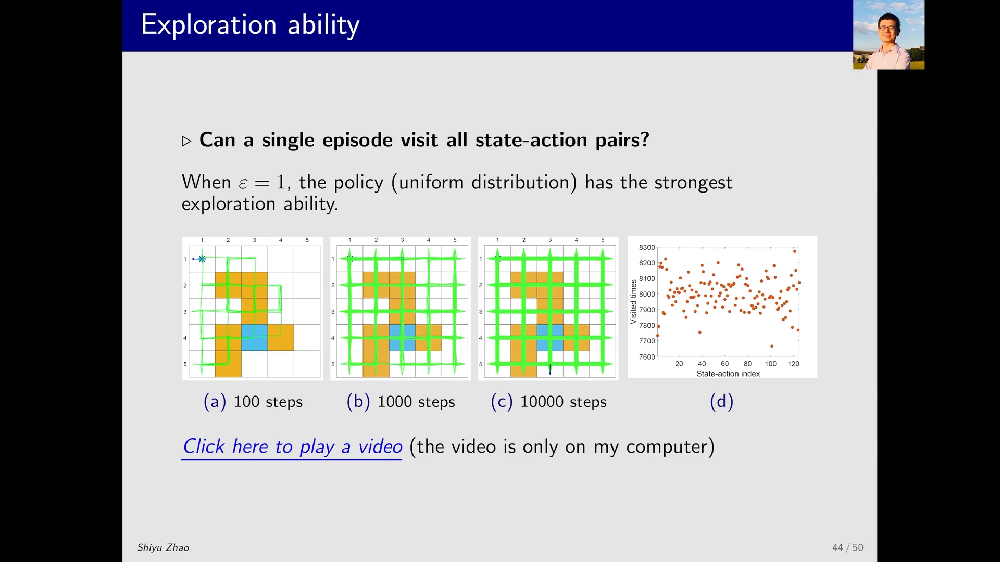

### 1.2 步数越多，覆盖越全

| episode 长度 | 观察到的现象 |
| --- | --- |
| 100 步 | 探索到了相当多的状态，但明显不全 |
| 1000 步 | 基本上所有状态、以及它们相应的动作都被探索到了 |
| 10000 步 | 探索次数更多，覆盖更充分 |

只从一个起点出发、只跑一条 episode，1000 步就把整个网格逛遍了——**这直接说明探索性起点不再必要**：不需要每个 `(s, a)` 都当一次起点，从某几个 `(s, a)` 出发就能覆盖到其它所有 `(s, a)`。

[【跳转到 00:30】](https://www.bilibili.com/video/BV1vW4y1H7oj/?t=30)

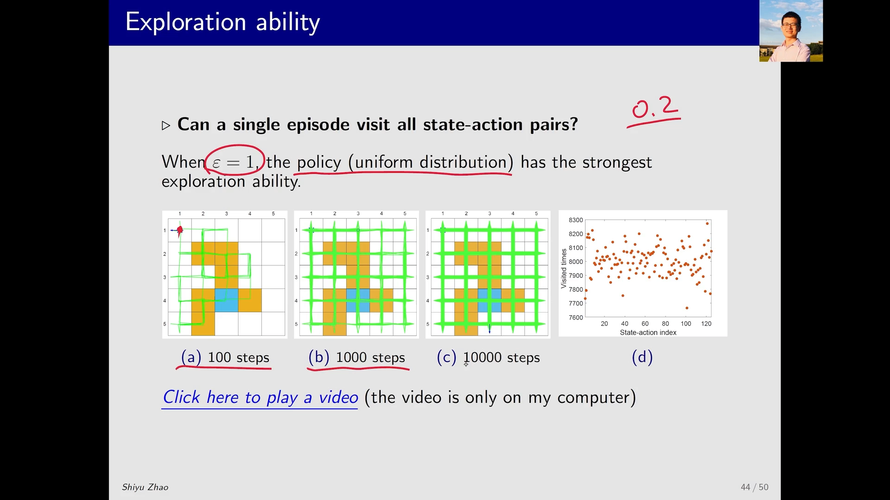

### 1.3 定量看：125 个"状态-动作对"被访问了多少次

把 episode 拉长到 **100 万步**，统计每个"状态-动作对"被访问的次数。这个网格世界共有 25 个状态、每个状态 5 个动作，所以一共 `25 × 5 = 125` 个状态-动作对。

结果：横轴是状态-动作对的索引（0 到 124），纵轴是访问次数——**每一个对都被访问了七八千次**。虽然整条轨迹只从**一个**起点出发，但每个 `(s, a)` 都拿到了足够多的样本。

这就是"ε 大 → 探索性强 → 不需要探索性起点"的定量证据。

[【跳转到 00:55】](https://www.bilibili.com/video/BV1vW4y1H7oj/?t=55)

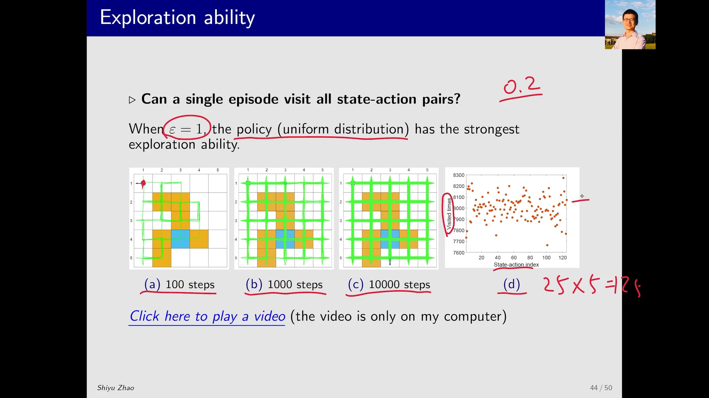

### 1.4 动态过程：看着智能体在网格里乱逛

再放一段动画，直观感受这个探索过程。蓝色箭头表示智能体**当前所在的状态以及它选择的动作**。

- 最开始它从某个状态触发，随后**被困在一个难以出去的区域**——四周都不好走；
- 但它一直在试，于是从那个地方"逃"了出来，跑到了别处；
- 因为选其它动作始终有一定概率，它又跑到了另一个区域。到这时，**基本上所有状态都访问到了，但还有一些动作没访问到**；
- 继续跑下去，**最后那些没试过的动作也被访问到了**。

这条轨迹的探索性非常强，也把"软性策略靠概率慢慢铺开覆盖"这件事演了出来。

[【跳转到 02:04】](https://www.bilibili.com/video/BV1vW4y1H7oj/?t=124)

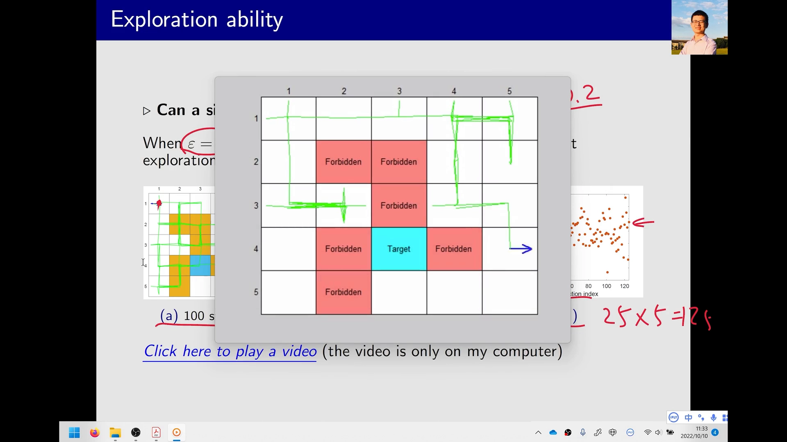


---

## 二、ε 很小时：探索性弱，但比贪婪策略还是强

### 2.1 步数少时访问的状态明显更少

把 ε 换成一个很小的值（策略的"偏好"很强，几乎总走贪婪动作），再重复上面的实验：

- **100 步**时，访问到的状态明显比 `ε = 1` 时少得多——因为它的偏好太强，轨迹很容易在局部打转；
- 即使跑到 **1000 步、10000 步**，仍然有一些动作没被访问到；
- 直到把 episode 拉到 **100 万步**，情况才好转：有的状态-动作对被访问得非常非常多，有的仍然很少。

[【跳转到 03:11】](https://www.bilibili.com/video/BV1vW4y1H7oj/?t=191)


### 2.2 但"有"总比"没有"好

尽管分布很不均匀，**相比纯贪婪策略，它仍然具备一定的探索能力**——纯贪婪策略下那些"从不被选中"的动作是永远采不到的，而小 ε 至少给了它们一线机会。

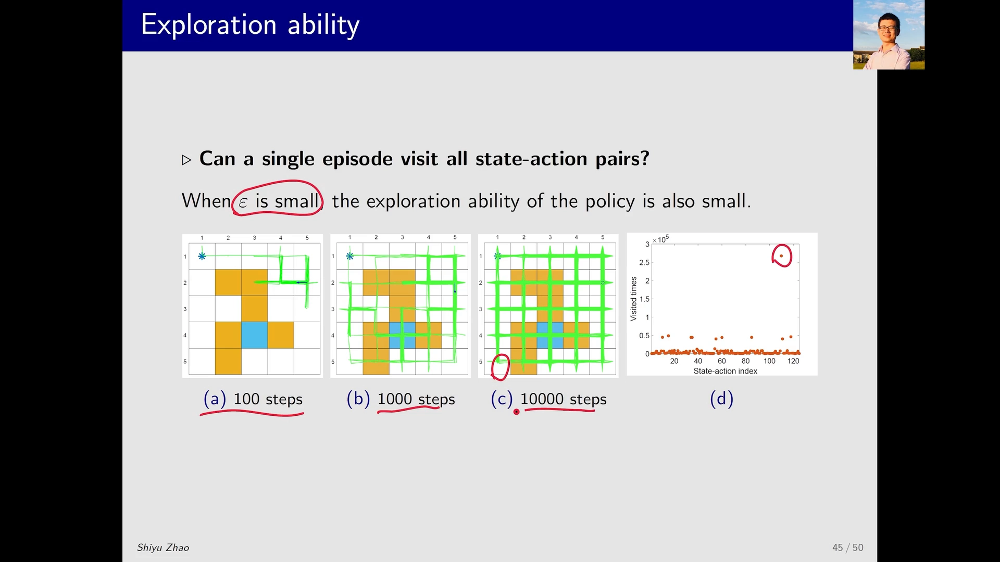

两个实验合起来，得到本节结论：**ε-贪婪确实有探索能力，强弱由 ε 决定。** 接下来就该问：这份探索能力，要拿什么去换？

---

## 三、用 MC ε-贪婪算法求解：探索换来的好处与代价

### 3.1 实验设计：一个 iteration 只用一条超长 episode

为了展示 MC ε-贪婪算法**确实能避开探索性起点条件**，这里把实验做得极端一点：**每个 iteration 只用一条 episode，但这条 episode 长达 100 万步**。

```
for 每个 iteration:
    用当前 ε-贪婪策略生成一条 100 万步的 episode
    用这一条 episode 更新所有 (s, a) 的动作价值
    用更新后的动作价值改进策略（在 Π_ε 内取最优）
```

之所以敢只用一条 episode，正是因为 ε-贪婪的探索性：**只要 episode 足够长，哪怕只从一个 `(s, a)` 出发，也能访问到其它所有 `(s, a)`。**

[【跳转到 04:26】](https://www.bilibili.com/video/BV1vW4y1H7oj/?t=266)

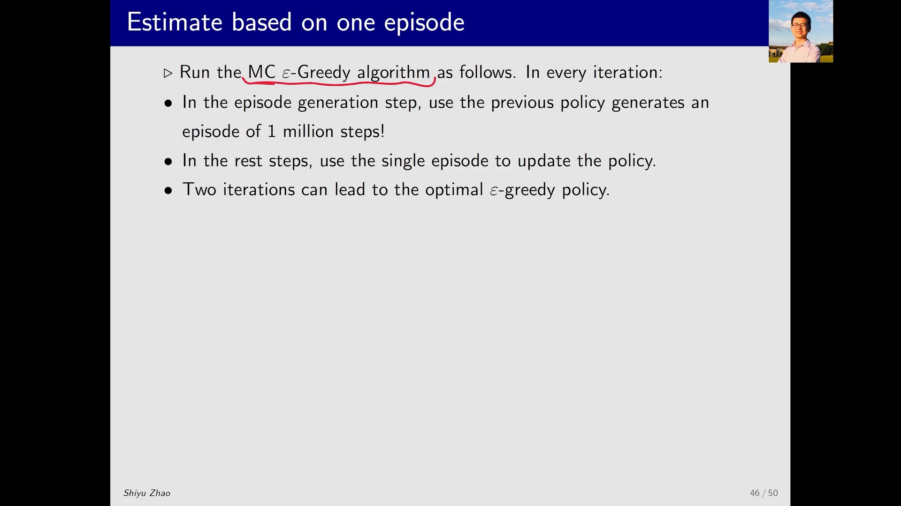

### 3.2 策略是怎么一步步变好的

| 阶段 | 策略形态 | 评价 |
| --- | --- | --- |
| 初始策略 | 每个状态下所有动作概率相同（均匀分布） | 显然不好 |
| 第 1 次更新后 | 有方向了，但有些位置仍会**原地不动** | 还是不太好 |
| 第 2 次更新后（最终） | 只取概率最大的动作看，从任何一点出发**都能到达目标** | 相对合理，但**不是最优** |

最终策略的问题在于：**它会穿过障碍物去够目标**。而我们知道真正的最优策略应该**绕过障碍物**再到达目标。所以这个策略"能用"，但不是最优。

[【跳转到 04:51】](https://www.bilibili.com/video/BV1vW4y1H7oj/?t=291)

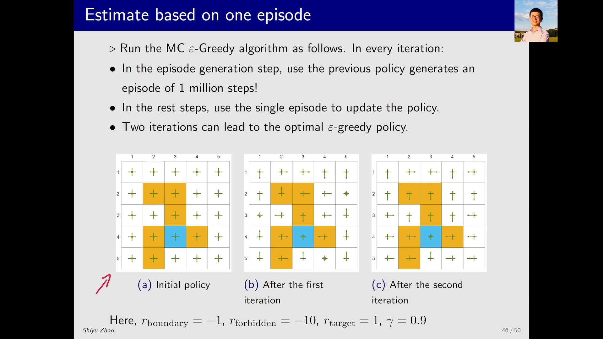

### 3.3 结论：探索性是借来的，最优性是抵押出去的

这个算例把 ε-贪婪的账算清楚了：

- **好处**：探索性强，可以彻底摆脱探索性起点这个条件，算法真正可落地；
- **代价**：最优性被牺牲——它求的是 `Π_ε` 里最好的策略，而不是全局最优策略。

[【跳转到 06:06】](https://www.bilibili.com/video/BV1vW4y1H7oj/?t=366)

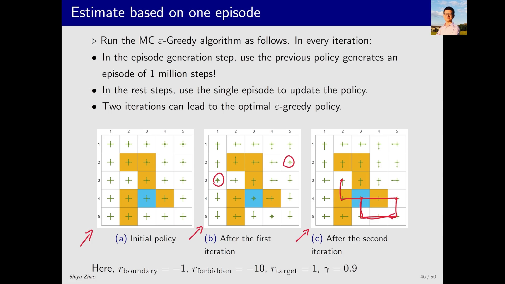

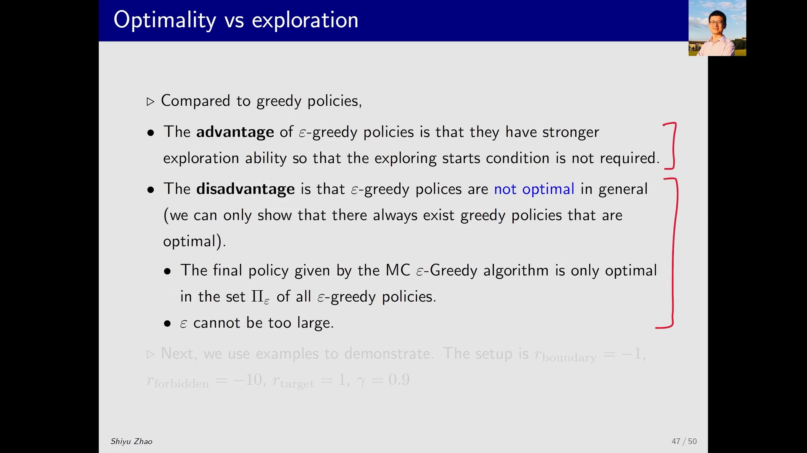

### 3.4 怎么两头都要：小 ε，或让 ε 衰减

实践中有两个办法把代价压下去：

1. **把 ε 设得比较小**。因为 `ε → 0` 时 ε-贪婪策略趋近于贪婪策略，所以"最优的 ε-贪婪策略"也趋近于"最优的贪婪策略"。
2. **让 ε 逐渐减小**。开始时 ε 较大（探索性强，先把环境摸清楚），然后让 ε 逐渐趋向 0（后期专注利用），最终得到的策略既有良好的探索、又有良好的最优性。这就是后来深度强化学习里常见的"探索率衰减"做法。

[【跳转到 06:31】](https://www.bilibili.com/video/BV1vW4y1H7oj/?t=391)

---

## 四、最优性到底损失多少：状态价值的对比实验

### 4.1 实验方法：给定策略，解贝尔曼方程得状态价值

第二组算例换一个角度量化"最优性损失"。做法是：**先给出一个策略，解它的贝尔曼方程，得到它的状态价值 `V(s)`**，然后比较不同 ε 下的状态价值。

回顾一个定义：**状态价值可以用来衡量一个策略的好坏，最优策略就是状态价值最大的那个策略。** 所以只要看 `V(s)` 怎么变，就知道策略变好还是变坏。

[【跳转到 06:56】](https://www.bilibili.com/video/BV1vW4y1H7oj/?t=416)

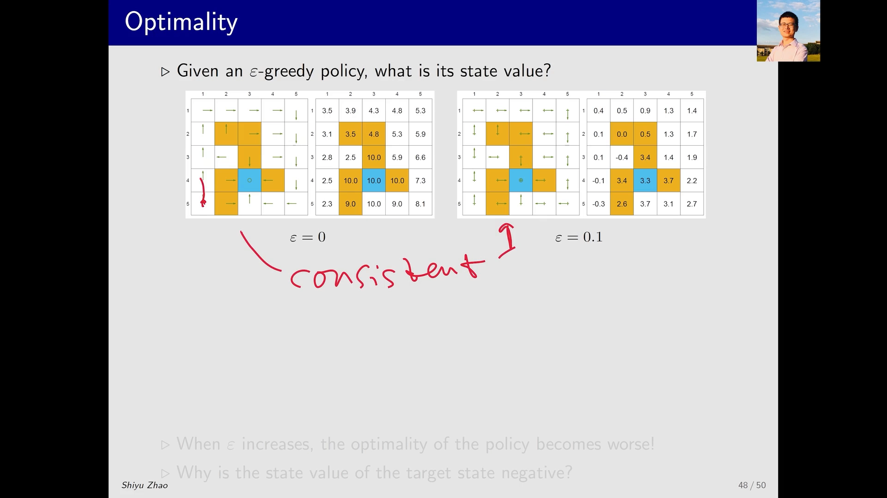

### 4.2 三个策略，同一套"偏好"，三种状态价值

设第一个策略是 `ε = 0` 的策略——它就是贪婪策略，而且在这个算例里恰好是**最优策略**，它的状态价值作为基准。

第二个策略与第一个**一致（consistent）**：比如在某个位置第一个策略要往上走，第二个策略在这个位置**概率最大的动作也是往上走**，只是同时给其它动作留了一点小概率。按定义，这就是"一致"。

第三个策略再进一步增大 ε。

三者的状态价值对比：

| 策略 | 与最优贪婪策略是否一致 | 状态价值 |
| --- | --- | --- |
| `ε = 0`（贪婪，最优） | — | 基准（最大） |
| 较小的 ε | 一致 | **明显更小** |
| `ε = 0.5` | 一致 | **更小，很多位置已变成负数** |

**为什么一致了还会更差？** 因为"一致"只保证"最想做的动作对"，不保证"只做这个动作"。ε 越大，在那些**本来不该乱动**的位置上，它就越有可能采取不该采取的动作，于是状态价值被拉低。

[【跳转到 07:21】](https://www.bilibili.com/video/BV1vW4y1H7oj/?t=441)

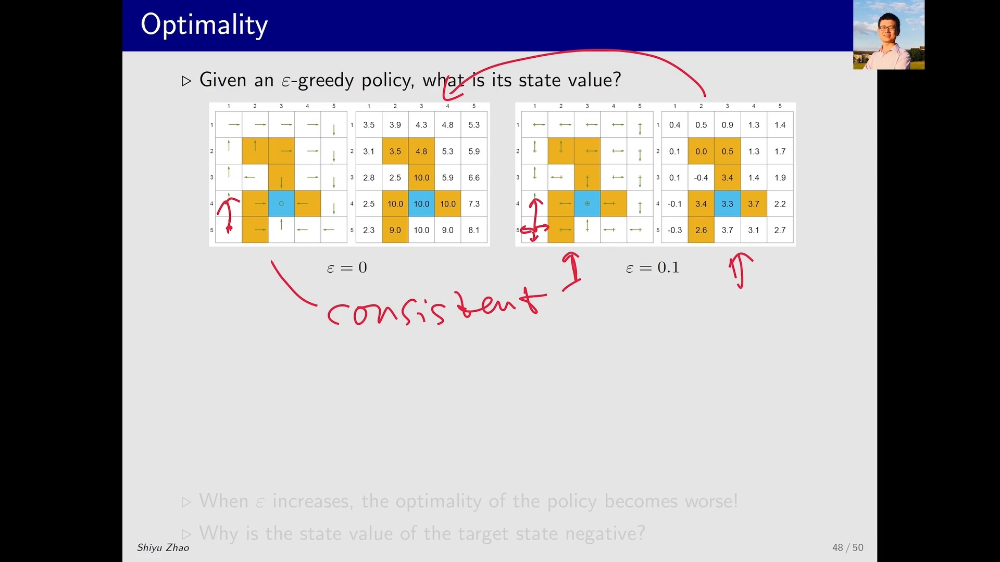

### 4.3 最刺眼的一个现象：目标区域的价值变成负数

`ε = 0.5` 时出现了一个很反直觉的结果：**目标区域（target area）在最优策略下状态价值最大，但在 ε 很大时反而变成了最小的、负数的值。**

原因不难理解：在那个位置，ε 很大意味着它**有相当大的概率一步踏进禁区（forbidden area）**，而禁区给的是负奖励。踏进去的次数多了，从目标区域出发的期望回报自然被拉成负数。

这个现象把"最优性损失"从抽象说法变成了一个看得见的数字：**ε 大到一定程度，连"站在终点"这件事都变成了坏事。**

[【跳转到 08:11】](https://www.bilibili.com/video/BV1vW4y1H7oj/?t=491)

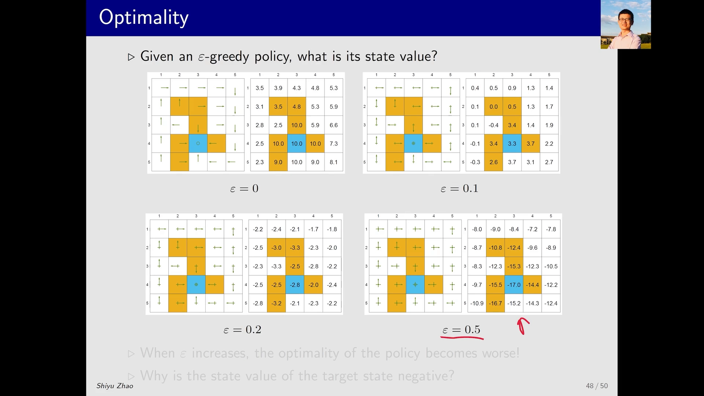

---

## 五、ε 该取多大：用 MC ε-贪婪算法反推"一致性"

### 5.1 实验：ε 取 0.1 / 0.2 / 0.5，看学出来的策略

最后一组算例直接回答"ε 怎么设"。做法：先给出这个问题的**最优策略**（贪婪策略）及其最优状态价值作为标准答案，然后跑 MC ε-贪婪算法，分别取 `ε = 0.1`、`0.2`、`0.5`，比较学到的策略。

`ε = 0.1` 的结果：学到的"最优 ε-贪婪策略"与最优策略**一致**——在任何一个状态，比如最优策略要求往右走，那么这个 ε-贪婪策略里概率最大的动作也是往右走。

[【跳转到 09:26】](https://www.bilibili.com/video/BV1vW4y1H7oj/?t=566)

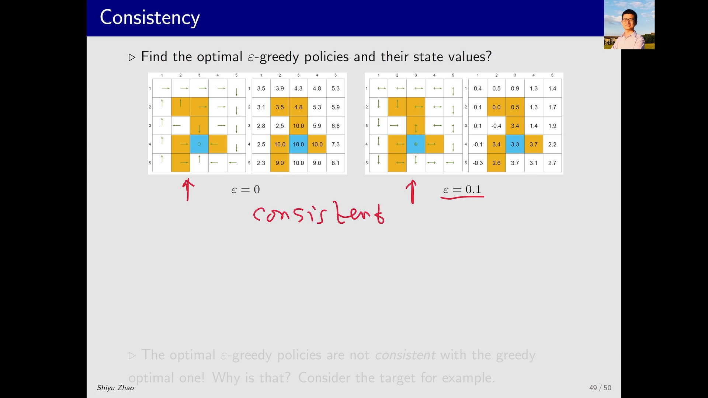

### 5.2 一致性为什么重要：部署时要把 ε 摘掉

一致性不是学术趣味，它直接决定算法能不能用。逻辑链条是这样的：

1. MC ε-贪婪算法学到的是**最优 ε-贪婪策略**（一个软性策略，带随机性）；
2. 但实际部署时，我们不会带着这个随机性去执行——而是把它**转成对应的贪婪策略**（每个状态取概率最大的那个动作）；
3. 我们希望这个"转出来的贪婪策略"就是**最优贪婪策略**；
4. 而这件事成立的**充要条件**，正是"学到的 ε-贪婪策略与最优策略一致"。

所以：**ε 小 → 一致 → 转成贪婪后就是最优策略；ε 大 → 不一致 → 转成贪婪后已经不是最优策略了。**

[【跳转到 10:16】](https://www.bilibili.com/video/BV1vW4y1H7oj/?t=616)

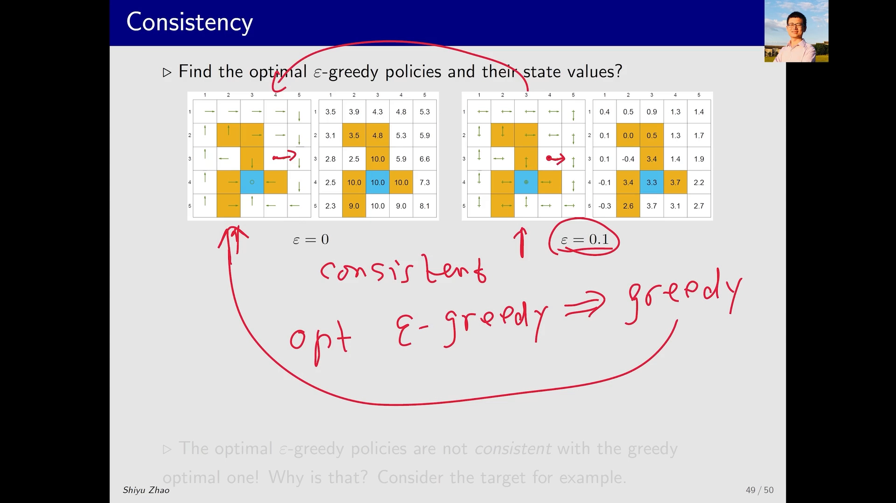

### 5.3 ε 一大就不一致了

- `ε = 0.2`：学到的"最优 ε-贪婪策略"与最优贪婪策略**已经没有太大关系**，转成贪婪后两者不同；
- `ε = 0.5`：同样**不再是最优的贪婪策略**。

也就是说，ε 稍微放大一点，"一致性"这条链就断了。**用 MC ε-贪婪算法，ε 不能太大。**

[【跳转到 10:41】](https://www.bilibili.com/video/BV1vW4y1H7oj/?t=641)

### 5.4 实践建议

把五组实验的结论收成一句可执行的话：

- **ε 要小**（如 0.1），保证"一致性"，保证转成贪婪后仍是最优策略；
- **或者让 ε 从大衰减到 0**：前期大 ε 保证探索、把环境摸清，后期小 ε 保证收敛到最优。这是实践中最常用的技巧。

[【跳转到 11:06】](https://www.bilibili.com/video/BV1vW4y1H7oj/?t=666)

---

## 小结

- **ε = 1（均匀分布）时探索性极强**：100 步已能逛到不少状态，1000 步基本覆盖全部状态与动作；100 万步后 125 个状态-动作对**每个都被访问七八千次**——一条 episode、一个起点就够了，**探索性起点条件确实可以去掉**。
- **ε 很小时探索性弱**：100 步访问的状态明显更少，长 episode 下访问次数分布也很不均匀；但相比纯贪婪策略，它仍保留了一点探索能力。
- **用 MC ε-贪婪算法（每个 iteration 一条 100 万步 episode）能学出可用策略**：从均匀分布的初始策略出发，迭代后从任意点都能到达目标；但它会穿过障碍物，**不是最优**——探索性是借来的，最优性是抵押出去的。
- **最优性损失可以量化**：与最优策略"一致"的 ε-贪婪策略，状态价值依然更小；`ε = 0.5` 时大量状态价值转负，**连目标区域都因为高概率踏入禁区而变成最差的位置**。
- **ε 不能大**：`ε = 0.1` 时学到的 ε-贪婪最优策略与最优策略一致，转成贪婪后就是最优策略；`ε = 0.2`、`0.5` 时一致性被破坏。实践做法是**取小 ε，或让 ε 从大衰减到 0**。
- 本讲也是这一章 MC 内容的收尾：从"用数据估计期望"的蒙特卡洛思想出发，依次得到 MC Basic、MC Exploring Starts、MC ε-贪婪三个算法，三者层层递进、效率递增，而 ε-贪婪正是让算法摆脱"探索性起点"这一不现实前提的关键一步。

## 关键术语速查

| 术语 | 一句话解释 |
| --- | --- |
| 探索性（exploration） | 软性策略以一定概率尝试非最优动作，从而覆盖更多 `(s, a)` |
| 状态-动作对 | 一个 `(s, a)` 组合；网格世界 25 个状态 × 5 个动作 = 125 个 |
| 一致性（consistent） | 两个策略在每个状态下"概率最大的动作"相同 |
| 最优 ε-贪婪策略 | 在 `Π_ε`（所有 ε-贪婪策略）中使状态价值最大的那一个 |
| 状态价值 `V(s)` | 从状态 s 出发的期望回报，用来衡量策略好坏；最优策略即状态价值最大者 |
| 目标区域 / 禁区 | 算例中给予正奖励 / 负奖励的特殊区域（target area / forbidden area） |
| ε 衰减 | 训练前期用大 ε 探索、后期逐渐减小到 0 以收敛到最优策略 |