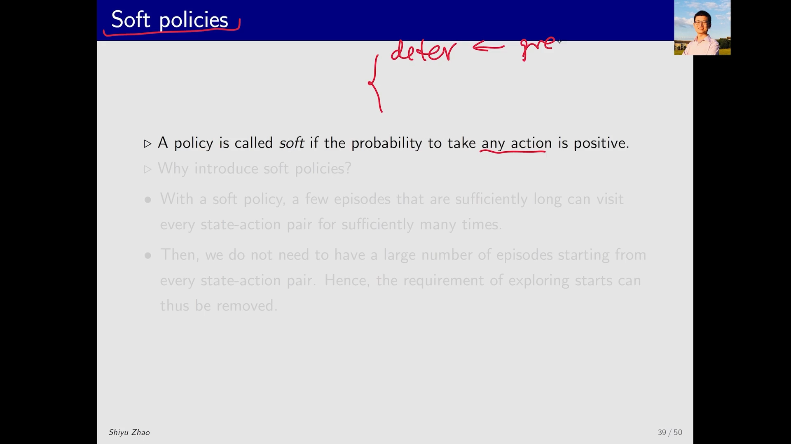
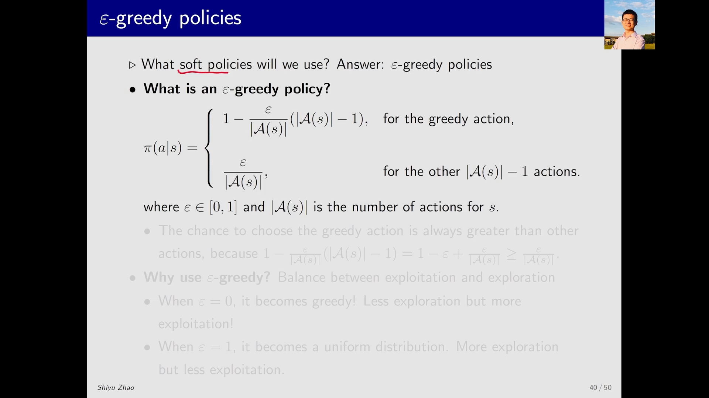
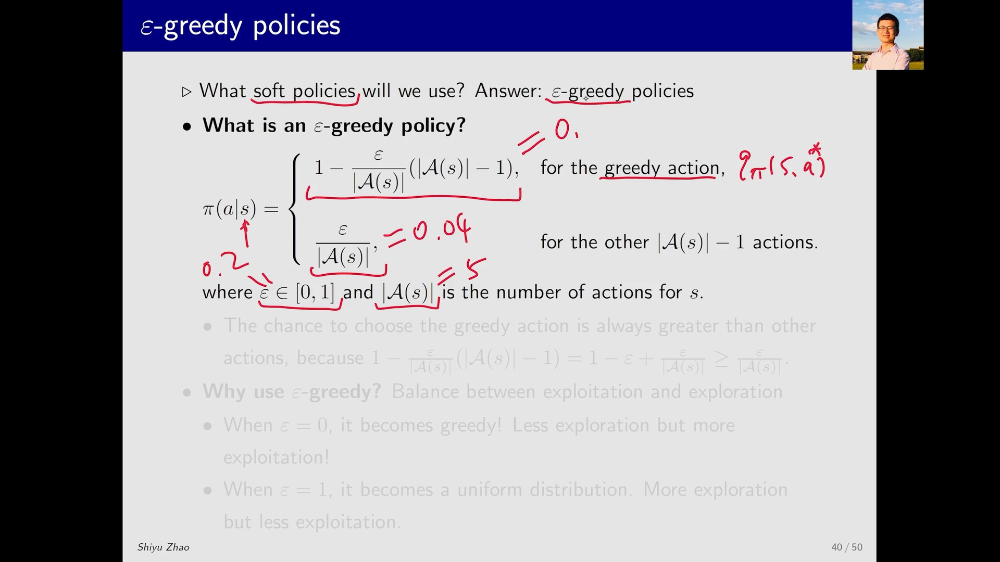
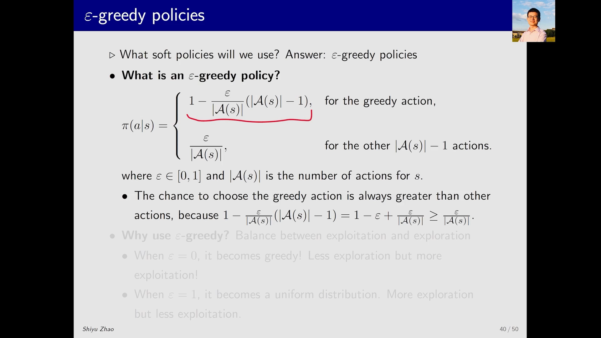
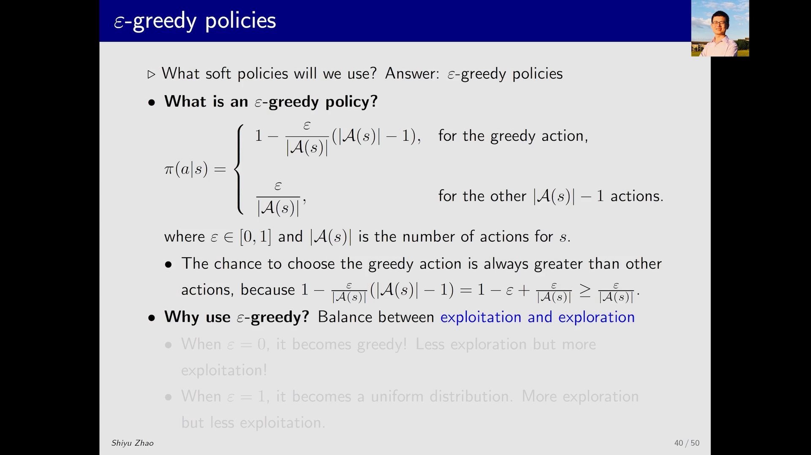
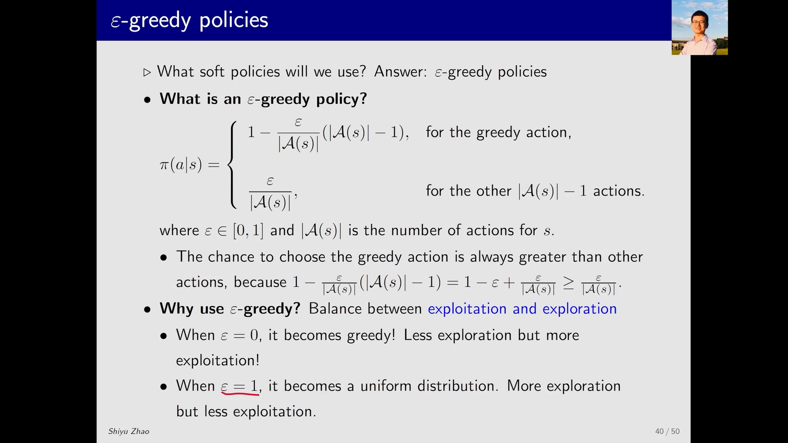
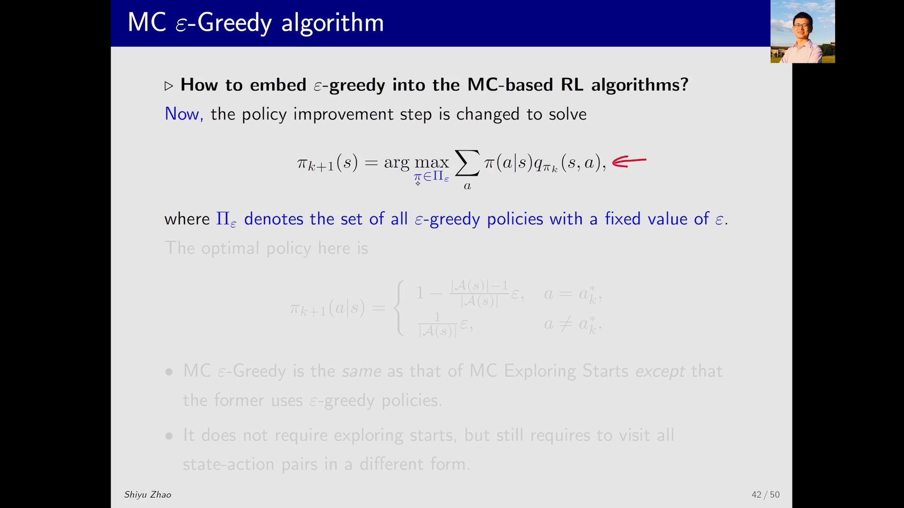
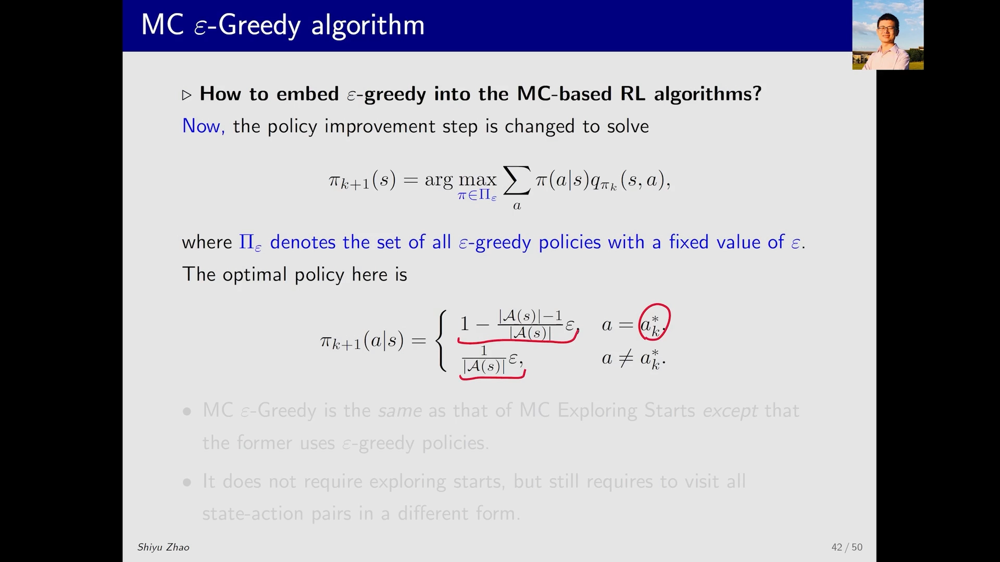
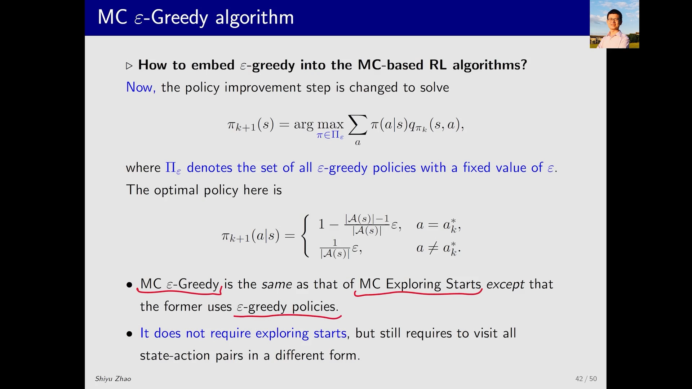
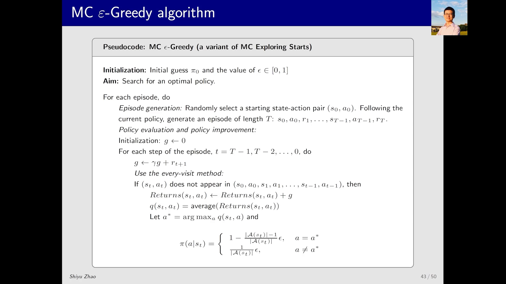

# 4.4 MC 的 ε-贪婪策略：从"探索性起点"到同轨控制

> 本篇整理自 Bilibili 视频《MC 的 ε-贪婪策略：从探索性起点到同轨控制》。视频地址：[BV1id4y1i7W4](https://www.bilibili.com/video/BV1id4y1i7W4/)。配套的算例演示见同目录另一篇《MC ε-贪婪策略实战：一个例子走通同轨控制》。

## 本讲要解决的核心问题（SCQA）

**背景**：上一节的蒙特卡洛控制算法（MC Exploring Starts）已经能在**没有环境模型**的情况下学会最优策略了，但它带着一个很别扭的前提——**探索性起点（exploring starts）**：为了保证每一个"状态-动作对" `(s, a)` 都能被采到，它要求每个 episode 都从任意指定的 `(s, a)` 出发。

**冲突**：这个前提在真实问题里几乎做不到。机器人不能凭空出现在任意状态、任意动作上；很多环境里"从某个状态出发"本身就是不可能的操作。也就是说，算法在数学上成立，在物理上不成立。

**疑问**：能不能不要这个前提？如果只从一个（或少数几个）`(s, a)` 出发，怎么保证数据依然覆盖到全部 `(s, a)`？

**回答（中心思想）**：能。办法是把策略从**确定性**换成**软性（soft）**——让每个动作都保留一点被选中的概率。最常用的软性策略就是 **ε-贪婪策略（ε-greedy）**：以 `1 − ε + ε/|A(s)|` 的概率选当前最优动作，其余动作各分 `ε/|A(s)|`。因为策略本身带随机性，一条足够长的 episode 就能自己"逛"遍所有 `(s, a)`，探索性起点这个条件就可以删掉；把 ε-贪婪塞进蒙特卡洛控制的策略改进步骤，就得到 **MC ε-贪婪算法**。代价是：它求的是"ε-贪婪策略里最好的那一个"，而不是全局最优策略。


---

## 一、为什么要引入软性策略

### 1.1 策略分两种：确定性策略与随机策略

先复习一个基本分类。策略 `π(a|s)` 描述"在状态 s 下选动作 a 的概率"，按这个概率分布的形状，可以分成两类：

| 类型 | 含义 | 例子 |
| --- | --- | --- |
| **确定性策略（deterministic policy）** | 在状态 s 下只选一个动作，概率为 1，其余为 0 | 贪婪策略（greedy policy） |
| **随机策略（stochastic policy）** | 在状态 s 下多个动作都有正概率 | ε-贪婪策略 |

**软性策略（soft policy）** 是随机策略里的一类：它保证**每一个动作都有可能被选中**（概率都严格大于 0）。ε-贪婪策略就是最典型的软性策略。

[【跳转到 00:05】](https://www.bilibili.com/video/BV1id4y1i7W4/?t=5)

### 1.2 软性策略为什么能替掉"探索性起点"

关键在于**探索性（exploration）**。

- 如果策略是**确定性**的，那么从 `(s, a)` 出发之后，后续每一步都被唯一确定了——这条轨迹只会落在一条固定的路径上，路上没经过的 `(s, a)` 永远采不到。所以只能靠"换起点"来覆盖：每个 `(s, a)` 都得当一次起点。这就是探索性起点的由来。
- 如果策略是**软性**的，那么从 `(s, a)` 出发之后，每一步都有一定概率"不走寻常路"。只要 episode 足够长，这条轨迹就会自己拐到别的状态、试到别的动作，**从少数几个起点出发就能覆盖到其它所有 `(s, a)`**。

于是"每个 `(s, a)` 都当起点"这个要求可以降级成"从一个或几个 `(s, a)` 出发，跑一条足够长的 episode"。这就是去掉探索性起点的思路。

[【跳转到 00:30】](https://www.bilibili.com/video/BV1id4y1i7W4/?t=30)



> 注意这里有一个隐含代价：软性策略的"逛"是概率性的，**不保证**一定覆盖全部 `(s, a)`，只是"跑得越久、覆盖得越全"。这个代价会在下一篇的算例里被量化得非常清楚。

---

## 二、ε-贪婪策略：把最大的概率留给贪婪动作

### 2.1 定义

软性策略有很多种，本课重点关注 ε-贪婪。设状态 s 下的动作集合为 `A(s)`，其中贪婪动作 $a^* = \arg\max_a Q(s, a)$（动作价值最大的那个），`ε ∈ [0, 1]` 是一个事先给定的正数，则：

```
π(a|s) = 1 − ε + ε/|A(s)|      若 a = a*（贪婪动作）
π(a|s) = ε/|A(s)|              若 a ≠ a*（其余动作）
```

它读起来像两个式子，其实是一句话：**先给每个动作平均分一份 `ε/|A(s)|` 的"探索预算"，剩下的 `1 − ε` 全部押给贪婪动作。** 所以贪婪动作拿到 `(1 − ε) + ε/|A(s)|`，其它动作各拿 `ε/|A(s)|`，加起来正好是 1。

[【跳转到 01:20】](https://www.bilibili.com/video/BV1id4y1i7W4/?t=80)



### 2.2 一个具体数字：ε = 0.2、5 个动作

在网格世界（grid world）例子里，每个状态有 5 个动作，即 `|A(s)| = 5`。取 `ε = 0.2`：

```
每个非贪婪动作的概率 = ε/|A(s)| = 0.2 / 5 = 0.04
贪婪动作的概率       = 1 − ε + ε/|A(s)| = 1 − 0.2 + 0.04 = 0.84
校验                 = 0.84 + 4 × 0.04 = 1.00  ✓
```

也可以这样算：4 个非贪婪动作一共分走 `4 × 0.04 = 0.16`，剩下的 `1 − 0.16 = 0.84` 归贪婪动作。

这个数字把 ε-贪婪的"性格"说清楚了：**它依然是"偏向贪婪"的（84% 的概率走最优动作），但另外 16% 的概率会去试别的动作。** 那 16% 就是探索性的来源。

[【跳转到 02:10】](https://www.bilibili.com/video/BV1id4y1i7W4/?t=130)



### 2.3 一个必须记住的性质：贪婪动作永远是最大概率

对 `ε ∈ [0, 1]`，恒有

```
1 − ε + ε/|A(s)| ≥ ε/|A(s)|    （因为 1 − ε ≥ 0）
```

也就是说，**ε-贪婪策略里被选概率最大的动作，一定是贪婪动作**。这条性质看起来平淡，却是后面一切结论的地基：

- 它保证 ε-贪婪"没有丢掉贪婪策略的信息"——想知道它"想干什么"，取概率最大的那个动作就行；
- 它也定义了后面反复出现的一个词——**一致性（consistent）**：如果两个策略在每个状态下"概率最大的动作"相同，就说它们是一致的。

[【跳转到 03:00】](https://www.bilibili.com/video/BV1id4y1i7W4/?t=180)



---

## 三、ε 是"探索"与"利用"之间的旋钮

### 3.1 两个词：利用（exploitation）与探索（exploration）

这两个词是强化学习里最容易绕晕的一对，用一句大白话分开：

- **利用（exploitation）**：字面是"剥削"，实际意思是**充分利用已知信息**。我在某个状态，已经知道某个动作的动作价值比较大，那下一步就该去用这个动作，好拿到更多奖励。
- **探索（exploration）**：我虽然现在知道那个动作看起来不错，但**手上的信息可能是不完备的**——说不定别的动作其实更好。所以我该去试试别的动作，试完可能发现它们的动作价值也很高。

这两件事天然冲突：一直利用，就永远发现不了更好的动作；一直探索，就等于把已经学到的东西扔了不用。**ε-贪婪的作用就是给这两者一个可调的配比。**

[【跳转到 03:50】](https://www.bilibili.com/video/BV1id4y1i7W4/?t=230)



### 3.2 两个极端：ε = 0 与 ε = 1

把 ε 推到两端，就能看清这个旋钮在调什么：

| 设置 | 策略形态 | 探索 | 利用 |
| --- | --- | --- | --- |
| `ε = 0` | 退化成**贪婪策略**（贪婪动作概率 1，其余 0） | 弱 | 强 |
| `ε = 1` | 退化成**均匀分布**（每个动作概率 `1/|A(s)|`） | 强 | 弱 |

`ε = 1` 时可以直接验算：5 个动作时每个动作概率都是 `0.2`——此时 `ε/|A(s)| = 1/5 = 0.2`，而贪婪动作的 `1 − ε + ε/|A(s)| = 0 + 0.2 = 0.2`，与非贪婪动作完全一样，分布被"抹平"成均匀分布。

所以 ε 从 0 走到 1，就是**从"完全利用"连续滑到"完全探索"**。这也预告了后面那个绕不开的取舍：ε 越大探索越强，但策略离"最优"越远。

[【跳转到 04:40】](https://www.bilibili.com/video/BV1id4y1i7W4/?t=280)



---

## 四、把 ε-贪婪嵌进蒙特卡洛控制

### 4.1 先看清 MC 控制里"策略改进"到底在做什么

回看 MC Basic 与 MC Exploring Starts 这两个算法，它们的**策略改进（policy improvement）** 步骤是同一个优化问题：

$$
\pi_{k+1}(s) = \arg\max_{\pi \in \Pi} \sum_a \pi(a \mid s) \cdot q_{\pi_k}(s, a)
$$

其中 $\Pi$ 是**所有可能的策略**构成的集合，$q_{\pi_k}(s, a)$ 是用第 k 轮策略采到的数据估出来的动作价值。

之前讲的时候没有强调，但这里的关键在于：**求解时是在"所有策略"里挑**。既然候选集合是全部策略，那这个优化问题的最优解自然就是**贪婪策略**——把概率 1 全给 $q_{\pi_k}(s, a)$ 最大的那个动作。

[【跳转到 05:55】](https://www.bilibili.com/video/BV1id4y1i7W4/?t=355)


### 4.2 改一行就够了：把候选集合换成 Π_ε

要得到 MC ε-贪婪算法，改动只有一处：**不再在全部策略 $\Pi$ 里找，而只在"所有 ε-贪婪策略"构成的集合 $\Pi_\varepsilon$ 里找**（这里的 ε 是事先给定的常数）。

$$
\pi_{k+1}(s) = \arg\max_{\pi \in \Pi_\varepsilon} \sum_a \pi(a \mid s) \cdot q_{\pi_k}(s, a)
$$

这个受限优化问题的解也不难推：在 $\Pi_\varepsilon$ 里，贪婪动作的概率被钉死为 `1 − ε + ε/|A(s)|`、其余为 `ε/|A(s)|`，唯一能变的是"哪个动作被当成贪婪动作"。要让 $\sum_a \pi(a \mid s) q(s,a)$ 最大，显然应该把那个"最大概率"分配给 `q` 值最大的动作。于是解就是：

```
π_{k+1}(a|s) = 1 − ε + ε/|A(s)|      若 a = argmax_a q_{π_k}(s, a)
π_{k+1}(a|s) = ε/|A(s)|              其它动作
```

换句话说：**策略改进仍然"贪心"，只是贪心的结果被 ε 稀释成了软性策略。**

[【跳转到 06:45】](https://www.bilibili.com/video/BV1id4y1i7W4/?t=405)





### 4.3 MC ε-贪婪算法与 MC Exploring Starts 的差别

两个算法的骨架**完全一样**（采样 → 估计动作价值 → 策略改进，循环），差别只有两处：

| | MC Exploring Starts | MC ε-贪婪 |
| --- | --- | --- |
| 采样用的策略 | 贪婪策略（确定性） | ε-贪婪策略（软性） |
| 起点要求 | 每个 `(s, a)` 都要当起点 | 任意起点，episode 够长即可 |
| 策略改进的搜索空间 | $\Pi$（全部策略） | $\Pi_\varepsilon$（所有 ε-贪婪策略） |
| 收敛到 | 最优策略 `π*` | $\Pi_\varepsilon$ 中最优的那个（ε 越小越接近 `π*`） |

**为什么用 ε-贪婪？** 就是为了那个"起点要求"一栏——软性策略自带探索性，探索性起点条件可以删掉，算法才真正可用。

[【跳转到 07:10】](https://www.bilibili.com/video/BV1id4y1i7W4/?t=430)



### 4.4 代码里的一个细节：为什么用 every-visit

MC ε-贪婪的伪代码与 MC Exploring Starts 几乎逐行相同，另有一处小区别值得单独说：**动作价值的估计用 every-visit（每次访问）而不是 first-visit（首次访问）**。

理由很实际：ε-贪婪策略下 episode 可能非常长，同一个 `(s, a)` 会被访问很多次。如果只取第一次访问的回报，后面那些访问记录就全被扔掉了——这是很大的浪费。用 every-visit 把每次访问的回报都算进平均，样本利用率更高。

[【跳转到 08:12】](https://www.bilibili.com/video/BV1id4y1i7W4/?t=492)



---

## 小结

- **软性策略（soft policy）** 让每个动作都保留正概率，因而自带探索性；用它可以把 MC 控制里"探索性起点"这个不现实的前提去掉。
- **ε-贪婪策略** 是最常用的软性策略：贪婪动作拿 `1 − ε + ε/|A(s)|`，其余动作各拿 `ε/|A(s)|`；贪婪动作的概率恒为最大，因此"取概率最大的动作"就能还原出它偏向的那个贪婪策略。
- **ε 是探索与利用的旋钮**：`ε = 0` 退化为贪婪策略（利用最强），`ε = 1` 退化为均匀分布（探索最强）。
- **MC ε-贪婪算法** 与 MC Exploring Starts 同构，唯一实质改动是策略改进从"在 $\Pi$ 中求解"变成"在 $\Pi_\varepsilon$ 中求解"，解仍是"最大概率给贪婪动作"，只是被 ε 稀释。
- 代价要记住：它收敛到的是 **$\Pi_\varepsilon$ 里的最优策略**，而不是全局最优；ε 越大离最优越远。ε 该取多小、探索性到底够不够，下一篇用具体算例给出答案。
- 实现细节：episode 长、同一 `(s, a)` 被反复访问，所以动作价值估计用 **every-visit** 更省样本。

## 关键术语速查

| 术语 | 一句话解释 |
| --- | --- |
| 确定性策略（deterministic policy） | 每个状态只选一个动作，概率为 1；贪婪策略属于此类 |
| 随机策略（stochastic policy） | 每个状态下多个动作都有正概率可选 |
| 软性策略（soft policy） | 保证每个动作都有正概率被选中的随机策略 |
| ε-贪婪策略（ε-greedy） | 贪婪动作概率 `1 − ε + ε/|A(s)|`、其余各 `ε/|A(s)|` 的软性策略 |
| 探索性起点（exploring starts） | 要求每个 episode 从任意指定的 `(s, a)` 出发，以保证覆盖 |
| 利用（exploitation） | 用已知的高价值动作去拿奖励 |
| 探索（exploration） | 去试信息不足的动作，可能发现更好的选择 |
| $\Pi_\varepsilon$ | 所有 ε-贪婪策略构成的集合；MC ε-贪婪的策略改进在它里面求解 |
| 一致性（consistent） | 两个策略在每个状态下"概率最大的动作"相同 |
| every-visit | 同一 `(s, a)` 的每次访问都计入平均，而非只用首次访问 |