# 异策略蒙特卡洛：重要性采样比率与加权重要性采样

> 本篇整理自 B 站视频《强化学习 101 公开课 S4-2：蒙特卡洛 · 异策略 · 重要性采样》。视频地址：[BV11kEMzhEYG](https://www.bilibili.com/video/BV11kEMzhEYG/)。

## 本讲要解决的核心问题（SCQA）

**背景**：蒙特卡洛（MC）估计的核心是「采样 → 求和 → 求均值」。前面学过的 MC 都是**同策略**的：采样用的策略和正在学习的策略是同一个，所以样本天然「属于」这个策略。

**冲突**：但采样很贵。让机器人学洗碗，它一开始会把碗打碎——样本是用时间和真金白银换来的。而且手头的数据往往来自**别的**策略：人类示教、其他智能体的轨迹、开源数据集，或者为了探索而故意加了随机性的 ε-greedy 策略。这些数据能用来学我们真正想要的那个策略吗？

**疑问**：怎么用**行为策略**采到的数据，去估计**目标策略**的价值？直接平均肯定不对，那要修正什么、修正之后又会付出什么代价？

**回答（中心思想）**：用**重要性采样**——给每条轨迹乘上一个**重要性采样比率** $\rho$，它是「目标策略与行为策略在每一步的动作概率之比」的**连乘**。这样估出来的期望是对的，但**普通重要性采样的方差会爆炸**（比率取值 0 到无穷大，个别样本能带偏整体）；改用**加权重要性采样**，把分母从「状态出现次数」换成「所有 ρ 之和」，等于把权重归一化到 0~1，方差小、收敛稳，代价是变成有偏估计（偏差随样本增多趋于零）。

---

## 一、蒙特卡洛为什么能用「采样求平均」算期望

### 1.1 期望就是按概率加权求和

期望不只是「平均值」，它的严谨定义是：设随机变量 $X$ 服从分布 $P$，$f(X)$ 是以 $X$ 为自变量的普通函数，那么 $f$ 关于 $P$ 的期望是

$$
\mathbb{E}_{X \sim P}\big[ f(X) \big] = \int f(x) \cdot p(x)\, dx
$$

如果 $f(X)$ 就是 $X$ 本身，式子简化成 $\mathbb{E}[X] = \int x \cdot p(x)\, dx$；如果是离散随机变量，积分换成连加 $\sum x \cdot p(x)$。**本质上，期望就是一个加权和，权重就是每个取值的概率。**

[【跳转到 01:15】](https://www.bilibili.com/video/BV11kEMzhEYG/?t=75)

把 $f(x)$ 和 $p(x)$ 两条线乘起来，就得到被积函数：两边都高的地方会出现一个小峰，中间有高有低比较平均。注意 $p(x) \cdot f(x)$ **不是**一个归一化的概率分布（它的积分不等于 1），但积分运算就等于求它下面的面积。

[【跳转到 04:29】](https://www.bilibili.com/video/BV11kEMzhEYG/?t=269)

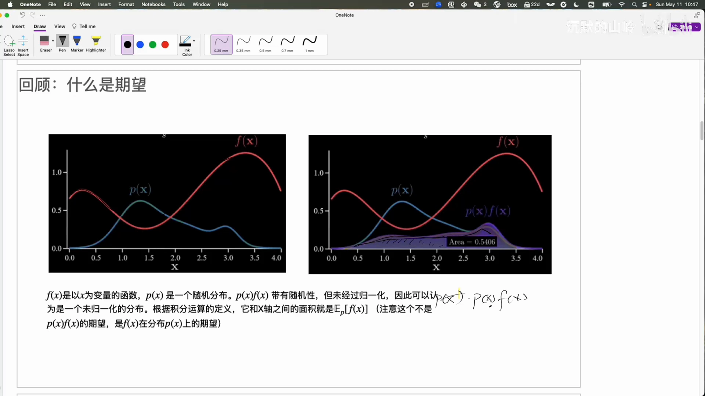

### 1.2 采样本身就「自带」了 p(x)

为什么能通过采样近似期望？直观理解是：**一个取值 $x$ 的概率越高，它在采样中出现的频率也越高**。所以「采样 + 求均值」这个动作，本身就已经把 $p(x)$ 这个权重体现进去了。

于是蒙特卡洛方法里 $p(x)$ 可以被**消掉**，问题从「求一个复杂分布的积分」变成「拿到样本、求和、求均值」这样简单的计算——原始分布 $p(x)$ 再复杂、再难定义都不怕。

[【跳转到 03:20】](https://www.bilibili.com/video/BV11kEMzhEYG/?t=200)

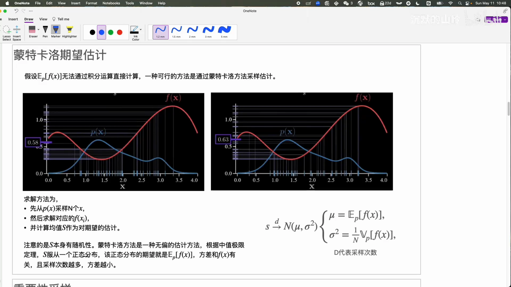

视频给了两次估计的演示：同样从 $p(x)$ 采样 N 个 $X$、求 $f(X)$ 的均值，第一次得到 0.58，第二次得到 0.63。**两次不一样**，说明这个估计本身带随机性。

### 1.3 估计有随机性：方差与样本量

根据**中心极限定理**，这个估计量服从正态分布，正态分布的中心 $\mu$ 就是我们要的期望；而方差一方面取决于 $f(X)$ 本身的方差，另一方面取决于**采样次数**——采样越多，方差越小。

所以想估准，就该尽量多采样；但每次采样都有成本，实际要在「想要的准确度」和「允许的样本量」之间做权衡。

[【跳转到 07:18】](https://www.bilibili.com/video/BV11kEMzhEYG/?t=438)

![同一页上的蓝色标注：估计量 S 服从 N(μ, σ²)，其中 μ = E_p[f(x)]、σ² = (1/N)·V_p[f(x)]——方差与采样次数成反比](assets/异策略蒙特卡洛：重要性采样比率与加权重要性采样/00463.webp)

---

## 二、重要性采样：换一个分布来估同一个期望

### 2.1 推导：分子分母同乘 q(x)

假设 $p(x)$ 难以直接采样，或者直接按 $p(x)$ 求期望的方差太大。这时引入一个新的概率分布 $q(x)$，在积分式里分子分母同乘 $q(x)$：

$$
\begin{aligned}
\mathbb{E}_{X \sim P}[f(X)] &= \int f(x) \cdot p(x)\, dx \\
&= \int f(x) \cdot \frac{p(x)}{q(x)} \cdot q(x)\, dx \\
&= \mathbb{E}_{X \sim Q}\Big[ \frac{p(x)}{q(x)} \cdot f(x) \Big]
\end{aligned}
$$

按期望的定义，这就变成了「在 $q$ 上的期望」，只是被求期望的函数从 $f(x)$ 变成了 $\frac{p(x)}{q(x)} \cdot f(x)$。

[【跳转到 09:09】](https://www.bilibili.com/video/BV11kEMzhEYG/?t=549)

![重要性采样一页通：左侧积分变换（框出 p/q），右侧采样估计式 r = (1/N)Σ(p/q)f，右下是方差式 V_q[r] = (1/N)V_q[(p/q)f] 与「希望它小于 V_p[f]」](assets/异策略蒙特卡洛：重要性采样比率与加权重要性采样/00524.webp)

有了这个式子，就可以**从 $q(x)$ 采 N 个 $X$**，对每个样本算 $\frac{p(x)}{q(x)} \cdot f(x)$，再求均值，得到的就是 $f(X)$ 在 $p$ 上的期望估计：

$$
\mathbb{E}_{X \sim P}[f(X)] \approx \frac{1}{N} \sum_i \frac{p(x_i)}{q(x_i)} \cdot f(x_i), \quad x_i \sim Q
$$

式中的 $\frac{p(x)}{q(x)}$ 就是**重要性权重（importance ratio）**，这套方法就叫**重要性采样**。

[【跳转到 09:59】](https://www.bilibili.com/video/BV11kEMzhEYG/?t=599)

### 2.2 怎么理解这个比率：先「除掉 Q」，再「还原 P」

蒙特卡洛之所以能把分布从式子里消掉，靠的是一个隐含前提：**$x_i$ 是从我要求的那个分布 P 里采出来的**，它出现的频率就代表了 $P$。

现在 $x_i$ 是从 $q$ 里采的，它带着 $q(x_i)$ 这个「出身」，无法代表 $P$ 下的采样结果，所以要**修正**：

1. 把 $q(x_i)$ 放到**分母**上——先「除掉 Q 的影响」，得到一个与具体 $Q$ 无关的量；
2. 再乘上 $p(x_i)$——把它**还原回在 P 下被采样出来的概率**。

修正之后，期望仍然等于 $f(X)$ 在 $p$ 下的期望（期望不变），但**方差会引入 $q$ 的影响而发生变化**。

[【跳转到 12:04】](https://www.bilibili.com/video/BV11kEMzhEYG/?t=724)

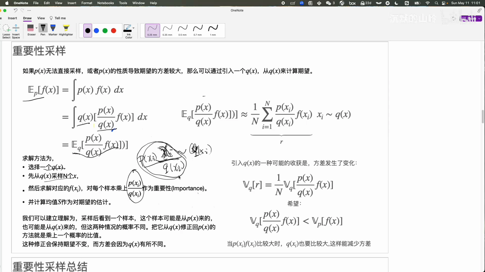

### 2.3 方差会变大还是变小？

方差衡量的是「每次采样得到的数值是否接近」。$f(X)$ 本身是稳定的普通函数，波动来自 $p(x)$、$q(x)$ 两个概率分布的比值。如果满足

> **$p(x) \cdot f(x)$ 大的地方，$q(x)$ 也大；$p(x) \cdot f(x)$ 小的地方，$q(x)$ 也小**

那么分子分母就会互相抵消，方差自然变小。这时我们还有额外收益：**即便用比较少的样本，也能估得比较准**。

[【跳转到 12:54】](https://www.bilibili.com/video/BV11kEMzhEYG/?t=774)

### 2.4 两个动机与一个前提

引入新分布做重要性采样，动机有两个：

1. **$p(x)$ 可能难以采样，而 $q(x)$ 容易采样**；
2. **方差可能变小**——前提就是上面那条「$p \cdot f$ 大时 $q$ 也大」。

[【跳转到 14:59】](https://www.bilibili.com/video/BV11kEMzhEYG/?t=899)

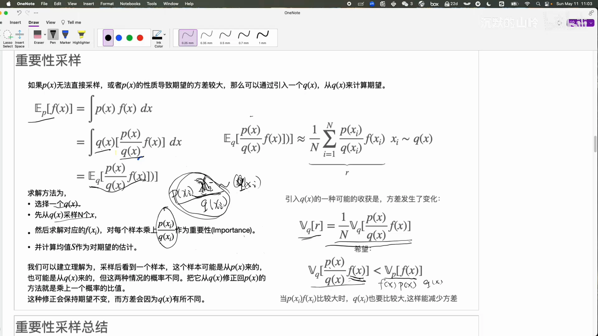

要注意一个容易混淆的点：$p(x)$ 虽然**难采样**，但给定一个 $X$，$p(x)$ 的**数值总是能算出来的**；而 $q(x)$ 必须既**容易采样**、又能算出数值。也正因为「$p$ 大时 $q$ 也要大」这个要求，**选一个合适的 $q(x)$ 其实相当困难**。但它提供了一种新思路：原本从 $p$ 根本采不出样本，现在换条路可能就解决了。

---

## 三、为什么要「异策略」：把采样和学习解耦

### 3.1 行为策略与目标策略

- **同策略（on-policy）**：与环境交互、采样数据的策略，和正在学习的策略是**同一个**；
- **异策略（off-policy）**：两者**不同**。负责收集数据的叫**行为策略（behavior policy）$b$**，要求解、正在学习的叫**目标策略（target policy）$\pi$**。

[【跳转到 17:29】](https://www.bilibili.com/video/BV11kEMzhEYG/?t=1049)

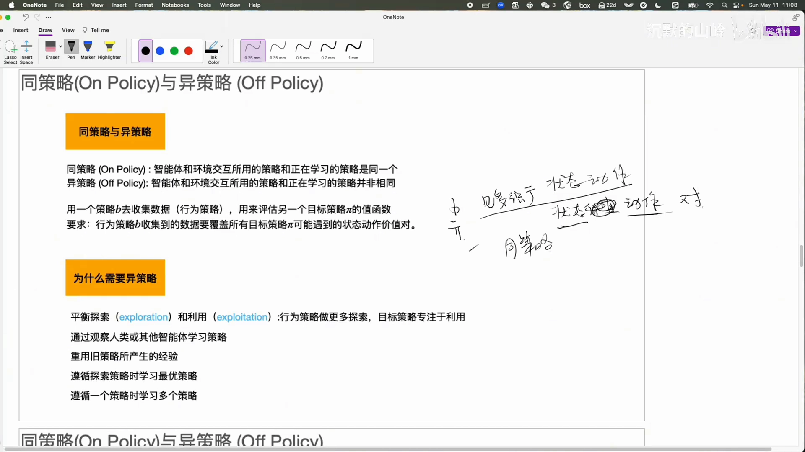

异策略有一个硬性要求：行为策略必须**「见多识广」**——目标策略 $\pi$ 可能遇到的**状态-动作对**，$b$ 采来的数据里**必须都包含**。因为 $\pi$ 的学习要靠这些数据来覆盖，$b$ 见过的东西一定要比 $\pi$ 更多。

### 3.2 动机一：把「探索」和「利用」拆开

同策略算法通常更简单，只有一个策略，边交互边学习。但控制类算法为了保证探索性，常用 **ε-greedy**：留出 ε 的概率随机探索。这带来两个弊端：

- **浪费收益**：那部分 ε 的决策不是最优的，白白损失了一部分价值；
- **ε 难定**：留多了浪费太多，留少了探索不彻底，学到的策略可能是次优的。

异策略可以把这两件事**解耦**：让**行为策略多探索**，让**目标策略专注求最优**——利用行为策略采来的信息，学出一个真正的最优策略。

[【跳转到 20:49】](https://www.bilibili.com/video/BV11kEMzhEYG/?t=1249)

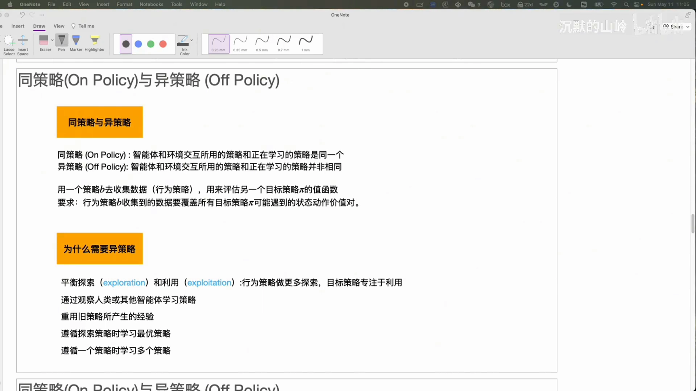

### 3.3 动机二：复用样本，降低样本成本

强化学习里有个概念叫**样本复杂性**：智能体与环境接触、收集数据是有成本的。机器人学做家务，就得把它放进厨房里真洗碗，学的过程还可能把碗打碎——时间与物质成本都很高。

把行为策略与目标策略分开，就可以**复用样本**：观察人类操作积累的数据、其他智能体已积累的数据、开源发布的机器人轨迹数据，都能拿来训练。这种情况下两个策略必然不同，**只能选异策略算法**。

### 3.4 动机三：一次采样，学出多个策略

有时我们希望学**多个**策略，在不同情况下用不同的：有的优化舒适性，有的优化效率、降低耗时——因为「最优」的定义本身就可能不一样。

正因为这些原因，异策略在强化学习落地过程中**更常见、更有用**。

---

## 四、异策略 MC 评估：ρ 是「策略比值」的连乘

### 4.1 一条轨迹的概率

假设看到一条轨迹：在某个状态下采取某个动作，转到新状态，一直持续到终结。下标从 $t$ 时刻到 $T$ 时刻。如果这条轨迹是遵循策略 $\pi$ 采样得到的，它出现的概率可以写成连乘：

$$
\Pr(\text{轨迹} \mid \pi) = \prod_{k=t}^{T-1} \pi(a_k \mid s_k) \cdot p(s_{k+1} \mid s_k, a_k)
$$

这就是马尔可夫决策过程（MDP）**马尔可夫性**的体现：整条轨迹的概率 = 每一步「选这个动作的概率 × 转到这个后继状态的概率」的乘积。

[【跳转到 23:44】](https://www.bilibili.com/video/BV11kEMzhEYG/?t=1424)

### 4.2 状态转移被约掉，只剩策略之比

把行为策略 $b$ 与目标策略 $\pi$ 的轨迹概率相除，就得到重要性采样比率。关键观察是：**状态转移概率 $p(s_{k+1} \mid s_k, a_k)$ 与策略无关**，上下相同，可以直接约掉：

$$
\rho_{t:T-1} = \prod_{k=t}^{T-1} \frac{\pi(a_k \mid s_k)}{b(a_k \mid s_k)}
$$

所以**在强化学习的异策略里，重要性采样比率就是「两个策略（两个决策函数）在每一步的概率之比」再连乘**。连乘到 $T-1$ 而不是 $T$，是因为 $s_T$ 是终止状态，它后面没有动作概率了。

[【跳转到 26:39】](https://www.bilibili.com/video/BV11kEMzhEYG/?t=1599)

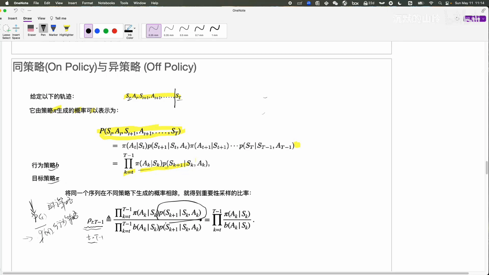

对照前面的一般公式：$p(x)$ 对应目标策略（我们本来要在它下面求期望），$q(x)$ 对应行为策略（便于采样、样本已经采好了）。

---

## 五、走一遍完整例子：10 条轨迹估出 V(S)

### 5.1 一个只有单状态的 MDP

- 只有一个状态 $S$，可以采取两个动作：**向左**或**向右**；
- **向右**：直接结束，奖励为 0；
- **向左**：有 **0.9** 的概率回到 $S$、奖励为 0；有 **0.1** 的概率得到奖励 **1** 并到达终止状态。

两个策略：

- **行为策略 $b$**：为了满足探索性，向左、向右各 **0.5**；
- **目标策略 $\pi$**：**只向左**、不向右（向右会立刻结束，什么也拿不到）。

[【跳转到 27:29】](https://www.bilibili.com/video/BV11kEMzhEYG/?t=1649)

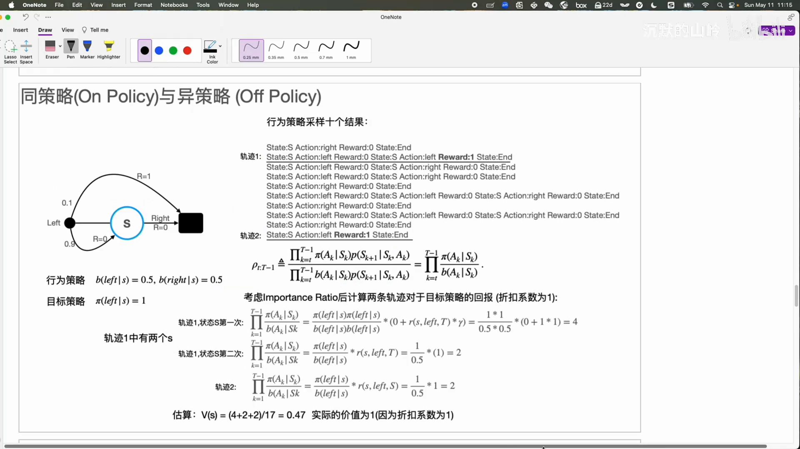

用行为策略采样 **10 条轨迹**，其中只有 **2 条**在向左走时拿到了奖励。目标是估计**目标策略下状态 S 的价值 $V^\pi(S)$**。

### 5.2 先定 first-visit 还是 every-visit

如果状态 $S$ 在一条轨迹里出现了两次，有两种处理方式：

- **first-visit**：只算它**第一次**出现时的价值，第二次忽略；
- **every-visit**：每次出现都算。

视频下面的计算基于 **every-visit**。所以轨迹一里的两个 $S$ 都要考虑。

[【跳转到 29:34】](https://www.bilibili.com/video/BV11kEMzhEYG/?t=1774)

### 5.3 逐条算 ρ 与回报

**轨迹一，$S$ 的第一次出现**：从这里到结束走了**两步**（向左、向左，然后结束），所以比率是两个概率之比相乘：

$$
\rho = \frac{\pi(\text{左} \mid S)}{b(\text{左} \mid S)} \cdot \frac{\pi(\text{左} \mid S)}{b(\text{左} \mid S)} = \frac{1}{0.5} \cdot \frac{1}{0.5} = 4
$$

回报方面，第一步奖励为 0，第二步奖励为 1（折扣系数 $\gamma = 1$），所以折扣回报 $G = 0 + \gamma \cdot 1 = 1$，这一项贡献 $4 \times 1 = 4$。

> 这里把奖励函数从 $r(s,a)$ 扩展成了 $r(s,a,s')$（状态、动作、后继状态）：因为同样采取「向左」，落到不同后继状态时奖励不同，写成三元组才能确切表达奖励是多少。

**轨迹一，$S$ 的第二次出现**：从这里出发只剩**一步**，比率直接是 $1/0.5 = 2$，回报仍是 1，贡献 $2$。

**轨迹二**：与上面同理，$S$ 只出现一次，贡献 $2$。

[【跳转到 31:39】](https://www.bilibili.com/video/BV11kEMzhEYG/?t=1899)

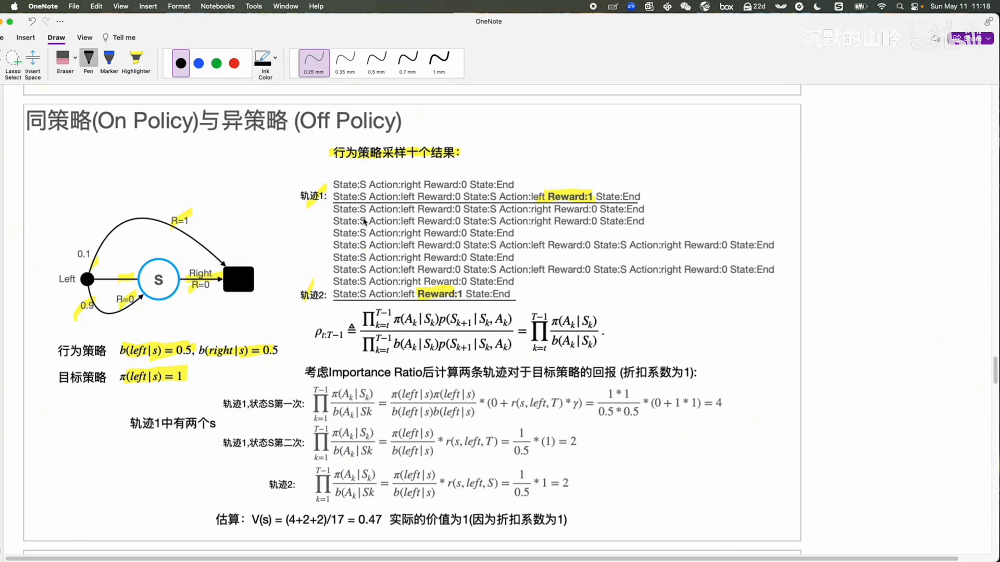

### 5.4 求均值：分母是「S 出现的总次数」

把所有项加起来是 $4 + 2 + 2 = 8$。求 $V(S)$ 的估计时，**不能除以 3**（不是除以「有回报的项数」）。为了计算简便，前面把回报为零的那些轨迹项略去了，但分母应该是**状态 $S$ 在所有轨迹当中出现的总次数**——这里一共是 **17 次**：

$$
V^\pi(S) \approx \frac{8}{17} \approx 0.47
$$

### 5.5 真值是多少？

真实的 $V^\pi(S)$ 等于 **1**。因为 $\gamma = 1$，远期奖励不打折；目标策略总是向左，每次向左都有 0.1 的概率拿到奖励 1，拿不到就回到 $S$ 继续向左，于是总回报是一个无穷等比数列，收敛到 1（拿不到奖励就不会结束）。

[【跳转到 34:09】](https://www.bilibili.com/video/BV11kEMzhEYG/?t=2049)

**结论**：普通重要性采样估出 0.47，真值 1——**偏差很大**，而且这还是只有 10 条样本的玩具问题。

---

## 六、普通重要性采样的致命弱点：方差爆炸

### 6.1 为什么方差会大

前面说过，重要性采样想让方差变小，需要「$p \cdot f$ 大时 $q$ 也大」。但在强化学习里这个条件**很难满足**：

- 目标策略学习时用的是行为策略**很久以前**收集的数据，数据拿到手就**不能再改**；想改行为策略重新采数据，成本极高；
- 行为策略本身有**探索性**的内在要求，不能过于偏向某一个方向；而目标策略是要学出来的**最优策略**，不是预先能指定的分布。

所以通常情况下，做重要性采样后**方差会变得很大**。

### 6.2 实验证据

视频给出一张估计曲线：横轴是采样次数（episode 数，**对数坐标**），纵轴是对价值的估计，共 10 次实验（10 条线），真值应在 1。

可以看到：采样到 **1000 次、甚至 1400 次之前**，估计值仍在**剧烈波动**、远远偏离真值；即便采到 **100 万次**，波动依然不小，还没有完全收敛。

[【跳转到 37:29】](https://www.bilibili.com/video/BV11kEMzhEYG/?t=2249)

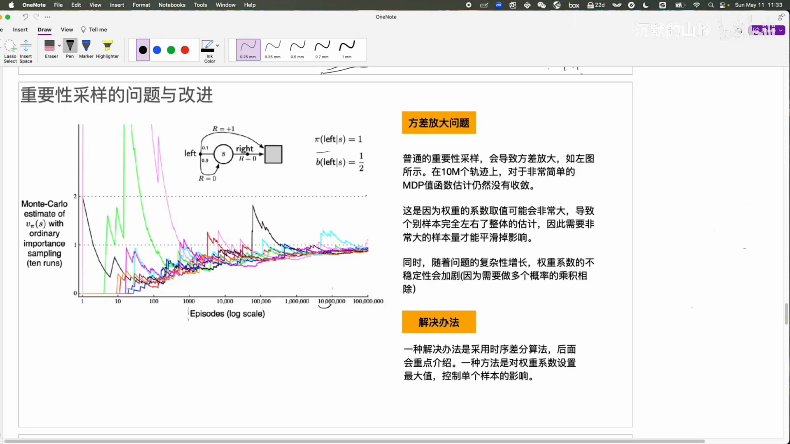

### 6.3 根源：比率取值可以到无穷大

根源在于计算回报时要乘上重要性采样比率。当**目标策略的概率大、行为策略的概率小**时，这个比值可能**非常大**，取值范围是 **0 到无穷大**。

后果是：**个别样本对整体估计产生过大的影响**，需要海量样本才能把这种影响平滑掉。而视频这个例子只有 1 个状态、2 个动作，已经简单到极致；真实问题里状态更多、轨迹更长，而权重是多个概率的**连乘**，不稳定性只会进一步加剧。

### 6.4 两条出路

1. **时序差分（TD）算法**——强化学习中控制方差的主流方法，也是最重要的方法（下一节讲）；
2. **控制权重系数**——既然比率范围是 0 到无穷，就把它压下来。

---

## 七、加权重要性采样：把权重归一化到 0~1

### 7.1 只改分母

方法很简单：把比率**归一化**，从 0~无穷压到 **0~1** 区间。对照两个式子：

$$
\begin{aligned}
\text{普通重要性采样：}\quad & V(s) \approx \frac{1}{|T(s)|} \sum_{t \in T(s)} \rho_{t:T-1} \cdot G_t \\
\text{加权重要性采样：}\quad & V(s) \approx \frac{\sum_{t \in T(s)} \rho_{t:T-1} \cdot G_t}{\sum_{t \in T(s)} \rho_{t:T-1}}
\end{aligned}
$$

分子不变，**分母从「状态 S 出现的次数」换成了「所有 ρ 之和」**。其中 $T(s)$ 是包含状态 $S$ 的所有「访问」的集合（every-visit 时多次出现要拆开分别算）。

[【跳转到 40:24】](https://www.bilibili.com/video/BV11kEMzhEYG/?t=2424)

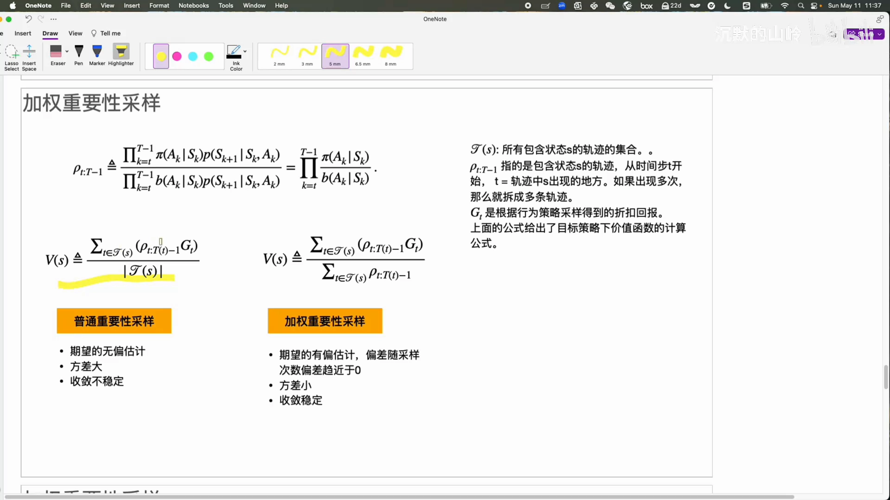

### 7.2 为什么这就是归一化

把分子的连加拆开，分母会「分」到每一项上去——每一项的系数变成 $\rho_i / \sum \rho$。也就是说，**每个重要性比率都被「所有 ρ 之和」归一化了，所有系数加起来恰好等于 1**。

既然已经归一化到和为 1，就不需要再除以「状态出现次数」了。这就是加权重要性采样的好处：**它仍然考虑了重要性比率，但给了它一个上限——最大也不超过 1。**

### 7.3 偏差与方差的取舍

| | 普通重要性采样 | 加权重要性采样 |
| :-- | :-- | :-- |
| 偏差 | 期望的**无偏**估计（first-visit 时；every-visit 时其实不是无偏） | **有偏**估计，但偏差随采样次数增加**趋于零** |
| 方差 | 方差大，收敛不稳定 | 方差小，收敛更稳定 |

### 7.4 用加权重要性采样重算前面的例子

分子还是 $4 + 2 + 2 = 8$，唯一变化是分母——现在除的是**所有 ρ 之和**：

$$
\begin{aligned}
\sum \rho &= (0.5 \times 0.5)^{-1} + (0.5)^{-1} + (0.5)^{-1} = 4 + 2 + 2 = 8 \\
V^\pi(S) &\approx \frac{8}{8} = 1
\end{aligned}
$$

**恰好等于真值 1**。也就是说，用了加权重要性采样之后，**在很少的样本上就已经非常接近真实值**。

[【跳转到 44:09】](https://www.bilibili.com/video/BV11kEMzhEYG/?t=2649)

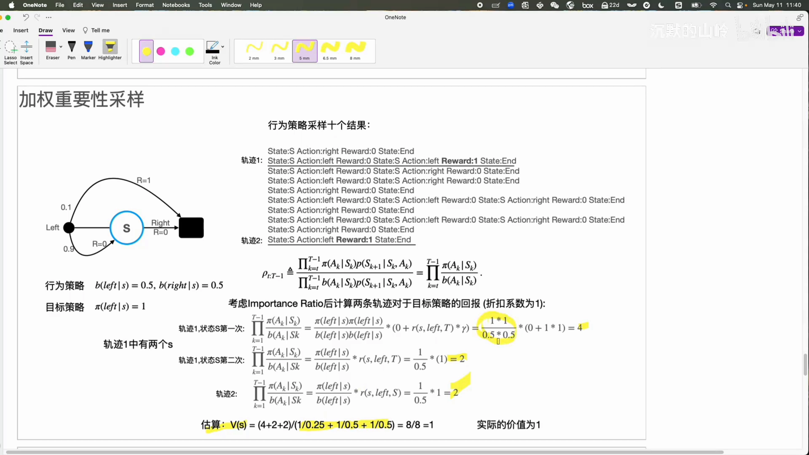

### 7.5 教材上的对比实验

视频还引用了《强化学习导论》里的另一个例子（问题比上面的玩具 MDP 复杂一些，差距更明显）。横轴是采样的 episode 数量，纵轴是**均方误差**——估计出的 $V(s)$ 与真实 $V(s)$ 之差的平方再取平均；两种方法各跑 100 次求均值。

结论很清楚：**加权重要性采样的误差在样本量很少时也相对稳定**；而普通重要性采样一开始误差非常高，要到 100 次以后才逐渐收敛。

[【跳转到 46:14】](https://www.bilibili.com/video/BV11kEMzhEYG/?t=2774)

---

## 八、两个算法：加权重要性采样的评估与控制

### 8.1 加权重要性采样的 MC 评估

伪代码的要点：

- 初始化后，用**行为策略 $b$** 收集样本；
- $G$ 是折扣回报，$W$ 就是当前的重要性采样比率 $\rho$；
- $C$ 用来追踪**归一化比率**，即 $(s_t,a_t)$ 下所有 $\rho$ 之和；
- 更新用的是**增量的期望更新法则**，乘的系数是**归一化之后**的系数（用 $C$ 做分母）；
- 因为比率要逐步累乘，每往前走一步就把 $W$ 乘一次 $\frac{\pi(a \mid s)}{b(a \mid s)}$。

注意：这个伪代码评估的是 **$Q$ 函数**（状态-动作价值）。如果要评估状态价值 $V$，把里面所有 $(s_t,a_t)$ 换成 $s_t$、把 $Q$ 换成 $V$ 即可。

[【跳转到 48:16】](https://www.bilibili.com/video/BV11kEMzhEYG/?t=2896)

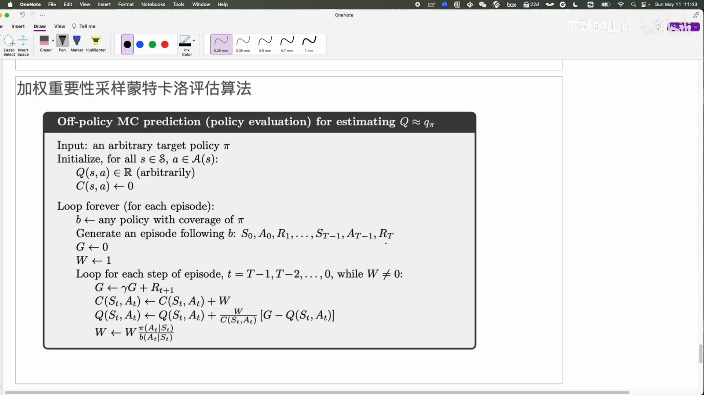

### 8.2 加权重要性采样的 MC 控制

控制算法与评估的区别在于：**它还要把最优策略求出来**，所以里面用**贪婪**的方法直接改进策略。前面部分与评估算法完全一样。

其中一个关键步骤是：**如果 $a_t \ne \pi(s_t)$，就直接退出当前 episode、进入下一个 episode 的迭代**。原因是不相等说明当前策略已经改进过了，这条旧轨迹不再适用于新策略，没必要继续用它更新。

---

## 小结

- **期望是加权和**；蒙特卡洛靠「采样自带概率」把 $p(x)$ 消掉，把积分问题变成「采样、求和、求均值」，代价是估计带随机性，方差随样本量增大而减小。
- **重要性采样**：采不到 $P$ 时，从 $Q$ 采样并乘上 $\frac{p(x)}{q(x)}$，期望不变、方差会变；比率的作用是「先除掉 Q 的影响，再还原 P 下的可能性」。
- **两个动机**：$p$ 难采样而 $q$ 易采样；方差可能变小（前提是 $p \cdot f$ 大时 $q$ 也大）。选合适的 $q$ 很难。
- **异策略**：行为策略 $b$ 采样、目标策略 $\pi$ 学习，要求 $b$ 见多识广、覆盖 $\pi$ 会遇到的状态-动作对。动机是解耦探索与利用、复用样本（样本复杂性）、一次采样学多个策略。
- **重要性采样比率**：$\rho = \prod_k \frac{\pi(a_k \mid s_k)}{b(a_k \mid s_k)}$，状态转移概率与策略无关被约掉，只剩策略比值的连乘。
- **普通重要性采样**：无偏（first-visit）但比率可到无穷大，方差爆炸；单状态两动作的例子里 10 条轨迹估出 0.47，真值 1。
- **加权重要性采样**：分母换成 ρ 之和，权重归一化到 0~1；有偏但偏差趋于零，方差小、收敛稳。同一例子直接算出 1。
- **两条降方差路线**：时序差分（主流）与权重系数控制（加权重要性采样）。

## 关键术语速查

| 术语 | 一句话解释 |
| :-- | :-- |
| 期望（Expectation） | 函数值按概率加权的平均，$\int f(x)p(x)\, dx$；离散时是连加。 |
| 蒙特卡洛估计 | 从分布采样 N 个点、代入函数取均值，用来近似期望。 |
| 重要性采样（Importance Sampling） | 想估 $P$ 下的期望却只能从 $Q$ 采样时，用 $\frac{p(x)}{q(x)}$ 加权修正。 |
| 重要性采样比率 $\rho$ | 异策略中「目标策略与行为策略动作概率之比」的连乘，取值 0 到无穷。 |
| 行为策略 $b$（Behavior Policy） | 负责与环境交互、收集数据的策略。 |
| 目标策略 $\pi$（Target Policy） | 真正要评估、要改进的那个策略。 |
| 同策略 / 异策略 | 采样策略与学习策略相同 / 不同。 |
| 覆盖条件 | $\pi$ 可能遇到的状态-动作对，$b$ 都必须能采到。 |
| 首次访问 / 每次访问（First-visit / Every-visit） | 一个状态在一条轨迹里多次出现时，只算第一次 / 每次都算。 |
| 普通重要性采样 | 除以「状态出现次数」，无偏但方差大、收敛不稳。 |
| 加权重要性采样（Weighted IS） | 除以「ρ 之和」，权重归一化到 0~1，有偏但方差小、收敛稳。 |
| 样本复杂性（Sample Complexity） | 学到可用策略所需的数据量；采集真实样本的成本往往很高。 |