# 重要性采样与同策略/异策略：PPO 为什么算同策略

> 本篇整理自 B 站视频《强化学习-重要性采样》。视频地址：[BV1Ap4y1E73W](https://www.bilibili.com/video/BV1Ap4y1E73W/)。

## 本讲要解决的核心问题（SCQA）

**背景**：强化学习里要算的量几乎都是**期望**——比如某个策略下「玩一局能拿多少奖励」。而算期望最常用的办法是**采样求平均**：从分布里抽一批样本，代入函数，取均值。这套办法成立的前提是——**你能从那个分布里采样**。

**冲突**：可现实里经常采不到。想估的那个分布 `P` 可能太复杂、根本没法直接抽样；而你手上只有另一批样本，它们来自另一个分布 `Q`。拿 `Q` 的样本直接平均，算出来的期望是错的。

**疑问**：能不能用「从 `Q` 采出来的样本」，去估计「在 `P` 下的期望」？如果可以，代价是什么？强化学习里谁在用这一招？

**回答（中心思想）**：可以，办法是给每个样本乘上一个**重要性权重** `p(x)/q(x)`——这就是**重要性采样（importance sampling）**。它把「从新策略 θ 采样」换成「从旧策略 θ′ 采样」，从而让**同一批数据可以反复更新参数**。PPO 正是这么做的；但因为它采样的 θ′ 只是 θ 的旧副本、两者网络结构相同，所以 PPO 在本质上是**同策略（on-policy）**算法。

---

## 一、先看「采样」：期望的两种算法

### 1.1 采样就是从分布里抽点

**采样**就是从某个概率分布中抽取样本点。视频里的例子：给一个正态分布，从中抽一个点，落在阴影区域（概率密度高的地方）的可能性就更大——这个抽点的过程就叫采样。

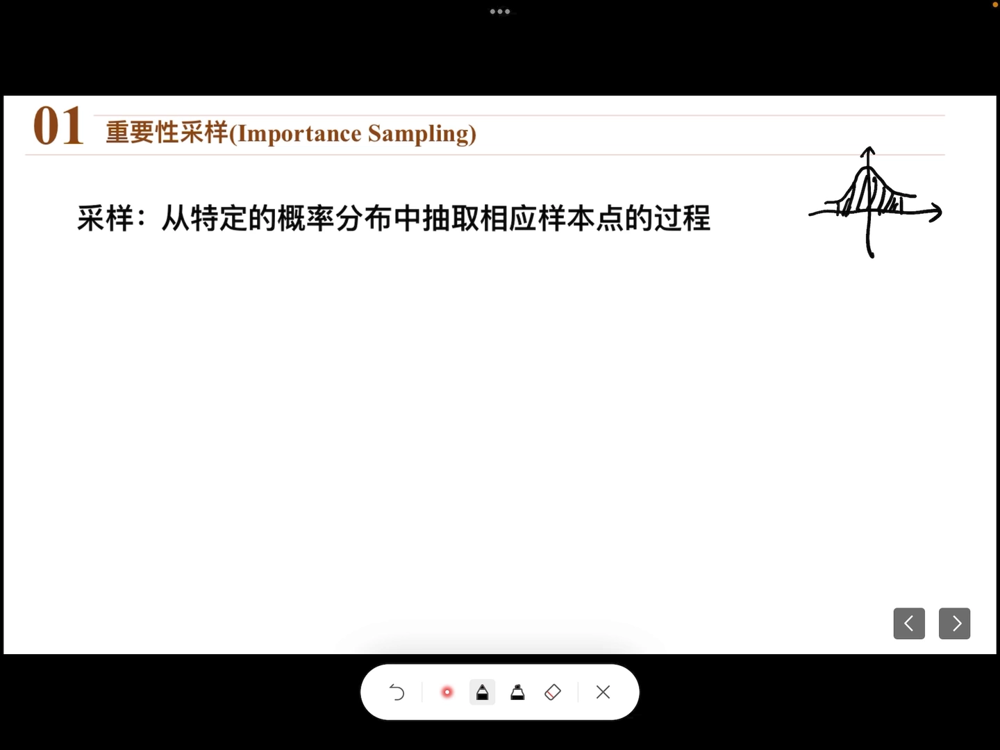

[【跳转到 00:18】](https://www.bilibili.com/video/BV1Ap4y1E73W/?t=18)

### 1.2 任务：从 P 采样 X，求 f(X) 的期望

视频给出的具体任务是：**从分布 `P` 中采样 `X`，并计算函数 `f(X)` 的期望**。完成这个任务有两条路：求积分，或者从分布 `p` 采样一批 `x_i`、代入 `f(x)` 后取平均。

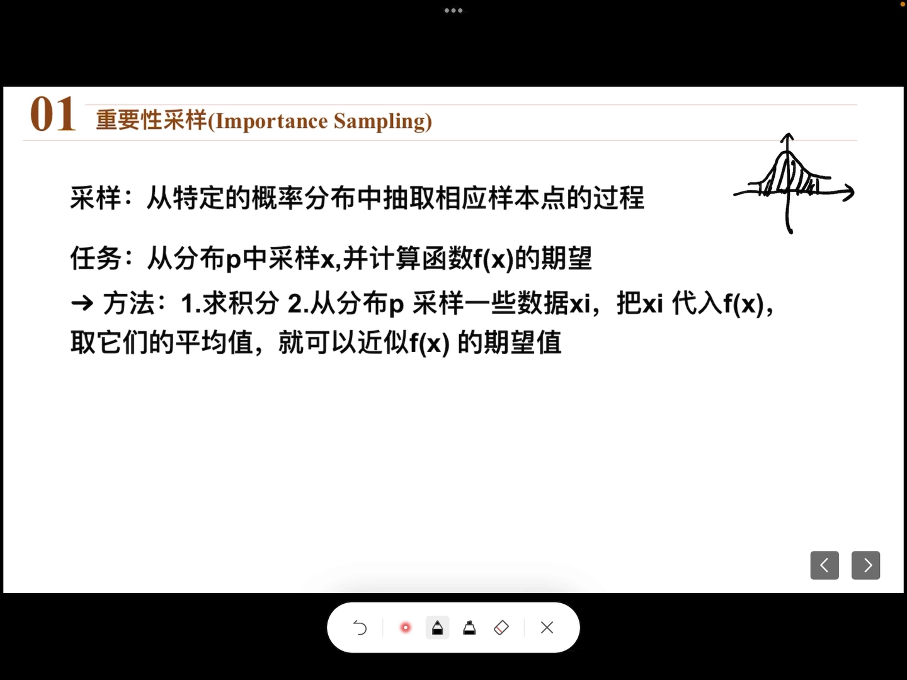

**第一条路：求积分。** 函数的期望等于「函数值 × 概率密度」再积分，而这里 `P` 的密度函数 `p(x)` 是已知的：

```
E[f(X)] = ∫ f(x) · p(x) dx
```

![讲者手写补上的积分定义：E[f(X)] = ∫ f(x)·p(x)dx](assets/重要性采样与同策略异策略：PPO 为什么算同策略/00098.webp)

**第二条路：采样再取平均。** 求积分有个现实问题——**在计算机里做积分不容易**（很多积分没有解析解）。于是换个办法：先从 `P` 中采样出一批数据点，把每个点代入函数算出 `f(x)`，再对这些函数值**取平均**，就可以近似看作 `f(X)` 的期望：

```
E[f(X)] ≈ (1/N) · Σ f(x_i),   x_i ~ P
```

一句话记住这两条路的关系：**积分是「按概率加权求和」的理论版，采样求平均是它的实操版**。

---

## 二、采不到 P 怎么办：引入重要性采样

### 2.1 新问题：只能从 Q 采样

现在把条件收紧：**假设我们不能从分布 `P` 中采样，只能从另一个分布 `Q` 中采样**，该怎么办？

[【跳转到 02:03】](https://www.bilibili.com/video/BV1Ap4y1E73W/?t=123)

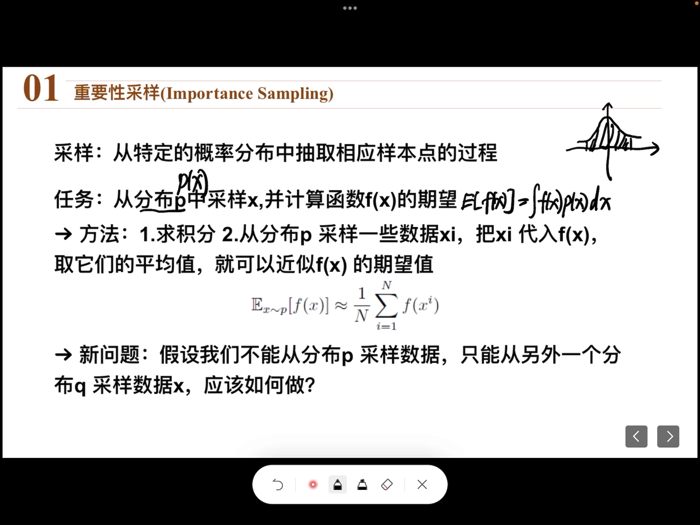

### 2.2 关键技巧：一乘一除 q(x)

做法是做一个**恒等变换**：在积分式里同时除以一个 `q(x)`、再乘上一个 `q(x)`，等式保持不变：

```
E_{x~P}[f(X)] = ∫ f(x) · p(x) dx
              = ∫ f(x) · (p(x)/q(x)) · q(x) dx
              = E_{x~Q}[ (p(x)/q(x)) · f(x) ]
```

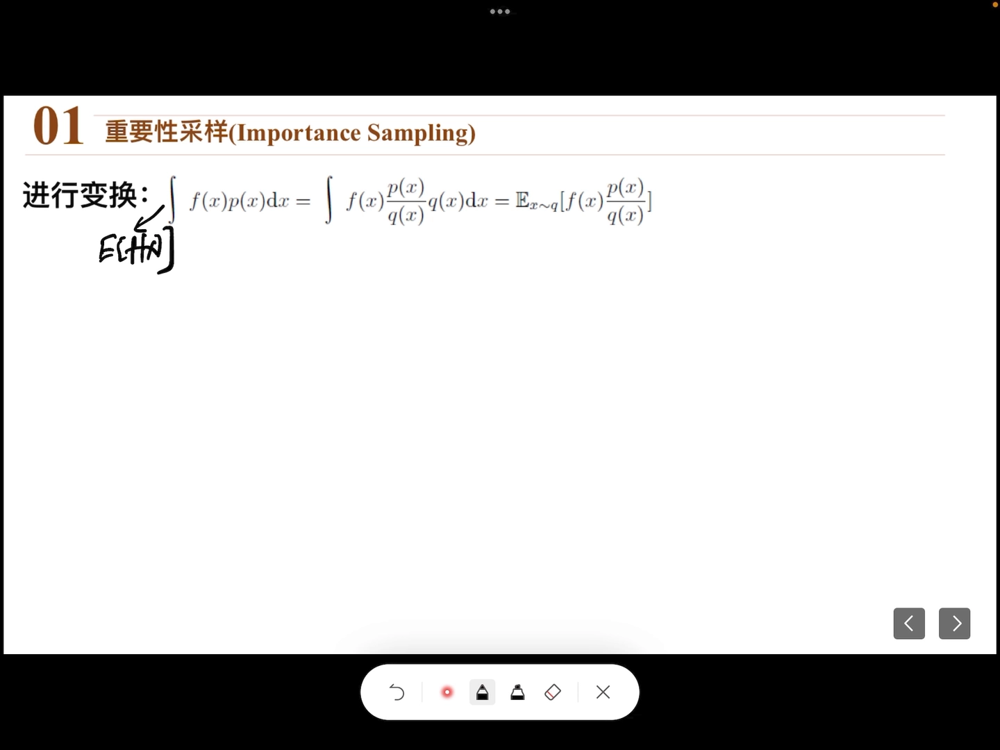

这一乘一除之后，`(p(x)/q(x))·f(x)` 可以整体看作一个**新的函数**，于是这个积分就变成了「这个新函数在 `Q` 下的期望」。

[【跳转到 03:00】](https://www.bilibili.com/video/BV1Ap4y1E73W/?t=180)

### 2.3 结论与那个多出来的比值

这个式子说的是：**从密度为 `p(x)` 的分布采样 `X` 求 `f(X)` 的期望，与从密度为 `q(x)` 的分布采样 `X` 再按下面的方式求期望，两者相等**：

```
E_{x~P}[f(X)] ≈ (1/N) · Σ (p(x_i)/q(x_i)) · f(x_i),   x_i ~ Q
```

两边相比，除了 `P` 换成 `Q`，还多了一个比值 `p(x)/q(x)`——它叫**重要性权重（importance weight）**，这一整套做法就叫**重要性采样**。

[【跳转到 03:50】](https://www.bilibili.com/video/BV1Ap4y1E73W/?t=230)

![变换后的结论：E_p[f(x)] = E_q[f(x)·p(x)/q(x)]，方框圈出的 p(x)/q(x) 就是「重要性权重（Importance Weight）」](assets/重要性采样与同策略异策略：PPO 为什么算同策略/00230.webp)

---

## 三、重要性权重到底在做什么

### 3.1 一个反例：只用 Q 采样会算错

视频用一张图说明为什么不能省掉这个权重。图中有三条线：红线是 `f(x)`，另外两条分别是 `p(x)` 和 `q(x)`。

- **从 `p(x)` 采样**：大概率采到 `p(x)` 高的那些位置，这些位置对应的 `f(x)` 是**负的**，取平均后期望也是负的；
- **从 `q(x)` 采样**：采出来的点大概率落在 `q(x)` 高的那些位置，而那里对应的 `f(x)` 是**正的**，于是算出的「期望」变成了正的。

[【跳转到 05:30】](https://www.bilibili.com/video/BV1Ap4y1E73W/?t=330)

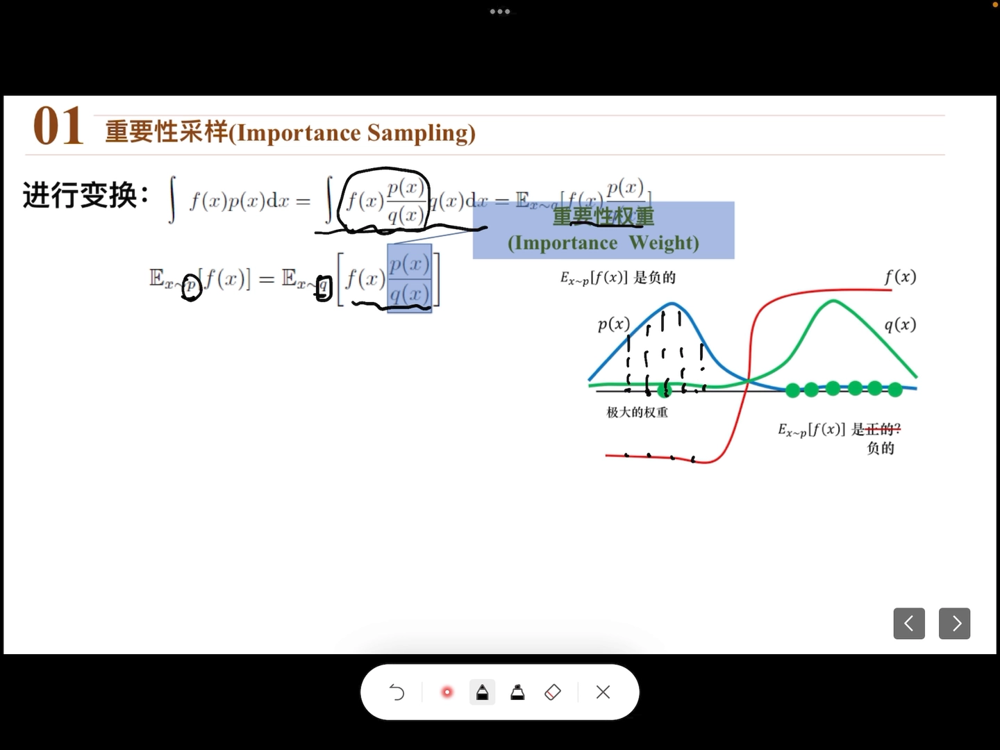

同一个量，两个分布采出来的结果是**一正一负**——说明直接拿 `Q` 的样本平均是**不行**的。

### 3.2 权重的作用：给「稀有但重要」的样本加权

把右边也写成「采样求均值」的形式，就能看清权重的意义。假设在采样过程中采到了这样一个点：它对应的 `p` 值很大、`q` 值很小，而它的 `f(x)` 是个负数。

此时比值 `p(x)/q(x)` 是一个**很大的正数**；用它去乘那个负的 `f(x)`，就等于**给这个负值一个很大的权重**。于是尽管绝大多数样本的 `f(x)` 都是正的，右边加权平均下来仍然是**负的**——和左边的正确答案一致，等式成立。

[【跳转到 07:35】](https://www.bilibili.com/video/BV1Ap4y1E73W/?t=455)

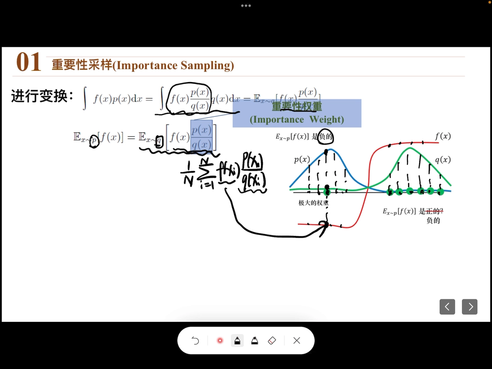

直觉上可以这样记：**`Q` 里出现得少的样本，`p/q` 就大，说明它在 `P` 里其实更常见，应该被「补偿」；`Q` 里出现得多的样本，`p/q` 就小，应该被「打折」。**

### 3.3 前提：采样点要够多，且 P 与 Q 不能差太远

这个办法有两个前提：

1. **采样点要足够多**，才有可能采到上面那种「`p` 大 `q` 小」的关键位置；
2. **`P` 和 `Q` 不能差得太大**。差得太大，误差可能就比较大。

[【跳转到 08:25】](https://www.bilibili.com/video/BV1Ap4y1E73W/?t=505)

---

## 四、搬到策略梯度上：从 θ 采样改成从 θ′ 采样

### 4.1 要改造的那个期望

视频接着把上面的结论用到策略梯度的式子上。这个式子本身是一个**期望**——「玩一局游戏结束后所得奖励的最终期望」，它是由策略梯度推导出来的（视频不展开推导过程）。

[【跳转到 08:50】](https://www.bilibili.com/video/BV1Ap4y1E73W/?t=530)

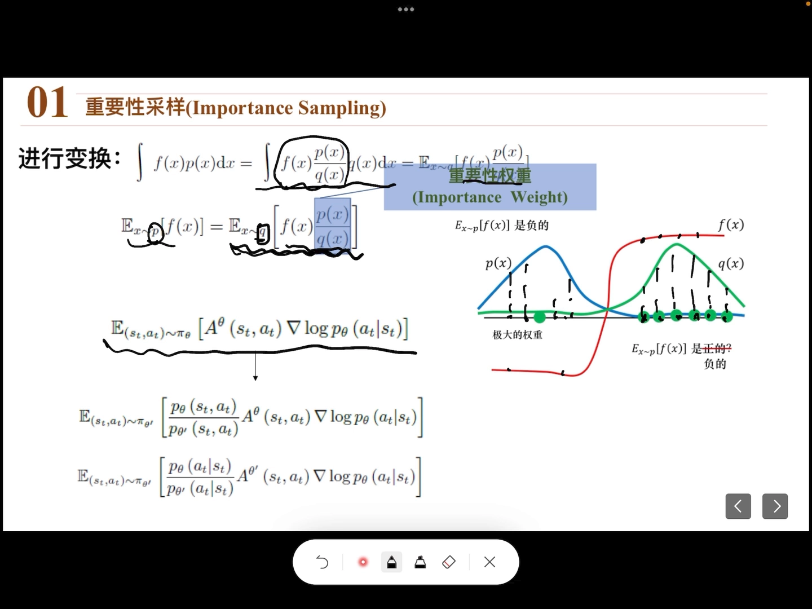

原本这个期望是**从 θ 这个分布（策略网络）中采样**再计算的。套用重要性采样，把它改造成**从 θ′ 中采样**，只需要再乘上一个重要性权重：

```
E_{a~π_θ}[ ... ]  =  E_{a~π_θ′}[ (p_θ(a|s) / p_θ′(a|s)) · ... ]
```

这里的 `p_θ(a|s)` 意思是：**在 θ 这个网络中、在状态 s 下采样到动作 a 的概率**。

[【跳转到 09:40】](https://www.bilibili.com/video/BV1Ap4y1E73W/?t=580)

### 4.2 再化简一步：把状态项约掉

用这个式子直接算最终期望还不行，要继续化简。关键是把联合概率写成乘法公式：

```
p_θ(s, a)  = p_θ(a|s) · p_θ(s)
p_θ′(s, a) = p_θ′(a|s) · p_θ′(s)
```

把上下两项都这样写开，其中 `p_θ(s)` 与 `p_θ′(s)` 是**相同的一项**，可以约掉，只剩**动作概率之比**：

```
p_θ(s,a) / p_θ′(s,a)  =  p_θ(a|s) / p_θ′(a|s)
```

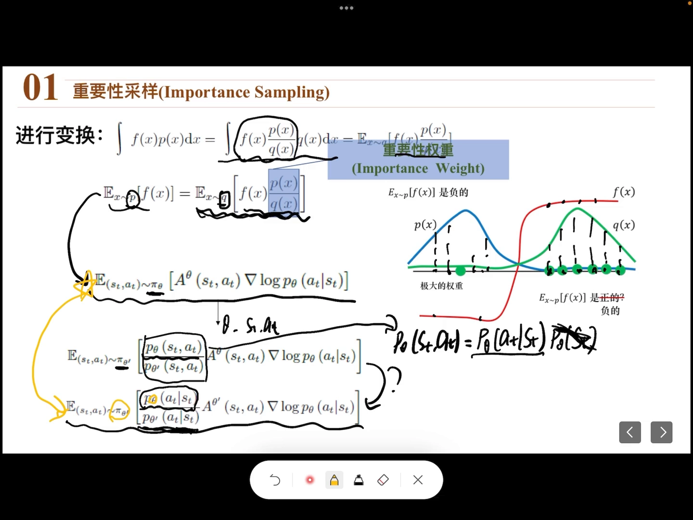

化简后的这个式子，就是最后用来**计算梯度、更新参数**的式子。

[【跳转到 10:05】](https://www.bilibili.com/video/BV1Ap4y1E73W/?t=605)

---

## 五、为什么要做这步改造：同一批数据能多次更新

改造带来的**好处**是：可以**多次更新 θ**。流程是这样的：

1. 让 **θ′** 去与环境交互、采样，得到一组数据；
2. 用这组数据在 θ′ 下算出损失与梯度，但**这个梯度不去更新 θ′**，而是拿去更新 **θ**；
3. θ 更新几次之后，把 θ 的参数**复制一份给 θ′**（两者的网络结构完全一样）。

[【跳转到 12:35】](https://www.bilibili.com/video/BV1Ap4y1E73W/?t=755)

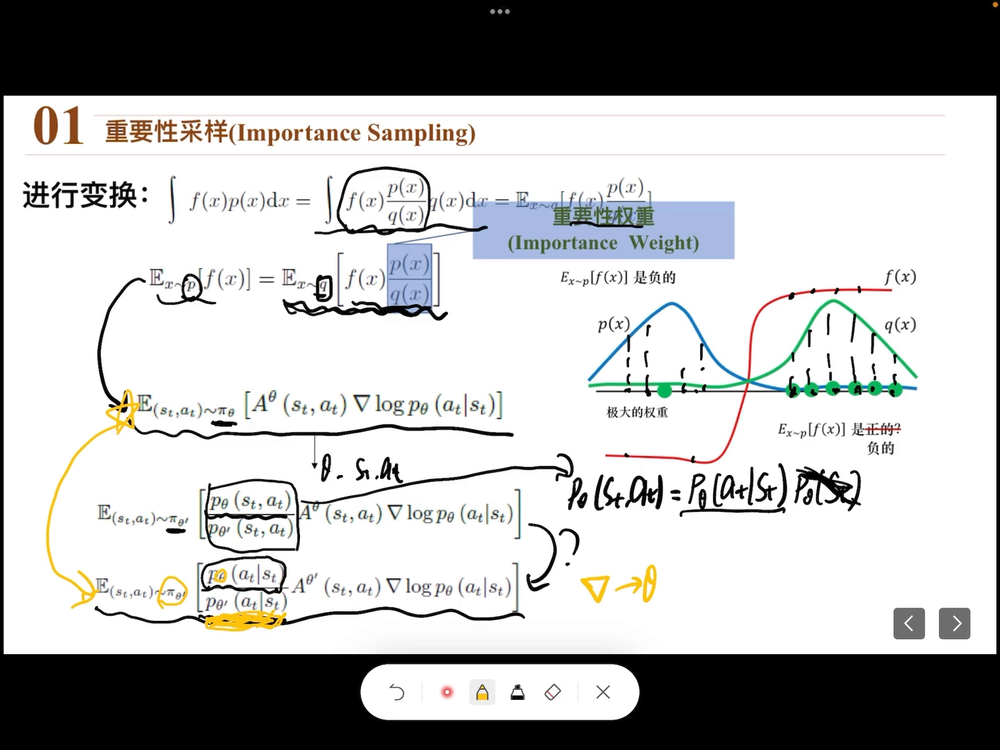

如果没有重要性采样，一批由旧策略采出来的数据只能用来更新一次（一旦参数变了，数据就不再「来自当前策略」）；有了重要性权重做修正，同一批数据就能被**反复利用**。这正是 PPO 使用重要性采样的**主要目的**。

---

## 六、同策略与异策略：PPO 到底算哪一类

### 6.1 两个定义

- **同策略（on-policy）**：要学习的智能体，与和环境交互、采样数据的智能体是**同一个**；
- **异策略（off-policy）**：与环境交互的那个智能体，和正在学习的智能体**不是同一个**。

[【跳转到 13:25】](https://www.bilibili.com/video/BV1Ap4y1E73W/?t=805)

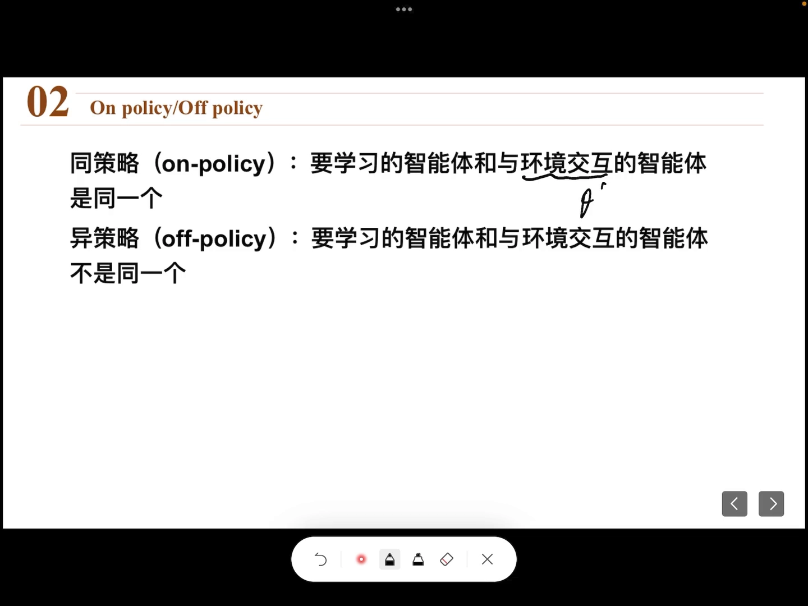

### 6.2 那 PPO 是哪一种？

按上面的流程看，PPO 是「θ′ 采样、θ 学习」，看起来像异策略。视频提到，网上对此有很多种说法，但它的发明者 OpenAI 认为它是**同策略（on-policy）**。

理由是：**θ 和 θ′ 本质上还是同一个东西**。

- 两者的**网络结构相同**；
- θ′ 的权重是 θ **复制**过去的——θ 更新完之后，把自己的权重信息复制给 θ′，再让 θ′ 用这份信息去采样。

所以从本质上来讲，这里的 θ 和 θ′ 是同一个策略。它使用重要性采样，**主要目的是让 θ 的参数可以被多次更新**，而不是为了「学一个策略、用另一个策略采数据」。

[【跳转到 15:30】](https://www.bilibili.com/video/BV1Ap4y1E73W/?t=930)

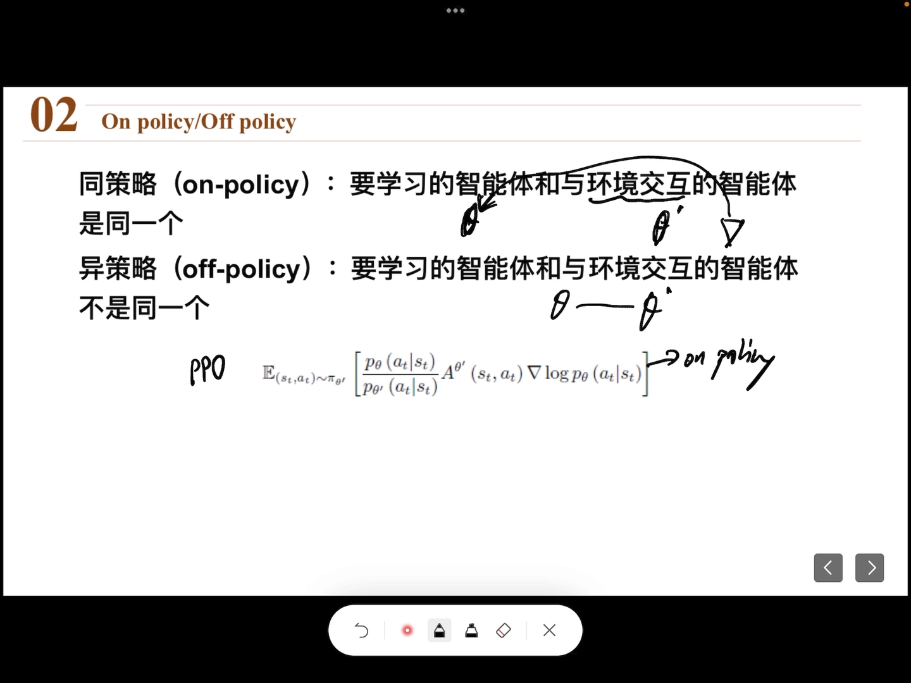

---

## 小结

- **采样**是从概率分布中抽样本点；**期望**既可以用积分算，也可以用「采样 + 求平均」近似。计算机里后者更常用。
- **重要性采样**解决的是「采不到 `P`」的问题：从 `Q` 采样，再给每个样本乘上**重要性权重** `p(x)/q(x)`，就能估出 `P` 下的期望。
- **权重的作用**是给「`Q` 里稀有、`P` 里常见」的样本加权，把被采样分布带偏的结果修正回来。
- **两个前提**：样本量要足够多；`P` 与 `Q` 不能差得太远，否则误差大。
- **在策略梯度里**，重要性采样把「从 θ 采样」换成「从 θ′ 采样」，权重化简后只剩**动作概率之比** `p_θ(a|s)/p_θ′(a|s)`。
- **收益**：同一批数据可以**多次更新** θ，更新若干次后再把 θ 复制给 θ′。
- **PPO 的定性**：θ′ 只是 θ 的旧副本、结构相同，本质仍是同一个策略，所以 PPO 算**同策略**算法；重要性采样在这里的作用是「复用数据」，不是「跨策略学习」。

## 关键术语速查

| 术语 | 一句话解释 |
| :-- | :-- |
| 采样（Sampling） | 从某个概率分布中抽取样本点，概率密度高的位置更容易被抽到。 |
| 期望（Expectation） | 函数值按概率加权的平均；连续情形下是 `∫ f(x)p(x)dx`。 |
| 蒙特卡洛估计 | 用「采样 N 个点再取平均」来近似期望，避开难算的积分。 |
| 重要性采样（Importance Sampling） | 想估 `P` 下的期望却只能从 `Q` 采样时，用 `p(x)/q(x)` 加权修正。 |
| 重要性权重（Importance Weight） | 比值 `p(x)/q(x)`：大于 1 表示该样本在 `P` 中更常见，应被放大。 |
| 行为分布 / 目标分布 | 目标分布 `P` 是你想估的那个；行为分布 `Q` 是你实际能采样的那个。 |
| 同策略（On-Policy） | 采样用的策略与正在学习的策略是同一个。 |
| 异策略（Off-Policy） | 采样用的策略与正在学习的策略不同。 |
| θ 与 θ′ | θ 是正在更新的策略网络参数，θ′ 是它的旧副本，负责采样。 |
| PPO | 用重要性采样让一批数据多次更新 θ，再把 θ 复制给 θ′；本质是同策略算法。 |