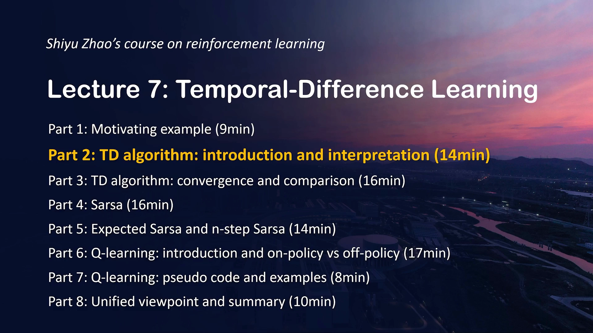
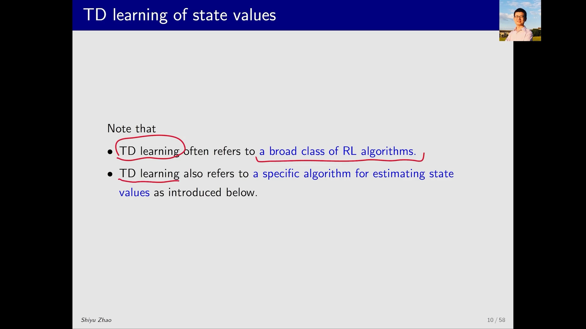
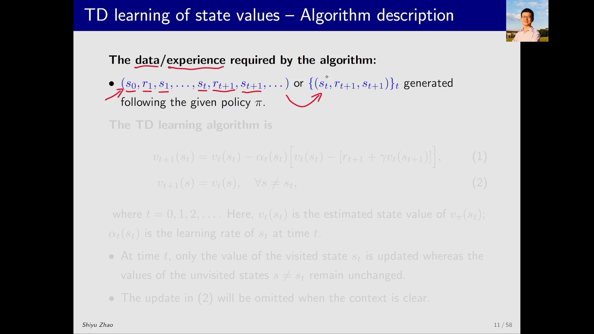
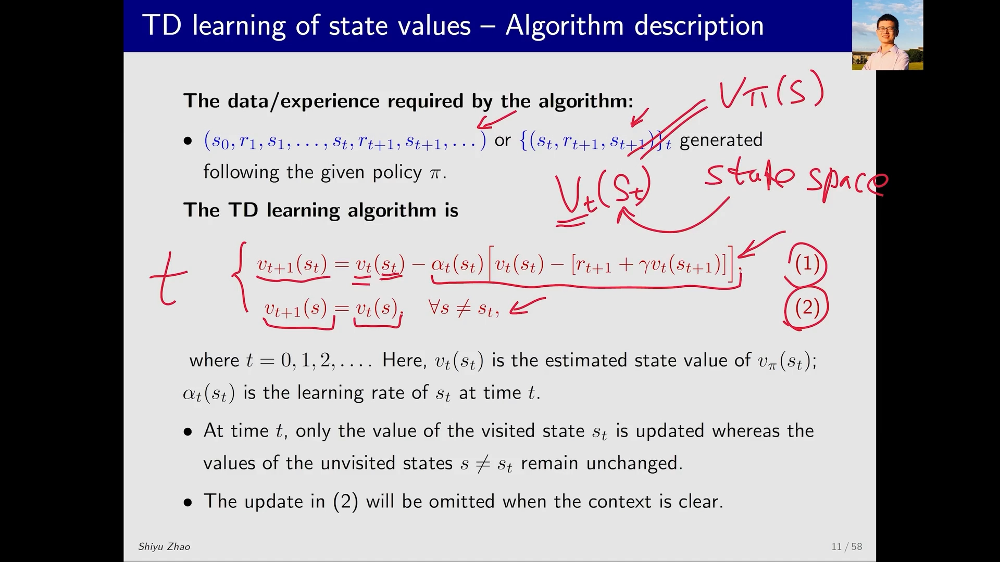
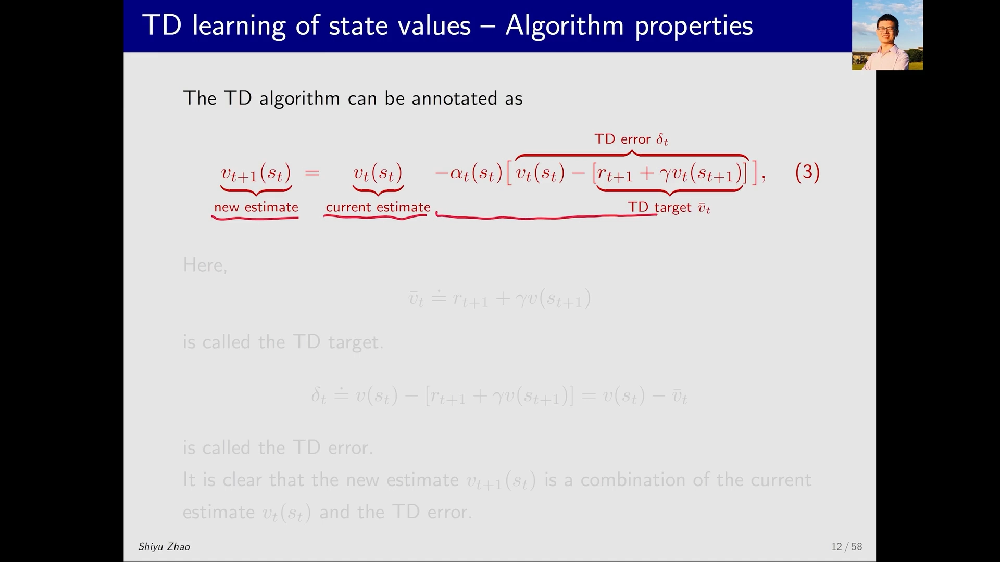
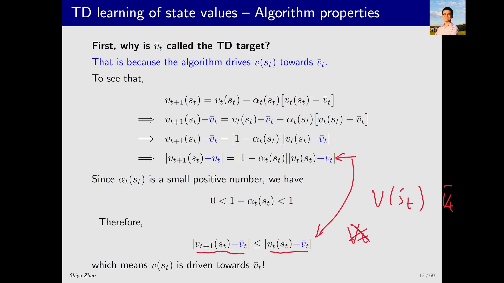
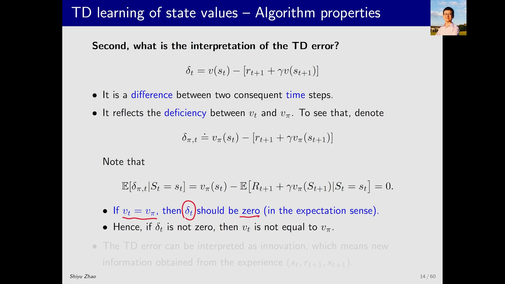
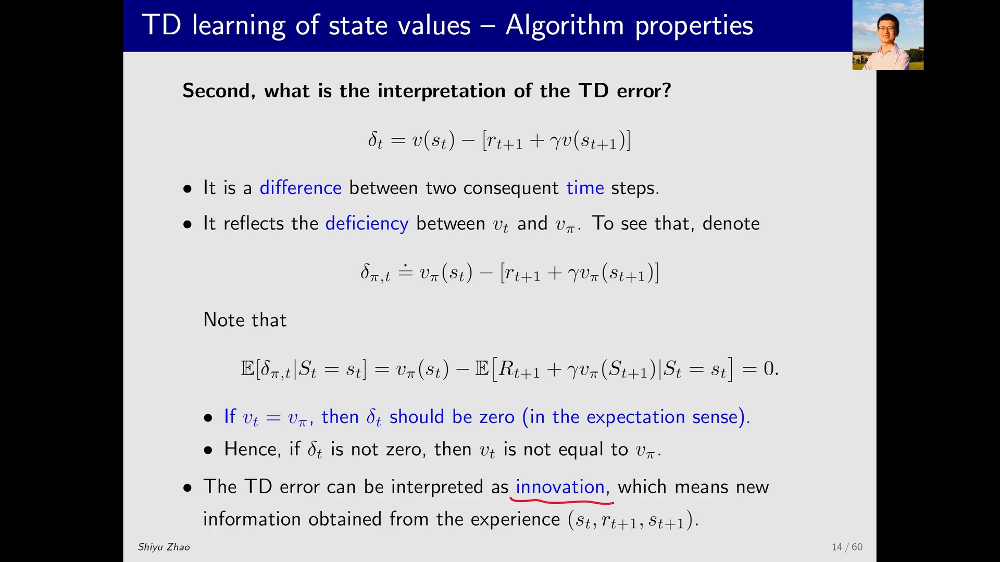
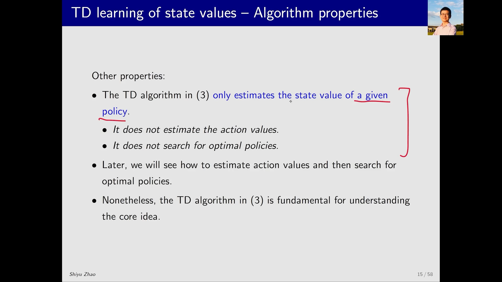

# TD(0) 预测算法：TD 目标与 TD 误差

> 本篇整理自赵世钰《强化学习的数学原理》第 7 课「时序差分方法（Part 2：TD 算法介绍）」。视频地址：[BV1RP4y1m71w](https://www.bilibili.com/video/BV1RP4y1m71w/)。

## 本讲要解决的核心问题（SCQA）

**背景**：策略评估（policy evaluation）要做的事，是给定一个策略 π，把每个状态的**状态价值** `v^π(s)` 算出来——它表示从状态 s 出发、一直按 π 走下去，能拿到的折扣回报的期望。只要这一步做出来，再配合策略改进（policy improvement），就能一步步逼近最优策略。

**冲突**：上一节讲过，动态规划（DP）能算 `v^π(s)`，但它要求知道环境的模型；蒙特卡洛（MC）不需要模型，却必须等一条轨迹**走到终结**才能算出累计回报，而且每个状态都是「各自独立」地被估计，没有利用状态之间的关联。

**疑问**：能不能只用**一步**交互数据、并且**边交互边更新**，就把 `v^π(s)` 估出来？

**回答（中心思想）**：能——用 **TD 算法**（时序差分，temporal difference）。它每走一步就用「即时奖励 `r_{t+1}` + 折扣后的下一状态估值 `γ·v_t(s_{t+1})`」这个**TD 目标（TD target）**去拉近当前估值 `v_t(s_t)`，两者之差就是 **TD 误差（TD error）**。本讲介绍的这一版是最经典、最原始的 TD 算法，也就是常说的 **TD(0)**：它只做**策略评估**，估计状态价值，不估计动作价值、也不直接搜索最优策略——但它是后面所有 TD 类算法的模板。



---

## 一、先把定位说清楚：TD 是「一类算法」，也是一个「具体算法」

### 1.1 两种含义要分清

「TD learning」这个词在强化学习里有两层用法：

- **广义**：指一大类算法。今天这节课讲的所有算法都可以叫 TD 算法（后面要介绍的那些能估计动作价值的 TD 算法，也都属于这一族）。
- **狭义**：指**最经典、最原始**的那一个 TD 算法，它有非常明确的表达式，只用来估计**状态价值**。

本讲讲的是狭义的那个。之所以先讲它，是因为它足够简单，简单到能把「时序差分」这个核心思想单独拎出来看清楚；后面的算法都与它高度相似，只是在它上面加东西。



[【跳转到 00:30】](https://www.bilibili.com/video/BV1RP4y1m71w/?t=30)

### 1.2 它做的事：策略评估

一句话概括：**给定策略 π，估计 π 对应的状态价值 `v^π(s)`**。

为什么只做这一件事？因为一旦求出状态价值，策略评估就完成了；而策略评估 + 策略改进 = 策略迭代，就能去找最优策略。所以「只会做策略评估」并不是缺陷，而是整个大厦的第一块砖。

[【跳转到 00:05】](https://www.bilibili.com/video/BV1RP4y1m71w/?t=5)

---

## 二、算法的输入：一串「经验」

TD 算法是**基于数据**的（data-driven），它不需要环境模型，只需要智能体与环境交互产生的**经验（experience）**。这些经验可以写成一条长链：

```
s_0 --a_0--> r_1, s_1 --a_1--> r_2, s_2 --> … --> r_t, s_t --a_t--> r_{t+1}, s_{t+1} --> …
```

也可以写成集合的形式：

```
{ (s_t, r_{t+1}, s_{t+1}) }_{t=0,1,2,…}
```

这里每个圆括号 `(s_t, r_{t+1}, s_{t+1})` 就是一条经验：**在 t 时刻处于状态 `s_t`，执行动作后拿到即时奖励 `r_{t+1}`，并转移到状态 `s_{t+1}`**。整串数据全部由那个给定的策略 π 产生。



[【跳转到 01:45】](https://www.bilibili.com/video/BV1RP4y1m71w/?t=105)

---

## 三、算法本体：一次只更新「当前踩到的那个状态」

### 3.1 两个式子

TD 算法只有两行，但第二行常被省略——因为它太显然了：

```
v_{t+1}(s_t) = v_t(s_t) − α_t(s_t) · [ v_t(s_t) − ( r_{t+1} + γ · v_t(s_{t+1}) ) ]

v_{t+1}(s)   = v_t(s)        对所有 s ≠ s_t
```



符号含义：

- `v_t(s)`：**t 时刻**对状态 s 的价值估计（带下标 t，说明它在不断变化）；
- `s_t`：这条经验里 t 时刻**实际访问到**的那个状态——一个智能体在一个时刻只能待在一个状态里；
- `α_t(s_t)`：步长（学习率），一个比较小的正数；
- `γ`：折扣因子。

### 3.2 为什么有第二个式子

第一个式子只更新了 `s_t` 的价值。那其它状态呢？**保持不变**。因为这一时刻智能体根本没访问它们，没有任何新信息，所以 `v_{t+1}(s) = v_t(s)`。

平时看 TD 算法时看不到这一行，它被隐含掉了；但从数学上讲它确实存在，而且正是「TD 是**增量式、逐状态**更新」这一点的体现。讲义上专门写了一句：**在 t 时刻只有被访问的状态 `s_t` 的价值被更新，未被访问的状态 `s ≠ s_t` 的价值保持不变**；而式 (2) 在上下文清楚时会被省略。

[【跳转到 04:40】](https://www.bilibili.com/video/BV1RP4y1m71w/?t=280)

### 3.3 把更新式拆成三块

对第一个式子做标注，右边其实是三块东西：

| 部分 | 名称 | 含义 |
| :-- | :-- | :-- |
| `v_t(s_t)` | **当前估计**（current estimate / old estimate） | 更新前的旧估值 |
| `r_{t+1} + γ·v_t(s_{t+1})` | **TD 目标**（TD target） | 希望估值靠近的目标 |
| `v_t(s_t) − (r_{t+1} + γ·v_t(s_{t+1}))` | **TD 误差**（TD error，记作 `δ_t`） | 旧估值离目标还差多远 |



于是整个更新可以读成一句大白话：

```
新估值 = 旧估值 − 步长 × (旧估值 − 目标)
       = 旧估值 + 步长 × (目标 − 旧估值)
```

也就是「**朝着目标挪一小步**」。步长 `α` 决定这一步迈多大。

---

## 四、为什么叫「TD 目标」：它真的在把估值拉近

### 4.1 名字的由来

`r_{t+1} + γ·v_t(s_{t+1})` 被叫作 TD **target**（目标值），原因很直白：这个算法要做的事，就是让 `v(s_t)` 朝着它改进，使得下一时刻的 `v_{t+1}(s_t)` 离它**更近**。既然估值要向它靠拢，它就是「目标」。

[【跳转到 05:05】](https://www.bilibili.com/video/BV1RP4y1m71w/?t=305)

### 4.2 一个漂亮的等价变形

「更近」不能只靠嘴说，可以严格证明。把 target 记作 `target`，在更新式**两边同时减去** `target`：

```
v_{t+1}(s_t) − target = v_t(s_t) − α·(v_t(s_t) − target) − target
                      = (1 − α)·(v_t(s_t) − target)
```

左边是「**t+1 时刻**估值与目标的距离」，右边是「**t 时刻**估值与目标的距离」乘上系数 `(1 − α)`。因为 `α` 是一个比较小的正数，所以 `0 < 1 − α < 1`。

两边取绝对值（不等式依然成立）：

```
| v_{t+1}(s_t) − target | = (1 − α) · | v_t(s_t) − target |  ≤  | v_t(s_t) − target |
```

结论：**每更新一次，估值与 TD 目标之间的距离就严格缩小一次**（只要 `α > 0`）。这正是「TD 算法把 `v(s_t)` 朝 TD 目标方向改进」的数学表述。



[【跳转到 07:10】](https://www.bilibili.com/video/BV1RP4y1m71w/?t=430)

---

## 五、TD 误差：一个误差，三层理解

TD 误差就是更新式里中括号那一项：

```
δ_t = v_t(s_t) − ( r_{t+1} + γ · v_t(s_{t+1}) )
```

理解它，是理解 TD 算法的关键。可以从三个层次看。



[【跳转到 08:25】](https://www.bilibili.com/video/BV1RP4y1m71w/?t=505)

### 5.1 第一层：它是「跨两个时刻」的差 —— 名字的由来

`δ_t` 是两个量之差，而这两个量分别站在**两个时间点**上：

- `v_t(s_t)`：**t 时刻**的估计；
- `r_{t+1} + γ·v_t(s_{t+1})`：要用到 **t+1 时刻**才拿到的奖励 `r_{t+1}`，以及**下一状态** `s_{t+1}` 的估值。

一个在 t，一个在 t+1，两者的差就是 **temporal difference（时序差分）**。这就是「时序」二字的来源：误差横跨相邻两个时刻。相比之下，蒙特卡洛的误差是「整条轨迹的回报 − 估计」，要等回合结束；TD 的误差只看一步。

### 5.2 第二层：它也在度量「估计离真值有多远」

更进一步，`δ_t` 不只描述「旧估值与目标」的差，它还能反映**当前估计 `v_t` 与真值 `v^π` 之间的差距**。结论先给：

> 当 `v_t = v^π` 时，`δ_t` 的期望为 0；反过来，若 `δ_t` 的期望不为 0，就说明 `v_t` 还没有收敛到 `v^π`。

证明只需一步。先把 `δ_t` 里的 `v` 全部换成真值 `v^π`，记作 `δ^π_t`：

```
δ^π_t = v^π(s_t) − ( r_{t+1} + γ · v^π(s_{t+1}) )
```

再对随机性（下一步跳到哪、拿到什么奖励）求期望：

```
E[ δ^π_t ] = v^π(s_t) − E[ r_{t+1} + γ · v^π(s_{t+1}) ] = 0
```

最后一步等于 0，用的正是**贝尔曼方程**：状态价值 = 即时奖励 + 折扣后的下一状态价值的期望。所以只要估值等于真值，TD 误差在期望意义下就消失；反之，误差不为 0 就说明「还没学到位」。

[【跳转到 09:40】](https://www.bilibili.com/video/BV1RP4y1m71w/?t=580) · [【跳转到 10:00】](https://www.bilibili.com/video/BV1RP4y1m71w/?t=600)

### 5.3 第三层：它是「新信息」（innovation）

换个信息论的视角：我对 `v^π` 有一个估计，但这个估计可能不准。这时来了一条**新的经验**，把经验与估计放在一起一算，发现「对不上」——这个对不上的量就是 TD 误差。

误差的存在说明当前估计有问题，而「问题在哪」本身就是**有价值的新信息**，可以用来修正估计。所以 `δ_t` 也被称为 **innovation**：它不是「坏消息」，而是「新消息」。



[【跳转到 10:55】](https://www.bilibili.com/video/BV1RP4y1m71w/?t=655)

---

## 六、这个算法的边界：能做什么，不能做什么

### 6.1 能做的

**给定策略，估计状态价值。** 也就是只完成策略评估这一步。

### 6.2 不能做的

- **不能估计动作价值 `q(s,a)`**：本讲这一版只维护 `v(s)`，没有为每个动作单独维护一个值；
- **不能直接搜索最优策略**：它没有「比较哪个动作更好」的机制，因此无法直接做策略改进。

### 6.3 但它非常 fundamental

这不是「能力不足」，而是**刻意的教学设计**：第一次介绍 TD 算法，不可能一上来就给一个复杂算法，那样很难抓住核心思想。有了这个最简版本作为基础，后面一系列 TD 算法（能估计动作价值、能与策略改进结合、进而搜索最优策略）都与它非常相似，只是把「状态价值」换成「动作价值」、把「更新一个状态」换成「更新一个动作」。



[【跳转到 11:45】](https://www.bilibili.com/video/BV1RP4y1m71w/?t=705) · [【跳转到 12:10】](https://www.bilibili.com/video/BV1RP4y1m71w/?t=730)

---

## 小结

- **定位**：TD(0) 是最经典、最原始的 TD 算法，只做**策略评估**——给定 π，估计 `v^π(s)`。它不估计动作价值，也不直接搜最优策略。
- **输入**：由 π 产生的一串经验 `(s_t, r_{t+1}, s_{t+1})`，不需要环境模型。
- **更新式**：`v_{t+1}(s_t) = v_t(s_t) − α_t(s_t)·[ v_t(s_t) − (r_{t+1} + γ·v_t(s_{t+1})) ]`；未被访问的其它状态保持 `v_{t+1}(s) = v_t(s)`。
- **TD 目标** `r_{t+1} + γ·v_t(s_{t+1})`：估值要向它靠拢。把更新式两边同减 target，得到 `(v_{t+1} − target) = (1−α)(v_t − target)`，取绝对值即知距离单调收缩。
- **TD 误差** `δ_t = v_t(s_t) − (r_{t+1} + γ·v_t(s_{t+1}))`，三层含义：跨两个时刻的差（名字由来）、离真值 `v^π` 的差距（`E[δ^π_t] = 0` 由贝尔曼方程给出）、以及可用来改进估计的**新信息**。
- **方法论意义**：只用一个「一步」的样本就能更新，不必等回合结束——这正是 TD 相对 MC 的核心优势。

## 关键术语速查

| 术语 | 一句话解释 |
| :-- | :-- |
| 策略评估（Policy Evaluation） | 给定策略 π，估计每个状态的状态价值 `v^π(s)`。 |
| 状态价值（State Value） `v^π(s)` | 从状态 s 出发、一直按 π 行动所能获得的折扣回报的期望。 |
| 经验（Experience） | 智能体与环境交互得到的 `(s_t, r_{t+1}, s_{t+1})` 这样的数据。 |
| TD 目标（TD Target） | `r_{t+1} + γ·v_t(s_{t+1})`，更新时希望估值逼近的目标值。 |
| TD 误差（TD Error） `δ_t` | 当前估计与 TD 目标之差；跨相邻两个时刻，故称「时序差分」。 |
| 步长 / 学习率（Step Size, α） | 每次更新朝目标挪动的比例，`0 < α < 1` 保证距离收缩。 |
| 自举（Bootstrapping） | 用自己当前的估值 `v_t(s_{t+1})` 来构造更新目标。 |
| 创新（Innovation） | 把 TD 误差看作「新经验带来的、可用于修正估计的新信息」。 |