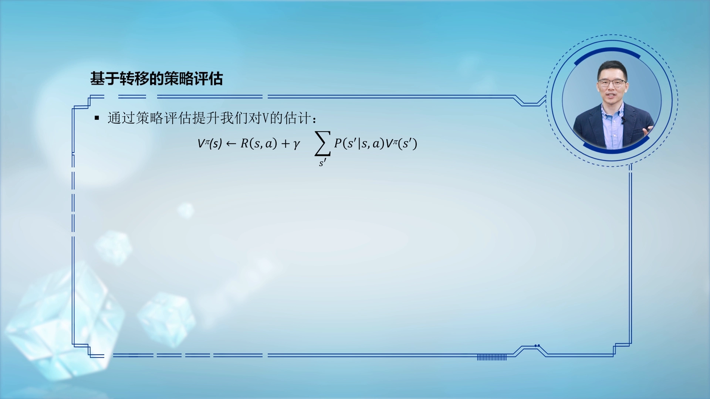
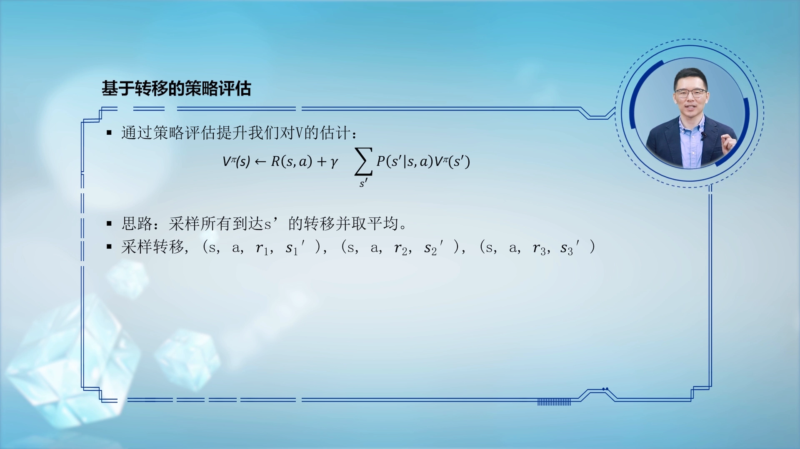
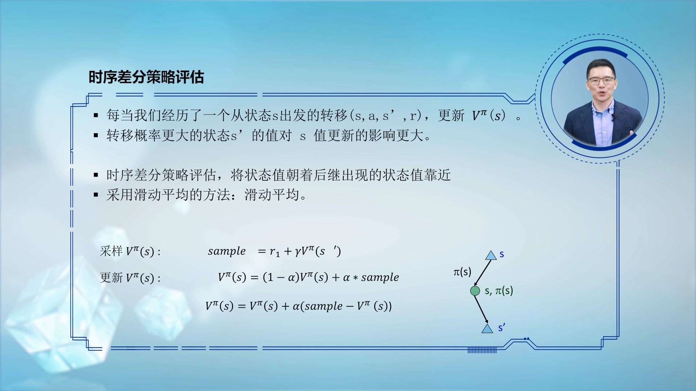
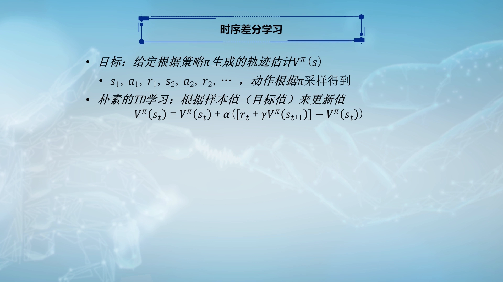
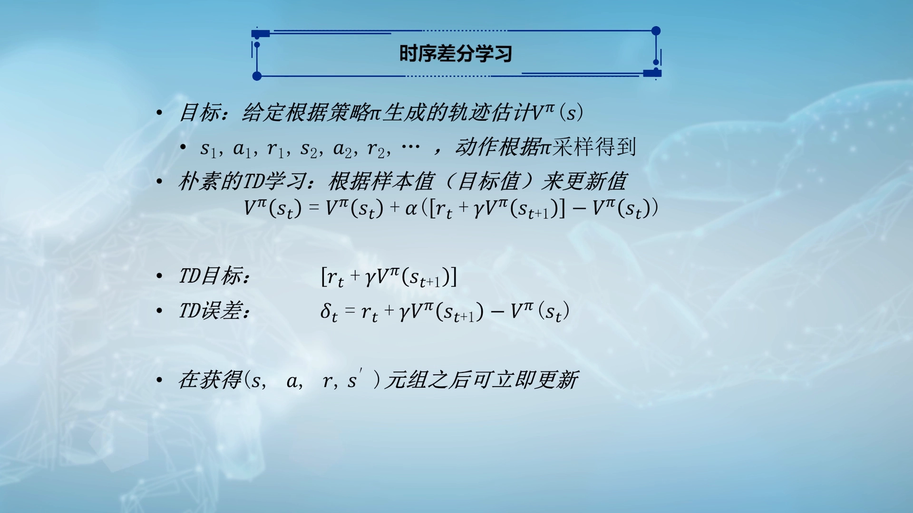
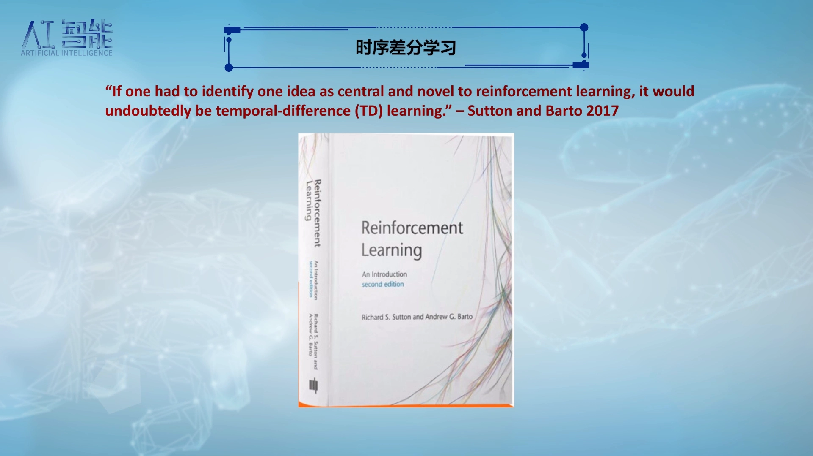
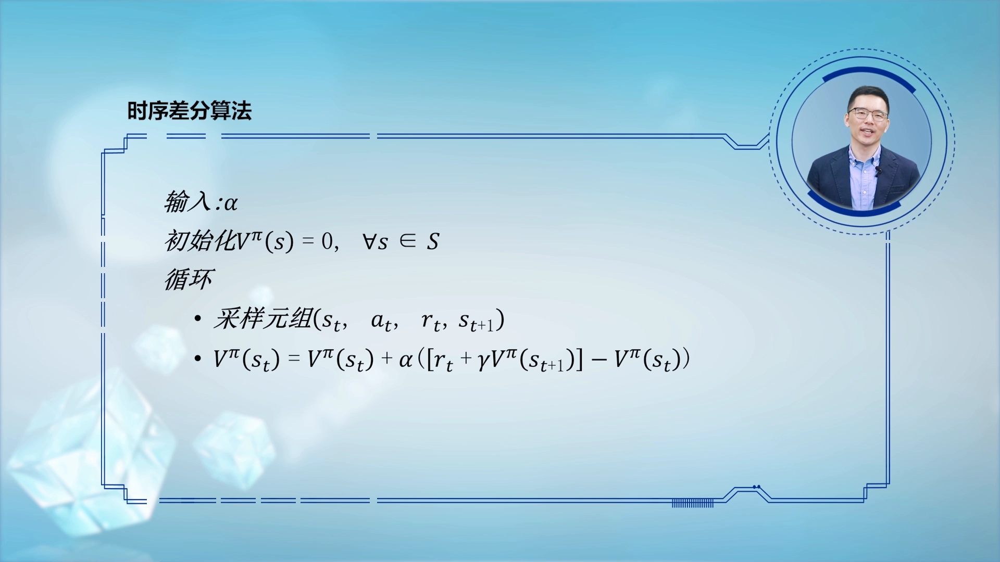
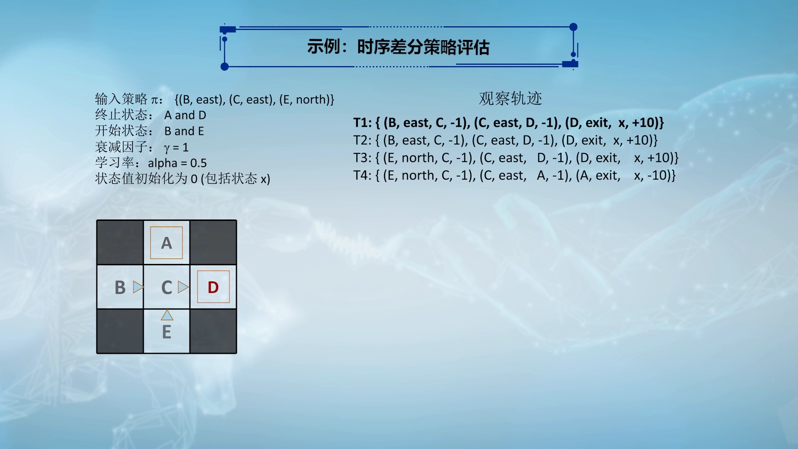
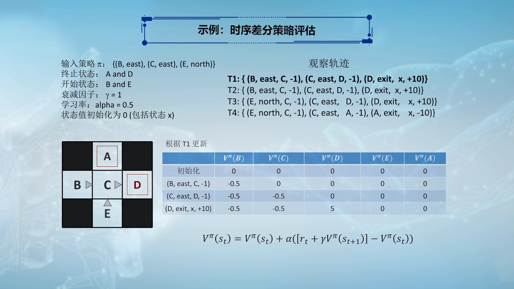

# 时序差分策略评估：从样本均值到 TD 更新

> 本篇整理自复旦大学魏忠钰老师《强化学习》课程第十一讲「模型无关的策略评估——时序差分算法」。视频地址：[BV1eU4y1Q7G8](https://www.bilibili.com/video/BV1eU4y1Q7G8/)。

## 本讲要解决的核心问题（SCQA）

**背景**：上一讲用**蒙特卡洛（Monte Carlo, MC）**做模型无关的策略评估——不看环境模型，只采样轨迹，用「从某状态出发实际拿到的累计回报」的平均值去估计该状态的效用值（价值）`V^π(s)`。这个做法完全贴合效用值的定义，非常好懂。

**冲突**：MC 有个天生的短板——它把每个状态的效用值**互相独立地**学习，完全忽略了「状态与状态之间怎么转移」这件 MDP 最核心的信息。于是样本里的一点波动，就能让两个本该估值相近的状态算出天差地别的结果。

**疑问**：既然状态之间有转移关系，能不能让「已经学得比较准的状态」去帮忙修正「还没学准的状态」？

**回答（中心思想）**：能——**时序差分（Temporal Difference, TD）**。它沿用贝尔曼迭代公式的结构，把「转移概率加权求和」换成「用真实采样到的转移四元组 `(s, a, s′, r)` 做样本」，于是每采到一次转移，就能对起始状态做一次更新：

```
V(s_t) ← V(s_t) + α · [ r_t + γ·V(s_{t+1}) − V(s_t) ]
```

其中 `r_t + γ·V(s_{t+1})` 叫 **TD 目标（TD target）**，中括号整体叫 **TD 误差（TD error）**。一句话：**让当前状态的估值，去逼近「即时奖励 + 折扣后的下一状态估值」**。

---

## 一、蒙特卡洛的短板：每个状态都在「单打独斗」

### 1.1 先回顾 MC 好在哪

MC 的设计完全遵循效用值的定义：一个状态好不好，就看「从它出发能收集到的期望累计回报」是多少。于是它收集一堆样本，每个样本就是这个状态出发实际拿到的累计回报，再对样本求平均。**算法与定义一一对应**，所以非常好理解。

[【跳转到 00:22】](https://www.bilibili.com/video/BV1eU4y1Q7G8/?t=22)

### 1.2 再看它漏掉了什么

讲 MDP 时强调过：MDP 模型里含有**状态与状态之间互相转移**的信息。而 MC 在估计效用值时，**完全忽略状态之间的联系**——每个状态的效用值都是各自独立学出来的。

这就引出一个问题：能不能利用状态之间的关联，让估计更稳、更准？看个例子就明白了。

[【跳转到 01:12】](https://www.bilibili.com/video/BV1eU4y1Q7G8/?t=72)

### 1.3 五状态走格子：四条轨迹

还是那个五状态走格子问题：状态 A、B、C、D、E，其中 **B、E 是起始状态**，**A、D 是终止状态**。假设已经收集到四条轨迹样本：

```
T1: B → C → D
T2: B → C → D
T3: E → C → D
T4: E → C → A
```

其中走到 D 是终止在正奖励，走到 A 是终止在 −10 的负奖励。

[【跳转到 02:02】](https://www.bilibili.com/video/BV1eU4y1Q7G8/?t=122)

### 1.4 MC 算出来的结果，暴露了两个问题

用 MC 对这四条轨迹求平均：

- **C 的效用值 = +4**：四条轨迹里有三条从 C 走到了 D、拿到正奖励，有一条从 C 走到了 A、拿到 −10，这条「坏样本」把 C 的估值拉低了，最终是 +4。
- **B 的效用值 = 8**：两条从 B 出发的轨迹都终止于 D，运气好。
- **E 的效用值 = −2**：两条从 E 出发的轨迹里，有一条终止于 A、拿到负奖励，于是被拉成负数。

问题来了：**B 和 E 都是起始状态，四条轨迹里它们的下一个状态都是 C**。既然下一步都走到同一个 C，B 和 E 的效用值理应很接近、甚至相同；可 MC 给出的却是 +8 与 −2 这样差距巨大的结果。

这就是 MC 的问题所在：**样本中的一个波动，会对效用值估计产生非常大的影响，估计的稳定性被破坏**。讲义上把这一点写成两条缺点：**状态值的学习互相独立**、**没有充分利用状态之间的联系**。


[【跳转到 02:27】](https://www.bilibili.com/video/BV1eU4y1Q7G8/?t=147) · [【跳转到 03:17】](https://www.bilibili.com/video/BV1eU4y1Q7G8/?t=197) · [【跳转到 04:07】](https://www.bilibili.com/video/BV1eU4y1Q7G8/?t=247)

### 1.5 换个角度：更新次数多的状态更可信

再看这四条轨迹：**C 被更新了 4 次**（每条轨迹都经过 C），而 **B 和 E 各只被更新了 2 次**。

一般规律是：一个状态被更新的次数越多，它的估值离目标值就越近。也就是说，用这四条轨迹更新完之后，**C 的估计比 B、E 更可靠**。

既然 B、E 的下一步都通向 C，那能不能**用一个更新次数更多的状态（C），去辅助更新更新次数更少的状态（B、E）**？这个想法很自然，也很聪明——它就是通向 TD 的第一步。


[【跳转到 04:32】](https://www.bilibili.com/video/BV1eU4y1Q7G8/?t=272) · [【跳转到 05:22】](https://www.bilibili.com/video/BV1eU4y1Q7G8/?t=322)

---

## 二、回到贝尔曼公式：用样本替代「转移概率」

### 2.1 贝尔曼迭代公式长什么样

要利用状态之间的连接关系，就得回到之前讲过的**贝尔曼迭代公式**：给定策略下，状态 s 的效用值等于「即时奖励」加上「下一状态效用值的加权平均」：

```
V^π(s) = Σ_a π(a|s) · [ r(s,a) + γ · Σ_{s′} p(s′|s,a) · V^π(s′) ]
```

逐项读：

- 先按策略 `π(a|s)` 对所有动作加权平均；
- 每个动作带来即时奖励 `r(s,a)`；
- 再乘以折扣因子 γ，加上「转移到下一个状态 s′ 后、从 s′ 返回的效用值」，并按**转移概率** `p(s′|s,a)` 加权平均。

讲义上写的是对某个具体动作 a 的形式（也就是上式方括号里的那一项）：`V^π(s) ← R(s,a) + γ·Σ_{s′} P(s′|s,a)·V^π(s′)`。



[【跳转到 05:47】](https://www.bilibili.com/video/BV1eU4y1Q7G8/?t=347) · [【跳转到 06:12】](https://www.bilibili.com/video/BV1eU4y1Q7G8/?t=372)

### 2.2 卡在哪：没有模型，就没有转移概率

问题在于现在是**无模型（model-free）**的情形：我们不知道转移概率 `p(s′|s,a)`，这个迭代公式**没法直接用**。

那怎么办？既然无模型算法是基于样本的，那就**用样本来代替转移概率**——用样本去利用状态之间的转移关系。

[【跳转到 06:37】](https://www.bilibili.com/video/BV1eU4y1Q7G8/?t=397)

### 2.3 每个样本是一次「转移四元组」

此时样本不再是整条轨迹，而是**一次转移**，写成一个四元组：

```
(s, a, r, s′)
```

含义：当前状态 s 采取动作 a，拿到即时奖励 r，转移到下一个状态 s′。

每拿到一个这样的四元组，就可以为**出发状态 s** 算出一个效用值的样本值：

```
样本值 = r + γ · V^π(s′)
```

即「这次转移拿到的即时奖励」+「折扣后的目标状态效用值」。比如第一批样本 `(s, r₁, s′₁)`、`(s, r₂, s′₂)`、`(s, r₃, s′₃)` 分别给出：

```
r₁ + γ·V^π(s′₁)
r₂ + γ·V^π(s′₂)
r₃ + γ·V^π(s′₃)
```

有了这几个样本值，就可以**用样本平均**来估计 s 的效用值：把样本值加起来除以样本个数。



[【跳转到 07:27】](https://www.bilibili.com/video/BV1eU4y1Q7G8/?t=447) · [【跳转到 07:52】](https://www.bilibili.com/video/BV1eU4y1Q7G8/?t=472) · [【跳转到 08:17】](https://www.bilibili.com/video/BV1eU4y1Q7G8/?t=497)

### 2.4 为什么「样本平均」能顶替「概率加权平均」

仔细看会发现：**样本值的计算方式与贝尔曼公式的右边几乎一样**，唯一的差别是我们没有那个概率转移模型。

那凭什么用样本平均就能代替概率加权？关键在于**样本出现的频率本身就编码了概率**：

- 如果 s 以更大概率转移到 s′，那么 `s → s′` 这样的样本就会**更频繁地**出现在样本库里；
- 样本越多，背后体现的就是「s 经 a 转移到 s′」的概率越大；
- 样本收集得足够多，样本的频率就能逼近转移概率。

所以「`V^π(s)` 等于样本均值」这句话才真正有意义：它自动把转移概率的权重学进来了。

[【跳转到 09:07】](https://www.bilibili.com/video/BV1eU4y1Q7G8/?t=547) · [【跳转到 09:32】](https://www.bilibili.com/video/BV1eU4y1Q7G8/?t=572)

### 2.5 于是有了名字：时序差分

基于「以转移四元组为样本、计算状态 s 的效用值」这一做法，就叫**时序差分（temporal difference）**方法。

它的工作方式是：不断收集 `(s, a, s′, r)` 四元组；每收集到一个，就对其中起始状态 s 做一次状态值更新。若某个转移出现得更频繁，目标状态 s′ 的效用值就会对 s 的估计产生更大影响——**这正好对应贝尔曼公式里转移概率所起的权重作用**。

换句话说，TD 做策略评估的本质是：**让当前状态的效用值，向它转移之后的目标状态的效用值逼近**；而逼近过程中，转移概率的权重通过「样本出现的次数」自动体现出来。

[【跳转到 09:57】](https://www.bilibili.com/video/BV1eU4y1Q7G8/?t=597) · [【跳转到 10:47】](https://www.bilibili.com/video/BV1eU4y1Q7G8/?t=647) · [【跳转到 11:12】](https://www.bilibili.com/video/BV1eU4y1Q7G8/?t=672)

---

## 三、把「求平均」改写成「增量更新」

### 3.1 步长 α：新样本与历史估计的平衡

基于每一次转移，都能为起始状态算一个样本值 `r + γ·V^π(s′)`。对整个状态 s 的更新可以写成：

```
V^π(s) ← (1 − α)·V^π(s) + α·(样本值)
```

`α` 表示**当前样本在这次更新中所起的作用大小**：

- `α` 越大 → 当前样本权重越高、历史数据权重越低（学得快，但更抖）；
- `α` 越小 → 更依赖历史估计（学得稳，但更慢）。



### 3.2 变形为滑动平均

把上式整理一下，就得到一个更常见、更好读的形式：

```
V^π(s) ← V^π(s) + α · ( 样本值 − V^π(s) )
```

读法：**先看新样本比旧估计高多少（或低多少），再按 α 的比例补上去**。这就是「滑动平均 / 增量更新」，与上一讲增量式蒙特卡洛的形式完全一致，区别只在于「样本值」的算法不同——MC 用的是整条轨迹的累计回报，TD 用的是一步的 `r + γ·V^π(s′)`。

[【跳转到 12:02】](https://www.bilibili.com/video/BV1eU4y1Q7G8/?t=722) · [【跳转到 12:27】](https://www.bilibili.com/video/BV1eU4y1Q7G8/?t=747)

### 3.3 最简单的 TD 更新式

形式化地说：目标是估计给定策略 π 下状态 s 的效用值，手头有一条长长的轨迹，整个更新是**基于四元组逐个完成**的。最简单的时序差分学习方法就是：

```
V(s_t) ← V(s_t) + α · [ r_t + γ·V(s_{t+1}) − V(s_t) ]
```

其中样本值 `r_t + γ·V(s_{t+1})` 就是「这次转移给出的样本值」：即时奖励 `r_t` 加上「下一时间片状态效用值 `V(s_{t+1})` 经 γ 衰减后」的量。



[【跳转到 12:47】](https://www.bilibili.com/video/BV1eU4y1Q7G8/?t=767) · [【跳转到 13:17】](https://www.bilibili.com/video/BV1eU4y1Q7G8/?t=797)

### 3.4 名字一：TD 目标（TD target）

```
TD target = r_t + γ·V(s_{t+1})
```

它是更新公式希望效用值去逼近的目标，本质上就是「当前这次转移带来的样本值」。换句话说，TD 目标就是「用下一步的真实反馈 + 下一步的当前估值」拼出来的一个参照点。

[【跳转到 13:42】](https://www.bilibili.com/video/BV1eU4y1Q7G8/?t=822)

### 3.5 名字二：TD 误差（TD error）

```
δ_t = r_t + γ·V(s_{t+1}) − V(s_t)
```

即「样本值 − 历史估计」。更新过程希望历史估计与当前目标越接近越好，这个差就是在度量「还差多少」。

于是整个 TD 更新可以读成一句话：**`V(s_t) ← V(s_t) + α·δ_t`**——每经历一个四元组，就对起始状态 s 更新一次。



[【跳转到 14:07】](https://www.bilibili.com/video/BV1eU4y1Q7G8/?t=847)

### 3.6 一句权威的背书

强化学习最经典的教材是 Sutton & Barto 的《Reinforcement Learning》。书中明确指出：**如果强化学习里有一个必须记住的概念，那就是时序差分**。这个概念虽然形式非常简单，但对强化学习而言极其核心。



[【跳转到 14:32】](https://www.bilibili.com/video/BV1eU4y1Q7G8/?t=872)

---

## 四、伪代码：五行就能写完

TD 策略评估的伪代码非常短：

```
输入：给定策略 π，步长 α ∈ (0, 1]
初始化：对所有状态 s，V(s) ← 0

循环（对每个时间片 t = 0, 1, 2, …）：
    1. 采样一次转移：
       a_t ← 由策略 π 在 s_t 处给出
       执行 a_t，环境返回即时奖励 r_t 与下一个状态 s_{t+1}
    2. 用 TD 更新公式更新 s_t 的效用值：
       V(s_t) ← V(s_t) + α · [ r_t + γ·V(s_{t+1}) − V(s_t) ]
```

逐条对照：

- **超参数 `α`**：既可以叫学习率，也可以看作「当前样本的权重」；
- **目标**：给所有状态都学出给定策略下的效用值，所以先把每个状态的效用值初始化为 0；
- **循环体第一步**：从当前时间片的状态 `s_t` 出发，采取由策略给定、与 `s_t` 对应的动作 `a_t`；环境告诉我们这一时间片获得的即时奖励 `r_t`，以及经过这个动作之后下一时间片的目标状态 `s_{t+1}`；
- **循环体第二步**：拿到四元组之后，就用 TD 更新公式更新 `s_t` 的状态效用值——历史估计加上 `α` 乘以时序误差。

注意：**一次转移只更新一个状态**（起始状态 `s_t`），这与 MC「一条轨迹要等结束、再回填所有状态」形成鲜明对比。



[【跳转到 14:57】](https://www.bilibili.com/video/BV1eU4y1Q7G8/?t=897) · [【跳转到 15:11】](https://www.bilibili.com/video/BV1eU4y1Q7G8/?t=911) · [【跳转到 15:36】](https://www.bilibili.com/video/BV1eU4y1Q7G8/?t=936) · [【跳转到 16:01】](https://www.bilibili.com/video/BV1eU4y1Q7G8/?t=961)

---

## 五、手算一遍：五状态走格子上的 TD 更新

### 5.1 场景

回到五状态走格子：A、B、C、D、E 五个状态，**B、E 是起始状态**，**A、D 是终止状态**。因为有一个初始化的策略，每个状态都对应着一个动作；四条轨迹记为 T1 ~ T4。

TD 算法开始时，**把每个状态的效用值都初始化为 0**。规则是：**每经历一次转移，就对该次转移的起始状态更新一次**。



[【跳转到 16:40】](https://www.bilibili.com/video/BV1eU4y1Q7G8/?t=1000) · [【跳转到 16:54】](https://www.bilibili.com/video/BV1eU4y1Q7G8/?t=1014)

### 5.2 T1 的三次转移

**第一次转移**：状态 B 采取「向东」的动作，获得 −1 的奖励，到达状态 C。

```
V(B) ← V(B) + α·[ r + γ·V(C) − V(B) ]
     = 0    + 0.5·[ (−1) + 1·0 − 0 ]
     = −0.5
```

**第二次转移**：C 采取「向东」的动作，获得 −1 的奖励，到达状态 D。

```
V(C) ← 0 + 0.5·[ (−1) + 1·0 − 0 ] = −0.5
```

**第三次转移**：D 采取「离开」动作，获得正的奖励（+10），回合结束。

```
V(D) ← 0 + 0.5·[ (+10) + 1·0 − 0 ] = 5
```

（讲义示例中取 `γ = 1`、学习率 `α = 0.5`，所有状态值初始化为 0，终止后的状态 x 也按 0 处理。）



[【跳转到 17:19】](https://www.bilibili.com/video/BV1eU4y1Q7G8/?t=1039) · [【跳转到 17:44】](https://www.bilibili.com/video/BV1eU4y1Q7G8/?t=1064) · [【跳转到 18:09】](https://www.bilibili.com/video/BV1eU4y1Q7G8/?t=1089) · [【跳转到 18:34】](https://www.bilibili.com/video/BV1eU4y1Q7G8/?t=1114)

### 5.3 和 MC 的对比：差别在哪

同一批数据，两种算法的「更新时机」完全不同：

| 对比项 | 蒙特卡洛（MC） | 时序差分（TD） |
| :-- | :-- | :-- |
| 一个样本是什么 | 一条**完整轨迹**的累计回报 | 一次**转移** `(s, a, r, s′)` |
| 什么时候能更新 | 必须等回合**结束** | 走完**一步**就能更新 |
| 一次更新影响几个状态 | 轨迹上**所有**状态 | 只有起始状态 `s_t` |
| 用到的估值 | 只用真实回报，不自举 | 用下一状态的**当前估值** `V(s_{t+1})` |
| 是否利用状态间关系 | 否，各状态独立 | 是，靠 `V(s_{t+1})` 传递信息 |

这张表也解释了 1.4 节那个怪现象：MC 里 B 和 E 的下一个状态都是 C，但 MC 根本不看 C 的估值，只数自己那两条轨迹的运气，所以会算出 +8 与 −2；TD 则通过 `V(C)` 把 C 的信息传给 B 和 E——**这正是「用一个更新次数更多的状态去辅助更新其他状态」的落地方式**。

---

## 小结

- **MC 的短板**：完全忽略状态之间的转移关系，每个状态独立学习；样本里的一次波动就能让估值大幅跳动（五状态例子里 B 与 E 的下一个状态都是 C，估值却是 +8 与 −2）。
- **改进思路**：更新次数越多的状态越可靠，用它去辅助更新其它状态——这就是 TD 的出发点。
- **TD 的构造**：保留贝尔曼迭代公式的结构，把「转移概率加权求和」换成「用转移四元组 `(s, a, r, s′)` 做样本」；样本出现的频率自动编码了转移概率。
- **更新式**：`V(s_t) ← V(s_t) + α·[ r_t + γ·V(s_{t+1}) − V(s_t) ]`。
- **两个名字**：`r_t + γ·V(s_{t+1})` 是 **TD 目标**（要逼近的样本值）；`δ_t = r_t + γ·V(s_{t+1}) − V(s_t)` 是 **TD 误差**。
- **α 的含义**：当前样本在更新中的权重；α 大更信新样本，α 小更信历史估计。
- **最大优点**：走一步就能更新一次，不必等回合结束；并且通过 `V(s_{t+1})` 把状态之间的关联用了起来。
- **地位**：Sutton & Barto 认为，强化学习里若有必须记住的概念，那就是时序差分。

## 关键术语速查

| 术语 | 一句话解释 |
| :-- | :-- |
| 策略评估（Policy Evaluation） | 给定策略 π，估计每个状态的效用值（价值）`V^π(s)`。 |
| 模型无关（Model-Free） | 不知道转移概率与奖励函数，只能靠与环境交互采样学习。 |
| 蒙特卡洛（MC） | 用完整轨迹的累计回报取平均来估计 `V^π(s)`，必须等回合结束。 |
| 贝尔曼迭代公式 | `V^π(s) = Σ_a π(a∣s)[ r(s,a) + γ·Σ_{s′} p(s′∣s,a)·V^π(s′) ]`，需要转移概率。 |
| 转移四元组 | `(s, a, r, s′)`：一次转移的起始状态、动作、即时奖励、目标状态。 |
| 时序差分（TD） | 用「一步转移」的样本值 `r + γ·V(s′)` 做增量更新，走一步就能学一次。 |
| TD 目标（TD Target） | `r_t + γ·V(s_{t+1})`，更新时希望估值逼近的目标值。 |
| TD 误差（TD Error） `δ_t` | `r_t + γ·V(s_{t+1}) − V(s_t)`，样本值与历史估计之差。 |
| 步长 α（学习率） | 当前样本在更新中所占的权重；α 越大越信新样本。 |
| 滑动平均 / 增量更新 | `V ← V + α(样本值 − V)`，不必保存全部历史样本。 |