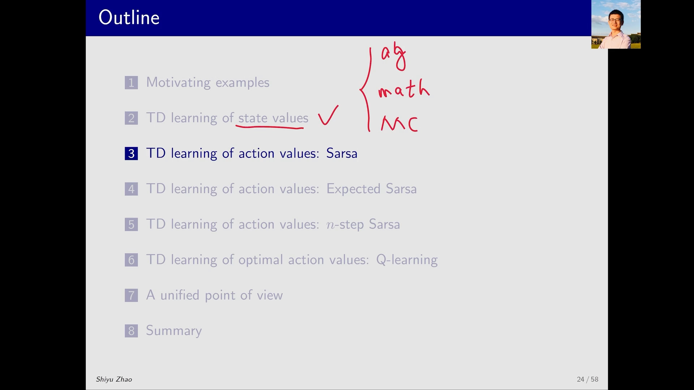
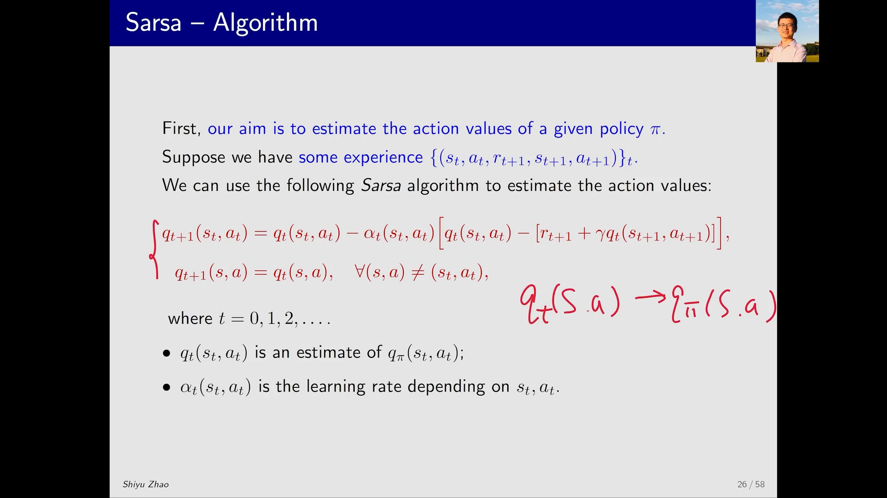
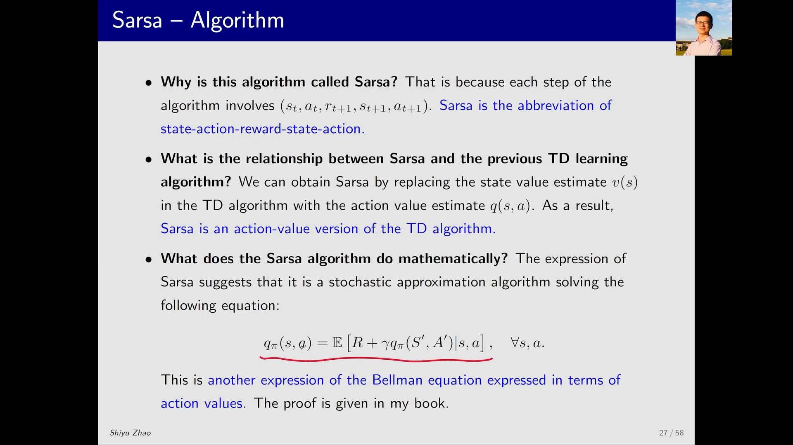
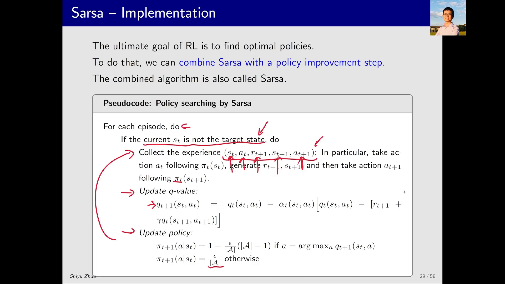
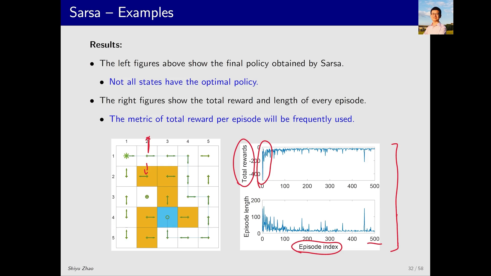

# SARSA 算法：同轨策略的 TD 控制

> 本篇整理自赵世钰《强化学习的数学原理》第 7 课「时序差分方法（Part 4：Sarsa）」。视频地址：[BV16P4y1m7fK](https://www.bilibili.com/video/BV16P4y1m7fK/)。

## 本讲要解决的核心问题（SCQA）

**背景**：上一节（5.2）的 TD(0) 算法能估计一个给定策略的**状态价值** $v_\pi(s)$，但它只会做策略评估。而强化学习的最终目的是找最优策略，找最优策略就必须比较「在某个状态下做哪个动作更好」——这需要的是**动作价值** $q_\pi(s,a)$。

**冲突**：TD(0) 从头到尾只维护 $v(s)$，根本没有为每个动作单独维护一个值，所以它没有「哪个动作更好」的可比对象，无法直接接上策略改进。

**疑问**：能不能把 TD 的更新式原封不动地搬到**动作价值**上，让它可以估计 $q_\pi(s,a)$，再和策略改进拼起来，得到一个真正能搜索最优策略的算法？

**回答（中心思想）**：能——这就是 **SARSA**。它的做法极其朴素：把 TD 更新式里的 $v(s_t)$ 换成 $q(s_t,a_t)$、把 $v(s_{t+1})$ 换成 $q(s_{t+1},a_{t+1})$，其余一字不改。于是它每走一步就用五元组 $(s_t,a_t,r_{t+1},s_{t+1},a_{t+1})$ 更新一次动作价值（这正是 SARSA 这个名字的来历）；把这个**策略评估**步骤与一个 **$\epsilon$-greedy 的策略改进**步骤交替执行，就得到一个**同轨策略（on-policy）**的控制算法。所谓「同轨」，是因为它评估的策略、改进的策略、以及实际采样数据的策略，始终是同一个。



---

## 一、为什么要从 $v(s)$ 走到 $q(s,a)$

### 1.1 策略改进需要「比较动作」

策略改进（policy improvement）的动作是：在状态 $s$ 下，看哪个动作的价值最大，就把概率挪给那个动作。要这么做，前提是**每个动作都有一个可比较的数值**。

TD(0) 给的 $v_\pi(s)$ 是「状态有多好」，它把「动作选择」平均掉了，所以拿它没法比较动作。SARSA 要补上的就是这一层：直接估计 $q_\pi(s,a)$——在状态 $s$ 采取动作 $a$、此后一直按 $\pi$ 行动所能获得的折扣回报的期望。

### 1.2 输入的数据：五元组而不是三元组

TD(0) 的经验是三元组 $(s_t, r_{t+1}, s_{t+1})$；SARSA 需要多一个动作，于是经验变成

$$
\big\{\, (s_t,\, a_t,\, r_{t+1},\, s_{t+1},\, a_{t+1}) \,\big\}_{t=0,1,2,\dots}
$$

多出来的 $a_{t+1}$ 是**在下一状态 $s_{t+1}$ 上、按同一个策略 $\pi$ 采样出来的动作**。这一点很关键：SARSA 不只要知道「走到了哪」，还要知道「下一步打算做什么」——TD 目标里要用的正是这个 $a_{t+1}$。

[【跳转到 02:35】](https://www.bilibili.com/video/BV16P4y1m7fK/?t=155)

### 1.3 算法本体：两行式子

$$
\begin{aligned}
q_{t+1}(s_t,a_t) &= q_t(s_t,a_t) - \alpha_t(s_t,a_t)\Big[\, q_t(s_t,a_t) - \big( r_{t+1} + \gamma\, q_t(s_{t+1},a_{t+1}) \big) \Big] \\
q_{t+1}(s,a) &= q_t(s,a), \qquad \forall (s,a) \neq (s_t,a_t)
\end{aligned}
$$

和 5.2 的 TD(0) 逐项对照，差别只有一处：

| TD(0)（5.2） | SARSA（本节） |
| :-- | :-- |
| 被更新的对象是状态 $s_t$ | 被更新的对象是状态-动作对 $(s_t,a_t)$ |
| 目标 $r_{t+1} + \gamma v_t(s_{t+1})$ | 目标 $r_{t+1} + \gamma q_t(s_{t+1},a_{t+1})$ |
| 数据三元组 $(s_t,r_{t+1},s_{t+1})$ | 数据五元组 $(s_t,a_t,r_{t+1},s_{t+1},a_{t+1})$ |

第二行同样常被省略：当前时刻只更新**实际被访问到的那个 $(s_t,a_t)$**，其它所有 $(s,a)$ 的价值保持不变。



[【跳转到 03:25】](https://www.bilibili.com/video/BV16P4y1m7fK/?t=205)

---

## 二、名字、血缘与它真正在解的方程

### 2.1 为什么叫 SARSA

因为算法每一步都要用到 $(s_t, a_t, r_{t+1}, s_{t+1}, a_{t+1})$ 这五个量，取它们的首字母就是 **S**tate-**A**ction-**R**eward-**S**tate-**A**ction，读作 SARSA。名字里没有任何数学含义，它只是「这一步用了哪几个数据」的缩写。

### 2.2 血缘：它就是 TD 算法的动作价值版

把 TD 算法里的状态价值估计 $v(s)$ 换成动作价值估计 $q(s,a)$，就得到 SARSA。所以最准确的说法是：**SARSA 是 TD 算法的 action-value 版本**。这也解释了为什么两者的收敛性定理、步长条件、乃至「只做策略评估」的能力边界都一模一样。

### 2.3 它在解什么数学问题：动作价值形式的贝尔曼方程

SARSA 是一个随机近似（stochastic approximation）算法，它迭代求解的方程是

$$
q_\pi(s,a) = \mathbb{E}\big[\, R + \gamma\, q_\pi(S',A') \mid s, a \,\big], \qquad \forall s, a
$$

这是**贝尔曼方程的另一种写法**：和之前用状态价值表达的贝尔曼方程相比，它刻画的是**不同动作价值之间的关系**，而不是状态价值之间的关系。等式右边那个期望里，$S'$ 由环境决定、$A'$ 由策略 $\pi$ 采样决定——两个随机性都被期望吃掉了。



[【跳转到 05:05】](https://www.bilibili.com/video/BV16P4y1m7fK/?t=305)

### 2.4 收敛性

**定理**：在步长满足

$$
\sum_t \alpha_t(s,a) = \infty, \qquad \sum_t \alpha_t^2(s,a) < \infty, \qquad \forall (s,a)
$$

的条件下，SARSA 产生的估计 $q_t(s,a)$ 以概率 1 收敛到 $q_\pi(s,a)$。

这和 TD(0) 的收敛性定理完全同构，条件也只针对学习率 $\alpha_t$。但请注意定理说的是什么：**给定策略 $\pi$，把它的动作价值估准**。到这一步为止，SARSA 仍然只是策略评估，还没有找到最优策略。


[【跳转到 06:20】](https://www.bilibili.com/video/BV16P4y1m7fK/?t=380)

---

## 三、加上策略改进：从「评估」变成「搜索」

### 3.1 结合之后的算法也叫 SARSA

强化学习的终极目标是找最优策略。做法是把上面那个 SARSA 更新（策略评估）与一个 policy improvement 步骤拼起来。**拼起来的算法同样被叫作 SARSA**——事实上大多数场合下，人们说「SARSA 算法」指的就是这个合体版本，而不是单独的评估式。

### 3.2 伪代码

```
对每一个 episode，做：
    如果当前状态 s_t 不是目标状态，做：
        采样经验 (s_t, a_t, r_{t+1}, s_{t+1}, a_{t+1})：
            按 π_t(s_t) 选动作 a_t，执行后得到 r_{t+1} 与 s_{t+1}，
            再按 π_t(s_{t+1}) 在下一状态采样出 a_{t+1}
        更新 q 值（策略评估）：
            q_{t+1}(s_t,a_t) = q_t(s_t,a_t) - α_t(s_t,a_t)[ q_t(s_t,a_t) - (r_{t+1} + γ q_t(s_{t+1},a_{t+1})) ]
        更新策略（策略改进）：
            π_{t+1}(a|s_t) = 1 - (ε/|A|)(|A|-1)，若 a = argmax_a q_{t+1}(s_t,a)
            π_{t+1}(a|s_t) = ε/|A|，其它情况
```

注意伪代码里那句「如果当前状态不是目标状态」：本讲关注的任务是**从一个特定状态出发、走到目标**，所以到达目标后可以强行停下，也可以不停，两者差别不大。



[【跳转到 07:08】](https://www.bilibili.com/video/BV16P4y1m7fK/?t=428)

### 3.3 策略更新为什么用 $\epsilon$-greedy

如果策略改进直接用贪心（greedy），那么没被访问过的 $(s,a)$ 就永远拿不到概率，也就永远得不到更新。所以这里用 $\epsilon$-greedy：给贪心动作一个**很大但小于 1** 的概率，同时给其它动作留一点小概率。写成式子就是

$$
\pi_{t+1}(a \mid s_t) =
\begin{cases}
1 - \dfrac{\epsilon}{|\mathcal{A}|}\big(|\mathcal{A}| - 1\big), & a = \arg\max_a q_{t+1}(s_t,a) \\[6pt]
\dfrac{\epsilon}{|\mathcal{A}|}, & \text{其它}
\end{cases}
$$

这样它能够尽可能访问到更多的 $(s,a)$，从而找到更优的策略。

[【跳转到 08:23】](https://www.bilibili.com/video/BV16P4y1m7fK/?t=503)

### 3.4 关键理解：评估一步就改进，这是 GPI

这个算法有两个步骤——**q 值更新（policy evaluation）** 和 **策略更新（policy improvement）**——但它们的节奏和经典策略迭代很不一样：

- 经典策略迭代里，策略评估要（近似）算准当前策略的价值，才切到策略改进；
- 这里**只更新一次 q 值就立刻改进策略**，根本没有得到准确的动作价值。

这并不违反什么原则，它正是**广义策略迭代（generalized policy iteration, GPI）** 的思想：评估与改进不必各自做到收敛，交替着各走一小步、互相牵引，最终也能收敛到最优。而「评估只做一步」之所以可行，靠的正是 TD 这种**增量式、单样本**的更新方式。

所以看这个算法时，最该抓住的是：**那个看起来最复杂的迭代式，它的职责就是策略评估——求动作价值**。剩下的一切（$\epsilon$-greedy、episode 循环）都是围绕「如何把评估与改进交替起来」的工程细节。

[【跳转到 09:13】](https://www.bilibili.com/video/BV16P4y1m7fK/?t=553) · [【跳转到 10:53】](https://www.bilibili.com/video/BV16P4y1m7fK/?t=653)

---

## 四、一个例子：从左上角走到目标

### 4.1 任务设定与以往不同

之前的网格世界任务，目标是**求出每一个状态的最优策略**。本讲的例子不一样：**只关心从一个特定状态（左上角）出发、到达目标的一条路径**。这类「从某个起点出发找一条可行路线」的任务在实际中非常常见。

这个区别带来一个重要后果：如果只想找一条可行路径，那么没被探索到的状态策略好不好**无所谓**；但如果想找到**所有状态**的最优策略，就必须探索到所有的状态-动作对。

### 4.2 结果

从左上角出发、沿着概率最大的方向走，确实能到达目标——目的达到了。但很多其它状态的策略并没有达到最优，因为整个训练只做了 500 个 episode 的探索。

右侧两条曲线是这门课第一次出现的「学习曲线」：

- **上图：每个 episode 的总奖励**。最开始很负（初始策略不好，会撞墙、会走进禁区），随着策略改善而上升；但它始终没有超过 0——因为 $\epsilon$-greedy 总保留一点随机性，时不时还是会踩到负奖励。
- **下图：每个 episode 的长度**。最开始要好几百步才能碰到目标，策略改进后几十步就能到达。

「每个 episode 的总奖励」这个指标后面会被反复使用，值得记住。



[【跳转到 12:33】](https://www.bilibili.com/video/BV16P4y1m7fK/?t=753) · [【跳转到 14:13】](https://www.bilibili.com/video/BV16P4y1m7fK/?t=853)

---

## 小结

- **动机**：TD(0) 只估计状态价值，无法比较动作，因此接不上策略改进。SARSA 把估计对象换成动作价值 $q_\pi(s,a)$。
- **更新式**：$q_{t+1}(s_t,a_t) = q_t(s_t,a_t) - \alpha_t\,[\,q_t(s_t,a_t) - (r_{t+1} + \gamma q_t(s_{t+1},a_{t+1}))\,]$；其余 $(s,a)$ 保持不变。它用的数据是五元组 $(s_t,a_t,r_{t+1},s_{t+1},a_{t+1})$。
- **名字**：State-Action-Reward-State-Action 的首字母缩写，说的是「这一步用了哪五个量」。
- **数学本质**：它是 TD 算法的 action-value 版本，求解动作价值形式的贝尔曼方程 $q_\pi(s,a) = \mathbb{E}[R + \gamma q_\pi(S',A') \mid s,a]$；在 Robbins-Monro 步长条件下 $q_t \to q_\pi$（以概率 1）。
- **控制**：与 $\epsilon$-greedy 的策略改进交替执行即得 SARSA 控制算法；评估只做一步就改进，属于 GPI 思想。
- **同轨（on-policy）**：评估的策略、改进的策略、采样的策略是同一个 $\pi$，所以 TD 目标里的 $a_{t+1}$ 必须真的按当前策略采样出来。
- **能力边界**：只想找一条从起点到目标的可行路径时，SARSA 足够；想找所有状态的最优策略，则必须探索到所有状态-动作对。

## 关键术语速查

| 术语 | 一句话解释 |
| :-- | :-- |
| 动作价值（Action Value） $q_\pi(s,a)$ | 在状态 $s$ 采取动作 $a$、此后按 $\pi$ 行动所能获得的折扣回报的期望。 |
| SARSA | 用五元组 $(s_t,a_t,r_{t+1},s_{t+1},a_{t+1})$ 更新的 TD 算法，是 TD 的动作价值版本。 |
| 同轨策略（On-Policy） | 评估/改进/采样用的是同一个策略；SARSA 属于此类。 |
| $\epsilon$-greedy 策略 | 以 $1-\epsilon$ 概率选贪心动作、以 $\epsilon$ 概率随机探索的策略，保证所有 $(s,a)$ 都有机会被访问。 |
| 广义策略迭代（GPI） | 评估与改进交替进行、各自不必做到收敛的思想；SARSA 的控制版本是它的实例。 |
| 随机近似（Stochastic Approximation） | 用带噪声的样本逐步逼近方程解的迭代方法，TD/SARSA 都是它的特例。 |
| 学习曲线 | 横轴为 episode 序号、纵轴为每回合总奖励（或回合长度）的曲线，用来观察策略是否在变好。 |