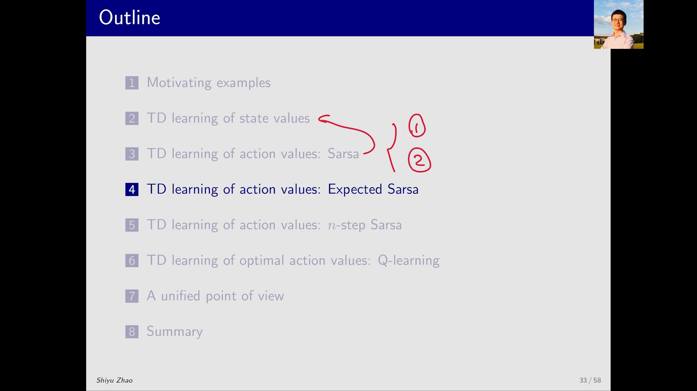
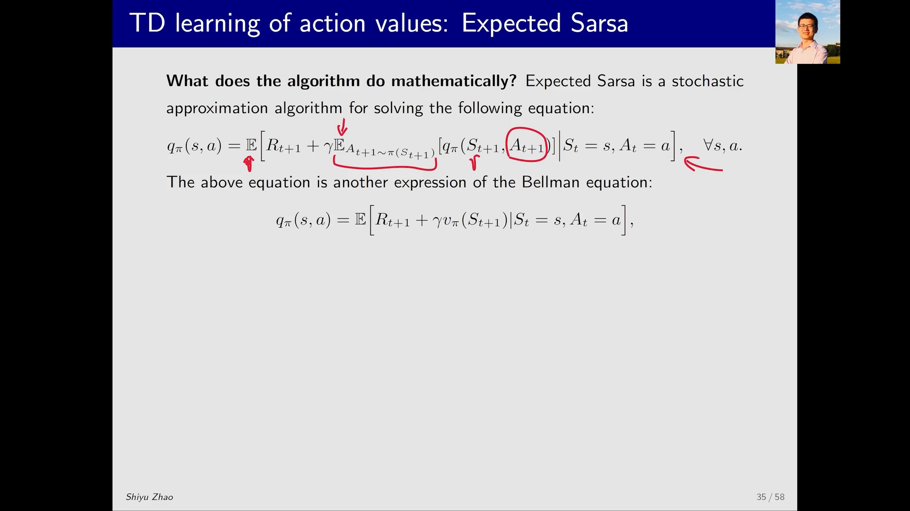
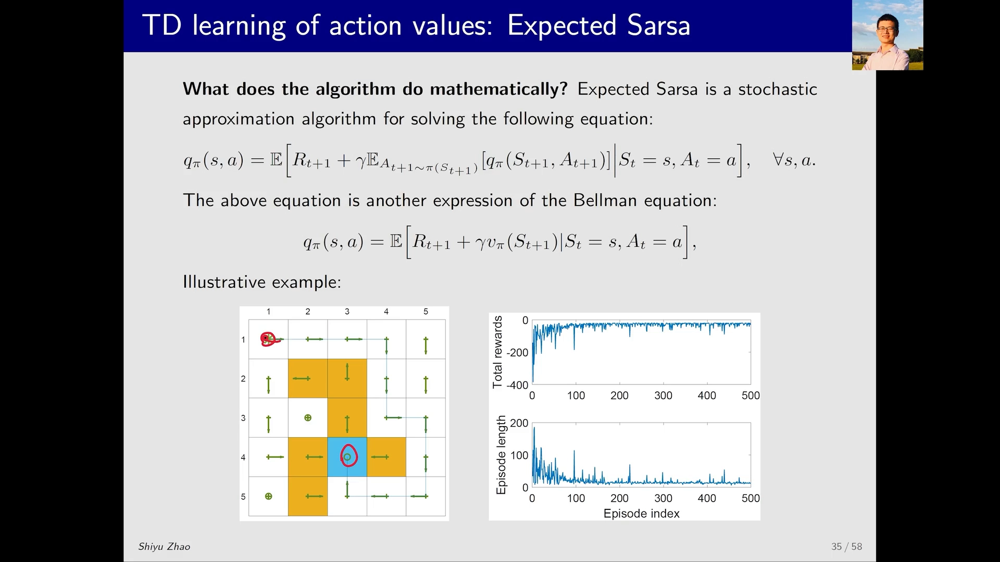
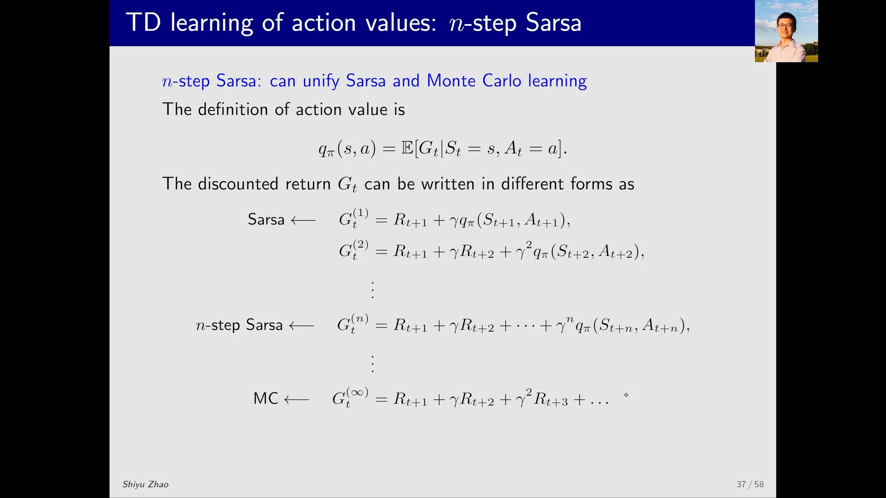

# 期望 SARSA：对下一动作求期望的 TD 目标

> 本篇整理自赵世钰《强化学习的数学原理》第 7 课「时序差分方法（Part 5：Expected Sarsa 和 n-step Sarsa）」。视频地址：[BV1BY411f7Pe](https://www.bilibili.com/video/BV1BY411f7Pe/)。其中 n-step SARSA 的完整推导属于 5.5 的内容，本篇只保留它作为「SARSA 推广」的那条线索。

## 本讲要解决的核心问题（SCQA）

**背景**：SARSA（见本篇同目录的《SARSA 算法：同轨策略的 TD 控制》）已经能估计动作价值并搜索最优策略，它的 TD 目标是 $r_{t+1} + \gamma\, q_t(s_{t+1}, a_{t+1})$。

**冲突**：这个目标里有一个**采样出来的** $a_{t+1}$。为了拿到它，SARSA 必须在下一状态真的按策略抽一次动作；而抽动作本身带随机性，于是 TD 目标跟着抖——同一个 $(s_t,a_t)$，两次更新用的目标可能差很多，估计的**方差**就大。

**疑问**：既然 $a_{t+1}$ 只是用来算「下一状态的价值」，那能不能不抽它，而是把**所有**动作按策略概率加权平均一遍？

**回答（中心思想）**：能——这就是 **Expected SARSA（期望 SARSA）**。它把 TD 目标里的 $q_t(s_{t+1}, a_{t+1})$ 换成对下一动作的**期望** $\mathbb{E}[q_t(s_{t+1},A)] = \sum_a \pi_t(a\mid s_{t+1}) q_t(s_{t+1},a)$，而这个量恰好就是下一状态的**状态价值** $v_t(s_{t+1})$。代价是每一步多算一个加权和（计算量变大），收益是去掉了动作采样这一步、随机变量从五个减到四个，**估计方差更小**。除此之外它和 SARSA 完全同构：同样求解一个贝尔曼方程，同样只做策略评估，同样需要与策略改进结合才能搜索最优策略。

---

## 一、算法：只改了 TD 目标

### 1.1 两行更新式

$$
\begin{aligned}
q_{t+1}(s_t,a_t) &= q_t(s_t,a_t) - \alpha_t(s_t,a_t)\Big[\, q_t(s_t,a_t) - \big( r_{t+1} + \gamma\, \mathbb{E}\big[q_t(s_{t+1}, A)\big] \big) \Big] \\
q_{t+1}(s,a) &= q_t(s,a), \qquad \forall (s,a) \neq (s_t,a_t)
\end{aligned}
$$

第二行与 SARSA 完全相同：只更新当前访问到的 $(s_t,a_t)$，其余保持不动。真正的差别全在第一行的 TD 目标里。

### 1.2 那个期望是什么

按期望的定义，把下一状态上所有可能动作按策略概率加权：

$$
\mathbb{E}\big[q_t(s_{t+1}, A)\big] = \sum_{a} \pi_t(a \mid s_{t+1})\, q_t(s_{t+1}, a) \;\doteq\; v_t(s_{t+1})
$$

最后这个等号是整件事的关键：**在状态 $s$ 下按策略 $\pi$ 对动作价值求期望，得到的就是该策略下的状态价值**。所以 Expected SARSA 的 TD 目标可以读成

$$
r_{t+1} + \gamma\, v_t(s_{t+1})
$$

——也就是 5.2 里 TD(0) 用的那个目标，只不过这里的 $v_t$ 是由 $q_t$ 现算出来的，而不是单独维护的一张表。

![Expected SARSA 的更新式，以及 $\mathbb{E}[q_t(s_{t+1},A)] = \sum_a \pi_t(a\mid s_{t+1})q_t(s_{t+1},a) \doteq v_t(s_{t+1})$ 的展开](assets/期望SARSA：对下一动作求期望的TD目标/00080.webp)

[【跳转到 00:55】](https://www.bilibili.com/video/BV1BY411f7Pe/?t=55)

### 1.3 与 SARSA 的区别

| 对比项 | SARSA | Expected SARSA |
| :-- | :-- | :-- |
| TD 目标 | $r_{t+1} + \gamma\, q_t(s_{t+1}, a_{t+1})$ | $r_{t+1} + \gamma\, \mathbb{E}[q_t(s_{t+1},A)]$ |
| 是否需要采样 $a_{t+1}$ | 需要，按 $\pi_t(s_{t+1})$ 抽一次 | **不需要**，改为对所有动作加权求和 |
| 每步计算量 | 小（只查一个 $q$ 值） | 大（要对 $\vert\mathcal{A}\vert$ 个动作求和） |
| 随机变量 | $\{s_t,a_t,r_{t+1},s_{t+1},a_{t+1}\}$ 五个 | $\{s_t,a_t,r_{t+1},s_{t+1}\}$ 四个 |
| 估计方差 | 较大 | 较小 |

用一句话概括这张表：**Expected SARSA 用更多的计算，换更小的方差**。它去掉了「下一步抽到哪个动作」这一层随机性，所以 TD 目标更稳；但也因为要在每个状态上遍历所有动作，单步开销更大。

![Compared to Sarsa：TD 目标从 $r_{t+1}+\gamma q_t(s_{t+1},a_{t+1})$ 变成 $r_{t+1}+\gamma\mathbb{E}[q_t(s_{t+1},A)]$，计算量更大但估计方差更小](assets/期望SARSA：对下一动作求期望的TD目标/00130.webp)

[【跳转到 02:10】](https://www.bilibili.com/video/BV1BY411f7Pe/?t=130)

---

## 二、它在解什么数学问题：还是同一个贝尔曼方程

Expected SARSA 同样是随机近似算法，它迭代求解的方程是

$$
q_\pi(s,a) = \mathbb{E}\Big[\, R_{t+1} + \gamma\, \mathbb{E}_{A_{t+1}\sim\pi(s_{t+1})}\big[q_\pi(S_{t+1}, A_{t+1})\big] \;\Big|\; S_t = s,\, A_t = a \,\Big], \qquad \forall s,a
$$

与 SARSA 所解的方程相比，这里**多了一层对 $A_{t+1}$ 的期望**（内层那个 $\mathbb{E}_{A_{t+1}\sim\pi(s_{t+1})}$），而 $S_{t+1}$ 的期望仍在外层。把内层期望认成状态价值，式子立刻变得非常干净：

$$
q_\pi(s,a) = \mathbb{E}\big[\, R_{t+1} + \gamma\, v_\pi(S_{t+1}) \;\big|\; S_t = s,\, A_t = a \,\big], \qquad \forall s,a
$$

读法是：**从 $(s,a)$ 出发的动作价值 = 即时奖励 + 折扣后的下一状态状态价值，再对随机性求期望**。这仍然是贝尔曼方程的另一种写法，所以 Expected SARSA 与 SARSA 在数学地位上完全平级：都是「给定策略、解它的贝尔曼方程」，都只做策略评估。

[【跳转到 02:35】](https://www.bilibili.com/video/BV1BY411f7Pe/?t=155)

---

## 三、同一个网格世界例子

把 Expected SARSA 放到与 SARSA 相同的网格世界任务上（从左上角出发、走到目标），得到的最终策略同样能到达目标：沿概率最大的方向走即可。其它状态的策略可能不是最优，但这不是本任务关心的——这里只要一条从起点到目标的路径。

右侧两条学习曲线的形态也与 SARSA 一致：**每回合总奖励**随学习逐渐变大，**每回合长度**从最初的上百步降到几十步。

[【跳转到 03:25】](https://www.bilibili.com/video/BV1BY411f7Pe/?t=205)

---

## 四、顺着这条线再走一步：n-step SARSA

讲完 Expected SARSA，视频接着给出了 SARSA 的另一个推广——**n-step SARSA**。它的完整推导属于 5.5（多步 TD 与资格迹），这里只保留它作为「SARSA 家族」的那条线索。

### 4.1 关键观察：同一个回报，可以有不同的分解

动作价值的定义是

$$
q_\pi(s,a) = \mathbb{E}\big[\, G_t \mid S_t = s,\, A_t = a \,\big]
$$

而折扣回报 $G_t$ 本身可以按「保留几步真实奖励、剩下的用一份 $q_\pi$ 兜底」来分解：

$$
\begin{aligned}
G_t^{(1)} &= R_{t+1} + \gamma\, q_\pi(S_{t+1}, A_{t+1}) &&\text{（SARSA）} \\
G_t^{(2)} &= R_{t+1} + \gamma R_{t+2} + \gamma^2 q_\pi(S_{t+2}, A_{t+2}) \\
&\;\;\vdots \\
G_t^{(n)} &= R_{t+1} + \gamma R_{t+2} + \cdots + \gamma^{n-1} R_{t+n} + \gamma^{n} q_\pi(S_{t+n}, A_{t+n}) &&\text{（n-step SARSA）} \\
&\;\;\vdots \\
G_t^{(\infty)} &= R_{t+1} + \gamma R_{t+2} + \gamma^2 R_{t+3} + \cdots &&\text{（蒙特卡洛）}
\end{aligned}
$$

这些 $G_t^{(k)}$ **全部等价**（期望都等于 $q_\pi(s,a)$），区别只在于「从哪里开始用 $q_\pi$ 兜底」。于是：$n=1$ 就是 SARSA 的 TD 目标，$n\to\infty$ 就退化成蒙特卡洛，中间就是 n-step SARSA。

[【跳转到 05:05】](https://www.bilibili.com/video/BV1BY411f7Pe/?t=305)

### 4.2 代价：要等，所以是「特殊的 online」

数据需求上，SARSA 在 $t$ 时刻就凑齐了五元组，可以立刻更新；蒙特卡洛要等整个 episode 结束；n-step SARSA 居中——它既不能只用这五个量，也不必等到回合结束，但要等到 $t+n$ 时刻才能更新 $(s_t,a_t)$。

所以它既不是严格 offline，也不是严格 online，而是一种**需要延迟 $n$ 步的特殊 online 方法**。这个「等」也直接决定了它的偏差-方差特性：

- $n$ 大 → 接近蒙特卡洛：**方差大、偏差小**；
- $n$ 小 → 接近 SARSA：**偏差大**（来自初始猜测，数据变多会消失）、**方差小**。

### 4.3 它依然只是策略评估

n-step SARSA 仍然只做策略评估：给定策略、估出它的动作价值。要搜索最优策略，同样得把它和 policy improvement 结合——方式和前面 SARSA 完全一样。

[【跳转到 10:05】](https://www.bilibili.com/video/BV1BY411f7Pe/?t=605) · [【跳转到 13:00】](https://www.bilibili.com/video/BV1BY411f7Pe/?t=780)

---

## 小结

- **一句话**：Expected SARSA = SARSA 把 TD 目标里的「采样一个 $a_{t+1}$」换成「对下一动作求期望」。
- **更新式**：$q_{t+1}(s_t,a_t) = q_t(s_t,a_t) - \alpha_t\,[\,q_t(s_t,a_t) - (r_{t+1} + \gamma\mathbb{E}[q_t(s_{t+1},A)])\,]$，其中 $\mathbb{E}[q_t(s_{t+1},A)] = \sum_a \pi_t(a\mid s_{t+1})q_t(s_{t+1},a) \doteq v_t(s_{t+1})$。
- **取舍**：每步计算量变大（要对所有动作求和），但随机变量从五个减到四个，**估计方差更小**。
- **数学本质**：仍是一个贝尔曼方程——$q_\pi(s,a) = \mathbb{E}[R_{t+1} + \gamma v_\pi(S_{t+1}) \mid S_t=s, A_t=a]$；仍只做策略评估，仍需与策略改进结合。
- **家族关系**：SARSA 用 $G_t^{(1)}$、n-step SARSA 用 $G_t^{(n)}$、蒙特卡洛用 $G_t^{(\infty)}$，三者是同一个回报的不同分解；$n$ 越大越接近蒙特卡洛（方差大、偏差小），$n$ 越小越接近 SARSA（偏差大、方差小）。

## 关键术语速查

| 术语 | 一句话解释 |
| :-- | :-- |
| Expected SARSA（期望 SARSA） | 把 TD 目标中的 $q_t(s_{t+1},a_{t+1})$ 换成 $\mathbb{E}[q_t(s_{t+1},A)]$ 的 SARSA 变体。 |
| 期望 TD 目标 | $r_{t+1} + \gamma\sum_a \pi_t(a\mid s_{t+1})q_t(s_{t+1},a)$，等价于 $r_{t+1} + \gamma v_t(s_{t+1})$。 |
| 估计方差 | 同一个量多次估计时的波动大小；去掉动作采样可以降低它。 |
| n-step SARSA | 用 $n$ 步真实奖励加一份 $q_\pi$ 兜底构造 TD 目标的 SARSA 推广，$n=1$ 退化为 SARSA、$n\to\infty$ 退化为蒙特卡洛。 |
| 偏差-方差权衡 | $n$ 大偏差小方差大，$n$ 小偏差大方差小。 |
| 策略评估（Policy Evaluation） | 给定策略，估计其动作价值；Expected SARSA 与 n-step SARSA 都只做到这一步。 |