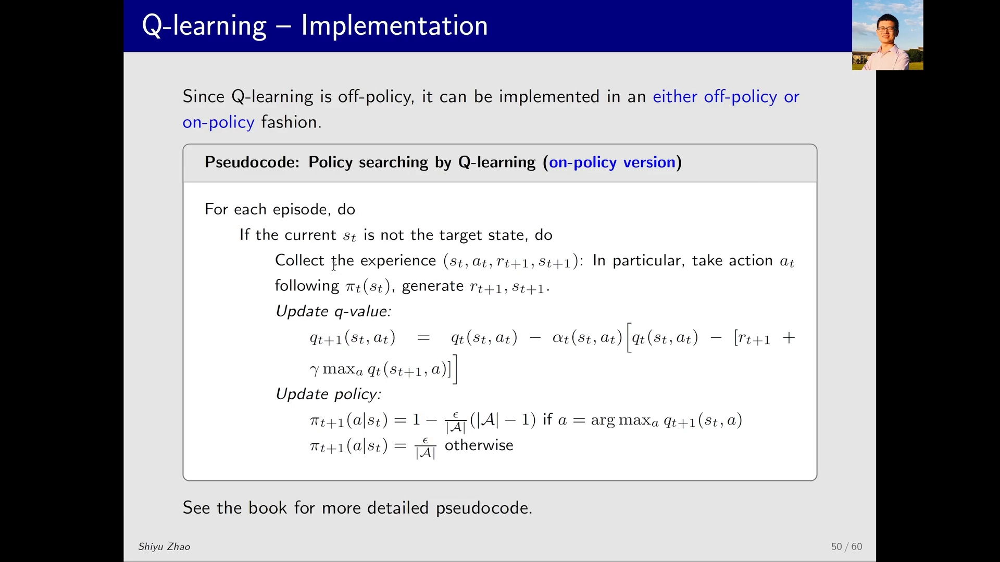
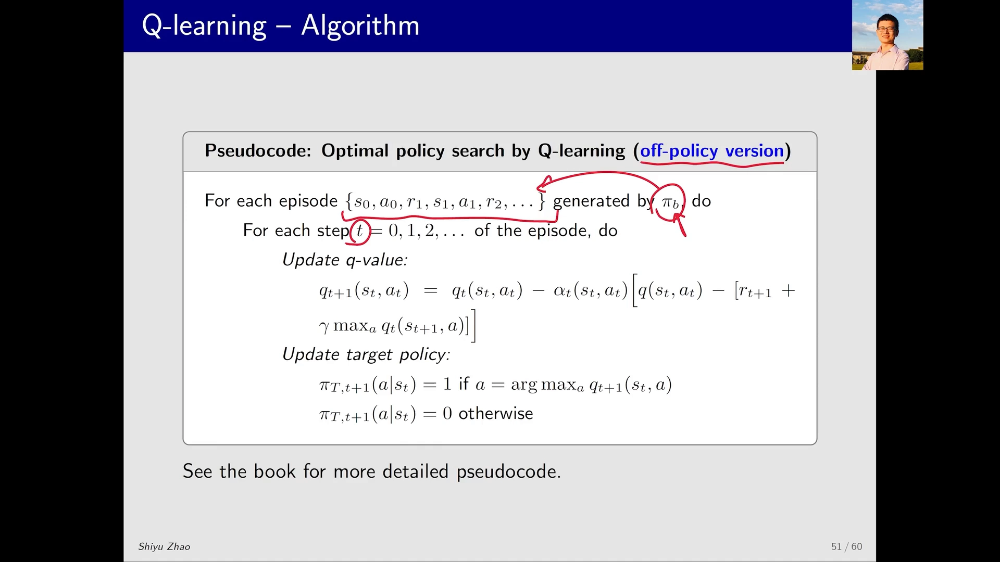
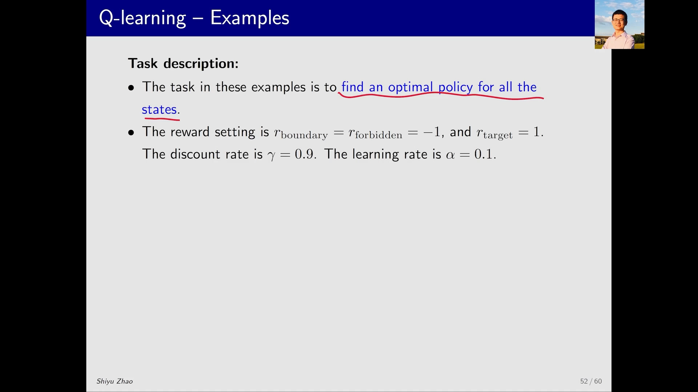
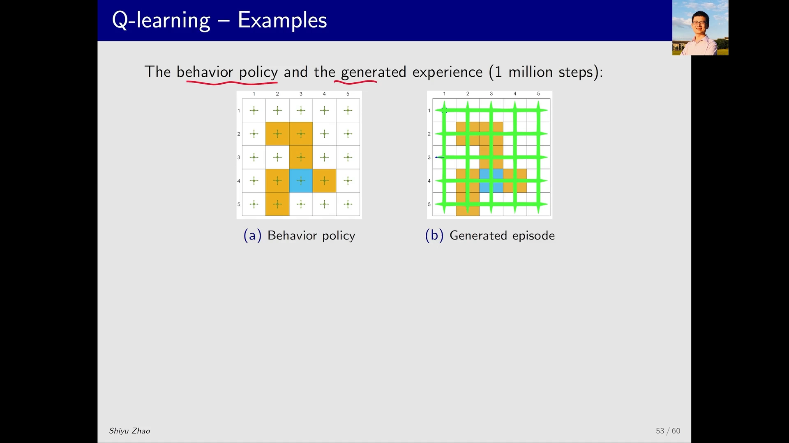
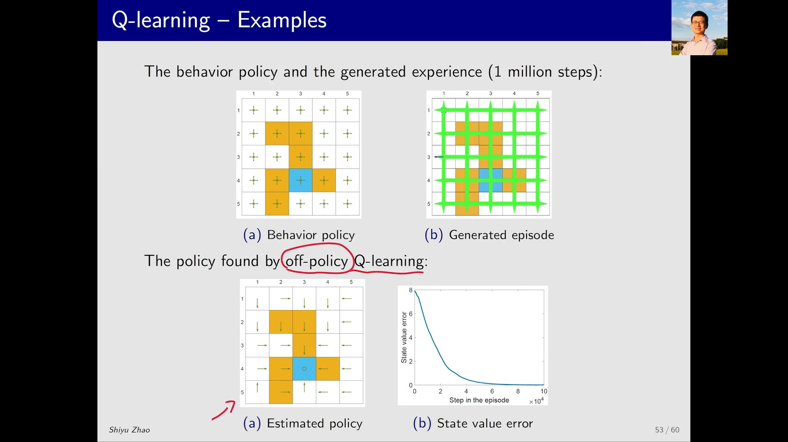
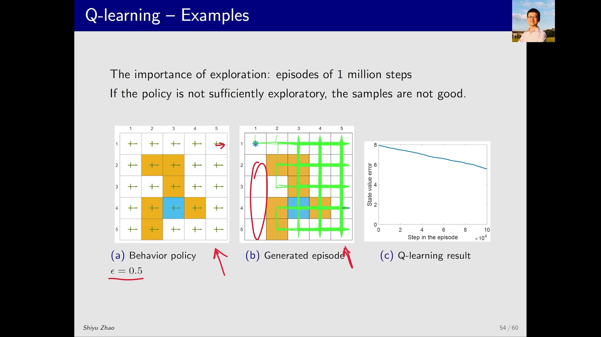

# Q-Learning 的两种实现与网格世界实验：离轨策略到底靠什么起作用

> 本篇整理自赵世钰《强化学习的数学原理》第 7 课「时序差分方法」Part 7：Q-learning 的伪代码与例子。视频地址：[BV1kP4y1m7E2](https://www.bilibili.com/video/BV1kP4y1m7E2/)。

## 本讲要解决的核心问题（SCQA）

**背景**：上一节已经确定，Q-learning 是 off-policy 算法——它的 behavior policy 和 target policy **可以**不同。

**冲突**：但「可以不同」是一句很抽象的话。落到代码里，这两个策略分别写在哪一行？如果不同，target policy 该长什么样？更实际的问题是：既然可以随便用一个策略去采数据，那**数据质量还重要吗**？

**疑问**：Q-learning 的伪代码具体怎么写？用一个「探索性很强」的策略去采数据、再用一个「贪心」的策略去学习，最后真的能学出最优策略吗？如果采数据的策略探索性变弱，结果会怎样？

**回答（中心思想）**：Q-learning 有两种写法。把 behavior policy 强行设成与 target policy 相同，就退化成 **on-policy 版本**（与 SARSA 几乎一样，只换了 TD 目标）；让两者分开，就是 **off-policy 版本**——采数据用 $\pi_b$，学习用贪心的 $\pi_t$，而且 $\pi_t$ 不需要是 $\epsilon$-贪心的，因为它不负责探索。网格世界实验会验证：只要**采数据的策略探索性足够强**，off-policy Q-learning 能学出与真实最优策略几乎一致的策略；而一旦探索性变弱，很多 $(s,a)$ 根本没被访问到，学出来的策略就会明显偏离最优。

---

## 一、一个算法，两种实现

### 1.1 为什么会有两种版本

因为 Q-learning 是 off-policy，它的 behavior policy 和 target policy **可以不同**；而「可以不同」意味着它们**也可以相同**——相同只是不同的一种特殊情况。所以：

- 强行让两者一致 → 得到一个 **on-policy 版本**；
- 让两者分开 → 得到 **off-policy 版本**。

[【跳转到 00:00】](https://www.bilibili.com/video/BV1kP4y1m7E2/?t=0)

### 1.2 on-policy 版本：和 SARSA 只差一个 TD 目标

on-policy 版本的 Q-learning 与 SARSA 的流程**一模一样**，唯一区别在 q value 的更新项：SARSA 用 $q_t(s_{t+1}, a_{t+1})$，这里换成 $\max_a q_t(s_{t+1}, a)$。策略更新仍然用 $\epsilon$-贪心。

```
对每个 episode：
    当当前状态 s_t 不是目标状态时：
        采集经验 (s_t, a_t, r_{t+1}, s_{t+1})：
            按 π_t(s_t) 选动作 a_t，执行后得到 r_{t+1}, s_{t+1}
        更新 q 值：
            q_{t+1}(s_t,a_t) ← q_t(s_t,a_t) - α [ q_t(s_t,a_t) - ( r_{t+1} + γ max_a q_t(s_{t+1},a) ) ]
        更新策略（ε-贪心）：
            π_{t+1}(a|s_t) = 1 - (ε/|A|)(|A|-1)   若 a = argmax_a q_{t+1}(s_t,a)
            π_{t+1}(a|s_t) = ε/|A|                其它
```

整个流程是：先有一个策略 → 按它得到数据 → 由数据得到 q value → 由 q value 得到改进的策略 → 再用改进的策略去采数据。这里那个策略**既生成数据（behavior policy），又不断被更新（target policy）**，所以它是 on-policy。



[【跳转到 00:30】](https://www.bilibili.com/video/BV1kP4y1m7E2/?t=30) · [【跳转到 01:20】](https://www.bilibili.com/video/BV1kP4y1m7E2/?t=80)

### 1.3 off-policy 版本：采数据与学习分开

off-policy 版本的设定是：手上已经有一个策略 $\pi_b$（下标 b 代表 behavior），由它生成一系列经验；任务是根据这些经验去找最优策略。对 t 时刻拿到的状态、动作、奖励，做两步：

```
给定由 π_b 生成的经验 { (s_t, a_t, r_{t+1}, s_{t+1}) }：
    第一步，更新 q 值（与 on-policy 版本完全相同）：
        q_{t+1}(s_t,a_t) ← q_t(s_t,a_t) - α [ q_t(s_t,a_t) - ( r_{t+1} + γ max_a q_t(s_{t+1},a) ) ]
    第二步，更新 target policy（这里与 on-policy 版本不同）：
        π_T,t+1(a|s_t) = 1   若 a = argmax_a q_{t+1}(s_t,a)
        π_T,t+1(a|s_t) = 0   其它
```

两步的差别只有一处：**策略更新从 $\epsilon$-贪心变成了纯贪心**。



### 1.4 为什么这里可以是纯贪心

这是全篇最值得琢磨的一处。用 $\epsilon$-贪心的理由，本来是「**待会儿要用这个策略去生成数据**，希望它有一定探索性，能访问到没被访问过的 $(s,a)$」。

但现在这个 target policy **根本不会被拿去生成数据**——生成数据是 $\pi_b$ 的事。既然不负责探索，就没有理由再保留 $\epsilon$ 的随机性；而我们知道贪心策略才是最优的，所以直接贪心就行。

随着 q 的估计越来越准确，$\pi_T$ 也会收敛到最优策略。整个算法里始终有两个策略：$\pi_b$ 和 $\pi_T$——这就是 off-policy 的样子。

[【跳转到 02:10】](https://www.bilibili.com/video/BV1kP4y1m7E2/?t=130) · [【跳转到 03:00】](https://www.bilibili.com/video/BV1kP4y1m7E2/?t=180)

---

## 二、网格世界实验：任务与设置

### 2.1 任务和上一节不一样

实验仍然用之前那个 5×5 网格世界，但**任务变了**：这次要找到**每一个状态**对应的最优策略；而讲 SARSA 时的任务是从左上角那个固定状态出发、找到一条到达目标的路径，不需要把所有状态的最优策略都找出来。

设置如下：

| 项目 | 取值 |
| :-- | :-- |
| 边界、禁区奖励 | $r_{\text{boundary}} = r_{\text{forbidden}} = -1$ |
| 目标奖励 | $r_{\text{target}} = 1$ |
| 折扣因子 | $\gamma = 0.9$ |
| 学习率 | $\alpha = 0.1$ |



### 2.2 先给出标准答案

讲义先给出 ground truth：真实的最优策略（每个格子一个箭头）和最优状态价值。待会儿用 Q-learning 算出一个策略，再和它比较是否一致。

### 2.3 选一个探索性很强的 behavior policy

这里选定的 behavior policy 是**均匀采样**：每个状态有 5 个动作，每个动作都给 0.2 的概率。它的探索性很强——跑 100 万步之后，每一个 $(s,a)$ 都被访问到很多次，数据质量很好。



既然数据是 behavior policy 产生的，估计时自然要用 **off-policy 的 Q-learning**。

[【跳转到 03:50】](https://www.bilibili.com/video/BV1kP4y1m7E2/?t=230) · [【跳转到 05:05】](https://www.bilibili.com/video/BV1kP4y1m7E2/?t=305)

---

## 三、实验结果：策略对上了，误差收敛到 0

### 3.1 学出来的策略与最优策略基本一致

用这批数据跑 off-policy Q-learning，得到的策略与 ground truth **基本一模一样**：只有个别格子方向不同（比如一个是向下、一个是向左），这类差别对最优性没有实质影响。



### 3.2 误差曲线怎么读

右图的纵坐标是**状态价值误差**：Q-learning 在估计过程中会给出一个又一个策略，每个策略都对应一组状态价值；把它和最优状态价值相减、取模，就得到这条曲线。

曲线从 8 左右起步，随步数迅速下降并在 10 万步附近贴近 0。也就是说：**最开始那个策略并不好，离最优状态价值还有一段距离；到最后的策略已经很好了，基本与最优状态价值一致。**

[【跳转到 05:55】](https://www.bilibili.com/video/BV1kP4y1m7E2/?t=355) · [【跳转到 06:20】](https://www.bilibili.com/video/BV1kP4y1m7E2/?t=380)

---

## 四、探索的重要性：把 behavior policy 变弱会怎样

### 4.1 为什么需要强探索

这个任务要求**每个** $(s,a)$ 都找到最优值，所以最好把每个 $(s,a)$ 都访问到、并且访问很多次。这正是 behavior policy 要足够探索的原因——也是离轨策略最大的卖点：**可以专门拿一个爱探索的策略去采数据，而不必牺牲正在学习的策略**。

### 4.2 实验一：$\epsilon = 0.5$，大部分时候向右走

把 behavior policy 换成一个 $\epsilon = 0.5$、但在每个状态都有较大向右概率的策略。它的探索性明显不如均匀采样：100 万步之后，仍有很多 $(s,a)$ 根本没被访问到（图中左侧一大片空白）。

用这批数据做 Q-learning，最后得到的策略离最优策略**有比较大的差距**；状态价值误差曲线下降得也慢得多，10 万步时还停在 6 附近。



### 4.3 实验二：$\epsilon = 0.1$，几乎每个状态都向右走

把 $\epsilon$ 再降到 0.1：几乎每个状态都有很大概率向右走。数据更差，最后得到的策略误差也更大。

结论很清楚：**off-policy 并不意味着数据可以随便采**。算法允许 behavior policy 与 target policy 不同，但 target policy 的质量仍然取决于数据覆盖度——behavior policy 的探索性决定了 Q-learning 能看到多少 $(s,a)$，也就决定了它能不能把最优策略学准。

[【跳转到 07:10】](https://www.bilibili.com/video/BV1kP4y1m7E2/?t=430) · [【跳转到 08:00】](https://www.bilibili.com/video/BV1kP4y1m7E2/?t=480)

---

## 小结

- **两种实现**：把 behavior policy 与 target policy 强行设成相同，就是 on-policy 版本（流程与 SARSA 相同，只把 TD 目标换成 $\max_a q_t(s_{t+1},a)$，策略更新用 $\epsilon$-贪心）；让两者分开，就是 off-policy 版本（q 值更新不变，target policy 用纯贪心更新）。
- **为什么 off-policy 版可以用纯贪心**：$\epsilon$ 的作用是给「要拿去采数据的策略」加探索性；target policy 不采数据，所以不需要 $\epsilon$，直接贪心即可，且贪心策略才是最优的。
- **实验设置**：5×5 网格世界，为所有状态找最优策略；$r_{\text{boundary}} = r_{\text{forbidden}} = -1$，$r_{\text{target}} = 1$，$\gamma = 0.9$，$\alpha = 0.1$。
- **实验结果**：用均匀采样的 behavior policy 采 100 万步，off-policy Q-learning 学出的策略与最优策略基本一致，状态价值误差随步数降到接近 0。
- **探索的作用**：$\epsilon = 0.5$、$\epsilon = 0.1$ 的弱探索策略会让大量 $(s,a)$ 未被访问，学出的策略明显偏离最优——离轨不等于可以随便采数据。

## 关键术语速查

| 术语 | 一句话解释 |
| :-- | :-- |
| on-policy 版本 Q-learning | 让 behavior policy 与 target policy 相同的实现，策略更新用 $\epsilon$-贪心。 |
| off-policy 版本 Q-learning | behavior policy 与 target policy 分开的实现，策略更新用纯贪心。 |
| behavior policy $\pi_b$ | 负责生成经验数据的策略，其探索性决定数据覆盖度。 |
| target policy $\pi_T$ | 被学习、被更新的策略，最终收敛到最优策略。 |
| 均匀采样策略 | 每个状态下所有动作等概率的策略，探索性最强的一类行为策略。 |
| 状态价值误差 | 当前策略的状态价值与最优状态价值之差的模，用于衡量学习进度。 |