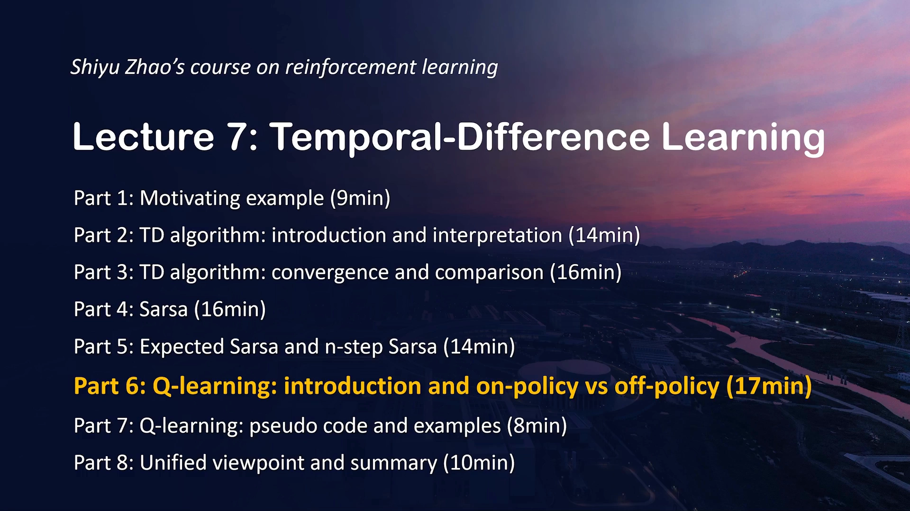
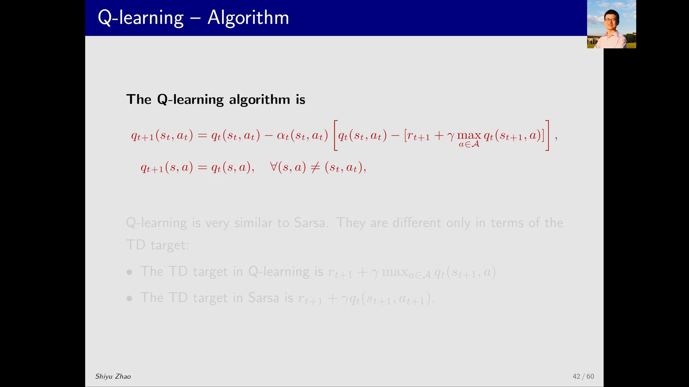
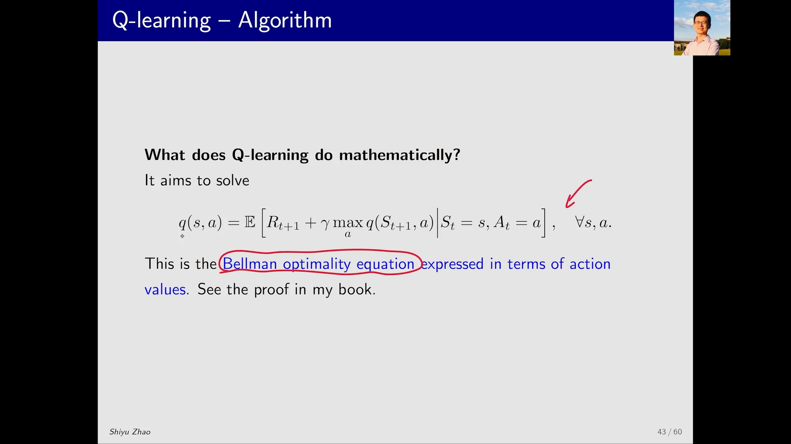
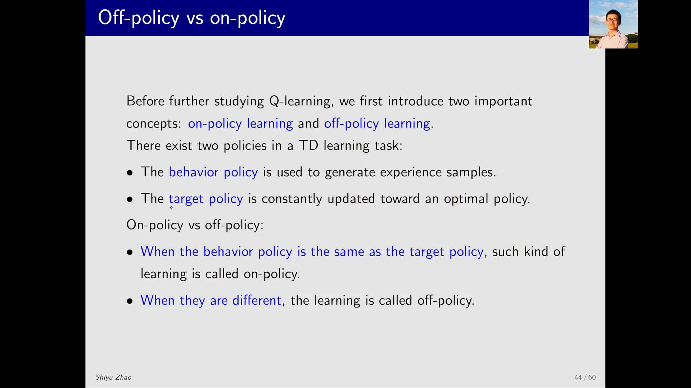
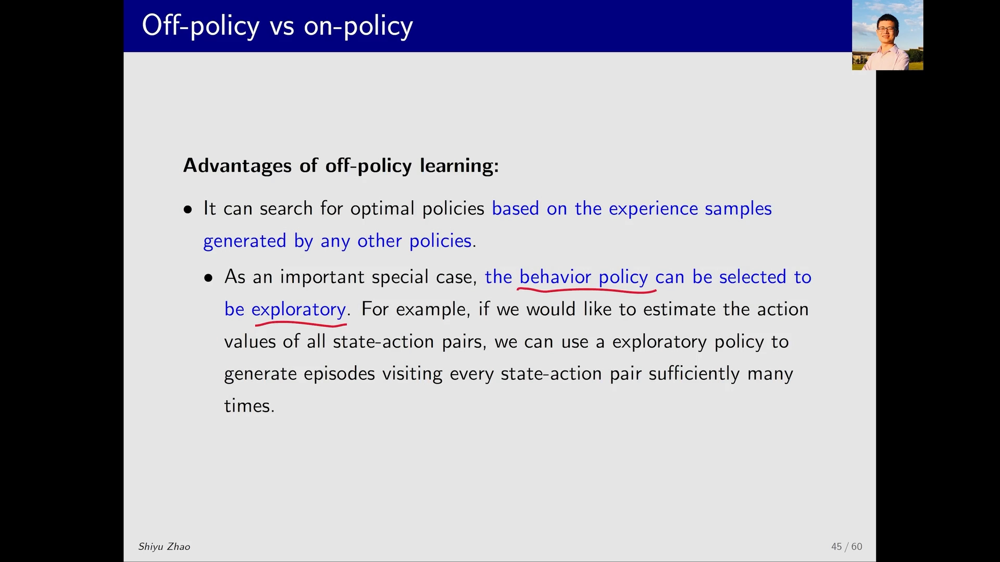
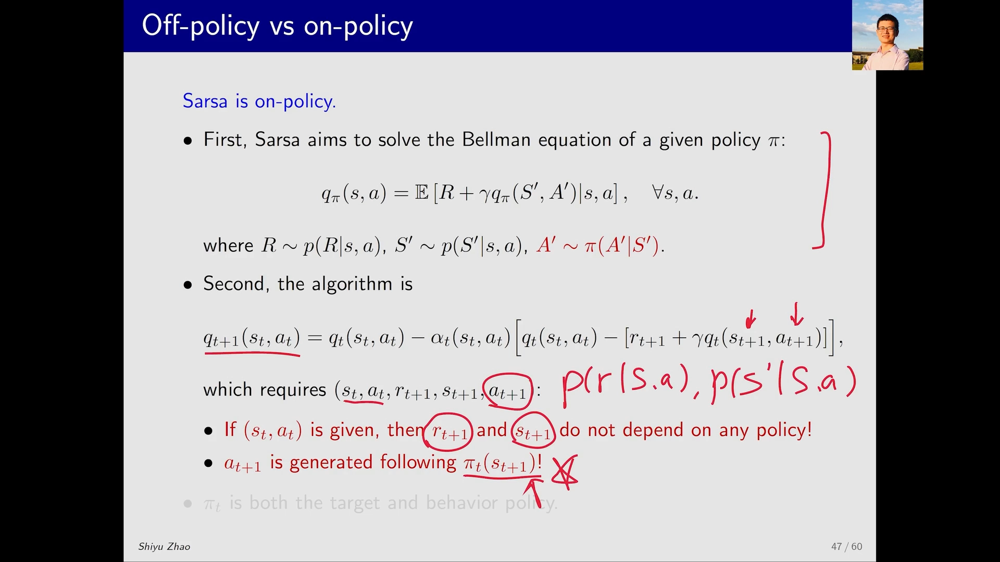
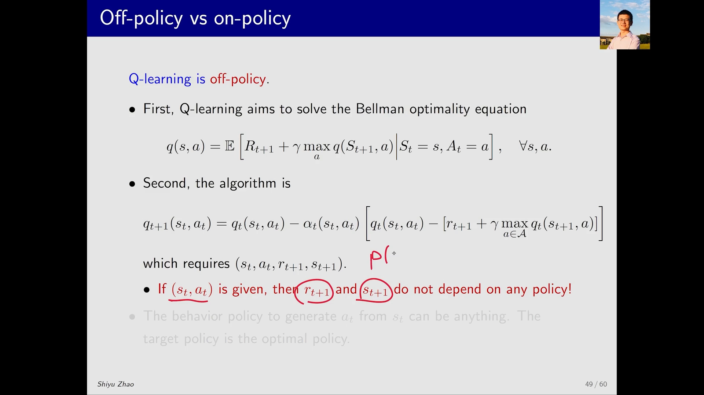
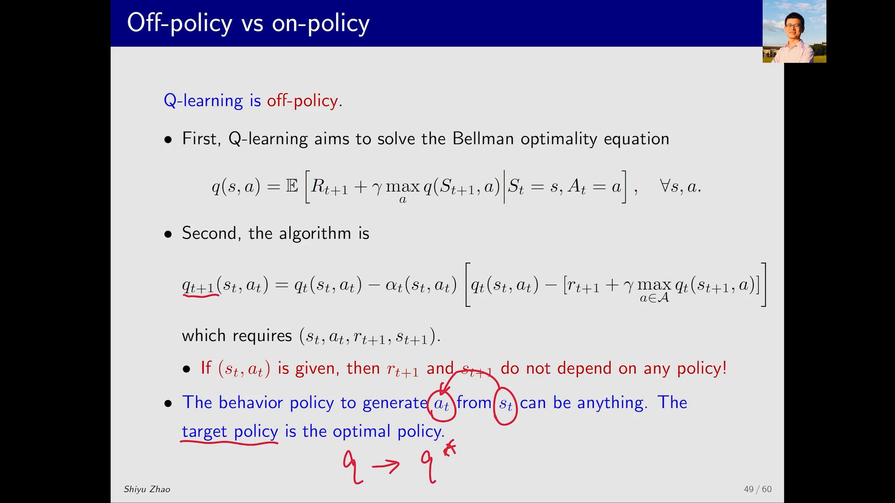

# Q-Learning 算法与离轨策略：只改一个 TD 目标，就跳出了「评估—改进」的循环

> 本篇整理自赵世钰《强化学习的数学原理》第 7 课「时序差分方法」Part 6：Q-learning 介绍与 on-policy / off-policy。视频地址：[BV1je4y1m7vC](https://www.bilibili.com/video/BV1je4y1m7vC/)。

## 本讲要解决的核心问题（SCQA）

**背景**：前面介绍的 SARSA（以及它的期望版本）已经能做「同轨策略控制」——它估计给定策略 $\pi$ 的动作价值 $q_\pi(s,a)$，再和策略改进交替迭代，最终逼近最优策略。这条路走通了，但它是**一条腿走路**：用来生成数据的策略，和正在被改进的策略，必须是同一个。

**冲突**：同一个策略既当「探索者」又当「被改进的对象」，会互相牵制。想估计所有 $(s,a)$ 的价值，就得让策略足够随机、足够爱探索；可一旦策略改进到接近贪心，探索性就没了，很多 $(s,a)$ 再也访问不到。更麻烦的是，每换一次策略，之前采到的数据就「过期」了——因为它们不是新策略产生的。

**疑问**：能不能**用一套策略去采数据，同时去学另一个完全不同的策略**？甚至，能不能干脆跳过「策略评估」这一步，直接估计最优动作价值？

**回答（中心思想）**：能。**Q-learning** 就是这样一个算法。它的更新式和 SARSA 几乎逐字相同，唯一改动在 TD 目标：把「按策略采样出来的 $q_t(s_{t+1}, a_{t+1})$」换成「对下一状态所有动作取最大值的 $\max_a q_t(s_{t+1}, a)$」。这一个 $\max$ 带来两个后果：它在数学上求解的不再是「某个给定策略的贝尔曼方程」，而是**贝尔曼最优方程**；因此它估计的从一开始就是**最优动作价值** $q^*$，不需要「评估—改进」来回交替——它是 **off-policy（离轨策略）** 的算法。

---

## 一、先看位置：Q-Learning 与前序内容的关系

课程讲到这里时，SARSA 刚刚讲完。SARSA 的本质是：**估计一个给定策略的动作价值**，再把它和策略改进（policy improvement）结合，在「策略评估」和「策略改进」之间反复迭代，从而求出最优策略。

Q-learning 的区别，从数学上讲只有一句话：**它直接估计最优动作价值（optimal action value）**。既然一步到位地估计了最优值，就不需要「评估」和「改进」这两个步骤来回交替运行了。

这也解释了为什么这一节的篇幅会这么短——前面已经把 TD 方法、SARSA、随机梯度下降都铺垫得很足，到了 Q-learning，算法几乎是把 SARSA 的一个项替换掉就完事了。讲义上只用两页就把 Q-learning 的基本信息讲完了：一页是「算法是什么」，一页是「它在数学上解决什么问题」。

[【跳转到 00:00】](https://www.bilibili.com/video/BV1je4y1m7vC/?t=0) · [【跳转到 00:30】](https://www.bilibili.com/video/BV1je4y1m7vC/?t=30)

---

## 二、算法本体：两个式子，只改一个 TD 目标

### 2.1 更新式

Q-learning 的算法是：

$$
q_{t+1}(s_t, a_t) = q_t(s_t, a_t) - \alpha_t(s_t, a_t)\Big[\, q_t(s_t, a_t) - \big( r_{t+1} + \gamma \max_{a \in \mathcal{A}} q_t(s_{t+1}, a) \big) \Big]
$$

$$
q_{t+1}(s, a) = q_t(s, a), \qquad \forall (s,a) \neq (s_t, a_t)
$$

第一式更新当前被访问到的 $(s_t, a_t)$；第二式说明其它 $(s,a)$ 保持不变——和 TD(0)、SARSA 的写法完全一致，只是这里的基本单位从「状态」换成了「状态-动作对」。

### 2.2 唯一的差别：TD 目标里的 max

把两处 TD 目标并排看，差别一目了然：

| 算法 | TD 目标 |
| :-- | :-- |
| SARSA | $r_{t+1} + \gamma\, q_t(s_{t+1}, a_{t+1})$ |
| Q-learning | $r_{t+1} + \gamma \max_{a \in \mathcal{A}} q_t(s_{t+1}, a)$ |

SARSA 里的 $a_{t+1}$ 是**按当时的策略采样出来**的一个具体动作；Q-learning 里没有「采样」这一步，而是直接在下一状态的所有动作上**取最大值**。前者问的是「这条轨迹实际走了哪一步」，后者问的是「下一步最好能有多好」。

[【跳转到 01:20】](https://www.bilibili.com/video/BV1je4y1m7vC/?t=80) · [【跳转到 02:10】](https://www.bilibili.com/video/BV1je4y1m7vC/?t=130)

---

## 三、它在数学上求解什么：动作价值形式的贝尔曼最优方程

前面每介绍一个算法，课程都会交代「它在解决什么数学问题」：

- TD 方法（估计状态价值）与 SARSA（估计动作价值）求解的都是**给定策略的贝尔曼方程**；
- Q-learning 求解的**不是**贝尔曼方程，而是**贝尔曼最优方程**（Bellman optimality equation）：

$$
q(s,a) = \mathbb{E}\Big[\, R_{t+1} + \gamma \max_{a} q(S_{t+1}, a) \;\Big|\; S_t = s,\, A_t = a \,\Big], \qquad \forall s, a
$$

它和之前讲过的贝尔曼最优方程有两处不同：**一是含有期望**（因为奖励和下一状态是随机的），**二是以动作价值而非状态价值为载体**。但它仍然是贝尔曼最优方程——这一点讲义上没有展开证明，只说「证明见书」。

这个定位决定了两件事：

1. 它最终得到的 $q$ 不是「某个策略的动作价值」，而是**最优动作价值** $q^*$；
2. 最优动作价值天然对应**最优策略**（每个状态取 $\arg\max_a q^*(s,a)$ 即可），所以不需要再单独跑一遍策略改进。

[【跳转到 02:35】](https://www.bilibili.com/video/BV1je4y1m7vC/?t=155) · [【跳转到 03:25】](https://www.bilibili.com/video/BV1je4y1m7vC/?t=205)

---

## 四、两个策略：behavior policy 与 target policy

### 4.1 强化学习里其实一直有两个策略

要讲清 on-policy / off-policy，先要承认一件事：一个 TD 学习任务里存在**两个**策略。

| 策略 | 作用 |
| :-- | :-- |
| **behavior policy**（行为策略） | 与环境交互、生成经验样本（experience） |
| **target policy**（目标策略） | 被不断更新、最终收敛到我们想要的最优策略 |

之前讲 SARSA、讲 TD 时其实已经涉及这两个角色了，只是没有明确命名。这里把它显式提出来。

### 4.2 定义：相同即同轨，不同即离轨

- **on-policy（同轨策略）**：behavior policy 与 target policy **相同**。用这个策略与环境交互得到经验，同时改进这个策略，改进完再用它去交互——一条线走到底。
- **off-policy（离轨策略）**：两者**不同**。用一个策略去和环境交互、拿到大量经验，再用这些经验不断改进另一个策略，那个策略最后收敛到最优。

于是：

- 前面学的 **SARSA 是 on-policy**；
- 刚介绍的 **Q-learning 是 off-policy**——它的两个策略**可以**不同（当然也可以相同，相同只是「不同」的特例）。

[【跳转到 05:30】](https://www.bilibili.com/video/BV1je4y1m7vC/?t=330) · [【跳转到 06:20】](https://www.bilibili.com/video/BV1je4y1m7vC/?t=380)

### 4.3 离轨带来什么好处

最直接的好处是：**可以直接拿别人的经验来学**。别人按他们自己的策略跑出来的数据，我们可以拿来更新自己的目标策略。

其中最重要的一个特例是：**让 behavior policy 专门负责探索**。如果目标是估计所有 $(s,a)$ 的动作价值，那就需要一个探索性很强的行为策略，去把每个 $(s,a)$ 都访问到足够多次。

反过来，如果被迫让 target policy 兼任 behavior policy，问题就来了：target policy 通常是贪心的或 $\epsilon$-贪心的，探索性弱，很难访问到所有 $s$ 和 $a$，自然也就估不出所有 $(s,a)$ 的最优值。这正是离轨策略的价值所在。

[【跳转到 07:10】](https://www.bilibili.com/video/BV1je4y1m7vC/?t=430) · [【跳转到 08:00】](https://www.bilibili.com/video/BV1je4y1m7vC/?t=480)

---

## 五、怎么判断一个算法是 on-policy 还是 off-policy

这个问题明白了就很简单，不明白就容易迷惑。课程给了两个工具。

### 5.1 工具一：看它在数学上解决什么问题

- 求解**贝尔曼方程**（给定策略的方程）→ 它的结果依赖策略，通常是 on-policy；
- 求解**贝尔曼最优方程**（不含任何具体策略）→ 它的结果不依赖策略，通常是 off-policy。

### 5.2 工具二：看算法跑起来需要哪些量

把算法实施时需要的输入列出来，看其中**哪些量依赖策略**。以 SARSA 为例，它需要 $(s_t, a_t, r_{t+1}, s_{t+1}, a_{t+1})$ 这五个量：

- 给定 $(s_t, a_t)$ 后，$r_{t+1}$ 和 $s_{t+1}$ 只由 $p(r \mid s,a)$ 和 $p(s' \mid s,a)$ 决定，**与任何策略无关**；
- 但 $a_{t+1}$ 是「在 $s_{t+1}$ 下按策略采样出来的动作」，**依赖策略**——这里用到的策略就是 behavior policy。

再看 target policy：SARSA 估计的是 $\pi_t$ 对应的动作价值，又用这个动作价值去改进 $\pi_t$。所以 $\pi_t$ 既是 behavior policy 又是 target policy，**SARSA 是 on-policy**。

### 5.3 三个算法逐个判

| 算法 | 求解的方程 | 跑起来需要的量 | 结论 |
| :-- | :-- | :-- | :-- |
| SARSA | 给定策略的贝尔曼方程 | $(s_t,a_t,r_{t+1},s_{t+1},a_{t+1})$，其中 $a_{t+1} \sim \pi_t$ | on-policy |
| 蒙特卡洛控制 | 估计 $q_\pi$，用整条 episode 的回报 | 整条由 $\pi$ 生成的轨迹 | on-policy |
| Q-learning | 贝尔曼最优方程 | $(s_t,a_t,r_{t+1},s_{t+1})$，**不含 $a_{t+1}$** | off-policy |

蒙特卡洛方法之所以是 on-policy，也是同一个道理：它用 $\pi$ 生成一条轨迹，用轨迹的回报去近似 $q_\pi$，再用 $q_\pi$ 改进 $\pi$——$\pi$ 既是 behavior policy 又是 target policy。

[【跳转到 08:50】](https://www.bilibili.com/video/BV1je4y1m7vC/?t=530) · [【跳转到 13:00】](https://www.bilibili.com/video/BV1je4y1m7vC/?t=780)

---

## 六、为什么 Q-Learning 是 off-policy：逐项拆解

用上面两个工具，把 Q-learning 走一遍。

**第一步，看它求解的方程。** 贝尔曼方程需要给定一个策略；而贝尔曼最优方程**不涉及任何策略**，它只是一个含有 $q$ 的等式（当然它对应最优策略，但式子里并不显式出现策略）。求解这样一个方程，自然不需要「跟着某个策略走」。

**第二步，看它需要的量。** Q-learning 只需要 $(s_t, a_t, r_{t+1}, s_{t+1})$，比 SARSA 少了 $a_{t+1}$。给定 $(s_t, a_t)$ 后，$r_{t+1}$ 和 $s_{t+1}$ 由环境决定、不依赖任何策略；而 $a_{t+1}$ 这一项根本不存在——它被 $\max_a$ 替代了。

**第三步，指认两个策略。**

- **behavior policy**：从 $s_t$ 出发、决定选哪个 $a_t$ 的那个策略。它可以**是任何东西**——因为它只影响「采到哪些数据」，不影响更新式里的目标值。
- **target policy**：对每个状态取 $\arg\max_a q(s,a)$ 的贪心策略。随着 $q$ 收敛到最优动作价值，这个贪心策略就收敛到最优策略。

两者不必相同，所以 **Q-learning 是 off-policy**。

[【跳转到 14:15】](https://www.bilibili.com/video/BV1je4y1m7vC/?t=855) · [【跳转到 16:45】](https://www.bilibili.com/video/BV1je4y1m7vC/?t=1005)

---

## 小结

- **算法**：$q_{t+1}(s_t,a_t) = q_t(s_t,a_t) - \alpha_t\big[\, q_t(s_t,a_t) - (r_{t+1} + \gamma \max_{a} q_t(s_{t+1},a)) \,\big]$，其余 $(s,a)$ 不变。
- **与 SARSA 的唯一差别**：TD 目标从「按策略采样得到的 $q_t(s_{t+1},a_{t+1})$」换成「对下一状态所有动作取最大值的 $\max_a q_t(s_{t+1},a)$」。
- **数学定位**：SARSA 求解给定策略的贝尔曼方程；Q-learning 求解**贝尔曼最优方程**，因此直接估计最优动作价值 $q^*$，不需要「评估—改进」交替迭代。
- **两个策略**：behavior policy 生成经验，target policy 被更新。两者相同是 on-policy，不同是 off-policy；Q-learning 属于后者。
- **判断方法（两个工具）**：一看它求解的是贝尔曼方程还是贝尔曼最优方程；二看它跑起来需要的量里有没有依赖策略的项（如 $a_{t+1}$）。
- **离轨的好处**：可以复用任意策略产生的经验，并可以让 behavior policy 专门负责探索，从而把每个 $(s,a)$ 都访问到足够多次。

## 关键术语速查

| 术语 | 一句话解释 |
| :-- | :-- |
| Q-learning | 直接估计最优动作价值 $q^*$ 的 TD 控制算法，更新时用 $\max_a q(s_{t+1},a)$ 作 TD 目标。 |
| 动作价值（Action Value） $q(s,a)$ | 在状态 $s$ 执行动作 $a$ 之后、继续按某策略行动所能获得的折扣回报的期望。 |
| 贝尔曼最优方程（Bellman Optimality Equation） | 不含具体策略、以 $\max$ 描述最优价值的方程；其解即最优价值函数。 |
| 行为策略（Behavior Policy） | 与环境交互、生成经验样本的策略。 |
| 目标策略（Target Policy） | 被不断更新、最终收敛到最优策略的那个策略。 |
| 同轨策略（On-Policy） | behavior policy 与 target policy 相同的学习方式，如 SARSA、蒙特卡洛控制。 |
| 离轨策略（Off-Policy） | behavior policy 与 target policy 可以不同的学习方式，如 Q-learning。 |
| TD 目标（TD Target） | 更新时希望估值靠近的目标值；Q-learning 中是 $r_{t+1} + \gamma \max_a q_t(s_{t+1},a)$。 |