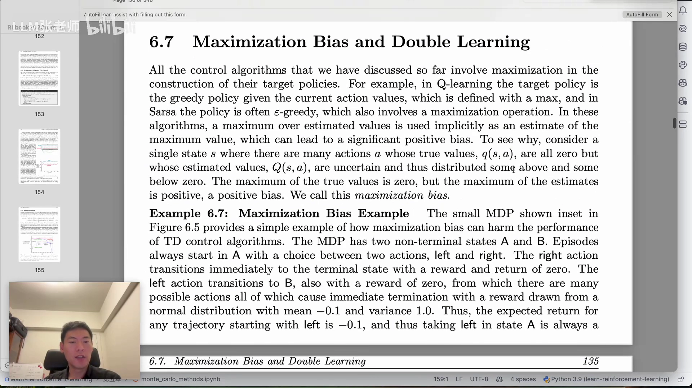
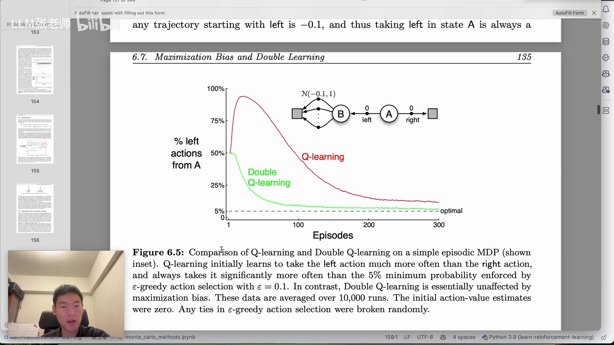
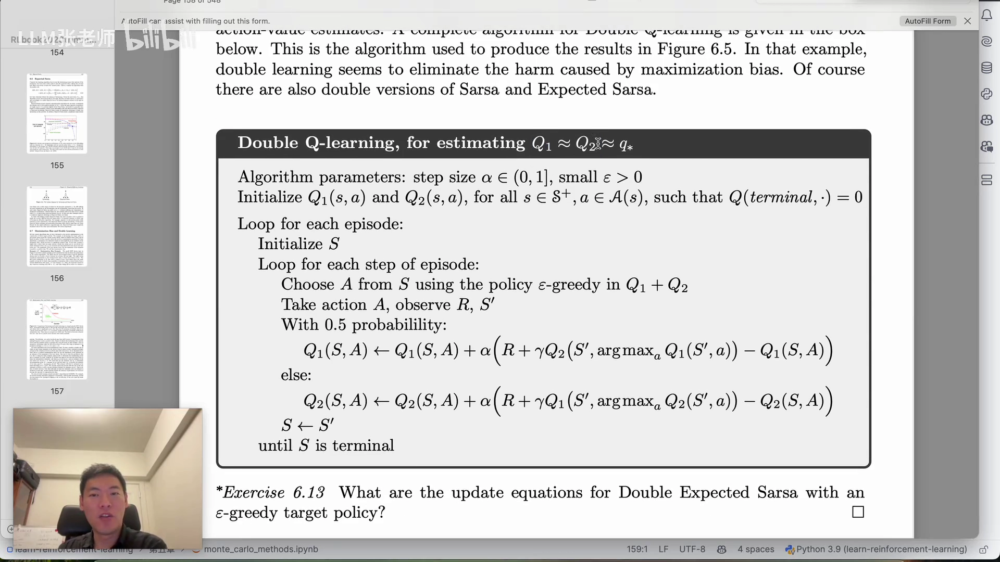

# 最大化偏差与 Double Q-Learning：当 max 把噪声当成了好消息

> 本篇整理自《强化学习》（Sutton & Barto）第 6 章逐页精读视频中 6.7 节「Maximization Bias and Double Learning」部分。视频地址：[BV1gM26YXEfZ](https://www.bilibili.com/video/BV1gM26YXEfZ/)。

## 本讲要解决的核心问题（SCQA）

**背景**：到此为止讲过的控制算法——SARSA、Q-learning——在构造 target policy 时都用了**最大化**：Q-learning 的 target policy 是给定当前动作价值下的贪心策略（定义里带 $\max$）；SARSA 的策略通常是 $\epsilon$-贪心的，选择动作时同样要取最大。

**冲突**：问题就出在这个 $\max$ 上。我们手上只有**估计值** $Q(s,a)$，而估计值是有噪声的。对一个状态的所有动作取最大，等于在噪声里挑「最乐观的那一个」——于是「估计值的最大值」会被系统性地高估，成为「真实最大值」的一个偏大的估计。

**疑问**：这种偏差有多大危害？它是怎么把算法带偏的？能不能在不放弃 $\max$ 的前提下把它消掉？

**回答（中心思想）**：这种偏差叫**最大化偏差（maximization bias）**。它不会让算法不收敛，但会让它**收敛得更慢**：在 Sutton 的两状态小 MDP 里，Q-learning 会因为高估而反复选择明明更差的动作，几百个 episode 之后才慢慢纠正。解决办法是**双估计（double learning）**：维护两个独立的动作价值估计 $Q_1, Q_2$，用其中一个**选**动作、用另一个**估**这个动作的价值——把「选择」和「评估」拆到两个估计器上，偏差就消掉了。这就是 **Double Q-learning**。

---

## 一、偏差从哪来：max 的期望，不等于期望的 max

### 1.1 一句话的机制

Sutton 书上的说法是：这些算法实际上把「**估计值的最大值**」当成了「**最大值的估计**」，这会带来显著的正偏差。

拆开看：设某个状态 $s$ 有很多动作 $a$，它们的**真实价值** $q(s,a)$ 全都是 0，但我们的**估计值** $Q(s,a)$ 是不确定的——有的估高了、有的估低了，分布在 0 的两侧。那么：

- 真实值的最大值是 0；
- 估计值的最大值却是**正数**（因为总有一些动作被估高了）。

这个正数就是偏差。用一行数学写出来，它是 Jensen 不等式的一个直接推论：

$$
\mathbb{E}\Big[ \max_a Q(s,a) \Big] \;\ge\; \max_a \mathbb{E}\big[ Q(s,a) \big]
$$

左边是算法实际在用的量（先取 max 再求期望），右边才是我们想要的量（先求期望再取 max）。只要估计有噪声，左边就严格大于右边。



[【跳转到 18:57】](https://www.bilibili.com/video/BV1gM26YXEfZ/?t=1137)

### 1.2 为什么它专挑「早期」发作

在训练早期，估计值离真值还很远、噪声很大。此时取 max，等于每次都押注「当前看起来最好的那个动作」，而这个「最好」很可能只是被噪声抬高的假象。于是算法会**高估某些动作**、频繁地去选它们，需要很长时间才能把这些被抬高的估计压回去。

视频里的直观说法是：训练早期选错的动作比较多，要花比较长的时间才能回到正确的状态上。这种情况在很多强化学习的早期阶段都会遇到。

[【跳转到 19:55】](https://www.bilibili.com/video/BV1gM26YXEfZ/?t=1195)

---

## 二、一个极小的 MDP 就能把偏差放大

### 2.1 环境设置

书上给了一个只有两个非终止状态的小 MDP（Figure 6.5 内嵌图）：

- episode 总是从状态 **A** 开始，有两个动作：**left** 和 **right**；
- 选 **right**：立即进入终止状态，奖励为 0；
- 选 **left**：奖励为 0，转移到状态 **B**；
- 在 **B** 里有很多可选动作，**每一个**都会立即终止，奖励取自均值 $-0.1$、方差 $1.0$ 的正态分布 $\mathcal{N}(-0.1, 1)$。

### 2.2 真实答案 vs 算法看到的东西

**真实答案**：任何以 left 开头的轨迹，期望回报都是 $-0.1$。所以

$$
q(A, \text{left}) = -0.1, \qquad q(A, \text{right}) = 0
$$

在 A 选 left 永远是**更差**的动作，最优策略是选 right。

**算法看到的东西**：从 B 出发的样本奖励是随机的，有正有负。Q-learning 的 TD 目标是 $r + \gamma \max_a Q(s', a)$，那个 $\max$ 会**优先挑中偏高的那些样本**。于是 $Q(A, \text{left})$ 被一路往上抬，甚至变成正数——算法反而认为「从 A 往左走」是好选择。

### 2.3 结果：几百个 episode 才纠正过来

Figure 6.5 画的是「从 A 出发选择 left 的比例」随 episode 的变化，10,000 次独立运行取平均，初始动作价值全为 0，$\epsilon = 0.1$：

- **Q-learning（红线）**：left 的比例先冲到 90% 以上，然后缓慢下降，到 300 个 episode 时仍明显高于 $\epsilon$-贪心强制的 5% 下限；
- **Double Q-learning（绿线）**：几乎不受最大化偏差影响，很快就降到 5% 附近——也就是「几乎总是选 right」的最优行为。



这张图是本节最有力的证据：偏差不是抽象的数学瑕疵，它直接表现为**几百个 episode 的错误行为**。

[【跳转到 19:18】](https://www.bilibili.com/video/BV1gM26YXEfZ/?t=1158) · [【跳转到 20:20】](https://www.bilibili.com/video/BV1gM26YXEfZ/?t=1220)

---

## 三、Double Q-Learning：把「选」和「估」拆开

### 3.1 核心想法

既然偏差来自「用同一套估计值既选动作、又评估这个动作」，那就用**两套**估计值：

- 用 $Q_1$ 选出「哪个动作最好」（$\arg\max$）；
- 用 $Q_2$ 给出「那个动作到底值多少」（取值）。

由于 $Q_2$ 没见过 $Q_1$ 挑出来的那个 max 带来的偏差，它对价值的估计是「干净」的。反过来，更新 $Q_2$ 时用 $Q_1$ 来选、$Q_2$ 来估。两个估计器互相牵制，偏差就被中和掉了。

视频里的说法是：相当于同时做两个 Q-learning，其中一个用来中和另一个；两个 Q 互相制约、互相牵制。

### 3.2 算法

```
Double Q-learning（估计 Q1 ≈ Q2 ≈ q*）

算法参数：步长 α ∈ (0,1]，很小的 ε > 0
初始化 Q1(s,a) 和 Q2(s,a)，对所有 s ∈ S+、a ∈ A(s)，且 Q(terminal, ·) = 0

对每个 episode 循环：
    初始化 S
    对该 episode 的每一步循环：
        用 ε-贪心策略在 Q1 + Q2 上从 S 中选择动作 A
        执行 A，观测 R, S'
        以 0.5 的概率：
            Q1(S,A) ← Q1(S,A) + α [ R + γ Q2(S', argmax_a Q1(S',a)) - Q1(S,A) ]
        否则：
            Q2(S,A) ← Q2(S,A) + α [ R + γ Q1(S', argmax_a Q2(S',a)) - Q2(S,A) ]
        S ← S'
    直到 S 是终止状态
```

两条更新式写清楚就是：

$$
Q_1(S,A) \leftarrow Q_1(S,A) + \alpha\Big[\, R + \gamma\, Q_2\big(S', \arg\max_a Q_1(S',a)\big) - Q_1(S,A) \,\Big]
$$

$$
Q_2(S,A) \leftarrow Q_2(S,A) + \alpha\Big[\, R + \gamma\, Q_1\big(S', \arg\max_a Q_2(S',a)\big) - Q_2(S,A) \,\Big]
$$



三个细节值得注意：

1. **选动作时用 $Q_1 + Q_2$ 之和**做 $\epsilon$-贪心，两个估计一起投票，比单用一个更稳；
2. **每次只更新其中一个**，各 50% 概率——这样两个估计器保持独立，偏差才不会被同步放大；
3. 更新 $Q_1$ 时，$\arg\max$ 由 $Q_1$ 给出、**价值由 $Q_2$ 给出**；更新 $Q_2$ 时反过来。

### 3.3 与 Q-learning 的对照

| | Q-learning | Double Q-learning |
| :-- | :-- | :-- |
| 估计器个数 | 1 个 $Q$ | 2 个 $Q_1, Q_2$ |
| TD 目标 | $R + \gamma \max_a Q(S',a)$ | $R + \gamma\, Q_2(S', \arg\max_a Q_1(S',a))$ |
| 选择与评估 | 同一个 $Q$ 既选又估 | 一个选、另一个估 |
| 偏差 | 有最大化偏差 | 基本消除 |
| 选动作的策略 | 由 $Q$ 决定 | 由 $Q_1 + Q_2$ 决定 |

[【跳转到 22:14】](https://www.bilibili.com/video/BV1gM26YXEfZ/?t=1334) · [【跳转到 22:44】](https://www.bilibili.com/video/BV1gM26YXEfZ/?t=1364)

---

## 四、放回这条主线：为什么它属于「离轨策略控制」

这一节的位置很关键：它紧跟在 6.5 节 Q-learning（离轨策略）之后。

- Q-learning 之所以能一步估计最优动作价值，靠的正是 TD 目标里的 $\max_a$；
- 而 $\max_a$ 也正是最大化偏差的来源。

也就是说，**离轨控制的能力和它的偏差来自同一个地方**。Double Q-learning 并没有放弃 $\max$（它仍然在做贪心选择），只是把「取 max」和「估价值」分配给两个独立的估计器——用双估计换掉偏差，代价是内存和计算翻倍。

从算法演化的角度看，视频作者的说法是：先有 Q-learning（离轨），发现它在某些场景、某些数据下前期收敛比较慢，于是有了双 Q 学习；再往后遇到更复杂的场景，还会把 Q-learning 和 SARSA 结合起来用。概念看着多，其实是**一步步打补丁**攒出来的。

[【跳转到 23:09】](https://www.bilibili.com/video/BV1gM26YXEfZ/?t=1389)

---

## 小结

- **最大化偏差**：控制算法用 $\max$ 构造 target policy，而 $\max$ 作用在**有噪声的估计值**上，会系统性地高估真实最大值。数学上就是 $\mathbb{E}[\max_a Q(s,a)] \ge \max_a \mathbb{E}[Q(s,a)]$。
- **危害**：不会导致不收敛，但会**收敛变慢**——早期被高估的动作会被反复选择，需要很长时间纠正。
- **经典例子（Example 6.7）**：A 的 left 转到 B，B 的动作奖励服从 $\mathcal{N}(-0.1,1)$；真实 $q(A,\text{left}) = -0.1$ 劣于 $q(A,\text{right}) = 0$，但 Q-learning 会把 $Q(A,\text{left})$ 高估为正，于是长期偏好 left。
- **Figure 6.5**：Q-learning 选 left 的比例长期远高于 5% 的最优下限；Double Q-learning 几乎立刻降到 5% 附近。
- **Double Q-learning**：维护 $Q_1, Q_2$，各以 0.5 概率被更新；更新 $Q_1$ 时用 $\arg\max_a Q_1(S',a)$ 选动作、用 $Q_2$ 取价值，反之亦然。选择与评估解耦，偏差被中和。
- **代价**：需要两套估计值，内存与计算翻倍。

## 关键术语速查

| 术语 | 一句话解释 |
| :-- | :-- |
| 最大化偏差（Maximization Bias） | 用估计值的最大值去估计真实最大值所产生的正偏差。 |
| 双估计（Double Learning） | 用两个独立的估计器分别负责「选动作」和「估价值」，以消除最大化偏差。 |
| Double Q-learning | 双估计版的 Q-learning：$Q_1$ 选、$Q_2$ 估（或反之），各以 0.5 概率更新。 |
| 目标策略（Target Policy） | 由当前动作价值导出的贪心策略，其构造中含 $\max$，是偏差的来源。 |
| $\epsilon$-贪心 | 以 $1-\epsilon$ 概率选当前最优动作、以 $\epsilon$ 概率随机探索；选择动作时同样涉及最大化。 |
| $\arg\max$ | 取使函数值最大的那个动作（动作本身），区别于 $\max$（最大值）。 |