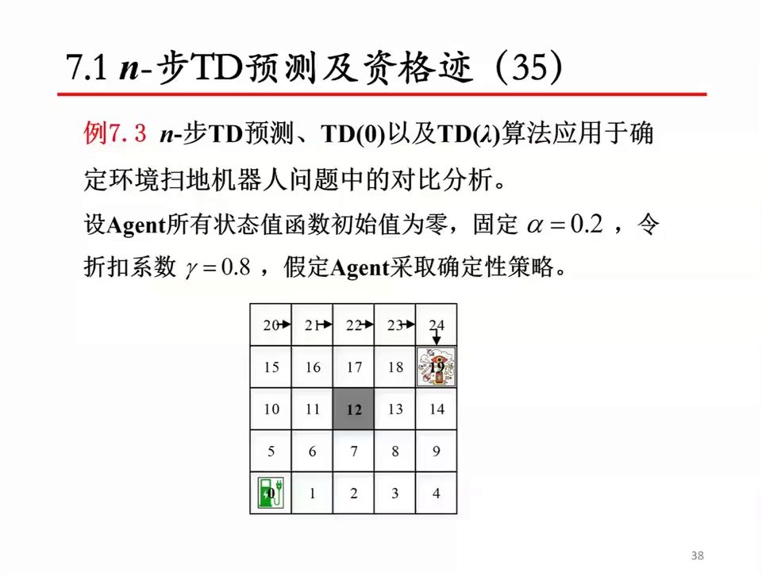
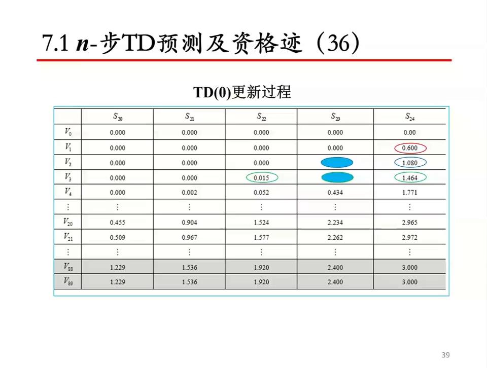
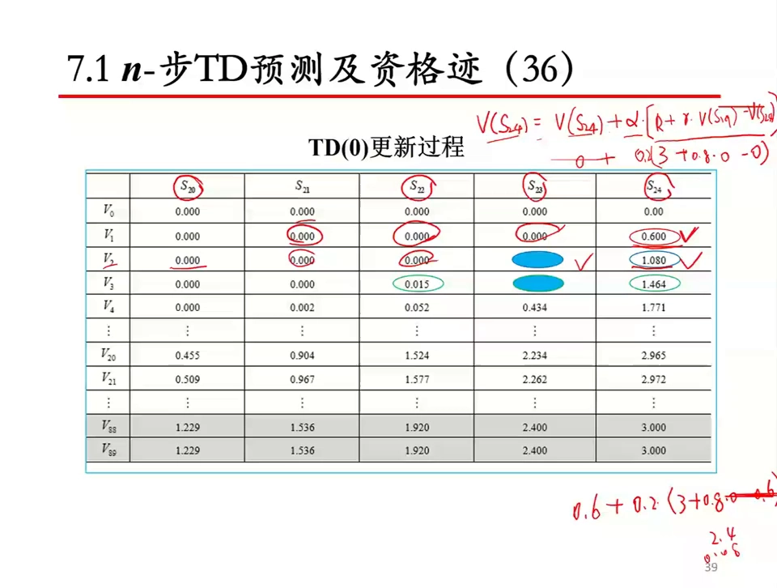
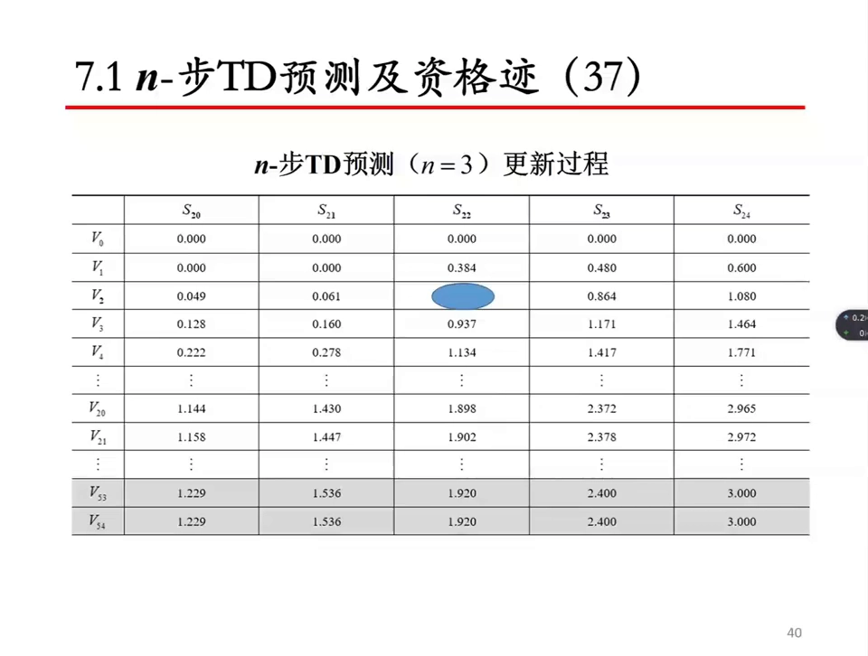
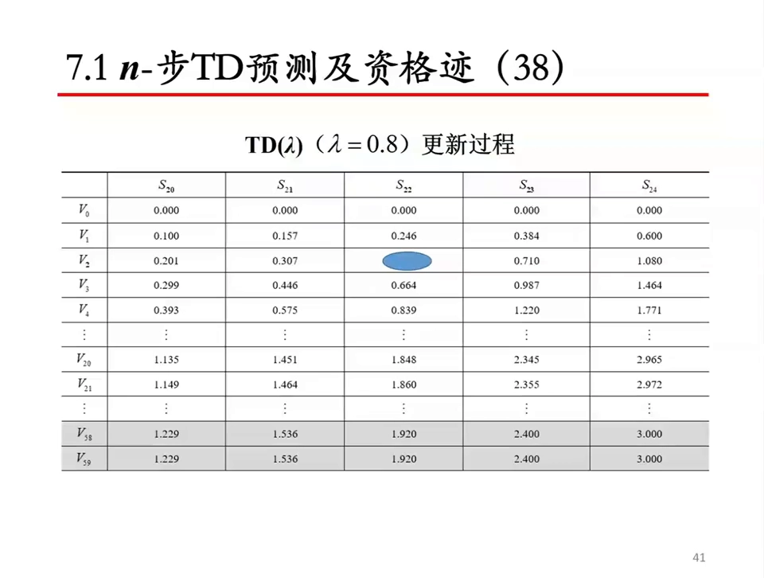
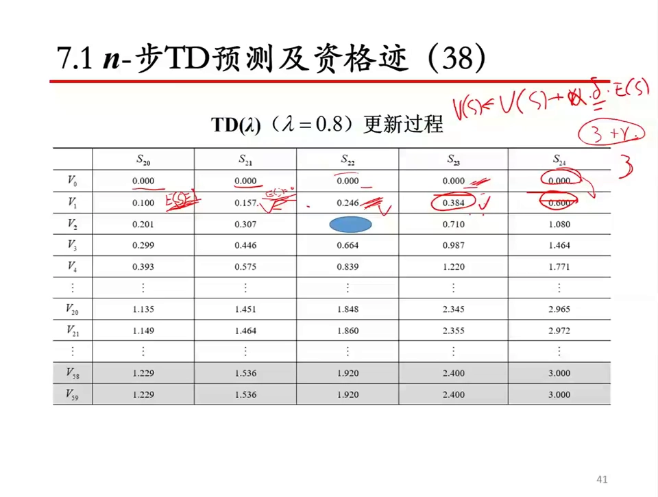

# TD(λ) 与资格迹：让 TD 误差按资格迹回溯

> 本篇整理自苏州大学《强化学习》课程第七讲 例 7.3：把 $n$ 步 TD 预测、TD(0) 与 TD($\lambda$) 三种算法放到同一个确定环境扫地机器人问题上做对比分析。视频地址：[BV1Hhz9YfEhf](https://www.bilibili.com/video/BV1Hhz9YfEhf/)。$n$ 步 TD 的定义与伪代码见同目录的《n 步 TD 预测：从一步自举到多步回报》。

## 本讲要解决的核心问题（SCQA）

**背景**：$n$ 步 TD 已经能在 TD(0) 与蒙特卡洛之间选一个折中：走 $n$ 步再回头更新，用第 $n$ 步的状态价值兜底。$n=1$ 是 TD(0)，$n\to\infty$ 是 MC。

**冲突**：但 $n$ 是一个**要手选的整数**。选小了，目标里估计值的成分多、偏差大，一次只能往前传一个状态，收敛慢；选大了，要等很久才能更新，而且目标里塞进太多真实奖励、方差回升。更根本的问题是：**「该往回传多远」本来就不该是一个固定常数**——离奖励近的状态该多传一点，离得远的状态该少传一点，可 $n$ 步 TD 对所有状态一视同仁。

**疑问**：能不能不选 $n$，而是让**所有** $n$ 的回报按权重混合起来？更进一步：能不能不等 $n$ 步，而是给每个状态记一条「最近被访问过多少次、还欠多少账」的**记忆**，每次拿到 TD 误差就按这条记忆摊回去？

**回答（中心思想）**：这就是 **TD($\lambda$)** 与**资格迹（eligibility trace）**。资格迹 $e_t(s)$ 是每个状态的一本「欠账账本」：每走一步，所有账本先按 $\gamma\lambda$ 衰减；当前访问到的状态账本加 1。等 TD 误差 $\delta_t$ 算出来，就把它乘以各状态的资格迹、再乘学习率，**一次性摊回所有状态**——不再需要等 $n$ 步，也不需要选 $n$。视频里的实验正好把这件事量化了：同样跑 5 个状态，TD(0) 一轮只更新 1 个状态、要 88 轮收敛；3 步 TD 一轮更新 3 个状态、33 轮收敛；TD($\lambda$) 一轮就把 5 个状态全更新了一遍，58 轮收敛。

---

## 一、实验设置：确定环境下的扫地机器人

这个例子沿用前面章节的扫地机器人任务，但设置与之前不同：

- 学习率**固定**为 $\alpha = 0.2$（前面章节用的是逐渐衰减的学习率，比如从 0.05 衰减到 0）；
- 折扣系数 $\gamma = 0.8$（因为后面还要用 $\gamma$ 乘以 $\lambda$）；
- 所有状态的价值函数初始值为零；
- 智能体采取**确定性策略**，沿一条固定轨迹走：$20 \to 21 \to 22 \to 23 \to 24 \to 19$，在状态 19 捡到垃圾，得到 $+3$ 的即时奖励。

之所以只盯住 $s_{20}$ 到 $s_{24}$ 这 5 个状态，是因为它们紧挨着奖励源：离 19 太远的状态一开始价值都是零，观察它们的更新过程没什么信息量。

---

## 二、TD(0)：一轮只往前传一个状态

TD(0) 的更新是 $V(S_t) \leftarrow V(S_t) + \alpha[\,R_{t+1} + \gamma V(S_{t+1}) - V(S_t)\,]$。第一轮（$V_1$）里：

- $s_{20}$ 到 $s_{23}$ 的即时奖励都是 0，下一状态的价值也还是 0，所以 TD 误差是 $0 + 0.8 \times 0 - 0 = 0$，价值不变，还是 0；
- 只有 $s_{24}$ 不一样：它走到 19 能拿到即时奖励 3，于是

$$
V(s_{24}) \leftarrow 0 + 0.2 \times \big(3 + 0.8 \times \underbrace{V(s_{19})}_{=\,0} - 0\big) = 0.6
$$

所以第一轮结束时，**只有 $s_{24}$ 这一个状态变了**（从 0 变成 0.6），其余全是 0。第二轮 $s_{23}$ 才有非零的下一状态价值可用，$s_{24}$ 也从 0.6 更新到 1.08：

$$
V(s_{24}) \leftarrow 0.6 + 0.2 \times (3 + 0.8 \times 0 - 0.6) = 0.6 + 0.2 \times 2.4 = 1.08
$$

第三轮 $s_{22}$ 开始动（0.015），$s_{24}$ 更新到 1.464；第四轮 $s_{21}$ 也出现非零值（0.002），$s_{23}$ 涨到 0.434。也就是说，**奖励的信息像一道波一样，每轮往回传一个状态**。要等这道波传到 $s_{20}$，再让所有状态收敛，一共花了 88 轮：$V_{88}$ 与 $V_{89}$ 都是 $(1.229,\ 1.536,\ 1.920,\ 2.400,\ 3.000)$。

---

## 三、3 步 TD：一轮往前传三个状态

把 $n$ 换成 3，目标值就变成 3 步回报 $G_{t:t+3}$：三步真实奖励加上 $\gamma^3$ 乘以第三步状态的估计值。第一轮里，$s_{22}$ 往前看三步正好看到 19 的奖励：

$$
G_{t:t+3} = 0 + \gamma \cdot 0 + \gamma^2 \cdot 3 + \gamma^3 V(s_{19}) = 0.64 \times 3 = 1.92
$$

$$
V(s_{22}) \leftarrow 0 + 0.2 \times (1.92 - 0) = 0.384
$$

同理 $s_{23}$ 的 3 步回报是 $\gamma \cdot 3 = 2.4$，更新得 $0.48$；$s_{24}$ 的 3 步回报就是 3，更新得 $0.6$。所以**第一轮就更新了三个状态**（$s_{22}, s_{23}, s_{24}$），第二轮再往前蔓延三个，很快就把整条轨迹覆盖住。结果它 33 轮就收敛到与 TD(0) 完全相同的终值 $(1.229,\ 1.536,\ 1.920,\ 2.400,\ 3.000)$——**同样的答案，快了两倍多**。

---

## 四、TD($\lambda$)：用资格迹把误差摊回去

### 4.1 后向观点：一本会衰减的账本

$n$ 步 TD 要等 $n$ 步；TD($\lambda$) 换了个思路，**不等**，而是给每个状态维护一条资格迹 $e_t(s)$。每走一步：

$$
e_t(s) = \gamma\lambda\, e_{t-1}(s) + \mathbb{1}(S_t = s), \qquad \forall s
$$

也就是**所有状态的资格迹先统一乘上 $\gamma\lambda$ 衰减一次，当前访问到的那个状态再加 1**。然后算出这一步的 TD 误差

$$
\delta_t = R_{t+1} + \gamma V(S_{t+1}) - V(S_t)
$$

用它更新**所有**状态：

$$
V(s) \leftarrow V(s) + \alpha\, \delta_t\, e_t(s), \qquad \forall s
$$

这就是视频里手写的那一行 $V(S) \leftarrow V(S) + \alpha \cdot \delta \cdot E(S)$。它的含义是：**TD 误差不只算在当前状态头上，而是按「谁最近被访问过、访问得多近」按比例摊回所有状态**。$\lambda = 0$ 时资格迹只有当前状态是 1，退化成 TD(0)；$\lambda = 1$ 时衰减只剩 $\gamma$，等价于把误差一路摊到情节起点，接近蒙特卡洛。

### 4.2 用数字验证：第一轮就更新了五个状态

视频取 $\lambda = 0.8$，于是衰减因子 $\gamma\lambda = 0.8 \times 0.8 = 0.64$。第一轮走到 $s_{24}$ 时，TD 误差是 $\delta = 3$（因为 $V(s_{19}) = 0$、$V(s_{24}) = 0$），而各状态的资格迹正好是「离 $s_{24}$ 的距离 $k$ 次方」：

$$
V(s_{24}) \leftarrow 0.2 \times 3 \times 0.64^{0} = 0.600, \quad
V(s_{23}) \leftarrow 0.2 \times 3 \times 0.64^{1} = 0.384
$$

$$
V(s_{22}) \leftarrow 0.2 \times 3 \times 0.64^{2} = 0.246, \quad
V(s_{21}) \leftarrow 0.157, \quad
V(s_{20}) \leftarrow 0.100
$$

对照表格，$V_1$ 这一行正是 $0.100,\ 0.157,\ 0.246,\ 0.384,\ 0.600$——**五个状态在第一轮全部被更新了**，而 TD(0) 第一轮只更新了 $s_{24}$ 一个。这就是资格迹的威力：一次 TD 误差，按衰减的权重摊回整条轨迹。

代价是每步都要对**所有**状态做一次衰减和更新，计算量比 TD(0) 大；而且资格迹的衰减长度由 $\lambda$ 控制，$\lambda$ 仍然是一个要调的超参数——只是它比 $n$ 更平滑，不必是整数。

### 4.3 顺带一提：前向观点

资格迹这套「边走边摊」的说法叫**后向观点**（backward view），因为它是从当前时刻往回看、把误差往回摊。与之对应还有一种**前向观点**（forward view）：把所有 $n$ 步回报按 $\lambda$ 做几何加权平均，得到 $\lambda$ 回报

$$
G_t^{\lambda} = (1-\lambda)\sum_{n=1}^{\infty} \lambda^{\,n-1} G_{t:t+n}
$$

再用它当目标值更新。$\lambda = 0$ 时只剩 $G_{t:t+1}$（TD(0)），$\lambda \to 1$ 时权重几乎全压在 $G_t$（MC）上。前向观点概念清楚但**不可在线实现**（要等无穷多步），后向观点用资格迹把它变成了每步都能做的增量更新——视频采用的是后向观点。

---

## 五、三者对比

| 对比项 | TD(0) | $n$ 步 TD（$n=3$） | TD($\lambda$)（$\lambda=0.8$） |
| :-- | :-- | :-- | :-- |
| 更新目标 | 1 步奖励 + 下一状态估计 | 3 步奖励 + 第 3 步状态估计 | 所有 $n$ 步回报的 $\lambda$ 加权（后向实现：$\delta_t e_t(s)$） |
| 要等几步才更新 | 0 步（立刻） | 2 步（延迟 $n-1$） | 0 步（立刻，靠资格迹摊回） |
| 第一轮更新了几个状态 | 1 个（$s_{24}$） | 3 个（$s_{22},s_{23},s_{24}$） | 5 个（$s_{20}\sim s_{24}$ 全部） |
| 收敛轮数（本例） | 88 轮 | 33 轮 | 58 轮 |
| 收敛到的终值 | $1.229,\ 1.536,\ 1.920,\ 2.400,\ 3.000$ | 同左 | 同左 |
| 每步计算量 | 最小 | 中（累加 $n$ 个奖励） | 大（对所有状态衰减并更新） |

三点结论：

1. **三种方法收敛到同一个答案**。它们的区别只在「奖励信息往回传的速度」，不在最终估计的目标。
2. **都比 TD(0) 快**。TD(0) 一轮只传一个状态，信息要爬 5 个状态才到 $s_{20}$；$n$ 步 TD 和 TD($\lambda$) 都是一次摊多个状态。
3. **$n$ 步 TD 与 TD($\lambda$) 各有取舍**。$n$ 步 TD 要等 $n$ 步、每步只算 $n$ 个奖励，计算便宜；TD($\lambda$) 不用等、一次摊回所有状态，但每步都要遍历全部状态，计算更贵。本例里 3 步 TD 的 33 轮还快过 TD($\lambda$) 的 58 轮——**没有哪个 $n$ 或 $\lambda$ 在所有任务上都最优**，这也是它们都要作为超参数来调的原因。

---

## 小结

- **一句话**：TD($\lambda$) = 给每个状态记一条会衰减的资格迹，每步把 TD 误差按资格迹摊回所有状态。
- **资格迹更新**：$e_t(s) = \gamma\lambda\,e_{t-1}(s) + \mathbb{1}(S_t = s)$——所有状态先衰减，当前状态再加 1。
- **价值更新**：$V(s) \leftarrow V(s) + \alpha\,\delta_t\,e_t(s)$，其中 $\delta_t = R_{t+1} + \gamma V(S_{t+1}) - V(S_t)$。
- **两个端点**：$\lambda = 0$ 退化为 TD(0)（只有当前状态被更新），$\lambda = 1$ 衰减只剩 $\gamma$、接近蒙特卡洛。
- **与 $n$ 步 TD 的关系**：$n$ 步 TD 是「等 $n$ 步、用第 $n$ 步兜底」；TD($\lambda$) 是「不等、用资格迹把所有 $n$ 的回报加权混合」，后向观点是它的在线实现。
- **实验结论**（扫地机器人，$\alpha=0.2$、$\gamma=0.8$）：第一轮更新状态数 TD(0) 为 1 个、3 步 TD 为 3 个、TD($\lambda$) 为 5 个；收敛轮数分别为 88、33、58，终值完全相同。

## 关键术语速查

| 术语 | 一句话解释 |
| :-- | :-- |
| TD($\lambda$) | 用资格迹把 TD 误差按衰减权重摊回所有状态的 TD 方法，$\lambda$ 控制回摊的长度。 |
| 资格迹（eligibility trace）$e_t(s)$ | 每个状态的「欠账账本」：每步乘 $\gamma\lambda$ 衰减，被访问到时加 1。 |
| 后向观点（backward view） | 从当前时刻往回看，把 TD 误差摊给最近访问过的状态；TD($\lambda$) 的在线实现。 |
| 前向观点（forward view） | 把所有 $n$ 步回报按 $\lambda$ 几何加权成 $\lambda$ 回报当目标；概念清楚但要等无穷多步。 |
| $\lambda$ 回报 $G_t^{\lambda}$ | $(1-\lambda)\sum_{n\ge 1}\lambda^{n-1}G_{t:t+n}$，所有 $n$ 步回报的加权平均。 |
| 衰减因子 $\gamma\lambda$ | 资格迹每步的衰减倍数；本例中 $0.8\times0.8=0.64$，决定误差能往回摊多远。 |