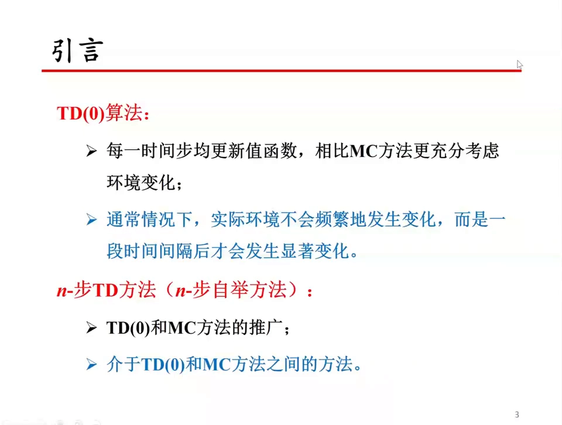
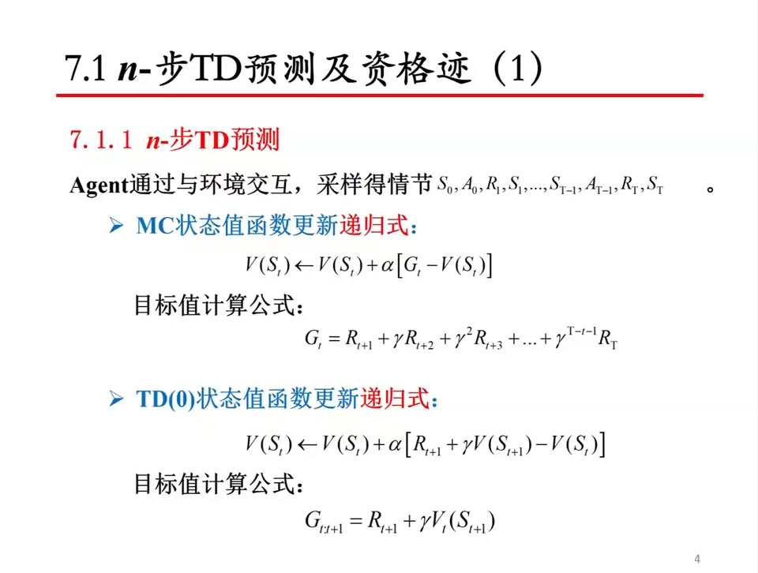
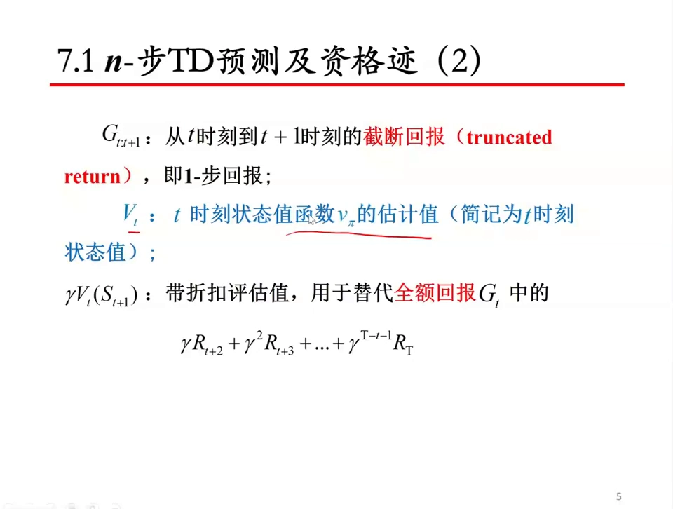
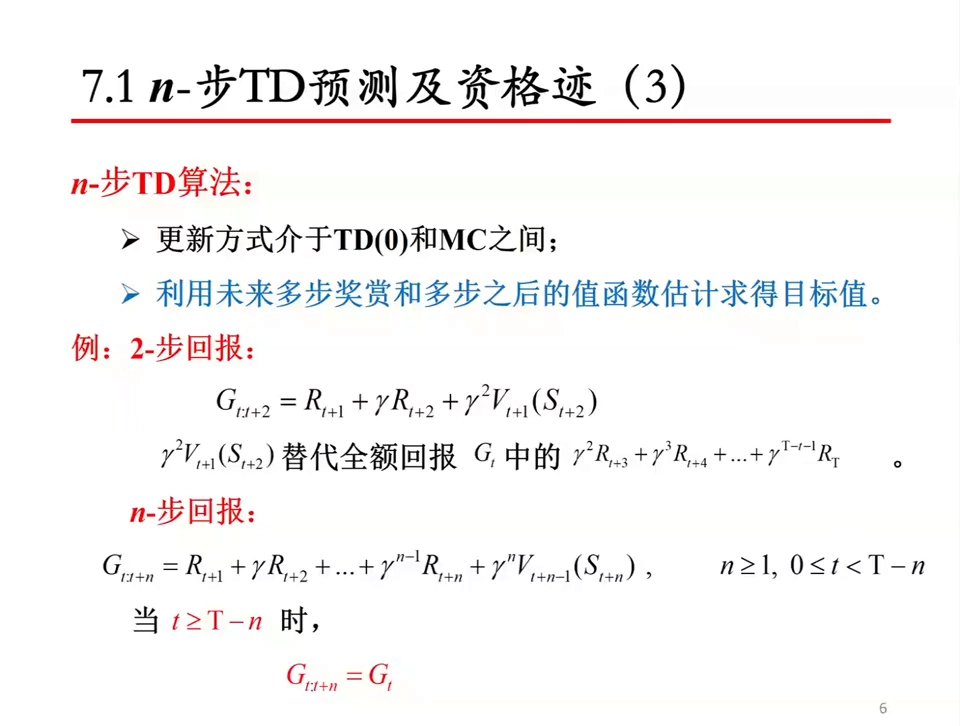
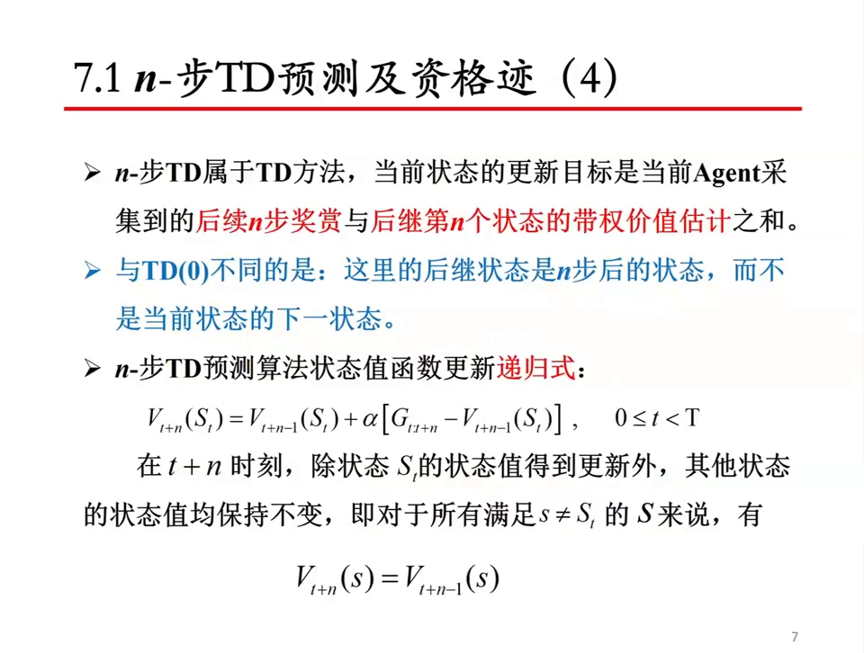
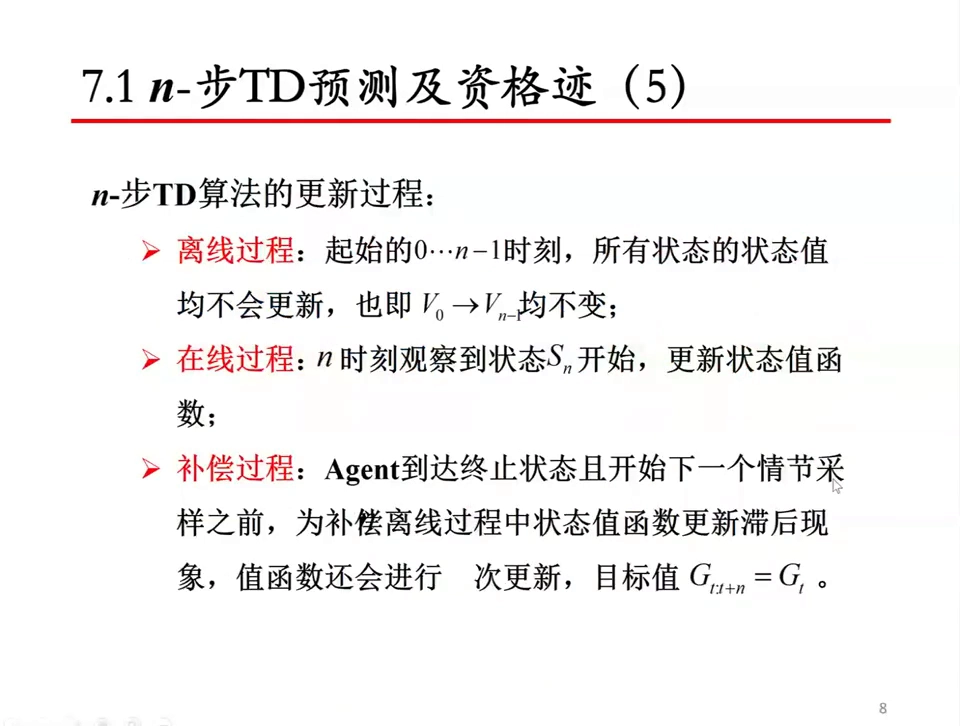
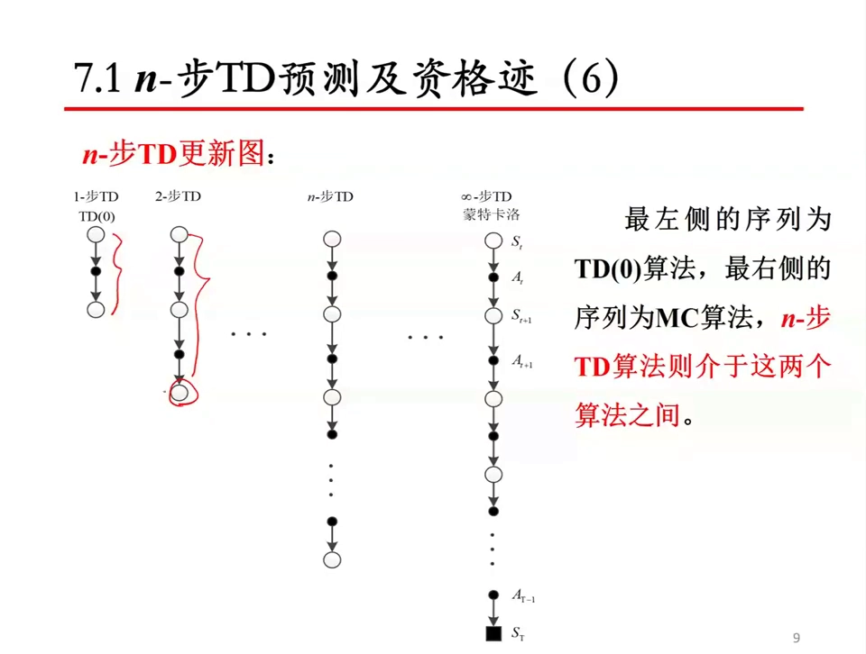
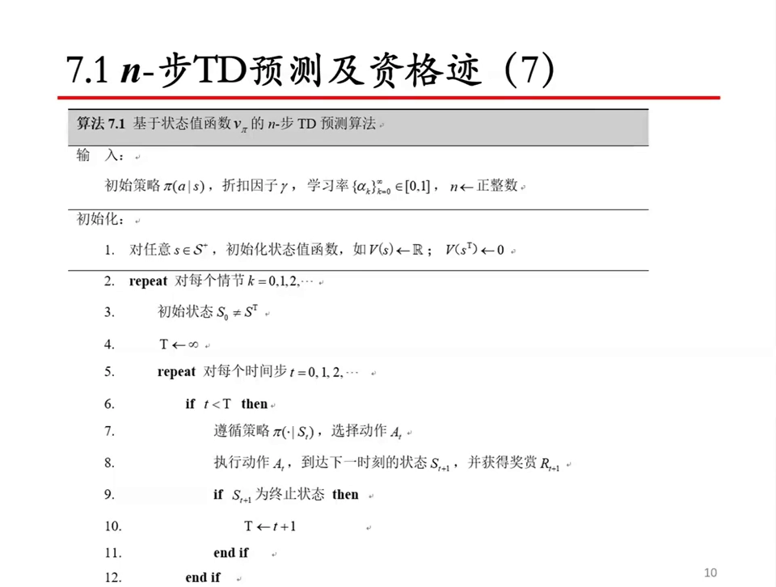
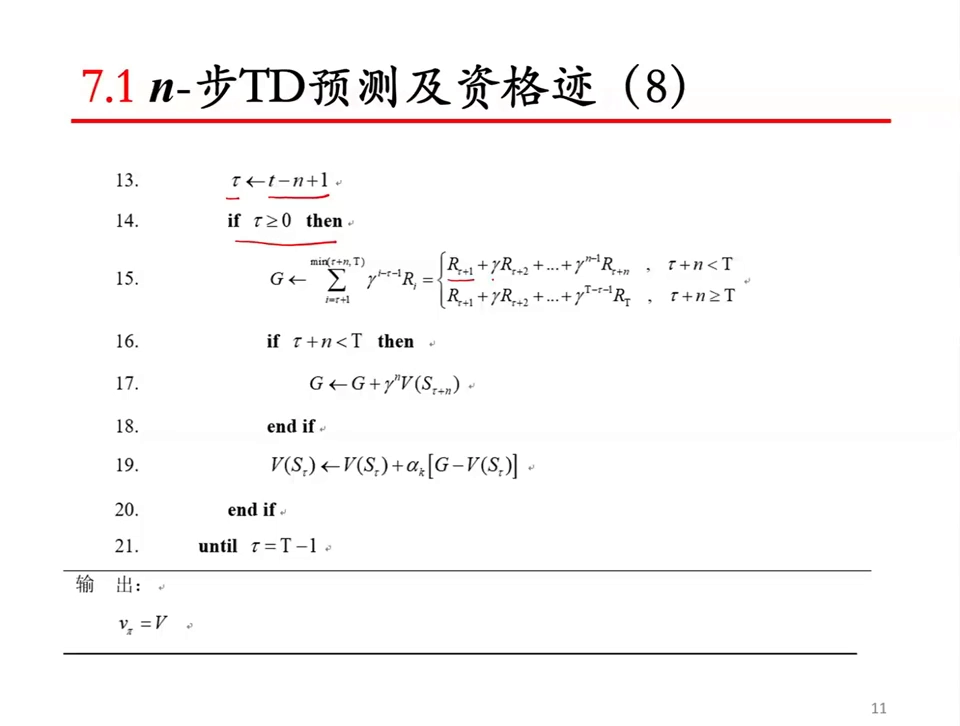

# n 步 TD 预测：从一步自举到多步回报

> 本篇整理自苏州大学《强化学习》课程第七讲「$n$-步时序差分」的 7.1 节「$n$-步 TD 预测」。视频地址：[BV1Hhz9YfE6X](https://www.bilibili.com/video/BV1Hhz9YfE6X/)。同目录的《TD（λ）与资格迹：TD 误差按资格迹回溯》接着讲本篇最后提到的资格迹。

## 本讲要解决的核心问题（SCQA）

**背景**：TD(0)（见 5.2 的《TD(0) 预测算法：TD 目标与 TD 误差》）每一步都更新一次价值函数，它的目标值是 $r_{t+1} + \gamma V(s_{t+1})$：用**一步真实奖励**加上**对下一个状态价值的估计**。蒙特卡洛（MC）则相反，它一直走到情节结束，用**全部真实奖励**累加出来的回报 $G_t$ 当目标。

**冲突**：两端各有各的毛病。TD(0) 的目标里只有一个真实数字 $r_{t+1}$，剩下的全靠估计，估计不准就一路偏下去；MC 的目标全是真实奖励，方差大，而且必须等整个情节跑完才能更新——中间状态的价值在更新之前一直在变，MC 等于把「情况发生变化」这件事全都算进了目标里。

**疑问**：既然一步太少、走到最后太多，能不能**走 $n$ 步再更新**？也就是用接下来 $n$ 步的真实奖励，再加上第 $n$ 步那个状态的估计来兜底？

**回答（中心思想）**：能，这就是 **$n$ 步 TD（$n$-step TD，也叫 $n$ 步自举）**。它的目标值叫 **$n$ 步回报** $G_{t:t+n}$：保留 $n$ 步真实奖励，剩下的部分用第 $n$ 步状态的价值估计一次性替代。$n=1$ 就是 TD(0)，$n\to\infty$ 退化成 MC，中间的 $n$ 就是两者之间的连续过渡。代价是**要等**：更新 $S_t$ 必须等到 $t+n$ 时刻，因此它既不是纯在线、也不是纯离线，而是一种「延迟 $n$ 步」的在线方法。



---

## 一、为什么需要多步：一个通勤的例子

视频用「从学校回家」打比方。把路上经过的每个地点当成一个状态，要预测的量是「从这里到家还要多久」。

用 **MC 方法**，你必须**真的走到家**才能更新：今天走了 40 分钟到家，于是回头把「走到东环路」「走到园区某处」这些状态各更新一次；明天车少、35 分钟到家，再更新一遍；后天堵车、走了一个半小时，也照样更新一遍。问题在于——一个半小时是**极端情况**，但 MC 因为「要等最后才更新」，只能把这个极端值原封不动地灌进每一个中间状态里。

用 **TD 方法**就不一样：更新某个状态时，用的是**对下一个状态价值的估计**，而不是走到最后才拿到的真实总时间。所以即使某天路况突变，对中间状态的估计影响也不大。视频由此给出一个经验判断：**实际环境不会频繁变化，而是一段时间间隔之后才发生显著变化**，所以大多数情况下一步 TD 就够用——这也正是 TD(0) 的立足点。

那么 $n$ 步 TD 的位置就很清楚了：它把「走一步就更新」放宽成「走 $n$ 步再更新」，是 TD(0) 的推广，也是 MC 的推广，落在两者之间。



---

## 二、从截断回报到 $n$ 步回报

### 2.1 先把 MC 和 TD(0) 摆在一起

设智能体与环境交互采样得到一个情节 $S_0, A_0, R_1, S_1, \dots, S_{T-1}, A_{T-1}, R_T, S_T$。两种方法的更新式结构完全一样，都是「目标值减去当前估计」：

$$
\begin{aligned}
\text{MC：}\quad & V(S_t) \leftarrow V(S_t) + \alpha\big[\, G_t - V(S_t) \,\big], \qquad G_t = R_{t+1} + \gamma R_{t+2} + \gamma^2 R_{t+3} + \cdots + \gamma^{T-t-1} R_T \\
\text{TD(0)：}\quad & V(S_t) \leftarrow V(S_t) + \alpha\big[\, R_{t+1} + \gamma V(S_{t+1}) - V(S_t) \,\big]
\end{aligned}
$$

差别只在目标值。MC 的目标 $G_t$ 是从 $t$ 一直加到终止状态 $T$ 的**全额回报**；TD(0) 的目标 $G_{t:t+1} \doteq R_{t+1} + \gamma V_t(S_{t+1})$ 只保留一步真实奖励，其余用估计值顶上。

### 2.2 截断回报：把「全额」砍掉一截

TD(0) 的目标值有一个正式名字——**截断回报（truncated return）**，记作 $G_{t:t+1}$，意思是「从 $t$ 时刻到 $t+1$ 时刻这一段」的回报，即 **1 步回报**。

式子里的 $V_t$ 是 $t$ 时刻对状态价值函数 $v_\pi$ 的估计（简称为 $t$ 时刻状态值）。注意它的下标是 $t$：**用的是更新发生那一刻的价值表**，所以随着更新推进，同一个 $V_t(S_{t+1})$ 会跟着变——这就是「异步计算」的意思。

关键的一步替换在这里：带折扣的评估值 $\gamma V_t(S_{t+1})$ 替代的是全额回报 $G_t$ 里的

$$
\gamma R_{t+2} + \gamma^2 R_{t+3} + \cdots + \gamma^{T-t-1} R_T
$$

也就是「第二步往后所有真实奖励」这一整串。把它换成一个估计值，就得到了 TD(0)；把它换成「$n$ 步之后的估计值」，就得到 $n$ 步 TD。



### 2.3 两步回报与 $n$ 步回报

先看 2 步：保留两步真实奖励，第三步开始交给估计值。

$$
G_{t:t+2} = R_{t+1} + \gamma R_{t+2} + \gamma^2 V_{t+1}(S_{t+2})
$$

这里 $\gamma^2 V_{t+1}(S_{t+2})$ 替代的是全额回报 $G_t$ 里的 $\gamma^2 R_{t+3} + \gamma^3 R_{t+4} + \cdots + \gamma^{T-t-1} R_T$。写成一般形式就是 **$n$ 步回报**：

$$
G_{t:t+n} = R_{t+1} + \gamma R_{t+2} + \cdots + \gamma^{n-1} R_{t+n} + \gamma^{n} V_{t+n-1}(S_{t+n}), \qquad n \ge 1,\; 0 \le t < T-n
$$

读法是：**$n$ 步真实奖励按 $\gamma$ 逐项折扣，再加上第 $n$ 步状态的折扣估计值**。两个端点都对得上：

- $n=1$：只剩 $R_{t+1} + \gamma V_t(S_{t+1})$，就是 TD(0)；
- $n \to \infty$：估计项被推到情节末尾，$V$ 在终止状态取 $0$，于是只剩全额回报 $G_t$，就是 MC。

还要处理一个边界：如果走不到 $n$ 步情节就结束了（$t \ge T-n$），那就没有「第 $n$ 步状态」可用，此时直接取

$$
G_{t:t+n} = G_t
$$

也就是退化成全额回报——反正后面已经没有奖励了，剩下的项全是零。



---

## 三、更新式：一次只更新一个状态

有了目标值，更新式照抄 TD(0) 的形状：

$$
V_{t+n}(S_t) = V_{t+n-1}(S_t) + \alpha\big[\, G_{t:t+n} - V_{t+n-1}(S_t) \,\big], \qquad 0 \le t < T
$$

$$
V_{t+n}(s) = V_{t+n-1}(s), \qquad \forall s \neq S_t
$$

第二行是容易被忽略但很重要的一条：**在 $t+n$ 时刻，除了状态 $S_t$ 的价值被更新，其他状态的价值都保持不变**。也就是说，$n$ 步 TD 每走一步仍然只更新**一个**状态，只不过这个状态是「$n$ 步之前」的那个状态，而且用的价值表是 $t+n-1$ 时刻的版本（不是最初 $t$ 时刻的版本）。

用一句话概括 $n$ 步 TD 与 TD(0) 的区别：**当前状态的更新目标，是接下来 $n$ 步奖励与第 $n$ 个状态带权价值估计之和；这里的后继状态是 $n$ 步之后的状态，而不是当前状态的下一个状态。**



---

## 四、在线、离线与补偿

因为要等 $n$ 步，$n$ 步 TD 的更新过程会出现三个值得分开说的阶段：

| 阶段 | 发生了什么 |
| :-- | :-- |
| 离线过程 | 情节刚开始的 $0 \sim n-1$ 时刻，还不满 $n$ 步，所有状态的价值都不会更新，即 $V_0 \to V_{n-1}$ 均不变 |
| 在线过程 | 从 $n$ 时刻观察到状态 $S_n$ 开始，每走一步就回头更新一个状态，价值函数开始变化 |
| 补偿过程 | 智能体到达终止状态、且开始下一个情节采样之前，为补偿离线过程中「更新滞后」的现象，价值函数还会再做若干次更新，此时目标值取 $G_{t:t+n} = G_t$ |

「补偿」这一步的作用是把情节末尾那几步补上：最后 $n-1$ 个状态等不到完整的 $n$ 步就结束了，只能拿全额回报 $G_t$ 当目标，把它们逐个更新完。



---

## 五、更新图：$n$ 步 TD 站在 TD(0) 与 MC 之间

把三种方法的「回溯深度」画成一条竖线，关系一目了然：

- **1 步 TD，即 TD(0)**：只往下看一层（一个状态、一个动作），立刻用下一状态的价值兜底；
- **$n$ 步 TD**：往下看 $n$ 层，用第 $n$ 层的状态价值兜底；
- **$\infty$ 步 TD，即蒙特卡洛**：一直看到终止状态 $S_T$，没有任何估计值参与，全用真实奖励。

所以 $n$ 步 TD 就夹在 TD(0) 和 MC 之间，$n$ 越大越靠近 MC，$n$ 越小越靠近 TD(0)。



---

## 六、算法 7.1：$n$ 步 TD 预测

把上面的式子整理成伪代码，就是教材里的算法 7.1（基于状态值函数 $v_\pi$ 的 $n$ 步 TD 预测）。输入是策略 $\pi(a\mid s)$、折扣因子 $\gamma$、学习率序列 $\{\alpha_k\}$ 和正整数 $n$。

```text
算法 7.1  基于状态值函数 v_π 的 n 步 TD 预测算法
输入：初始策略 π(a|s)，折扣因子 γ，学习率 {α_k} ⊆ [0,1]，n ← 正整数

初始化：
  1. 对任意 s ∈ S⁺，初始化状态值函数，如 V(s) ← 任意实数；V(s_T) ← 0
  2. repeat 对每个情节 k = 0,1,2,…
  3.     初始状态 S₀ ≠ s_T
  4.     T ← ∞
  5.     repeat 对每个时间步 t = 0,1,2,…
  6.         if t < T then
  7.             遵循策略 π(·|S_t)，选择动作 A_t
  8.             执行动作 A_t，到达下一时刻的状态 S_{t+1}，并获得奖赏 R_{t+1}
  9.             if S_{t+1} 为终止状态 then
 10.                 T ← t + 1
 11.             end if
 12.         end if
 13.         τ ← t − n + 1
 14.         if τ ≥ 0 then
 15.             G ← Σ_{i=τ+1}^{min(τ+n, T)} γ^{i−τ−1} R_i
 16.             if τ + n < T then
 17.                 G ← G + γⁿ V(S_{τ+n})
 18.             end if
 19.             V(S_τ) ← V(S_τ) + α_k [ G − V(S_τ) ]
 20.         end if
 21.     until τ = T − 1
 22. end repeat
输出：v_π ≈ V
```

伪代码里最关键的三个量是 $\tau$、$G$ 和那个 `if τ + n < T`：

- $\tau = t-n+1$ 是「该被更新的那个状态」的下标。$\tau \ge 0$ 意味着已经走满 $n$ 步，可以回头更新了——这就是前面说的「延迟 $n$ 步」在代码里的样子；
- 第 15 行先把 $\tau+1$ 到 $\tau+n$ 这 $n$ 个奖励按 $\gamma$ 折扣累加。如果中途就到了终止状态（$\min$ 取到 $T$），累加自然只到 $R_T$ 为止；
- 第 16–18 行判断「$n$ 步之后是否还没结束」：没结束就补上 $\gamma^n V(S_{\tau+n})$ 这个估计项；已经结束了就不补，等价于 $V=0$，此时 $G$ 就是全额回报。

循环条件 `until τ = T − 1` 保证情节末尾那 $n-1$ 个滞后状态都会被补更新——这正是第四节说的「补偿过程」。





---

## 小结

- **一句话**：$n$ 步 TD 就是把 TD(0) 的目标从「1 步真实奖励 + 1 个估计值」放宽成「$n$ 步真实奖励 + 1 个估计值」。
- **目标值**：$G_{t:t+n} = R_{t+1} + \gamma R_{t+2} + \cdots + \gamma^{n-1}R_{t+n} + \gamma^n V_{t+n-1}(S_{t+n})$；当 $t \ge T-n$ 时退化为全额回报 $G_t$。
- **两个端点**：$n=1$ 是 TD(0)，$n\to\infty$ 是蒙特卡洛，$n$ 步 TD 夹在中间。
- **更新式**：$V_{t+n}(S_t) = V_{t+n-1}(S_t) + \alpha[G_{t:t+n} - V_{t+n-1}(S_t)]$，且同一时刻只更新 $S_t$ 一个状态，其余状态价值不变。
- **代价**：必须等满 $n$ 步才能更新，因此有「前 $n-1$ 步不更新」的离线阶段和情节末尾的补偿阶段。
- **与 TD(0) 的唯一区别**：兜底用的后继状态从「下一个状态」换成了「$n$ 步之后的状态」。

## 关键术语速查

| 术语 | 一句话解释 |
| :-- | :-- |
| $n$ 步 TD（$n$-step TD） | 用 $n$ 步真实奖励加第 $n$ 步状态价值估计作为目标值的 TD 方法，介于 TD(0) 与 MC 之间。 |
| $n$ 步回报（$n$-step return）$G_{t:t+n}$ | 从 $t$ 到 $t+n$ 的折扣奖励之和，再加 $\gamma^n$ 乘以第 $n$ 步状态的价值估计。 |
| 截断回报（truncated return） | 把全额回报在某一层「砍断」、用估计值接上的回报；$G_{t:t+1}$ 即 1 步回报。 |
| 全额回报 $G_t$ | 从 $t$ 一直累加到终止状态的真实折扣回报，MC 的目标值。 |
| 自举（bootstrapping） | 用自己当前的估计值来构造更新目标；$n$ 步 TD 只在第 $n$ 步自举一次。 |
| 补偿过程 | 情节结束后、下一情节开始前，对滞后的最后 $n-1$ 个状态补做的更新，目标值取 $G_t$。 |