# 第5讲：时序差分学习——用「自举」与「采样」结合动态规划与蒙特卡洛

> 本篇整理自上海交通大学张伟楠老师《强化学习》课程第 5 讲「时序差分学习：自举与采样」。视频地址：[BV1t14y177XD](https://www.bilibili.com/video/BV1t14y177XD/)。

## 本讲要解决的核心问题（SCQA）

**背景**：我们已经有了两套估计状态价值 $V(s)$ 的办法。一套是**动态规划（Dynamic Programming, DP）**：知道环境的转移概率和奖励函数，直接用贝尔曼方程反复迭代；另一套是**蒙特卡洛（Monte Carlo, MC）**：不知道环境，就从某个状态出发按策略采样一整条轨迹，用这条轨迹的真实累积奖励 $G_t$ 去更新 $V(s)$。

**冲突**：这两套办法各有硬伤。DP 要求环境模型已知——一旦只能和环境交互、拿不到转移概率，它就用不了；MC 虽然不需要模型，却必须等一条**完整片段（episode）结束**、看到最终累积奖励才能更新一次。如果任务很长、或者根本没有终止状态，MC 就彻底没法工作了。而且一条完整轨迹上每一步都有随机性，$G_t$ 的波动很大。

**疑问**：有没有一种方法，**既不需要环境模型，又不必等整条序列结束**，就能估计 $V(s)$？

**回答（中心思想）**：有，这就是**时序差分学习（Temporal-Difference Learning, TD）**。它的做法是：只采样**一步**，拿到即时奖励 $r_{t+1}$ 和下一状态 $s_{t+1}$，然后**用自己对 $V(s_{t+1})$ 的当前估计去顶替"未来的全部奖励"**——这个"用估计代替真实"的动作叫**自举（Bootstrapping）**。于是更新目标从 MC 的 $G_t$ 变成 TD 的 $r_{t+1} + \gamma V(s_{t+1})$。一句话概括：**TD = 采样（像 MC）+ 自举（像 DP）**，它用一部分偏差换来了极低的方差、以及"边走边学"的灵活性。

---

## 一、TD 的核心思想：一步采样 + 一个估计，替掉整条序列

### 1.1 要估计的东西没变：当前策略下的真实状态价值

我们始终在问同一个问题：**当前状态 $s$ 下真正的 $V(s)$ 是多少？** 也就是从 $s$ 出发、按策略 $\pi$ 一直走下去，能拿到的折扣累积奖励的期望——这是策略 $\pi$ 的真实状态价值，记作 $V^\pi(s)$。

要估计它，最自然的办法就是**蒙特卡洛采样**：从当前状态出发，按策略（follow policy）走一步得到奖励 $r$，再走一步得到下一个奖励，一直这样走到终止，把这条轨迹上的奖励加起来。这个"真实采样出来的累积奖励"就是 $G_t$。

[【跳转到 00:31】](https://www.bilibili.com/video/BV1t14y177XD/?t=31)

### 1.2 关键拆分：累积奖励 = 这一步的即时奖励 + 未来的部分

有了 $G_t$ 之后，把它按时间拆开看，它一定可以写成两部分：

$$
G_t = r_{t+1} + \gamma \cdot \big(\text{从 } s_{t+1} \text{ 开始的累积奖励}\big)
$$

前一项 $r_{t+1}$ 是**当前这一步的即时奖励（immediate reward）**，是已经真实观测到的；后一项是"从下一状态 $s_{t+1}$ 出发还能拿到的折扣累积奖励"。

而后面这一项——按照定义——它的期望**就是** $V^\pi(s_{t+1})$。所以只要我们能拿到 $V^\pi(s_{t+1})$ 的真值，就能用 $r_{t+1} + \gamma V^\pi(s_{t+1})$ 精确地表示 $G_t$。

### 1.3 自举：用「估计值」顶替「真值」，得到 TD 目标

问题在于 $V^\pi(s_{t+1})$ 我们并不知道——它正是我们想学的东西。TD 的做法是：**先拿自己手上现有的估计 $V(s_{t+1})$ 顶上**。

$$
\text{TD 目标（TD target）}:\quad r_{t+1} + \gamma \cdot V(s_{t+1})
$$

这个替换带来一个必须记住的细节：$r_{t+1}$ 是一次真实采样，而 $V(s_{t+1})$ 是一个**估值**，所以严格来说两者之间是**约等号**的关系，不是恒等式。这正是 TD 有偏差的根源（后文第五节会展开）。

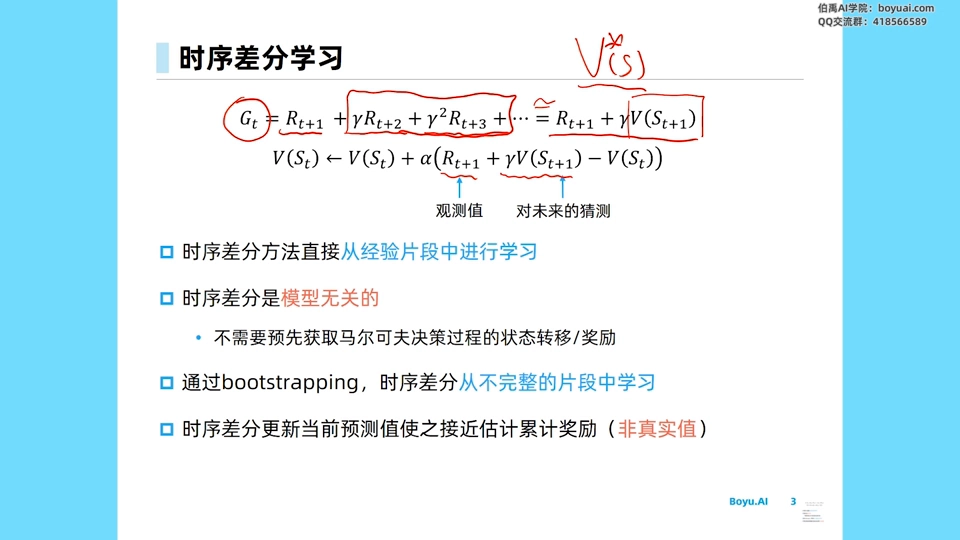

[【跳转到 00:56】](https://www.bilibili.com/video/BV1t14y177XD/?t=56)

把 MC 和 TD 的更新式并排放，差别就一目了然——**只有方括号里的"目标值"不一样**：

$$
\begin{aligned}
\text{蒙特卡洛（MC）}:\quad & V(s_t) \leftarrow V(s_t) + \alpha\big[\, G_t - V(s_t) \,\big] \\
\text{时序差分（TD）}:\quad & V(s_t) \leftarrow V(s_t) + \alpha\big[\, r_{t+1} + \gamma \cdot V(s_{t+1}) - V(s_t) \,\big]
\end{aligned}
$$

其中 $\alpha$ 是学习率。方括号里的量叫 **TD 误差（TD error）**：

$$
\delta_t = r_{t+1} + \gamma \cdot V(s_{t+1}) - V(s_t)
$$

直观理解：$r_{t+1} + \gamma V(s_{t+1})$ 是"我走了一步之后，**重新看** $V(s_t)$ 应该等于多少"，$V(s_t)$ 是"我**原先以为**它等于多少"，两者之差就是"这一步让我改变了多少看法"。所以叫**时序差分**——它是相邻两个时刻估计值之间的**差分**。

### 1.4 为什么 TD 只需要一个四元组，为什么它是 model-free

TD 一次更新只需要知道四个量：

$$
(s_t, a_t, r_{t+1}, s_{t+1})
$$

拿到这个四元组就结束了。原因很简单：**$s_{t+1}$ 之后的所有奖励，我们不再采样，而是直接用 $V(s_{t+1})$ 猜出来。**

这也解释了为什么 TD 是**模型无关（model-free）**的：整个更新过程里，我们**不需要对任何东西求期望**——不需要知道"在 $s_t$ 做 $a_t$ 之后会以多大概率转到哪个 $s_{t+1}$"，也不需要知道奖励的期望是多少。转移和奖励都是环境直接"给"我们的一个样本而已。

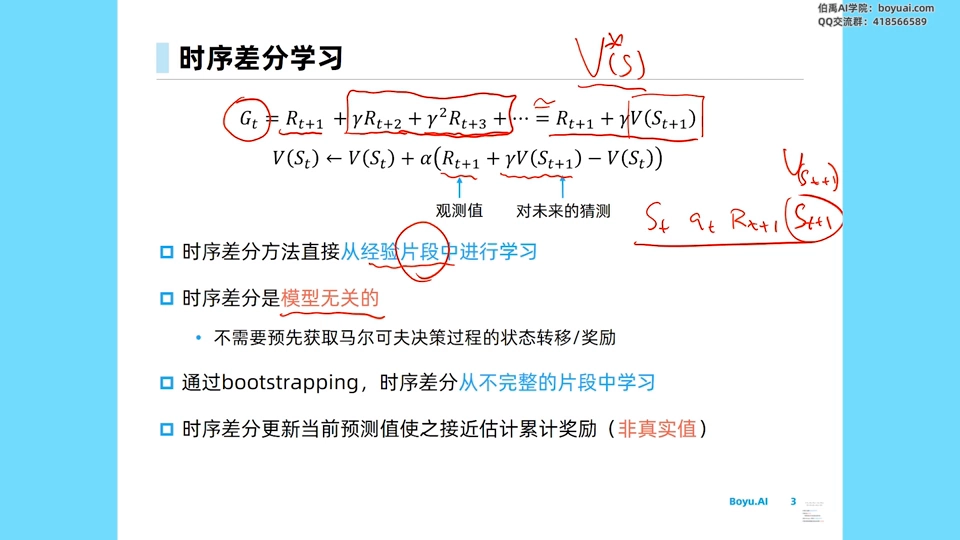

[【跳转到 02:11】](https://www.bilibili.com/video/BV1t14y177XD/?t=131)

这里要强调一个容易被忽略的点：TD 更新的是**当前的估计值**，让它去接近一个"累计奖励"；但这个累计奖励**不是**直接采样整条序列得到的，而是"**当前的观测值 + 对未来的猜测**"。这个"用猜测拼出目标"的动作，就叫**自举（bootstrapping）**——用自己已有的、还不准确的估计，去构造下一次更新的目标。

---

## 二、MC 与 TD 的目标其实一致，只是逼近方式不同

### 2.1 两者的共同目标

MC 和 TD 的目标完全相同：估计给定策略 $\pi$ 的价值函数 $V^\pi$，也就是任意状态 $s$ 的状态价值 $V^\pi(s)$。区别只在"用什么去逼近它"。

**MC 的做法**：每采样完一个 episode，就更新 $V(s_t)$，让它去接近这条轨迹的**真实累积奖励** $G_t$。为什么这样做是对的？因为整个 MDP 有随机性，每次采样出来的 $G_t$ 都是 $V(s_t)$ 的**一个样本**，而 $G_t$ 的期望**就等于** $V(s_t)$——这几乎就是价值函数的定义本身。所以某一次 $G_t$ 可能比真值高一些、也可能低一些，但做很多个 episode 之后，$V(s_t)$ 就会学到真值附近。

**TD 的做法**：更新 $V(s_t)$，让它去接近 $r_{t+1} + \gamma V(s_{t+1})$——一个"**估计出来的**累积奖励"。这里 $r_{t+1}$ 是真实的，但加上的那一项是自己对下一状态的估计。

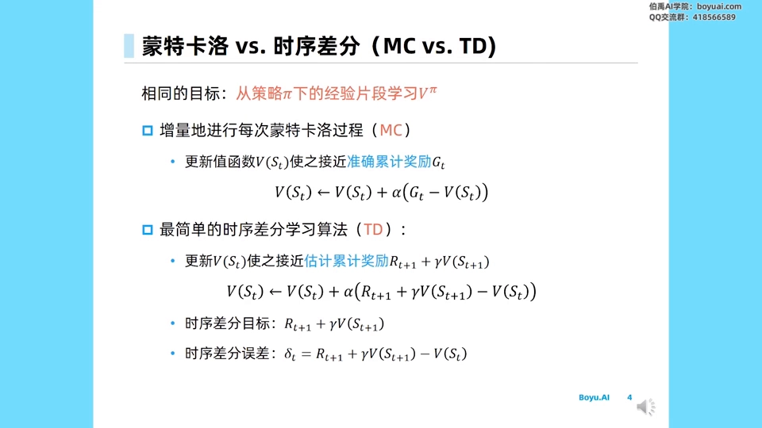

[【跳转到 03:51】](https://www.bilibili.com/video/BV1t14y177XD/?t=231)

### 2.2 一句话记住区别

- **MC**：真实 $V^\pi(s)$ 很难直接得到，于是**采样出一条完整序列**，用这条序列的累积奖励作为对 $V^\pi(s)$ 的一次估计；
- **TD**：只做**当前这一步**的观测，接下来的未来奖励用 $\gamma \cdot V(s_{t+1})$ 这个估计来代替。

换句话说，MC 是"**用真实的整条轨迹**去校准当前估计"，TD 是"**用下一步的估计**去校准当前估计"。后者听起来像是在"自己教自己"，但正因为如此，它不必等序列结束、也不必知道模型。

---

## 三、驾车回家：MC 回溯到终点，TD 只看下一步

### 3.1 例子设定

张老师用了一个经典的"开车回家"例子来直观区分 MC 和 TD。设状态由两部分信息描述：**已经过去的时间**，以及**对剩余时间的估计**；两者相加就是**预计总时间**。整个回家过程可以分成六个状态：

| 状态 | 已用时间 | 对剩余时间的估计 | 预计总时间 |
| --- | ---: | ---: | ---: |
| 离开公司（leaving office） | 0 分钟 | 30 分钟 | 30 分钟 |
| 上车（reaching car） | 5 分钟 | 35 分钟 | 40 分钟 |
| 驶离高速（leaving highway） | 20 分钟 | 15 分钟 | 35 分钟 |
| 走在 local 街道（遇到卡车） | 30 分钟 | 10 分钟 | 40 分钟 |
| 到家附近的街道 | 40 分钟 | 3 分钟 | 43 分钟 |
| 到家（arriving home） | 43 分钟 | 0 分钟 | 43 分钟 |

注意这张表里**预计总时间在来回摇摆**：出发时觉得 30 分钟能到；一上车发现下雨了，把估计调高到 40；开上高速很顺利，又降到 35；下高速走小路遇到卡车，又回到 40；最后到家发现真实耗时是 **43 分钟**。

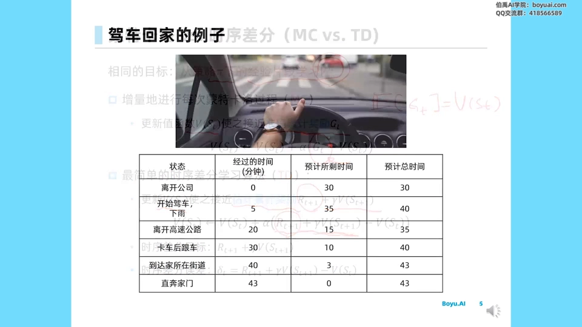

[【跳转到 06:14】](https://www.bilibili.com/video/BV1t14y177XD/?t=374)

### 3.2 MC 会怎么学：所有状态一起被拉向 43

因为整条序列已经采样结束，我们**知道最后用了 43 分钟到家**。MC 的更新目标就是这条轨迹的真实累积奖励，所以六个状态虽然各有各的估计，**它们都会被拉向同一个目标：43 分钟**。

### 3.3 TD 会怎么学：每个状态被拉向"下一个状态的估计"

TD 完全不同：它是根据**下一刻的估计**、以及**当前估计与它的差距**来做调整的。

- 处在 leaving office 时估计 30 分钟；走到 reaching car 时，估计已经变成 40 分钟。于是 TD 的目标是让 leaving office 的估计**从 30 上移到 40**。
- 但到了 reaching car 之后才发现，驶离高速时总时间估计已经从 40 **降到 35**，所以 reaching car 的估计也应该**从 40 降到 35**。
- 后面 highway、secondary road 等状态，同样都是**用下一刻的估计值来调整当前时刻的估计值**。

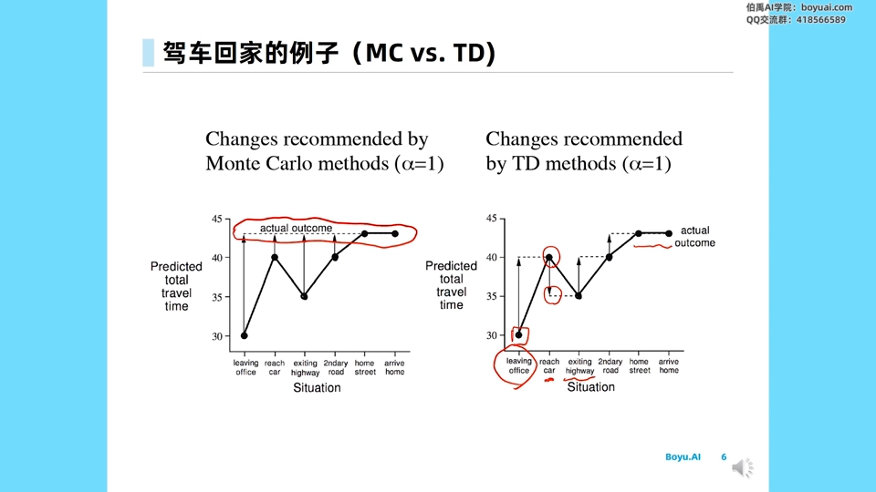

[【跳转到 07:54】](https://www.bilibili.com/video/BV1t14y177XD/?t=474)

### 3.4 两者最终都会收敛，但路径完全不同

最后 arriving home 的估计一定是准的（43 分钟、剩余 0），所以尽管 TD 会把前面一些估计**下调**（比如 reaching car 的 40 被拉到 35），最终所有状态也都会学到 43 分钟这个目标上。

差别在于**中间过程**：MC 是"一步到位、全体对齐终点"，TD 是"逐级传递、相邻状态互相拉扯"。这也解释了为什么 TD 能在序列还没结束时就开始学——它根本不需要知道终点在哪。

---

## 四、TD 更灵活：不必等片段结束，也能用于没有终止的任务

### 4.1 第一层优势：每步都能更新

TD 每一步只需要知道**下一步的状态**；而 MC 必须等整个 episode 结束、看到完整的累积奖励才能更新一次。

这个差距在实际任务里有时非常大：有些任务要拿到一条完整序列其实很困难；有些场景因为**隐私问题、政策问题**，系统只允许你看到一小段交互数据——这时你只能用 TD。

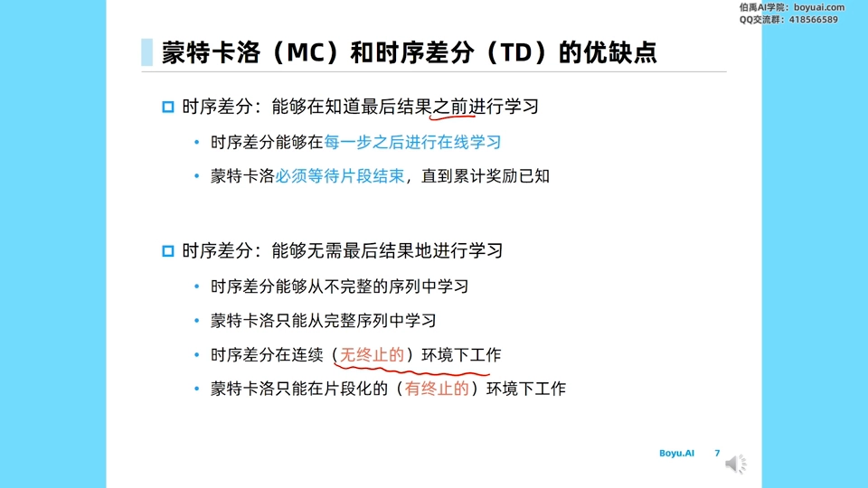

[【跳转到 09:58】](https://www.bilibili.com/video/BV1t14y177XD/?t=598)

### 4.2 第二层优势：能处理无终止状态的环境

TD 可以在**没有终止状态**的环境里工作。比如某个任务会一直持续下去、永远没有终止状态——这时 MC 根本不可能"采样到最后"，也就永远得不到那个准确的累积奖励；而 TD 每走一步就能更新一次，天然适配。

反过来，MC **一定**是在有终止的环境下才能工作：一直 sample 下去而没有终止状态，它无法停止，也就无法得到最终准确的累积奖励。

---

## 五、偏差-方差权衡：TD 方差低、偏差大

### 5.1 先看目标值：$G_t$ 无偏，TD 目标有偏

判断一个估计量好不好，通常看两个指标：**偏差（bias）**和**方差（variance）**。

- **$G_t$ 是 $V^\pi(s)$ 的无偏采样**。原因前面已经说过：$G_t$ 的期望就等于 $V^\pi(s)$，这正是当前策略 $\pi$ 在状态 $s$ 的价值函数的定义。
- **TD 的目标是有偏的**。TD 的真实目标应该是 $r_{t+1} + \gamma V^\pi(s_{t+1})$，但我们手上并没有 $V^\pi(s_{t+1})$，只有当前模型对它的估计 $V(s_{t+1})$。用一个本身还有偏差的估计去顶替真值，得到的目标自然也是 $V^\pi(s_t)$ 的**有偏估计**。

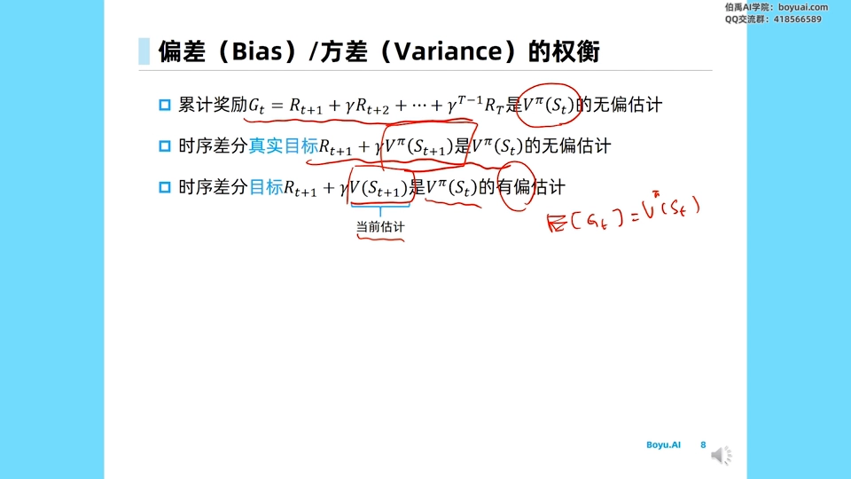

[【跳转到 11:38】](https://www.bilibili.com/video/BV1t14y177XD/?t=698)

### 5.2 再看方差：$G_t$ 方差大，TD 只差一步

为什么 $G_t$ 的方差大？因为采样一整条序列时，**每一步都有不确定性**，这些不确定性会一路累积，导致从同一个状态出发采出的不同 $G_t$ 之间差距很大——序列越长，累积奖励的波动越大。

TD 呢？它每一次的不确定性**只有一个维度**：$r_{t+1}$。下一状态的价值用现成的估计代替，不再引入新的随机性。所以 TD 的方差远低于 $G_t$。

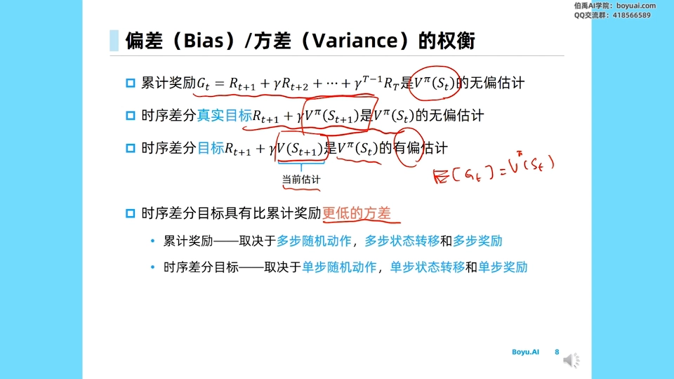

[【跳转到 13:18】](https://www.bilibili.com/video/BV1t14y177XD/?t=798)

结论：

$$
\begin{aligned}
\text{MC 目标}\quad G_t \;&\to\; \text{无偏，但高方差} \\
\text{TD 目标}\quad r_{t+1} + \gamma \cdot V(s_{t+1}) \;&\to\; \text{低方差，但有偏}
\end{aligned}
$$

这就是 TD 的本质交易：**用一点偏差，换掉大量方差**。

### 5.3 两边的完整优缺点清单

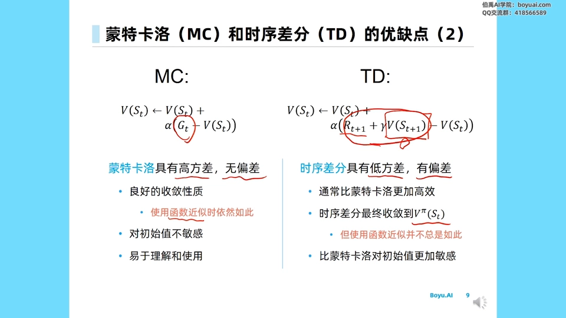

[【跳转到 14:08】](https://www.bilibili.com/video/BV1t14y177XD/?t=848)

**蒙特卡洛（MC）**

- 方差高：必须采样到整条序列终止，每一步都带来很大的不确定性；
- 但估计 $G_t$ 是**无偏**的，收敛性质良好——只是往往需要很多条完整序列才能估好；
- 用近似函数去估计 $V(s)$ 时也能有不错的收敛性，**对初始值不敏感**；
- 易于理解和使用：直接通过采样去逼近想要的目标。

**时序差分（TD）**

- 方差很低：只有一步的不确定性（$r_{t+1}$ 这一项）；
- 但有偏差：因为 $V(s_{t+1})$ 不是 $V^\pi(s_{t+1})$；
- 计算上往往比 MC **更高效**，尤其在还没采样结束时就已经开始更新了；
- TD 最终仍然收敛到最优的 $V^\pi(s)$；但如果使用的函数本身是**近似**的（比如真实的 $V^\pi(s)$ 是二次函数，我们却用线性函数去拟合），那么函数近似带来的偏差**不会被消除**，此时它不一定收敛到最优价值函数；
- 因此：MC 对初始化更不敏感，而 TD 有时会受初始化影响。

---

## 六、随机游走实验：TD 在同样数据量下学得更准

### 6.1 任务设定

光讲理论不够，张老师给了一个可以量化的**随机游走（random walk）**任务。

- 一条链上有五个中间状态 **A、B、C、D、E**，初始状态是 **C**；
- 每个状态下策略都**等概率地往左走或往右走**；
- 中间这五个状态的即时奖励**都是 0**；
- 走到**左端终止状态**得 0（游戏结束），走到**右端终止状态**得**价值 1** 的最终奖励。

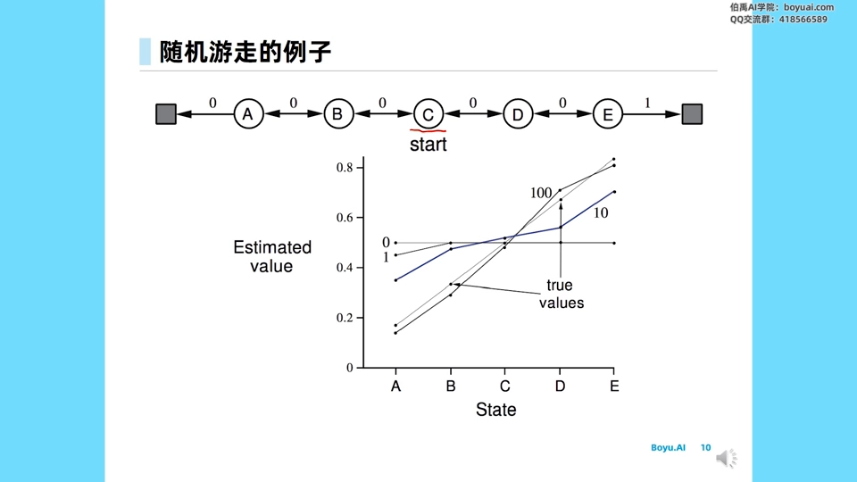

[【跳转到 16:13】](https://www.bilibili.com/video/BV1t14y177XD/?t=973)

### 6.2 学习过程长什么样

用随机策略去估计时，可以看到 $V(s)$ 的估计在逐步逼近真实价值：

- **0 次采样**时，每个状态的价值估计都是 0——图上是一条**水平横线**；
- 采样 **1 个 episode** 后，得到一条非常接近 0 的折线；
- 采样 **10 个 episode** 后稍微好一点，已经能看出一些趋势；
- 走到 **100 个 episode** 时，这条折线已经**很接近真实价值**了。

这就是"对 $V(s)$ 的估计不断被更新"的直观过程。

### 6.3 定量对比：RMSE 随 episode 数下降

把 MC 和 TD 放在同一个坐标系里比较：

- **横坐标**：走了多少个 episode（每次从 C 出发、跟随策略直到游戏结束，可能走到最左也可能走到最右）；
- **纵坐标**：**RMSE（均方根误差，Root Mean Square Error）**——先求均方误差再开根号，衡量估计值与真实价值之间的差距，**越小越好**。

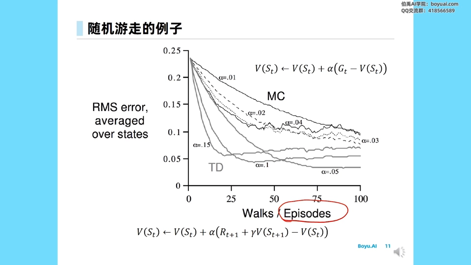

[【跳转到 17:53】](https://www.bilibili.com/video/BV1t14y177XD/?t=1073)

不同学习率 $\alpha$ 会拉出不同的训练曲线，但总体规律是：

- **TD 普遍学得比 MC 好一些**，能更快地降到比较低的 RMSE 位置；
- 细看的话，**MC 的下降比较平缓**，而且最终降到一个位置之后，**不会像 TD 那样出现稍微上升的趋势**——这可以看作 MC 的一个特点；
- 但别忘了前提：MC 需要采样整条序列，TD 在采样结束之前就已经开始更新了。

---

## 七、三种"备份"图：MC、TD、DP 的统一视角

### 7.1 什么叫备份（backup）

**备份（backup）**指的是"一次更新时，信息从哪些状态回流到当前状态"。把三种方法画成图，能一眼看出它们的本质差异。

**MC 的备份**：从当前状态 $s_t$ 出发，跟随当前策略 $\pi$，把整个 state-action 序列一直采样到终止状态，算出这条路径的 $G_t$，再用它更新 $V(s_t)$。也就是说，**必须采样出整条序列之后**才能更新——信息从终点一路回传到起点。

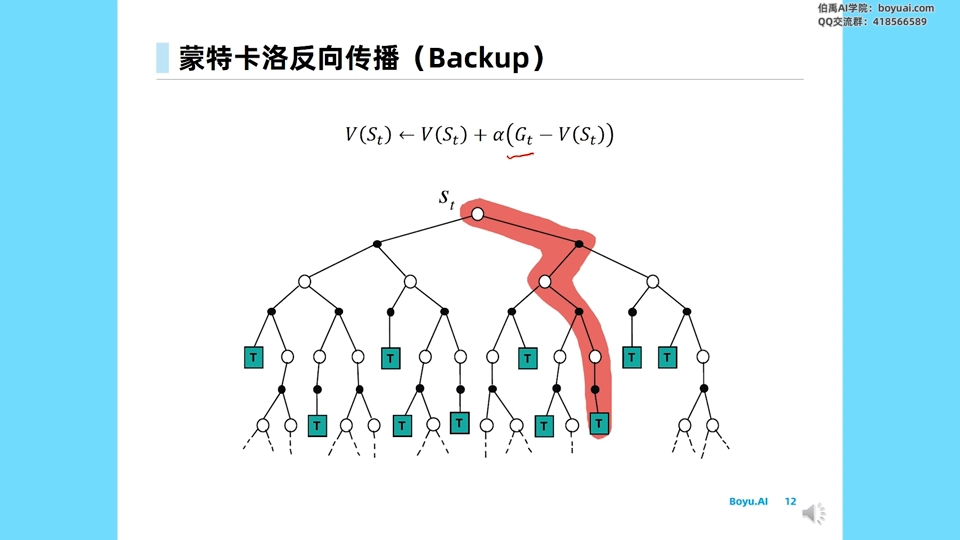

[【跳转到 19:08】](https://www.bilibili.com/video/BV1t14y177XD/?t=1148)

**TD 的备份**：只采样**一步**——执行一个动作、得到一步奖励、得到下一个状态 $s_{t+1}$，就结束了，后面的都不用再采样。此时需要对 $s_{t+1}$ 有一个价值估计，而这个估计**可能带来偏差**（因为当前估计本来就有偏差）；但 $r_{t+1}$ 是整个过程里唯一的一次不确定性，所以**方差更低**。

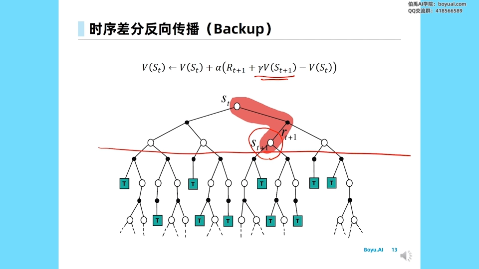

[【跳转到 19:33】](https://www.bilibili.com/video/BV1t14y177XD/?t=1173)

**DP 的备份**：如果我们知道整个模型的状态转移和奖励函数，就可以用**贝尔曼方程**做备份——它同样只往前看一步，但这一步不是"采样出一个下一状态"，而是**对所有可能的下一个状态做期望**（策略本身也可能选不同动作，环境也可能把当前动作带到不同状态，都要算进期望）。正因为模型已知、期望是精确算出来的，**DP 的估计非常稳定**。

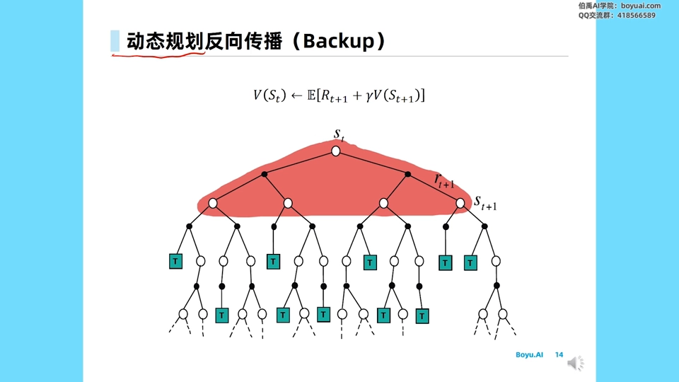

[【跳转到 20:23】](https://www.bilibili.com/video/BV1t14y177XD/?t=1223)

### 7.2 一张表看清三者关系

| 方法 | 需要环境模型？ | 采样多少？ | 备份的宽度 | 偏差 / 方差 |
| --- | --- | --- | --- | --- |
| 动态规划 DP | 需要（白盒） | 不采样，做期望 | 全宽：遍历所有动作与下一状态 | 无采样方差，估计稳定 |
| 蒙特卡洛 MC | 不需要 | 采样到 episode 终止 | 全深：沿一条轨迹走到终点 | 无偏，高方差 |
| 时序差分 TD | 不需要 | 只采样一步 | 深度 1：用 $V(s_{t+1})$ 截断 | 有偏，低方差 |

**TD 正好落在 DP 和 MC 中间**：它像 DP 一样"只往前看一步、用估计截断"，又像 MC 一样"靠采样获得那一步的信息"，所以既不需要模型，也不需要等序列结束。

---

## 八、n 步 TD：在"一步"和"整条序列"之间调档

### 8.1 为什么要限制在一步？

讲到这里自然会问：**为什么只做一步的时序差分？** 其实完全可以推广成 **n 步时序差分（n-step TD）**。

做法是：不只往前看 $r_{t+1}$，而是继续采样 `n` 步，一直采到 $r_{t+n}$；到达状态 $s_{t+n}$ 之后就**停止采样**，改用当前的 value function 去估计 $V(s_{t+n})$。前面的 `n` 项奖励都是采样得到的真实值，只有最后那一项是估计。也就是说，**n 步 TD 正好落在 TD(0) 和 MC 之间**：采样到的真实奖励越多，目标就越接近真实的累积奖励；剩下没采的部分仍然靠估计截断。

$$
G_t^{n} = r_{t+1} + \gamma \cdot r_{t+2} + \dots + \gamma^{n-1} \cdot r_{t+n} + \gamma^n \cdot V(s_{t+n})
$$

注意折扣因子：$r_{t+n}$ 前面乘的是 $\gamma^{n-1}$，而 $V(s_{t+n})$ 前面乘的是 $\gamma^n$——因为后者代表的是"再往后的全部奖励"。

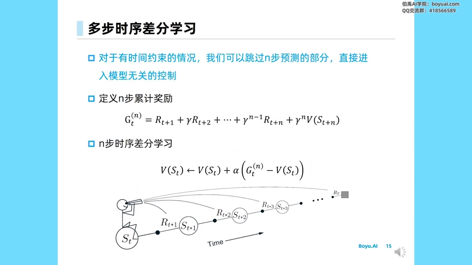

[【跳转到 21:43】](https://www.bilibili.com/video/BV1t14y177XD/?t=1303)

### 8.2 n 取多大？看任务的时间约束

`n` 的取值完全取决于任务**有没有时间约束**：如果有时间约束，就可以根据具体的时间约束决定采样多少步后停止，再用 $V(s_{t+n})$ 做一次估计。

从极端角度看：`n = 1` 就是 TD(0)，`n` 大到覆盖整条 episode 就退化成 MC。**MC 和 TD(0) 是这条谱系的两端**，n 步 TD 是中间的一档档刻度。

### 8.3 一个更深的类比：价值函数剪深度，策略剪宽度

张老师最后给了一个很有启发性的视角：如果把强化学习想象成**树搜索**——

- **价值函数**相当于对搜索树做**深度上的剪枝**：搜到某个状态之后就不需要再往下搜了，直接用 `V(s)` 顶替后面整棵子树；
- **策略**相当于对搜索树做**宽度上的剪枝**：某些策略在某些状态下几乎只会走某几个动作、不会走其它可能的动作，于是横向的分支被砍掉了。

这个类比在后面讲 **AlphaGo** 时会再次出现：AlphaGo 里有一个**价值网络**专门对树的**深度**做剪枝，还有一个**策略网络**对树的**宽度**做剪枝。

---

## 小结

1. **TD 的核心是自举**：只采样一步 $(s_t, a_t, r_{t+1}, s_{t+1})$，然后用自己当前的估计 $V(s_{t+1})$ 顶替"未来的全部奖励"，得到 TD 目标 $r_{t+1} + \gamma V(s_{t+1})$。
2. **TD = 采样 + 自举**：采样让它不需要环境模型（model-free），自举让它不必等 episode 结束。
3. **MC 与 TD 只差一个目标值**：MC 逼近真实的 `G_t`（无偏、高方差），TD 逼近 $r_{t+1} + \gamma V(s_{t+1})$（有偏、低方差）。
4. **驾车回家的例子**说明路径差异：MC 把所有状态一起拉向终点真值 43 分钟；TD 让每个状态向"下一刻的估计"靠拢，逐级传递。
5. **TD 更灵活**：每步都能更新，还能处理无终止状态的任务；MC 必须有终止状态、必须等整条序列。
6. **代价是偏差**：$V(s_{t+1})$ 不是 $V^\pi(s_{t+1})$，所以 TD 有偏；若再叠加函数近似的误差，这个偏差不会被消除，TD 也不一定收敛到最优价值函数，且比 MC 更容易受初始化影响。
7. **随机游走实验**：相同 episode 数下 TD 的 RMSE 降得更快；MC 曲线更平缓、末端不回升。
8. **统一视角**：DP 做全宽备份（需要模型）、MC 做全深备份（采样到终点）、TD 做一步备份（采样一步 + 估计截断）；n 步 TD 在两端之间连续调档。

## 关键术语速查

| 术语 | 一句话解释 |
| --- | --- |
| 时序差分（TD） | 用"一步真实奖励 + 下一状态的估计"作为更新目标的价值估计方法 |
| 自举（Bootstrapping） | 用自己当前的估计值去构造下一次更新的目标，而不是等真实结果 |
| TD 目标（TD target） | $r_{t+1} + \gamma V(s_{t+1})$，TD 让 $V(s_t)$ 去逼近的那个值 |
| TD 误差（TD error） | $\delta_t = r_{t+1} + \gamma V(s_{t+1}) - V(s_t)$，相邻两个时刻估计的差 |
| 累积奖励（return）`G_t` | 从 `t` 时刻起真实采样到的折扣奖励之和，是 $V^\pi(s_t)$ 的无偏样本 |
| 备份（backup） | 一次更新时信息从哪些状态回流到当前状态；MC 全深、TD 一步、DP 全宽 |
| 模型无关（model-free） | 更新过程不需要转移概率与奖励函数的期望，只用交互样本 |
| 偏差 / 方差权衡 | TD 低方差高偏差，MC 无偏但高方差，实际按任务取舍 |
| n 步 TD | 采样 n 步后用 $V(s_{t+n})$ 截断，介于 TD(0) 与 MC 之间 |
| RMSE | 均方根误差，实验中用来衡量价值估计与真实价值的差距 |
