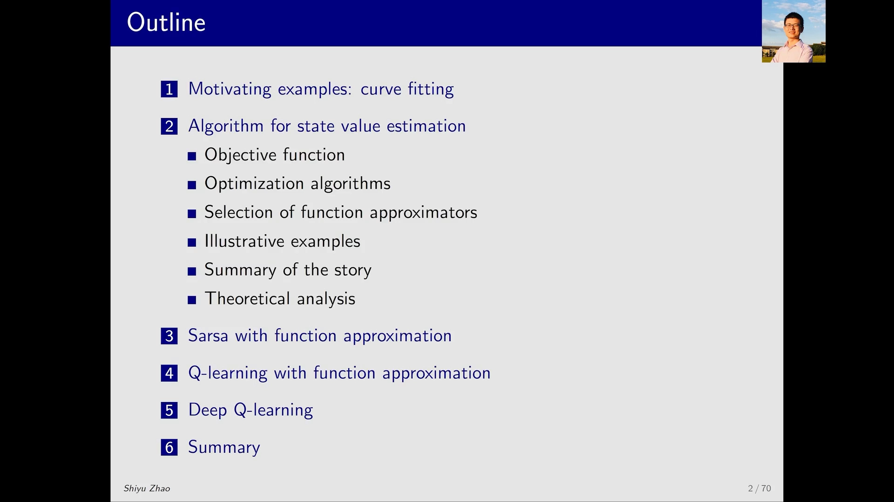
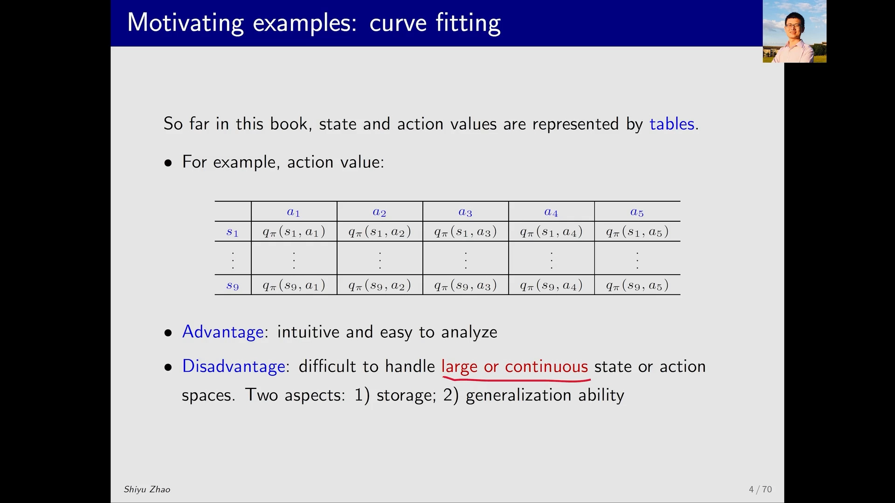
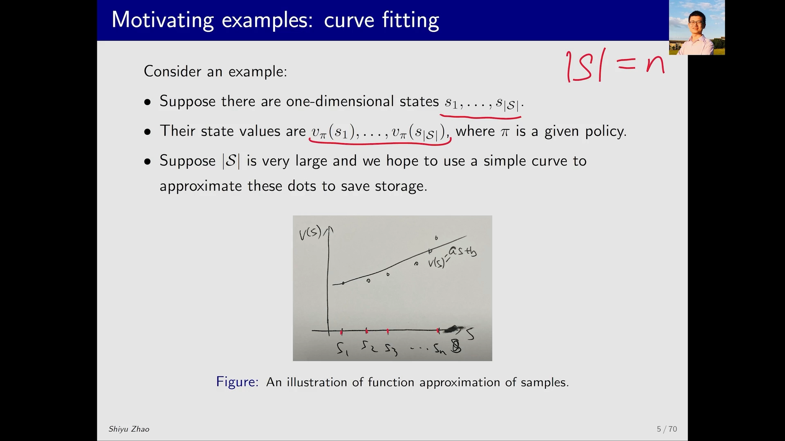
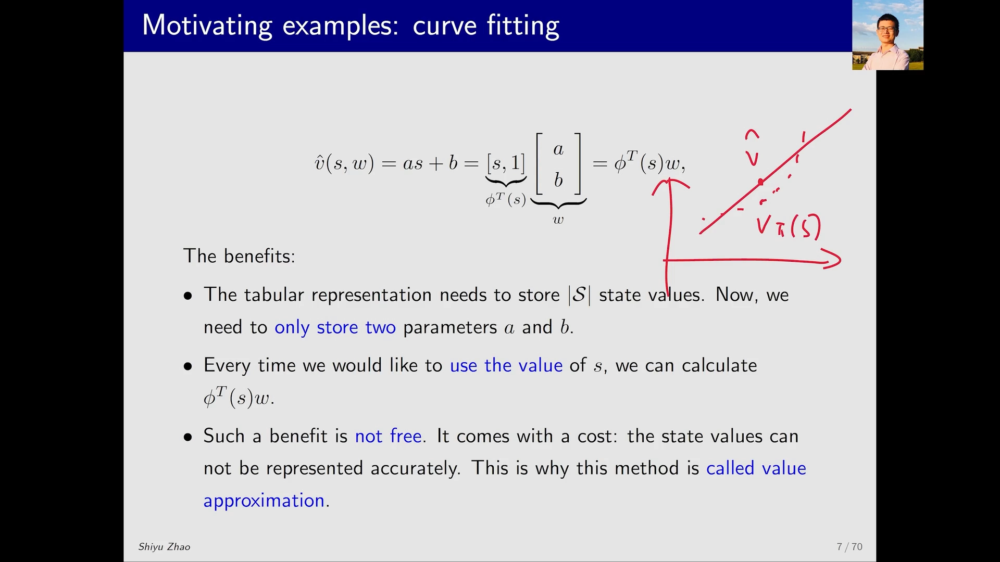
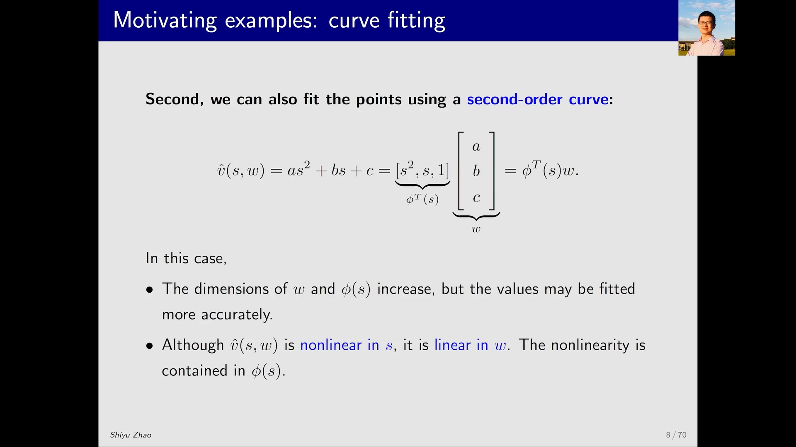
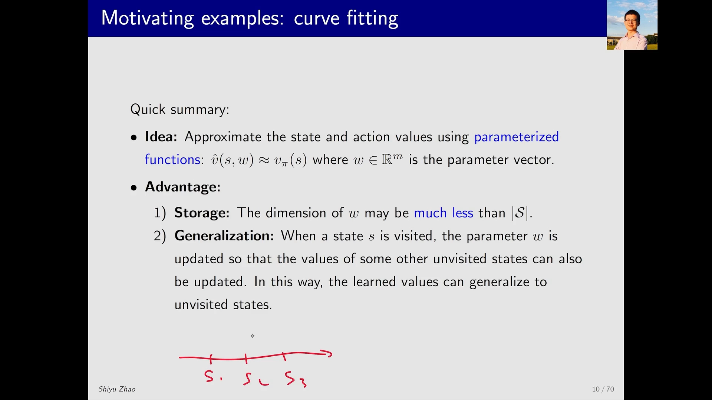
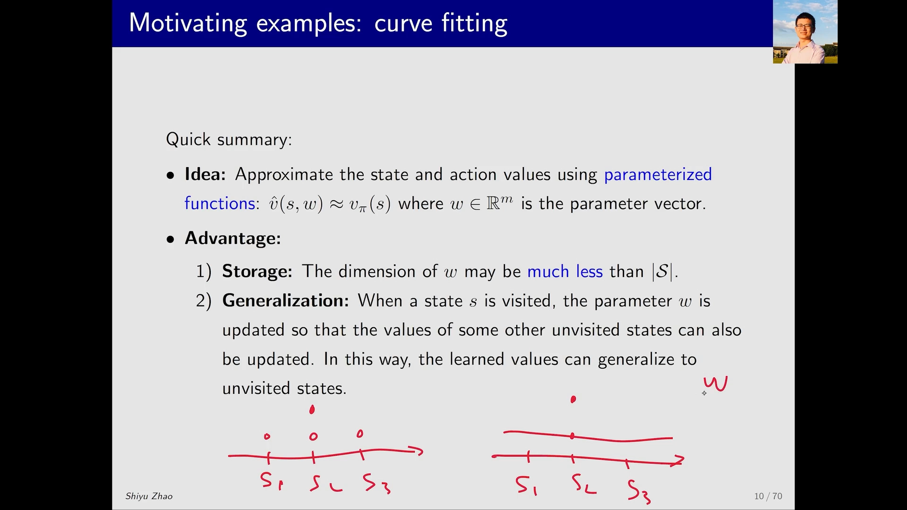

# 从表格到参数化函数：为什么一条曲线能替掉整张 Q 表

> 本篇整理自赵世钰《强化学习的数学原理》第 8 课「值函数近似」Part 1：Motivating example（曲线拟合）。视频地址：[BV1wP4y117jM](https://www.bilibili.com/video/BV1wP4y117jM/)。

## 本讲要解决的核心问题（SCQA）

**背景**：前面七课的所有内容——贝尔曼方程、值迭代与策略迭代、蒙特卡洛、TD、SARSA、Q-Learning——都建立在一个从未明说的假设上：状态价值 $v_\pi(s)$ 和动作价值 $q_\pi(s,a)$ 是**用表格（table）表示的**。在代码里，这张表就是一个数组或矩阵，索引是状态、列号是动作。

**冲突**：表格有一个致命的适用边界——它要求「每个状态占一格」。一旦状态空间很大，格子数就爆炸；一旦状态空间是连续的，格子根本画不出来。更麻烦的是第二个问题：表格里每一格是**互相独立**的，要估计 $s$ 的价值，就必须真的访问过 $s$。状态一多，绝大多数格子永远学不到。

**疑问**：既然存不下、也访问不完，能不能**不存表**？能不能让「学到一个状态」顺带把「没访问过的邻居状态」也估个八九不离十？

**回答（中心思想）**：能。做法是把价值函数换成一个**带参数的函数** $\hat{v}(s,w)$——用一条曲线去拟合那些离散的价值点。这样只需要存很少的参数 $w$，而一旦某个状态让 $w$ 发生了变化，**整条曲线都跟着动**，没被访问过的状态也自动得到更新。这就是**值函数近似（value function approximation）**。它带来两个好处（省存储、能泛化），代价是——它只是近似，不再精确。

---

## 一、这一讲在课程里的位置：一次「representation」的跳跃

课程地图走到这里，主线仍然是 TD 学习，但**表示方式**换了：

| 阶段 | 价值函数的表示 | 典型算法 |
| :-- | :-- | :-- |
| 第 2~7 课 | tabular（表格） | 值迭代、策略迭代、MC、TD(0)、SARSA、Q-Learning |
| 第 8 课起 | 参数化函数（function） | 带函数近似的 SARSA / Q-Learning、DQN、后面的策略梯度 |

讲者对这个跳跃的评价很直接：算法本身之后看起来并不难，**难的是思路和想法**。同一课里还第一次把神经网络引入强化学习——神经网络在这里不是新算法，而是「函数」这一角色的一个具体候选者。

这一讲（本课第 1 节）只做一件事：用一个**曲线拟合**的例子，把「从表格到函数」的动机讲清楚。第 2 节才是正式的原理（目标函数、优化算法、函数选择），后面第 3~5 节才把这套东西接到 SARSA、Q-Learning 和 DQN 上。

[【跳转到 01:39】](https://www.bilibili.com/video/BV1wP4y117jM/?t=99) · [【跳转到 02:54】](https://www.bilibili.com/video/BV1wP4y117jM/?t=174)

---

## 二、表格法的两个硬伤：存不下，也泛化不了

到目前为止，$q_\pi(s,a)$ 被放在一张二维表里：行是状态 $s_1,\dots,s_9$，列是动作 $a_1,\dots,a_5$，格子里是 $q_\pi(s_i,a_j)$。这张表就是编程里的 **q table**，$s$ 和 $a$ 分别是它的两个索引；类似地，$v_\pi(s)$ 对应一张一维表。

表格的**优点**是直观、便于分析——这也是前面七课能一路推下来的原因。但它的**缺点**同样明确：**难以处理大状态空间或连续状态空间**，具体表现在两个层面。

**第一，存储（storage）。** 状态数 $\lvert \mathcal{S}\rvert$ 一大，表就存不下；如果状态是连续的，这张表根本无从建立。有人会说：连续空间可以离散化成网格啊。但离散化本身是个两难——网格划得密，格子数量又爆炸，处理起来依然吃力；网格划得稀，又无法很好地近似原来的连续空间。

**第二，泛化能力（generalization ability）。** 表格里每一格是独立的。你有多少个 state-action pair，就得**逐个访问到**，才能把它们的价值估出来；而状态一多，这件事在有限时间内根本做不到，于是大量格子的价值永远估不出来。

这两个问题，正是函数近似要解决的。下面用一个例子说明它的基本思想。

[【跳转到 03:19】](https://www.bilibili.com/video/BV1wP4y117jM/?t=199) · [【跳转到 04:59】](https://www.bilibili.com/video/BV1wP4y117jM/?t=299)

---

## 三、曲线拟合：把 $n$ 个价值点换成两个参数

### 3.1 问题的设定

考虑最简单的情形：状态是一维的 $s_1,\dots,s_{\lvert \mathcal{S}\rvert}$，一共有 $n = \lvert \mathcal{S}\rvert$ 个状态（图中手写的 $|S| = n$ 就是这个意思），每个状态在一个给定策略 $\pi$ 下有自己的状态价值 $v_\pi(s_1),\dots,v_\pi(s_{\lvert \mathcal{S}\rvert})$。把这些点画在「横轴 = 状态、纵轴 = 状态价值」的平面上，就是一串离散的圆点。

如果 $\lvert \mathcal{S}\rvert$ 非常大，把每个点都存下来要占很大的内存。于是自然的问题是：**能不能用一条曲线把这些点串起来，用曲线来代表这些点？** 之所以想到曲线，是因为**曲线对应的参数个数非常少**——只要存少量参数，就能表示所有状态的 $v_\pi(s)$。

### 3.2 最简单的情况：一条直线

先用一条直线拟合这些点。设直线方程为

$$
\hat{v}(s,w) = as + b
$$

其中 $a$、$b$ 是两个参数。符号上：$v$ 表示对价值的近似，$\hat{\cdot}$（hat）表示「估计」。

关键在于，这个式子可以改写成**两个向量相乘**的形式：

$$
\hat{v}(s,w) = as + b = \begin{bmatrix} s & 1 \end{bmatrix}\begin{bmatrix} a \\ b \end{bmatrix} = \phi^{T}(s)\, w
$$

- $\phi(s) = \begin{bmatrix} s \\ 1 \end{bmatrix}$ 称为状态 $s$ 的**特征向量（feature vector）**；
- $w = \begin{bmatrix} a \\ b \end{bmatrix}$ 称为**参数向量（parameter vector）**；
- 注意 $\hat{v}(s,w)$ 对 $w$ 是**线性**的（虽然对 $s$ 也是线性的，这一点下一小节会变）。

![直线的参数化写法：v̂(s,w) = as + b = [s, 1][a; b]^T = φ^T(s) w，其中 φ(s) 是特征向量、w 是参数向量](assets/从表格到参数化函数：为什么一条曲线能替掉整张Q表/00424.webp)

### 3.3 好处与代价

**好处**：表格表示要存 $\lvert \mathcal{S}\rvert$ 个状态价值；现在**只需要存两个参数** $a$ 和 $b$。每次想用状态 $s$ 的价值时，现算即可：第一步算出特征向量 $\phi(s)$，第二步做内积 $\phi^{T}(s)w$，就得到了 $\hat{v}(s,w)$。内存占用大幅下降。

**代价**：这个好处不是免费的。那些离散点本来就不严格落在一条直线上，你非要用直线拟合，很多点上 $\hat{v}(s,w)$ 与真实的 $v_\pi(s)$ 差别不小。**这个方法之所以叫 value function approximation（近似），原因就在这里**——它是近似，不是等号。

[【跳转到 05:24】](https://www.bilibili.com/video/BV1wP4y117jM/?t=324) · [【跳转到 08:19】](https://www.bilibili.com/video/BV1wP4y117jM/?t=499)

---

## 四、换一条更弯的曲线：非线性藏在特征向量里

觉得直线不够准，就换二阶曲线：

$$
\hat{v}(s,w) = as^{2} + bs + c = \begin{bmatrix} s^{2} & s & 1 \end{bmatrix}\begin{bmatrix} a \\ b \\ c \end{bmatrix} = \phi^{T}(s)\, w
$$

此时 $\phi(s)$ 和 $w$ 的维数都变大了（从 2 维变成 3 维），也就是要存更多的值；但拟合精度可能提高。

这里有一个容易被忽略、但对后面所有算法都至关重要的观察：**这个函数对 $s$ 是非线性的，但对参数 $w$ 仍然是线性的**。非线性被全部塞进了特征向量 $\phi(s)$ 里。所以「线性函数近似」这个说法里的「线性」，指的是**对 $w$ 线性**，而不是对 $s$ 线性。

继续往上走，还可以用更高阶的多项式、或者更复杂的曲线（比如神经网络）来拟合。这时 $\hat{v}(s,w)$ 对 $w$ 也可以是非线性的。规律很清楚：

| 曲线复杂度 | 好处 | 坏处 |
| :-- | :-- | :-- |
| 直线（2 个参数） | 参数最少、最省存储 | 拟合最粗糙 |
| 二阶曲线（3 个参数） | 拟合更准 | 参数变多 |
| 高阶多项式 / 神经网络 | 可以非常准 | 参数更多，训练更难 |

[【跳转到 09:09】](https://www.bilibili.com/video/BV1wP4y117jM/?t=549) · [【跳转到 10:24】](https://www.bilibili.com/video/BV1wP4y117jM/?t=624)

---

## 五、小结：parameterized function 的两个好处

把上面的例子抽象出来，值函数近似的想法只有一句话：

$$
\hat{v}(s,w) \approx v_\pi(s), \qquad w \in \mathbb{R}^{m}
$$

用一个**参数化函数（parameterized function）**去逼近真实的状态价值，$w$ 是参数向量。好处有两条：

1. **Storage（省存储）**：$w$ 的维数 $m$ 可能远小于状态数 $\lvert \mathcal{S}\rvert$。表格要存 $\lvert \mathcal{S}\rvert$ 个数，现在只存 $m$ 个数。
2. **Generalization（能泛化）**：当某个状态 $s$ 被访问、$w$ 被更新时，**其它没被访问过的状态的价值也跟着被更新了**。学到的价值可以泛化到没见过的状态上。

第二条值得单独看一眼，因为它正是表格法做不到的事。取三个相邻状态 $s_1, s_2, s_3$：

- **表格表示**：一开始三个值都是某个水平。一个 episode 访问到 $s_2$，把 $s_2$ 的值往上挪——**只有 $s_2$ 动了**，$s_1$、$s_3$ 因为没被访问，原地不动。
- **函数表示**：同样的情形下，$s_2$ 的价值不对，我们**不直接改 $s_2$ 的值，而是改 $w$**。$w$ 一变，整条曲线就变了，$s_1$ 和 $s_3$ 虽然从未被访问，它们的价值也跟着被修正了。

这就是为什么讲者说：不需要把所有状态都访问到，只访问其中一部分，相邻状态的价值就能被比较准确地估计出来。

[【跳转到 10:49】](https://www.bilibili.com/video/BV1wP4y117jM/?t=649) · [【跳转到 11:39】](https://www.bilibili.com/video/BV1wP4y117jM/?t=699)

---

## 六、这一讲留下了什么问题

到这里，「用什么表示价值函数」这件事已经说清楚了：从表格换成参数化函数 $\hat{v}(s,w)$，换来省存储与泛化能力，付出的是精度。

但真正的算法问题还没碰：**到底怎么找到那个「好」的 $w$？** 例子里的直线是「看起来拟合得不错」，可这只是一句口语判断。要写成算法，必须先回答两件事：

1. 「拟合得好」怎么用数学表达？——这需要一个**目标函数** $J(w)$；
2. 有了 $J(w)$ 之后怎么求最优的 $w$？——这需要**优化算法**（下一节会给出随机梯度下降）。

这正是本课第 2 节的内容，也是下一篇要讲的东西：把「让 $\hat{v}(s,w)$ 接近 $v_\pi(s)$」变成一个可以优化的问题，并处理其中那个容易被忽略、却决定算法形态的细节——**目标函数里的期望是对哪个状态分布取的**。