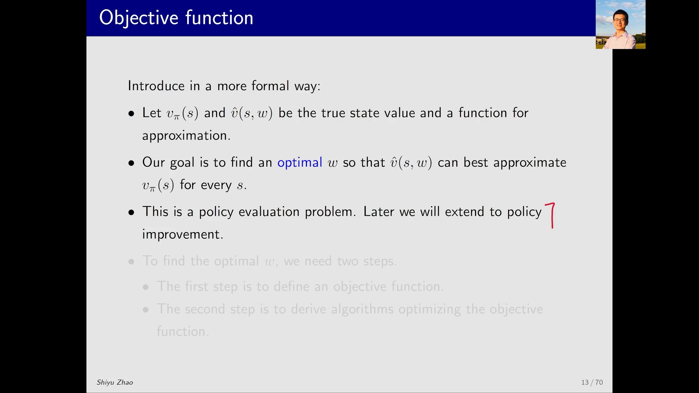
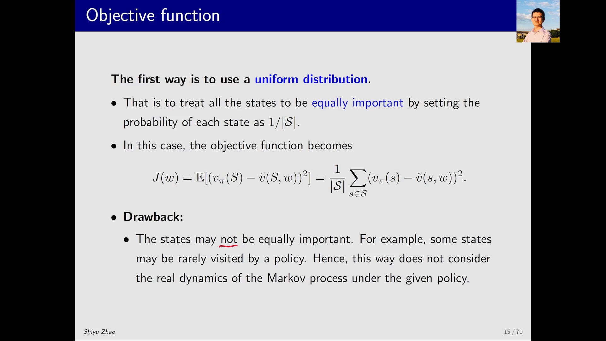
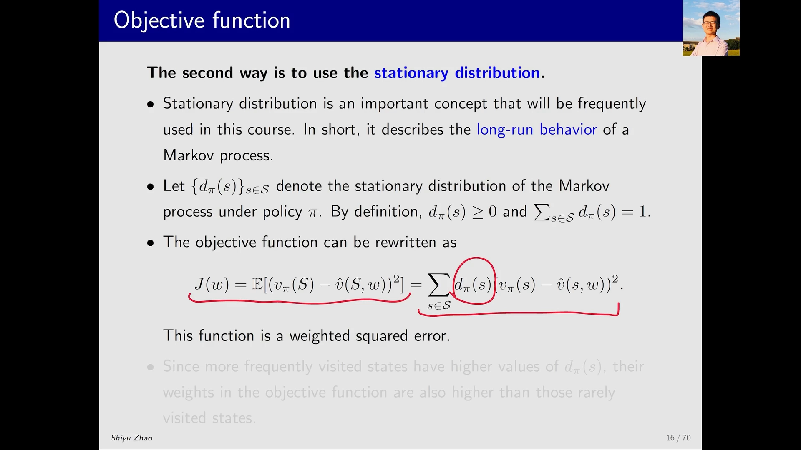
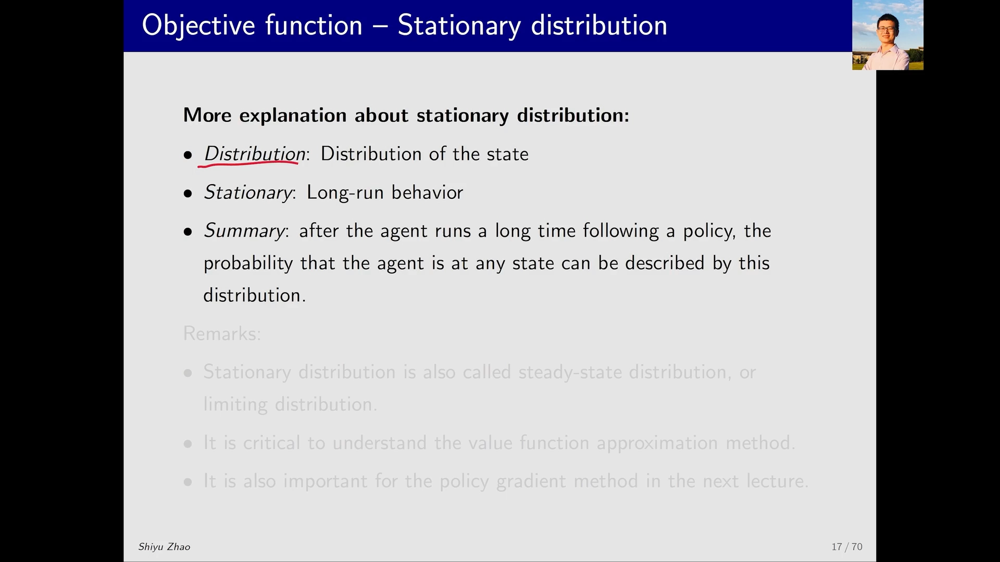
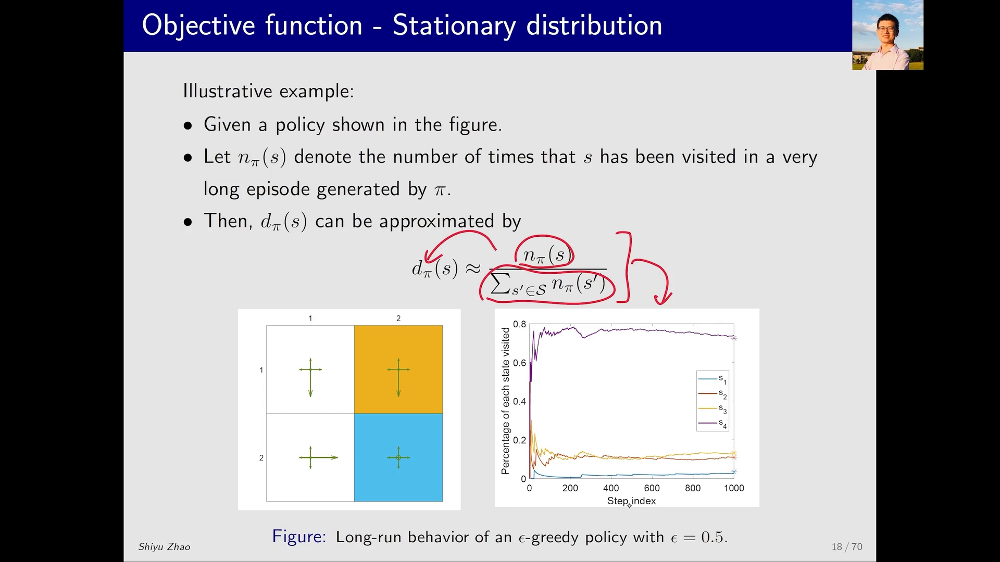
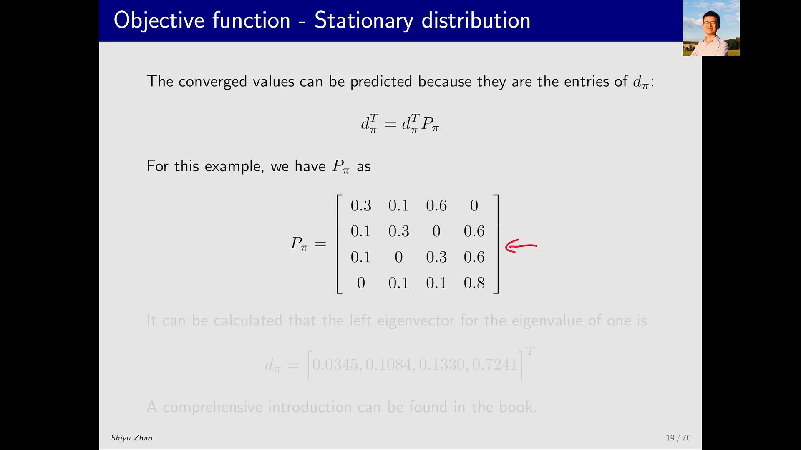

# 值函数近似的目标函数：把「拟合得好不好」变成一个可优化的数学问题

> 本篇整理自赵世钰《强化学习的数学原理》第 8 课「值函数近似」Part 2：原理——目标函数介绍。视频地址：[BV1GY411f7qU](https://www.bilibili.com/video/BV1GY411f7qU/)。

## 本讲要解决的核心问题（SCQA）

**背景**：上一篇用曲线拟合的例子说明了一件事——价值函数可以不存成表格，而是存成一个带参数的函数 $\hat{v}(s,w)$，只保存 $w$，还能顺带获得泛化能力。但那只是「想法」，还不是算法。

**冲突**：说「让 $\hat{v}(s,w)$ 尽量接近 $v_\pi(s)$」很容易，可这句话里藏着两个含糊之处。第一，**「接近」怎么量化**？所有状态上的误差要合成一个数，才能比较谁好谁坏。第二，就算合成了一个数，**每个状态的误差该占多大权重**？把所有状态一视同仁，听起来公平，实际上很荒唐：一个几乎不会被访问到的状态，估错了也无所谓；而目标附近、频繁经过的状态，估错一点后果就很严重。

**疑问**：怎么把「拟合得好」写成一个**可以对 $w$ 求最优的函数** $J(w)$？那个权重，到底该由什么决定？

**回答（中心思想）**：定义**目标函数**（objective function）为价值误差平方的期望：

$$
J(w) = \mathbb{E}\big[(v_\pi(S) - \hat{v}(S,w))^{2}\big]
$$

找最优 $w$ 就是最小化 $J(w)$。而期望是对**状态这个随机变量 $S$ 的分布**取的，这个分布有两种常见取法：**均匀分布**（所有状态同等重要，简单但忽略了马尔可夫过程的真实动态）和**平稳分布 $d_\pi$**（按策略长期运行时状态被访问的频率加权）。后者才是值函数近似真正使用的权重，也是下一课策略梯度里会再次出现的关键概念。

---

## 一、先定位：这仍然是一个策略评估问题

给定策略 $\pi$，要找一个近似的函数 $\hat{v}(s,w)$ 去逼近它真实的状态价值 $v_\pi(s)$——这在数学上就是**策略评估（policy evaluation）**，和上一课用 TD 算法做的事是同一件事，只是表示方式从表格换成了函数。

所以这一步只解决「评估」，不解决「改进」。等评估做通了，才会推广到动作价值 $\hat{q}(s,a,w)$，再推广到怎么找最优策略。课程的推进顺序是刻意的一步一步来。

一旦函数的结构定下来（是一条直线、一条抛物线，还是一个神经网络），**能调的只剩下参数 $w$**。于是问题变成：在所有可能的 $w$ 里，找一个让 $\hat{v}(s,w)$ 最接近 $v_\pi(s)$ 的。找 $w$ 分两步走：

1. 先**定义目标函数**——把「接近」写成一个标量；
2. 再**推导优化它的算法**——这一步留给后面的随机梯度下降。

本讲只做第 1 步。

[【跳转到 00:30】](https://www.bilibili.com/video/BV1GY411f7qU/?t=30) · [【跳转到 01:20】](https://www.bilibili.com/video/BV1GY411f7qU/?t=80)

---

## 二、目标函数：误差平方的期望

值函数近似的目标函数定义为

$$
J(w) = \mathbb{E}\big[(v_\pi(S) - \hat{v}(S,w))^{2}\big]
$$

逐项读一遍：

- $v_\pi(S) - \hat{v}(S,w)$ 是**真值与估计值之差**，即误差；
- 外面套一个**平方**，正负误差不会互相抵消，大误差被放大惩罚；
- 最外层是**期望**，把所有状态的误差合成一个标量。

目标是找到让 $J(w)$ 最小的 $w$。但这里立刻出现一个必须回答的问题：**期望是对谁取的？** 式子里 $S$ 是一个随机变量，随机变量一定有概率分布。换句话说，上面那个「期望」本质上是在做**加权平均**，而权重就是 $S$ 的分布。这个问题有两个问法，是同一件事：期望对什么分布取？各个状态在平均时各占多少权重？

这个问题对初次接触值函数近似的人往往比较迷惑，因为前面几课从未讨论过「状态的分布」。下面给出两种取法。

![目标函数 J(w) = E[(v_π(S) − v̂(S,w))²]：目标是找使 J(w) 最小的 w；期望是对随机变量 S ∈ S 取的，于是必须回答「S 的概率分布是什么」](assets/值函数近似的目标函数：把拟合好坏变成优化问题/00155.webp)

### 2.1 第一种：均匀分布

最直观、最容易想到的取法是**均匀分布（uniform distribution）**：认为所有状态**同等重要**，每个状态的概率（也就是求平均时的权重）都是 $1/\lvert \mathcal{S}\rvert$。此时期望按定义展开，权重是常数可以提到求和号外面：

$$
J(w) = \mathbb{E}\big[(v_\pi(S) - \hat{v}(S,w))^{2}\big] = \frac{1}{\lvert \mathcal{S}\rvert}\sum_{s \in \mathcal{S}} \big(v_\pi(s) - \hat{v}(s,w)\big)^{2}
$$

也就是说，$J(w)$ 变成了「所有状态估计误差的平方和，再求平均」。

**但这个假设站不住脚。** 状态并不都是同等重要的。举个直观的例子：如果任务是从某个起点出发到达目标状态，那么目标状态和靠近目标的状态显然更重要；而离目标很远、几乎不会经过的状态就没那么重要。我们希望**给重要的状态更大的权重**——权重大的状态，其估计误差会被压得更小；权重小的状态即使误差较大也无妨，反正很少访问到它。

### 2.2 第二种：平稳分布 $d_\pi$

顺着「重要的状态权重更大」这个想法，就引出了**平稳分布（stationary distribution）**。它是值函数近似中真正使用的分布，描述的是马尔可夫过程的**长期行为（long-run behavior）**。

什么叫长期行为？从某个状态出发，按策略 $\pi$ 不断选动作、与环境交互，一直跑非常非常多步之后，过程会进入一种平稳状态；在那个状态下，可以告诉你 agent 出现在每个状态的概率是多少。记这个分布为 $\{d_\pi(s)\}_{s \in \mathcal{S}}$，按定义它满足

$$
d_\pi(s) \ge 0, \qquad \sum_{s \in \mathcal{S}} d_\pi(s) = 1
$$

用它替换期望中的分布，目标函数就写成

$$
J(w) = \mathbb{E}\big[(v_\pi(S) - \hat{v}(S,w))^{2}\big] = \sum_{s \in \mathcal{S}} d_\pi(s)\big(v_\pi(s) - \hat{v}(s,w)\big)^{2}
$$

这就是一个**加权平方误差（weighted squared error）**，$d_\pi(s)$ 扮演权重的角色：某个状态的 $d_\pi(s)$ 大，说明它在长期运行中被访问得更频繁，我们希望它的估计误差更小；反之则容忍更大的误差。

### 2.3 名字与地位

从字面上拆解这个名字并不难：它首先是一个 **distribution**（状态的概率分布），其次它是 **stationary**（平稳的）——从现在出发、按某个策略跑很多很多步之后达到的那个概率分布。所以它也被称为 **steady-state distribution** 或 **limiting distribution**（极限分布）。

它的地位值得强调：这一课的值函数近似要用它，**下一课的策略梯度也要用它**——只要定义目标函数，这个分布就会出现。

[【跳转到 02:10】](https://www.bilibili.com/video/BV1GY411f7qU/?t=130) · [【跳转到 07:35】](https://www.bilibili.com/video/BV1GY411f7qU/?t=455)

---

## 三、一个例子：4 状态网格上跑出来的平稳分布

抽象定义讲完，用一个具体例子把它落地。

**策略**：图里是一个 2×2 的网格（行、列各标 1、2，四个格子对应状态 $s_1$ 到 $s_4$）。给定策略是**探索性的**——每个动作都有正概率被选中，但明显偏向某个特定动作：左上、右上两个状态偏向向下，左下偏向向右，右下则大概率原地不动。讲者用的是一个 $\epsilon$-greedy 策略，$\epsilon = 0.5$。

**仿真**：让 agent 从某个状态出发，按这个策略跑一个很长的 episode（例子中是 1000 步）。记 $n_\pi(s)$ 为状态 $s$ 在这个 episode 中被访问的次数，那么

$$
d_\pi(s) \approx \frac{n_\pi(s)}{\sum_{s' \in \mathcal{S}} n_\pi(s')}
$$

也就是「访问 $s$ 的次数 ÷ episode 总长度」，用频率去近似概率。

把这条比值随步长的变化画出来（横轴是 episode 的步长，纵轴是这个比值），可以看到：不同状态被访问的比例不同，**开始时波动较大，随着步数增加逐渐收敛到平稳值**。这就是「平稳」和「长期」的含义——跑得足够久，每个状态的访问比例都会收敛到一个确定的数。

以图中最上面那条紫色曲线对应的状态 $s_4$ 为例：它被访问的次数除以 episode 长度，最终收敛到大约 $0.7$。原因也不难理解：在每个状态，策略都有较大把握选择某个特定动作，而这些动作无论从哪个点出发，都有较大机会把 agent 带到 $s_4$，所以长期来看 agent 出现在 $s_4$ 的概率最大。

**理论值**：图上还画了星号，那是**理论值**——不需要真跑很多次也能算出来。$d_\pi$ 满足

$$
d_\pi^{T} = d_\pi^{T} P_\pi
$$

其中 $P_\pi$ 是策略 $\pi$ 下的状态转移矩阵（元素是 $s \to s'$ 的转移概率）。对照一下贝尔曼公式的矩阵-向量形式 $v_\pi = r_\pi + \gamma P_\pi v_\pi$，会看到这里用的正是同一个 $P_\pi$。这个式子说明：$d_\pi$ 是 $P_\pi$ 的**左特征向量**，对应的特征值是 $1$。

对这个 2×2 的例子，$P_\pi$ 可以写成一个 4×4 矩阵（读者可以暂停视频核对）：

$$
P_\pi = \begin{bmatrix}
0.3 & 0.1 & 0.6 & 0 \\
0.1 & 0.3 & 0 & 0.6 \\
0.1 & 0 & 0.3 & 0.6 \\
0 & 0.1 & 0.1 & 0.8
\end{bmatrix}
$$

求出特征值为 1 的左特征向量，得到

$$
d_\pi = \big[0.0345,\ 0.1084,\ 0.1330,\ 0.7241\big]^{T}
$$

其中 $s_4$ 对应的分量是 $0.7241$，与刚才仿真出来的约 $0.7$ 基本一致——频率确实收敛到了理论上的平稳分布。

[【跳转到 08:00】](https://www.bilibili.com/video/BV1GY411f7qU/?t=480) · [【跳转到 11:20】](https://www.bilibili.com/video/BV1GY411f7qU/?t=680)

---

## 四、小结：这一步把「近似」变成了「优化」

这一讲做的事情，可以压缩成三句话：

1. **目标函数**：$J(w) = \mathbb{E}\big[(v_\pi(S) - \hat{v}(S,w))^{2}\big]$，最小化它就等于让近似函数逼近真实价值；这仍然是一个**策略评估**问题。
2. **权重来自状态分布**：均匀分布简单，但忽略了「哪些状态真的会被访问」；平稳分布 $d_\pi$ 按长期访问频率加权，是值函数近似真正使用的选择。
3. **平稳分布的地位**：它满足 $d_\pi^{T} = d_\pi^{T}P_\pi$，是 $P_\pi$ 对应特征值 1 的左特征向量；定义目标函数时它必然出现，下一课的策略梯度同样离不开它。

还差最后一块拼图：$J(w)$ 有了，但怎么在不知道 $v_\pi(s)$、也不知道 $d_\pi$ 的情况下**最小化**它？答案是**随机梯度下降（stochastic gradient descent）**——用采样到的样本来估计梯度，这也是后面把函数近似接到 SARSA、Q-Learning 和 DQN 上的技术底座。