# 梯度下降与随机梯度：把目标函数真正优化起来

> 本篇整理自赵世钰《强化学习的数学原理》第 8 课「值函数近似」Part 3：原理——优化算法和函数选择。视频地址：[BV1PM411C7jQ](https://www.bilibili.com/video/BV1PM411C7jQ/)。

## 本讲要解决的核心问题（SCQA）

**背景**：上一篇已经把「拟合得好不好」写成了一个数学对象——目标函数 $J(w) = \mathbb{E}\big[(v_\pi(S) - \hat{v}(S,w))^{2}\big]$，期望按平稳分布 $d_\pi$ 加权。有了目标函数，剩下的问题就是「怎么把它压到最小」。

**冲突**：这一步看起来只是套一个梯度下降，但真往下写会连撞两道墙。第一道：$J(w)$ 里的梯度是一个**期望**，要精确算出来就得遍历所有状态、还要知道 $v_\pi$ 和 $d_\pi$，这在无模型（model-free）的设定下根本办不到。第二道更致命：就算把期望换成一次采样，式子里还留着 $v_\pi(s_t)$——而 $v_\pi$ 恰恰是我们要求的东西，用一个未知量去更新另一个未知量，算法等于没写。

**疑问**：这两道墙怎么翻过去？翻过去之后，$\hat{v}(s,w)$ 这个函数本身又该怎么选？

**回答（中心思想）**：用**随机梯度下降（stochastic gradient descent, SGD）**翻第一道墙——把期望换成一次采样，梯度变成「一个样本的梯度」，虽然噪声大但期望上正确；用**MC 回报 $g_t$ 或 TD 目标 $r_{t+1} + \gamma \hat{v}(s_{t+1},w_t)$** 翻第二道墙——这两个量都是可观测、可计算的，恰好是 $v_\pi(s_t)$ 的估计。至于函数怎么选，本讲给出两条路线：**线性函数 $\hat{v}(s,w) = \phi^{T}(s)w$**（梯度恰好等于特征向量，算法极简，且能证明表格法是它的特例）与**神经网络**（表达能力强，但理论难分析）。

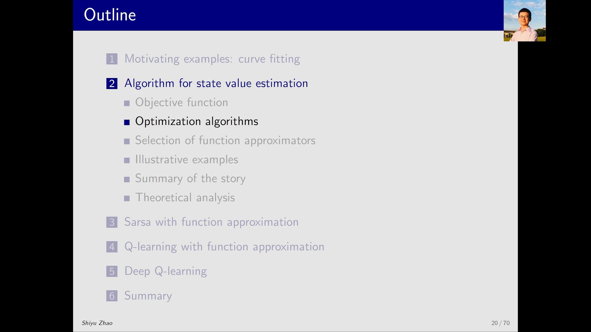

---

## 一、优化算法只有一行：沿负梯度走

提到优化，第一反应就是梯度方法——要最小化就用**梯度下降（gradient descent）**，要最大化才用梯度上升。要优化的参数是 $w$，算法形式简单到只有一行：

$$
w_{k+1} = w_k - \alpha_k \nabla_w J(w_k)
$$

其中 $\alpha_k > 0$ 是步长（学习率），$\nabla_w J(w_k)$ 是 $J$ 对 $w$ 的梯度。含义很直白：梯度指向 $J$ 上升最快的方向，所以**往反方向走一小步**，$J$ 就会下降。

这一行本身没有难度，难度全在 $\nabla_w J(w_k)$ 怎么算。

[【跳转到 00:05】](https://www.bilibili.com/video/BV1PM411C7jQ/?t=5) · [【跳转到 00:30】](https://www.bilibili.com/video/BV1PM411C7jQ/?t=30)

### 1.1 真实梯度：把求导推进期望里面

把 $J(w)$ 的具体表达式代入，按「求导符号移进期望 → 对平方求导」两步走：

$$
\nabla_w J(w) = \nabla_w \mathbb{E}\big[(v_\pi(S) - \hat{v}(S,w))^{2}\big] = \mathbb{E}\big[\nabla_w (v_\pi(S) - \hat{v}(S,w))^{2}\big] = 2\,\mathbb{E}\big[(v_\pi(S) - \hat{v}(S,w))\big(-\nabla_w \hat{v}(S,w)\big)\big]
$$

注意两点。第一，$v_\pi(S)$ 与 $w$ 无关，所以求导只作用在 $\hat{v}$ 上；第二，对平方求导会掉出一个因子 $2$，同时里面那一项要乘上 $\hat{v}$ 自己的梯度。

这个式子被称为**真实梯度（true gradient）**。它是对的，但没法用：外面那层期望要求你知道状态 $S$ 的分布并对所有状态求平均，而强化学习里我们手上只有采样出来的轨迹。

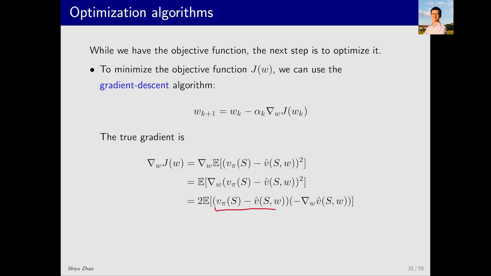

---

## 二、SGD：用一次采样代替一个期望

### 2.1 把期望换成样本

避免期望的标准做法就是**随机梯度**：既然期望是对随机变量 $S$ 取的，那就采样一个 $s_t$ 出来，用这一个样本的梯度去代替整个期望。同时把因子 $2$ 并进步长 $\alpha_k$ 里（反正步长本来就要调），式子立刻清爽：

$$
w_{t+1} = w_t + \alpha_t\big(v_\pi(s_t) - \hat{v}(s_t, w_t)\big)\nabla_w \hat{v}(s_t, w_t)
$$

符号上，负号被吸收进了括号里的顺序（$v_\pi - \hat{v}$ 而不是 $\hat{v} - v_\pi$），所以更新变成了「加」。这一步就是**随机梯度下降**：单次更新方向有噪声，但期望方向是对的。

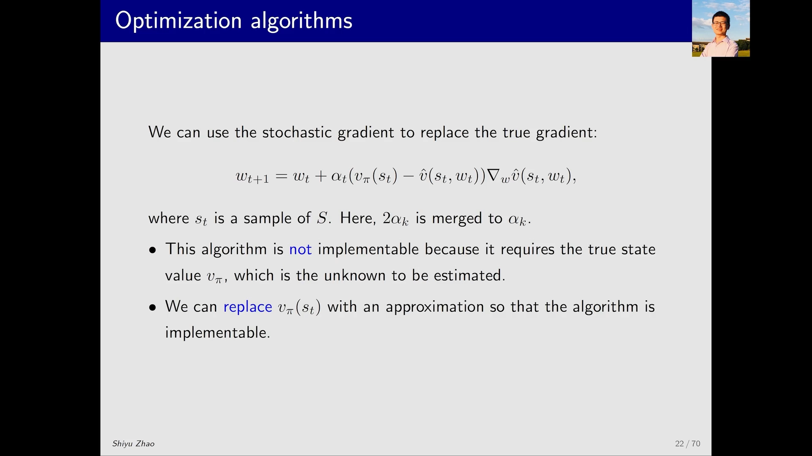

### 2.2 还差一块：$v_\pi(s_t)$ 也不知道

上面这个式子只解决了一半问题。它里面含有 $v_\pi(s_t)$——真实的状态价值，而这正是我们要求的东西。**用一个未知量去更新参数，算法在实际中是跑不起来的。**

讲者的处理方式很务实：不硬算，而是**用别的量去替代 $v_\pi(s_t)$**。替代品必须满足两个条件——可观测、且是 $v_\pi(s_t)$ 的合理估计。前面几课学过的两种 model-free 方法，恰好各提供一个。

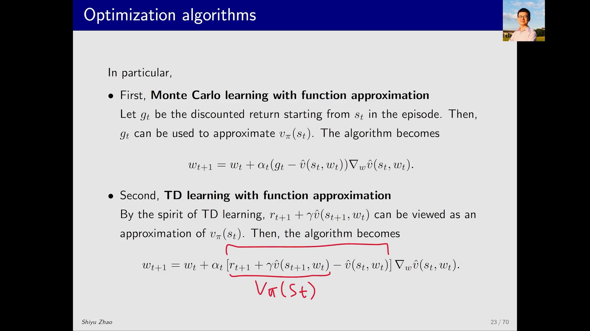

### 2.3 两种替代：蒙特卡洛与 TD

**第一种：蒙特卡洛（MC）。** 从 $s_t$ 出发跑完一个 episode，把沿途的奖励按折扣累加成回报 $g_t$，就用它替代 $v_\pi(s_t)$：

$$
w_{t+1} = w_t + \alpha_t\big(g_t - \hat{v}(s_t, w_t)\big)\nabla_w \hat{v}(s_t, w_t)
$$

这正是 MC 的基本思想——用一次实际采样到的回报去估计期望回报。代价是必须等 episode 结束才能更新。

**第二种：TD 学习。** 借用 TD 的「自举」思路，用一步奖励加上对下一状态价值的估计来替代：

$$
w_{t+1} = w_t + \alpha_t\big[r_{t+1} + \gamma \hat{v}(s_{t+1}, w_t) - \hat{v}(s_t, w_t)\big]\nabla_w \hat{v}(s_t, w_t)
$$

方括号里就是熟悉的 **TD 误差（TD error）**，其中 $r_{t+1} + \gamma \hat{v}(s_{t+1}, w_t)$ 是 **TD 目标（TD target）**。区别只在「用什么估计 $v_\pi(s_t)$」：MC 用走到底的回报，TD 用一步奖励加自举。这一步一到位，前面几课的所有 TD 结论就都能搬到函数近似上了。

### 2.4 伪代码：一个样本更新一次参数

把上面的式子写成算法，只有三层循环：

```text
初始化：一个对 w 可微的函数 v̂(s, w)，初始参数 w_0
目标：近似给定策略 π 的真实状态价值

对每个由策略 π 生成的 episode：
    对每一步 (s_t, r_{t+1}, s_{t+1})：
        一般情形：
            w_{t+1} = w_t + α_t [ r_{t+1} + γ v̂(s_{t+1}, w_t) − v̂(s_t, w_t) ] ∇_w v̂(s_t, w_t)
```

和表格版 TD 的伪代码比，唯一的结构差别是：**更新的对象从「某一格的价值」变成了「整个参数向量 $w$」**。也正因为如此，更新 $w$ 会同时改变所有状态的估计值——这就是上一篇说的泛化能力在算法层面的体现。

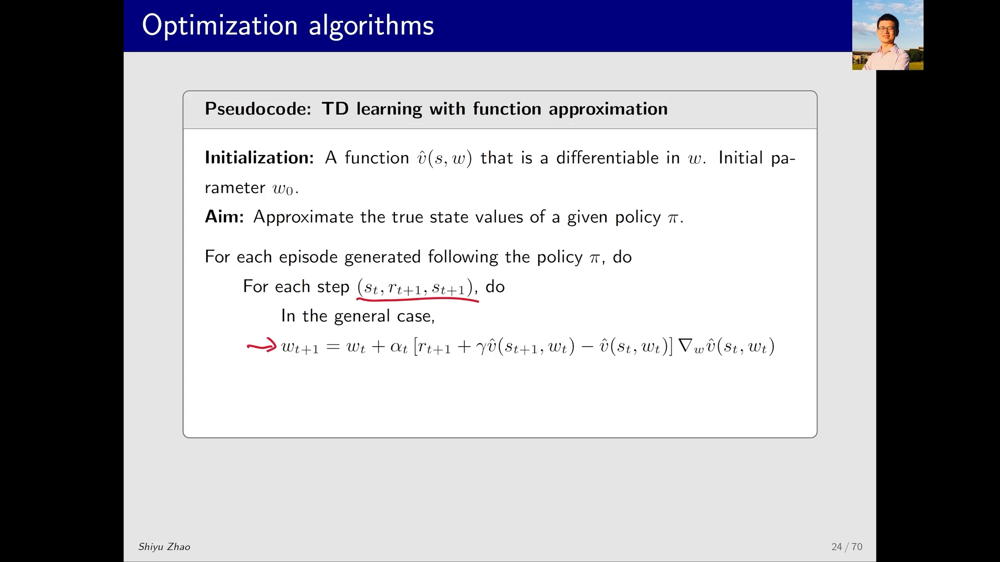

还有一点值得强调：这套算法**仍然只是在做策略评估**——给它一个策略 $\pi$，它估出这个策略的状态价值。要到估动作价值 $\hat{q}(s,a,w)$、再和策略改进结合去搜索最优策略，是后面几节的事。

[【跳转到 02:05】](https://www.bilibili.com/video/BV1PM411C7jQ/?t=130) · [【跳转到 03:25】](https://www.bilibili.com/video/BV1PM411C7jQ/?t=205)

---

## 三、函数选择：线性函数加特征向量

优化算法讲完，讲者回头补上一个此前一直悬着的问题：$\hat{v}(s,w)$ 到底怎么选？主流有两条路线。

**路线一（过去广泛使用）：线性函数。**

$$
\hat{v}(s,w) = \phi^{T}(s)\, w
$$

$\phi(s)$ 是状态 $s$ 的**特征向量（feature vector）**，$w$ 是参数向量。说它「线性」，指的是**对 $w$ 线性**——$\phi(s)$ 里可以塞进 $s$ 的任意非线性变换（上一篇那条抛物线里的 $s^2$ 就是这么来的）。

**路线二（现在广泛使用）：神经网络。** 不显式写出函数表达式，而是把状态 $s$ 喂进网络，网络输出 $\hat{v}(s,w)$，$w$ 是网络参数。此时 $\hat{v}$ 对 $w$ 是**非线性**的。

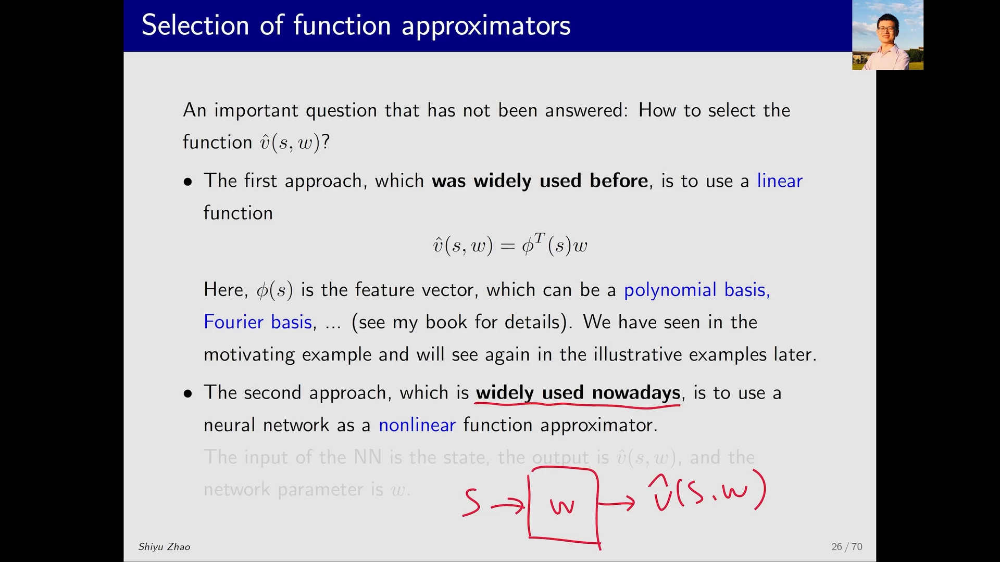

线性路线的关键工程问题是**特征向量怎么设计**。常见选择有**多项式基（polynomial basis）**、**傅里叶基（Fourier basis）**等；讲者把细节留给了教材，课程里只通过例子演示「阶数越高、拟合能力越强」。

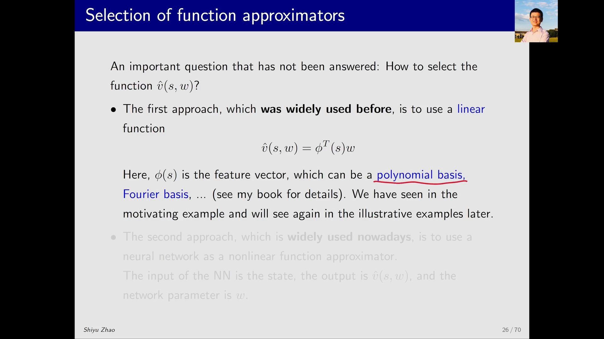

### 3.1 线性情形下，梯度就是特征向量

线性函数有一个极其漂亮的性质：对 $w$ 求梯度，$\phi(s)$ 是常数系数，直接掉出来：

$$
\nabla_w \hat{v}(s,w) = \phi(s)
$$

把它代回前面的 TD 更新式，并把两处 $\hat{v}$ 也展开成 $\phi^{T}w$：

$$
w_{t+1} = w_t + \alpha_t\big[r_{t+1} + \gamma \phi^{T}(s_{t+1})w_t - \phi^{T}(s_t)w_t\big]\phi(s_t)
$$

这个算法在课程里被命名为 **TD-Linear**。它的计算量小得惊人：不需要对函数求导，只要算两次内积、一次标量乘法、一次向量加法。

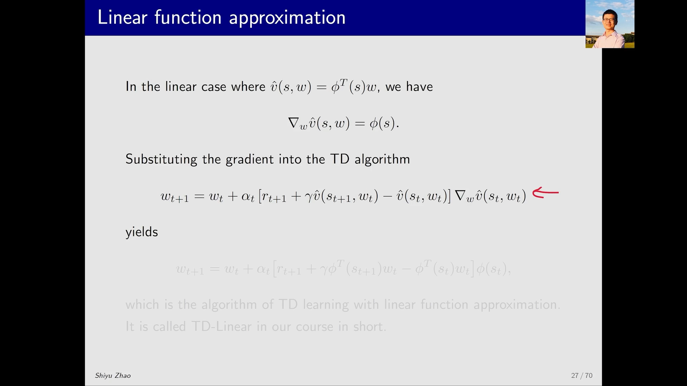

[【跳转到 04:15】](https://www.bilibili.com/video/BV1PM411C7jQ/?t=255) · [【跳转到 07:35】](https://www.bilibili.com/video/BV1PM411C7jQ/?t=455)

---

## 四、线性函数近似的优劣势

### 4.1 劣势：特征向量难选，这是它被神经网络取代的主因

线性函数近似最大的短板不是「表达力弱」，而是**特征向量要靠人来设计**。设计得好不好，取决于你对问题有没有很好的理解；而很多时候即使理解得很好，也很难构造出鲁棒、够用的特征向量。

讲者给了一个类比：这和传统机器学习被深度学习取代是同一个原因——一旦特征要靠手工设计，人的先验就成了天花板。

### 4.2 优势一：理论性质能被真正分析

神经网络的理论性质很难分析，线性情形则好得多。这是研究上的通行策略：**一个难题很难直接理解，那就退一步先把一个简化版本理解透，再用它去理解复杂版本**。过去对线性函数近似的研究非常多、也比较透彻，理论结果不少（细节在教材里）。

### 4.3 优势二：表格法是线性函数近似的特例

第二个优势更有意思：线性函数近似并不「弱」，它把前面七课一直在用的表格法**收编成了自己的一个特例**。

做法是选一个极端的特征向量——**独热向量**：

$$
\phi(s) = e_s \in \mathbb{R}^{\lvert \mathcal{S}\rvert}
$$

$e_s$ 是一个只有第 $s$ 个分量为 $1$、其余全为 $0$ 的向量。代进 $\hat{v}(s,w) = \phi^{T}(s)w = e_s^{T}w$，内积只挑出 $w$ 的第 $s$ 个分量：

$$
\hat{v}(s,w) = w(s)
$$

也就是说，参数向量 $w$ 直接**变成了一张表**：想查状态 $s$ 的价值，就去 $w$ 里取第 $s$ 个元素。

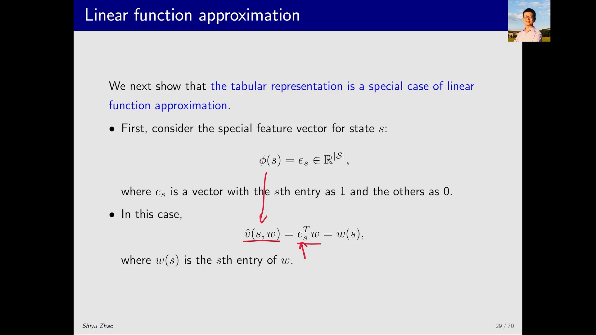

再把这个 $\phi(s_t) = e_{s_t}$ 代进 TD-Linear，算法退化成

$$
w_{t+1} = w_t + \alpha_t\big(r_{t+1} + \gamma w_t(s_{t+1}) - w_t(s_t)\big)e_{s_t}
$$

右边那个 $e_{s_t}$ 只有第 $s_t$ 个分量非零，所以**整个向量里只有第 $s_t$ 个元素被改动**，其余元素一动不动。把那个元素单独拎出来看，就是

$$
w_{t+1}(s_t) = w_t(s_t) + \alpha_t\big(r_{t+1} + \gamma w_t(s_{t+1}) - w_t(s_t)\big)
$$

这正是前面几课的**表格版 TD 算法**，只是把符号 $v$ 换成了 $w$。

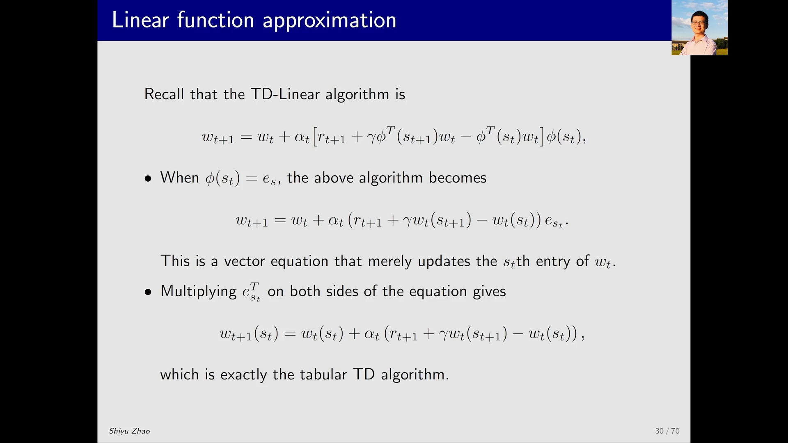

这个特例的价值不只是「好玩」：它说明**表格法不是另一套方法，而是函数近似在特征取独热时的极端情形**。特征取得越「粗」（比如 $[1,x,y]$），泛化越强、精度越低；取得越「细」（直到独热），泛化越弱、精度越高，最后完全退化成表格。上一篇讲的「省存储 vs 保精度」的权衡，在这里有了一个统一的坐标系。

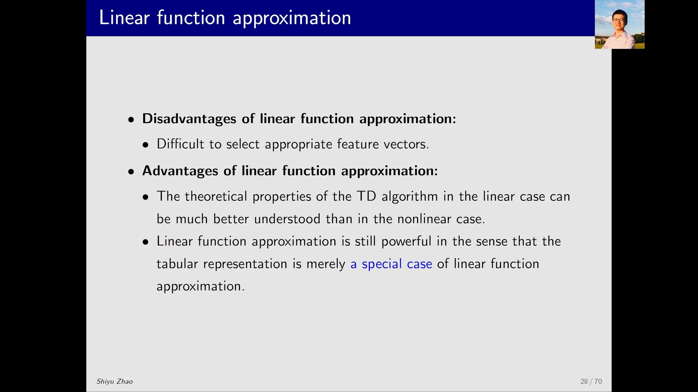

[【跳转到 08:00】](https://www.bilibili.com/video/BV1PM411C7jQ/?t=480) · [【跳转到 09:40】](https://www.bilibili.com/video/BV1PM411C7jQ/?t=580)

---

## 五、这一讲留下的一笔账：TD 版的梯度其实不是 $J(w)$ 的梯度

到这里，整条故事线是通的：目标函数 → 梯度下降 → 随机梯度 → 用 TD 目标替代 $v_\pi$ → TD-Linear。但这条故事线有一个不严谨的地方，讲者自己也点了出来：**「用 TD 目标替代 $v_\pi(s_t)$」这一步，在数学上并不能保证算法还在最小化原来那个 $J(w)$。**

原因不难体会：TD 目标 $r_{t+1} + \gamma \hat{v}(s_{t+1}, w_t)$ 里含着 $\hat{v}(s_{t+1}, w_t)$，它**依赖 $w$**；而我们在求梯度时把它当成了常数，只对 $\hat{v}(s_t,w_t)$ 求了导。这种「只对一半求导」的做法，在文献里被称为**半梯度（semi-gradient）**——严格来说它并不是任何目标函数的真梯度。

后果是：TD-Linear 收敛到的并不是 $J(w)$ 的最小点，而是另一个目标的解（课程给出的结论是 **projected Bellman error**，下一篇会展开）。这不影响算法可用，但影响你怎么理解它——**「梯度下降 + 替换 $v_\pi$」是一个帮助理解的脚手架，不是一份严格的证明**。

[【跳转到 04:40】](https://www.bilibili.com/video/BV1PM411C7jQ/?t=280)

---

## 小结

1. **优化算法只有一行**：$w_{k+1} = w_k - \alpha_k \nabla_w J(w_k)$；难点全在梯度怎么算。
2. **真实梯度含期望**，实际不可算，于是用**一次采样**代替期望，得到随机梯度下降；因子 $2$ 并进步长。
3. **SGD 式里还留着 $v_\pi(s_t)$**，必须替换：MC 用回报 $g_t$，TD 用 $r_{t+1} + \gamma \hat{v}(s_{t+1},w_t)$，后者就是 TD 误差。
4. **函数两条路线**：线性 $\hat{v} = \phi^{T}(s)w$（梯度就是 $\phi(s)$，得 TD-Linear）与神经网络（表达强、理论难）。
5. **线性近似的优劣势**：特征向量难设计是硬伤；但理论可分析，且**表格法只是特征取 $e_s$ 时的特例**。
6. **半梯度**：TD 版更新把 TD 目标当常数，并不真在最小化 $J(w)$——这是下一篇理论分析的入口。

## 关键术语速查

| 术语 | 一句话解释 |
| :-- | :-- |
| 梯度下降（gradient descent） | 沿负梯度方向小步更新参数，使目标函数下降 |
| 真实梯度（true gradient） | 对期望型目标函数求得的精确梯度，需知道状态分布，实际不可算 |
| 随机梯度下降（SGD） | 用一个采样状态的梯度代替期望梯度，单步有噪声但期望正确 |
| 特征向量（feature vector） | $\phi(s)$，把状态映射成一组数值，线性近似里充当 $w$ 的系数 |
| TD-Linear | 线性函数近似下的 TD 算法，梯度即 $\phi(s)$，更新只涉及内积 |
| 独热特征（one-hot feature） | $\phi(s) = e_s$，只有第 $s$ 个分量为 1；此时线性近似退化为表格法 |
| 半梯度（semi-gradient） | 把 TD 目标里的 $\hat{v}(s_{t+1},w)$ 当常数求导，并非真梯度 |