# 线性函数近似的实例与分析：用平面还是曲面拟合价值函数

> 本篇整理自赵世钰《强化学习的数学原理》第 8 课「值函数近似」Part 4：原理——示例与分析。视频地址：[BV1gK411Z7PT](https://www.bilibili.com/video/BV1gK411Z7PT/)。

## 本讲要解决的核心问题（SCQA）

**背景**：上一篇给出了 TD-Linear 算法——线性函数近似 $\hat{v}(s,w) = \phi^{T}(s)w$ 加上 TD 更新。公式都齐了，但公式对不对、好不好用，光看推导看不出来。

**冲突**：线性函数近似的能力完全取决于**特征向量怎么选**，而「怎么选」这件事没有通用答案。选得太简单（比如只用平面），复杂曲面的价值函数拟合不上；选得太复杂（阶数一路加），参数变多、逼近表格法，泛化优势又没了。更麻烦的是，上一篇那条「目标函数 → 梯度下降 → 替换 $v_\pi$ → TD」的故事线，讲者自己承认**在数学上并不严谨**。

**疑问**：特征阶数到底怎么影响拟合效果，有没有可量化的对比？如果故事线不严谨，那 TD-Linear 究竟在优化什么？

**回答（中心思想）**：在一个 5×5 的 grid-world 上做对照实验，把 25 个状态价值画成三维曲面，就能直接看到三件事：**TD-Table 能把误差压到 0**（因为它有 25 个自由参数）；**平面特征 $\phi = [1,x,y]$ 只能拟合出趋势、误差收敛到非零值**（真实曲面不是平面）；**升到二次 $\mathbb{R}^{6}$、三次 $\mathbb{R}^{10}$ 后拟合明显变好**。而理论上的答案是：TD-Linear 最小化的**不是**真正价值误差 $J_E$，而是**投影贝尔曼误差（projected Bellman error）$J_{PBE}$**——这才是它「不严谨」的确切含义。

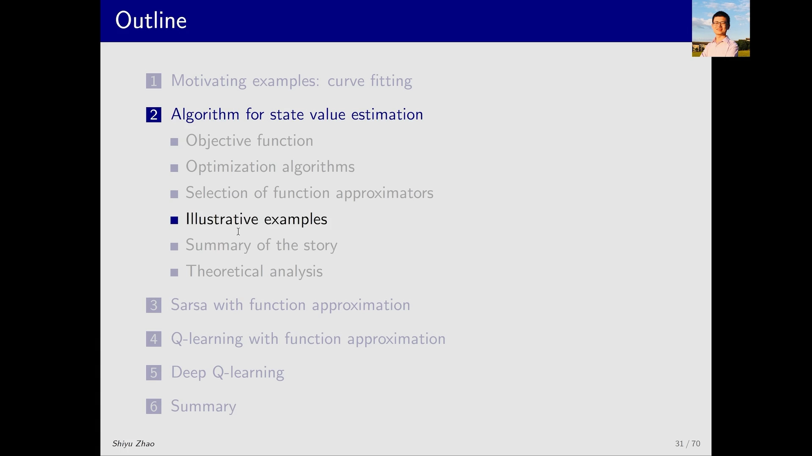

---

## 一、例子设定：25 个状态，一个纯探索策略

例子还是熟悉的 **grid-world**，但这次是 5×5 的网格，一共 **25 个状态**（行、列各标 1~5）。

**策略**：$\pi(a \mid s) = 0.2$ 对所有 $s, a$ 成立——也就是每个状态下 5 个动作等概率，一个**纯探索**的策略，没有偏好。

**奖励**：进入禁区（图中橙色格）或撞到边界得 $r = -1$，到达目标（蓝色格）得 $r = 1$，折扣因子 $\gamma = 0.9$。

**任务**：估计这个策略的状态价值，也就是对 25 个状态各算一个 $v_\pi(s)$。这本质上是一个 **policy evaluation（策略评估）** 问题。如果按表格法做，要存 25 个状态价值；下面要展示的是，**用少于 25 个参数也能比较好地近似它们**。

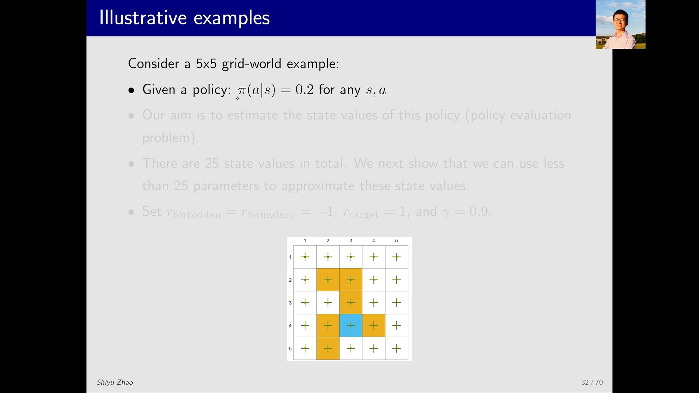

### 1.1 真值怎么来：先解贝尔曼方程

要判断近似得好不好，得先有标准答案。做法是**先用基于模型的方法求解贝尔曼公式**，得到 25 个精确的状态价值，再拿它和 TD-Linear 学出来的结果比。

这里有一个贯穿全讲的工具：**把二维的表格画成三维曲面**。横轴、纵轴对应表格的行与列，高度就是状态价值。图中最低的点在坐标 $(1,5)$，值是 $-4.5$——它也是全部状态价值里最小的那个。

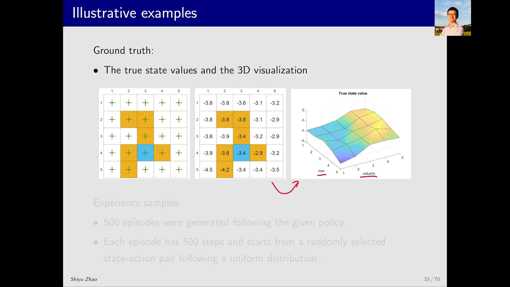

于是 TD-Linear 的目标可以一句话说清：**学一个函数，它对应的曲面要尽量贴近这张真实的复杂曲面。**

### 1.2 数据：500 个 episode，每个 500 步

无模型设定下没有转移概率可用，只能靠数据。例子生成了 **500 个 episode、每个 episode 500 步**，每个 episode 的起始 state-action pair 从均匀分布里随机抽取。

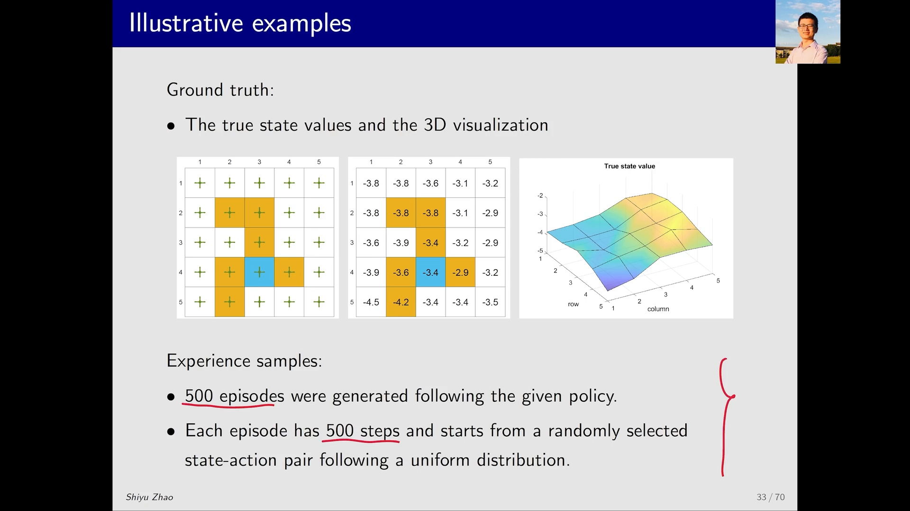

---

## 二、基准线：TD-Table 能把误差压到 0

先用数据跑一遍**表格版 TD（简称 TD-Table）**，看看数据本身够不够。

结果很干净：学出来的三维曲面和真实曲面几乎重合；右侧的误差曲线（纵轴是状态价值误差 RMSE，横轴是 episode 序号）随着 episode 增加单调下降，到 500 个 episode 时**基本降到 0**。

这个「降到 0」不奇怪——TD-Table 有 25 个可调参数，正好对应 25 个状态，只要数据足够，它当然能逐个拟合到真值。**它就是这一讲的参照系：误差能到 0 是什么样子。**

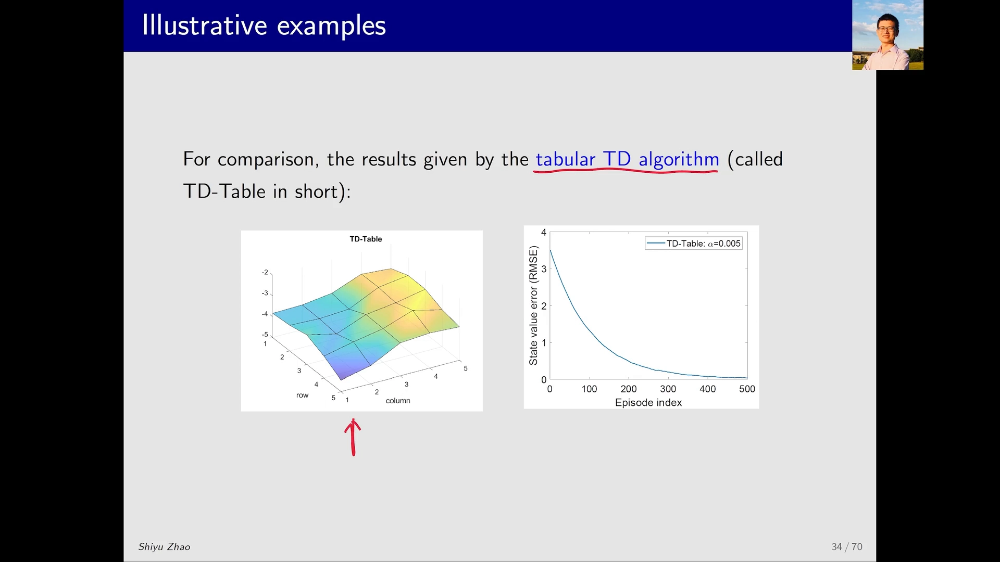

---

## 三、TD-Linear 第一版：用平面拟合，趋势对但误差不归零

### 3.1 特征向量取 $[1, x, y]$

思路顺着「函数对应曲面」来：最简单的曲面是**平面**，所以特征向量取

$$
\phi(s) = \begin{bmatrix} 1 \\ x \\ y \end{bmatrix} \in \mathbb{R}^{3}
$$

其中 $(x,y)$ 是状态的行、列坐标。此时

$$
\hat{v}(s,w) = \phi^{T}(s)w = w_1 + w_2 x + w_3 y
$$

这正是三维空间里的一个平面方程，$w_1, w_2, w_3$ 是它的三个参数。注意特征向量里元素的**顺序可以随意调整**（比如写成 $[x,y,1]^{T}$），不影响表达能力，只要和 $w$ 的分量一一对应即可。

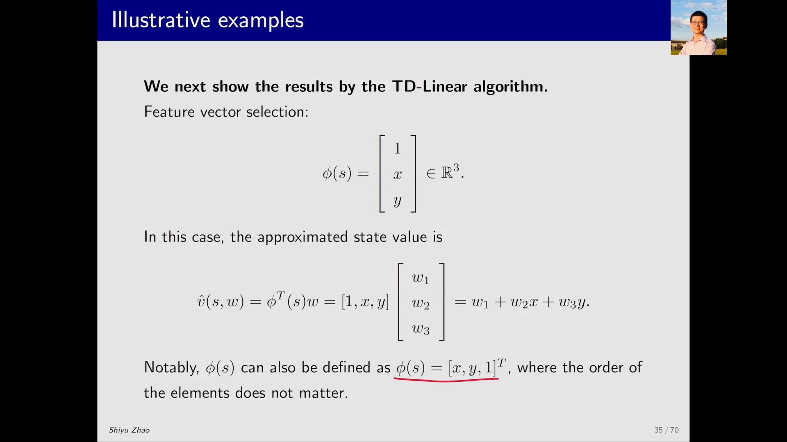

### 3.2 结果：趋势对，细节错，误差收敛到非零

把特征代进 TD-Linear 跑一遍，得到的曲面和真值放在一起对比：**趋势是对的**——左边（低价值区）都比较小，右边（高价值区）都比较大；但在很多具体点上，估计并不准确。

看误差曲线更能说明问题：它**收敛了，但收敛到一个明显大于 0 的值**。原因很直白——真实曲面是个复杂的起伏曲面，你非要用一个平面去拟合，怎么可能百分之百贴合？你只能找到**最优的那个平面**，而最优平面和真实曲面之间必然还差一块。

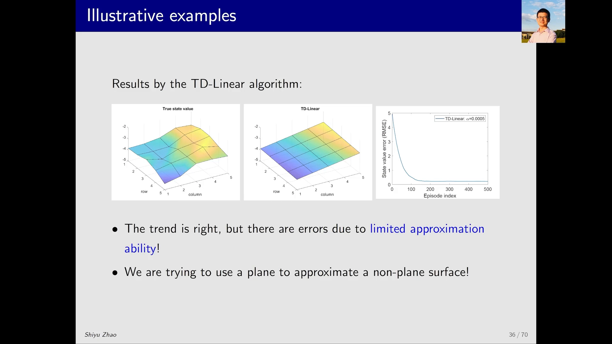

---

## 四、加高阶特征：从平面到二次、三次曲面

既然平面不够，就换更弯的曲面——**提高特征向量的阶数，同时增加参数个数**。

**二次曲面（$\mathbb{R}^{6}$）**：把 $x^2$、$y^2$、$xy$ 也放进特征向量：

$$
\phi(s) = \big[1,\ x,\ y,\ x^{2},\ y^{2},\ xy\big]^{T} \in \mathbb{R}^{6}
$$

$$
\hat{v}(s,w) = w_1 + w_2 x + w_3 y + w_4 x^{2} + w_5 y^{2} + w_6 xy
$$

这对应一个二次曲面，参数从 3 个涨到 6 个。

**三次曲面（$\mathbb{R}^{10}$）**：再把三次项也加进去：

$$
\phi(s) = \big[1,\ x,\ y,\ x^{2},\ y^{2},\ xy,\ x^{3},\ y^{3},\ x^{2}y,\ xy^{2}\big]^{T} \in \mathbb{R}^{10}
$$

参数变成 10 个，拟合能力理应更强。

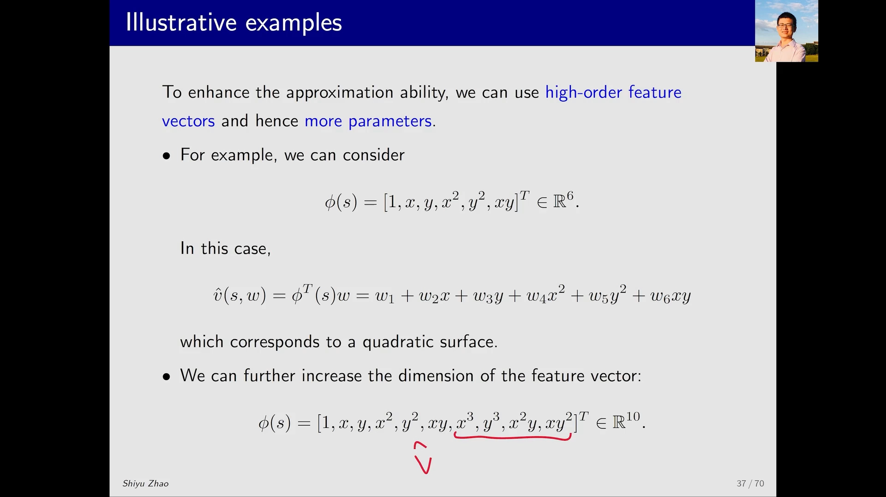

### 4.1 结果：阶数越高，越贴近真实曲面

把两组结果并排看（上排 $\mathbb{R}^{6}$，下排 $\mathbb{R}^{10}$）：

- 二次曲面：趋势正确，局部比平面好，误差收敛值明显变小；
- 三次曲面：肉眼上看已经和真实曲面**非常接近**，收敛后的误差也更小。

也就是说，**用更多参数确实换来了更好的拟合**——但这条路的尽头不是「无限好」。

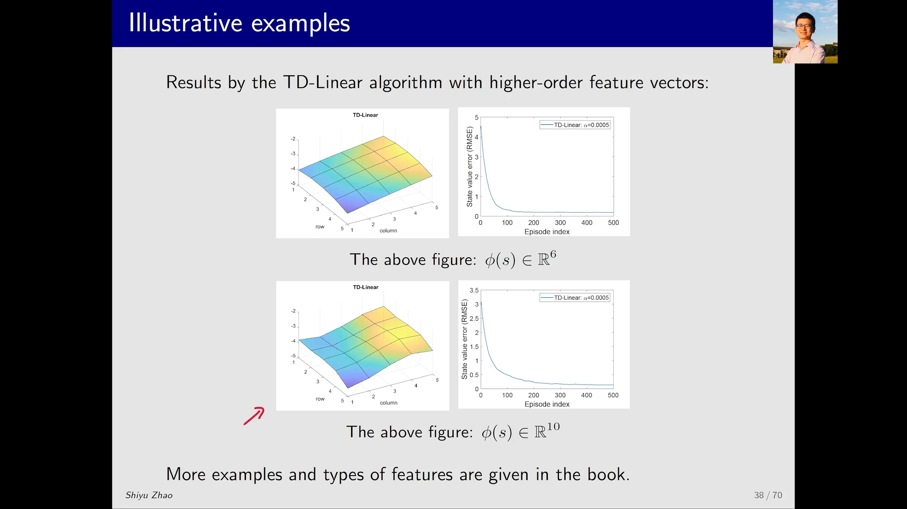

### 4.2 两个天花板：参数不能无限加，线性结构本身也有极限

讲者在这里点了两个 tradeoff，都很关键：

**第一，参数个数不能无限增加。** 加到最后，参数个数就等于状态数，那时它和表格法就没有区别了——**泛化优势消失，你只是用更贵的方式做了一张表**。

**第二，在 linear 的情形下，参数再多也不保证误差能到 0。** 因为函数的结构已经定死在那里了（$\phi^{T}w$ 只能张成特征所张成的那个空间），结构不够就永远差一块。这也是如今广泛使用神经网络的原因：**神经网络从理论上可以近似任意非线性函数**，结构上不再有这道天花板。

---

## 五、故事线小结：三步走，但第三步不严谨

例子讲完，讲者把整条推理链重新捋了一遍——这也是理解 value function approximation 最省力的路径：

1. **从目标函数出发**：$J(w) = \mathbb{E}\big[(v_\pi(S) - \hat{v}(S,w))^{2}\big]$，真实价值与估计价值之差的平方的加权平均；
2. **用梯度下降优化它**：$w_{t+1} = w_t + \alpha_t (v_\pi(s_t) - \hat{v}(s_t,w_t))\nabla_w \hat{v}(s_t,w_t)$；
3. **把未知的 $v_\pi$ 替换成可算的量**：得到 TD learning 与 value function approximation 相结合的算法。

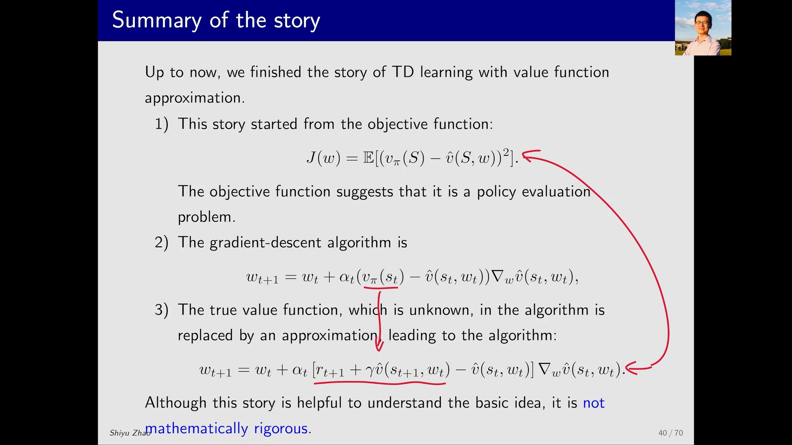

讲者对这条故事线的评价很坦诚：**它非常直观、非常有助于理解思路，但它在数学上并不严谨**——问题就出在第 3 步的「替换」上。如果不用这个故事，就得直接把那个真正被优化的目标函数摆出来，而那会复杂得多。所以对初学者，先掌握故事线即可；严格分析留给教材。

---

## 六、严格版本：TD-Linear 到底在最小化哪个目标？

那么「不严谨」的确切含义是什么？课程用两页 PPT 给了结论：**TD-Linear 最小化的不是 $J_E$，而是 $J_{PBE}$。** 中间还有一座桥——$J_{BE}$。三个目标函数排在一起看最清楚。

### 6.1 目标一：真实价值误差 $J_E$

就是前面一直在用的那个，可以写成向量形式：

$$
J_E(w) = \mathbb{E}\big[(v_\pi(S) - \hat{v}(S,w))^{2}\big] = \lVert \hat{v}(w) - v_\pi \rVert_{D}^{2}
$$

这里 $\lVert x \rVert_{D}^{2} = x^{T} D x$，$D$ 是对角矩阵，其对角元就是状态分布 $d_\pi$——**权重就是平稳分布**，和上一篇的结论一致。

### 6.2 目标二：贝尔曼误差 $J_{BE}$

换个角度想：我们希望 $\hat{v}$ 逼近 $v_\pi$，而 $v_\pi$ 满足贝尔曼方程 $v_\pi = r_\pi + \gamma P_\pi v_\pi$。如果 $\hat{v}$ 真的等于 $v_\pi$，那它也应该满足同一个式子：$\hat{v} = r_\pi + \gamma P_\pi \hat{v}$。把右边记成算子 $T_\pi(\hat{v}) \triangleq r_\pi + \gamma P_\pi \hat{v}$，那么两边之差就是**贝尔曼误差**：

$$
J_{BE}(w) = \lVert \hat{v}(w) - T_\pi(\hat{v}(w)) \rVert_{D}^{2}
$$

理论上这个差应该为 0；实际中不为 0，于是可以把它当成要最小化的对象。

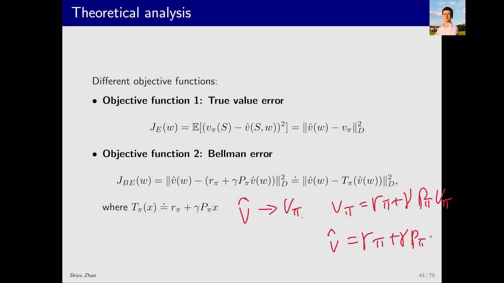

### 6.3 目标三：投影贝尔曼误差 $J_{PBE}$

$J_{BE}$ 还有一个麻烦：由于函数结构的限制（比如它只能是一个平面），$\hat{v}$ 可能**永远无法真正等于 $v_\pi$**，$J_{BE}$ 的最小值也就可能永远不为 0。解决办法是**先投影再比较**：

$$
J_{PBE}(w) = \lVert \hat{v}(w) - M T_\pi(\hat{v}(w)) \rVert_{D}^{2}
$$

其中 $M$ 是**投影矩阵（projection matrix）**。含义是：把 $T_\pi(\hat{v})$ 投影回「$\hat{v}$ 能表示的那个空间」（也就是 $w$ 变化所能张成的空间），再和 $\hat{v}$ 比差。在这个空间里，最优值就**可能**是 0 了。

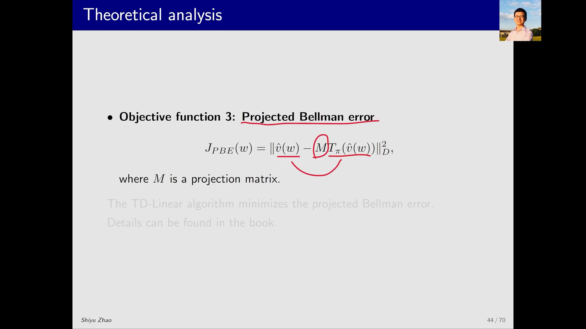

**结论**：TD-Linear 最小化的正是 $J_{PBE}$。这解释了为什么上一篇那条「梯度下降最小化 $J(w)$」的故事线讲得通却证不了——它替换 $v_\pi$ 之后，真正的优化目标已经悄悄换成了另一个。更深入的分析在教材里。

[【跳转到 08:50】](https://www.bilibili.com/video/BV1gK411Z7PT/?t=530) · [【跳转到 10:30】](https://www.bilibili.com/video/BV1gK411Z7PT/?t=630) · [【跳转到 12:10】](https://www.bilibili.com/video/BV1gK411Z7PT/?t=730)

---

## 小结

1. **实验设置**：5×5 grid-world、25 个状态、等概率探索策略；真值用基于模型的贝尔曼方程解出，再画成三维曲面做对照。
2. **TD-Table 是参照系**：25 个参数对应 25 个状态，数据够时误差能降到 0。
3. **平面特征 $\phi=[1,x,y]$ 只能拟合趋势**：误差收敛到非零值——用平面拟合非平面曲面，只能拿到「最优平面」。
4. **升阶有效**：$\mathbb{R}^{6}$（二次）与 $\mathbb{R}^{10}$（三次）特征让拟合明显变好，三次曲面肉眼已接近真值。
5. **两道天花板**：参数加到与状态数相当就退化成表格法；线性结构本身决定误差不可能归零——这正是神经网络取代线性近似的理由。
6. **严格结论**：TD-Linear 最小化的是**投影贝尔曼误差 $J_{PBE}$**，而不是真实价值误差 $J_E$；「目标函数 → 梯度下降 → 替换 $v_\pi$」只是便于理解的脚手架。

## 关键术语速查

| 术语 | 一句话解释 |
| :-- | :-- |
| 策略评估（policy evaluation） | 给定策略，估计它的状态价值；本例中即估 25 个 $v_\pi(s)$ |
| TD-Table | 表格版 TD，每个状态一个自由参数，误差可降到 0 |
| 特征阶数 | 特征向量里 $x,y$ 的最高次幂，决定近似曲面是平面、二次还是三次曲面 |
| 真实价值误差 $J_E$ | 估计价值与真实价值之差的加权平方和，权重为平稳分布 |
| 贝尔曼误差 $J_{BE}$ | $\hat{v}$ 与贝尔曼备份 $T_\pi(\hat{v})$ 之差；结构受限时其最小值可能不为 0 |
| 投影贝尔曼误差 $J_{PBE}$ | 把 $T_\pi(\hat{v})$ 投影回 $\hat{v}$ 可表示的空间后再比较；TD-Linear 真正最小化的目标 |