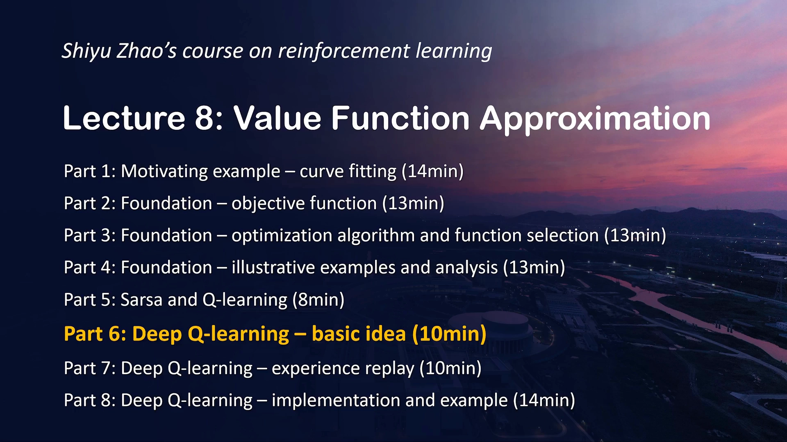
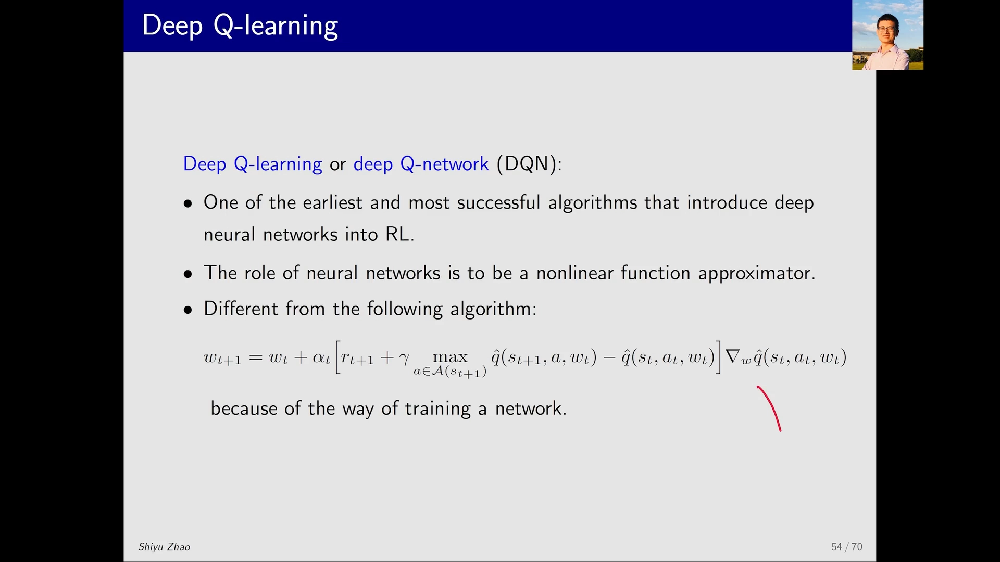
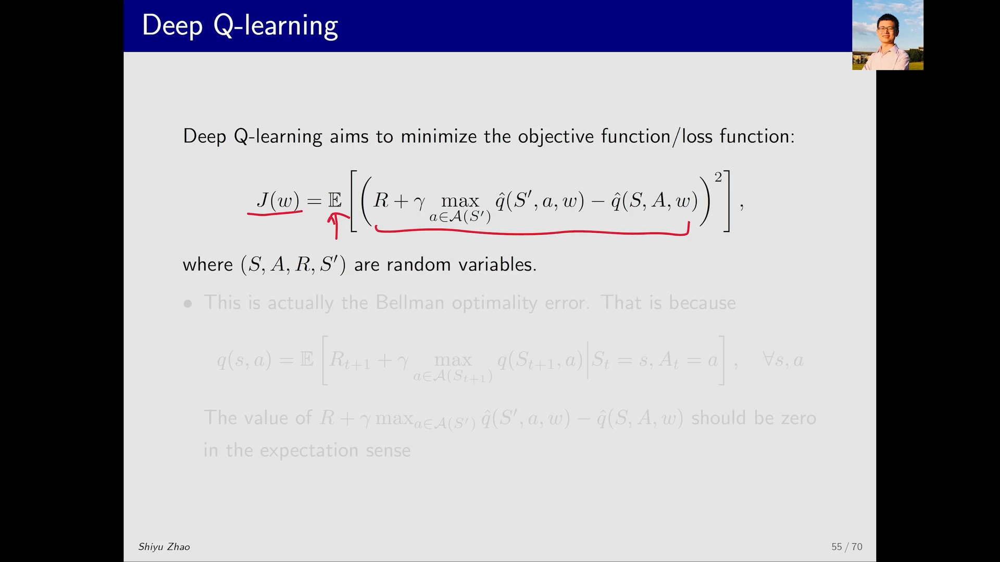
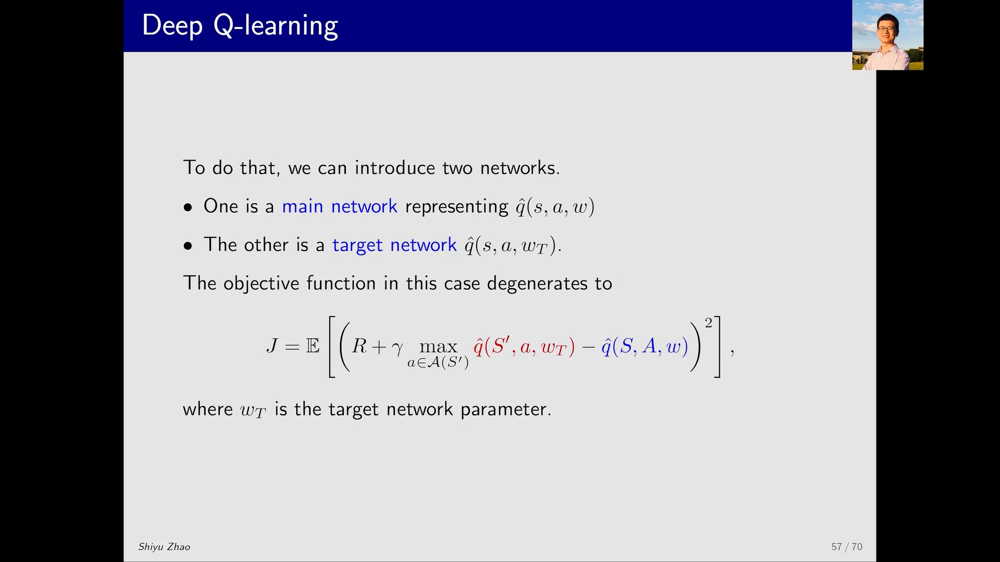
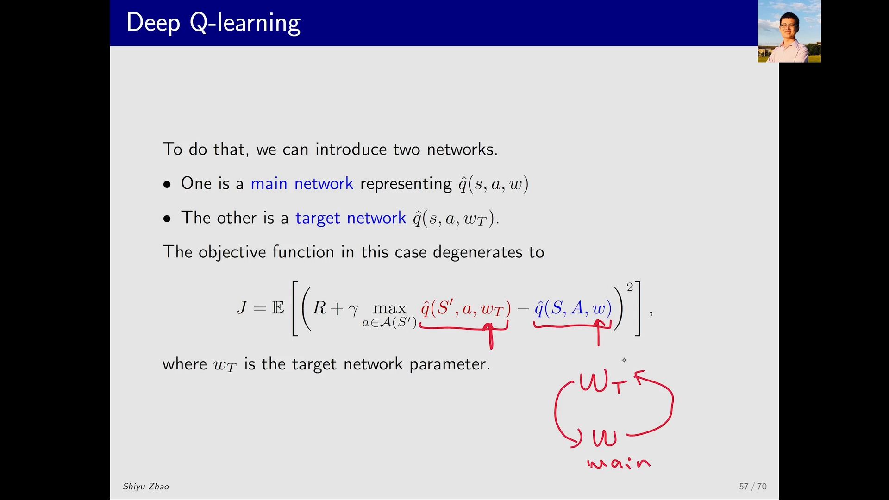
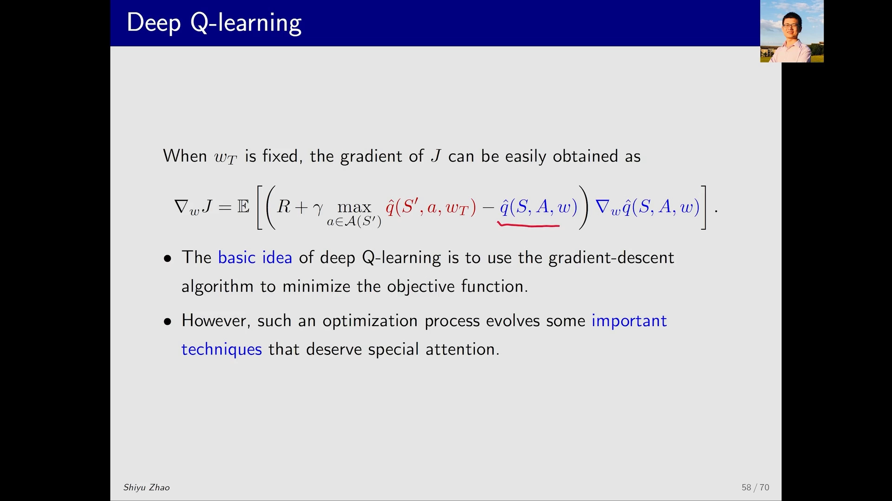
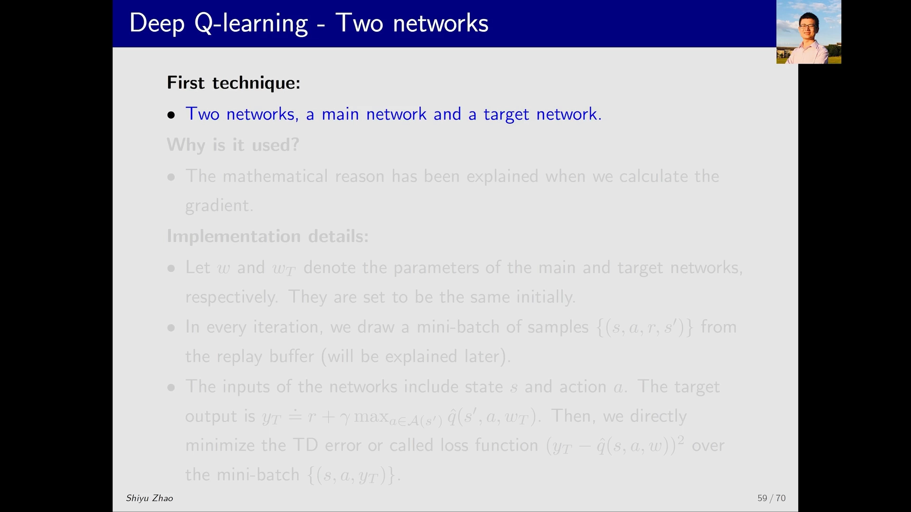

# DQN 基本原理：为什么需要「主网络 + 目标网络」两套参数

> 本篇整理自赵世钰《强化学习的数学原理》第 8 课「值函数近似」Part 6：Deep Q-learning — basic idea。视频地址：[BV1tt4y1N7iJ](https://www.bilibili.com/video/BV1tt4y1N7iJ/)。同一条目下的另一篇《经验回放：为什么必须打乱样本顺序》整理自 Part 7，两篇合起来才是完整的 DQN。

## 本讲要解决的核心问题（SCQA）

**背景**：6.1 节已经把价值函数从一张表换成了带参数的函数 $\hat{v}(s,w)$，第 8 课 Part 5 又把 Q-Learning 推广成了「带函数近似的 Q-Learning」，更新式长这样：

$$
w_{t+1} = w_t + \alpha_t\Big[\, r_{t+1} + \gamma \max_{a\in\mathcal{A}(s_{t+1})} \hat{q}(s_{t+1}, a, w_t) - \hat{q}(s_t, a_t, w_t) \,\Big]\nabla_w \hat{q}(s_t, a_t, w_t)
$$

**冲突**：这个式子本身没有错，但它要求你**亲手算出梯度、亲手给参数赋值**——也就是你必须自己实现神经网络的底层运算。而今天的深度学习工具包早就把这件事包成了一个黑盒：你把数据喂进去，它自己会选合适的算法把参数训好。既然如此，为什么还要另发明一个 DQN？

**疑问**：能不能不再写「带梯度的更新式」，而是像训练普通神经网络那样——**定义一个损失函数，交给优化器去最小化**？如果这样做，Q-Learning 的那套写法要改哪里？

**回答（中心思想）**：能，DQN 就是这件事的答案。它把 Q-Learning 的 TD 误差写成一个**均方误差形式的目标函数** $J(w)$，然后用梯度下降最小化它。但这里冒出一个技术难题：$J(w)$ 里 $w$ 出现了**两次**（一次在预测值里，一次在 TD 目标里），直接求梯度既复杂又会让目标跟着参数一起动。DQN 的解法是引入**两套参数**——主网络（main network）的参数 $w$ 一直更新，目标网络（target network）的参数 $w_T$ 隔一段时间才从 $w$ 复制一次。这就是 DQN 的第一个稳定化技巧：**目标网络**。

---

## 一、DQN 的定位：把神经网络当成一个非线性函数近似器

DQN 的全称是 **Deep Q-Network**（原论文里的叫法），也常写作 **Deep Q-Learning**。课程里偏好后者，因为它点明了本质：**它是 Q-Learning 的一个变种**，而不是一个全新的算法。

它有两个历史地位：

- **最早、也最成功**地把深度神经网络引入强化学习的算法之一。注意「之一」——在它之前已经有人这么做过，但都不太成功；
- 它的成功体现在两处：**应用**上，它在一系列游戏控制任务上达到了人类水平；**方法**上，它用到的几个关键技术后来被大量后续算法沿用。

神经网络在这里的角色，讲者说得很朴素：**它就是一个非线性函数（nonlinear function）**。前面几节讨论的「函数」可以是直线、可以是特征向量的线性组合，而神经网络只是这个位置上又一个候选者——只不过它的表达能力更强。

[【跳转到 00:30】](https://www.bilibili.com/video/BV1tt4y1N7iJ/?t=30) · [【跳转到 01:20】](https://www.bilibili.com/video/BV1tt4y1N7iJ/?t=80)

---

## 二、为什么不能直接用「带函数近似的 Q-Learning」

这是本讲最容易被跳过、但最该想清楚的一步。既然 Part 5 已经给了带函数近似的 Q-Learning 更新式，为什么还要 DQN？

**原因不是数学上不成立，而是工程上不该这么写。** 用那个式子，意味着你要对一个神经网络做非常底层的操作：算出它关于参数的梯度，然后**直接赋值**去修改参数。而现实是，神经网络的训练工具已经非常成熟——对绝大多数使用者来说它就是个黑盒，数据送进去，它自己会挑合适的参数与底层算法把网络训好。

所以 DQN 换了一个接口：**不再写「参数怎么更新」，而是写「要最小化什么」**。一旦写成损失函数，剩下的交给优化器。

这个转变看起来只是写法问题，实际上决定了后面所有技巧的形态——因为一旦用「最小化期望损失」的语言来描述 Q-Learning，就不得不回答「这个期望是对谁的期望、样本从哪来」这类问题。经验回放正是被这个问题逼出来的（见同条目的另一篇）。

---

## 三、目标函数：把贝尔曼最优方程写成一个均方误差

DQN 要最小化的目标函数是

$$
J(w) = \mathbb{E}\left[\left( R + \gamma \max_{a\in\mathcal{A}(S')} \hat{q}(S', a, w) - \hat{q}(S, A, w) \right)^2\right]
$$

其中 $S, A, R, S'$ 都是**随机变量**（大写字母表示随机变量，小写表示具体取值）。

这个式子为什么长这样？讲者给的理由只有一句：**方括号里那一项，就是 Q-Learning 的 TD 目标减去当前估计，也就是贝尔曼最优性误差（Bellman optimality error）**。

把这句话展开，逻辑是这样的。最优动作价值满足贝尔曼最优方程：

$$
q(s,a) = \mathbb{E}\left[ R_{t+1} + \gamma \max_{a\in\mathcal{A}(S_{t+1})} q(S_{t+1}, a) \;\middle|\; S_t = s,\ A_t = a \right], \qquad \forall s, a
$$

也就是说，**如果 $\hat{q}$ 已经是最优的**，那么「$r + \gamma \max \hat{q}(s',\cdot)$」与「$\hat{q}(s,a)$」在期望意义下应该**相等**，两者之差应该为 0——误差为零。既然最优解对应误差为零，那么「让误差的平方尽量小」就是一个合理的目标。这就是选择这个损失函数的全部理由。

这里有个细节值得记住：**平方是套在期望外面的**，即 $\mathbb{E}[(\cdot)^2]$，而不是 $(\mathbb{E}[\cdot])^2$。它衡量的是「每一对 $(s,a)$ 上的偏差有多大」，而不是「平均偏差有多大」——后者会因为正负抵消而给出虚假的零。

[【跳转到 02:35】](https://www.bilibili.com/video/BV1tt4y1N7iJ/?t=155) · [【跳转到 03:00】](https://www.bilibili.com/video/BV1tt4y1N7iJ/?t=180)

---

## 四、真正的难点：$w$ 在目标函数里出现了两次

有了目标函数，下一步自然是梯度下降。但**怎么算这个梯度**，讲者的原话是「有点 tricky」——而这正是 DQN 的核心贡献所在。

看 $J(w)$ 的括号内部：$w$ 出现在**两个地方**。

- 一处是 $\hat{q}(S,A,w)$，这是**当前估计**，对 $w$ 求梯度天经地义；
- 另一处是 $\gamma \max_{a}\hat{q}(S',a,w)$，它藏在 **TD 目标**里。如果记

$$
y \doteq R + \gamma \max_{a\in\mathcal{A}(S')} \hat{q}(S', a, w)
$$

那么 $y$ 里也含 $w$。

这就麻烦了。如果老老实实对两项都求导，梯度表达式会非常复杂；更本质的问题是：**你一边用 $w$ 算目标、一边又用这个目标去改 $w$，等于在追一个自己也在跑的目标**。目标随参数同步移动，训练就没有一个稳定的落点。

DQN 的处理办法是「先假装它不动」：**假设 $y$ 里的 $w$ 是一个常数**（至少在一段时间内是常数）。这样一来，$J$ 就只对「预测值里的那个 $w$」求导，梯度立刻变得干净。

---

## 五、两套网络：主网络负责预测，目标网络负责提供目标

「假设目标里的参数是常数」这句话，在代码里怎么实现？答案是**用两个网络**：

- **主网络（main network）**：$\hat{q}(s,a,w)$，参数 $w$ 一直在更新，有新样本进来就更新；
- **目标网络（target network）**：$\hat{q}(s,a,w_T)$，参数 $w_T$ 不常更新，隔一段时间才把主网络的 $w$ **赋值**过来。

把目标函数里两处 $\hat{q}$ 分别换成这两个网络，就得到 DQN 实际优化的目标：

$$
J = \mathbb{E}\left[\left( R + \gamma \max_{a\in\mathcal{A}(S')} \hat{q}(S', a, w_T) - \hat{q}(S, A, w) \right)^2\right]
$$

其中 $w_T$ 是目标网络的参数。

### 5.1 为什么「固定一个」不算耍赖

看到这里最自然的质疑是：**本来那里就是 $w$，你把它当成常数固定住，这显然不对啊？**

讲者对这个质疑的回答，是整节课里最值得琢磨的一段逻辑：

1. 先假设有一个 $w_T$ **保持不动**，在这个前提下更新 $w$；
2. 更新一段时间，得到一个**新的 $w$**（这是主网络的参数）；
3. 把新的 $w$ **赋值给** $w_T$；
4. 在新的 $w_T$ 保持不动的前提下，继续更新 $w$。

也就是说，「固定」不是永久的，而是**交替进行**：固定—更新—同步—再固定—再更新。讲者的结论是：**这样交替下去，$w_T$ 和 $w$ 最终都能收敛到最优值**。

这个思路在数值方法里并不陌生：把一个「两边都带未知量」的方程拆成两半，先冻结一半、解另一半，再交换。冻结的那一半相当于给优化过程一个**短期不变的靶子**，靶子不动，梯度方向才有意义；靶子隔一段时间才挪一次，挪的又是自己最新的位置，于是整体仍然朝着正确的方向走。

### 5.2 梯度长什么样

当 $w_T$ 固定时，$J$ 对 $w$ 的梯度很容易写出来：

$$
\nabla_w J = \mathbb{E}\left[\left( R + \gamma \max_{a\in\mathcal{A}(S')} \hat{q}(S', a, w_T) - \hat{q}(S, A, w) \right)\nabla_w \hat{q}(S, A, w)\right]
$$

注意这个式子的结构：**括号里那个「TD 误差」被当成了一个标量系数，只有最后那个 $\nabla_w\hat{q}(S,A,w)$ 带梯度**。目标网络那一项（红色）**完全不产生梯度**。

这正是「半梯度（semi-gradient）」这个名字的来历——它只对目标函数的一半求了真正的梯度，另一半被当作常数。前面讲线性函数近似时，那个带着 $\nabla_w\hat{v}(s,w)$ 的更新式其实也是半梯度，只是当时没有点破；到了 DQN，这个「假装目标不动」的做法被显式地实现成了**两个网络**。

[【跳转到 05:05】](https://www.bilibili.com/video/BV1tt4y1N7iJ/?t=305) · [【跳转到 05:55】](https://www.bilibili.com/video/BV1tt4y1N7iJ/?t=355) · [【跳转到 06:45】](https://www.bilibili.com/video/BV1tt4y1N7iJ/?t=405)

---

## 六、实现细节：一次迭代到底做了什么

把上面的东西拼起来，DQN 的一次迭代是这样的：

1. $w$ 是主网络参数，$w_T$ 是目标网络参数，**初始时两者相同**；
2. 每一次迭代，从**回放缓冲区（replay buffer）**里抽一个**小批量（mini-batch）**样本 $\{(s,a,r,s')\}$；
3. 用**目标网络**算出每个样本的目标值

$$
y_T \doteq r + \gamma \max_{a\in\mathcal{A}(s')} \hat{q}(s', a, w_T)
$$

4. 把 $\{(s,a,y_T)\}$ 这一批数据送进主网络，直接最小化 TD 误差（也就是损失函数）$\big(y_T - \hat{q}(s,a,w)\big)^2$；
5. 训练一段时间后，把主网络的参数复制给目标网络：$w_T \leftarrow w$，然后回到第 2 步。

这里有两个「工程上很关键、数学上很朴素」的点：

- **第 3 步和第 4 步用的是不同的网络**。$y_T$ 由 $w_T$ 算出，训练只动 $w$。所以第 4 步就是一个**普通的监督学习问题**：输入 $(s,a)$、标签 $y_T$、损失是平方误差。任何深度学习框架都能直接做，不需要你手写梯度。
- **第 5 步的同步频率是一个超参数**。视频里只说「隔一段时间之后」把 $w$ 赋给 $w_T$，并没有给固定值。可以顺着这个逻辑推一下：同步太频繁，目标网络就退化成主网络，「固定」等于没做；同步太稀疏，目标值又太久不更新，学得慢。

[【跳转到 07:35】](https://www.bilibili.com/video/BV1tt4y1N7iJ/?t=455) · [【跳转到 08:25】](https://www.bilibili.com/video/BV1tt4y1N7iJ/?t=505) · [【跳转到 09:15】](https://www.bilibili.com/video/BV1tt4y1N7iJ/?t=555)

---

## 小结

- **DQN = 用损失函数语言重写的 Q-Learning**。它不再手写参数更新式，而是定义 $J(w)$ 交给优化器，这样就能直接借用成熟的神经网络工具包。
- **目标函数就是贝尔曼最优性误差的平方**：$J(w)=\mathbb{E}\big[(r+\gamma\max_{a}\hat{q}(s',a,w)-\hat{q}(s,a,w))^2\big]$。最优时该误差在期望意义下为 0，所以最小化它是合理的。
- **难点是 $w$ 出现了两次**：既在预测值里，又在 TD 目标 $y$ 里。直接求梯度复杂，且目标会跟着参数一起动。
- **解法是两套网络**：主网络参数 $w$ 持续更新，目标网络参数 $w_T$ 隔一段时间才从 $w$ 复制。于是 $J$ 对 $w$ 的梯度里只有预测值那一项带梯度，$w_T$ 那一项被当作常数。
- **「固定」是交替的**：固定 $w_T$ → 更新 $w$ → 把 $w$ 赋给 $w_T$ → 再固定……讲者的结论是两者最终都能收敛到最优值。
- **一次迭代 = 抽 mini-batch → 用目标网络算 $y_T$ → 用 $(s,a,y_T)$ 训练主网络 → 定期同步参数**。注意第 2 步的样本来自回放缓冲区，这正是下一篇要讲的技巧。

## 关键术语速查

| 术语 | 一句话解释 |
| :-- | :-- |
| DQN（Deep Q-Network） | 用深度神经网络近似最优动作价值 $q_*(s,a)$ 的 Q-Learning 变种 |
| 目标函数 / 损失函数 $J(w)$ | DQN 要最小化的量，等于贝尔曼最优性误差的平方的期望 |
| 贝尔曼最优性误差 | 「TD 目标」与「当前估计」之差；最优时在期望意义下为 0 |
| 主网络（main network） | 参数为 $w$、持续被更新的那个网络，负责给出预测值 $\hat{q}(s,a,w)$ |
| 目标网络（target network） | 参数为 $w_T$、隔一段时间才从 $w$ 复制一次的网络，负责给出 TD 目标 |
| TD 目标 $y_T$ | $r + \gamma\max_{a\in\mathcal{A}(s')}\hat{q}(s',a,w_T)$，由目标网络计算，训练时视为常数 |
| 半梯度（semi-gradient） | 只对目标函数中「预测值」那一半求真实梯度，另一半当常数 |
| 回放缓冲区（replay buffer） | 存放历史经验样本 $(s,a,r,s')$ 的集合，训练时从中随机抽样 |
| mini-batch | 每次迭代从回放缓冲区里随机抽出的一小批样本 |